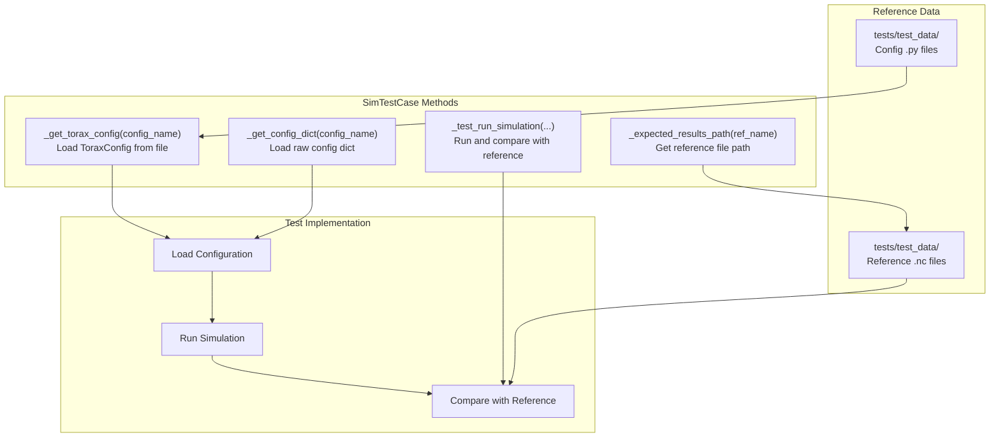
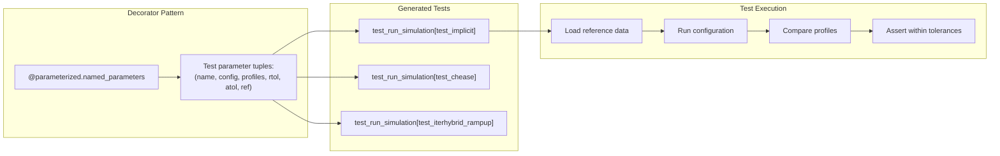
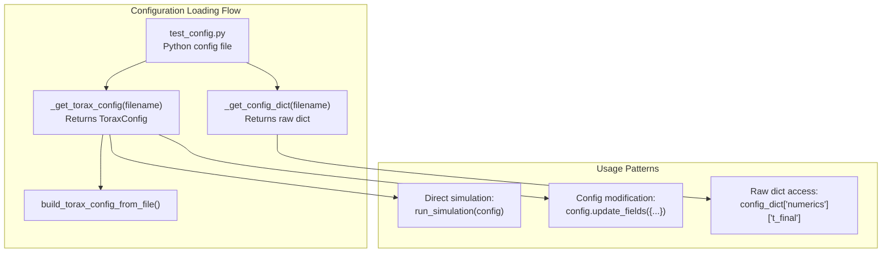

<!-- source: DeepWiki mcp.deepwiki.com · repo google-deepmind/torax · page 10.2 Testing Framework and Best Practices · fetched 2026-10-26 -->

# Testing Framework and Best Practices

<details>
<summary>Relevant source files</summary>

The following files were used as context for generating this wiki page:

- [.github/workflows/pytest.yml](.github/workflows/pytest.yml)
- [README.md](README.md)
- [docs/installation.rst](docs/installation.rst)
- [pyproject.toml](pyproject.toml)
- [torax/__init__.py](torax/__init__.py)
- [torax/tests/sim_test.py](torax/tests/sim_test.py)

</details>


This document provides practical guidance for developers writing tests in TORAX. It covers the patterns and utilities for creating integration tests, comparing against reference data, and maintaining test fixtures. For information about the CI/CD infrastructure and test execution mechanics, see [Integration Tests](#8.1) and [CI/CD Pipeline](#8.3).

## Overview

TORAX testing emphasizes comprehensive integration tests that validate complete simulation workflows against reference data. The testing approach is designed around:

- **Reference-based validation**: Comparing simulation outputs to pre-computed reference NetCDF files
- **Parameterized test generation**: Systematically testing multiple configurations with minimal boilerplate
- **Physics-aware tolerances**: Using appropriate numerical tolerances for different physical quantities
- **JAX-compatible testing**: Handling JIT compilation, static arguments, and numerical precision in tests

The primary test framework class is `SimTestCase`, which provides utilities for configuration loading, simulation execution, and reference data comparison.

**Sources:** [torax/tests/sim_test.py:15-52]()

## Writing Integration Tests

Integration tests in TORAX inherit from the `SimTestCase` base class, which provides essential utilities for configuration loading and reference comparison. The typical pattern uses parameterized tests to systematically validate multiple simulation scenarios.

### SimTestCase Base Class

The `SimTestCase` class from [torax/_src/test_utils/sim_test_case.py]() provides core testing functionality:



Key methods provided by `SimTestCase`:

| Method | Purpose | Returns |
|--------|---------|---------|
| `_get_torax_config(config_name)` | Load validated `ToraxConfig` from Python file | `ToraxConfig` |
| `_get_config_dict(config_name)` | Load raw configuration dictionary | `dict` |
| `_test_run_simulation(...)` | Execute simulation and compare with reference | None (assertions) |
| `_expected_results_path(ref_name)` | Get path to reference NetCDF file | `str` |

**Sources:** [torax/tests/sim_test.py:50-52](), [torax/_src/test_utils/sim_test_case.py]()

### Parameterized Test Pattern

The standard pattern for integration tests uses the `@parameterized.named_parameters` decorator to generate individual test methods:



Example parameterized test structure from [torax/tests/sim_test.py:53-324]():

```python
@parameterized.named_parameters(
    # Basic solver tests
    ('test_implicit', 'test_implicit.py'),
    ('test_crank_nicolson', 'test_crank_nicolson.py', (output.T_I, output.T_E), 2e-1, 0, 'test_implicit.nc'),
    
    # Transport model tests
    ('test_bohmgyrobohm_all', 'test_bohmgyrobohm_all.py'),
    ('test_combined_transport', 'test_combined_transport.py'),
    
    # ITER scenario tests
    ('test_iterhybrid_rampup', 'test_iterhybrid_rampup.py'),
    ('test_iterhybrid_predictor_corrector', 'test_iterhybrid_predictor_corrector.py'),
)
def test_run_simulation(
    self,
    config_name: str,
    profiles: Sequence[str] = _ALL_PROFILES,
    rtol: float | None = None,
    atol: float | None = None,
    ref_name: str | None = None,
):
    """Integration test comparing to reference output from TORAX."""
    self._test_run_simulation(
        config_name,
        profiles,
        rtol=rtol,
        atol=atol,
        ref_name=ref_name,
    )
```

**Parameter meanings:**

| Parameter | Type | Purpose | Default |
|-----------|------|---------|---------|
| `config_name` | `str` | Python config file name (e.g., `'test_implicit.py'`) | Required |
| `profiles` | `Sequence[str]` | Profile names to compare (e.g., `output.T_I`, `output.T_E`) | `_ALL_PROFILES` |
| `rtol` | `float \| None` | Relative tolerance for comparison | Test-specific default |
| `atol` | `float \| None` | Absolute tolerance for comparison | Test-specific default |
| `ref_name` | `str \| None` | Reference file name if different from config name | `{config_name}.nc` |

**Sources:** [torax/tests/sim_test.py:53-343]()

## Test Fixtures and Utilities

### Configuration Loading

`SimTestCase` provides multiple methods for loading test configurations:



**Example: Loading and modifying configuration**

From [torax/tests/sim_test.py:357-381]():

```python
def test_no_op(self):
    """Tests that running the solver with all equations off is a no-op."""
    torax_config = self._get_torax_config('test_iterhybrid_rampup.py')
    torax_config.update_fields({
        'numerics': {
            't_final': 0.1,
            'fixed_dt': 0.06,
            'evolve_ion_heat': False,
            'evolve_electron_heat': False,
            'evolve_current': False,
            'evolve_density': False,
        },
    })
    _, history = run_simulation.run_simulation(torax_config, progress_bar=False)
```

**Sources:** [torax/tests/sim_test.py:357-419]()

### Reference File Handling

The framework manages reference data through standardized file paths:

| Utility | Purpose | Location |
|---------|---------|----------|
| `paths.test_data_dir()` | Get test data directory path | [torax/_src/test_utils/paths.py]() |
| `_expected_results_path(ref_name)` | Construct path to reference NetCDF file | `SimTestCase` method |
| `output.load_state_file(path)` | Load reference xarray DataTree | [torax/_src/output_tools/output.py]() |

**Example: Custom reference file comparison**

From [torax/tests/sim_test.py:426-451]():

```python
def test_simulation_with_restart(self, test_config: str):
    ref_name = test_config + '.nc'
    output_file = os.path.join(paths.test_data_dir(), ref_name)
    gt_output_xr = output.load_state_file(output_file)
    profiles_dataset = gt_output_xr.children[output.PROFILES].dataset
    ref_time = profiles_dataset[output.TIME].to_numpy()
    
    # Load from halfway through reference
    index = len(ref_time) // 2
    loading_time = ref_time[index]
    
    torax_config = self._get_torax_config(test_config + '.py')
    torax_config.update_fields({'numerics.t_initial': loading_time})
```

**Sources:** [torax/tests/sim_test.py:426-451]()

## Asserting Against Reference Data

### Profile Selection

Tests can validate specific profiles rather than all outputs. The default set of profiles is defined in [torax/tests/sim_test.py:38-44]():

```python
_ALL_PROFILES: Final[Sequence[str]] = (
    output.T_I,      # Ion temperature
    output.T_E,      # Electron temperature  
    output.PSI,      # Poloidal flux
    output.Q,        # Safety factor
    output.N_E,      # Electron density
)
```

**Selecting specific profiles for comparison:**

```python
# Compare only temperatures
('test_crank_nicolson', 'test_crank_nicolson.py', (output.T_I, output.T_E), 2e-1, 0, 'test_implicit.nc')

# Compare all profiles (default)
('test_implicit', 'test_implicit.py')
```

**Sources:** [torax/tests/sim_test.py:38-44](), [torax/tests/sim_test.py:56-62]()

### Tolerance Settings

Numerical comparisons use relative (`rtol`) and absolute (`atol`) tolerances. The comparison follows NumPy's `allclose` semantics:

```
|actual - reference| ≤ atol + rtol * |reference|
```

**Tolerance guidelines:**

| Scenario | Typical rtol | Typical atol | Rationale |
|----------|-------------|-------------|-----------|
| Same solver, same config | `1e-6` | `0` | Expect near-exact match |
| Different solver settings | `2e-1` | `0` | Different numerics acceptable |
| Custom physics model | `1e-3` | `0` | Model-dependent variations |
| Geometry comparison (CHEASE vs EQDSK) | `1e-6` | `0` | Geometry affects all profiles |

**Example tolerance specifications:**

From [torax/tests/sim_test.py:56-62](), [torax/tests/sim_test.py:181-187]():

```python
# Crank-Nicolson has different numerics - higher tolerance
('test_crank_nicolson', 'test_crank_nicolson.py', (output.T_I, output.T_E), 2e-1, 0, 'test_implicit.nc')

# EQDSK geometry test - expect close match to CHEASE
('test_iterhybrid_predictor_corrector_eqdsk', 'test_iterhybrid_predictor_corrector_eqdsk.py', 
 _ALL_PROFILES, 1e-6, 0, 'test_iterhybrid_predictor_corrector_eqdsk.nc')
```

### Custom Reference Files

When a test uses a reference file different from its configuration name, specify `ref_name`:

```python
# test_crank_nicolson.py uses reference from test_implicit.nc
('test_crank_nicolson', 'test_crank_nicolson.py', (output.T_I, output.T_E), 2e-1, 0, 'test_implicit.nc')
```

**Sources:** [torax/tests/sim_test.py:56-62]()

### Manual Comparison

For custom validation logic, use xarray comparison utilities directly:

From [torax/tests/sim_test.py:448-451](), [torax/tests/sim_test.py:593-604]():

```python
# Load and compare full DataTree
output_xr, _ = run_simulation.run_simulation(torax_config, progress_bar=False)
ref_data_tree = output.load_state_file(expected_results_path)
xr.map_over_datasets(xr.testing.assert_allclose, output_xr, ref_data_tree)

# Compare specific profiles with custom tolerances
np.testing.assert_allclose(
    output_xr.profiles.T_i.values,
    ref_data_tree.profiles.T_i.values,
    rtol=1e-3,
)
```

**Sources:** [torax/tests/sim_test.py:448-451](), [torax/tests/sim_test.py:593-604]()

## Adding New Tests

### Integration Test Addition

To add a new integration test:

1. **Create Configuration File**: Add a new Python configuration file in the test configuration directory
2. **Generate Reference Data**: Run the configuration to generate reference NetCDF output
3. **Add Parameterized Test Case**: Add entry to the `@parameterized.named_parameters` decorator
4. **Specify Test Parameters**: Configure profiles to test, tolerances, and reference file name

Example parameterized test addition:
```python
('test_new_scenario', 'test_new_scenario.py', (output.T_I, output.T_E), 1e-6, 0, 'test_new_scenario.nc')
```

### Unit Test Addition

For unit tests of individual components:

1. **Create Test File**: Follow naming convention `test_<component_name>.py`
2. **Use Standard pytest**: Standard pytest patterns and assertions
3. **Import Test Utilities**: Use helpers from `torax._src.test_utils` as needed
4. **Mock External Dependencies**: Use `unittest.mock` for external system dependencies

**Sources:** [torax/tests/sim_test.py:53-269]()

### Test Validation Helpers

The framework provides utilities for test validation:

| Helper | Purpose | Location |
|--------|---------|----------|
| `core_profile_helpers.verify_core_profiles` | Profile comparison | `torax._src.test_utils.core_profile_helpers` |
| `sim_test_case.SimTestCase` | Base integration test class | `torax._src.test_utils.sim_test_case` |
| `output` module constants | Profile name constants | `torax._src.output_tools.output` |

**Sources:** [torax/tests/sim_test.py:34-44](), [torax/tests/sim_test.py:465-467]()

This testing framework ensures TORAX maintains high quality and reliability while supporting rapid development and continuous integration workflows.

---

