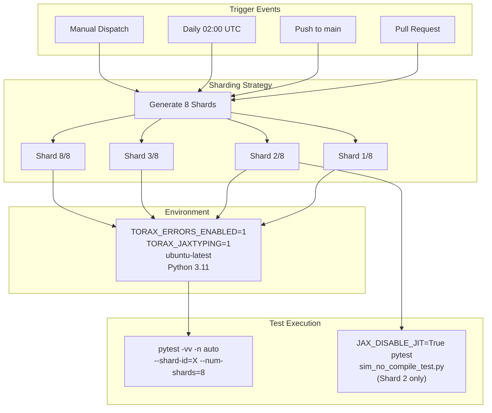
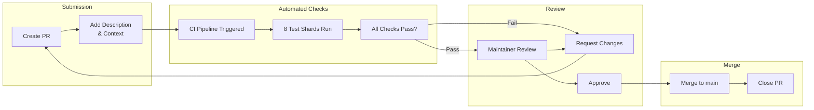
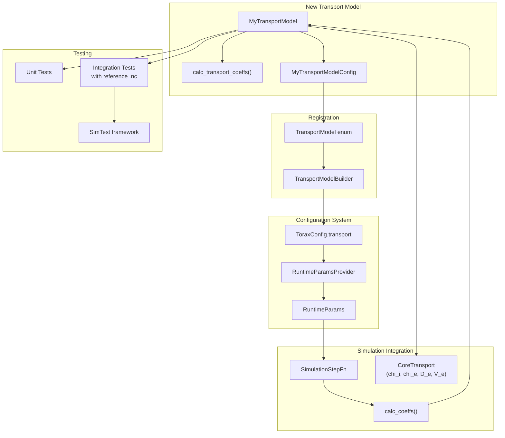

<!-- source: DeepWiki mcp.deepwiki.com · repo google-deepmind/torax · page 10.3 Contributing Guidelines · fetched 2026-10-26 -->

# Contributing Guidelines

<details>
<summary>Relevant source files</summary>

The following files were used as context for generating this wiki page:

- [.github/workflows/pytest.yml](.github/workflows/pytest.yml)
- [README.md](README.md)
- [docs/installation.rst](docs/installation.rst)
- [pyproject.toml](pyproject.toml)
- [torax/__init__.py](torax/__init__.py)

</details>


## Purpose and Scope

This page provides guidelines for developers who want to contribute to the TORAX codebase. It covers the development environment setup, code style requirements, testing procedures, and the contribution workflow. For information about the overall code structure and module organization, see [Code Structure and Module Organization](#10.1). For details on the testing framework and best practices, see [Testing Framework and Best Practices](#10.2).

---

## Development Environment Setup

### Forking and Cloning the Repository

To contribute to TORAX, start by forking the repository on GitHub and cloning it locally:

```bash
git clone https://github.com/YOUR_USERNAME/torax.git
cd torax
```

### Creating a Development Virtual Environment

Follow the standard virtual environment setup as documented in [Installation and Setup](#1.1), then install TORAX in editable mode with development dependencies:

```bash
python3 -m venv toraxvenv
source toraxvenv/bin/activate
pip install --upgrade pip
pip install -e .[dev]
```

The `[dev]` extra installs additional development tools defined in [pyproject.toml:64-78]():

| Tool | Purpose |
|------|---------|
| `isort` | Import statement sorting |
| `pytest`, `pytest-xdist`, `pytest-shard` | Testing framework and parallel execution |
| `pylint` | Code linting |
| `pyink` | Code formatting (Google style) |
| `sphinx*` packages | Documentation generation |

**Sources:** [pyproject.toml:64-78](), [README.md:116-118]()

---

## Code Style Requirements

### Formatting with pyink

TORAX uses `pyink`, a Google-style Python formatter based on Black. The configuration is defined in [pyproject.toml:90-105]():

| Parameter | Value | Purpose |
|-----------|-------|---------|
| `line-length` | 80 | Maximum line length |
| `pyink-indentation` | 2 | Indentation width in spaces |
| `pyink-use-majority-quotes` | true | Consistent quote style |
| `unstable` | true | Enable experimental features |

Format your code before committing:

```bash
pyink .
```

### Import Organization with isort

Import statements must be organized according to Google style using `isort`. Configuration is in [pyproject.toml:86-88]():

```bash
isort .
```

The tool groups imports into:
1. Standard library imports
2. Third-party imports (including `torax` as third-party when importing into TORAX)
3. Local application imports

### Linting with pylint

Code must pass `pylint` checks. While specific configuration is not in the provided files, the tool is required as a dev dependency [pyproject.toml:70]().

```bash
pylint torax
```

**Development Workflow Diagram**

```mermaid
graph LR
    subgraph "Pre-Commit"
        EDIT["Edit Code"]
        FORMAT["pyink ."]
        SORT["isort ."]
        LINT["pylint torax"]
    end
    
    subgraph "Local Testing"
        UNITTEST["pytest -vv -n auto"]
        FULLTEST["TORAX_ERRORS_ENABLED=True<br/>TORAX_JAXTYPING=True<br/>pytest -vv -n auto"]
    end
    
    subgraph "Commit & Push"
        COMMIT["git commit"]
        PUSH["git push"]
    end
    
    subgraph "CI Pipeline"
        CITEST["GitHub Actions<br/>pytest with sharding"]
        REVIEW["Code Review"]
        MERGE["Merge to main"]
    end
    
    EDIT --> FORMAT
    FORMAT --> SORT
    SORT --> LINT
    LINT --> UNITTEST
    UNITTEST --> FULLTEST
    FULLTEST --> COMMIT
    COMMIT --> PUSH
    PUSH --> CITEST
    CITEST --> REVIEW
    REVIEW --> MERGE
```



**Sources:** [pyproject.toml:86-105](), [README.md:201-206]()

---

## Testing Requirements

### Running Tests Locally

TORAX uses `pytest` with parallel execution and sharding capabilities. The basic test command is:

```bash
pytest -vv -n auto
```

For full testing with all assertion checks enabled (recommended before submitting PRs):

```bash
TORAX_ERRORS_ENABLED=True TORAX_JAXTYPING=True pytest -vv -n auto
```

### Environment Variables for Testing

| Variable | Purpose | Default (CI) |
|----------|---------|--------------|
| `TORAX_ERRORS_ENABLED` | Enable internal error checking | `1` (True) |
| `TORAX_JAXTYPING` | Enable JAX type checking | `1` (True) |
| `JAX_DISABLE_JIT` | Disable JIT compilation for debugging | `False` |

The error checking flag is incompatible with the JAX persistent compilation cache [README.md:156-158](), so it's disabled by default for faster development iteration but enabled in CI.

### Test Configuration

The pytest configuration in [pyproject.toml:118-127]() defines:

- Test discovery paths: `**/tests`
- Ignored paths: `test_data`, `scripts`, `lib*`, `qualikiz_wrapper.py`
- Python files: All `.py` files in test directories

**Special Test Cases:**

Some tests require specific environment variables and are run separately in CI [.github/workflows/pytest.yml:80-83]():

```bash
# Example: sim_no_compile_test requires JAX_DISABLE_JIT=True
JAX_DISABLE_JIT=True pytest -vv -n auto torax/tests/sim_no_compile_test.py
```

**Sources:** [README.md:199-206](), [pyproject.toml:118-127](), [.github/workflows/pytest.yml:21-26]()

---

## Continuous Integration Pipeline

### GitHub Actions Workflow

The CI pipeline is defined in [.github/workflows/pytest.yml](). It runs automatically on:

- Pull requests to `main`
- Direct pushes
- Daily at 02:00 UTC
- Manual workflow dispatch

**CI Test Execution Strategy**



The pipeline uses test sharding to parallelize execution across 8 workers [.github/workflows/pytest.yml:25](), with each shard running a subset of tests. This significantly reduces total CI time.

### Required Checks

All PRs must pass:

1. **All test shards** - Each of the 8 shards must complete successfully
2. **Python 3.11 compatibility** - Tests run on Python 3.11 [.github/workflows/pytest.yml:56]()
3. **Ubuntu compatibility** - Tests run on `ubuntu-latest` [.github/workflows/pytest.yml:57]()

The workflow uses `fail-fast: false` [.github/workflows/pytest.yml:51](), meaning all test shards continue running even if one fails, providing complete test results.

**Sources:** [.github/workflows/pytest.yml:1-84]()

---

## Pull Request Submission Process

### Before Submitting

1. **Ensure all code is formatted:**
   ```bash
   pyink .
   isort .
   ```

2. **Run tests locally with full checks:**
   ```bash
   TORAX_ERRORS_ENABLED=True TORAX_JAXTYPING=True pytest -vv -n auto
   ```

3. **Verify your changes don't break existing functionality** by running relevant integration tests (see [Integration Tests](#8.1))

### PR Requirements

- **Clear description** - Explain what the PR changes and why
- **Reference issues** - Link to related GitHub issues if applicable
- **Test coverage** - Add tests for new functionality
- **Documentation** - Update relevant documentation in `docs/` or docstrings

### Code Review Process



**Sources:** [.github/workflows/pytest.yml:5-19](), [README.md:116-118]()

---

## Adding New Physics Models

### Integration Points for Physics Models

TORAX's modular architecture allows new physics models to be added through well-defined interfaces. The main integration points are:

| Model Type | Base Class/Module | Configuration Location |
|------------|-------------------|------------------------|
| Transport Models | `_src/transport_model/` | `TransportConfig` in `ToraxConfig` |
| Source Models | `_src/sources/` | `SourceConfigs` in `ToraxConfig` |
| Pedestal Models | `_src/pedestal_model/` | `PedestalConfig` in `ToraxConfig` |
| Geometry Providers | `_src/geometry/` | `GeometryConfig` in `ToraxConfig` |
| Edge Models | `_src/edge/` | `EdgeConfig` in `ToraxConfig` |

### Adding a New Transport Model

**Transport Model Integration Architecture**



**Implementation Steps:**

1. **Create the model implementation** in `_src/transport_model/my_model.py`:
   - Implement a function or class that computes transport coefficients
   - Signature should accept `RuntimeParams`, `Geometry`, `CoreProfiles`
   - Return a structure with `chi_i`, `chi_e`, `D_e`, `V_e` (diffusivities and convection)

2. **Define configuration** as a Pydantic model inheriting from appropriate base class

3. **Register in the transport model enum** and builder

4. **Add unit tests** in `tests/` testing the model in isolation

5. **Add integration tests** using the `SimTest` framework (see [Integration Tests](#8.1)):
   - Create a test configuration using the new model
   - Generate reference data
   - Add parameterized test case

### Adding a New Source Model

Similar process to transport models, but for sources in `_src/sources/`:

1. **Implement source calculation** - Return heating power profiles (`p_i`, `p_e`), particle sources (`s_e`), or current drive (`j_ext`)

2. **Define source configuration** - Add to `SourceConfigs` in `ToraxConfig`

3. **Integrate with source builder** - Ensure source is instantiated in `build_sources_from_config`

4. **Add to `CoreSources`** - Source profiles are accumulated in the `CoreSources` dataclass

5. **Test thoroughly** - Both unit tests and integration tests comparing against expected profiles

### Testing New Models

All new physics models must include:

1. **Unit tests** - Test the model calculation in isolation with known inputs/outputs

2. **Integration tests** - Use the `SimTest` framework to run full simulations and compare against reference data:
   ```python
   @parameterized.named_parameters(
       ('my_new_model', 'my_model_config.py'),
   )
   def test_new_model(self, config_name):
       sim_test.run_test(config_name, reference_data)
   ```

3. **Reference data generation** - Create reference NetCDF files in `tests/test_data/` by running:
   ```bash
   run_torax --config=tests/test_data/my_model_config.py --output_dir=tests/test_data
   ```

**Sources:** Based on system architecture from Diagrams 3 (Physics Model Ecosystem) and 6 (Module Organization & Dependencies)

---

## Package Structure Considerations

When contributing new modules, follow the existing structure:

- **Public API** exports in `torax/__init__.py` [torax/__init__.py:51-69]()
- **Internal implementation** in `torax/_src/` subdirectories
- **Tests** in `torax/tests/` with corresponding structure
- **Example configurations** in `examples/`

The package configuration excludes tests from distribution [pyproject.toml:110-112]():

```toml
[tool.setuptools.packages.find]
include = ["torax*"]
exclude = ["*tests*"]
```

### Data Files

Geometry files and other data should be placed in `torax/data/` with appropriate package data configuration [pyproject.toml:114-115]():

```toml
[tool.setuptools.package-data]
"torax.data.third_party.geo" = ["*"]
```

**Sources:** [pyproject.toml:107-115](), [torax/__init__.py:1-87]()

---

## Version Control and Branching

- Create feature branches from `main`
- Use descriptive branch names: `feature/add-foo-model`, `fix/bar-bug`, `docs/update-readme`
- Keep commits atomic and well-described
- Rebase on `main` before submitting PRs to avoid merge conflicts

---

## Documentation Requirements

When adding new features:

1. **Update docstrings** - All public functions and classes should have comprehensive docstrings
2. **Update wiki pages** - If your changes affect user-facing functionality, update relevant documentation
3. **Add examples** - Provide example configuration files in `examples/` for new features
4. **Update README** - For major features, update the feature list in [README.md:24-56]()

**Sources:** [README.md:1-274](), [docs/installation.rst:1-120]()

---

## License and Copyright

All contributions must include the Apache 2.0 license header [torax/__init__.py:1-13]():

```python
# Copyright 2024 DeepMind Technologies Limited
#
# Licensed under the Apache License, Version 2.0 (the "License");
# you may not use this file except in compliance with the License.
# You may obtain a copy of the License at
#
#     http://www.apache.org/licenses/LICENSE-2.0
#
# Unless required by applicable law or agreed to in writing, software
# distributed under the License is distributed on an "AS IS" BASIS,
# WITHOUT WARRANTIES OR CONDITIONS OF ANY KIND, either express or implied.
# See the License for the specific language governing permissions and
# limitations under the License.
```

TORAX is released under the Apache 2.0 license [pyproject.toml:10]().

**Sources:** [pyproject.toml:10-11](), [torax/__init__.py:1-13]()