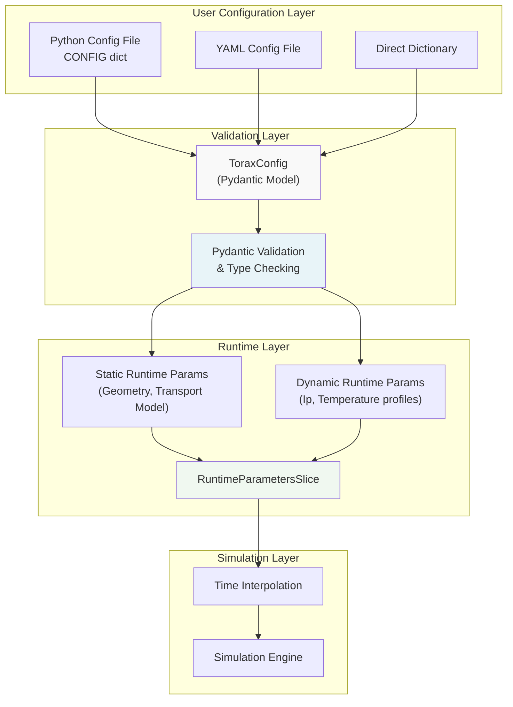
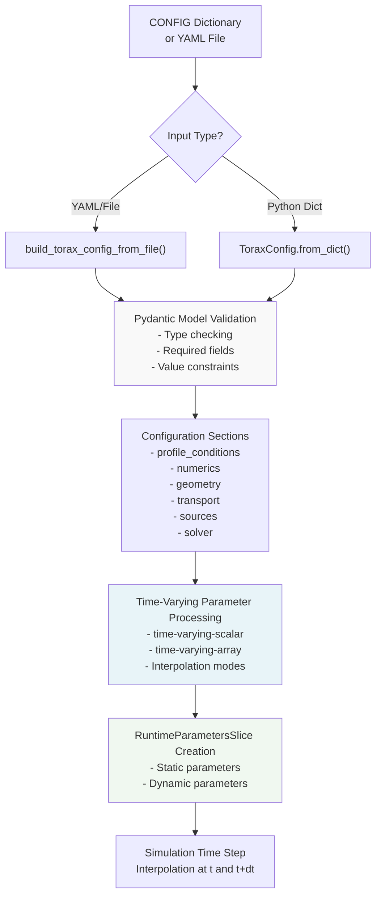
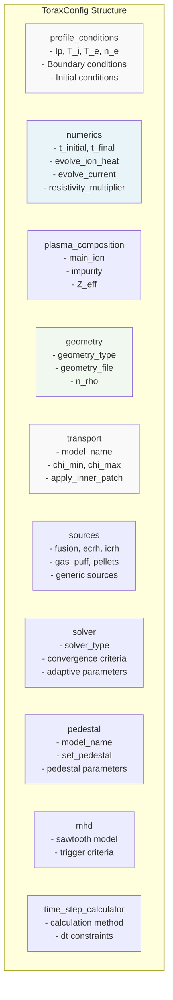

<!-- source: DeepWiki mcp.deepwiki.com · repo google-deepmind/torax · page 2 Configuration System · fetched 2026-10-26 -->

# Configuration System

<details>
<summary>Relevant source files</summary>

The following files were used as context for generating this wiki page:

- [docs/configuration.rst](docs/configuration.rst)
- [docs/edge_models.rst](docs/edge_models.rst)
- [docs/interfacing_with_surrogates.rst](docs/interfacing_with_surrogates.rst)
- [docs/links.rst](docs/links.rst)
- [docs/output.rst](docs/output.rst)
- [docs/physics_models.rst](docs/physics_models.rst)
- [docs/running_programmatically.rst](docs/running_programmatically.rst)
- [docs/user_guides.rst](docs/user_guides.rst)
- [docs/using_jax.rst](docs/using_jax.rst)
- [torax/_src/config/build_runtime_params.py](torax/_src/config/build_runtime_params.py)
- [torax/_src/config/numerics.py](torax/_src/config/numerics.py)
- [torax/_src/config/tests/build_runtime_params_test.py](torax/_src/config/tests/build_runtime_params_test.py)
- [torax/_src/config/tests/numerics_test.py](torax/_src/config/tests/numerics_test.py)

</details>


TORAX's configuration system provides a structured approach to defining simulation parameters, supporting both static values and time-dependent inputs with validation and type checking. This document covers the configuration architecture, parameter formats, validation mechanisms, and the conversion process from user-defined dictionaries to internal Pydantic models.

For information about running simulations with configurations, see [Running Simulations](#5). For details about specific configuration parameters, see [Configuration Parameters](#2.1).

## Configuration Architecture

The TORAX configuration system follows a layered architecture that transforms user-friendly Python dictionaries into validated, type-safe objects used throughout the simulation.



**Sources:** [docs/configuration.rst:26-36](), [docs/code_structure.rst:59-71]()

## Configuration Processing Flow

The configuration system processes user inputs through several stages, from initial parsing to runtime parameter interpolation.



**Sources:** [docs/configuration.rst:26-36](), [docs/code_structure.rst:62-70]()

## Time-Dependent Parameter System

TORAX supports sophisticated time-dependent parameters through two main types: `time-varying-scalar` and `time-varying-array`. These parameters support multiple input formats and interpolation methods.

### Time-Varying Scalars

Time-varying scalars accept multiple input formats for specifying time evolution:

| Input Format | Example | Description |
|--------------|---------|-------------|
| Scalar | `15.0` | Constant value throughout simulation |
| Time dict | `{10: 2.0e6, 100: 15.0e6}` | Time-value pairs |
| Tuple | `(time_array, value_array)` | Arrays of times and values |
| xarray.DataArray | `xarray.DataArray(data=values, coords={'time': times})` | Structured array format |

**Sources:** [docs/configuration.rst:47-54]()

### Time-Varying Arrays

Time-varying arrays define spatial profiles that evolve over time, using the normalized flux coordinate ρ̂:

```python
# Nested dictionary format
T_i = {
    0.0: {0.0: 15.0, 0.95: 3.0, 1.0: 1.0},
    80.0: {0.0: 12.0, 0.95: 2.5, 1.0: 0.8}
}

# Array format
T_i = (time_array, rho_norm_array, values_array)
```

**Sources:** [docs/configuration.rst:100-172]()

### Interpolation Methods

Two interpolation modes are supported:

| Mode | Description | Usage |
|------|-------------|-------|
| `PIECEWISE_LINEAR` | Linear interpolation (default) | Smooth transitions |
| `STEP` | Stepwise changes | Discrete state changes |

**Sources:** [docs/configuration.rst:192-196]()

## Configuration Structure

The configuration system organizes parameters into logical sections, each controlling different aspects of the simulation:



**Sources:** [docs/configuration.rst:11-25]()

### Core Configuration Sections

#### Profile Conditions
Controls plasma profiles and boundary conditions:
- `Ip`: Total plasma current (time-varying-scalar)
- `T_i`, `T_e`: Ion and electron temperatures (time-varying-array)
- `n_e`: Electron density (time-varying-array)
- `psi`: Poloidal flux (time-varying-array)

#### Numerics
Simulation control parameters:
- `t_initial`, `t_final`: Simulation time bounds
- `evolve_ion_heat`, `evolve_electron_heat`: Equation toggles
- `max_dt`, `min_dt`: Time step constraints
- `resistivity_multiplier`: Current diffusion scaling

#### Transport
Transport model configuration:
- `model_name`: `'constant'`, `'CGM'`, `'bohm-gyrobohm'`, `'qlknn'`, `'qualikiz'`
- `chi_min`, `chi_max`: Heat conductivity bounds
- `apply_inner_patch`, `apply_outer_patch`: Regional overrides

**Sources:** [docs/configuration.rst:205-873]()

## Validation and Type Checking

The configuration system uses Pydantic for comprehensive validation:

### Type Validation
- Automatic type conversion and checking
- Nested model validation
- Array shape and dimension validation
- Time coordinate validation

### Value Constraints
- Physical bounds checking (e.g., positive temperatures)
- Consistency validation between related parameters
- Required field enforcement
- Default value assignment

### Error Reporting
```python
# Invalid configuration raises informative errors
try:
    config = ToraxConfig.from_dict(invalid_config)
except ValidationError as e:
    # Detailed error messages with field paths
    print(e.errors())
```

**Sources:** [docs/configuration.rst:48-51](), [docs/running.rst:48-51]()

## Runtime Parameter Management

During simulation execution, the configuration system manages parameters through the `RuntimeParametersSlice` system:

### Static vs Dynamic Parameters
- **Static**: Don't change during simulation (transport model, geometry type)
- **Dynamic**: Change during simulation (plasma current, temperature profiles)
- Changing static parameters triggers JAX recompilation

### Parameter Interpolation
At each simulation step, time-dependent parameters are interpolated at both `t` and `t+dt` for the theta-method solver.

**Sources:** [docs/code_structure.rst:63-70](), [docs/configuration.rst:58-61]()

---

