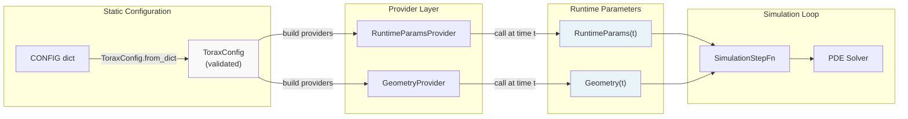

<!-- source: DeepWiki mcp.deepwiki.com · repo google-deepmind/torax · page 2.1 ToraxConfig and Configuration Parameters · fetched 2026-10-26 -->

# ToraxConfig and Configuration Parameters

<details>
<summary>Relevant source files</summary>

The following files were used as context for generating this wiki page:

- [docs/configuration.rst](docs/configuration.rst)
- [docs/edge_models.rst](docs/edge_models.rst)
- [docs/interfacing_with_surrogates.rst](docs/interfacing_with_surrogates.rst)
- [docs/links.rst](docs/links.rst)
- [docs/output.rst](docs/output.rst)
- [docs/physics_models.rst](docs/physics_models.rst)
- [docs/running_programmatically.rst](docs/running_programmatically.rst)
- [docs/user_guides.rst](docs/user_guides.rst)
- [docs/using_jax.rst](docs/using_jax.rst)
- [torax/_src/edge/extended_lengyel_model.py](torax/_src/edge/extended_lengyel_model.py)
- [torax/_src/edge/extended_lengyel_standalone.py](torax/_src/edge/extended_lengyel_standalone.py)
- [torax/_src/edge/pydantic_model.py](torax/_src/edge/pydantic_model.py)
- [torax/_src/edge/tests/edge_pydantic_model_test.py](torax/_src/edge/tests/edge_pydantic_model_test.py)
- [torax/_src/edge/tests/edge_updaters_test.py](torax/_src/edge/tests/edge_updaters_test.py)
- [torax/_src/edge/tests/extended_lengyel_model_test.py](torax/_src/edge/tests/extended_lengyel_model_test.py)
- [torax/_src/edge/updaters.py](torax/_src/edge/updaters.py)
- [torax/_src/torax_pydantic/model_config.py](torax/_src/torax_pydantic/model_config.py)
- [torax/_src/torax_pydantic/tests/model_config_test.py](torax/_src/torax_pydantic/tests/model_config_test.py)

</details>


## Purpose and Scope

This page documents the `ToraxConfig` Pydantic model and all top-level configuration sections that define TORAX simulation inputs. It provides a comprehensive reference for all configurable parameters, their data types, and their purposes.

For information about how configuration parameters are interpolated over time and converted to runtime parameters, see [Runtime Parameters and Time Interpolation](#2.2). For specific guidance on plasma composition configuration modes, see [Plasma Composition Configuration](#2.3). For complete example configurations, see [Example Configurations](#2.4).

## ToraxConfig Overview

`ToraxConfig` is the root configuration class for TORAX simulations. It is a Pydantic model that provides validation, type checking, and serialization for all simulation parameters. The configuration system follows a hierarchical structure where static configuration (defined in Python dictionaries or files) is validated by `ToraxConfig` and then converted to time-dependent runtime parameters.

The typical workflow is:
1. Define configuration as a Python dictionary with key `CONFIG`
2. Load configuration: `torax.build_torax_config_from_file('path/to/config.py')` or `ToraxConfig.from_dict(config_dict)`
3. `ToraxConfig` validates and structures the configuration
4. Runtime parameter providers interpolate time-dependent values during simulation

**Key Class:** `torax._src.torax_pydantic.model_config.ToraxConfig`

Sources: [torax/_src/torax_pydantic/model_config.py:45-93](), [docs/configuration.rst:1-50]()

## Configuration System Architecture

```mermaid
graph TB
    CONFIG_FILE["Config File<br/>(*.py with CONFIG dict)"]
    CONFIG_DICT["Python Dictionary<br/>(config_dict)"]
    
    TORAX_CONFIG["ToraxConfig<br/>(Pydantic Model)"]
    
    PROFILE["profile_conditions:<br/>ProfileConditions"]
    NUMERICS["numerics:<br/>Numerics"]
    COMPOSITION["plasma_composition:<br/>PlasmaComposition"]
    GEOMETRY["geometry:<br/>Geometry"]
    PEDESTAL["pedestal:<br/>PedestalConfig"]
    EDGE["edge:<br/>EdgeConfig | None"]
    SOURCES["sources:<br/>Sources"]
    SOLVER["solver:<br/>SolverConfig"]
    TRANSPORT["transport:<br/>TransportConfig"]
    NEOCLASSICAL["neoclassical:<br/>Neoclassical"]
    MHD["mhd:<br/>MHD"]
    TIME_STEP["time_step_calculator:<br/>TimeStepCalculator"]
    RESTART["restart:<br/>FileRestart | None"]
    
    CONFIG_FILE --> TORAX_CONFIG
    CONFIG_DICT --> TORAX_CONFIG
    
    TORAX_CONFIG --> PROFILE
    TORAX_CONFIG --> NUMERICS
    TORAX_CONFIG --> COMPOSITION
    TORAX_CONFIG --> GEOMETRY
    TORAX_CONFIG --> PEDESTAL
    TORAX_CONFIG --> EDGE
    TORAX_CONFIG --> SOURCES
    TORAX_CONFIG --> SOLVER
    TORAX_CONFIG --> TRANSPORT
    TORAX_CONFIG --> NEOCLASSICAL
    TORAX_CONFIG --> MHD
    TORAX_CONFIG --> TIME_STEP
    TORAX_CONFIG --> RESTART
    
    style TORAX_CONFIG fill:#f9f9f9
    style PROFILE fill:#e8f4f8
    style NUMERICS fill:#e8f4f8
    style COMPOSITION fill:#e8f4f8
    style GEOMETRY fill:#e8f4f8
```



**ToraxConfig Structure - Mapping Configuration Sections to Code Classes**

Sources: [torax/_src/torax_pydantic/model_config.py:45-93](), [docs/configuration.rst:14-32]()

## Top-Level Configuration Sections

`ToraxConfig` contains the following top-level configuration sections:

| Section | Type | Required | Description |
|---------|------|----------|-------------|
| `profile_conditions` | `ProfileConditions` | Yes | Boundary conditions, initial conditions, and prescribed time-dependence of temperature, density, and current |
| `numerics` | `Numerics` | Yes | Time stepping settings, equation evolution flags, and numerical parameters |
| `plasma_composition` | `PlasmaComposition` | Yes | Ion species distribution, main ions, impurities, and Z_eff |
| `geometry` | `Geometry` | Yes | Magnetic geometry configuration (CHEASE, EQDSK, FBT, IMAS, or circular) |
| `sources` | `Sources` | Yes | Configuration for all heating, current drive, and particle sources |
| `solver` | `SolverConfig` | Yes | PDE solver selection and parameters (defaults to `linear`) |
| `transport` | `TransportConfig` | Yes | Transport model selection and parameters (defaults to `constant`) |
| `neoclassical` | `Neoclassical` | No | Neoclassical bootstrap current and conductivity models |
| `pedestal` | `PedestalConfig` | Yes | Pedestal model configuration (defaults to `no_pedestal`) |
| `mhd` | `MHD` | No | MHD models (e.g., sawteeth) |
| `edge` | `EdgeConfig` | No | Edge physics model (e.g., Extended Lengyel) |
| `time_step_calculator` | `TimeStepCalculator` | No | Method for calculating timestep dt |
| `restart` | `FileRestart` | No | File restart behavior for continuing simulations |

Sources: [torax/_src/torax_pydantic/model_config.py:48-92](), [docs/configuration.rst:14-32]()

## profile_conditions

Configures boundary conditions, initial conditions, and optionally prescribed time-dependence of core plasma profiles (temperature, density, current).

**Key Parameters:**

| Parameter | Type | Default | Description |
|-----------|------|---------|-------------|
| `Ip` | time-varying-scalar | 15.0e6 | Total plasma current [A]. Boundary condition for ψ equation if not using v_loop |
| `use_v_loop_lcfs_boundary_condition` | bool | False | Use Vloop at LCFS as boundary condition instead of Ip |
| `v_loop_lcfs` | time-varying-scalar | 0.0 | Loop voltage at LCFS [V] (dpsi_lcfs/dt) |
| `T_i` | time-varying-array | {0: {0: 15.0, 1: 1.0}} | Ion temperature [keV] vs time and ρ̂ |
| `T_e` | time-varying-array | {0: {0: 15.0, 1: 1.0}} | Electron temperature [keV] vs time and ρ̂ |
| `T_i_right_bc` | time-varying-scalar | None | Ion temperature boundary condition at r=a_minor [keV] |
| `T_e_right_bc` | time-varying-scalar | None | Electron temperature boundary condition at r=a_minor [keV] |
| `n_e` | time-varying-array | {0: {0: 1.2e20, 1: 0.8e20}} | Electron density [m⁻³] vs time and ρ̂ |
| `nbar` | time-varying-scalar | 0.85e20 | Line-averaged density [m⁻³] or Greenwald fraction |
| `normalize_n_e_to_nbar` | bool | False | Renormalize density profile to match nbar |
| `n_e_right_bc` | time-varying-scalar | None | Electron density boundary condition at r=a_minor |
| `psi` | time-varying-array | None | Initial poloidal flux [Wb] |
| `psidot` | time-varying-array | None | Prescribed time derivative of poloidal flux [Wb/s] |
| `current_profile_nu` | float | 1.0 | Peaking factor for initial current: j ∝ (1-r²/a²)^ν |
| `initial_j_is_total_current` | bool | False | Whether current_profile_nu defines total or Ohmic current |
| `initial_psi_from_j` | bool | False | Calculate initial ψ from current formula vs geometry file |
| `toroidal_velocity` | time-varying-array | None | Toroidal velocity profile [m/s] |

**Code Class:** `torax._src.core_profiles.profile_conditions.ProfileConditions`

Sources: [docs/configuration.rst:239-351](), [torax/_src/torax_pydantic/model_config.py:68]()

## numerics

Configures simulation control parameters including time settings, timestep calculation, and which equations are evolved by the PDE solver.

**Key Parameters:**

| Parameter | Type | Default | Description |
|-----------|------|---------|-------------|
| `t_initial` | float | 0.0 | Simulation start time [s] |
| `t_final` | float | 5.0 | Simulation end time [s] |
| `exact_t_final` | bool | True | Ensure simulation ends exactly at t_final by adapting final dt |
| `fixed_dt` | time-varying-scalar | 1e-1 | Fixed timestep for `fixed_time_step_calculator` [s] |
| `max_dt` | float | 2.0 | Maximum timestep allowed [s] (for chi_time_step_calculator) |
| `min_dt` | float | 1e-8 | Minimum timestep allowed [s] |
| `chi_timestep_prefactor` | float | 50.0 | Prefactor for chi-based timestep: dt_base = dx²/(2χ) |
| `adaptive_dt` | bool | True | Enable dt-backtracking if nonlinear solver fails to converge |
| `dt_reduction_factor` | float | 3.0 | Factor to reduce dt during backtracking |
| `evolve_ion_heat` | bool | True | Solve ion heat equation in PDE |
| `evolve_electron_heat` | bool | True | Solve electron heat equation in PDE |
| `evolve_current` | bool | False | Solve current diffusion equation (evolving ψ) |
| `evolve_density` | bool | False | Solve electron density equation in PDE |
| `resistivity_multiplier` | time-varying-scalar | 1.0 | Multiplier for 1/σ to adjust current diffusion timescale |
| `adaptive_T_source_prefactor` | float | 1e10 | Prefactor for adaptive source term for temperature IBC |
| `adaptive_n_source_prefactor` | float | 1e8 | Prefactor for adaptive source term for density IBC |

**Evolution Flags:** The `evolve_*` flags determine which equations are solved by the PDE. When an equation is not evolved, prescribed time-dependent profiles can be provided in `profile_conditions`.

**Code Class:** `torax._src.config.numerics.Numerics`

Sources: [docs/configuration.rst:352-435](), [torax/_src/torax_pydantic/model_config.py:69]()

## plasma_composition

Defines the distribution of ion species, including main ions, impurities, and effective charge Z_eff. See [Plasma Composition Configuration](#2.3) for detailed documentation of the three impurity modes.

**Key Parameters:**

| Parameter | Type | Default | Description |
|-----------|------|---------|-------------|
| `main_ion` | str or dict | `{'D': 0.5, 'T': 0.5}` | Main ion species (single string or mixture dict) |
| `impurity` | dict | - | Impurity configuration with `impurity_mode` field |
| `Z_eff` | time-varying-array | 1.0 | Plasma effective charge (required for some modes) |
| `Z_i_override` | time-varying-scalar | None | Optional override for main ion charge |
| `A_i_override` | time-varying-scalar | None | Optional override for main ion mass [amu] |

**Impurity Modes:**
- `fractions`: Specify fractional abundances; Z_eff constrains total impurity density (default)
- `n_e_ratios`: Specify n_impurity/n_e for each species; Z_eff is calculated
- `n_e_ratios_Z_eff`: Specify ratios for all but one species; calculate remaining to match Z_eff

**Supported Ion Symbols:** H, D, T, He3, He4, Li, Be, C, N, O, Ne, Ar, Kr, Xe, W

**Code Classes:** 
- `torax._src.core_profiles.plasma_composition.plasma_composition.PlasmaComposition`
- Impurity modes: `electron_density_ratios.py`, `fractions.py`, etc.

Sources: [docs/configuration.rst:437-697](), [torax/_src/torax_pydantic/model_config.py:70]()

## geometry

Configures the magnetic geometry provider. TORAX supports CHEASE, EQDSK, IMAS, FBT, and analytical circular geometries.

**Common Parameters:**

| Parameter | Type | Default | Description |
|-----------|------|---------|-------------|
| `geometry_type` | str | - | Required: `'circular'`, `'chease'`, `'eqdsk'`, `'imas'`, or `'fbt'` |
| `n_rho` | int | 25 | Number of radial grid points |
| `hires_factor` | int | 4 | High-resolution mesh factor for j→ψ conversions |
| `geometry_file` | str | - | Path to geometry file (CHEASE, EQDSK, IMAS) |
| `geometry_directory` | str | None | Optional absolute path to geometry directory |
| `Ip_from_parameters` | bool | True | Use Ip from config vs geometry file |

**Circular Geometry (analytical):**
- `R_major`: Major radius [m] (default: 6.2)
- `a_minor`: Minor radius [m] (default: 2.0)
- `B_0`: Vacuum toroidal field on axis [T] (default: 5.3)
- `elongation_LCFS`: Plasma elongation (default: 1.72)

**FBT Geometry:**
- `divertor_domain`: `'lower_null'` or `'upper_null'`
- `LY_object`, `LY_bundle_object`, `L_object`: FBT geometry file objects
- `LY_to_torax_times`: Simulation times for bundle slices

**Code Classes:**
- `torax._src.geometry.geometry_pydantic_model.Geometry` (config)
- `torax._src.geometry.standard_geometry.StandardGeometry` (runtime)

Sources: [docs/configuration.rst:818-931](), [torax/_src/torax_pydantic/model_config.py:71]()

## pedestal

Configures pedestal models for setting internal boundary conditions (edge transport barrier). Default is `no_pedestal`.

**Available Models:**

| Model Name | Description |
|------------|-------------|
| `no_pedestal` | No pedestal profile set (default) |
| `set_T_ped_n_ped` | Directly specify pedestal width, Te, Ti, and ne |
| `set_P_ped_n_ped` | Specify total pressure and ne at pedestal |

**Key Parameters (set_T_ped_n_ped):**

| Parameter | Type | Default | Description |
|-----------|------|---------|-------------|
| `set_pedestal` | time-varying-scalar | False | Enable pedestal model |
| `T_e_ped` | time-varying-scalar | 5.0 | Electron temperature at pedestal top [keV] |
| `T_i_ped` | time-varying-scalar | 5.0 | Ion temperature at pedestal top [keV] |
| `n_e_ped` | time-varying-scalar | 0.7e20 | Electron density at pedestal top [m⁻³ or fGW] |
| `n_e_ped_is_fGW` | time-varying-scalar | False | Toggle units of n_e_ped |
| `rho_norm_ped_top` | time-varying-scalar | 0.91 | Location of pedestal top in ρ̂ |

**Code Class:** `torax._src.pedestal_model.pydantic_model.PedestalConfig`

Sources: [docs/configuration.rst:698-766](), [torax/_src/torax_pydantic/model_config.py:82-84]()

## edge

Configures edge physics models for calculating boundary conditions. Currently supports the Extended Lengyel model. See [Edge Physics and Extended Lengyel Model](#3.5) for detailed documentation.

**Available Models:**
- `extended_lengyel`: 1D SOL/divertor model calculating target temperature and separatrix conditions

**Key Parameters (Extended Lengyel):**

| Parameter | Type | Default | Description |
|-----------|------|---------|-------------|
| `model_name` | str | `'extended_lengyel'` | Edge model selection |
| `computation_mode` | str | `'forward'` | `'forward'` or `'inverse'` mode |
| `solver_mode` | str | `'hybrid'` | `'fixed_point'`, `'newton_raphson'`, or `'hybrid'` |
| `impurity_sot` | str | `'core'` | Source of truth: `'core'` or `'edge'` |
| `update_temperatures` | bool | True | Update core T_e/T_i boundary conditions |
| `update_impurities` | bool | True | Update core impurity profiles |
| `T_e_target` | time-varying-scalar | None | Target temperature [eV] (inverse mode) |
| `seed_impurity_weights` | dict | None | Relative weights for seeded impurities (inverse mode) |
| `fixed_impurity_concentrations` | dict | {} | Fixed background impurity concentrations |
| `enrichment_factor` | dict | None | Manual enrichment factors by species |
| `use_enrichment_model` | bool | True | Use Kallenbach 2024 enrichment model |
| `connection_length_target` | time-varying-scalar | None | Parallel connection length to target [m] |
| `diverted` | bool | None | Required for non-FBT geometries |

**Code Class:** `torax._src.edge.pydantic_model.ExtendedLengyelConfig`

Sources: [docs/configuration.rst:767-817](), [torax/_src/torax_pydantic/model_config.py:86](), [torax/_src/edge/pydantic_model.py:32-165]()

## sources

Configures all heating sources, current drive, particle sources, and radiation sinks. Each source is independently configured with parameters for profile shape, magnitude, and time-dependence.

**Available Sources:**

| Source | Type | Description |
|--------|------|-------------|
| `fusion` | Heating | Fusion alpha heating (Bosch-Hale formula) |
| `generic_heat` | Heating | Generic external heating to electrons and ions |
| `ecrh` | Heating + Current | Electron cyclotron resonance heating |
| `icrh` | Heating | Ion cyclotron resonance heating |
| `ohmic` | Heating | Ohmic heating |
| `bremsstrahlung` | Sink | Bremsstrahlung radiation |
| `impurity_radiation` | Sink | Impurity radiation (Mavrin fit model) |
| `cyclotron_radiation` | Sink | Cyclotron radiation |
| `qei` | Exchange | Electron-ion heat exchange (always active) |
| `generic_current` | Current | Generic non-inductive current drive |
| `gas_puff` | Particle | Gas puff particle source |
| `pellet` | Particle | Pellet injection particle source |
| `generic_particle` | Particle | Generic particle source |

**Common Source Parameters:**

| Parameter | Type | Description |
|-----------|------|-------------|
| `model` | str | Source model name (e.g., `'default'`, `'prescribed'`, `'zero'`) |
| `P_total` or `I_total` | time-varying-scalar | Total power [W] or current [A] |
| `gaussian_location` | time-varying-scalar | Peak location in normalized radius ρ̂ |
| `gaussian_width` | time-varying-scalar | Width of Gaussian profile |
| `is_explicit` | bool | Explicit (False) or implicit (True) time treatment |

**Code Class:** `torax._src.sources.pydantic_model.Sources`

Sources: [docs/configuration.rst:1005-1305](), [torax/_src/torax_pydantic/model_config.py:72]()

## solver

Configures the PDE solver for the time-dependent transport equations. Default is `linear` (predictor-corrector theta method).

**Available Solvers:**

| Solver Type | Description | Use Case |
|-------------|-------------|----------|
| `linear` | Linear theta method with predictor-corrector | Fast, suitable for weakly nonlinear problems |
| `newton_raphson` | Nonlinear Newton-Raphson solver | Handles strong nonlinearities, requires autodiff |
| `optimizer` | Optimizer-based solver (jaxopt.LBFGS) | For constrained optimization problems |

**Common Parameters:**

| Parameter | Type | Default | Description |
|-----------|------|---------|-------------|
| `solver_type` | str | `'linear'` | Solver selection (discriminator field) |
| `theta_imp` | float | 1.0 | Implicit theta parameter (0=explicit, 1=implicit) |
| `use_pereverzev` | bool | False | Enable Pereverzev-Corrigan terms for stability |

**Linear Solver Parameters:**
- `predictor_corrector`: bool = True (enable predictor-corrector)
- `corrector_steps`: int = 1 (number of corrector iterations)

**Newton-Raphson Solver Parameters:**
- `initial_guess_mode`: `'x_new'`, `'x_old'`, or `'linear'`
- `log_iterations`: bool = False
- `maxiter`: int = 30
- `tol`: float = 1e-5

**Code Classes:**
- `torax._src.solver.pydantic_model.SolverConfig` (base)
- `LinearThetaMethod`, `NewtonRaphsonThetaMethod`, `OptimizerThetaMethod`

Sources: [docs/configuration.rst:1306-1385](), [torax/_src/torax_pydantic/model_config.py:76-78]()

## transport

Configures the turbulent transport model that determines transport coefficients (χ_i, χ_e, D_e, V_e). Default is `constant`.

**Available Models:**

| Model Name | Description | Characteristics |
|------------|-------------|-----------------|
| `constant` | Constant transport coefficients | Simple, for testing |
| `CGM` | Critical Gradient Model | Theory-based, simple nonlinearity |
| `bohm-gyrobohm` | Bohm-GyroBohm scaling | Semi-empirical, widely used |
| `qlknn` | QLKNN-7-11 neural network | ML surrogate of QuaLiKiz, fast and accurate |
| `qualikiz` | QuaLiKiz quasilinear code | High-fidelity, requires external installation |

**Common Parameters:**

| Parameter | Type | Description |
|-----------|------|-------------|
| `model_name` | str | Transport model selection (discriminator field) |
| `apply_inner_patch` | bool | Apply fixed transport in inner region |
| `apply_outer_patch` | bool | Apply fixed transport in outer region |
| `De_min` | float | Minimum electron particle diffusivity [m²/s] |
| `Ve_min` | float | Minimum electron convection velocity [m/s] |
| `chimin` | float | Minimum heat diffusivity [m²/s] |
| `use_rotation` | bool | Enable rotation effects (model-dependent) |

**Model-Specific Parameters:**

*Constant Transport:*
- `chii_const`, `chie_const`, `De_const`, `Ve_const`: Fixed coefficient values

*QLKNN:*
- `include_ITG`, `include_TEM`, `include_ETG`: Enable turbulence mode channels
- `DVeff`: bool = True (use effective diffusion)

**Code Class:** `torax._src.transport_model.pydantic_model.TransportConfig`

Sources: [docs/configuration.rst:1386-1550](), [torax/_src/torax_pydantic/model_config.py:79-81]()

## neoclassical

Configures neoclassical physics models for bootstrap current and neoclassical conductivity. Uses Sauter 1999 formulas by default.

**Key Parameters:**

| Parameter | Type | Default | Description |
|-----------|------|---------|-------------|
| `bootstrap_model` | str | `'sauter'` | Bootstrap current model |
| `resistivity_model` | str | `'qlknn'` | Model for neoclassical resistivity calculation |
| `poloidal_velocity_multiplier` | float | 1.0 | Multiplier for poloidal velocity (rotation tuning) |

**Code Class:** `torax._src.neoclassical.pydantic_model.Neoclassical`

Sources: [torax/_src/torax_pydantic/model_config.py:73-75]()

## mhd

Configures MHD models. Currently only sawteeth are implemented.

**Key Parameters (Sawteeth):**

| Parameter | Type | Default | Description |
|-----------|------|---------|-------------|
| `sawteeth_model_name` | str | `'none'` | Sawtooth model: `'none'` or `'constant_mixing_radius'` |
| `sawteeth_period` | time-varying-scalar | 0.1 | Time between sawtooth crashes [s] |
| `sawteeth_mixing_radius` | time-varying-scalar | 0.3 | Mixing radius in normalized ρ̂ |

**Code Class:** `torax._src.mhd.pydantic_model.MHD`

Sources: [docs/configuration.rst:1551-1583](), [torax/_src/torax_pydantic/model_config.py:85]()

## time_step_calculator

Configures the method for calculating the timestep dt at each iteration.

**Available Calculators:**

| Calculator Type | Description |
|-----------------|-------------|
| `chi` | Adaptive based on chi timescale: dt = prefactor × dx²/(2χ_max) |
| `fixed` | Use fixed timestep from `numerics.fixed_dt` |

**Code Class:** `torax._src.time_step_calculator.pydantic_model.TimeStepCalculator`

Sources: [docs/configuration.rst:1584-1597](), [torax/_src/torax_pydantic/model_config.py:87-89]()

## restart

Configures file restart behavior for continuing simulations from saved state.

**Key Parameters:**

| Parameter | Type | Description |
|-----------|------|-------------|
| `run_id` | str | Run ID for loading previous state |
| `output_dir` | str | Directory containing state files |
| `t_start` | float | Time to restart from |

**Code Class:** `torax._src.torax_pydantic.file_restart.FileRestart`

Sources: [torax/_src/torax_pydantic/model_config.py:90-92]()

## Configuration to Runtime Parameter Flow



**Configuration Parameter Flow - From Static Configuration to Runtime Execution**

This diagram shows how static configuration in `ToraxConfig` flows through provider objects to produce time-dependent runtime parameters that are used during simulation execution. The separation between configuration and runtime parameters enables time interpolation and dynamic parameter updates.

Sources: [torax/_src/torax_pydantic/model_config.py:94-103](), [docs/configuration.rst:52-95]()

## Configuration Validation

`ToraxConfig` includes several model validators that check configuration consistency:

**Key Validations:**

1. **Pereverzev Warning:** Warns if nonlinear transport model is used with linear solver without Pereverzev terms enabled [torax/_src/torax_pydantic/model_config.py:138-172]()

2. **Psidot and Evolve Current:** Warns if `psidot` is provided but `evolve_current` is True (psidot is ignored) [torax/_src/torax_pydantic/model_config.py:174-187]()

3. **Edge with Circular Geometry:** Raises error if edge models are used with circular geometry [torax/_src/torax_pydantic/model_config.py:189-199]()

4. **Extended Lengyel Impurity Mode:** Ensures Extended Lengyel uses `n_e_ratios` impurity mode [torax/_src/torax_pydantic/model_config.py:201-215]()

5. **Edge Diverted Status:** Validates that `diverted` is set correctly based on geometry type [torax/_src/torax_pydantic/model_config.py:217-244]()

6. **Edge-Core Impurity Consistency:** Ensures impurity species match between core and edge configurations [torax/_src/torax_pydantic/model_config.py:246-283]()

Sources: [torax/_src/torax_pydantic/model_config.py:105-283]()

## Loading and Using Configuration

### From File

```python
import torax

# Load from Python file with CONFIG dict
torax_config = torax.build_torax_config_from_file('examples/iterhybrid_rampup.py')

# Or use command line
# run_torax --config='path/to/config.py'
```

### From Dictionary

```python
import torax

config_dict = {
    'profile_conditions': {...},
    'numerics': {...},
    'plasma_composition': {...},
    'geometry': {...},
    'sources': {...},
    # ... other sections
}

torax_config = torax.ToraxConfig.from_dict(config_dict)
```

### Serialization

```python
# Serialize to JSON
config_json = torax_config.model_dump_json()

# Deserialize from JSON
torax_config_roundtrip = torax.ToraxConfig.model_validate_json(config_json)
```

Sources: [docs/configuration.rst:37-48](), [docs/running_programmatically.rst:10-19]()

## Building Physics Models and Providers

Once `ToraxConfig` is constructed, it can build the required physics models and runtime parameter providers:

```python
# Build physics models (transport, sources, neoclassical, etc.)
physics_models = torax_config.build_physics_models()

# Build runtime parameter provider for time interpolation
from torax._src.config import build_runtime_params
provider = build_runtime_params.RuntimeParamsProvider.from_config(torax_config)

# Get runtime parameters at specific time
runtime_params = provider(t=1.5)
```

Sources: [torax/_src/torax_pydantic/model_config.py:94-103]()

---

