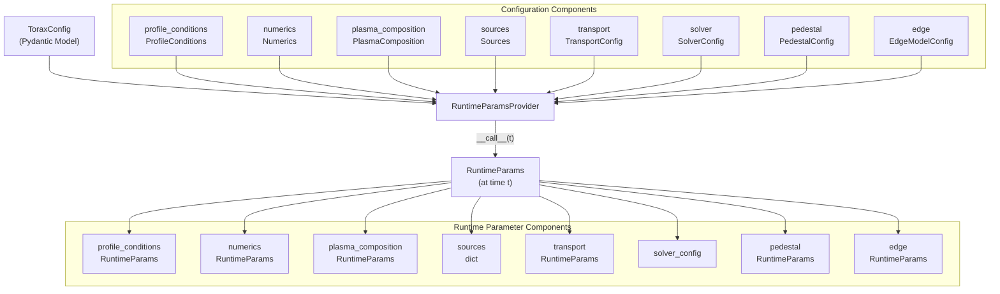
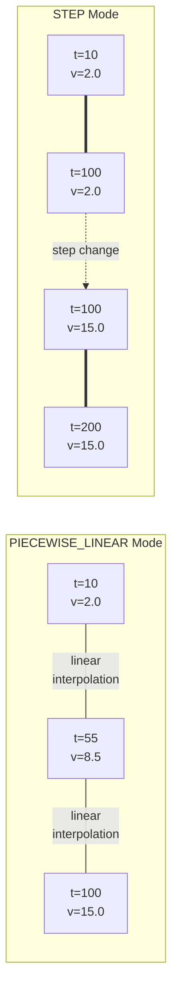
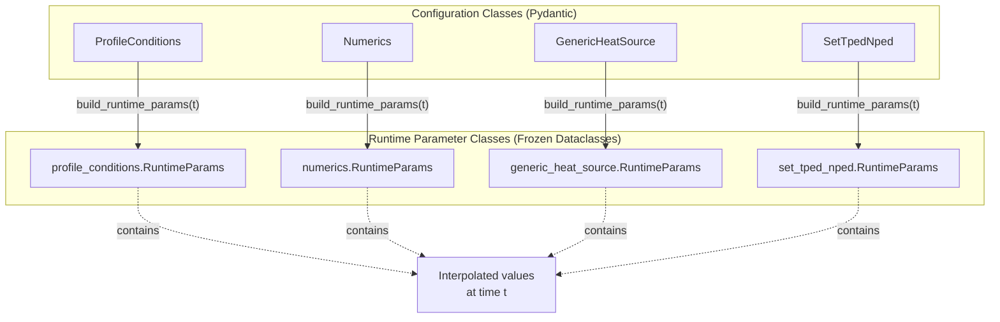
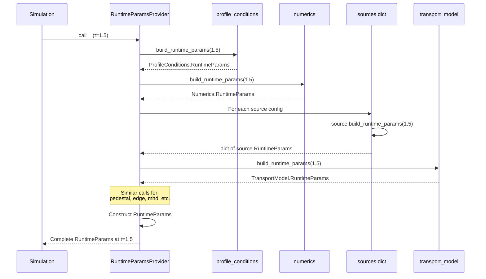
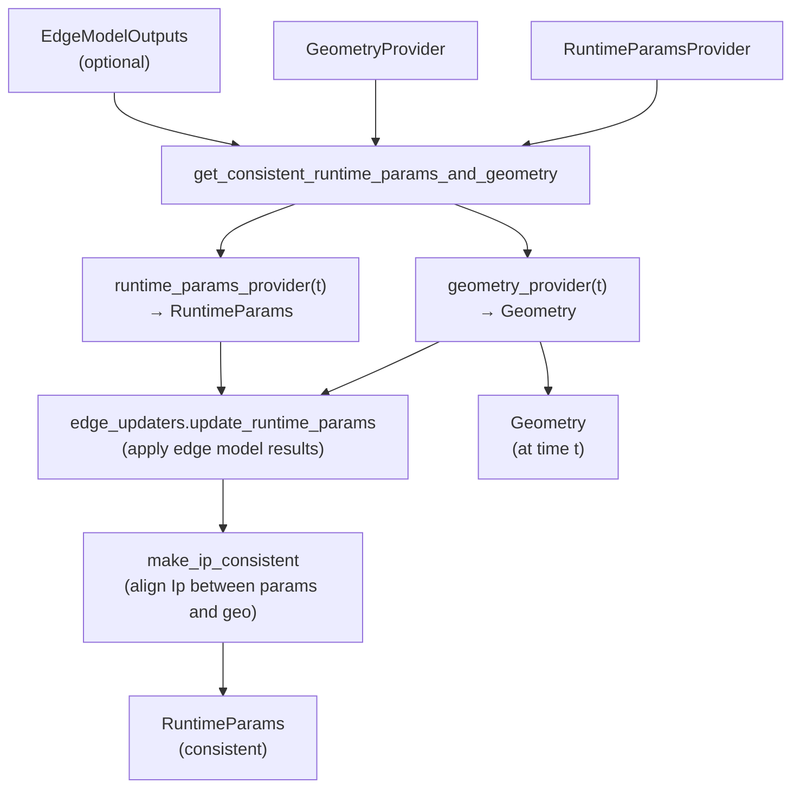

<!-- source: DeepWiki mcp.deepwiki.com · repo google-deepmind/torax · page 2.2 Runtime Parameters and Time Interpolation · fetched 2026-10-26 -->

# Runtime Parameters and Time Interpolation

<details>
<summary>Relevant source files</summary>

The following files were used as context for generating this wiki page:

- [docs/configuration.rst](docs/configuration.rst)
- [docs/edge_models.rst](docs/edge_models.rst)
- [docs/interfacing_with_surrogates.rst](docs/interfacing_with_surrogates.rst)
- [docs/links.rst](docs/links.rst)
- [docs/output.rst](docs/output.rst)
- [docs/physics_models.rst](docs/physics_models.rst)
- [docs/running_programmatically.rst](docs/running_programmatically.rst)
- [docs/user_guides.rst](docs/user_guides.rst)
- [docs/using_jax.rst](docs/using_jax.rst)
- [torax/_src/config/build_runtime_params.py](torax/_src/config/build_runtime_params.py)
- [torax/_src/config/numerics.py](torax/_src/config/numerics.py)
- [torax/_src/config/tests/build_runtime_params_test.py](torax/_src/config/tests/build_runtime_params_test.py)
- [torax/_src/config/tests/numerics_test.py](torax/_src/config/tests/numerics_test.py)

</details>


## Purpose and Scope

This document explains how TORAX manages time-dependent simulation parameters through the `RuntimeParamsProvider` system and how parameter values are interpolated during simulation execution. 

For static configuration structure and validation, see [ToraxConfig and Configuration Parameters](#2.1). For how configurations are loaded from files, see [Example Configurations](#2.4). For details on specific parameter categories like plasma composition, see [Plasma Composition Configuration](#2.3).

The runtime parameter system enables:
- Time-dependent parameter values that change smoothly during simulation
- Consistent snapshots of all parameters at any time `t`
- Dynamic parameter updates during simulation execution
- JAX-compatible parameter handling for JIT compilation and autodiff

---

## RuntimeParamsProvider Overview

The `RuntimeParamsProvider` class serves as the bridge between static configuration (`ToraxConfig`) and time-dependent runtime parameters. It interpolates all time-varying parameters to produce a complete `RuntimeParams` snapshot at any simulation time.



**Diagram: RuntimeParamsProvider Architecture**

The provider is constructed once from `ToraxConfig` and can be called repeatedly with different time values to obtain parameter snapshots.

Sources: [torax/_src/config/build_runtime_params.py:66-135]()

---

## RuntimeParamsProvider Class Structure

The `RuntimeParamsProvider` is a frozen dataclass containing all configuration components:

| Field | Type | Purpose |
|-------|------|---------|
| `sources` | `Sources` | Heating, current drive, and particle source configurations |
| `numerics` | `Numerics` | Time stepping and numerical control parameters |
| `profile_conditions` | `ProfileConditions` | Boundary conditions and initial profiles |
| `plasma_composition` | `PlasmaComposition` | Ion species and impurity configuration |
| `transport_model` | `TransportConfig` | Transport model selection and parameters |
| `solver` | `SolverConfig` | PDE solver configuration |
| `pedestal` | `PedestalConfig` | Pedestal model parameters |
| `mhd` | `MHD` | MHD model (e.g., sawtooth) configuration |
| `edge` | `EdgeModelConfig` | Edge model configuration (optional) |
| `neoclassical` | `Neoclassical` | Neoclassical physics parameters |
| `time_step_calculator` | `TimeStepCalculator` | Time step calculation method |

The provider implements a `__call__` method that builds `RuntimeParams` for a given time:

```python
runtime_params = provider(t=1.5)  # Get parameters at t=1.5 seconds
```

Sources: [torax/_src/config/build_runtime_params.py:66-91](), [docs/configuration.rst:13-32]()

---

## Time-Varying Parameter Types

TORAX supports two types of time-varying parameters, each handled by specialized classes.

### TimeVaryingScalar

`TimeVaryingScalar` represents a scalar value that changes over time. It supports multiple input formats:

| Input Format | Example | Description |
|--------------|---------|-------------|
| Scalar | `5.0` | Constant value (no time dependence) |
| Dict | `{10: 2.0e6, 100: 15.0e6}` | Time-value pairs |
| Tuple | `([10, 100], [2.0e6, 15.0e6])` | Time array and value array |
| xarray.DataArray | `xr.DataArray(values, coords={'time': times})` | xarray format |

Example from configuration:
```python
# Plasma current ramping from 2 MA to 15 MA
'Ip': {10: 2.0e6, 100: 15.0e6}

# Or with explicit interpolation mode
'Ip': ({10: 2.0e6, 100: 15.0e6}, 'PIECEWISE_LINEAR')
```

Sources: [docs/configuration.rst:58-116](), [torax/_src/torax_pydantic/interpolated_param_1d.py]()

### TimeVaryingArray

`TimeVaryingArray` represents a radial profile that varies over time, interpolated on a 2D grid of (time, ρ̂).

| Input Format | Example | Description |
|--------------|---------|-------------|
| Scalar | `6.0` | Constant profile at all times |
| Single dict | `{0.0: 18.0, 0.95: 5.0, 1.0: 0.2}` | Radial profile at t=0 |
| Nested dict | `{0.0: {0.0: 15.0, 1.0: 1.0}, 80: 1.0}` | Time-dependent profiles |
| Tuple | `(times, rho_norm, values)` | Array-based specification |

Example from configuration:
```python
# Ion temperature profile with pedestal at t=0
'T_i': {0.0: {0.0: 15.0, 0.95: 3.0, 1.0: 1.0}}

# Time-evolving profile
'T_i': {
    0.0: {0.0: 15.0, 0.95: 3.0, 1.0: 1.0},
    80: 1.0  # Decays to constant T_i=1 by t=80
}
```

Sources: [docs/configuration.rst:118-229](), [torax/_src/torax_pydantic/interpolated_param_2d.py]()

---

## Interpolation Modes

Both `TimeVaryingScalar` and `TimeVaryingArray` support two interpolation modes:



**Diagram: Interpolation Mode Behavior**

### PIECEWISE_LINEAR (Default)

Linear interpolation between specified time points. For times outside the specified range, the nearest value is used (constant extrapolation).

```python
# Linear ramp from 2 MA to 15 MA
'Ip': {10: 2.0e6, 100: 15.0e6}
# At t=55: Ip ≈ 8.5e6 (linearly interpolated)
```

### STEP

Stepwise changes at specified times. The value changes **after** crossing each time boundary.

```python
# Stepwise pedestal changes
'T_i_ped': ({2: 1.0, 8: 3.0, 20: 1.0}, 'STEP')
# t<2:  T_i_ped = 1.0
# 2≤t<8: T_i_ped = 1.0
# 8≤t<20: T_i_ped = 3.0
# t≥20: T_i_ped = 1.0
```

For `TimeVaryingArray`, interpolation modes can be specified separately for time and spatial dimensions:

```python
(
    time_varying_array_value,
    {'time_interpolation_mode': 'STEP', 'rho_interpolation_mode': 'PIECEWISE_LINEAR'}
)
```

Sources: [docs/configuration.rst:77-229]()

---

## Building Runtime Parameters

Each configuration component implements a `build_runtime_params(t)` method that produces a frozen runtime parameters object for a specific time.



**Diagram: Configuration to Runtime Parameters Pattern**

### Example: ProfileConditions

The `ProfileConditions` class contains time-varying boundary conditions and profiles:

```python
profile_conditions = ProfileConditions(
    T_i_right_bc={0.0: 2.0, 4.0: 4.0},  # TimeVaryingScalar
    T_e_right_bc=4.5,                    # Constant
    n_e_right_bc=({5.0: 6.0e20, 7.0: 8.0e20}, 'step'),  # Step interpolation
)

# Build runtime params at t=2.0
runtime_params = profile_conditions.build_runtime_params(t=2.0)
# runtime_params.T_i_right_bc == 3.0  (linearly interpolated)
# runtime_params.T_e_right_bc == 4.5  (constant)
# runtime_params.n_e_right_bc == 6.0e20  (step: value at t=5.0)
```

Sources: [torax/_src/config/tests/build_runtime_params_test.py:61-88](), [torax/_src/core_profiles/profile_conditions.py]()

### Example: Numerics

The `Numerics` class contains time-varying numerical control parameters:

```python
numerics = Numerics(
    fixed_dt={0.0: 1e-1, 5.0: 1e-2, 10.0: 1e-1},  # TimeVaryingScalar with STEP mode
    resistivity_multiplier={0.0: 1.0, 10.0: 2.0},  # TimeVaryingScalar
)

runtime_params = numerics.build_runtime_params(t=7.0)
# runtime_params.fixed_dt == 1e-2  (step mode)
# runtime_params.resistivity_multiplier ≈ 1.7  (linear interpolation)
```

Note that `fixed_dt` internally uses `STEP` interpolation mode by default to ensure consistent time step sizes.

Sources: [torax/_src/config/numerics.py:158-177](), [docs/configuration.rst:381-398]()

---

## RuntimeParamsProvider Execution Flow

The `RuntimeParamsProvider.__call__(t)` method orchestrates parameter building across all components:



**Diagram: RuntimeParams Construction Sequence**

The provider ensures all components produce consistent parameter snapshots at the same time point.

Sources: [torax/_src/config/build_runtime_params.py:113-134]()

---

## Integration with Geometry

Runtime parameters must be consistent with geometry, particularly regarding plasma current (`Ip`). The function `get_consistent_runtime_params_and_geometry` handles this coordination:



**Diagram: Consistent Runtime Parameters and Geometry**

This function performs three key operations:
1. **Geometry interpolation**: Gets geometry at time `t`
2. **Edge model updates**: Applies edge model outputs (temperature boundary conditions, impurity concentrations) to runtime parameters
3. **Ip consistency**: Ensures plasma current is consistent between `RuntimeParams` and `Geometry`

```python
runtime_params, geo = get_consistent_runtime_params_and_geometry(
    t=current_time,
    runtime_params_provider=provider,
    geometry_provider=geo_provider,
    edge_outputs=edge_model_outputs,  # Optional
)
```

Sources: [torax/_src/config/build_runtime_params.py:290-303](), [torax/_src/edge/updaters.py]()

---

## Dynamic Provider Updates

The `RuntimeParamsProvider` supports dynamic updates to parameter values during simulation, enabling adaptive control and optimization workflows. Updates are designed to work within `jax.jit` for performance.

### Update Provider Method

The `update_provider` method replaces specific parameters using a functional approach:

```python
# Original provider
provider = RuntimeParamsProvider.from_config(torax_config)

# Define updates
ip_update = TimeVaryingScalarUpdate(value=new_ip_value)
T_e_update = TimeVaryingArrayUpdate(
    value=new_T_e_values,
    rho_norm=grid.cell_centers,
)

# Update provider (works under jax.jit)
updated_provider = provider.update_provider(
    get_nodes_to_replace=lambda x: (
        x.profile_conditions.Ip,
        x.profile_conditions.T_e,
    ),
    replacement_values=(ip_update, T_e_update),
)
```

The method uses `equinox.tree_at` internally to perform pytree-compatible updates that preserve JIT compilation.

Sources: [torax/_src/config/build_runtime_params.py:136-182]()

### Update Types

Different parameter types require specific update objects:

| Parameter Type | Update Type | Example |
|----------------|-------------|---------|
| `TimeVaryingScalar` | `TimeVaryingScalarUpdate` | `TimeVaryingScalarUpdate(value=new_value)` |
| `TimeVaryingArray` | `TimeVaryingArrayUpdate` | `TimeVaryingArrayUpdate(value=array, rho_norm=grid)` |
| Scalar/Array | Direct value | `2.0` or `jnp.array([...])` |

```python
# Update a TimeVaryingScalar (Ip)
ip_update = TimeVaryingScalarUpdate(value=ip_value * 2.0)

# Update a TimeVaryingArray (temperature profile)
T_e_update = TimeVaryingArrayUpdate(
    value=T_e_cell_value * 3.0,
    rho_norm=T_e.grid.cell_centers,
)

# Update a simple scalar multiplier
qei_update = 4.0  # Direct numeric value
```

Sources: [torax/_src/config/build_runtime_params.py:243-287](), [torax/_src/config/tests/build_runtime_params_test.py:308-369]()

### Update Provider from Mapping

For more convenient updates, `update_provider_from_mapping` accepts a dictionary with dot-separated paths:

```python
updated_provider = provider.update_provider_from_mapping({
    'profile_conditions.Ip': TimeVaryingScalarUpdate(value=new_ip),
    'profile_conditions.T_e': TimeVaryingArrayUpdate(value=new_T_e, rho_norm=grid),
    'sources.ei_exchange.Qei_multiplier': 2.0,
})
```

The method parses the string paths to navigate the provider's nested structure and apply updates to the correct fields.

Sources: [torax/_src/config/build_runtime_params.py:195-240](), [torax/_src/config/tests/build_runtime_params_test.py:431-499]()

### JIT Compatibility

Dynamic updates are designed to work efficiently under `jax.jit`:

```python
@jax.jit
def update_and_run(provider, ip_update, T_e_update):
    # Update provider inside JIT
    new_provider = provider.update_provider(
        lambda x: (x.profile_conditions.Ip, x.profile_conditions.T_e),
        (ip_update, T_e_update),
    )
    
    # Use updated provider
    runtime_params = new_provider(t=1.0)
    return runtime_params

# First call compiles
result1 = update_and_run(provider, ip_update1, T_e_update1)

# Subsequent calls with different values don't recompile
result2 = update_and_run(provider, ip_update2, T_e_update2)
```

The update mechanism uses JAX-compatible pytree operations, allowing the compiled function to be reused with different parameter values without recompilation.

Sources: [torax/_src/config/tests/build_runtime_params_test.py:326-369]()

---

## Time-Dependent Parameter Examples

### Plasma Current Ramp

A typical scenario for ITER-like ramp-up simulations:

```python
'profile_conditions': {
    'Ip': {
        0.0: 2.0e6,      # Start at 2 MA
        5.0: 8.0e6,      # Ramp to 8 MA at t=5s
        20.0: 15.0e6,    # Reach 15 MA at t=20s
    },
    # Ip remains 15 MA for t > 20s (constant extrapolation)
}
```

Sources: [docs/configuration.rst:93-106]()

### Variable Time Step

Adjusting time resolution during different simulation phases:

```python
'numerics': {
    'fixed_dt': ({
        0.0: 1e-1,     # 0.1s steps during initial phase
        5.0: 1e-2,     # 0.01s steps during transition (higher resolution)
        10.0: 1e-1,    # Back to 0.1s for steady state
    }, 'STEP'),  # STEP mode for consistent dt within each phase
}
```

Note: An epsilon offset may be needed to change `dt` exactly at the prescribed time due to step interpolation behavior:

```python
epsilon = 1e-5
'fixed_dt': {
    0.0: 1e-1,
    5.0 - epsilon: 1e-2,    # Changes to 1e-2 at t=5.0
    10.0 - epsilon: 1e-1,   # Changes to 1e-1 at t=10.0
}
```

Sources: [docs/configuration.rst:381-398]()

### Evolving Temperature Profile

Temperature profile that evolves from peaked to flat:

```python
'profile_conditions': {
    'T_i': {
        0.0: {0.0: 15.0, 0.95: 3.0, 1.0: 1.0},  # Initial peaked profile
        80.0: 1.0,  # Decays to constant T_i=1 keV everywhere by t=80s
    },
}
```

At t=40s, the profile is linearly interpolated between the two extremes.

Sources: [docs/configuration.rst:174-180]()

### Time-Varying Impurity Mix

Isotope ratio changing over time:

```python
'plasma_composition': {
    'main_ion': {
        'D': {0.0: 0.1, 5.0: 0.9},  # Deuterium fraction: 10% → 90%
        'T': {0.0: 0.9, 5.0: 0.1},  # Tritium fraction: 90% → 10%
    },
    'impurity': 'W',
    'Z_eff': 1.1,
}
```

Sources: [docs/configuration.rst:532-542]()

---

## Runtime Parameters in Simulation Loop

The following diagram shows how `RuntimeParamsProvider` integrates into the simulation time-stepping:

```mermaid
sequenceDiagram
    participant Loop as Time Loop
    participant StepFn as SimulationStepFn
    participant Provider as RuntimeParamsProvider
    participant GeoProvider as GeometryProvider
    participant Solver as PDE Solver
    
    Loop->>StepFn: step(t, dt, state)
    
    StepFn->>Provider: Get params at t
    StepFn->>GeoProvider: Get geometry at t
    StepFn->>StepFn: get_consistent_runtime_params_and_geometry
    Note over StepFn: Ensures Ip consistency,<br/>applies edge model updates
    
    StepFn->>Provider: Get params at t+dt
    StepFn->>GeoProvider: Get geometry at t+dt
    StepFn->>StepFn: get_consistent_runtime_params_and_geometry
    
    StepFn->>Solver: solve(state, params_t, params_t_plus_dt, geo_t, geo_t_plus_dt)
    Note over Solver: Theta-method uses<br/>params at both t and t+dt
    
    Solver-->>StepFn: new_state
    StepFn-->>Loop: new_state, t+dt
```

**Diagram: Runtime Parameters in Time Stepping**

The simulation step function retrieves parameter snapshots at both `t` and `t+dt` to support theta-method time integration, which blends values from the beginning and end of each time step.

Sources: [torax/_src/orchestration/step_function.py](), [torax/_src/config/build_runtime_params.py:290-303]()

---

## Performance Considerations

### Caching and Lazy Evaluation

`TimeVaryingScalar` and `TimeVaryingArray` use `functools.cached_property` to cache interpolated values:

```python
@functools.cached_property
def _interpolated_values(self):
    # Expensive interpolation computed once
    return self._build_interpolator()

def get_value(self, t):
    # Uses cached interpolator
    return self._interpolated_values(t)
```

This ensures interpolation setup happens once, even when the same parameter is queried multiple times.

Sources: [torax/_src/torax_pydantic/interpolated_param_1d.py](), [torax/_src/torax_pydantic/interpolated_param_2d.py]()

### JIT Compilation

The entire `RuntimeParamsProvider.__call__` method is JIT-compatible:

```python
@jax.jit
def get_params(provider: RuntimeParamsProvider, t: float):
    return provider(t)

# First call compiles
params1 = get_params(provider, 0.5)

# Subsequent calls reuse compilation
params2 = get_params(provider, 1.0)  # No recompile
```

This allows parameter interpolation to occur within compiled simulation loops without performance penalty.

Sources: [torax/_src/config/tests/build_runtime_params_test.py:257-288]()

---

## Common Patterns and Best Practices

### Pattern 1: Constant Parameters

For parameters that don't vary with time, simply provide a scalar:

```python
'profile_conditions': {
    'T_e_right_bc': 4.5,  # Constant 4.5 keV boundary condition
}
```

### Pattern 2: Ramp-Then-Hold

Common for actuator control (heating, current drive):

```python
'sources': {
    'generic_heat_source': {
        'rsource': 0.5,  # Deposition location (constant)
        'w': 0.1,        # Deposition width (constant)
        'P_e': {
            0.0: 0.0,      # No heating initially
            2.0: 0.0,      # Heating off until t=2s
            5.0: 10e6,     # Ramp to 10 MW by t=5s
            100.0: 10e6,   # Hold at 10 MW
        },
    },
}
```

### Pattern 3: Profile Shape Preservation

To maintain profile shape while changing magnitude:

```python
# Define shape once
base_profile = {0.0: 1.0, 0.5: 0.6, 1.0: 0.2}

'T_i': {
    0.0: {rho: 15.0 * val for rho, val in base_profile.items()},
    10.0: {rho: 10.0 * val for rho, val in base_profile.items()},
}
# Profile shape preserved, magnitude scales from 15 keV to 10 keV
```

### Pattern 4: Step Changes for Discrete Events

Use step interpolation for parameters that should change instantaneously:

```python
'pedestal': {
    'set_pedestal': ({0.0: False, 10.0: True}, 'STEP'),
    # Pedestal turns on exactly at t=10s
}
```

Sources: [docs/configuration.rst:52-229]()

---

## Summary

The `RuntimeParamsProvider` system provides:

- **Time interpolation**: Smooth parameter evolution using `TimeVaryingScalar` and `TimeVaryingArray`
- **Consistency**: Coordinated parameter and geometry snapshots via `get_consistent_runtime_params_and_geometry`
- **Flexibility**: Multiple input formats (dicts, tuples, xarray) and interpolation modes (linear, step)
- **Performance**: JIT-compatible design with caching for efficient execution
- **Dynamic updates**: In-simulation parameter modification through `update_provider` methods
- **Integration**: Seamless incorporation of edge model outputs and boundary condition updates

This architecture enables complex time-dependent scenarios (ramp-ups, transitions, adaptive control) while maintaining clean separation between configuration and runtime execution.

---

