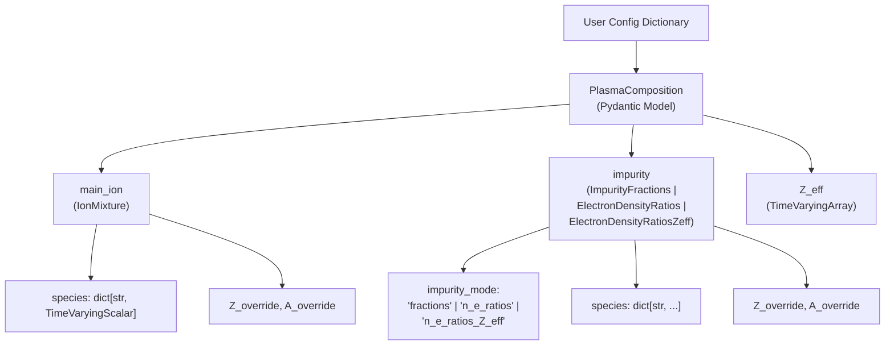
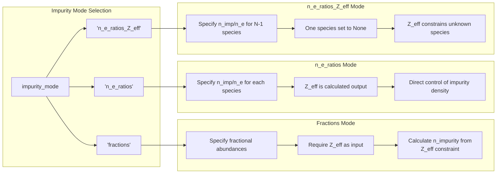
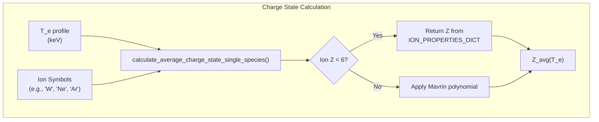
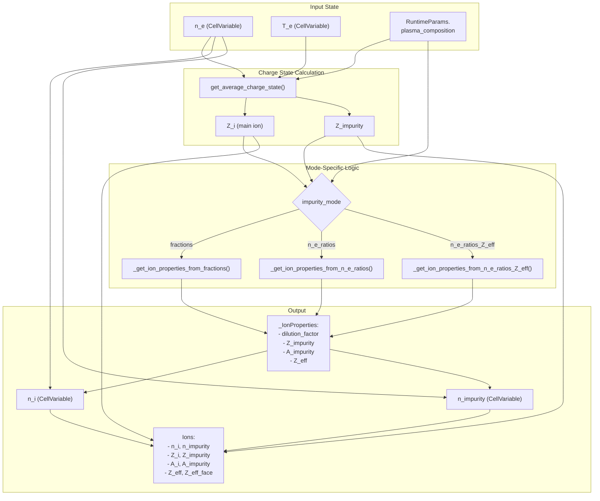
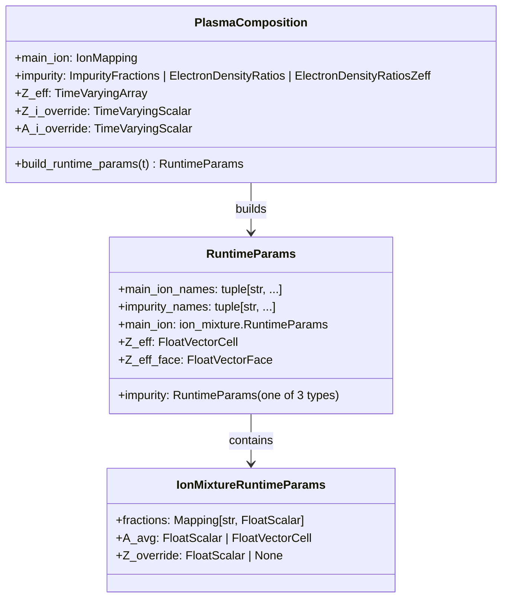

<!-- source: DeepWiki mcp.deepwiki.com · repo google-deepmind/torax · page 2.3 Plasma Composition Configuration · fetched 2026-10-26 -->

# Plasma Composition Configuration

<details>
<summary>Relevant source files</summary>

The following files were used as context for generating this wiki page:

- [docs/configuration.rst](docs/configuration.rst)
- [docs/edge_models.rst](docs/edge_models.rst)
- [docs/interfacing_with_surrogates.rst](docs/interfacing_with_surrogates.rst)
- [docs/links.rst](docs/links.rst)
- [docs/output.rst](docs/output.rst)
- [docs/physics_models.rst](docs/physics_models.rst)
- [docs/running_programmatically.rst](docs/running_programmatically.rst)
- [docs/user_guides.rst](docs/user_guides.rst)
- [docs/using_jax.rst](docs/using_jax.rst)
- [torax/_src/core_profiles/getters.py](torax/_src/core_profiles/getters.py)
- [torax/_src/core_profiles/plasma_composition/electron_density_ratios.py](torax/_src/core_profiles/plasma_composition/electron_density_ratios.py)
- [torax/_src/core_profiles/plasma_composition/electron_density_ratios_zeff.py](torax/_src/core_profiles/plasma_composition/electron_density_ratios_zeff.py)
- [torax/_src/core_profiles/plasma_composition/impurity_fractions.py](torax/_src/core_profiles/plasma_composition/impurity_fractions.py)
- [torax/_src/core_profiles/plasma_composition/ion_mixture.py](torax/_src/core_profiles/plasma_composition/ion_mixture.py)
- [torax/_src/core_profiles/plasma_composition/plasma_composition.py](torax/_src/core_profiles/plasma_composition/plasma_composition.py)
- [torax/_src/core_profiles/tests/getters_test.py](torax/_src/core_profiles/tests/getters_test.py)
- [torax/_src/core_profiles/tests/plasma_composition_test.py](torax/_src/core_profiles/tests/plasma_composition_test.py)
- [torax/_src/physics/charge_states.py](torax/_src/physics/charge_states.py)
- [torax/_src/physics/tests/charge_states_test.py](torax/_src/physics/tests/charge_states_test.py)
- [torax/_src/sources/impurity_radiation_heat_sink/impurity_radiation_mavrin_fit.py](torax/_src/sources/impurity_radiation_heat_sink/impurity_radiation_mavrin_fit.py)
- [torax/_src/tests/state_test.py](torax/_src/tests/state_test.py)
- [torax/_src/transport_model/tests/bohm_gyrobohm_test.py](torax/_src/transport_model/tests/bohm_gyrobohm_test.py)

</details>


## Purpose and Scope

This page describes how to configure the plasma composition in TORAX, including main ion species, impurity species, and the effective plasma charge (Z_eff). The configuration determines ion densities, charge states, and mass properties that affect transport equations, fusion power calculations, and impurity radiation. 

For information about how these parameters are used in runtime simulation, see [Advanced Topics: Core Profiles and Plasma Composition](#9.1). For general configuration structure, see [Configuration System](#2).

**Sources:** [docs/configuration.rst:412-673]()

## Configuration Model Structure

The plasma composition is configured through the `PlasmaComposition` Pydantic model, which validates and structures all ion-related parameters.



**Sources:** [torax/_src/core_profiles/plasma_composition/plasma_composition.py:59-246](), [docs/configuration.rst:412-450]()

## Main Ion Configuration

Main ions represent the bulk plasma species (typically hydrogen isotopes). They can be specified as a single ion or a mixture with time-dependent fractions.

### Single Ion Specification

For a pure species plasma:

```python
'plasma_composition': {
    'main_ion': 'D',  # Pure deuterium
}
```

### Ion Mixture Specification

For isotope mixtures or multi-species plasmas:

```python
'plasma_composition': {
    'main_ion': {'D': 0.5, 'T': 0.5},  # 50-50 D-T mixture
}
```

### Time-Dependent Mixtures

Fractions can vary in time to model changing isotope ratios:

```python
'plasma_composition': {
    'main_ion': {
        'D': {0.0: 0.1, 5.0: 0.9},  # D fraction from 0.1 to 0.9
        'T': {0.0: 0.9, 5.0: 0.1},  # T fraction from 0.9 to 0.1
    },
}
```

The `IonMixture` class enforces that fractions sum to 1.0 at all times (within tolerance of 1e-6).

**Sources:** [torax/_src/core_profiles/plasma_composition/ion_mixture.py:56-97](), [docs/configuration.rst:481-518]()

## Impurity Configuration Modes

TORAX supports three modes for specifying impurity content, each with different constraints and use cases.



**Sources:** [torax/_src/core_profiles/plasma_composition/plasma_composition.py:36-40](), [docs/configuration.rst:520-650]()

### Fractions Mode

In fractions mode, impurities are specified by their relative fractional abundances within the impurity mixture. Z_eff is required as input to constrain the total impurity density.

**Configuration Example:**

```python
'plasma_composition': {
    'main_ion': 'D',
    'impurity': {
        'impurity_mode': 'fractions',
        'species': {'Ne': 0.8, 'Ar': 0.2},  # 80% Ne, 20% Ar by fraction
    },
    'Z_eff': 2.0,
}
```

The fractions can be time- and space-varying:

```python
'impurity': {
    'impurity_mode': 'fractions',
    'species': {
        'Ne': {0.0: {0.0: 0.1}, 5.0: {0.0: 0.9}},
        'Ar': {0.0: {0.0: 0.9}, 5.0: {0.0: 0.1}},
    },
}
```

**Key constraint:** Fractions must sum to 1.0 at all times and radial positions.

**Sources:** [torax/_src/core_profiles/plasma_composition/impurity_fractions.py:1-148](), [docs/configuration.rst:520-571]()

### n_e_ratios Mode

In this mode, impurity densities are directly specified as ratios to electron density: `n_impurity / n_e`. Z_eff becomes an emergent calculated quantity rather than an input.

**Configuration Example:**

```python
'plasma_composition': {
    'main_ion': 'D',
    'impurity': {
        'impurity_mode': 'n_e_ratios',
        'species': {
            'W': {0.0: {0.0: 1e-5, 1.0: 1e-4}},  # Hollow W profile
            'Ne': 0.01,  # Constant Ne ratio
        },
    },
    # Z_eff input will be ignored with a warning
}
```

The dilution factor is calculated directly from the ratios:

```
dilution_factor = 1 - sum(Z_imp_i * (n_imp_i / n_e)) / Z_main
```

**Warning:** If Z_eff is provided in this mode, it will be ignored and a warning issued.

**Sources:** [torax/_src/core_profiles/plasma_composition/electron_density_ratios.py:1-148](), [docs/configuration.rst:572-610]()

### n_e_ratios_Z_eff Mode

This hybrid mode specifies ratios for N-1 impurity species, with exactly one species marked as `None`. The density of the unknown species is calculated to satisfy the provided Z_eff profile.

**Configuration Example:**

```python
'plasma_composition': {
    'main_ion': 'D',
    'impurity': {
        'impurity_mode': 'n_e_ratios_Z_eff',
        'species': {
            'Ne': 0.01,  # Known Ne ratio
            'W': None,   # W density calculated from Z_eff
        },
    },
    'Z_eff': {0.0: {0.0: 2.0}, 10.0: {0.0: 2.2}},  # Time-varying Z_eff
}
```

This solves a 2×2 system for the main ion dilution and unknown impurity ratio:

```
x * Z_i + y * Z_unknown = 1 - sum(Z_known * n_known / n_e)
x * Z_i^2 + y * Z_unknown^2 = Z_eff - sum(Z_known^2 * n_known / n_e)
```

**Sources:** [torax/_src/core_profiles/plasma_composition/electron_density_ratios_zeff.py:1-88](), [torax/_src/core_profiles/getters.py:287-471](), [docs/configuration.rst:611-650]()

## Charge State Calculations

TORAX calculates temperature-dependent charge states using Mavrin polynomial fits to ADAS atomic data.



### Mavrin Polynomials

For ions with Z ≥ 6 (C and higher), charge states are calculated using polynomial fits:

```
log10(Z_avg) = c4*X^4 + c3*X^3 + c2*X^2 + c1*X + c0
where X = log10(T_e)
```

Temperature is clipped to the valid range [0.1, 100] keV to avoid extrapolation.

**Supported ions with temperature-dependent charge states:**
- Carbon (C)
- Nitrogen (N)
- Oxygen (O)
- Neon (Ne)
- Argon (Ar)
- Krypton (Kr)
- Xenon (Xe)
- Tungsten (W)

**Fully ionized ions (Z < 6):**
- H, D, T, He3, He4, Li, Be

### Effective Charge for Mixtures

For ion mixtures, the effective charge is calculated as:

```
Z_mixture = <Z^2> / <Z> = sum(fraction_i * Z_i^2) / sum(fraction_i * Z_i)
```

This definition ensures consistency with quasineutrality equations when treating the mixture as a single effective species.

**Sources:** [torax/_src/physics/charge_states.py:119-167](), [torax/_src/physics/charge_states.py:169-239](), [docs/configuration.rst:472-476]()

## Ion Density Calculations

The `get_updated_ions()` function calculates main ion and impurity densities from electron density, charge states, and Z_eff, enforcing quasineutrality.



### Quasineutrality Constraint

All modes enforce quasineutrality:

```
n_i * Z_i + n_impurity * Z_impurity = n_e
```

Combined with the Z_eff definition:

```
n_i * Z_i^2 + n_impurity * Z_impurity^2 = n_e * Z_eff
```

These two equations are solved for `n_i` and `n_impurity`.

### Dilution Factor

The main ion dilution factor is defined as:

```
dilution_factor = n_i / n_e
```

This quantifies how much the main ion density is reduced by impurities.

**Sources:** [torax/_src/core_profiles/getters.py:474-625](), [torax/_src/core_profiles/getters.py:178-284]()

## Runtime Parameters Structure

The configuration is converted to runtime parameters for use in the simulation loop.



The `build_runtime_params(t)` method evaluates all time-varying parameters at time `t` and returns JAX-compatible arrays for use in compiled functions.

**Sources:** [torax/_src/core_profiles/plasma_composition/plasma_composition.py:42-55](), [torax/_src/core_profiles/plasma_composition/plasma_composition.py:237-246]()

## Configuration Examples

### Example 1: ITER-like D-T Plasma with Neon Impurity

```python
'plasma_composition': {
    'main_ion': {'D': 0.5, 'T': 0.5},
    'impurity': {
        'impurity_mode': 'fractions',
        'species': 'Ne',
    },
    'Z_eff': {
        0.0: {0.0: 1.2, 1.0: 1.5},  # Core to edge gradient
        5.0: {0.0: 2.0, 1.0: 2.5},  # Increases over time
    },
}
```

### Example 2: High-Z Contamination with n_e_ratios

```python
'plasma_composition': {
    'main_ion': 'D',
    'impurity': {
        'impurity_mode': 'n_e_ratios',
        'species': {
            'W': {
                0.0: {0.0: 1e-5, 1.0: 1e-4},  # Hollow profile initially
                10.0: {0.0: 1e-4},             # Flattens over time
            },
            'Ne': 0.01,  # Constant neon seeding
        },
    },
}
```

### Example 3: Mixed Impurity with Z_eff Constraint

```python
'plasma_composition': {
    'main_ion': 'D',
    'impurity': {
        'impurity_mode': 'n_e_ratios_Z_eff',
        'species': {
            'Ne': 0.01,      # Known Ne concentration
            'W': None,       # Tungsten adjusted to match Z_eff
        },
    },
    'Z_eff': {
        0.0: {0.0: 2.0},
        10.0: {0.0: 2.2},
    },
}
```

**Sources:** [docs/configuration.rst:481-650](), [torax/_src/core_profiles/tests/plasma_composition_test.py:148-269]()

## Overrides for Testing

Both main ions and impurities support Z and A overrides for testing or sensitivity studies:

```python
'plasma_composition': {
    'main_ion': {'D': 1.0},
    'Z_i_override': 1.5,     # Override deuterium charge
    'A_i_override': 2.5,     # Override deuterium mass
    'impurity': {
        'impurity_mode': 'fractions',
        'species': 'Ne',
        'Z_override': 8.0,   # Override neon charge state
        'A_override': 22.0,  # Override neon mass
    },
}
```

**Note:** Legacy top-level `Z_impurity_override` and `A_impurity_override` are deprecated. Use overrides within the `impurity` dictionary instead.

**Sources:** [torax/_src/core_profiles/plasma_composition/plasma_composition.py:113-116](), [docs/configuration.rst:448-471]()

## Allowed Ion Symbols

The following ion symbols are recognized in both `main_ion` and `impurity` specifications:

| Symbol | Name | Z | A (amu) |
|--------|------|---|---------|
| H | Hydrogen | 1 | 1.008 |
| D | Deuterium | 1 | 2.014 |
| T | Tritium | 1 | 3.016 |
| He3 | Helium-3 | 2 | 3.016 |
| He4 | Helium-4 | 2 | 4.003 |
| Li | Lithium | 3 | 6.941 |
| Be | Beryllium | 4 | 9.012 |
| C | Carbon | 6 | 12.011 |
| N | Nitrogen | 7 | 14.007 |
| O | Oxygen | 8 | 15.999 |
| Ne | Neon | 10 | 20.180 |
| Ar | Argon | 18 | 39.948 |
| Kr | Krypton | 36 | 83.798 |
| Xe | Xenon | 54 | 131.29 |
| W | Tungsten | 74 | 183.84 |

**Sources:** [docs/configuration.rst:651-673](), [torax/_src/constants.py:39-63]()

## Validation Rules

The configuration system enforces several validation rules:

1. **Fraction sum constraint:** For fractions mode, impurity fractions must sum to 1.0 within tolerance 1e-6
2. **Z_eff bounds:** Z_eff must be ≥ 1.0 (pure main ion plasma minimum)
3. **Non-negative ratios:** n_e_ratios must be non-negative
4. **Exactly one None:** n_e_ratios_Z_eff mode requires exactly one species with `None` ratio
5. **Consistent grids:** For time/space-varying fractions, all species must share the same time points and rho_norm coordinates
6. **Non-empty species:** At least one species must be specified for impurities

These validations are enforced during Pydantic model construction and will raise `ValidationError` if violated.

**Sources:** [torax/_src/core_profiles/plasma_composition/impurity_fractions.py:42-96](), [torax/_src/core_profiles/plasma_composition/electron_density_ratios_zeff.py:77-87]()

---

