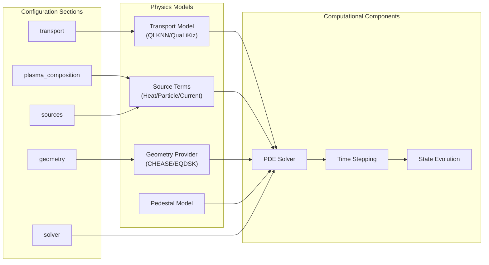

<!-- source: DeepWiki mcp.deepwiki.com · repo google-deepmind/torax · page 2.4 Example Configurations · fetched 2026-10-26 -->

# Example Configurations

<details>
<summary>Relevant source files</summary>

The following files were used as context for generating this wiki page:

- [docs/configuration.rst](docs/configuration.rst)
- [docs/edge_models.rst](docs/edge_models.rst)
- [docs/interfacing_with_surrogates.rst](docs/interfacing_with_surrogates.rst)
- [docs/links.rst](docs/links.rst)
- [docs/output.rst](docs/output.rst)
- [docs/physics_models.rst](docs/physics_models.rst)
- [docs/running_programmatically.rst](docs/running_programmatically.rst)
- [docs/user_guides.rst](docs/user_guides.rst)
- [docs/using_jax.rst](docs/using_jax.rst)
- [torax/tests/test_data/test_changing_config_after.nc](torax/tests/test_data/test_changing_config_after.nc)
- [torax/tests/test_data/test_changing_config_before.nc](torax/tests/test_data/test_changing_config_before.nc)
- [torax/tests/test_data/test_implicit.nc](torax/tests/test_data/test_implicit.nc)
- [torax/tests/test_data/test_iterbaseline_mockup.nc](torax/tests/test_data/test_iterbaseline_mockup.nc)
- [torax/tests/test_data/test_iterhybrid_mockup.nc](torax/tests/test_data/test_iterhybrid_mockup.nc)
- [torax/tests/test_data/test_iterhybrid_predictor_corrector.nc](torax/tests/test_data/test_iterhybrid_predictor_corrector.nc)
- [torax/tests/test_data/test_iterhybrid_predictor_corrector_zeffprofile.nc](torax/tests/test_data/test_iterhybrid_predictor_corrector_zeffprofile.nc)
- [torax/tests/test_data/test_iterhybrid_rampup.nc](torax/tests/test_data/test_iterhybrid_rampup.nc)
- [torax/tests/test_data/test_ne_qlknn_deff_veff.nc](torax/tests/test_data/test_ne_qlknn_deff_veff.nc)
- [torax/tests/test_data/test_ne_qlknn_defromchie.nc](torax/tests/test_data/test_ne_qlknn_defromchie.nc)
- [torax/tests/test_data/test_prescribed_timedependent_ne.nc](torax/tests/test_data/test_prescribed_timedependent_ne.nc)
- [torax/tests/test_data/test_timedependence.nc](torax/tests/test_data/test_timedependence.nc)

</details>


This page provides concrete examples of TORAX configuration files for different simulation scenarios, demonstrating common configuration patterns and best practices. These examples serve as templates for setting up new simulations and illustrate how to configure various physics models and numerical methods.

For detailed information about individual configuration parameters, see [Configuration Parameters](#2.1). For information about implementing time-varying parameters, see [Time-Dependent Parameters](#2.2).

## Configuration Categories

TORAX includes several categories of example configurations, each designed for specific simulation purposes and physics scenarios:

```mermaid
graph TD
    ExampleConfigs["Example Configurations"]
    
    ExampleConfigs --> ITERScenarios["ITER Scenarios"]
    ExampleConfigs --> SolverExamples["Solver Method Examples"]
    ExampleConfigs --> TestConfigs["Test Configurations"]
    
    ITERScenarios --> Hybrid["Hybrid Scenario<br/>test_iterhybrid_mockup.py"]
    ITERScenarios --> Baseline["Baseline Scenario<br/>test_iterbaseline_mockup.py"]
    ITERScenarios --> Rampup["Current Rampup<br/>test_iterhybrid_rampup.py"]
    
    SolverExamples --> PredCorr["Predictor-Corrector<br/>test_iterhybrid_predictor_corrector.py"]
    SolverExamples --> Qualikiz["QuaLiKiz Transport<br/>test_iterhybrid_predictor_corrector_qualikiz.py"]
    SolverExamples --> ZeffProfile["Z_eff Profile<br/>test_iterhybrid_predictor_corrector_zeffprofile.py"]
    
    TestConfigs --> ChangingBefore["Parameter Change Test (Before)<br/>test_changing_config_before.py"]
    TestConfigs --> ChangingAfter["Parameter Change Test (After)<br/>test_changing_config_after.py"]
    TestConfigs --> RampupShort["Short Rampup Test<br/>test_iterhybrid_rampup_short.py"]
```



Sources: [torax/tests/test_data/test_iterhybrid_mockup.py:15-18](), [torax/tests/test_data/test_iterbaseline_mockup.py:15-15](), [torax/tests/test_data/test_iterhybrid_rampup.py:15-19](), [torax/tests/test_data/test_iterhybrid_predictor_corrector.py:15-15]()

## Configuration Structure

All TORAX configurations follow a standard dictionary structure with major sections corresponding to different aspects of the simulation:

```mermaid
graph TD
    CONFIG["CONFIG Dictionary"]
    
    CONFIG --> PlasmaComp["plasma_composition<br/>Main ion species, impurities, Z_eff"]
    CONFIG --> ProfileCond["profile_conditions<br/>Initial conditions, boundary conditions"]
    CONFIG --> Numerics["numerics<br/>Time stepping, convergence, evolution flags"]
    CONFIG --> Geometry["geometry<br/>Equilibrium type and parameters"]
    CONFIG --> Sources["sources<br/>Heat, particle, and current sources"]
    CONFIG --> Transport["transport<br/>Transport model and coefficients"]
    CONFIG --> Solver["solver<br/>Linear/nonlinear solver settings"]
    CONFIG --> Pedestal["pedestal<br/>Edge transport barrier model"]
    CONFIG --> Neoclassical["neoclassical<br/>Bootstrap current, conductivity"]
    
    PlasmaComp --> MainIon["main_ion: {'D': 0.5, 'T': 0.5}"]
    PlasmaComp --> Impurity["impurity: 'Ne'"]
    PlasmaComp --> Zeff["Z_eff: 1.6"]
    
    ProfileCond --> Ip["Ip: plasma current"]
    ProfileCond --> TempBC["T_i_right_bc, T_e_right_bc"]
    ProfileCond --> DensBC["n_e_right_bc"]
    ProfileCond --> InitProfiles["T_i, T_e, n_e initial profiles"]
```



Sources: [torax/tests/test_data/test_iterhybrid_mockup.py:18-24](), [torax/tests/test_data/test_iterhybrid_mockup.py:40-56]()

## ITER Scenario Configurations

### Hybrid Scenario

The ITER hybrid scenario configuration provides a template for high-performance, steady-state-like discharges with current drive and transport barriers.

| Parameter Category | Key Settings |
|-------------------|--------------|
| **Plasma Current** | 10.5 MA |
| **Main Ion Mix** | D:T = 50:50 |
| **Z_eff** | 1.6 |
| **Transport Model** | QLKNN |
| **Geometry** | CHEASE equilibrium |
| **Solver** | Linear |

```python
# Key configuration sections from test_iterhybrid_mockup.py
CONFIG = {
    'plasma_composition': {
        'main_ion': {'D': 0.5, 'T': 0.5},
        'impurity': 'Ne',
        'Z_eff': 1.6,
    },
    'profile_conditions': {
        'Ip': 10.5e6,  # 10.5 MA plasma current
        'T_i': {0.0: {0.0: 15.0, 1.0: 0.2}},  # keV
        'T_e': {0.0: {0.0: 15.0, 1.0: 0.2}},  # keV
    },
    'transport': {
        'model_name': 'qlknn',
    }
}
```

Sources: [torax/tests/test_data/test_iterhybrid_mockup.py:18-39](), [torax/tests/test_data/test_iterhybrid_mockup.py:110-115]()

### Baseline Scenario

The ITER baseline scenario represents the reference inductive operational mode with lower performance requirements but higher reliability.

| Parameter Category | Key Settings |
|-------------------|--------------|
| **Plasma Current** | 15 MA |
| **Main Ion Mix** | D:T = 50:50 |
| **Z_eff** | 1.74 |
| **Transport Model** | QLKNN |
| **Impurity Override** | Z = 6.3623 |

The baseline scenario uses higher current and different impurity composition compared to the hybrid scenario, reflecting the different physics requirements.

Sources: [torax/tests/test_data/test_iterbaseline_mockup.py:18-30]()

### Current Rampup Scenario

The rampup configuration demonstrates time-dependent parameters, showing how to evolve plasma current from startup to flattop:

```python
'profile_conditions': {
    'Ip': {0: 3e6, 80: 10.5e6},  # Current ramp over 80 seconds
    'n_e_right_bc': {0: 0.1, 80: 0.3},  # Evolving density boundary
}
```

This configuration uses the Newton-Raphson solver to handle the nonlinear dynamics during the rampup phase.

Sources: [torax/tests/test_data/test_iterhybrid_rampup.py:28-39]()

## Solver Method Examples

### Predictor-Corrector Method

The predictor-corrector configuration shows how to enable iterative improvement of time step accuracy:

```python
'solver': {
    'use_predictor_corrector': True,
    'n_corrector_steps': 1,
    'solver_type': 'linear'
}
```

This method provides better accuracy for time-dependent simulations while maintaining computational efficiency.

Sources: [torax/tests/test_data/test_iterhybrid_predictor_corrector.py:124-129]()

### Transport Model Variations

Different transport models can be configured by changing the `model_name` parameter:

| Model | Configuration | Purpose |
|-------|--------------|---------|
| **QLKNN** | `'model_name': 'qlknn'` | Neural network transport model |
| **QuaLiKiz** | `'model_name': 'qualikiz'` | First-principles transport |
| **Constant** | `'model_name': 'constant'` | Fixed transport coefficients |

Sources: [torax/tests/test_data/test_iterhybrid_predictor_corrector_qualikiz.py:22-24]()

## Configuration-to-Physics Mapping

The following diagram shows how configuration sections map to physical models and computational components:



Sources: [torax/tests/test_data/test_iterhybrid_mockup.py:75-115]()

## Test Data Correspondence

Each configuration file has corresponding NetCDF test data that serves as a reference output:

| Configuration File | Test Data File | Purpose |
|-------------------|----------------|---------|
| `test_iterhybrid_mockup.py` | `test_iterhybrid_mockup.nc` | Hybrid scenario validation |
| `test_iterbaseline_mockup.py` | `test_iterbaseline_mockup.nc` | Baseline scenario validation |
| `test_iterhybrid_rampup.py` | `test_iterhybrid_rampup.nc` | Rampup dynamics validation |
| `test_changing_config_before.py` | `test_changing_config_before.nc` | Parameter change testing |
| `test_changing_config_after.py` | `test_changing_config_after.nc` | Parameter change testing |

These test data files contain the expected simulation outputs and are used in the integration testing framework to ensure configuration changes don't break existing functionality.

Sources: [torax/tests/test_data/test_iterhybrid_mockup.nc:1-6](), [torax/tests/test_data/test_changing_config_before.nc:1-6]()

## Usage Patterns

### Creating New Configurations

To create a new configuration, start with an existing example and modify the relevant sections:

1. **Copy a base configuration** that matches your simulation type
2. **Modify plasma composition** for your species mix and impurity content
3. **Adjust profile conditions** for your initial and boundary conditions
4. **Select transport model** appropriate for your physics case
5. **Configure sources** to match your heating and current drive systems
6. **Set numerical parameters** for convergence and time stepping

### Time-Dependent Simulations

For simulations with evolving parameters, use the rampup configuration as a template and specify time-dependent values using the format shown in [Time-Dependent Parameters](#2.2).

### Testing Configurations

Before running production simulations, validate your configuration against similar test cases to ensure the parameters produce physically reasonable results.

Sources: [torax/tests/test_data/test_iterhybrid_rampup.py:22-111](), [torax/examples/iterhybrid_rampup.py:22-44]()

---

