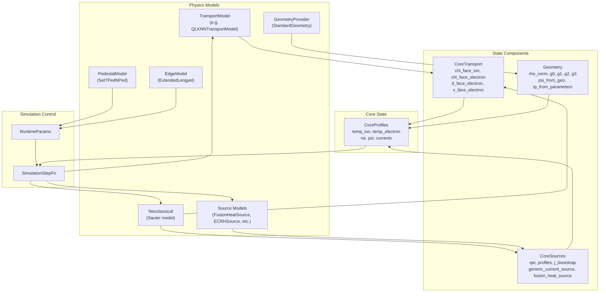
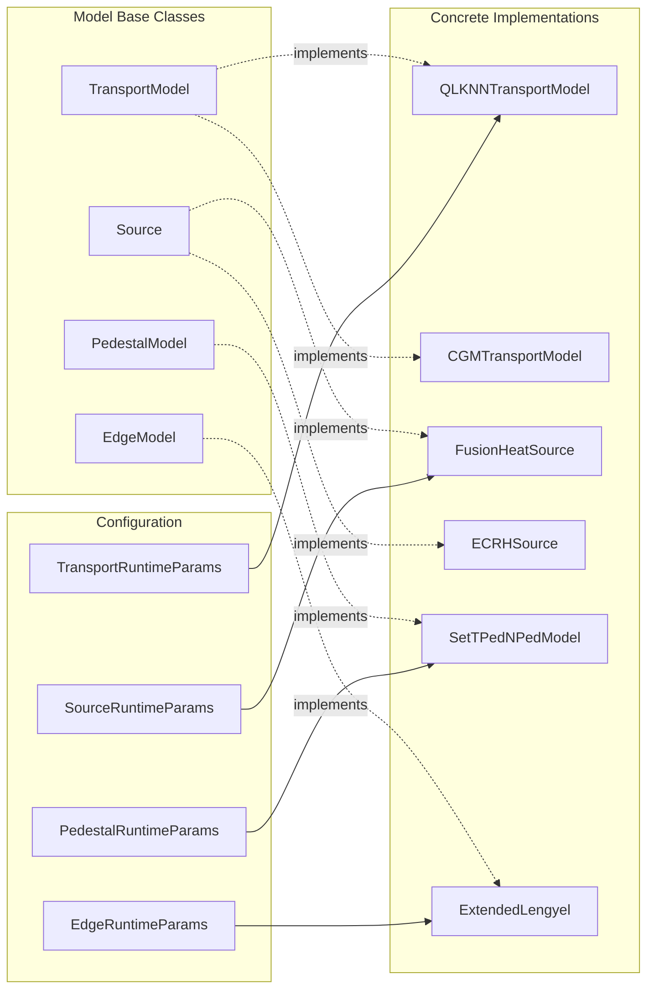
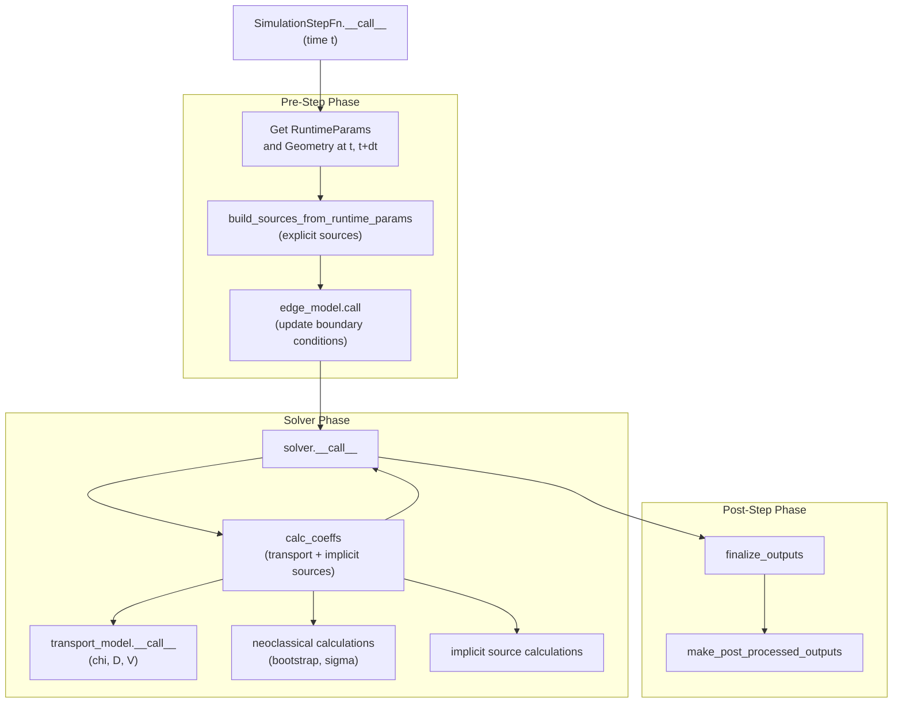
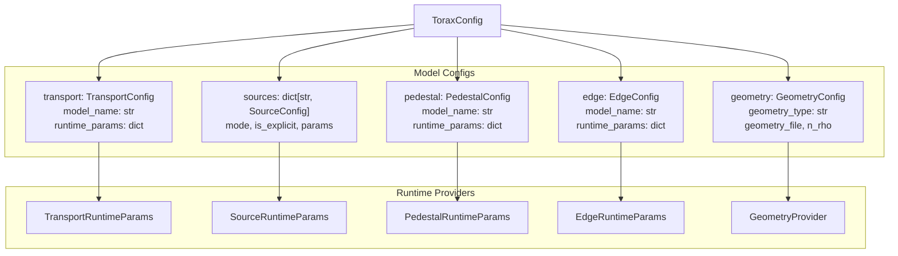
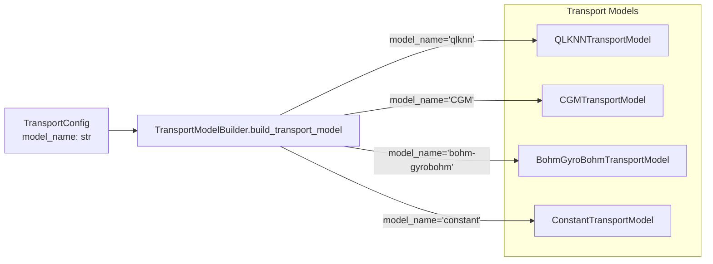
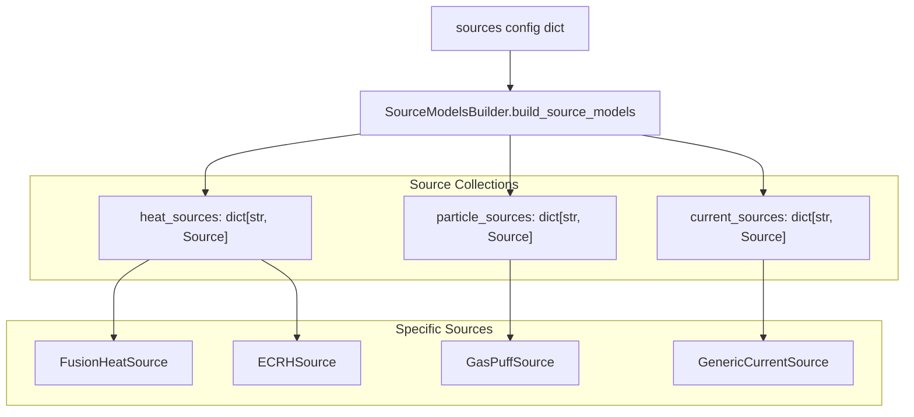
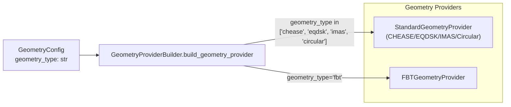

<!-- source: DeepWiki mcp.deepwiki.com · repo google-deepmind/torax · page 3 Physics Models · fetched 2026-10-26 -->

# Physics Models

<details>
<summary>Relevant source files</summary>

The following files were used as context for generating this wiki page:

- [docs/configuration.rst](docs/configuration.rst)
- [docs/edge_models.rst](docs/edge_models.rst)
- [docs/interfacing_with_surrogates.rst](docs/interfacing_with_surrogates.rst)
- [docs/links.rst](docs/links.rst)
- [docs/output.rst](docs/output.rst)
- [docs/physics_models.rst](docs/physics_models.rst)
- [docs/running_programmatically.rst](docs/running_programmatically.rst)
- [docs/user_guides.rst](docs/user_guides.rst)
- [docs/using_jax.rst](docs/using_jax.rst)

</details>


## Purpose and Scope

This page provides an overview of TORAX's modular physics model ecosystem and how different physics models integrate into the core transport simulation. Physics models in TORAX calculate transport coefficients, source terms, boundary conditions, and auxiliary physics effects that drive plasma evolution.

For detailed information on specific model categories:
- **Transport coefficient models**: See [Transport Models](#3.1)
- **Magnetic geometry configurations**: See [Geometry Providers](#3.2)
- **Heating, current drive, and particle sources**: See [Source Models](#3.3)
- **Pedestal boundary conditions**: See [Pedestal Models](#3.4)
- **Scrape-off layer and divertor physics**: See [Edge Physics and Extended Lengyel Model](#3.5)
- **Bootstrap current and MHD effects**: See [Neoclassical Effects and MHD](#3.6)

For information on numerical solution methods that use these physics models, see [Numerical Methods](#5). For configuration details, see [Configuration System](#2).

## Physics Model Architecture

TORAX employs a modular architecture where physics models are decoupled from the core PDE solver. Each model category provides specific physics outputs that feed into the simulation state, which is then evolved by the solver.

### Core State and Model Outputs

Physics models populate three primary state components:

| State Component | Description | Populated By |
|----------------|-------------|--------------|
| `CoreTransport` | Transport coefficients: `chi_i`, `chi_e`, `D_e`, `V_e` | Transport models, neoclassical models |
| `CoreSources` | Power densities, particle sources, current densities | Source models, neoclassical bootstrap |
| `Geometry` | Magnetic field configuration, flux surface geometry | Geometry providers |

**Physics Model Data Flow**



Sources: [docs/physics_models.rst:1-478](), [torax/_src/state.py](), [torax/_src/core_profiles.py]()

### Model Interface Pattern

All physics models follow a consistent interface pattern for integration with the solver:



Sources: [torax/_src/transport_model/transport_model.py](), [torax/_src/sources/source.py](), [torax/_src/pedestal_model/pedestal_model.py](), [torax/_src/edge/edge_model.py]()

## Physics Model Categories

### Transport Models

Transport models calculate turbulent transport coefficients that determine heat and particle diffusion in the plasma. TORAX supports multiple transport models:

| Model | Type | Key Features | Configuration Key |
|-------|------|--------------|-------------------|
| `QLKNNTransportModel` | ML surrogate | Neural network trained on QuaLiKiz data | `'qlknn'` |
| `CGMTransportModel` | Theory-based | Critical gradient model with GyroBohm scaling | `'CGM'` |
| `BohmGyroBohmTransportModel` | Semi-empirical | Bohm + GyroBohm scaling | `'bohm-gyrobohm'` |
| `ConstantTransportModel` | Simple | User-defined constant coefficients | `'constant'` |
| `RuntimeTransportModel` | Prescribed | Time-dependent prescribed values | `'runtime-prescribed'` |

Transport models output a `CoreTransport` object containing:
- `chi_face_ion`: Ion heat diffusivity [m²/s]
- `chi_face_electron`: Electron heat diffusivity [m²/s]
- `d_face_electron`: Electron particle diffusivity [m²/s]
- `v_face_electron`: Electron particle convection velocity [m/s]

See [Transport Models](#3.1) for detailed information.

Sources: [docs/physics_models.rst:111-315](), [torax/_src/transport_model/]()

### Geometry Providers

Geometry providers supply magnetic field configurations and flux surface geometry required for transport calculations:

| Provider | Source | Key Features |
|----------|--------|--------------|
| `StandardGeometry` (CHEASE) | CHEASE equilibrium solver | Fixed boundary Grad-Shafranov solution |
| `StandardGeometry` (EQDSK) | EQDSK G-file format | Flux surface averaged from 2D poloidal flux |
| `StandardGeometry` (IMAS) | IMAS equilibrium IDS | ITER data structure format |
| `FBTGeometry` | FBT equilibrium solver | Free boundary with edge geometry parameters |
| `StandardGeometry` (Circular) | Analytical | Simple circular approximation for testing |

Key geometry outputs: `g0`, `g1`, `g2`, `g3` (flux surface averaged geometric factors), `psi`, `Ip_profile`, `rho_norm`.

See [Geometry Providers](#3.2) for detailed information.

Sources: [docs/physics_models.rst:14-61](), [torax/_src/geometry/]()

### Source Models

Source models calculate heating power densities, particle sources, and current drive:

**Heating Sources:**
- `FusionHeatSource`: Alpha heating from D-T fusion reactions (Bosch-Hale parameterization)
- `ECRHSource`: Electron cyclotron resonance heating
- `ICRHSource`: Ion cyclotron resonance heating
- `OhmicHeatSource`: Resistive heating from plasma current
- `GenericHeatSource`: User-prescribed heating profiles

**Particle Sources:**
- `GasPuffSource`: Gas puff particle injection
- `PelletSource`: Pellet ablation
- `GenericParticleSource`: User-prescribed particle profiles

**Current Drive:**
- `GenericCurrentSource`: External non-inductive current drive
- Bootstrap current from neoclassical effects (see [Neoclassical Effects and MHD](#3.6))

**Radiation Sinks:**
- `BremsstrahlungHeatSink`: Bremsstrahlung radiation losses
- `CyclotronRadiationHeatSink`: Cyclotron radiation
- `ImpurityRadiationHeatSink`: Line radiation from impurities (Mavrin fits)

See [Source Models](#3.3) for detailed information.

Sources: [docs/physics_models.rst:478-647](), [torax/_src/sources/]()

### Pedestal Models

Pedestal models set internal boundary conditions for temperature and density at the pedestal top:

| Model | Description | Configuration |
|-------|-------------|---------------|
| `SetTPedNPedModel` | Directly specify pedestal height and width | `T_i_ped`, `T_e_ped`, `n_e_ped`, `rho_norm_ped_top` |
| `SetPPedNPedModel` | Specify pressure and temperature ratio | `P_ped`, `n_e_ped`, `T_i_T_e_ratio` |

Pedestal models work by adding adaptive source terms at the pedestal location to enforce the desired values.

See [Pedestal Models](#3.4) for detailed information.

Sources: [docs/configuration.rst:698-766](), [torax/_src/pedestal_model/]()

### Edge Models

Edge models couple the core transport solver to scrape-off layer (SOL) and divertor physics:

The `ExtendedLengyel` model provides:
- Separatrix temperature calculation from 2-point model
- Target temperature based on parallel SOL transport with impurity radiation
- Forward mode: Calculate target conditions from upstream state
- Inverse mode: Calculate required impurity seeding for target temperature
- Enrichment modeling for divertor impurity retention

See [Edge Physics and Extended Lengyel Model](#3.5) for detailed information.

Sources: [docs/edge_models.rst:1-269](), [docs/physics_models.rst:419-478](), [torax/_src/edge/]()

### Neoclassical Effects

Neoclassical models (Sauter formulation) calculate:
- Bootstrap current density `j_bootstrap`
- Neoclassical conductivity `sigma_neo`
- Neoclassical transport coefficients `chi_neo_i`, `chi_neo_e`, `D_neo_e`, `V_neo_e`

MHD effects include:
- Sawtooth crash model for core profile redistribution

See [Neoclassical Effects and MHD](#3.6) for detailed information.

Sources: [docs/physics_models.rst:317-329](), [torax/_src/neoclassical/](), [torax/_src/mhd/]()

## Integration with Simulation

### Execution Flow

Physics models are invoked at specific points in the simulation step:



Sources: [torax/_src/orchestration/step_function.py](), [torax/_src/solver/solver.py]()

### Explicit vs. Implicit Treatment

Sources can be treated explicitly or implicitly:

**Explicit sources:**
- Calculated once at the beginning of the timestep using state at time `t`
- Used for all solver iterations at `t + dt`
- Computationally cheaper, less accurate for fast-evolving sources
- Do not require JAX compatibility (can use Python callbacks)

**Implicit sources:**
- Recalculated each solver iteration using current guess for state at `t + dt`
- More accurate for fast-evolving sources
- Must be JAX-compatible for Newton-Raphson solver
- Included in residual Jacobian calculations

Configuration example:
```python
'sources': {
    'fusion_heat_source': {
        'mode': 'formula_based',
        'is_explicit': False,  # Implicit treatment
    },
    'generic_heat_source': {
        'mode': 'prescribed',
        'is_explicit': True,  # Explicit treatment
    },
}
```

Sources: [docs/physics_models.rst:478-502](), [torax/_src/sources/source.py]()

## Model Configuration

### Configuration Structure

Physics models are configured through nested dictionaries in the `ToraxConfig`:



Sources: [torax/_src/torax_pydantic.py](), [torax/_src/config/]()

### Model Selection

Models are selected by name in configuration:

```python
CONFIG = {
    'transport': {
        'model_name': 'qlknn',  # Options: 'qlknn', 'CGM', 'bohm-gyrobohm', 'constant'
    },
    'pedestal': {
        'model_name': 'set_T_ped_n_ped',  # Options: 'no_pedestal', 'set_T_ped_n_ped', 'set_P_ped_n_ped'
        'set_pedestal': True,
    },
    'edge': {
        'model_name': 'extended_lengyel',
        'computation_mode': 'inverse',  # Options: 'forward', 'inverse'
    },
    'geometry': {
        'geometry_type': 'chease',  # Options: 'chease', 'eqdsk', 'imas', 'fbt', 'circular'
    },
}
```

Sources: [docs/configuration.rst:23-31](), [examples/]()

### Time-Dependent Parameters

Many physics model parameters support time interpolation:

| Parameter Type | Configuration Format | Interpolation |
|---------------|---------------------|---------------|
| Scalar | `{time: value}` dict or `(times, values)` tuple | Linear or step |
| Array | `{time: {rho: value}}` nested dict | Linear in time and space |

Example with time-varying transport model parameters:
```python
'transport': {
    'model_name': 'CGM',
    'CGM_alpha': {0.0: 1.0, 5.0: 2.0},  # Time-dependent stiffness factor
    'CGM_C': 0.05,  # Constant multiplier
}
```

Sources: [docs/configuration.rst:52-229](), [torax/_src/config/runtime_params.py]()

## Model Factory Pattern

### Transport Model Factory

The `TransportModelBuilder` constructs transport models:



Sources: [torax/_src/transport_model/transport_model_builder.py]()

### Source Model Factory

The `SourceModelsBuilder` constructs source model collections:



Sources: [torax/_src/sources/source_models_builder.py]()

### Geometry Provider Factory

The `GeometryProviderBuilder` constructs geometry providers:



Sources: [torax/_src/geometry/geometry_provider_builder.py]()

## Physics Model Outputs

### Transport Coefficients

Transport models populate `CoreTransport`:

| Field | Description | Units | Grid |
|-------|-------------|-------|------|
| `chi_face_ion` | Ion heat diffusivity | m²/s | Face |
| `chi_face_electron` | Electron heat diffusivity | m²/s | Face |
| `d_face_electron` | Electron particle diffusivity | m²/s | Face |
| `v_face_electron` | Electron convection velocity | m/s | Face |

Neoclassical contributions are added separately in `CoreTransport`:
- `chi_face_neo_ion`, `chi_face_neo_electron`
- `d_face_neo_electron`, `v_face_neo_electron`

Sources: [torax/_src/core_profiles/core_transport.py](), [docs/output.rst:138-404]()

### Source Profiles

Source models populate `CoreSources`:

| Field | Description | Units | Grid |
|-------|-------------|-------|------|
| `qei` | Ion-electron heat exchange | W/m³ | Cell |
| `profiles` | Combined source profiles per equation | Various | Cell |
| `j_bootstrap` | Bootstrap current density | A/m² | Cell |

Individual source profiles are stored in source-specific fields (e.g., `fusion_heat_source`, `generic_current_source`).

Sources: [torax/_src/core_profiles/core_sources.py](), [docs/output.rst:170-365]()

### Geometry Data

Geometry providers populate `Geometry`:

| Field | Description | Units | Grid |
|-------|-------------|-------|------|
| `rho_norm` | Normalized toroidal flux coordinate | - | Cell+Face |
| `g0`, `g1`, `g2`, `g3` | Flux surface averaged geometric factors | Various | Cell |
| `psi` | Poloidal flux | Wb | Cell+Face |
| `Ip_profile` | Cumulative current profile | A | Face |

Sources: [torax/_src/geometry/geometry.py](), [docs/output.rst:136-393]()

## Summary

The physics model architecture in TORAX provides:

1. **Modularity**: Physics models are independent modules that can be swapped without modifying solver code
2. **Flexibility**: Multiple implementations per category with consistent interfaces
3. **Configurability**: Model selection and parameters via configuration dictionaries
4. **Time-dependence**: Support for time-varying parameters and geometry
5. **Coupling**: Edge models and pedestal models update boundary conditions for core transport
6. **Explicit/Implicit**: Flexible treatment of sources for performance vs. accuracy trade-offs

For implementation details on specific model categories, see the child pages [3.1](#3.1) through [3.6](#3.6).

Sources: [docs/physics_models.rst:1-647](), [torax/_src/]()

---

