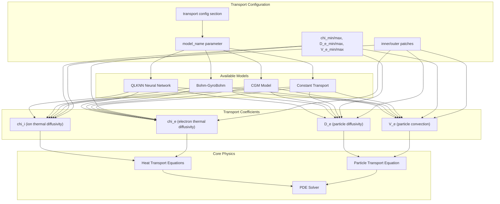
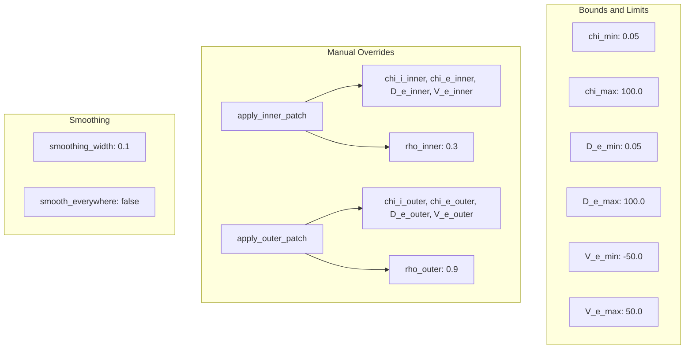
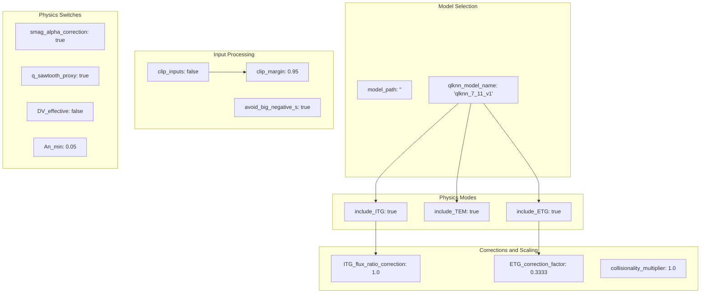
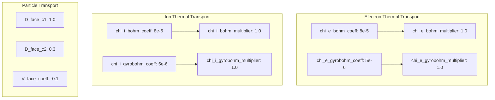
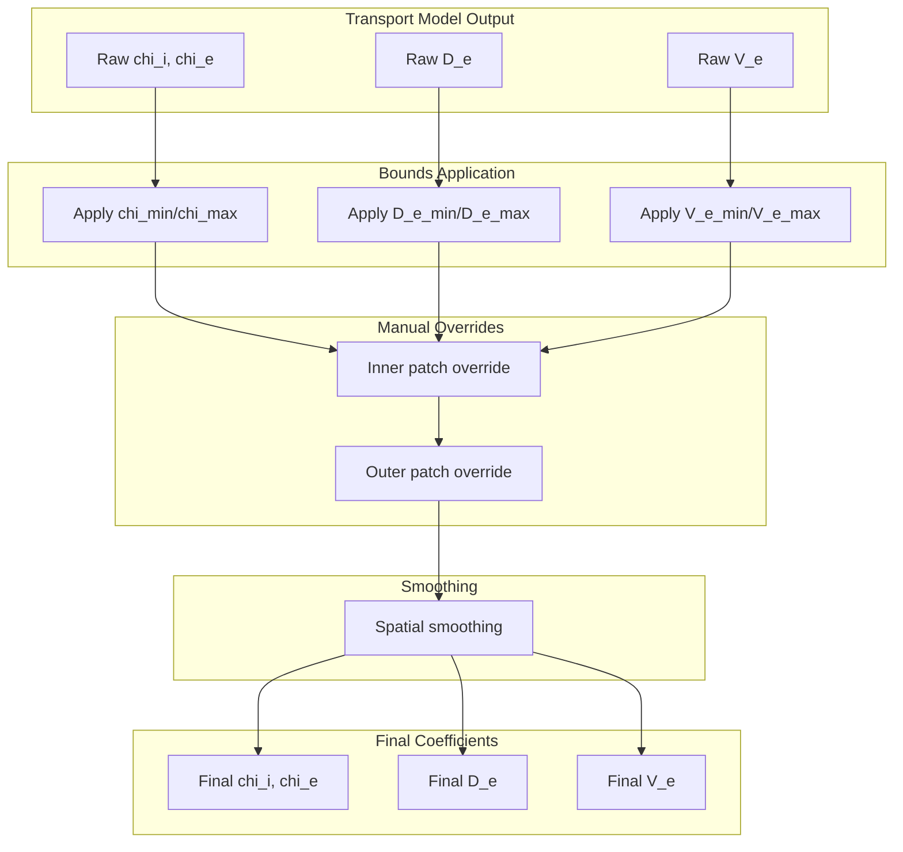

<!-- source: DeepWiki mcp.deepwiki.com · repo google-deepmind/torax · page 3.1 Transport Models · fetched 2026-10-26 -->

# Transport Models

Relevant source files

The following files were used as context for generating this wiki page:

- [docs/configuration.rst](docs/configuration.rst)
- [docs/edge_models.rst](docs/edge_models.rst)
- [docs/interfacing_with_surrogates.rst](docs/interfacing_with_surrogates.rst)
- [docs/links.rst](docs/links.rst)
- [docs/output.rst](docs/output.rst)
- [docs/physics_models.rst](docs/physics_models.rst)
- [docs/running_programmatically.rst](docs/running_programmatically.rst)
- [docs/user_guides.rst](docs/user_guides.rst)
- [docs/using_jax.rst](docs/using_jax.rst)
- [torax/tests/test_data/test_all_transport_fusion_qlknn.nc](torax/tests/test_data/test_all_transport_fusion_qlknn.nc)
- [torax/tests/test_data/test_bohmgyrobohm_all.nc](torax/tests/test_data/test_bohmgyrobohm_all.nc)
- [torax/tests/test_data/test_fixed_dt.nc](torax/tests/test_data/test_fixed_dt.nc)
- [torax/tests/test_data/test_particle_sources_cgm.nc](torax/tests/test_data/test_particle_sources_cgm.nc)
- [torax/tests/test_data/test_psi_and_heat.nc](torax/tests/test_data/test_psi_and_heat.nc)
- [torax/tests/test_data/test_psi_heat_dens.nc](torax/tests/test_data/test_psi_heat_dens.nc)
- [torax/tests/test_data/test_semiimplicit_convection.nc](torax/tests/test_data/test_semiimplicit_convection.nc)

## Purpose and Scope

This page describes the transport models implemented in TORAX, which calculate transport coefficients that govern heat and particle transport in tokamak plasmas. These models compute thermal diffusivities (`chi_i`, `chi_e`), particle diffusivity (`D_e`), and particle convection velocity (`V_e`) that are used in the core plasma evolution equations. For information about the numerical solvers that use these transport coefficients, see [PDE Solvers](#4.1). For details about geometry models that provide magnetic equilibrium data to transport models, see [Geometry Models](#3.2).

## Transport Model Architecture

TORAX implements multiple physics-based and empirical transport models that can be configured through the transport configuration section. The models range from simple analytical expressions to sophisticated neural network approximations of gyrokinetic simulations.

**Sources:** [torax/tests/test_data/test_bohmgyrobohm_all.nc:1-50](), [torax/tests/test_data/test_ne_qlknn_defromchie.nc:1-50](), [torax/tests/test_data/test_particle_sources_cgm.nc:1-50]()

## Transport Model Selection and Configuration

Transport models are selected via the `model_name` parameter in the transport configuration section. Each model has specific parameters that control its behavior and physics assumptions.

| Model Name | Description | Primary Use Case |
|------------|-------------|------------------|
| `"qlknn"` | Neural network approximation of gyrokinetic simulations | High-fidelity turbulent transport predictions |
| `"bohm-gyrobohm"` | Analytical scaling laws | Simple empirical transport |
| `"cgm"` | Critical gradient model | Stiff transport with threshold behavior |
| `"constant"` | Fixed transport coefficients | Testing and simplified scenarios |

### Common Transport Parameters

All transport models support these common configuration parameters:

**Sources:** [torax/tests/test_data/test_bohmgyrobohm_all.nc:1-2000](), [torax/tests/test_data/test_ne_qlknn_defromchie.nc:1-2000]()

## QLKNN Neural Network Model

The QLKNN (QuaLiKiz Neural Network) model provides a fast approximation to full gyrokinetic transport calculations by using neural networks trained on QuaLiKiz database outputs.

### QLKNN Configuration

The QLKNN model computes transport coefficients by:
1. Taking plasma state inputs (temperatures, densities, gradients, magnetic geometry)
2. Processing through trained neural networks for each turbulence mode (ITG, TEM, ETG)
3. Applying physics corrections and scaling factors
4. Outputting thermal diffusivities and particle transport coefficients

**Sources:** [torax/tests/test_data/test_ne_qlknn_defromchie.nc:1-3000](), [torax/tests/test_data/test_all_transport_fusion_qlknn.nc:1-3000](), [torax/tests/test_data/test_ne_qlknn_deff_veff.nc:1-3000]()

## Bohm-GyroBohm Model

The Bohm-GyroBohm model uses analytical scaling expressions for transport coefficients based on plasma parameters and magnetic field strength.

### Bohm-GyroBohm Configuration

The model combines Bohm and GyroBohm scaling:
- **Bohm scaling**: `chi ~ c_Bohm * T / eB` (independent of plasma size)
- **GyroBohm scaling**: `chi ~ c_GyroBohm * (rho*/a)^2 * T / eB` (scales with plasma size)

Where `rho*` is the ion gyroradius and `a` is the minor radius.

**Sources:** [torax/tests/test_data/test_bohmgyrobohm_all.nc:1-4000]()

## CGM (Critical Gradient Model)

The CGM model implements a critical gradient approach where transport coefficients increase sharply when local gradients exceed critical thresholds.

### CGM Characteristics

The CGM model provides:
- **Stiff transport**: Sharp increase in transport above critical gradients
- **Physics-based thresholds**: Critical gradients based on linear stability analysis
- **Profile stiffness**: Tendency to maintain near-critical gradient profiles

**Sources:** [torax/tests/test_data/test_particle_sources_cgm.nc:1-4000]()

## Transport Coefficient Application

Once computed by the selected transport model, the transport coefficients are processed through several stages before being used in the PDE solver:

### Manual Patches

The inner and outer patch features allow manual override of transport coefficients in specific radial regions:

- **Inner patch** (`rho < rho_inner`): Often used to model enhanced transport in the core
- **Outer patch** (`rho > rho_outer`): Typically used to set edge transport conditions

When `apply_inner_patch` or `apply_outer_patch` is enabled, the specified constant values override the model-computed transport coefficients in those regions.

**Sources:** [torax/tests/test_data/test_timedependence.nc:1-4000](), [torax/tests/test_data/test_prescribed_timedependent_ne.nc:1-4000]()

## Integration with Core Physics

Transport coefficients are used in the core plasma evolution equations:

1. **Heat transport equations**: `chi_i` and `chi_e` appear in the ion and electron temperature evolution
2. **Particle transport equation**: `D_e` and `V_e` govern electron density evolution  
3. **Current transport**: Transport affects current profile evolution through temperature-dependent resistivity

The transport models form a critical bridge between microscopic turbulence physics and macroscopic plasma evolution, enabling predictive simulations of tokamak performance and confinement.

**Sources:** [torax/tests/test_data/test_psi_and_heat.nc:1-4000](), [torax/tests/test_data/test_fixed_dt.nc:1-4000]()

---

