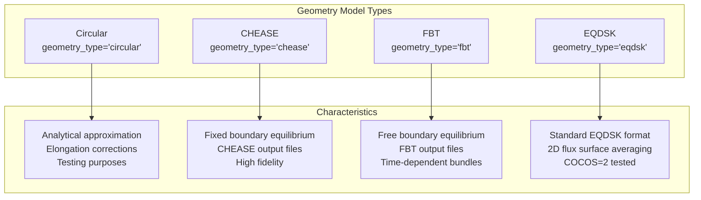
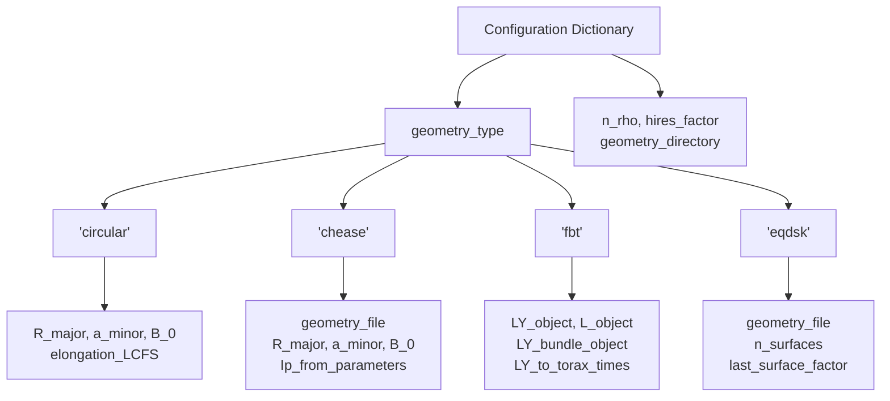
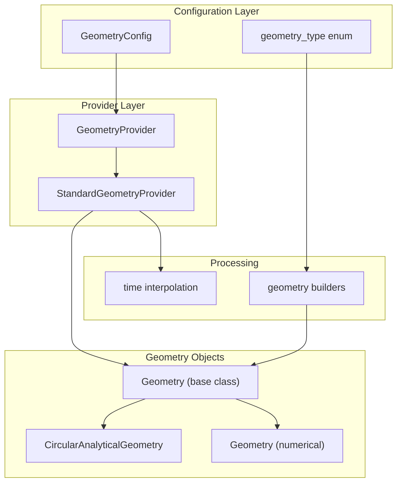
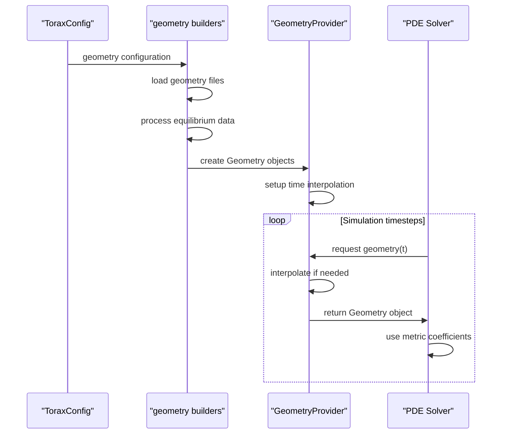

<!-- source: DeepWiki mcp.deepwiki.com · repo google-deepmind/torax · page 3.2 Geometry Providers · fetched 2026-10-26 -->

# Geometry Models

<details>
<summary>Relevant source files</summary>

The following files were used as context for generating this wiki page:

- [docs/configuration.rst](docs/configuration.rst)
- [docs/edge_models.rst](docs/edge_models.rst)
- [docs/interfacing_with_surrogates.rst](docs/interfacing_with_surrogates.rst)
- [docs/links.rst](docs/links.rst)
- [docs/output.rst](docs/output.rst)
- [docs/physics_models.rst](docs/physics_models.rst)
- [docs/running_programmatically.rst](docs/running_programmatically.rst)
- [docs/user_guides.rst](docs/user_guides.rst)
- [docs/using_jax.rst](docs/using_jax.rst)
- [torax/_src/geometry/chease.py](torax/_src/geometry/chease.py)
- [torax/_src/geometry/circular_geometry.py](torax/_src/geometry/circular_geometry.py)
- [torax/_src/geometry/eqdsk.py](torax/_src/geometry/eqdsk.py)
- [torax/_src/geometry/geometry_provider.py](torax/_src/geometry/geometry_provider.py)
- [torax/_src/geometry/imas.py](torax/_src/geometry/imas.py)
- [torax/_src/geometry/pydantic_model.py](torax/_src/geometry/pydantic_model.py)
- [torax/_src/geometry/standard_geometry.py](torax/_src/geometry/standard_geometry.py)
- [torax/_src/geometry/tests/circular_geometry_test.py](torax/_src/geometry/tests/circular_geometry_test.py)
- [torax/_src/geometry/tests/pydantic_model_test.py](torax/_src/geometry/tests/pydantic_model_test.py)

</details>


Geometry models in TORAX define the magnetic equilibrium and provide the geometric coefficients required for solving the transport equations. They determine flux surface geometry, metric coefficients, and other geometric quantities essential for accurate plasma transport modeling.

For information about transport coefficients and plasma profiles, see [Transport Models](#3.1). For source term modeling, see [Source Models](#3.3).

## Purpose and Scope

Geometry models serve several critical functions in TORAX:

- Provide flux surface averaged geometric quantities and metric coefficients
- Define the relationship between flux coordinates and physical space
- Enable calculation of current density and safety factor profiles
- Support both static and time-dependent magnetic equilibria
- Interface with external equilibrium reconstruction codes

The geometry system supports four distinct model types, ranging from simple analytical approximations to sophisticated numerical equilibrium data from external codes.

## Available Geometry Models

TORAX supports four geometry model types, each with different levels of fidelity and computational requirements:



### Circular Geometry

The circular geometry model provides a simplified analytical representation for testing and demonstration purposes. It assumes circular plasma cross-sections with elongation corrections to approximate realistic metric coefficients.

**Key Features:**
- User-specified major radius (`R_major`), minor radius (`a_minor`), and magnetic field (`B_0`)
- Elongation factor (`elongation_LCFS`) for volume and area corrections
- Analytical current profile initialization using `current_profile_nu` parameter
- Not recommended for production simulations

### CHEASE Geometry

CHEASE geometry utilizes equilibrium data from the CHEASE fixed boundary Grad-Shafranov equilibrium solver. This provides high-fidelity geometric data for realistic tokamak configurations.

**Key Features:**
- Reads CHEASE output files (`.mat2cols` format)
- Requires denormalization parameters: `R_major`, `a_minor`, `B_0`
- Supports user control over plasma current via `Ip_from_parameters` flag
- Provides flux surface averaged quantities directly from equilibrium solution

### FBT Geometry

FBT geometry supports equilibrium data from the FBT free boundary Grad-Shafranov code, with special support for time-dependent geometry sequences.

**Key Features:**
- Single time-slice mode via `LY_object` and `L_object` parameters
- Time-dependent bundles via `LY_bundle_object` with automatic time interpolation
- Custom time mapping through `LY_to_torax_times` parameter
- Support for multiple geometry configurations via `geometry_configs`

### EQDSK Geometry

EQDSK geometry processes standard EQDSK format files, performing 2D flux surface averaging to extract 1D profile data required by TORAX.

**Key Features:**
- Standard EQDSK file format support
- Automatic flux surface averaging with configurable `n_surfaces`
- Boundary handling via `last_surface_factor` for diverted geometries
- Tested with CHEASE-generated EQDSK files using COCOS=2

Sources: [docs/physics_models.rst:14-61](), [docs/configuration.rst:497-639]()

## Configuration and Usage

Geometry models are configured through the `geometry` section of the TORAX configuration. The model type is selected via the `geometry_type` parameter, with additional parameters specific to each model.



### Common Configuration Parameters

All geometry types support these common parameters:

- `n_rho`: Number of radial grid points (default: 25)
- `hires_factor`: High-resolution factor for current-to-flux conversions (default: 4)
- `geometry_directory`: Directory path for geometry files (optional)

### Time-Dependent Geometry

Time-dependent geometry is supported through the `geometry_configs` parameter, which allows different geometry files or parameters at different simulation times:

```python
'geometry_configs': {
    20.0: {'LY_file': 'early_rampup.mat'},
    50.0: {'LY_file': 'mid_rampup.mat'},
    100.0: {'LY_file': 'end_rampup.mat'}
}
```

Sources: [docs/configuration.rst:497-639]()

## Code Architecture

The TORAX geometry system is built around several key classes that handle geometry data loading, processing, and time interpolation:



### Key Classes and Functions

**Core Geometry Classes:**
- `Geometry`: Base class representing geometry at a single time point
- `CircularAnalyticalGeometry`: Analytical circular geometry implementation
- `GeometryProvider`: Abstract interface for time-dependent geometry
- `StandardGeometryProvider`: Implementation for numerical geometries with interpolation

**Configuration and Building:**
- `GeometryConfig`: Pydantic configuration model for geometry parameters
- Individual builder functions for each geometry type (CHEASE, FBT, EQDSK, Circular)

**Time Interpolation:**
- Geometry objects are pre-computed at simulation initialization
- `StandardGeometryProvider` interpolates between time points during simulation
- Support for dynamic time stepping through on-the-fly interpolation

Sources: [docs/code_structure.rst:107-122]()

## Geometry Data Flow

The geometry system follows a structured data flow from configuration to runtime usage:



### Geometric Quantities Computed

The geometry system provides essential quantities for the transport equations:

**Metric Coefficients:**
- `g0`, `g1`, `g2`, `g3`: Flux surface averaged metric terms
- `vpr`, `spr`: Volume and surface area derivatives
- `volume`, `area`: Enclosed volume and cross-sectional area

**Magnetic Quantities:**
- `F`: Flux function (B_tor * R)
- `psi`: Poloidal flux profiles
- Safety factor `q` and magnetic shear calculations

**Geometric Profiles:**
- `R_in`, `R_out`: Inner and outer radial positions
- `elongation`: Flux surface elongation
- `r_mid`: Mid-plane radius profiles

### Current and Safety Factor Calculations

The geometry system computes key magnetic quantities using the provided flux data:

**Toroidal Current Density:**
```
j_tor = (R_0^2)/(8π³μ₀) * ∂/∂V * (g₂g₃J/ρ * ∂ψ/∂ρ)
```

**Safety Factor:**
```
q = 2πB₀ρ * (∂ψ/∂ρ)⁻¹
```

With boundary condition: `q(ρ=0) = 2B₀/(μ₀j_tot(ρ=0)R₀)`

Sources: [docs/physics_models.rst:38-54](), [docs/code_structure.rst:107-122]()

---

