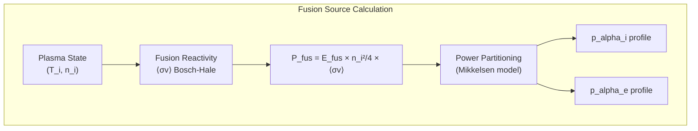
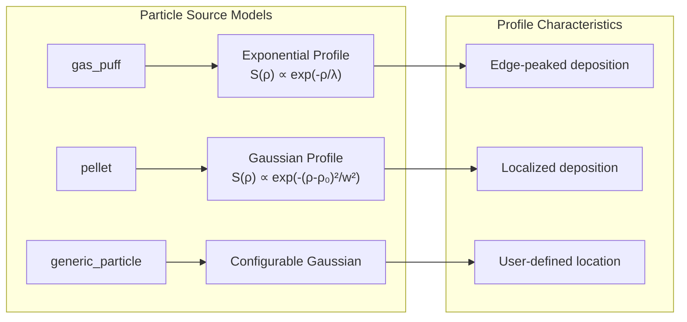
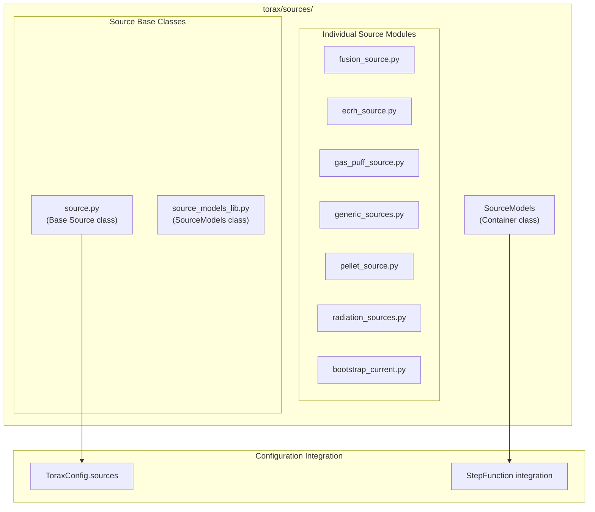
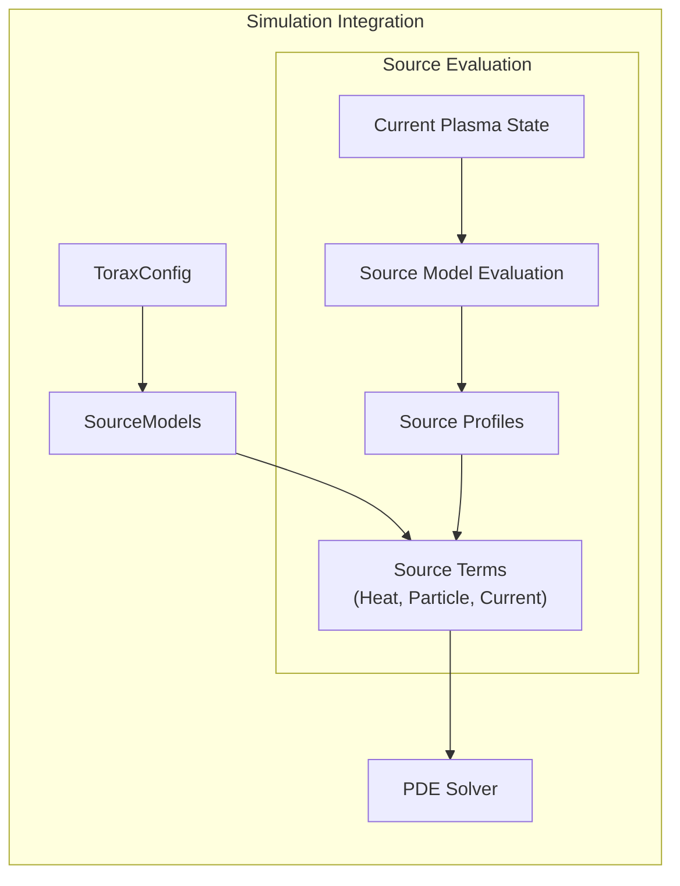

<!-- source: DeepWiki mcp.deepwiki.com · repo google-deepmind/torax · page 3.3 Source Models · fetched 2026-10-26 -->

# Source Models

<details>
<summary>Relevant source files</summary>

The following files were used as context for generating this wiki page:

- [docs/configuration.rst](docs/configuration.rst)
- [docs/edge_models.rst](docs/edge_models.rst)
- [docs/interfacing_with_surrogates.rst](docs/interfacing_with_surrogates.rst)
- [docs/links.rst](docs/links.rst)
- [docs/output.rst](docs/output.rst)
- [docs/physics_models.rst](docs/physics_models.rst)
- [docs/running_programmatically.rst](docs/running_programmatically.rst)
- [docs/user_guides.rst](docs/user_guides.rst)
- [docs/using_jax.rst](docs/using_jax.rst)
- [torax/tests/test_data/test_all_transport_fusion_qlknn.nc](torax/tests/test_data/test_all_transport_fusion_qlknn.nc)
- [torax/tests/test_data/test_bohmgyrobohm_all.nc](torax/tests/test_data/test_bohmgyrobohm_all.nc)
- [torax/tests/test_data/test_fixed_dt.nc](torax/tests/test_data/test_fixed_dt.nc)
- [torax/tests/test_data/test_particle_sources_cgm.nc](torax/tests/test_data/test_particle_sources_cgm.nc)
- [torax/tests/test_data/test_psi_and_heat.nc](torax/tests/test_data/test_psi_and_heat.nc)
- [torax/tests/test_data/test_psi_heat_dens.nc](torax/tests/test_data/test_psi_heat_dens.nc)
- [torax/tests/test_data/test_semiimplicit_convection.nc](torax/tests/test_data/test_semiimplicit_convection.nc)

</details>


## Purpose and Scope

This document describes the source and sink models implemented in TORAX for heat, particle, and current deposition in tokamak plasmas. Source models calculate the spatial and temporal profiles of energy, particle, and current injection that drive plasma evolution.

For information about transport models that determine diffusive fluxes, see [Transport Models](#3.1). For geometry models that provide the spatial coordinate system, see [Geometry Models](#3.2).

## Source Model Architecture

TORAX implements a modular source framework where individual physics-based models calculate source terms that are combined in the transport equations. Each source can be configured to operate in different modes and can be treated either implicitly or explicitly in the numerical solver.

```mermaid
graph TB
    subgraph "Source Model Framework"
        SourceModels["SourceModels Container"]
        SourceModels --> HeatSources["Heat Sources"]
        SourceModels --> ParticleSources["Particle Sources"] 
        SourceModels --> CurrentSources["Current Sources"]
        SourceModels --> RadiationSinks["Radiation Sinks"]
    end
    
    subgraph "Heat Sources"
        HeatSources --> fusion["fusion (Bosch-Hale)"]
        HeatSources --> generic_heat["generic_heat (Gaussian)"]
        HeatSources --> ecrh_heat["ecrh (ECRH heating)"]
        HeatSources --> icrh_heat["icrh (ICRH heating)"]
        HeatSources --> ohmic["ohmic (Resistive heating)"]
        HeatSources --> ei_exchange["ei_exchange (Collisional)"]
    end
    
    subgraph "Particle Sources"
        ParticleSources --> gas_puff["gas_puff (Exponential)"]
        ParticleSources --> pellet["pellet (Gaussian)"]
        ParticleSources --> generic_particle["generic_particle (Gaussian)"]
    end
    
    subgraph "Current Sources"
        CurrentSources --> generic_current["generic_current (Gaussian)"]
        CurrentSources --> ecrh_current["ecrh (Current drive)"]
        CurrentSources --> bootstrap["bootstrap (Neoclassical)"]
    end
    
    subgraph "Radiation Sinks"
        RadiationSinks --> bremsstrahlung["bremsstrahlung"]
        RadiationSinks --> cyclotron_radiation["cyclotron_radiation"]
        RadiationSinks --> impurity_radiation["impurity_radiation"]
    end
```



Sources: [docs/physics_models.rst:331-587](), [docs/code_structure.rst:135-147]()

### Source Configuration Modes

Each source model supports three operational modes:

| Mode | Description | Configuration |
|------|-------------|---------------|
| `"MODEL_BASED"` | Physics-based calculation | Uses model-specific parameters |
| `"PRESCRIBED_VALUES"` | User-specified profiles | Direct profile specification |
| `"ZERO"` | Disabled source | No contribution |

```mermaid
graph LR
    subgraph "Source Mode Selection"
        ModelBased["MODEL_BASED"]
        Prescribed["PRESCRIBED_VALUES"] 
        Zero["ZERO"]
    end
    
    subgraph "Implementation Types"
        ModelBased --> Implicit["Implicit Treatment"]
        ModelBased --> Explicit["Explicit Treatment"]
        Prescribed --> PrescribedImpl["Direct Profile Input"]
        Zero --> ZeroImpl["Zero Contribution"]
    end
    
    subgraph "Code Integration"
        Implicit --> "Included in PDE residual"
        Explicit --> "Pre-calculated input"
        PrescribedImpl --> "Time/space interpolation"
        ZeroImpl --> "Bypassed in calculation"
    end
```

Sources: [docs/physics_models.rst:336-350](), [docs/configuration.rst:19]()

## Heat Sources

Heat sources provide power density profiles that appear as source terms in the ion and electron heat transport equations.

### Fusion Heating

The `fusion` source implements deuterium-tritium fusion power using the Bosch-Hale parameterization. It partitions power between ions and electrons based on the Mikkelsen slowing-down model.

**Key Implementation:**
- Model: `"bosch_hale"`
- Physics: D-T fusion reactivity calculation
- Power split: Parameterized ion/electron heating fractions



Sources: [docs/physics_models.rst:387-427]()

### Generic Heat Source

The `generic_heat` source provides flexible auxiliary heating with configurable spatial and temporal profiles.

**Configuration Parameters:**
- `gaussian_width`: Radial deposition width
- `gaussian_location`: Peak deposition location  
- `P_total`: Total injected power
- `electron_heat_fraction`: Power split between species

### Electron Cyclotron Heating (ECRH)

The `ecrh` source models electron cyclotron resonance heating and current drive.

**Current Drive Formula:**
```
⟨j_EC · B⟩ = (2πε₀²F)/(e³R_maj) × (T_e/n_e) × ζ_EC × Q_EC
```

Where `ζ_EC` is the dimensionless current drive efficiency profile.

Sources: [docs/physics_models.rst:460-477]()

### Ion-Electron Heat Exchange

The `ei_exchange` source calculates collisional power transfer between ion and electron populations.

**Physics Model:**
```
Q_ei = 1.5 n_e (T_i - T_e) / (A_i m_p τ_e)
```

Sources: [docs/physics_models.rst:357-385]()

## Particle Sources

Particle sources provide density source terms for the electron density equation when density evolution is enabled.

### Gas Puff Source

The `gas_puff` source models neutral gas injection from the plasma edge using an exponential penetration profile.

**Model Parameters:**
- `model_name`: `"exponential"`
- `puff_decay_length`: Penetration depth
- `S_total`: Total particle injection rate

### Pellet Injection

The `pellet` source models solid pellet injection with Gaussian deposition profiles.

**Configuration:**
- `pellet_width`: Deposition width
- `pellet_deposition_location`: Injection location
- `S_total`: Pellet particle content



Sources: [docs/physics_models.rst:480-497]()

## Current Sources

Current sources provide non-inductive current drive profiles that appear in the poloidal flux evolution equation.

### Generic Current Drive

The `generic_current` source provides flexible current drive profiles with Gaussian spatial distribution.

**Configuration Modes:**
- `use_absolute_current`: Direct current specification
- `fraction_of_total_current`: Relative to total plasma current

### ECRH Current Drive

ECRH systems provide both heating and current drive through the Lin-Liu current drive efficiency model.

Sources: [docs/physics_models.rst:444-477]()

## Radiation Sinks

Radiation models remove energy from the electron population through various loss mechanisms.

### Bremsstrahlung Radiation

Implements continuum radiation losses with optional relativistic corrections.

**Model Options:**
- Base model: Wesson & Campbell formulation
- Relativistic correction: Stott PPCF 2005

### Cyclotron Radiation

Uses the Albajar total radiation model with Artaud deposition profiles.

### Impurity Radiation

Provides multiple impurity radiation models:

1. **Constant fraction model**: Fixed fraction of external power
2. **ADAS polynomial fits**: Temperature-dependent cooling rates for:
   - Light impurities: He, Li, Be, C, N, O
   - Medium impurities: Ne, Ar, Kr, Xe  
   - Heavy impurities: W

**Valid temperature range:** 0.1-100 keV

Sources: [docs/physics_models.rst:498-542]()

## Code Organization

The source model implementation follows a modular architecture centered around the `SourceModels` container class.



**Key Implementation Files:**
- `source.py`: Base `Source` class defining the interface
- `source_models_lib.py`: `SourceModels` container implementation
- Individual source modules: Physics-specific implementations
- Configuration: Source parameters in `ToraxConfig.sources`

Sources: [docs/code_structure.rst:135-147](), [torax/tests/test_data/]()

### Source Integration in Simulation Loop

Sources are integrated into the TORAX simulation through the `SourceModels` object, which collects all active sources and provides their profiles to the PDE solver.



Sources: [docs/code_structure.rst:76-94]()

---

