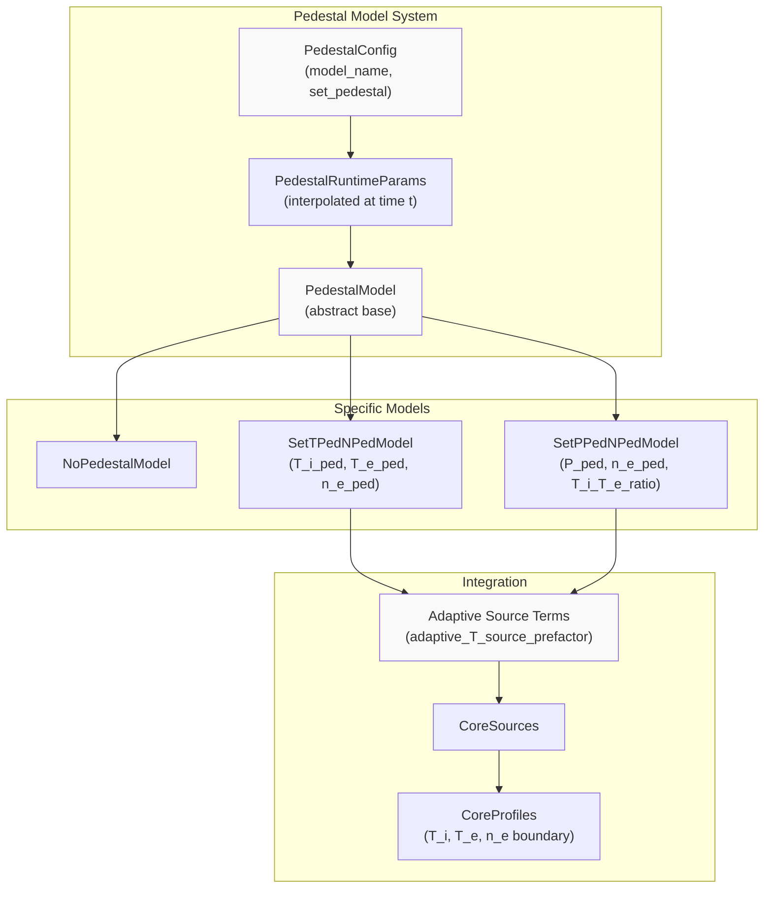
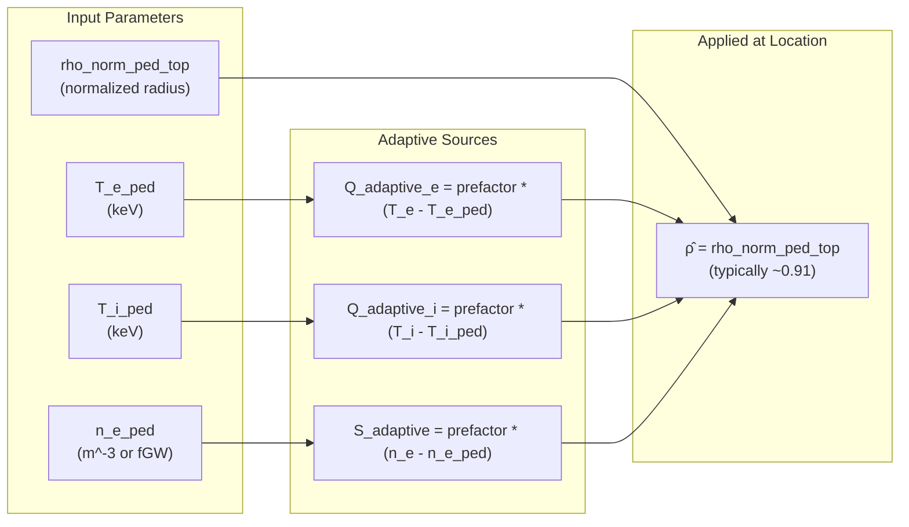
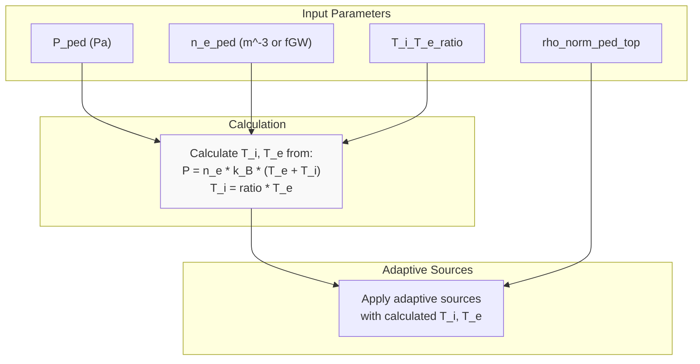
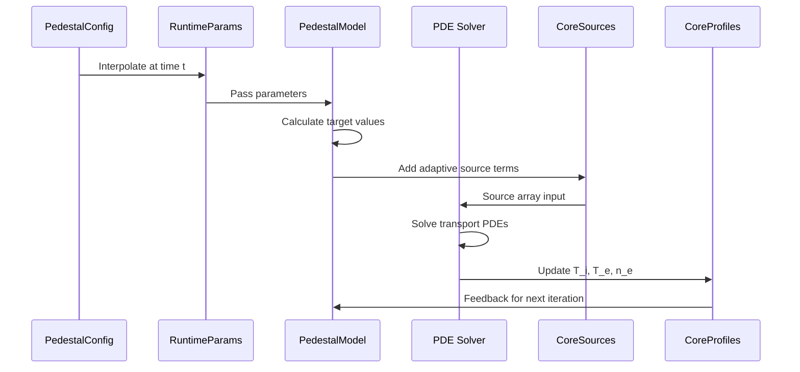

<!-- source: DeepWiki mcp.deepwiki.com · repo google-deepmind/torax · page 3.4 Pedestal Models · fetched 2026-10-26 -->

# Pedestal Models

<details>
<summary>Relevant source files</summary>

The following files were used as context for generating this wiki page:

- [docs/configuration.rst](docs/configuration.rst)
- [docs/edge_models.rst](docs/edge_models.rst)
- [docs/interfacing_with_surrogates.rst](docs/interfacing_with_surrogates.rst)
- [docs/links.rst](docs/links.rst)
- [docs/output.rst](docs/output.rst)
- [docs/physics_models.rst](docs/physics_models.rst)
- [docs/running_programmatically.rst](docs/running_programmatically.rst)
- [docs/user_guides.rst](docs/user_guides.rst)
- [docs/using_jax.rst](docs/using_jax.rst)

</details>


## Purpose and Scope

This page documents the pedestal models available in TORAX for setting internal boundary conditions in the core transport solver. Pedestal models define conditions at the top of the pedestal (typically around ρ̂ ≈ 0.91) to represent the edge transport barrier (ETB) characteristic of H-mode plasmas.

For physics models that compute boundary conditions at the last closed flux surface (LCFS) through edge/divertor coupling, see [Edge Physics and Extended Lengyel Model](#3.5). For general transport models that determine turbulent transport coefficients throughout the plasma, see [Transport Models](#3.1).

---

## Pedestal Modeling Approach

TORAX implements pedestal constraints using **adaptive localized source terms** rather than prescribing transport coefficients in the pedestal region. This approach allows the solver to enforce desired values of temperature and density at a specified radial location (the pedestal top) while maintaining numerical stability.

The adaptive source mechanism works by adding strong source/sink terms that drive the local plasma parameters toward target values at the pedestal top location. These sources are proportional to the difference between the current and target values, with a large prefactor to ensure rapid convergence.



**Diagram: Pedestal Model Architecture**

The pedestal models operate by:
1. Reading configuration parameters at each timestep (via `PedestalRuntimeParams`)
2. Computing target values for T_i, T_e, and n_e at the pedestal top location
3. Injecting adaptive source terms into the PDE source arrays
4. The PDE solver then enforces these boundary conditions during time evolution

Sources: [docs/configuration.rst:698-766](), [docs/physics_models.rst:300-314]()

---

## Available Pedestal Models

TORAX provides three pedestal model options, selected via the `model_name` parameter in the `pedestal` configuration section:

### Model Selection Table

| Model Name | Purpose | Key Parameters | Use Case |
|------------|---------|----------------|----------|
| `no_pedestal` | Disable pedestal | None | L-mode or testing without ETB |
| `set_T_ped_n_ped` | Directly specify pedestal values | `T_i_ped`, `T_e_ped`, `n_e_ped`, `rho_norm_ped_top` | When pedestal parameters are known |
| `set_P_ped_n_ped` | Specify pressure and ratios | `P_ped`, `n_e_ped`, `T_i_T_e_ratio`, `rho_norm_ped_top` | When total pressure is constrained |

Sources: [docs/configuration.rst:698-722]()

---

## Model Descriptions

### no_pedestal

The default model that disables all pedestal boundary condition enforcement. When `set_pedestal=False`, no adaptive source terms are added regardless of the `model_name` setting.

**Configuration:**
- No model-specific parameters required
- Equivalent to setting `set_pedestal: False` with any model

**Example:**
```python
'pedestal': {
    'model_name': 'no_pedestal',
    'set_pedestal': False,  # Can also be omitted (defaults to False)
}
```

Sources: [docs/configuration.rst:718-721]()

---

### set_T_ped_n_ped

Directly specifies the electron density, ion temperature, and electron temperature at the pedestal top. This is the most straightforward approach when pedestal values are known from experimental data or empirical scalings.



**Diagram: set_T_ped_n_ped Model Data Flow**

**Configuration Parameters:**

| Parameter | Type | Default | Units | Description |
|-----------|------|---------|-------|-------------|
| `n_e_ped` | time-varying-scalar | 0.7e20 | m^-3 or fGW | Electron density at pedestal top |
| `n_e_ped_is_fGW` | time-varying-scalar | False | boolean | Toggle for Greenwald fraction units |
| `T_i_ped` | time-varying-scalar | 5.0 | keV | Ion temperature at pedestal top |
| `T_e_ped` | time-varying-scalar | 5.0 | keV | Electron temperature at pedestal top |
| `rho_norm_ped_top` | time-varying-scalar | 0.91 | dimensionless | Pedestal top location in ρ̂ |

**Example Configuration:**
```python
'pedestal': {
    'model_name': 'set_T_ped_n_ped',
    'set_pedestal': True,
    'T_e_ped': {0.0: 5.0, 10.0: 8.0},  # Time-varying pedestal
    'T_i_ped': {0.0: 5.0, 10.0: 8.0},
    'n_e_ped': 0.7e20,  # Constant pedestal density
    'n_e_ped_is_fGW': False,
    'rho_norm_ped_top': 0.91,
}
```

**Notes:**
- All pedestal parameters can be time-varying to simulate L-H transitions or pedestal evolution
- The adaptive source prefactor is controlled by `numerics.adaptive_T_source_prefactor` (default: 1e10 for temperature) and `numerics.adaptive_n_source_prefactor` (default: 1e8 for density)
- Pedestal width is determined by `rho_norm_ped_top`; the model does not prescribe the shape inside the pedestal

Sources: [docs/configuration.rst:723-743]()

---

### set_P_ped_n_ped

Specifies the total plasma pressure at the pedestal top, along with the electron density and the ion-to-electron temperature ratio. The model calculates the individual ion and electron temperatures to satisfy the pressure constraint.



**Diagram: set_P_ped_n_ped Model Calculation**

**Configuration Parameters:**

| Parameter | Type | Default | Units | Description |
|-----------|------|---------|-------|-------------|
| `P_ped` | time-varying-scalar | 1e5 | Pa | Total plasma pressure at pedestal top |
| `n_e_ped` | time-varying-scalar | 0.7 | m^-3 or fGW | Electron density at pedestal top |
| `n_e_ped_is_fGW` | time-varying-scalar | False | boolean | Toggle for Greenwald fraction units |
| `T_i_T_e_ratio` | time-varying-scalar | 1.0 | dimensionless | Ratio T_i/T_e at pedestal |
| `rho_norm_ped_top` | time-varying-scalar | 0.91 | dimensionless | Pedestal top location in ρ̂ |

**Temperature Calculation:**

Given pressure P, density n_e, and ratio r = T_i/T_e:
- Total pressure: P = n_e * k_B * (T_e + T_i)
- With ratio: P = n_e * k_B * T_e * (1 + r)
- Therefore: T_e = P / (n_e * k_B * (1 + r))
- And: T_i = r * T_e

**Example Configuration:**
```python
'pedestal': {
    'model_name': 'set_P_ped_n_ped',
    'set_pedestal': True,
    'P_ped': {0.0: 1.0e5, 5.0: 1.5e5},  # Pressure ramp
    'n_e_ped': 0.7,  # In Greenwald fraction
    'n_e_ped_is_fGW': True,
    'T_i_T_e_ratio': 1.0,  # Equal ion and electron temperature
    'rho_norm_ped_top': 0.91,
}
```

**Use Cases:**
- When experimental measurements provide total pressure but not individual temperatures
- When maintaining a specific pressure profile constraint
- When the T_i/T_e ratio is better constrained than absolute temperatures

Sources: [docs/configuration.rst:745-766]()

---

## Adaptive Source Implementation

The adaptive source mechanism is a key component of how pedestal models enforce boundary conditions without modifying the transport solver's core algorithm.

### Source Term Formulation

For temperature boundary conditions at radial location ρ̂_ped:

**Electron heat source:**
```
Q_adaptive_e(ρ̂) = α_T * δ(ρ̂ - ρ̂_ped) * (T_e_target - T_e(ρ̂_ped))
```

**Ion heat source:**
```
Q_adaptive_i(ρ̂) = α_T * δ(ρ̂ - ρ̂_ped) * (T_i_target - T_i(ρ̂_ped))
```

**Particle source:**
```
S_adaptive(ρ̂) = α_n * δ(ρ̂ - ρ̂_ped) * (n_e_target - n_e(ρ̂_ped))
```

Where:
- α_T = `adaptive_T_source_prefactor` (default: 1e10 W/m³/keV)
- α_n = `adaptive_n_source_prefactor` (default: 1e8 s^-1·m^-3)
- δ(ρ̂ - ρ̂_ped) is a localized function centered at the pedestal top

### Numerical Prefactors

The adaptive source prefactors must be chosen carefully:
- **Too small**: Pedestal boundary condition is weakly enforced; solver may not converge to desired values
- **Too large**: Numerical stiffness increases; solver may become unstable or require smaller timesteps
- **Default values** (1e10 for T, 1e8 for n) typically provide good balance for ITER-scale plasmas

Configuration example showing how to adjust prefactors:

```python
'numerics': {
    'adaptive_T_source_prefactor': 1e10,  # Default for temperature
    'adaptive_n_source_prefactor': 1e8,   # Default for density
    # ... other numerics parameters
}

'pedestal': {
    'model_name': 'set_T_ped_n_ped',
    'set_pedestal': True,
    'T_e_ped': 8.0,
    'T_i_ped': 8.0,
    'n_e_ped': 0.8e20,
    'rho_norm_ped_top': 0.91,
}
```

### Integration with PDE Solver



**Diagram: Pedestal Model Integration Sequence**

The pedestal model operates within the simulation loop:

1. **Pre-timestep**: RuntimeParamsProvider interpolates pedestal parameters at time t
2. **Source building**: Pedestal model computes target values and adds adaptive sources to `CoreSources`
3. **PDE solution**: Solver includes adaptive sources in the residual calculation
4. **Post-timestep**: Updated profiles reflect the enforced pedestal constraints

**Key Integration Points:**
- Pedestal sources are added to the same `CoreSources` arrays as physics sources (fusion, ECRH, etc.)
- Adaptive sources can be treated explicitly or implicitly depending on solver configuration
- The `set_pedestal` flag provides runtime control to enable/disable the model

Sources: [docs/configuration.rst:428-434](), [docs/physics_models.rst:300-314]()

---

## Configuration Guidelines

### Choosing a Pedestal Model

**Use `no_pedestal` when:**
- Simulating L-mode scenarios without ETB
- Testing core transport without edge constraints
- Boundary conditions are set directly via `profile_conditions` parameters

**Use `set_T_ped_n_ped` when:**
- Pedestal temperature and density values are known from experiments
- Using empirical pedestal scalings that provide T and n directly
- Maximum control over individual species temperatures is needed

**Use `set_P_ped_n_ped` when:**
- Total pedestal pressure is constrained (e.g., from stability limits)
- T_i/T_e ratio is better known than absolute values
- Pressure is the primary control parameter

### Time-Dependent Pedestals

All pedestal models support time-varying parameters to simulate:
- **L-H transitions**: Ramp pedestal values from low to high
- **ELM cycles**: Not directly supported by current models (future work)
- **Scenario evolution**: Adapt pedestal as plasma current or heating power changes

Example L-H transition configuration:
```python
'pedestal': {
    'model_name': 'set_T_ped_n_ped',
    'set_pedestal': {0.0: False, 5.0: True},  # Turn on at t=5s
    'T_e_ped': {0.0: 1.0, 5.0: 1.0, 5.1: 8.0},  # Sharp transition
    'T_i_ped': {0.0: 1.0, 5.0: 1.0, 5.1: 8.0},
    'n_e_ped': {0.0: 0.5e20, 5.0: 0.5e20, 5.1: 0.8e20},
    'rho_norm_ped_top': 0.91,
}
```

### Common Pitfalls

1. **Inconsistent boundary conditions**: Ensure `T_e_right_bc`, `T_i_right_bc`, and `n_e_right_bc` in `profile_conditions` are consistent with pedestal values or set to `None` to use values from profiles

2. **Pedestal location vs grid resolution**: The pedestal top location `rho_norm_ped_top` should align with grid points; typical value of 0.91 works well with default grid sizes

3. **Source prefactor tuning**: If solver convergence issues arise, try adjusting `adaptive_T_source_prefactor` or `adaptive_n_source_prefactor`

4. **Greenwald fraction units**: Be careful with `n_e_ped_is_fGW`; when True, `n_e_ped` is interpreted as a fraction of the Greenwald density n_GW = I_p/(πa²)

Sources: [docs/configuration.rst:698-766]()

---

## Future Developments

Current pedestal models in TORAX use adaptive source terms as a pragmatic approach for setting internal boundary conditions. Future development roadmap includes:

1. **Adaptive transport coefficients**: Modify transport model behavior in the pedestal region rather than adding source terms
2. **Pedestal predictive models**: Integration of theory-based models for pedestal height and width (e.g., EPED, neural network surrogates)
3. **ELM cycle modeling**: Periodic relaxation events that transiently modify pedestal profiles
4. **Self-consistent pedestal-core coupling**: Models that evolve pedestal parameters based on core conditions and stability constraints

For edge physics models that couple the core to scrape-off layer and divertor physics, see [Edge Physics and Extended Lengyel Model](#3.5).

Sources: [docs/physics_models.rst:306-314]()

---

