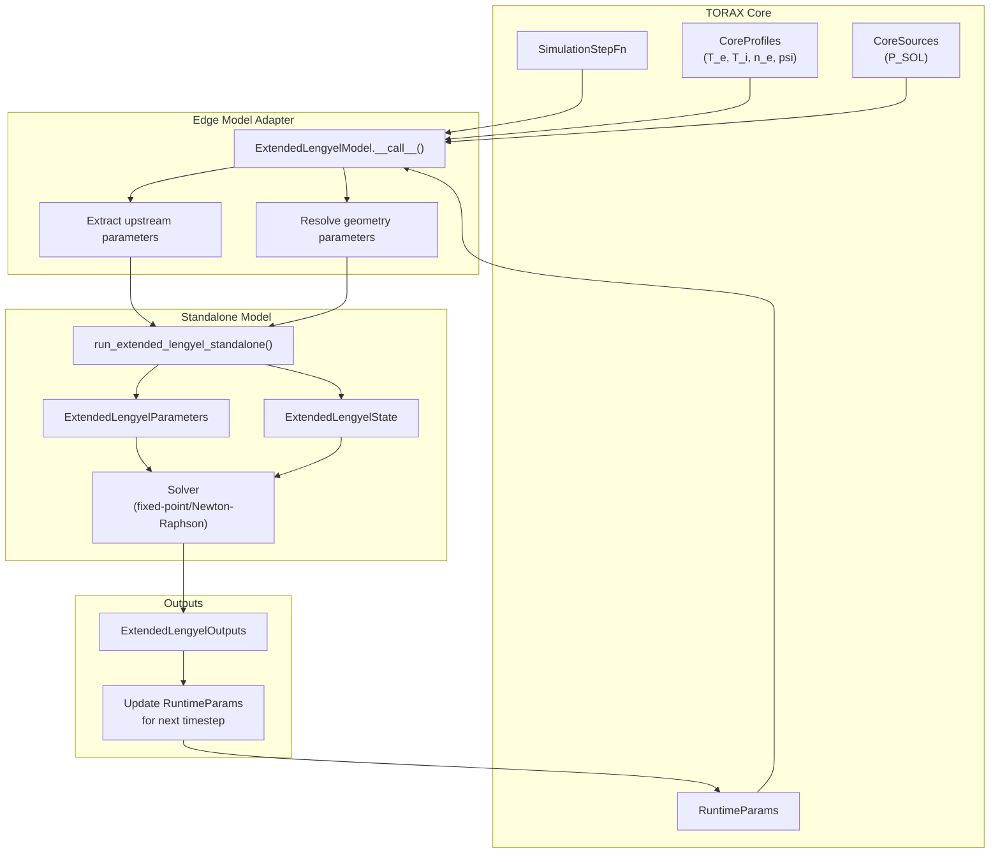
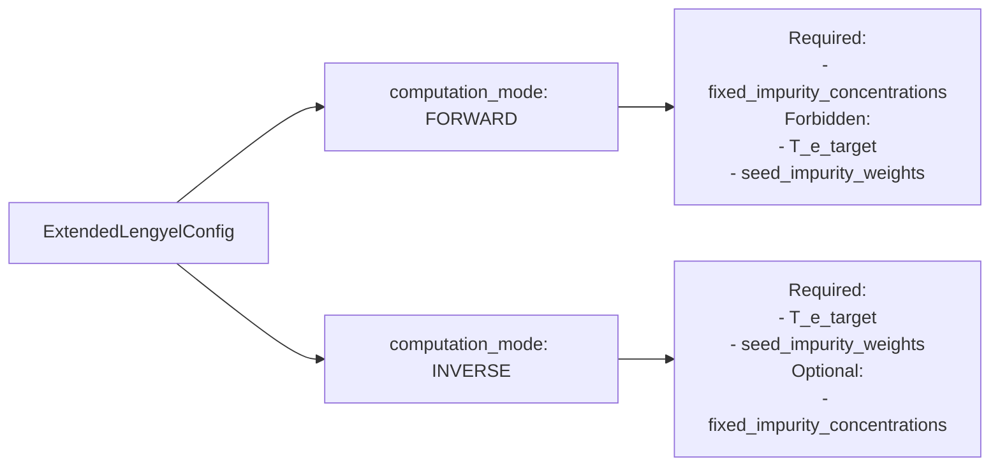
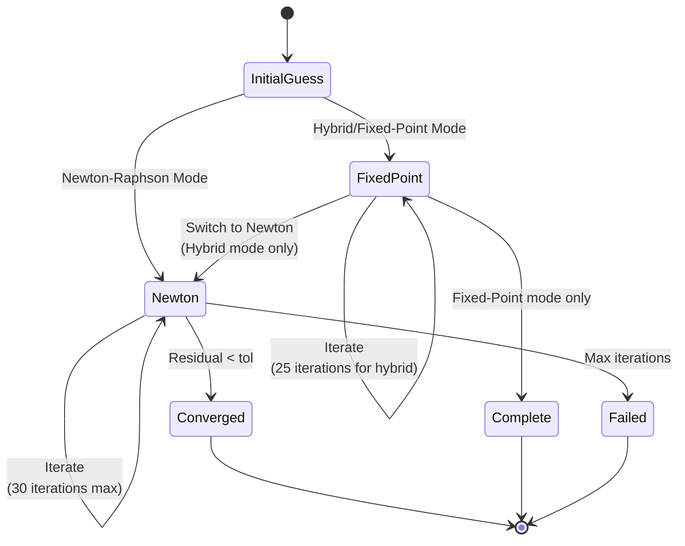
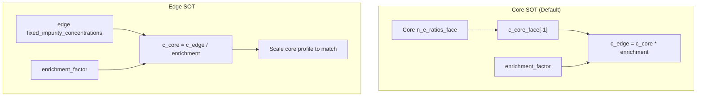
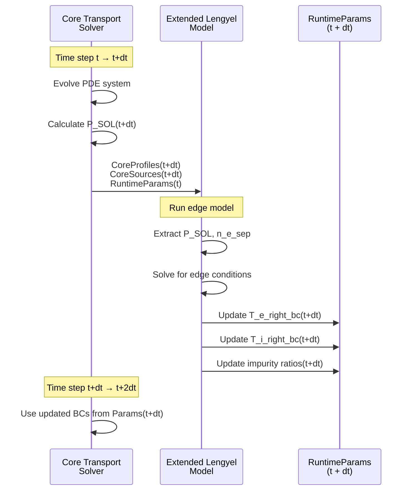
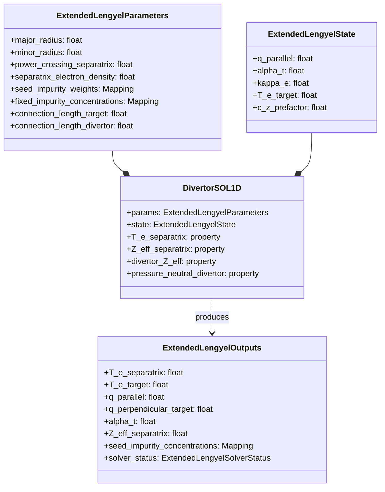
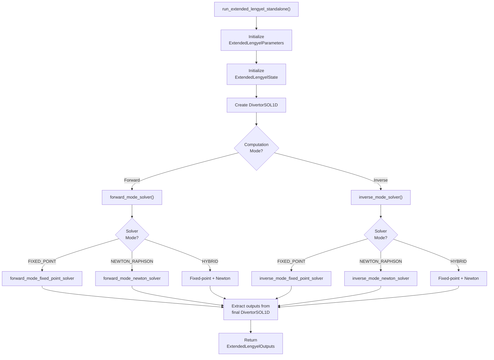

<!-- source: DeepWiki mcp.deepwiki.com · repo google-deepmind/torax · page 3.5 Edge Physics and Extended Lengyel Model · fetched 2026-10-26 -->

# Edge Physics and Extended Lengyel Model

<details>
<summary>Relevant source files</summary>

The following files were used as context for generating this wiki page:

- [docs/configuration.rst](docs/configuration.rst)
- [docs/edge_models.rst](docs/edge_models.rst)
- [docs/interfacing_with_surrogates.rst](docs/interfacing_with_surrogates.rst)
- [docs/links.rst](docs/links.rst)
- [docs/output.rst](docs/output.rst)
- [docs/physics_models.rst](docs/physics_models.rst)
- [docs/running_programmatically.rst](docs/running_programmatically.rst)
- [docs/user_guides.rst](docs/user_guides.rst)
- [docs/using_jax.rst](docs/using_jax.rst)
- [torax/_src/edge/base.py](torax/_src/edge/base.py)
- [torax/_src/edge/divertor_sol_1d.py](torax/_src/edge/divertor_sol_1d.py)
- [torax/_src/edge/extended_lengyel_defaults.py](torax/_src/edge/extended_lengyel_defaults.py)
- [torax/_src/edge/extended_lengyel_formulas.py](torax/_src/edge/extended_lengyel_formulas.py)
- [torax/_src/edge/extended_lengyel_model.py](torax/_src/edge/extended_lengyel_model.py)
- [torax/_src/edge/extended_lengyel_solvers.py](torax/_src/edge/extended_lengyel_solvers.py)
- [torax/_src/edge/extended_lengyel_standalone.py](torax/_src/edge/extended_lengyel_standalone.py)
- [torax/_src/edge/pydantic_model.py](torax/_src/edge/pydantic_model.py)
- [torax/_src/edge/tests/divertor_sol_1d_test.py](torax/_src/edge/tests/divertor_sol_1d_test.py)
- [torax/_src/edge/tests/edge_pydantic_model_test.py](torax/_src/edge/tests/edge_pydantic_model_test.py)
- [torax/_src/edge/tests/edge_updaters_test.py](torax/_src/edge/tests/edge_updaters_test.py)
- [torax/_src/edge/tests/extended_lengyel_formulas_test.py](torax/_src/edge/tests/extended_lengyel_formulas_test.py)
- [torax/_src/edge/tests/extended_lengyel_model_test.py](torax/_src/edge/tests/extended_lengyel_model_test.py)
- [torax/_src/edge/tests/extended_lengyel_solver_test.py](torax/_src/edge/tests/extended_lengyel_solver_test.py)
- [torax/_src/edge/tests/extended_lengyel_standalone_test.py](torax/_src/edge/tests/extended_lengyel_standalone_test.py)
- [torax/_src/edge/third_party_licenses.txt](torax/_src/edge/third_party_licenses.txt)
- [torax/_src/edge/updaters.py](torax/_src/edge/updaters.py)
- [torax/_src/torax_pydantic/model_config.py](torax/_src/torax_pydantic/model_config.py)
- [torax/_src/torax_pydantic/tests/model_config_test.py](torax/_src/torax_pydantic/tests/model_config_test.py)

</details>


## Purpose and Scope

This page documents the Extended Lengyel edge physics model, which calculates 1D parallel heat and particle transport in the Scrape-Off Layer (SOL) and divertor region. The model provides physically consistent boundary conditions for the core transport solver, including separatrix temperature and impurity concentrations. 

The Extended Lengyel model is an optional component of TORAX. When enabled, it runs at each time step to update edge conditions based on upstream plasma parameters and power crossing the separatrix.

For general physics model overview, see [Physics Models](#3). For pedestal models that set internal boundary conditions, see [Pedestal Models](#3.4). For neoclassical effects, see [Neoclassical Effects and MHD](#3.6).

Sources: [docs/physics_models.rst:419-476](), [torax/_src/edge/extended_lengyel_model.py:1-40]()

---

## Model Overview

### Physics Foundation

The Extended Lengyel model extends the classic Lengyel two-point model by incorporating:
- Cross-field transport in the divertor
- Power and momentum loss due to neutral ionization near the target
- Turbulent broadening of the upstream heat flux channel
- Multiple impurity species with enrichment

The model relates upstream quantities (power crossing separatrix `P_SOL`, separatrix density `n_e_sep`) and divertor impurity content to downstream quantities such as target temperature `T_e_target`.

Sources: [docs/physics_models.rst:426-431](), [docs/configuration.rst:767-816](), [torax/_src/edge/extended_lengyel_standalone.py:1-16]()

### System Architecture



**Diagram: Extended Lengyel Integration with TORAX Core**

The edge model adapter [`ExtendedLengyelModel`]() extracts upstream conditions from `CoreProfiles` and `CoreSources`, resolves geometric parameters, then calls the standalone implementation. The outputs update `RuntimeParams` for the next time step, creating explicit coupling between edge and core.

Sources: [torax/_src/edge/extended_lengyel_model.py:136-146](), [torax/_src/edge/extended_lengyel_standalone.py:35-80]()

---

## Computation Modes

The model operates in two distinct modes, controlled by `computation_mode` in the configuration:

### Forward Mode

**Purpose**: Calculate target temperature given fixed impurity concentrations.

**Inputs**:
- Upstream conditions (`P_SOL`, `n_e_sep`, `T_e_sep`)
- Fixed impurity concentrations (`fixed_impurity_concentrations`)

**Outputs**:
- Target electron temperature `T_e_target`
- Separatrix temperature `T_e_separatrix`
- Heat flux at target `q_perpendicular_target`

**Use case**: Predict edge conditions for a given impurity scenario.

Sources: [docs/physics_models.rst:438-440](), [torax/_src/edge/extended_lengyel_enums.py:23-27]()

### Inverse Mode

**Purpose**: Calculate required seeded impurity concentration to achieve a specified target temperature.

**Inputs**:
- Upstream conditions (`P_SOL`, `n_e_sep`)
- Target temperature `T_e_target` (e.g., 5 eV for detachment onset)
- Seed impurity weights (`seed_impurity_weights`)
- Fixed background impurities (`fixed_impurity_concentrations`)

**Outputs**:
- Required seed impurity concentrations (`seed_impurity_concentrations`)
- Separatrix temperature `T_e_separatrix`
- Heat flux distributions

**Use case**: Determine impurity seeding rate needed for detachment control.

Sources: [docs/physics_models.rst:443-445](), [torax/_src/edge/extended_lengyel_enums.py:18-22]()

### Mode Selection and Validation



**Diagram: Computation Mode Requirements**

The configuration system validates that required parameters are present for each mode. Attempting to use inverse-mode parameters in forward mode (or vice versa) raises a validation error.

Sources: [torax/_src/edge/pydantic_model.py:166-243]()

---

## Solver Strategies

The model supports three solver modes to handle the nonlinear system of equations:

### Fixed-Point Iteration

**Method**: Iteratively update state variables until convergence.

**Implementation**:
- `inverse_mode_fixed_point_solver()` for inverse mode
- `forward_mode_fixed_point_solver()` for forward mode

**Characteristics**:
- Simple implementation
- Guaranteed progress (with relaxation in forward mode)
- May require many iterations
- Default: 25 iterations for hybrid mode, 50 for pure fixed-point

Sources: [torax/_src/edge/extended_lengyel_solvers.py:85-135](), [torax/_src/edge/extended_lengyel_defaults.py:40-41]()

### Newton-Raphson

**Method**: Solve nonlinear system using Jacobian-based root finding.

**Implementation**: `forward_mode_newton_solver()` and `inverse_mode_newton_solver()`

**Characteristics**:
- Faster convergence near solution
- Requires differentiability (uses JAX autodiff)
- May struggle far from solution or with ill-conditioned problems
- Default: 30 iterations, tolerance 1e-5

**State Vector** (forward mode):
```python
x = [log(q_parallel), alpha_t, log(kappa_e), log(T_e_target)]
```

Sources: [torax/_src/edge/extended_lengyel_solvers.py:225-276](), [torax/_src/edge/extended_lengyel_defaults.py:41-42]()

### Hybrid Mode (Recommended)

**Method**: Combines fixed-point and Newton-Raphson for robustness and speed.

**Strategy**:
1. Run fixed-point iterations to get close to solution
2. Use Newton-Raphson to refine to tight tolerance

**Configuration**:
- `solver_mode: 'hybrid'` (default)
- Default: 5 fixed-point iterations, then Newton-Raphson

**Benefits**:
- Robustness of fixed-point far from solution
- Speed of Newton-Raphson near solution
- Recommended for most use cases

Sources: [torax/_src/edge/extended_lengyel_enums.py:30-36](), [torax/_src/edge/pydantic_model.py:39-44]()



**Diagram: Solver Mode State Machine**

Sources: [torax/_src/edge/extended_lengyel_standalone.py:145-232]()

---

## Impurity Handling and Enrichment

### Impurity Classification

The model distinguishes between two types of impurities:

**Seed Impurities** (inverse mode only):
- Concentrations calculated by the solver
- Specified via `seed_impurity_weights` (relative weights in a mixture)
- Example: `{'N': 1.0, 'Ar': 0.05}` for primarily nitrogen seeding with trace argon

**Fixed Impurities**:
- Concentrations specified as inputs
- Present in both forward and inverse modes
- Example: `{'He': 0.01}` for 1% helium (e.g., fusion-born alpha particles)

Sources: [torax/_src/edge/pydantic_model.py:145-152](), [docs/edge_models.rst:60-84]()

### Enrichment Model

**Enrichment** is the ratio of impurity concentration at the divertor to the upstream (core) concentration:

```
enrichment = c_divertor / c_core
```

The model supports two approaches:

#### Manual Enrichment

Set `use_enrichment_model: False` and provide `enrichment_factor`:

```python
'enrichment_factor': {
    'N': 2.5,
    'Ar': 3.0,
    'He': 1.5
}
```

Sources: [torax/_src/edge/pydantic_model.py:157-159]()

#### Empirical Enrichment Model

Set `use_enrichment_model: True` to calculate enrichment from the Kallenbach 2024 scaling:

```
E = 41.0 * Z^(-0.5) * p_0^(-0.4) * (E_ion_z / E_ion_D)^(-5.8)
```

where:
- `Z`: Impurity charge
- `p_0`: Neutral pressure in divertor
- `E_ion_z / E_ion_D`: Ratio of ionization energies

The model automatically calculates enrichment for each species. An optional multiplier `enrichment_model_multiplier` can scale the result.

Sources: [torax/_src/edge/extended_lengyel_formulas.py:294-334](), [docs/physics_models.rst:453-456]()

### Source of Truth for Fixed Impurities

The `impurity_sot` parameter controls consistency between core and edge:

**`impurity_sot: 'core'`** (default):
- Core impurity profiles drive edge concentrations
- Edge model uses: `c_edge = c_core_face[-1] * enrichment`
- Core remains unchanged

**`impurity_sot: 'edge'`**:
- Edge model's concentrations drive core profiles
- Core profiles scaled to match edge values
- Profile shape from core, magnitude from edge

This bidirectional coupling ensures consistency between core plasma composition and edge model predictions.

Sources: [torax/_src/edge/extended_lengyel_model.py:41-63](), [torax/_src/edge/extended_lengyel_model.py:204-248]()



**Diagram: Impurity Source of Truth Logic**

Sources: [torax/_src/edge/extended_lengyel_model.py:226-248]()

---

## Edge-Core Coupling

### Boundary Condition Updates

The edge model updates the following runtime parameters for the next time step:

#### Temperature Boundary Conditions

```python
# Electron temperature at LCFS
runtime_params.profile_conditions.T_e_right_bc = T_e_separatrix

# Ion temperature at LCFS (via ratio)
T_i_separatrix = T_e_separatrix * T_i_T_e_ratio_separatrix
runtime_params.profile_conditions.T_i_right_bc = T_i_separatrix
```

Controlled by `update_temperatures` flag (default: `True`).

Sources: [torax/_src/edge/updaters.py:31-77]()

#### Impurity Concentration Updates

For **inverse mode**, seeded impurity concentrations are updated:

```python
# Scale by inverse enrichment to get core separatrix value
c_core_sep = seed_concentrations[species] / enrichment[species]

# Update core profile
n_e_ratios_face[species][-1] = c_core_sep
```

For **fixed impurities** with `impurity_sot: 'core'`, the edge model reads from core. With `impurity_sot: 'edge'`, it updates core profiles.

Controlled by `update_impurities` flag (default: `True`).

Sources: [torax/_src/edge/updaters.py:79-153]()

### Explicit Coupling Scheme



**Diagram: Explicit Coupling Sequence**

The edge model runs **after** each core transport time step using the new plasma state. Updated boundary conditions are applied at the **next** time step. This explicit coupling is stable for typical transport time scales.

Sources: [torax/_src/edge/extended_lengyel_model.py:140-146]()

### Geometric Parameter Resolution

When running within TORAX, the edge model resolves geometric parameters with the following precedence:

1. **FBT Geometry**: Use values from geometry object if available (connection lengths, angles, flux expansion)
2. **Edge Config**: Use values from `ExtendedLengyelConfig` if geometry doesn't provide them
3. **Validation**: Ensure all required parameters are available

For **limited configurations** (non-diverted), the broadening factor is forced to 1.0, and enrichment is set to 1.0.

Sources: [torax/_src/edge/extended_lengyel_model.py:249-332]()

---

## Data Structures

### Core Data Classes



**Diagram: Core Data Structures**

Sources: [torax/_src/edge/divertor_sol_1d.py:44-121](), [torax/_src/edge/extended_lengyel_standalone.py:35-80]()

### State Variables

`ExtendedLengyelState` contains the unknowns solved by the iterative methods:

| Variable | Description | Units | Initial Value |
|----------|-------------|-------|---------------|
| `q_parallel` | Parallel heat flux at separatrix | W/m² | Calculated from `P_SOL` |
| `alpha_t` | Turbulence broadening parameter | - | Calculated from geometry |
| `kappa_e` | Electron parallel conductivity parameter | - | `kappa_e_0 * (Z_eff)^(-1/2)` |
| `T_e_target` | Electron temperature at target | eV | 2.0 (forward) or specified (inverse) |
| `c_z_prefactor` | Seeded impurity concentration prefactor | - | 0.0 (forward) or calculated (inverse) |

These variables are updated iteratively by the solver until the system converges.

Sources: [torax/_src/edge/divertor_sol_1d.py:123-172]()

### Computed Properties

The `DivertorSOL1D` class provides lazy-evaluated properties from the current state:

**Key Properties**:
- `T_e_separatrix`: Separatrix temperature from two-point model
- `Z_eff_separatrix`: Effective charge at separatrix
- `Z_eff_divertor`: Effective charge in divertor (with enrichment)
- `divertor_Z_eff`: Alias for `Z_eff_divertor`
- `pressure_neutral_divertor`: Neutral pressure in divertor

These are recalculated on-demand whenever the underlying state changes.

Sources: [torax/_src/edge/divertor_sol_1d.py:174-290]()

---

## Configuration

### Basic Configuration Example

```python
config_dict = {
    'edge': {
        'model_name': 'extended_lengyel',
        'computation_mode': 'inverse',
        'solver_mode': 'hybrid',
        
        # Target for inverse mode
        'T_e_target': 5.0,  # eV, detachment onset
        
        # Impurities
        'seed_impurity_weights': {'N': 1.0},
        'fixed_impurity_concentrations': {'He': 0.02},
        
        # Enrichment
        'use_enrichment_model': True,
        
        # Geometry (required for non-FBT)
        'connection_length_target': 25.0,
        'connection_length_divertor': 8.0,
        'angle_of_incidence_target': 3.0,
        'diverted': True,
    }
}
```

Sources: [docs/edge_models.rst:24-84]()

### Required vs. Optional Parameters

**Always Required**:
- `model_name: 'extended_lengyel'`

**Mode-Dependent**:
- Forward mode: `fixed_impurity_concentrations`
- Inverse mode: `T_e_target`, `seed_impurity_weights`

**Geometry-Dependent**:
- Non-FBT geometries: `diverted`, `connection_length_target`, `connection_length_divertor`, `angle_of_incidence_target`
- FBT geometries: Geometry provides these; setting them in config raises error

**Enrichment**:
- If `use_enrichment_model: False`: Must provide `enrichment_factor`
- If `use_enrichment_model: True`: `enrichment_factor` calculated automatically

Sources: [torax/_src/edge/pydantic_model.py:106-243](), [torax/_src/torax_pydantic/model_config.py:217-243]()

### Plasma Composition Consistency

The edge model requires `plasma_composition.impurity.impurity_mode: 'n_e_ratios'` and enforces consistency between core and edge impurity species:

```python
# Core impurities
'plasma_composition': {
    'impurity': {
        'impurity_mode': 'n_e_ratios',
        'species': {
            'N': 0.01,   # 1% nitrogen
            'He': 0.02,  # 2% helium
        }
    }
}

# Edge impurities (must match core species)
'edge': {
    'seed_impurity_weights': {'N': 1.0},  # N is seeded
    'fixed_impurity_concentrations': {'He': 0.02},  # He is fixed
}
```

The validation ensures:
- All species in `seed_impurity_weights` + `fixed_impurity_concentrations` match core species
- No overlap between seed and fixed impurities
- All core species accounted for in edge configuration

Sources: [torax/_src/torax_pydantic/model_config.py:201-283]()

### Physical Parameters

Key physical parameters with defaults from [extended_lengyel_defaults.py]():

| Parameter | Default | Description |
|-----------|---------|-------------|
| `ne_tau` | 0.5e17 m⁻³·s | Non-coronal parameter for radiation |
| `divertor_broadening_factor` | 3.0 | Turbulent broadening (diverted) |
| `sheath_heat_transmission_factor` | 8.0 | Sheath heat transmission |
| `fraction_of_P_SOL_to_divertor` | 2/3 | Fraction of power to divertor |
| `SOL_conduction_fraction` | 1.0 | Fraction of conduction vs. convection |
| `ratio_of_molecular_to_ion_mass` | 2.0 | For neutral momentum loss |
| `T_wall` | 300.0 K | Wall temperature |
| `mach_separatrix` | 0.0 | Mach number at separatrix |
| `T_i_T_e_ratio_separatrix` | 1.0 | T_i/T_e at separatrix |
| `mach_target` | 1.0 | Mach number at target |

Sources: [torax/_src/edge/extended_lengyel_defaults.py:20-38](), [docs/edge_models.rst:118-175]()

---

## Implementation Details

### Solver Execution Flow



**Diagram: Solver Execution Flow**

Sources: [torax/_src/edge/extended_lengyel_standalone.py:145-232]()

### Physics Calculations

Key physics formulas implemented in [extended_lengyel_formulas.py]():

**Momentum Loss in Convection Layer**:
```
f_mom = 1 - A_mom * (1 - exp(-T_e_target/W_mom))^S_mom
```

**Density Ratio in Convection Layer**:
```
n_target/n_cc = 1 - A_n * (1 - exp(-T_e_target/W_n))^S_n
```

**Shaping Factor** (for separatrix geometry):
```
κ_s = sqrt((1 + κ² * (1 + 2δ² - 1.2δ³)) / 2)
```
where κ is elongation and δ is triangularity at ψ_N = 0.95.

**Z_eff Calculation**:
Includes contributions from main ions, fixed impurities, and seeded impurities with Mavrin 2017 charge state model.

Sources: [torax/_src/edge/extended_lengyel_formulas.py:39-291]()

### Solver Status and Error Handling

The solver returns a `ExtendedLengyelSolverStatus` containing:

**Physics Outcome**:
- `SUCCESS` (0): Normal operation
- `C_Z_PREFACTOR_NEGATIVE` (1): Inverse mode failed - cannot reach target temperature even with zero seeding
- `Q_CC_SQUARED_NEGATIVE` (2): Forward mode predicts full detachment

**Numerics Outcome**:
- Fixed-point: Always `SUCCESS` (no convergence criteria enforced)
- Newton-Raphson: `RootMetadata` with convergence status, iterations, residual

These status codes are output to the `edge` dataset in the simulation results for diagnostics.

Sources: [torax/_src/edge/extended_lengyel_solvers.py:36-83](), [docs/output.rst:735-798]()

---

## Output Variables

The edge model produces outputs stored in the `edge` dataset of the simulation results:

### Scalar Outputs

| Variable | Description | Units | Computation Mode |
|----------|-------------|-------|------------------|
| `T_e_separatrix` | Electron temperature at separatrix | keV | Both |
| `T_e_target` | Electron temperature at target | eV | Both |
| `Z_eff_separatrix` | Effective charge at separatrix | - | Both |
| `q_parallel` | Parallel heat flux at separatrix | W/m² | Both |
| `q_perpendicular_target` | Heat flux perpendicular to target | W/m² | Both |
| `alpha_t` | Turbulence broadening parameter | - | Both |
| `pressure_neutral_divertor` | Neutral pressure in divertor | Pa | Both |
| `calculated_enrichment` | Calculated enrichment per species | - | If enrichment model used |
| `seed_impurity_concentrations` | Required seeded concentrations | - | Inverse only |

### Status Outputs

| Variable | Description | Values |
|----------|-------------|--------|
| `solver_physics_outcome` | Physics validity status | 0 (success), 1 (negative seeding), 2 (detachment) |
| `solver_error` | Numeric solver status | 0 (converged), 1 (not converged), 2 (coarse tolerance) |
| `solver_iterations` | Number of Newton iterations | Integer |
| `solver_residual` | Final Newton residual | Float |

Sources: [docs/output.rst:735-798]()

---

## Usage Examples

### Example 1: Forward Mode with Manual Enrichment

```python
config = {
    'geometry': {'geometry_type': 'chease', ...},
    'plasma_composition': {
        'impurity': {
            'impurity_mode': 'n_e_ratios',
            'species': {'Ne': 0.05}
        }
    },
    'edge': {
        'model_name': 'extended_lengyel',
        'computation_mode': 'forward',
        'solver_mode': 'hybrid',
        'fixed_impurity_concentrations': {'Ne': 0.05},
        'use_enrichment_model': False,
        'enrichment_factor': {'Ne': 2.0},
        'connection_length_target': 20.0,
        'connection_length_divertor': 5.0,
        'angle_of_incidence_target': 3.0,
        'diverted': True,
    }
}
```

This configuration predicts the target temperature given 5% neon with 2x enrichment.

Sources: [docs/edge_models.rst:85-117]()

### Example 2: Inverse Mode with Enrichment Model

```python
config = {
    'geometry': {'geometry_type': 'fbt', ...},
    'plasma_composition': {
        'impurity': {
            'impurity_mode': 'n_e_ratios',
            'species': {'N': 0.01, 'Ar': 0.005}
        }
    },
    'edge': {
        'model_name': 'extended_lengyel',
        'computation_mode': 'inverse',
        'solver_mode': 'hybrid',
        'T_e_target': 5.0,  # Target 5 eV for detachment
        'seed_impurity_weights': {'N': 1.0, 'Ar': 0.1},
        'use_enrichment_model': True,
        'enrichment_model_multiplier': 1.5,
        # Geometry from FBT, no need to specify
    }
}
```

This configuration calculates the nitrogen and argon seeding rates needed to achieve 5 eV target temperature, using automatic enrichment calculation scaled by 1.5x.

Sources: [docs/edge_models.rst:186-238]()

### Example 3: Accessing Outputs

```python
import torax

torax_config = torax.ToraxConfig.from_dict(config_dict)
data_tree, state_history = torax.run_simulation(torax_config)

# Access edge outputs at t=2.0s
edge_data = data_tree.edge.sel(time=2.0, method='nearest')

T_e_separatrix = edge_data.T_e_separatrix  # in keV
T_e_target = edge_data.T_e_target  # in eV
q_parallel = edge_data.q_parallel  # in W/m²

# Check if solver succeeded
physics_outcome = edge_data.solver_physics_outcome
if physics_outcome != 0:
    print(f"Warning: Edge model physics issue: {physics_outcome}")
```

Sources: [docs/running_programmatically.rst:1-36]()

---

## Key Files and Classes

### Configuration and Runtime Parameters
- [`torax/_src/edge/pydantic_model.py`](): `ExtendedLengyelConfig` class for configuration
- [`torax/_src/edge/extended_lengyel_model.py`](): `RuntimeParams` class for time-dependent parameters
- [`torax/_src/edge/extended_lengyel_enums.py`](): `ComputationMode` and `SolverMode` enums

### Core Model Implementation
- [`torax/_src/edge/extended_lengyel_standalone.py`](): Standalone model entry point
- [`torax/_src/edge/divertor_sol_1d.py`](): Data structures and core physics logic
- [`torax/_src/edge/extended_lengyel_formulas.py`](): Self-contained physics formulas
- [`torax/_src/edge/extended_lengyel_solvers.py`](): Solver implementations

### Integration with TORAX
- [`torax/_src/edge/extended_lengyel_model.py`](): `ExtendedLengyelModel` adapter class
- [`torax/_src/edge/updaters.py`](): Functions to update runtime parameters from edge outputs
- [`torax/_src/edge/base.py`](): Base classes for edge models

### Default Parameters
- [`torax/_src/edge/extended_lengyel_defaults.py`](): Default values for all physical parameters

Sources: All files in [`torax/_src/edge/`]() directory

---

