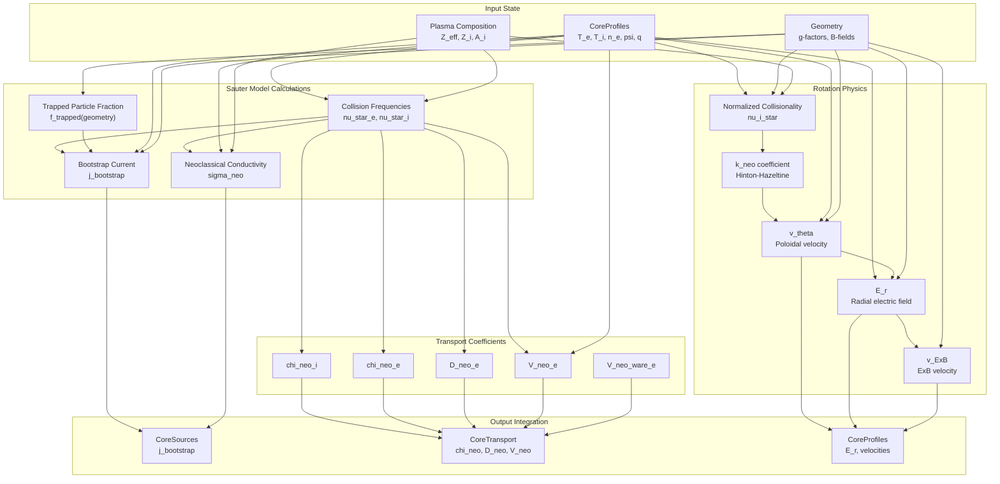
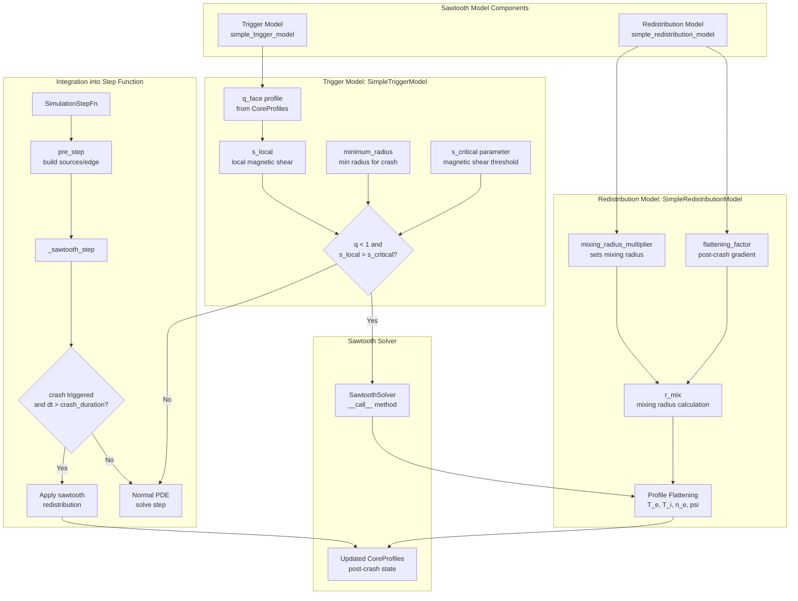
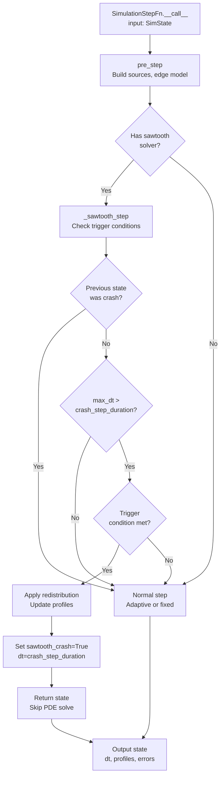
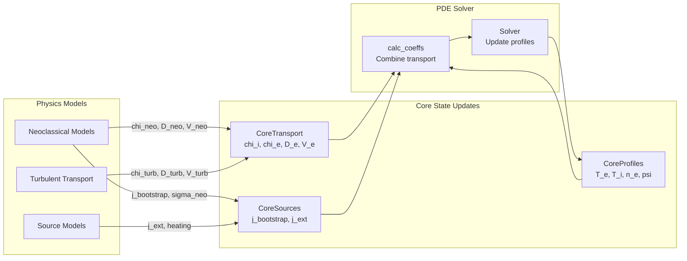

<!-- source: DeepWiki mcp.deepwiki.com · repo google-deepmind/torax · page 3.6 Neoclassical Effects and MHD · fetched 2026-10-26 -->

# Neoclassical Effects and MHD

<details>
<summary>Relevant source files</summary>

The following files were used as context for generating this wiki page:

- [docs/configuration.rst](docs/configuration.rst)
- [docs/edge_models.rst](docs/edge_models.rst)
- [docs/interfacing_with_surrogates.rst](docs/interfacing_with_surrogates.rst)
- [docs/links.rst](docs/links.rst)
- [docs/output.rst](docs/output.rst)
- [docs/physics_models.rst](docs/physics_models.rst)
- [docs/running_programmatically.rst](docs/running_programmatically.rst)
- [docs/user_guides.rst](docs/user_guides.rst)
- [docs/using_jax.rst](docs/using_jax.rst)
- [torax/_src/mhd/sawtooth/tests/sawtooth_model_test.py](torax/_src/mhd/sawtooth/tests/sawtooth_model_test.py)
- [torax/_src/orchestration/jit_run_loop.py](torax/_src/orchestration/jit_run_loop.py)
- [torax/_src/orchestration/run_loop.py](torax/_src/orchestration/run_loop.py)
- [torax/_src/orchestration/run_simulation.py](torax/_src/orchestration/run_simulation.py)
- [torax/_src/orchestration/step_function.py](torax/_src/orchestration/step_function.py)
- [torax/_src/orchestration/tests/step_function_test.py](torax/_src/orchestration/tests/step_function_test.py)
- [torax/tests/sim_time_dependence_test.py](torax/tests/sim_time_dependence_test.py)

</details>


## Purpose and Scope

This page documents the neoclassical physics and magnetohydrodynamic (MHD) models implemented in TORAX. Neoclassical effects include bootstrap current generation, neoclassical conductivity, and neoclassical transport coefficients that arise from collisional processes in a magnetized plasma. MHD effects currently focus on sawtooth oscillations, which are periodic instabilities causing rapid redistribution of temperature, density, and current profiles in the plasma core.

For information about turbulent transport models (QLKNN, CGM, Bohm-GyroBohm), see [Transport Models](#3.1). For edge physics and SOL models, see [Edge Physics and Extended Lengyel Model](#3.5).

## Neoclassical Physics

Neoclassical physics describes collisional transport in toroidal magnetic geometry. TORAX implements several neoclassical effects that contribute to current drive and transport coefficients.

### Bootstrap Current

The bootstrap current is a self-generated toroidal current driven by pressure and temperature gradients in the plasma. TORAX employs the Sauter model (Sauter PoP 1999) to calculate the parallel bootstrap current density `j_bootstrap`.

The bootstrap current model computes:
- Parallel bootstrap current density `j_parallel_bootstrap` 
- Profile of bootstrap current `I_bootstrap` (integrated quantity)

The model depends on:
- Plasma pressure gradients
- Magnetic geometry (safety factor `q`, flux surface averages)
- Collision frequencies
- Effective charge `Z_eff`

The bootstrap current contributes to the total current profile used in the current diffusion equation when `evolve_current=True`.

Sources: [docs/physics_models.rst:316-328](), [docs/output.rst:218-219]()

### Neoclassical Conductivity

The neoclassical conductivity `sigma_neo` (or `sigma_parallel`) represents the plasma conductivity parallel to the magnetic field. This quantity is essential for calculating the Ohmic current and resistive diffusion of the poloidal flux `psi`.

The Sauter model provides analytical formulas for neoclassical conductivity as a function of:
- Electron temperature `T_e`
- Electron density `n_e` 
- Effective charge `Z_eff`
- Collision frequencies
- Trapped particle fraction (geometry-dependent)

The neoclassical conductivity can be modified by the `resistivity_multiplier` parameter to artificially adjust current diffusion timescales for numerical testing purposes.

Sources: [docs/physics_models.rst:318-322](), [docs/configuration.rst:423-426](), [docs/output.rst:367-368]()

### Neoclassical Transport Coefficients

In addition to bootstrap current and conductivity, TORAX computes neoclassical contributions to heat and particle transport:

| Coefficient | Symbol | Description | Output Variable |
|-------------|--------|-------------|-----------------|
| Ion heat diffusivity | χ_neo_i | Neoclassical ion heat transport | `chi_neo_i` |
| Electron heat diffusivity | χ_neo_e | Neoclassical electron heat transport | `chi_neo_e` |
| Electron particle diffusivity | D_neo_e | Neoclassical particle diffusivity | `D_neo_e` |
| Electron convection | V_neo_e | Neoclassical particle convection | `V_neo_e` |
| Ware pinch | V_neo_ware_e | Convection from parallel electric field | `V_neo_ware_e` |

These coefficients are calculated on the face grid (`rho_face_norm`) and contribute to the total transport coefficients alongside turbulent components.

Sources: [docs/output.rst:152-166](), [docs/output.rst:394-403]()

### Rotation and Neoclassical Velocities

The radial electric field `E_r` and associated plasma rotation are computed using neoclassical theory. The implementation includes:

**Radial Electric Field:**
```
E_r = (1/(Z_i * e * n_i)) * dP_i/dr - v_phi * B_theta + v_theta * B_phi
```

**Neoclassical Poloidal Velocity:**

The poloidal velocity `v_theta` is calculated using Kim et al. (Phys. Fluids B 1991), Equation 33:

```
v_theta = k_neo * (1/(Z_i * e)) * dT_i/dr * B_tor/B_total^2
```

where `k_neo` is a neoclassical coefficient based on Hinton & Hazeltine (Rev. Mod. Phys. 1976), Equation 6.135. This coefficient transitions between the banana regime (ν*_i → 0, k_neo ≈ 1.17) and Pfirsch-Schluter regime (ν*_i → ∞, k_neo ≈ -2.1).

The normalized ion collisionality `nu_i_star` depends on:
- Safety factor `q`
- Geometry (inverse aspect ratio)
- Ion density `n_i` and temperature `T_i`
- Effective charge `Z_eff`
- Ion-ion Coulomb logarithm

**E×B Velocity:**
```
v_ExB = E_r / B_total
```

Rotation effects are currently disabled by default but can be enabled through transport model configuration.

Sources: [docs/physics_models.rst:331-380]()

### Neoclassical Physics Model Flow



Sources: [docs/physics_models.rst:316-380]()

## MHD Effects: Sawtooth Model

TORAX currently implements sawtooth oscillations as the primary MHD instability model. Sawteeth are periodic relaxation events that flatten temperature, density, and current profiles within a mixing radius in the plasma core.

### Sawtooth Model Architecture

The sawtooth model consists of two components:

1. **Trigger Model**: Determines when a sawtooth crash occurs based on stability criteria
2. **Redistribution Model**: Calculates the post-crash profiles after redistribution



Sources: [torax/_src/orchestration/step_function.py:83-88](), [torax/_src/orchestration/step_function.py:347-398](), [torax/_src/mhd/sawtooth/tests/sawtooth_model_test.py:36-110]()

### Trigger Models

**SimpleTriggerModel** (`model_name: 'simple'`)

The simple trigger model checks for sawtooth instability based on the Porcelli criterion:

- **Condition**: A sawtooth crash is triggered when `q < 1` at the q=1 surface **and** the local magnetic shear `s_local > s_critical` within the mixing region
- **Key Parameters**:
  - `s_critical` (float, default=0.3): Threshold for magnetic shear
  - `minimum_radius` (float, default=0.0): Minimum normalized radius for a crash to occur

The magnetic shear is calculated as:
```
s_local = -rho/q * dq/drho
```

If both conditions are met and the previous step was not a sawtooth crash, the trigger model signals a crash.

Sources: [docs/configuration.rst:28-29](), [torax/_src/mhd/sawtooth/tests/sawtooth_model_test.py:72-76]()

### Redistribution Models

**SimpleRedistributionModel** (`model_name: 'simple'`)

After a crash is triggered, the redistribution model flattens profiles within a mixing radius:

- **Mixing Radius**: `r_mix = mixing_radius_multiplier * r_q1`, where `r_q1` is the radius where `q=1`
- **Flattening**: Profiles are set to `average_value * flattening_factor` within `r_mix`
- **Affected Profiles**: `T_e`, `T_i`, `n_e`, `psi`

**Key Parameters**:
- `flattening_factor` (float, default=1.0): Post-crash gradient relative to average. Values >1 create slight peaking
- `mixing_radius_multiplier` (float, default=1.0): Scales the mixing radius relative to q=1 surface

The redistribution conserves total energy and particle content within the mixing region while flattening gradients.

Sources: [torax/_src/mhd/sawtooth/tests/sawtooth_model_test.py:77-82](), [torax/_src/mhd/sawtooth/tests/sawtooth_model_test.py:130-141]()

### Sawtooth Step Function Logic

The sawtooth logic is integrated into the `SimulationStepFn` through special handling:



**Key Logic**:

1. **Pre-Step Check**: Before attempting a normal time step, check if sawtooth conditions are met
2. **Crash Prevention**: If the previous step was a crash (`sawtooth_crash=True`), no new crash can occur this step
3. **Duration Check**: The crash only triggers if `max_dt > crash_step_duration` to ensure the crash fits within the available time
4. **Early Exit**: When a crash occurs, the PDE solver is skipped and the state is updated directly with redistributed profiles
5. **Time Step**: The time step `dt` is set to `crash_step_duration` (typically ~1e-3 seconds)
6. **Flag Persistence**: The `sawtooth_crash` flag remains `True` for the output state, preventing consecutive crashes

Sources: [torax/_src/orchestration/step_function.py:249-274](), [torax/_src/orchestration/step_function.py:347-398](), [torax/_src/mhd/sawtooth/tests/sawtooth_model_test.py:169-240]()

### Sawtooth Configuration Example

```python
'mhd': {
    'sawtooth': {
        'trigger_model': {
            'model_name': 'simple',
            's_critical': 0.3,
            'minimum_radius': 0.0,
        },
        'redistribution_model': {
            'model_name': 'simple',
            'flattening_factor': 1.0,
            'mixing_radius_multiplier': 1.0,
        },
        'crash_step_duration': 1e-3,  # seconds
    }
}
```

**Configuration Parameters**:

| Parameter | Type | Default | Description |
|-----------|------|---------|-------------|
| `crash_step_duration` | time-varying-scalar | 1e-3 | Duration of a sawtooth crash event [s] |
| `trigger_model.model_name` | str | 'simple' | Name of trigger model |
| `trigger_model.s_critical` | float | 0.3 | Critical magnetic shear threshold |
| `trigger_model.minimum_radius` | float | 0.0 | Minimum radius for crash [normalized] |
| `redistribution_model.model_name` | str | 'simple' | Name of redistribution model |
| `redistribution_model.flattening_factor` | float | 1.0 | Post-crash gradient scaling |
| `redistribution_model.mixing_radius_multiplier` | float | 1.0 | Mixing radius scaling factor |

Sources: [docs/configuration.rst:28-29](), [torax/_src/mhd/sawtooth/tests/sawtooth_model_test.py:70-84]()

## Outputs

### Neoclassical Outputs

**Profile Outputs** (time, rho_norm or rho_face_norm):
- `chi_neo_e`: Neoclassical electron heat conductivity [m²/s]
- `chi_neo_i`: Neoclassical ion heat conductivity [m²/s]
- `D_neo_e`: Neoclassical electron particle diffusivity [m²/s]
- `V_neo_e`: Neoclassical electron particle convection [m/s]
- `V_neo_ware_e`: Ware pinch convection velocity [m/s]
- `j_bootstrap`: Bootstrap current density [A/m²]
- `sigma_parallel`: Plasma conductivity parallel to B-field [S/m]
- `radial_electric_field`: Radial electric field [V/m]
- `poloidal_velocity`: Poloidal velocity [m/s]
- `toroidal_velocity`: Toroidal velocity [m/s]

**Scalar Outputs** (time):
- `I_bootstrap`: Total bootstrap current [A]

### MHD Outputs

**Numeric Outputs** (time):
- `sawtooth_crash`: Boolean flag indicating post-crash state

The sawtooth crash flag is stored in `SolverNumericOutputs.sawtooth_crash` and included in the output DataTree under `numerics.sawtooth_crash`.

Sources: [docs/output.rst:110-113](), [docs/output.rst:152-156](), [docs/output.rst:218-219](), [docs/output.rst:394-403](), [docs/output.rst:521-522]()

## Integration with Transport and Sources

Neoclassical effects integrate into the broader TORAX simulation through `CoreSources` and `CoreTransport`:



**Transport Coefficient Addition**:
- `chi_i_total = chi_turb_i + chi_neo_i`
- `chi_e_total = chi_turb_e + chi_neo_e`
- `D_e_total = D_turb_e + D_neo_e`
- `V_e_total = V_turb_e + V_neo_e + V_neo_ware_e`

**Current Profile Calculation**:
- `j_total = j_ohmic + j_bootstrap + j_external`

Sources: [torax/_src/orchestration/step_function.py:215-222](), [torax/_src/orchestration/step_function.py:531-541]()

---

