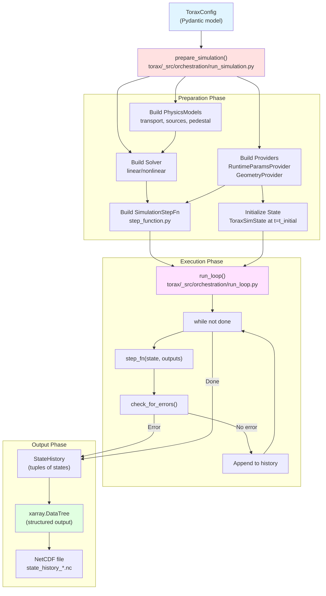
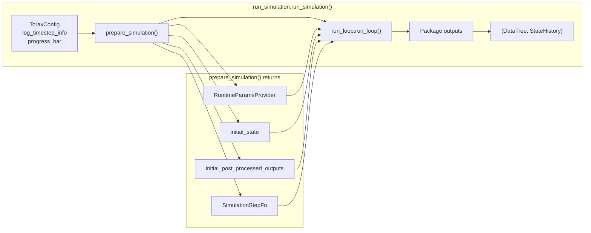
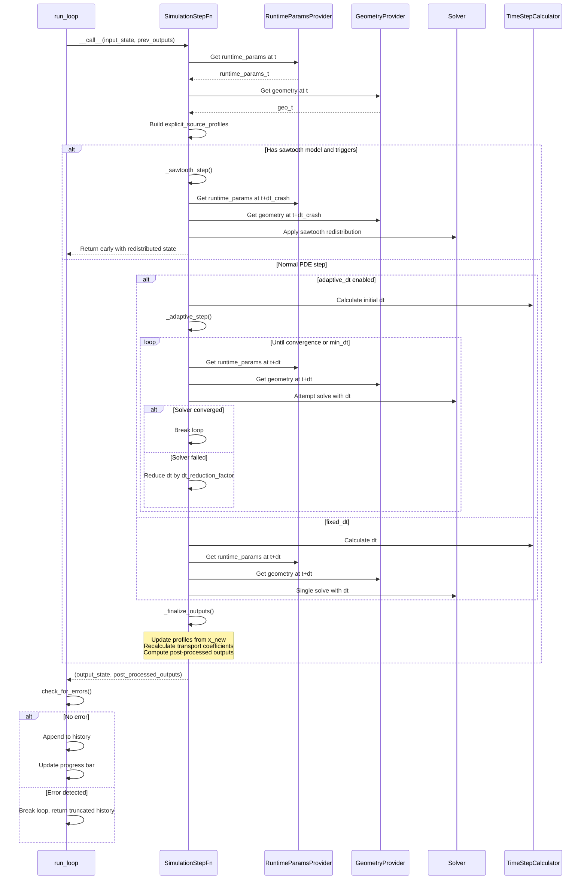
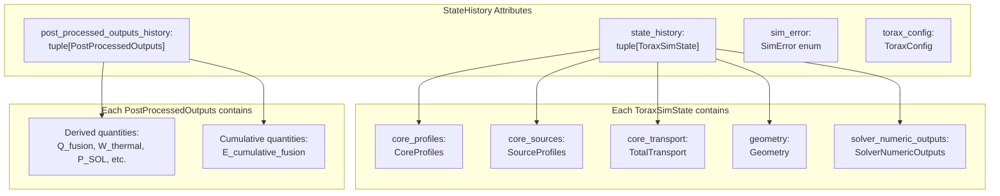

<!-- source: DeepWiki mcp.deepwiki.com · repo google-deepmind/torax · page 4 Simulation Execution · fetched 2026-10-26 -->

# Simulation Execution

<details>
<summary>Relevant source files</summary>

The following files were used as context for generating this wiki page:

- [torax/_src/mhd/sawtooth/tests/sawtooth_model_test.py](torax/_src/mhd/sawtooth/tests/sawtooth_model_test.py)
- [torax/_src/orchestration/jit_run_loop.py](torax/_src/orchestration/jit_run_loop.py)
- [torax/_src/orchestration/run_loop.py](torax/_src/orchestration/run_loop.py)
- [torax/_src/orchestration/run_simulation.py](torax/_src/orchestration/run_simulation.py)
- [torax/_src/orchestration/step_function.py](torax/_src/orchestration/step_function.py)
- [torax/_src/orchestration/tests/step_function_test.py](torax/_src/orchestration/tests/step_function_test.py)
- [torax/tests/sim_time_dependence_test.py](torax/tests/sim_time_dependence_test.py)

</details>


This page describes how TORAX orchestrates the execution of plasma transport simulations, from configuration input to output generation. It covers the main execution loop, the step function that advances the simulation through time, and the entry points for running simulations.

**Scope**: This page focuses on the orchestration layer that manages simulation execution. For details on configuration parameters, see [Configuration System](#2). For numerical solver implementations, see [Numerical Methods](#5). For time stepping strategies and adaptive control, see [Time Stepping and Adaptive Control](#4.2). For state data structures and history collection, see [State Management and History](#4.3).

## Execution Architecture

TORAX simulations follow a clear execution pipeline from configuration to output:



**Diagram**: End-to-end execution flow showing the three main phases of a TORAX simulation.

Sources: [torax/_src/orchestration/run_simulation.py:37-101](), [torax/_src/orchestration/run_loop.py:30-190]()

## Key Components

### run_simulation Function

The primary programmatic entry point is `run_simulation()`, which orchestrates the complete simulation workflow:



**Diagram**: Structure of the `run_simulation` function showing preparation and execution phases.

The `prepare_simulation()` function [torax/_src/orchestration/run_simulation.py:37-101]() constructs all necessary components:

| Component | Type | Purpose |
|-----------|------|---------|
| `RuntimeParamsProvider` | Provider object | Supplies time-dependent runtime parameters |
| `GeometryProvider` | Provider object | Supplies time-dependent geometry |
| `PhysicsModels` | Container | Holds transport, sources, pedestal, MHD models |
| `Solver` | Solver instance | Numerical PDE solver (linear or nonlinear) |
| `SimulationStepFn` | Step function | Advances simulation by one time step |
| `initial_state` | `ToraxSimState` | Starting plasma state at `t_initial` |
| `initial_post_processed_outputs` | `PostProcessedOutputs` | Derived quantities at `t_initial` |

Sources: [torax/_src/orchestration/run_simulation.py:37-101](), [torax/_src/orchestration/step_function.py:81-114]()

### SimulationStepFn Class

`SimulationStepFn` [torax/_src/orchestration/step_function.py:69-261]() is the core component that advances the simulation by one time step:

```mermaid
graph TB
    subgraph "SimulationStepFn Attributes"
        Solver["_solver: Solver<br/>(linear or nonlinear)"]
        TSCalc["_time_step_calculator<br/>TimeStepCalculator"]
        RPP["_runtime_params_provider<br/>RuntimeParamsProvider"]
        GeoProvider["_geometry_provider<br/>GeometryProvider"]
        SawtoothSolver["_sawtooth_solver<br/>SawtoothSolver | None"]
    end
    
    subgraph "SimulationStepFn.__call__()"
        InputState["input_state:<br/>ToraxSimState"]
        GetParams["Get runtime_params_t<br/>and geo_t"]
        BuildSources["Build explicit<br/>source_profiles"]
        
        CheckSawtooth{"Sawtooth model<br/>provided?"}
        TriggerCheck{"Sawtooth<br/>triggered?"}
        SawtoothStep["_sawtooth_step()"]
        
        AdaptiveCheck{"adaptive_dt?"}
        AdaptiveStep["_adaptive_step()"]
        FixedStep["_fixed_step()"]
        
        FinalizeOutputs["_finalize_outputs()"]
        OutputState["output_state:<br/>ToraxSimState"]
    end
    
    Solver --> SimulationStepFn
    TSCalc --> SimulationStepFn
    RPP --> SimulationStepFn
    GeoProvider --> SimulationStepFn
    
    InputState --> GetParams
    GetParams --> BuildSources
    BuildSources --> CheckSawtooth
    
    CheckSawtooth -->|Yes| TriggerCheck
    CheckSawtooth -->|No| AdaptiveCheck
    
    TriggerCheck -->|Yes| SawtoothStep
    TriggerCheck -->|No| AdaptiveCheck
    
    SawtoothStep --> OutputState
    
    AdaptiveCheck -->|Yes| AdaptiveStep
    AdaptiveCheck -->|No| FixedStep
    
    AdaptiveStep --> FinalizeOutputs
    FixedStep --> FinalizeOutputs
    FinalizeOutputs --> OutputState
```



**Diagram**: Internal structure and execution flow of `SimulationStepFn.__call__()` method.

The step function orchestrates several key operations:

1. **Parameter retrieval**: Gets `runtime_params_t` and `geo_t` at the current time [torax/_src/orchestration/step_function.py:191-197]()
2. **Explicit source calculation**: Computes sources marked as explicit [torax/_src/orchestration/step_function.py:202-209]()
3. **Sawtooth handling**: Checks for sawtooth crash conditions and redistributes profiles if triggered [torax/_src/orchestration/step_function.py:236-258]()
4. **Time stepping**: Executes either adaptive or fixed time stepping [torax/_src/orchestration/step_function.py:213-228]()
5. **Finalization**: Updates state with evolved profiles and recalculates transport [torax/_src/orchestration/step_function.py:512-566]()

Sources: [torax/_src/orchestration/step_function.py:69-261](), [torax/_src/orchestration/step_function.py:300-363]()

### Run Loop Implementations

TORAX provides two implementations of the main simulation loop:

#### Non-JIT Loop (Default)

The standard `run_loop()` function [torax/_src/orchestration/run_loop.py:30-190]() uses a Python while loop:

```python
# Pseudo-code structure from run_loop.py
current_state = initial_state
state_history = [current_state]

while time_step_calculator.not_done(current_state.t, t_final):
    current_state, post_processed_outputs = step_fn(current_state, ...)
    sim_error = check_for_errors(current_state, post_processed_outputs)
    
    if sim_error != SimError.NO_ERROR:
        break
    
    state_history.append(current_state)

return tuple(state_history), sim_error
```

**Advantages**:
- Supports logging and progress bars [torax/_src/orchestration/run_loop.py:109-157]()
- Can terminate early on errors [torax/_src/orchestration/run_loop.py:138-143]()
- Easier to debug

**Disadvantages**:
- Not efficient for gradients
- Loop overhead not compiled away

Sources: [torax/_src/orchestration/run_loop.py:30-190]()

#### JIT Loop (Experimental)

The `run_loop_jit()` function [torax/_src/orchestration/jit_run_loop.py:29-116]() uses JAX-compiled control flow:

```python
# Pseudo-code structure from jit_run_loop.py
@jax.jit
def run_loop_jit(initial_state, step_fn, max_steps):
    # Pre-allocate history buffers
    states_history = jax.tree_map(
        lambda x: jnp.zeros((max_steps + 1,) + x.shape), 
        initial_state
    )
    
    # JAX while loop with pre-allocated arrays
    final_i, states_history = jax_utils.while_loop_bounded(
        cond_fun, step_fn, initial_inputs, max_steps
    )
    
    return states_history, final_i
```

**Advantages**:
- Entire simulation compiled as single XLA graph
- Efficient for gradient computation
- No Python loop overhead

**Disadvantages**:
- No logging or progress bars during execution
- Must pre-allocate history buffers [torax/_src/orchestration/jit_run_loop.py:44-62]()
- Requires bounded loop (fixed `max_steps`)

Sources: [torax/_src/orchestration/jit_run_loop.py:29-116](), [torax/_src/orchestration/jit_run_loop.py:153-223]()

## Detailed Execution Flow

The following sequence diagram shows a single time step iteration:



**Diagram**: Sequence of operations during a single time step showing interactions between orchestration components.

Key steps in this flow:

1. **Time-dependent parameter retrieval**: The step function queries providers for parameters at both `t` and `t+dt` [torax/_src/orchestration/step_function.py:191-197](), [torax/_src/orchestration/step_function.py:461-467]()

2. **Explicit source calculation**: Sources marked as explicit in configuration are computed using the state at time `t` [torax/_src/orchestration/step_function.py:202-209]()

3. **Sawtooth check**: If a sawtooth model is configured, checks trigger conditions and may bypass PDE solve [torax/_src/orchestration/step_function.py:236-258]()

4. **Solver invocation**: Either adaptive retry loop or single fixed step [torax/_src/orchestration/step_function.py:364-439](), [torax/_src/orchestration/step_function.py:441-502]()

5. **State finalization**: Updates `CoreProfiles` with evolved variables, recalculates transport coefficients and implicit sources [torax/_src/orchestration/step_function.py:512-566]()

6. **Error checking**: Validates for NaN values, minimum dt violations, and other error conditions [torax/_src/orchestration/step_function.py:49-65]()

Sources: [torax/_src/orchestration/step_function.py:154-260](), [torax/_src/orchestration/run_loop.py:116-157]()

## Entry Points

TORAX provides two primary entry points for running simulations:

### Python API Entry Point

The `torax.run_simulation()` function is the programmatic interface:

```python
import torax

# Load configuration
torax_config = torax.ToraxConfig.from_dict(config_dict)
# or
torax_config = torax.build_torax_config_from_file('path/to/config.py')

# Run simulation
data_tree, state_history = torax.run_simulation(
    torax_config,
    log_timestep_info=False,  # Optional: log each timestep
    progress_bar=True,         # Optional: show progress bar
)

# Access outputs
temperatures = data_tree['core_profiles']['T_e'].values
```

This function returns:
- `data_tree`: `xarray.DataTree` with all simulation outputs in structured format
- `state_history`: `StateHistory` object containing raw state dataclasses for debugging

Sources: [torax/__init__.py:46-59](), [torax/_src/orchestration/run_simulation.py:104-148]()

### CLI Entry Point

The command-line interface is provided via the `run_torax` script [pyproject.toml:54]():

```bash
run_torax --config='examples/basic_config.py' \
          --output_dir='/path/to/output' \
          --log_progress
```

The CLI invokes `simulation_app.main()` [torax/_src/simulation_app.py:149-205](), which:

1. Loads configuration from file
2. Calls `run_simulation.run_simulation()`
3. Writes output to timestamped NetCDF file: `state_history_YYYYMMDD_HHMMSS.nc`
4. Presents interactive post-simulation menu for rerunning or plotting

**Common CLI flags**:

| Flag | Default | Description |
|------|---------|-------------|
| `--config` | (required) | Path to Python configuration file |
| `--output_dir` | `/tmp/torax_results` | Directory for output files |
| `--log_progress` | `False` | Log timestep info during execution |
| `--log_output` | `False` | Log initial/final state profiles |
| `--reference_run` | `None` | Path to reference run for comparison plotting |
| `--plot_config` | `default_plot_config.py` | Plotting configuration file |

Sources: [pyproject.toml:53-55](), [torax/_src/simulation_app.py:149-205](), [docs/running.rst:80-138]()

## Output Generation

After simulation completion, outputs are packaged into two formats:

### StateHistory Object

The `StateHistory` class [torax/_src/output_tools/output.py]() wraps simulation outputs:



**Diagram**: Structure of `StateHistory` and contained state objects.

Sources: [torax/__init__.py:57](), [torax/_src/orchestration/run_simulation.py:138-148]()

### xarray DataTree

The `simulation_output_to_xr()` method converts `StateHistory` to an `xarray.DataTree` with hierarchical structure:

```
DataTree
├── time (dimension)
├── rho_norm (dimension)
├── core_profiles/
│   ├── T_e [time, rho_norm]
│   ├── T_i [time, rho_norm]
│   ├── n_e [time, rho_norm]
│   ├── psi [time, rho_norm]
│   └── ...
├── core_sources/
│   ├── ohmic_heat_source [time, rho_norm]
│   ├── fusion_heat_source [time, rho_norm]
│   └── ...
├── core_transport/
│   ├── chi_face_ion [time, rho_face]
│   ├── d_face_el [time, rho_face]
│   └── ...
├── geometry/
│   ├── Rmaj [time, rho_norm]
│   ├── Rmin [time, rho_norm]
│   └── ...
└── post_processed_outputs/
    ├── Q_fusion [time]
    ├── W_thermal_tot [time]
    └── ...
```

This format:
- Enables easy NetCDF I/O via `data_tree.to_netcdf(path)`
- Supports xarray-based analysis and plotting
- Preserves metadata and dimensional information
- Compatible with standard scientific Python tools

Sources: [torax/_src/orchestration/run_simulation.py:138-148](), [torax/_src/simulation_app.py:102-118]()

## Error Handling and Simulation Termination

The `check_for_errors()` function [torax/_src/orchestration/step_function.py:49-65]() validates simulation state after each step:

**Error conditions checked**:

| Error Code | Condition | Action |
|------------|-----------|--------|
| `NO_ERROR` | All checks pass | Continue simulation |
| `NAN_DETECTED` | NaN in state or outputs | Terminate, return truncated history |
| `REACHED_MIN_DT` | `dt < min_dt` and solver failed | Terminate, return truncated history |

The error checking scans:
- All `CellVariable` values and boundary constraints in `CoreProfiles`
- All source profiles in `SourceProfiles`
- All transport coefficients in `TotalTransport`
- All post-processed outputs in `PostProcessedOutputs`

When an error is detected, the run loop terminates immediately [torax/_src/orchestration/run_loop.py:138-143]() and returns the state history collected up to (but not including) the failed step. The `SimError` enum value is returned along with the truncated history to indicate what went wrong.

Sources: [torax/_src/orchestration/step_function.py:49-65](), [torax/_src/orchestration/run_loop.py:130-143](), [torax/__init__.py:32-33]()

---

