<!-- source: DeepWiki mcp.deepwiki.com · repo google-deepmind/torax · page 4.1 Simulation Orchestration and Step Function · fetched 2026-10-26 -->

# Simulation Orchestration

<details>
<summary>Relevant source files</summary>

The following files were used as context for generating this wiki page:

- [torax/_src/mhd/sawtooth/tests/sawtooth_model_test.py](torax/_src/mhd/sawtooth/tests/sawtooth_model_test.py)
- [torax/_src/orchestration/jit_run_loop.py](torax/_src/orchestration/jit_run_loop.py)
- [torax/_src/orchestration/run_loop.py](torax/_src/orchestration/run_loop.py)
- [torax/_src/orchestration/run_simulation.py](torax/_src/orchestration/run_simulation.py)
- [torax/_src/orchestration/step_function.py](torax/_src/orchestration/step_function.py)
- [torax/_src/orchestration/tests/step_function_test.py](torax/_src/orchestration/tests/step_function_test.py)
- [torax/tests/sim_time_dependence_test.py](torax/tests/sim_time_dependence_test.py)

</details>


This page describes how TORAX orchestrates the execution of a simulation from configuration to completion. It covers the high-level workflow of `run_simulation()`, the role of `SimulationStepFn` in advancing the simulation, and how the various components (solver, geometry provider, runtime parameters, time step calculator) interact during execution. For details on time stepping logic and adaptive control, see [Time Stepping and Adaptive Control](#4.2). For state management and history tracking, see [State Management and History](#4.3).

## Overview

TORAX simulation orchestration follows a preparation-execution-output pattern:

1. **Preparation**: Build all components from configuration
2. **Initialization**: Create initial state at `t_initial`
3. **Execution**: Iterate through time steps via a run loop
4. **Output**: Collect results into structured data formats

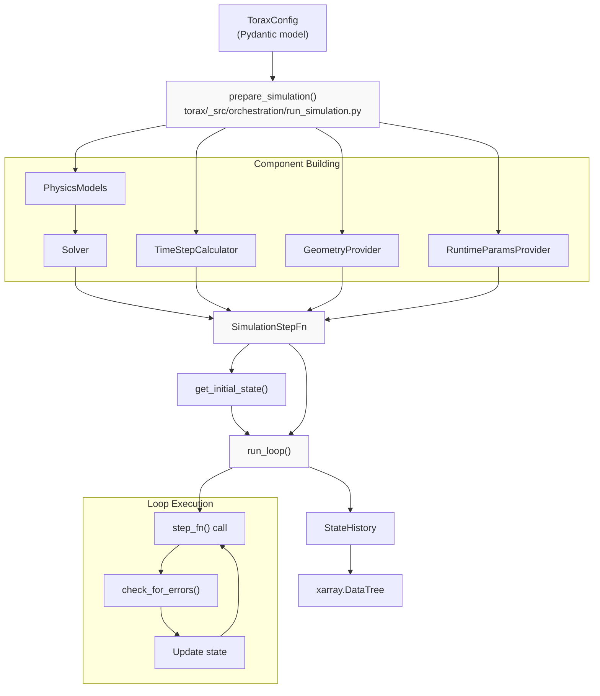

**Sources:** [torax/_src/orchestration/run_simulation.py:37-101](), [torax/_src/orchestration/step_function.py:69-140]()

## The `run_simulation()` Entry Point

The primary programmatic entry point for running a TORAX simulation is `run_simulation()` in [torax/_src/orchestration/run_simulation.py:104-148](). This function accepts a `ToraxConfig` and returns simulation outputs as both an `xarray.DataTree` and a `StateHistory` object.

### Workflow

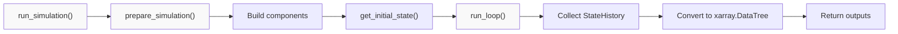

**Key Function Signature:**

```python
def run_simulation(
    torax_config: model_config.ToraxConfig,
    log_timestep_info: bool = False,
    progress_bar: bool = True,
) -> tuple[xr.DataTree, output.StateHistory]
```

**Sources:** [torax/_src/orchestration/run_simulation.py:104-148]()

## Component Preparation

The `prepare_simulation()` function [torax/_src/orchestration/run_simulation.py:37-101]() builds all necessary components from the configuration:

| Component | Purpose | Built From |
|-----------|---------|------------|
| `GeometryProvider` | Provides time-dependent geometry | `torax_config.geometry.build_provider` |
| `PhysicsModels` | Contains transport, source, pedestal, MHD models | `torax_config.build_physics_models()` |
| `Solver` | Evolves core profiles via PDE solving | `torax_config.solver.build_solver()` |
| `RuntimeParamsProvider` | Provides time-dependent runtime parameters | `RuntimeParamsProvider.from_config()` |
| `TimeStepCalculator` | Determines `dt` for each step | `torax_config.time_step_calculator` |
| `SimulationStepFn` | Orchestrates a single time step | Constructed from above components |

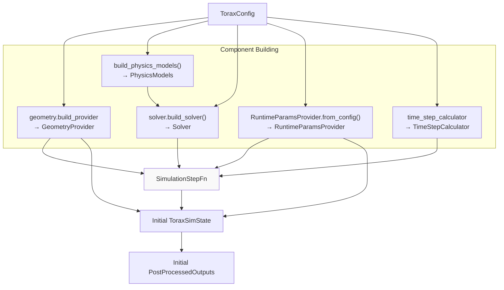

**Sources:** [torax/_src/orchestration/run_simulation.py:37-101]()

## The `SimulationStepFn` Class

`SimulationStepFn` [torax/_src/orchestration/step_function.py:69-502]() is a JAX pytree that advances the simulation by one time step. It wraps the `Solver` with robustness features like adaptive time stepping and sawtooth handling.

### Architecture

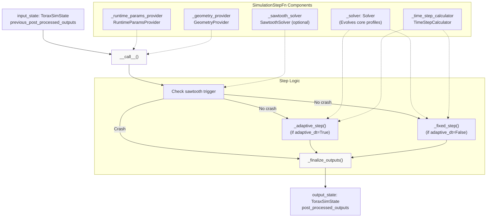

**Sources:** [torax/_src/orchestration/step_function.py:69-260]()

### Key Methods

| Method | Purpose | Line Reference |
|--------|---------|----------------|
| `__call__()` | Main entry point for taking one step | [step_function.py:153-260]() |
| `step()` | Performs solver call with given `dt` | [step_function.py:300-362]() |
| `_adaptive_step()` | Handles adaptive time stepping with retries | [step_function.py:364-439]() |
| `_fixed_step()` | Executes single step with fixed `dt` | [step_function.py:441-502]() |
| `_sawtooth_step()` | Handles sawtooth crash if triggered | [step_function.py:262-298]() |
| `_finalize_outputs()` | Updates profiles and calculates transport | [step_function.py:512-566]() |

**Sources:** [torax/_src/orchestration/step_function.py:153-566]()

## Single Time Step Execution Flow

Each call to `SimulationStepFn.__call__()` follows this sequence:

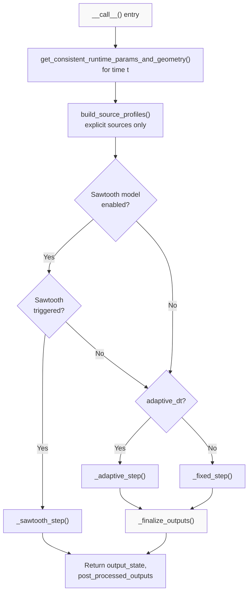

**Sources:** [torax/_src/orchestration/step_function.py:153-260](), [torax/_src/orchestration/step_function.py:512-566]()

### Runtime Parameters and Geometry Retrieval

At each time step, `SimulationStepFn` retrieves runtime parameters and geometry for both `t` and `t+dt` using `get_consistent_runtime_params_and_geometry()` [torax/_src/config/build_runtime_params.py](). This ensures that implicit solvers have access to boundary conditions and geometry at the end of the time step.

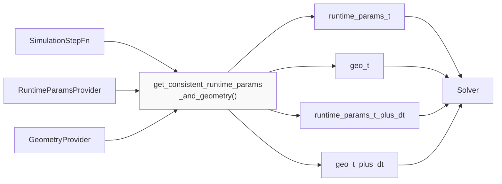

**Sources:** [torax/_src/orchestration/step_function.py:191-197](), [torax/_src/config/build_runtime_params.py]()

## The Run Loop

After preparation and initialization, `run_loop()` [torax/_src/orchestration/run_loop.py:30-190]() iterates the `SimulationStepFn` until completion or error. Two implementations exist:

1. **Python while loop** (`run_loop.py`): Supports logging, progress bar, and early termination
2. **JAX JIT loop** (`jit_run_loop.py`): Fully compiled for maximum performance

### Python While Loop Implementation

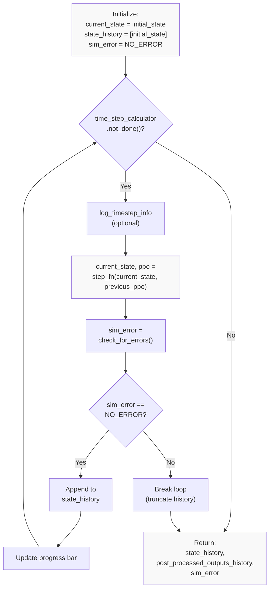

**Sources:** [torax/_src/orchestration/run_loop.py:30-190]()

### JAX JIT Loop Implementation

For fully compiled execution, `jit_run_loop.py` [torax/_src/orchestration/jit_run_loop.py:29-115]() uses `jax.lax.while_loop` with pre-allocated history buffers:

```python
@functools.partial(jax.jit, static_argnames=['max_steps'])
def run_loop_jit(
    initial_state: sim_state.ToraxSimState,
    initial_post_processed_outputs: post_processing.PostProcessedOutputs,
    step_fn: step_function.SimulationStepFn,
    max_steps: int,
) -> tuple[sim_state.ToraxSimState, post_processing.PostProcessedOutputs, chex.Numeric]
```

Key differences from the Python loop:

| Aspect | Python Loop | JAX JIT Loop |
|--------|-------------|--------------|
| Compilation | Step function JIT-ed | Entire loop JIT-ed |
| History | Appended dynamically | Pre-allocated arrays |
| Logging | Supported | Not supported |
| Progress bar | Supported | Not supported |
| Early exit | Immediate | Via condition check |

**Sources:** [torax/_src/orchestration/jit_run_loop.py:29-223]()

## Error Checking

`check_for_errors()` [torax/_src/orchestration/step_function.py:49-65]() validates the simulation state after each step:

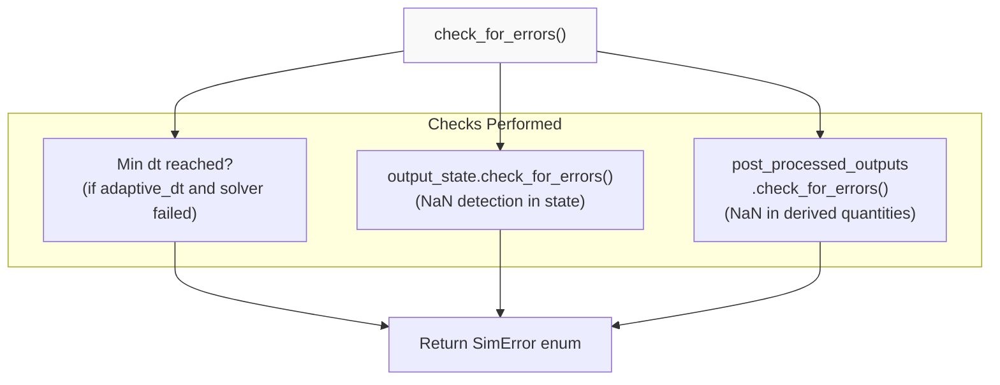

**Error Types:**

- `SimError.NO_ERROR`: Simulation proceeding normally
- `SimError.NAN_DETECTED`: NaN found in state or outputs
- `SimError.REACHED_MIN_DT`: Adaptive stepping hit minimum `dt`

**Sources:** [torax/_src/orchestration/step_function.py:49-65](), [torax/_src/state.py]()

## Fixed vs Adaptive Time Stepping

`SimulationStepFn` supports both fixed and adaptive time stepping modes, determined by `numerics.adaptive_dt`:

### Fixed Time Step Flow

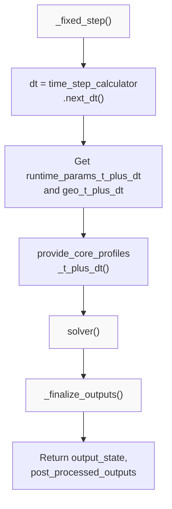

**Sources:** [torax/_src/orchestration/step_function.py:441-502]()

### Adaptive Time Step Flow

For adaptive stepping, see [Time Stepping and Adaptive Control](#4.2) for detailed coverage of the retry mechanism.

**Sources:** [torax/_src/orchestration/step_function.py:364-439]()

## Finalization and Output Processing

`_finalize_outputs()` [torax/_src/orchestration/step_function.py:512-566]() performs the final updates after solver convergence:

1. **Update core profiles**: Convert solver output `x_new` to `CoreProfiles`
2. **Recalculate sources**: Build implicit source profiles based on updated state
3. **Calculate transport**: Compute total transport coefficients at `t+dt`
4. **Create output state**: Construct `ToraxSimState` with updated profiles, sources, transport
5. **Post-process**: Calculate derived quantities (fusion power, stored energy, etc.)

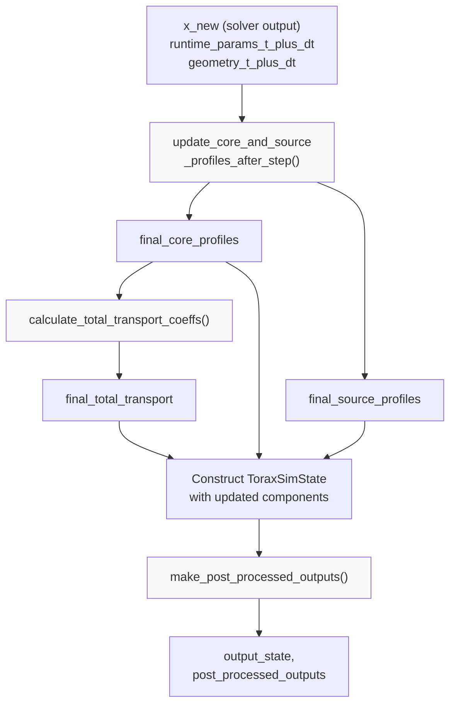

**Sources:** [torax/_src/orchestration/step_function.py:512-566]()

## Sawtooth Handling

If a sawtooth model is configured, `SimulationStepFn` checks for crash triggers before the main PDE solve:

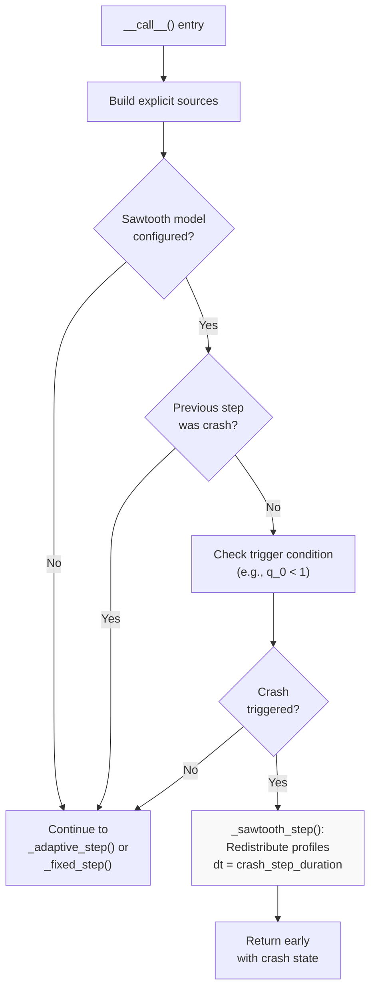

**Key Points:**
- Sawtooth crashes bypass the main PDE solver
- The `dt` for a crash step is set by `crash_step_duration` configuration
- Consecutive crashes are prevented by checking `sawtooth_crash` flag
- After redistribution, profiles are evolved to maintain constant `dW/dt`

**Sources:** [torax/_src/orchestration/step_function.py:236-260](), [torax/_src/orchestration/step_function.py:575-684]()

## Integration with Other Systems

The simulation orchestration layer integrates with several other TORAX subsystems:

| System | Interface | Purpose |
|--------|-----------|---------|
| Configuration | `ToraxConfig` → components | Builds all simulation components |
| Geometry | `GeometryProvider` | Supplies time-dependent geometry |
| Runtime Params | `RuntimeParamsProvider` | Supplies time-dependent parameters |
| Solver | `Solver.__call__()` | Evolves state variables via PDE solving |
| Physics Models | `PhysicsModels` | Provides transport, sources, pedestal |
| State | `ToraxSimState` | Contains all simulation state at time `t` |
| Post-processing | `PostProcessedOutputs` | Derived quantities and cumulative values |
| Output | `StateHistory` → `xarray.DataTree` | Structured output for analysis |

**Sources:** [torax/_src/orchestration/run_simulation.py:37-148](), [torax/_src/orchestration/step_function.py:69-502]()

## Restart Capability

TORAX supports restarting simulations from saved state files. When `torax_config.restart.do_restart` is `True`, `get_initial_state_and_post_processed_outputs_from_file()` loads the state at `t_initial` from a NetCDF file instead of computing it from scratch.

**Sources:** [torax/_src/orchestration/run_simulation.py:76-94](), [torax/_src/orchestration/initial_state.py]()

## CLI and Application Entry Points

While this page focuses on the programmatic API, TORAX also provides command-line entry points:

- `run_torax` CLI: Defined in [pyproject.toml:54](), implemented via `torax.run_simulation_main:run`
- `simulation_app.main()`: Higher-level wrapper in [torax/_src/simulation_app.py:149-205]() that adds file I/O, logging, and menu-driven interaction

For details on using the CLI, see [Command Line Interface](#6.1).

**Sources:** [pyproject.toml:53-55](), [torax/_src/simulation_app.py:149-205]()

---

