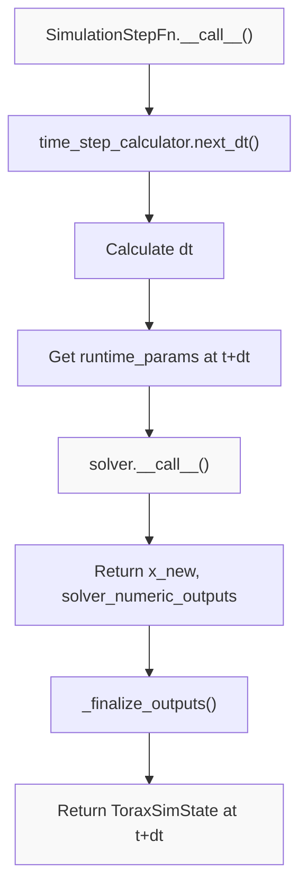
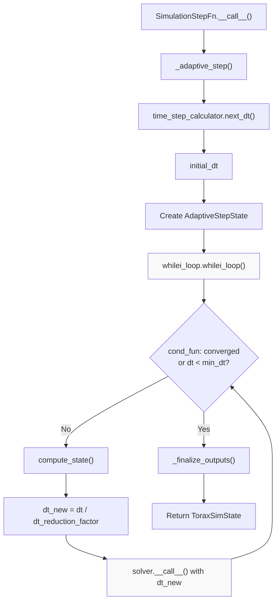
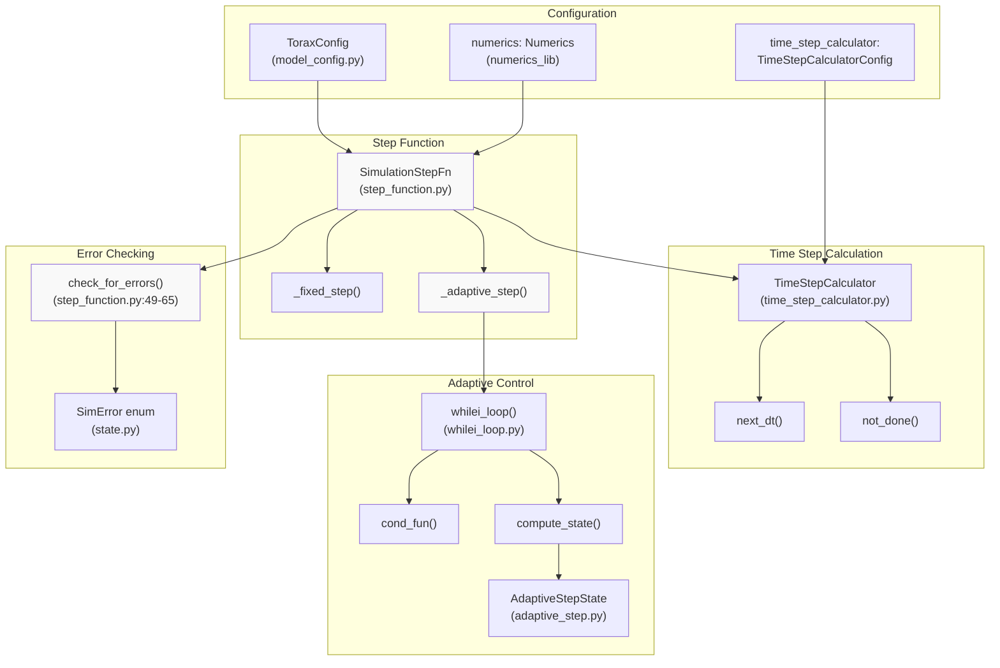
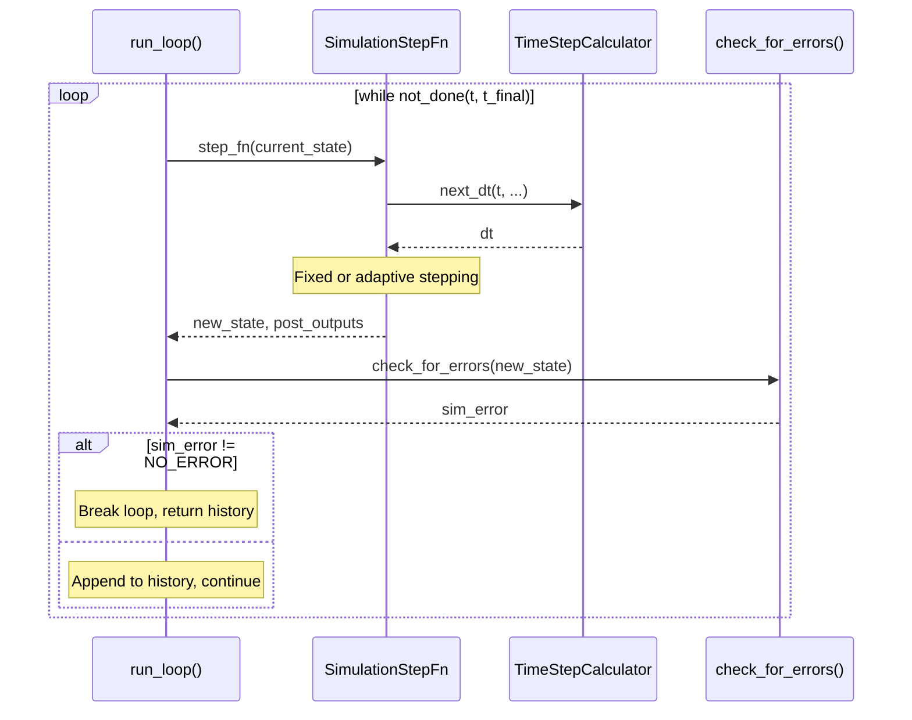

<!-- source: DeepWiki mcp.deepwiki.com · repo google-deepmind/torax · page 4.2 Time Stepping and Adaptive Control · fetched 2026-10-26 -->

# Time Stepping and Adaptive Control

<details>
<summary>Relevant source files</summary>

The following files were used as context for generating this wiki page:

- [docs/configuration.rst](docs/configuration.rst)
- [docs/edge_models.rst](docs/edge_models.rst)
- [docs/interfacing_with_surrogates.rst](docs/interfacing_with_surrogates.rst)
- [docs/links.rst](docs/links.rst)
- [docs/output.rst](docs/output.rst)
- [docs/physics_models.rst](docs/physics_models.rst)
- [docs/running_programmatically.rst](docs/running_programmatically.rst)
- [docs/user_guides.rst](docs/user_guides.rst)
- [docs/using_jax.rst](docs/using_jax.rst)
- [torax/_src/mhd/sawtooth/tests/sawtooth_model_test.py](torax/_src/mhd/sawtooth/tests/sawtooth_model_test.py)
- [torax/_src/orchestration/jit_run_loop.py](torax/_src/orchestration/jit_run_loop.py)
- [torax/_src/orchestration/run_loop.py](torax/_src/orchestration/run_loop.py)
- [torax/_src/orchestration/run_simulation.py](torax/_src/orchestration/run_simulation.py)
- [torax/_src/orchestration/step_function.py](torax/_src/orchestration/step_function.py)
- [torax/_src/orchestration/tests/step_function_test.py](torax/_src/orchestration/tests/step_function_test.py)
- [torax/tests/sim_time_dependence_test.py](torax/tests/sim_time_dependence_test.py)

</details>


## Purpose and Scope

This page explains how TORAX controls the size and adaptation of time steps during simulation execution. It covers the mechanisms for computing the time step duration (`dt`) at each iteration, the distinction between fixed and adaptive time stepping modes, and the retry logic used when solvers fail to converge.

For information about the overall simulation execution flow and how time stepping fits into the broader orchestration, see [Simulation Orchestration](#4.1). For details on the numerical PDE solvers that these time stepping strategies control, see [PDE Solvers](#5.1).

---

## Overview

TORAX supports two time stepping strategies:

1. **Fixed Time Stepping**: The time step is calculated once per iteration based on a configured calculator. If the solver fails to converge, the simulation continues with the failed state or terminates.

2. **Adaptive Time Stepping**: When solver convergence fails, the time step is automatically reduced by a configurable factor and the solver is retried. This process repeats until either convergence succeeds or a minimum time step threshold is reached.

The choice between these modes is controlled by the `adaptive_dt` boolean parameter in the `numerics` configuration section.

Sources: [torax/_src/orchestration/step_function.py:69-502](), [docs/configuration.rst:375-383]()

---

## Time Step Calculation

### TimeStepCalculator Interface

Time steps are computed by a `TimeStepCalculator` object, which is configured via the `time_step_calculator` section of the configuration. The calculator provides two key methods:

- `next_dt(t, runtime_params, geo, core_profiles, core_transport)`: Computes the next time step duration based on current simulation state
- `not_done(t, t_final, params)`: Determines whether the simulation should continue

Sources: [torax/_src/orchestration/step_function.py:84-93](), [torax/_src/orchestration/step_function.py:377-383]()

### Calculation Methods

The `time_step_calculator.calculator_type` configuration parameter selects the calculation method:

| Calculator Type | Description | Primary Control Parameter |
|-----------------|-------------|---------------------------|
| `'fixed'` | Returns a constant time step | `numerics.fixed_dt` |
| `'chi'` | Calculates dt based on transport timescales: `dt = prefactor * dx²/(2*chi)` | `numerics.chi_timestep_prefactor`, `numerics.max_dt` |

The `chi` calculator ensures numerical stability by respecting the diffusive CFL condition. The calculated dt is clamped to `[min_dt, max_dt]`.

Sources: [docs/configuration.rst:360-373](), [torax/_src/time_step_calculator/time_step_calculator.py]()

### Exact Final Time

When `numerics.exact_t_final = True`, the final time step is adjusted to land exactly on `t_final`. This prevents small overshoots and ensures reproducible endpoint conditions.

Sources: [docs/configuration.rst:356-358]()

---

## Fixed Time Stepping Mode



**Diagram 1: Fixed Time Stepping Flow**

In fixed mode (`adaptive_dt=False`), the `_fixed_step()` method executes the following sequence:

1. **Calculate dt**: Call `time_step_calculator.next_dt()` with current state
2. **Get future parameters**: Retrieve `runtime_params` and `geometry` at `t + dt`
3. **Update boundary conditions**: Build `core_profiles_t_plus_dt` with new boundary conditions
4. **Invoke solver**: Call `solver(...)` once with the calculated dt
5. **Finalize outputs**: Update state, compute transport coefficients and post-processed outputs
6. **Return**: Provide the updated `ToraxSimState`

If the solver reports non-convergence (`solver_error_state != 0`), the simulation continues to the next step. The `check_for_errors()` function will detect this condition but does not automatically retry in fixed mode.

Sources: [torax/_src/orchestration/step_function.py:441-502]()

---

## Adaptive Time Stepping Mode

### Retry Mechanism

Adaptive mode enables automatic dt reduction and retry when the solver fails to converge. This improves robustness for stiff or nonlinear problems.



**Diagram 2: Adaptive Time Stepping Retry Loop**

Sources: [torax/_src/orchestration/step_function.py:364-439](), [torax/_src/orchestration/adaptive_step.py]()

### Adaptive Step State

The retry loop uses an `AdaptiveStepState` dataclass to track:

- `dt`: Current time step being attempted
- `x_new`: Evolved state variables from last solver call
- `solver_numeric_outputs`: Convergence status and iteration counts
- `runtime_params`, `geo`: Runtime parameters and geometry at `t + dt`
- `core_profiles`: Updated core profiles

Sources: [torax/_src/orchestration/adaptive_step.py]()

### Convergence Criteria

The adaptive loop terminates when:

1. **Solver converges**: `solver_numeric_outputs.solver_error_state == 0`
2. **Minimum dt reached**: `dt / dt_reduction_factor < min_dt`

If minimum dt is reached without convergence, `check_for_errors()` returns `SimError.REACHED_MIN_DT` and the simulation terminates.

Sources: [torax/_src/orchestration/step_function.py:49-65](), [torax/tests/sim_time_dependence_test.py:60-72]()

### Iteration Tracking

The `SolverNumericOutputs` dataclass records:

- `outer_solver_iterations`: Number of dt reduction attempts (adaptive mode only)
- `inner_solver_iterations`: Total solver iterations across all retries
- `solver_error_state`: Final convergence status (0=converged, 1=failed, 2=coarse tolerance)

In adaptive mode, `outer_solver_iterations` counts how many times dt was reduced. The sum of `inner_solver_iterations` across retries is accumulated.

Sources: [torax/_src/orchestration/step_function.py:411-424](), [torax/tests/sim_time_dependence_test.py:127-132]()

---

## Configuration Parameters

### Numerics Section

The following parameters in the `numerics` configuration section control time stepping:

```python
'numerics': {
    # Time control
    't_initial': 0.0,              # Simulation start time (s)
    't_final': 5.0,                # Simulation end time (s)
    'exact_t_final': True,         # Adjust final dt to hit t_final exactly
    
    # Fixed stepping
    'fixed_dt': 0.1,               # Time step for 'fixed' calculator (s)
    
    # Adaptive dt limits
    'max_dt': 2.0,                 # Maximum allowed time step (s)
    'min_dt': 1e-8,                # Minimum allowed time step (s)
    
    # Chi-based calculator
    'chi_timestep_prefactor': 50.0, # Prefactor for chi-based dt calculation
    
    # Adaptive mode
    'adaptive_dt': True,           # Enable dt reduction on solver failure
    'dt_reduction_factor': 3.0,    # Factor to reduce dt by on failure
}
```

Sources: [docs/configuration.rst:343-383]()

### Parameter Details

| Parameter | Type | Default | Description |
|-----------|------|---------|-------------|
| `t_initial` | float | 0.0 | Simulation start time in seconds |
| `t_final` | float | 5.0 | Simulation end time in seconds |
| `exact_t_final` | bool | True | If True, final dt adjusted to hit t_final exactly |
| `max_dt` | float | 2.0 | Maximum time step; only used with `chi_time_step_calculator` |
| `min_dt` | float | 1e-8 | Minimum time step; simulation errors if dt goes below this |
| `chi_timestep_prefactor` | float | 50.0 | Prefactor for chi-based dt: `dt = prefactor * dx²/(2*chi)` |
| `fixed_dt` | float | 0.1 | Time step used by `fixed_time_step_calculator` |
| `adaptive_dt` | bool | True | Enable automatic dt reduction on solver failure |
| `dt_reduction_factor` | float | 3.0 | Factor to divide dt by when solver fails to converge |

Sources: [docs/configuration.rst:343-383]()

---

## Code Structure



**Diagram 3: Time Stepping Components and Dependencies**

Sources: [torax/_src/orchestration/step_function.py:68-139](), [torax/_src/time_step_calculator/](), [torax/_src/orchestration/adaptive_step.py]()

---

## Sawtooth Crash Handling

When MHD sawtooth models are enabled, the step function checks for sawtooth trigger conditions before attempting the main PDE solve. If a crash is triggered:

1. The sawtooth solver performs profile redistribution
2. The time step is overridden to `crash_step_duration` (typically ~1ms)
3. The step function returns early, bypassing the main solver
4. Subsequent sawtooth crashes are prevented until at least one regular PDE step occurs

This ensures sawtooth events do not interfere with the adaptive dt mechanism.

Sources: [torax/_src/orchestration/step_function.py:230-260](), [torax/_src/orchestration/step_function.py:575-684](), [torax/_src/mhd/sawtooth/tests/sawtooth_model_test.py:115-174]()

---

## Error States and Termination

### Error Detection

The `check_for_errors()` function validates the simulation state after each step:

```python
def check_for_errors(
    numerics: numerics_lib.Numerics,
    output_state: sim_state.ToraxSimState,
    post_processed_outputs: post_processing.PostProcessedOutputs,
) -> state.SimError
```

It returns a `SimError` enum value:

| Error Code | Name | Condition |
|------------|------|-----------|
| 0 | `NO_ERROR` | Simulation proceeding normally |
| 1 | `NAN_DETECTED` | NaN found in state arrays or post-processed outputs |
| 2 | `REACHED_MIN_DT` | dt reduced below `min_dt` without convergence |

Sources: [torax/_src/orchestration/step_function.py:49-65]()

### Minimum dt Check

When `adaptive_dt=True`, if the solver fails to converge and dt reduction would result in `dt / dt_reduction_factor < min_dt`, the simulation terminates with `REACHED_MIN_DT` error. This prevents infinite retry loops.

The check only triggers when the solver error state is 1 (non-convergence). If the solver converged at a small dt, no error is raised even if dt < min_dt.

Sources: [torax/_src/orchestration/step_function.py:55-60](), [torax/_src/orchestration/tests/step_function_test.py:103-144]()

### NaN Detection

NaN checks scan:
- Core profile arrays (`T_i`, `T_e`, `n_e`, `psi`, etc.)
- Boundary condition constraints (`right_face_constraint`)
- Source profiles (`j_bootstrap`, `Q_fusion`, etc.)
- Post-processed scalar outputs (`P_aux_total`, `W_thermal`, etc.)

If NaN is detected anywhere, the simulation terminates immediately.

Sources: [torax/_src/orchestration/tests/step_function_test.py:53-101](), [torax/_src/state.py]()

---

## Integration with Run Loop

The outer simulation loop in `run_loop.py` repeatedly calls the step function until termination:



**Diagram 4: Run Loop Integration**

The loop terminates when:
1. `time_step_calculator.not_done()` returns False (normal completion at `t >= t_final`)
2. `check_for_errors()` returns a non-zero error code

In case of error, the loop breaks and returns a truncated state history up to the last valid time step.

Sources: [torax/_src/orchestration/run_loop.py:30-190](), [torax/_src/orchestration/step_function.py:49-65]()

---

## Testing and Validation

### Adaptive dt Test Cases

The test suite validates adaptive stepping behavior:

```python
# Test: Adaptive dt with 3 outer iterations, converging at reduced dt
test_time_dependent_params_update_in_adaptive_dt(
    adaptive_dt=True,
    expected_outer_solver_iterations=3,
    expected_error_state=0,
    expected_combined_value=2.44444444444,
)

# Test: Fixed dt with single attempt, failing but continuing
test_time_dependent_params_update_in_adaptive_dt(
    adaptive_dt=False,
    expected_outer_solver_iterations=1,
    expected_error_state=1,
    expected_combined_value=3.0,
)
```

These tests use a `FakeSolver` that fails convergence based on a time-dependent parameter threshold, demonstrating dt reduction and retry in adaptive mode versus immediate failure in fixed mode.

Sources: [torax/tests/sim_time_dependence_test.py:60-156]()

### Error State Tests

Unit tests verify error detection:

- `test_below_min_dt()`: Confirms `REACHED_MIN_DT` error when dt reduction exceeds limit
- `test_no_error_when_below_min_dt_but_solver_converged()`: Ensures no error if solver succeeds at small dt
- `test_nan_in_bc()`, `test_nan_in_source_array()`: Validate NaN detection in various state components

Sources: [torax/_src/orchestration/tests/step_function_test.py:30-144]()

---

## Configuration Examples

### Basic Fixed Stepping

```python
CONFIG = {
    'numerics': {
        'adaptive_dt': False,
        'fixed_dt': 0.05,  # 50ms time steps
        't_final': 10.0,
    },
    'time_step_calculator': {
        'calculator_type': 'fixed',
    },
    # ... other config sections
}
```

### Chi-Based Adaptive Stepping

```python
CONFIG = {
    'numerics': {
        'adaptive_dt': True,
        'chi_timestep_prefactor': 100.0,  # More conservative
        'max_dt': 1.0,
        'min_dt': 1e-6,
        'dt_reduction_factor': 2.0,  # Halve dt on failure
        't_final': 20.0,
    },
    'time_step_calculator': {
        'calculator_type': 'chi',
    },
    # ... other config sections
}
```

### Aggressive Adaptive Strategy

```python
CONFIG = {
    'numerics': {
        'adaptive_dt': True,
        'max_dt': 0.1,  # Small max for tight control
        'min_dt': 1e-10,  # Very small min for robustness
        'dt_reduction_factor': 1.5,  # Gradual reduction
    },
    'time_step_calculator': {
        'calculator_type': 'chi',
    },
    'solver': {
        'solver_type': 'newton_raphson',  # Nonlinear solver
    },
}
```

Sources: [docs/configuration.rst:343-383](), [torax/tests/sim_time_dependence_test.py:75-103]()

---

