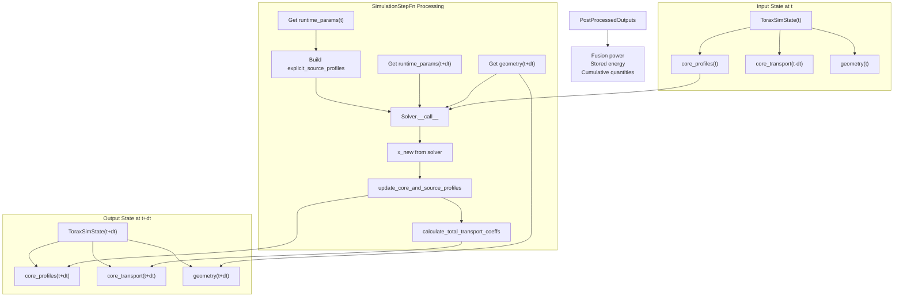
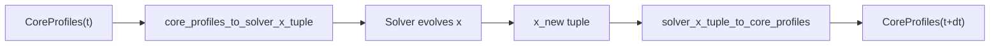
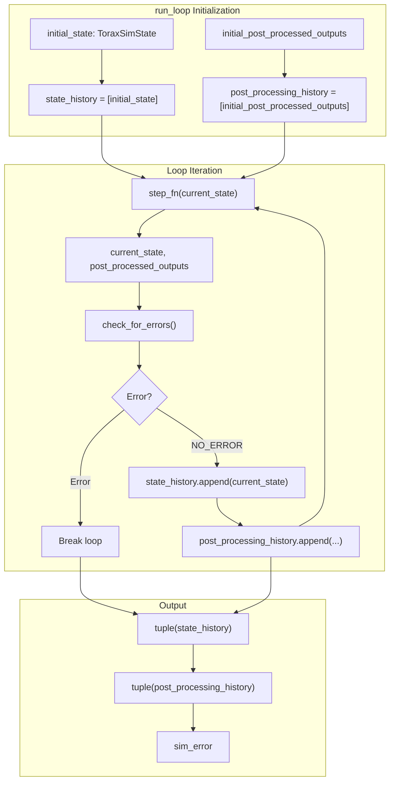
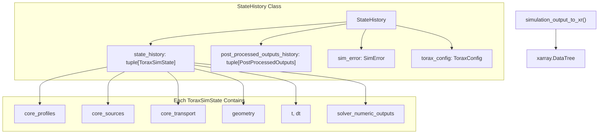
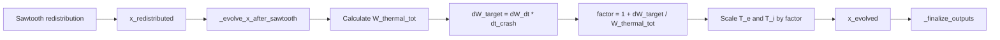
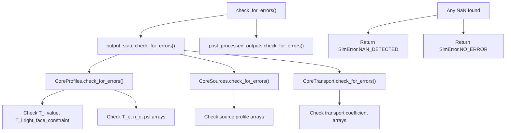
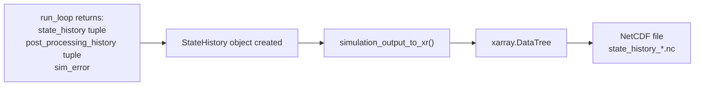

<!-- source: DeepWiki mcp.deepwiki.com · repo google-deepmind/torax · page 4.3 State Management and History · fetched 2026-10-26 -->

# State Management and History

<details>
<summary>Relevant source files</summary>

The following files were used as context for generating this wiki page:

- [torax/_src/imas_tools/output/equilibrium.py](torax/_src/imas_tools/output/equilibrium.py)
- [torax/_src/orchestration/adaptive_step.py](torax/_src/orchestration/adaptive_step.py)
- [torax/_src/orchestration/initial_state.py](torax/_src/orchestration/initial_state.py)
- [torax/_src/orchestration/sawtooth_step.py](torax/_src/orchestration/sawtooth_step.py)
- [torax/_src/orchestration/sim_state.py](torax/_src/orchestration/sim_state.py)
- [torax/_src/orchestration/step_function_processing.py](torax/_src/orchestration/step_function_processing.py)
- [torax/_src/orchestration/tests/initial_state_test.py](torax/_src/orchestration/tests/initial_state_test.py)
- [torax/_src/output_tools/impurity_radiation.py](torax/_src/output_tools/impurity_radiation.py)
- [torax/_src/output_tools/output.py](torax/_src/output_tools/output.py)
- [torax/_src/output_tools/post_processing.py](torax/_src/output_tools/post_processing.py)
- [torax/_src/output_tools/tests/output_test.py](torax/_src/output_tools/tests/output_test.py)
- [torax/_src/output_tools/tests/post_processing_test.py](torax/_src/output_tools/tests/post_processing_test.py)

</details>


This page documents how TORAX manages simulation state throughout execution and collects history for analysis. It covers the structure of `ToraxSimState`, how state evolves through time steps, and how history is collected and output. For information about the simulation loop mechanics, see [Simulation Orchestration](#4.1). For details on post-processing derived quantities, see [State History and Post-Processing](#7.2).

## Core State Structures

TORAX uses immutable data structures compatible with JAX's functional programming model. The primary state container is `ToraxSimState`, which holds all information needed to advance the simulation.

### ToraxSimState Components

`ToraxSimState` contains five major components:

| Component | Type | Purpose |
|-----------|------|---------|
| `t` | `jax.Array` | Current simulation time |
| `dt` | `jax.Array` | Time step duration used to reach current state |
| `core_profiles` | `state.CoreProfiles` | Plasma profiles (T_i, T_e, n_e, psi, etc.) |
| `core_sources` | `source_profiles.SourceProfiles` | Heat, particle, and current sources |
| `core_transport` | `transport_model.TransportCoefficients` | Transport coefficients (chi, D, V) |
| `geometry` | `geometry.Geometry` | Magnetic geometry configuration |
| `solver_numeric_outputs` | `state.SolverNumericOutputs` | Solver convergence diagnostics |

Sources: [torax/_src/orchestration/step_function.py:552-560]()

### State Flow Through Simulation Step



Sources: [torax/_src/orchestration/step_function.py:154-260](), [torax/_src/orchestration/step_function.py:512-566]()

## State Evolution and Immutability

TORAX follows JAX's functional programming paradigm where state objects are immutable. Each simulation step creates new state objects rather than modifying existing ones.

### Core Profiles Update Flow

The solver returns updated `CellVariable` objects (`x_new`) which are converted back into `CoreProfiles`:



The conversion happens in `_finalize_outputs()`:

- `x_new` contains evolved state variables (T_i, T_e, n_e, psi, etc.)
- Non-evolved profiles are updated from prescribed values
- Ion densities recalculated for quasineutrality
- Source profiles recomputed for both explicit and implicit sources

Sources: [torax/_src/orchestration/step_function.py:527-540](), [torax/_src/orchestration/step_function.py:687-752]()

### SolverNumericOutputs

The `SolverNumericOutputs` dataclass tracks solver convergence and diagnostics:

| Field | Type | Description |
|-------|------|-------------|
| `solver_error_state` | `int` | 0=converged fine, 1=not converged, 2=coarse convergence |
| `outer_solver_iterations` | `int` | Number of adaptive dt retry attempts |
| `inner_solver_iterations` | `int` | Number of solver iterations (predictor-corrector or Newton) |
| `sawtooth_crash` | `bool` | Whether a sawtooth crash occurred this step |

These outputs are used for error checking and determining whether to retry with smaller `dt` in adaptive mode.

Sources: [torax/_src/orchestration/step_function.py:411-424](), [torax/tests/sim_time_dependence_test.py:246-251]()

## State History Collection

The simulation loop collects state at each time step into tuples for output and analysis.

### History Accumulation in run_loop



The `run_loop()` function uses a Python `while` loop (not JAX-compiled) to allow dynamic history accumulation:

- Cannot use `jax.lax.while_loop` because history length is unknown at compile time
- Appends to Python lists which are converted to tuples at the end
- If an error occurs, returns truncated history up to last valid state

Sources: [torax/_src/orchestration/run_loop.py:30-190]()

### History Data Structure



The `StateHistory` object is created at the end of `run_simulation()` and provides methods to convert to output formats.

Sources: [torax/_src/orchestration/run_simulation.py:129-143]()

## Post-Processed Outputs

Post-processed outputs are derived quantities computed from the core state, such as fusion power and stored energy.

### PostProcessedOutputs Structure

`PostProcessedOutputs` contains:

- **Instantaneous quantities**: `Q_fusion`, `P_ohmic`, `P_external`, `P_alpha_electron`, etc.
- **Cumulative quantities**: `Q_fusion_cum`, `W_thermal_cum` (cumulative integral over time)
- **Profile derivatives**: `dW_thermal_dt` (rate of change of stored energy)

These are computed by `make_post_processed_outputs()` which:
1. Calculates pressures from temperatures and densities
2. Integrates over volume to get stored energies
3. Computes power terms from sources
4. Updates cumulative quantities from previous step

Sources: [torax/_src/orchestration/step_function.py:561-566]()

### Evolution During Sawtooth Events

Sawtooth crashes require special handling to maintain consistent `dW_thermal_dt`:



This adjustment prevents non-physical discontinuities in `dW_thermal_dt` during sawtooth crashes. The temperature profiles are scaled to maintain the same energy evolution rate over the crash duration.

Sources: [torax/_src/orchestration/step_function.py:687-752]()

## Error Checking and State Validation

The `check_for_errors()` function validates simulation state at each step.

### Error Types

| Error Code | Enum Value | Condition |
|------------|------------|-----------|
| 0 | `SimError.NO_ERROR` | Simulation proceeding normally |
| 1 | `SimError.REACHED_MIN_DT` | Adaptive dt fell below `min_dt` threshold |
| 2 | `SimError.NAN_DETECTED` | NaN found in state arrays |

The function performs three checks:

1. **Adaptive dt validation**: If solver failed to converge and `dt / dt_reduction_factor < min_dt`, return `REACHED_MIN_DT`
2. **State NaN check**: Call `output_state.check_for_errors()` to scan all state arrays
3. **Post-processed outputs check**: Call `post_processed_outputs.check_for_errors()`

Sources: [torax/_src/orchestration/step_function.py:49-65](), [torax/_src/orchestration/tests/step_function_test.py:45-101]()

### NaN Detection

NaN checks traverse the entire state tree:



Each dataclass implements `check_for_errors()` that recursively checks nested structures and arrays using `jnp.any(jnp.isnan(...))`.

Sources: [torax/_src/orchestration/tests/step_function_test.py:53-101]()

## State Persistence and Output

After simulation completes, state history is converted to persistent output formats.

### Output Conversion Pipeline



The `StateHistory` class:
- Wraps the raw tuples from `run_loop()`
- Stores reference to original `ToraxConfig`
- Provides `simulation_output_to_xr()` method to convert to `xarray.DataTree`
- DataTree organizes outputs hierarchically by category (core_profiles, core_sources, etc.)

Sources: [torax/_src/orchestration/run_simulation.py:138-148]()

### In-Memory Access

For debugging and analysis within Python, `StateHistory` provides direct access to dataclasses:

```python
state_history, post_processed_outputs_history, sim_error = run_loop(...)

# Access state at step i
state_i = state_history[i]
T_e_profile = state_i.core_profiles.T_e.value
transport_coeffs = state_i.core_transport.chi_face_ion

# Access post-processed outputs
Q_fusion = post_processed_outputs_history[i].Q_fusion
```

This allows inspection of full state without converting to output format, which is useful for:
- Integration tests that compare against reference states
- Custom post-processing scripts
- Debugging convergence issues

Sources: [torax/_src/orchestration/run_loop.py:30-190](), [torax/tests/sim_time_dependence_test.py:106-146]()

### Restart Capability

TORAX supports restarting simulations from saved state:

1. **Save state**: History is automatically written to NetCDF
2. **Load state**: `get_initial_state_and_post_processed_outputs_from_file()` reads saved state
3. **Continue**: New simulation starts from loaded state with updated `t_initial`

The restart mechanism:
- Loads `CoreProfiles` from specified timestep in NetCDF file
- Reconstructs `ToraxSimState` with loaded profiles
- Recalculates sources and transport for consistency with new configuration

Sources: [torax/_src/orchestration/run_simulation.py:76-94]()

---

