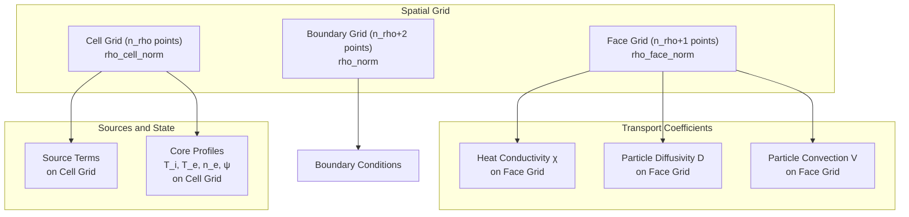
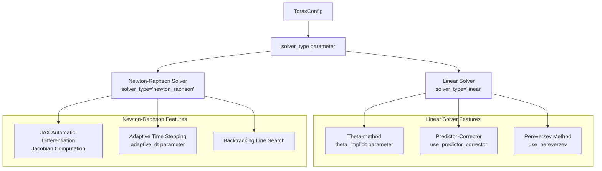
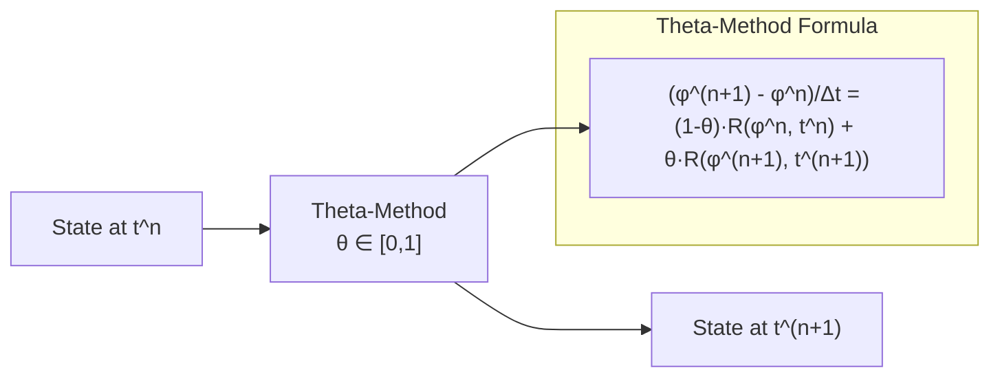
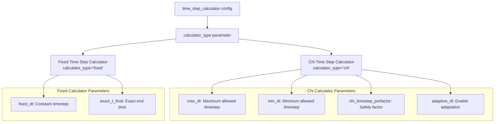
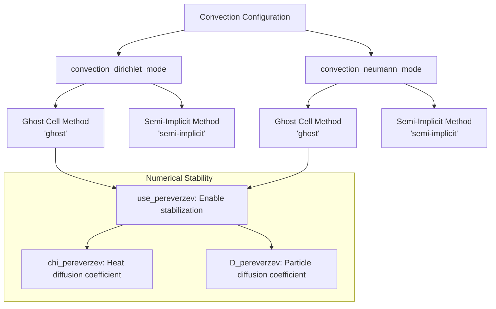
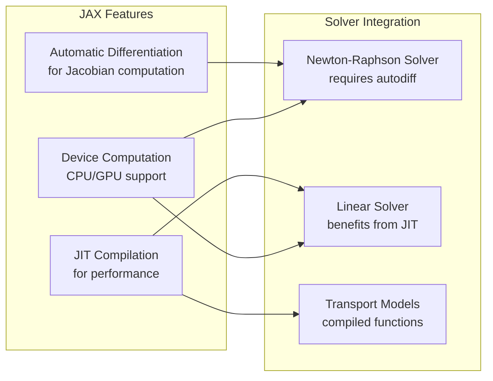

<!-- source: DeepWiki mcp.deepwiki.com · repo google-deepmind/torax · page 5 Numerical Methods · fetched 2026-10-26 -->

# Numerical Methods

<details>
<summary>Relevant source files</summary>

The following files were used as context for generating this wiki page:

- [torax/_src/fvm/calc_coeffs.py](torax/_src/fvm/calc_coeffs.py)
- [torax/_src/fvm/newton_raphson_solve_block.py](torax/_src/fvm/newton_raphson_solve_block.py)
- [torax/_src/fvm/optimizer_solve_block.py](torax/_src/fvm/optimizer_solve_block.py)
- [torax/_src/fvm/residual_and_loss.py](torax/_src/fvm/residual_and_loss.py)
- [torax/_src/fvm/tests/calc_coeffs_test.py](torax/_src/fvm/tests/calc_coeffs_test.py)
- [torax/_src/fvm/tests/fvm_test.py](torax/_src/fvm/tests/fvm_test.py)
- [torax/_src/solver/linear_theta_method.py](torax/_src/solver/linear_theta_method.py)
- [torax/_src/solver/nonlinear_theta_method.py](torax/_src/solver/nonlinear_theta_method.py)
- [torax/_src/solver/predictor_corrector_method.py](torax/_src/solver/predictor_corrector_method.py)
- [torax/_src/solver/solver.py](torax/_src/solver/solver.py)

</details>


This page provides an overview of the numerical methods used in TORAX for solving the transport equations that govern tokamak plasma dynamics. It covers PDE discretization, solver algorithms, and time stepping strategies that enable efficient and accurate simulation of plasma evolution.

For detailed information about specific solver implementations, see [PDE Solvers](#4.1). For time stepping strategies and adaptive algorithms, see [Time Stepping](#4.2).

## Overview

TORAX employs a finite volume method (FVM) for spatial discretization combined with implicit time stepping to solve the coupled system of nonlinear partial differential equations governing plasma transport. The numerical approach is designed to handle the multi-scale nature of plasma transport phenomena while maintaining computational efficiency through JAX compilation.

## Finite Volume Discretization

TORAX uses a finite volume method to discretize the transport equations in the radial direction. The domain is divided into discrete cells with transport coefficients defined on cell faces and source terms on cell centers.

### Finite Volume Method Architecture



Sources: [docs/output.rst:40-77](), [docs/configuration.rst:522-524]()

## Solver Algorithms

TORAX provides multiple solver algorithms to handle different numerical requirements and convergence characteristics of the transport equations.

### Solver Algorithm Selection



Sources: [docs/configuration.rst:889-911](), [torax/tests/test_data/test_implicit.nc:1](), [torax/tests/test_data/test_semiimplicit_convection.nc:1]()

### Theta-Method Implementation

The theta-method provides a unified framework for implicit time stepping with configurable implicitness through the `theta_implicit` parameter:

- `theta_implicit = 0.0`: Explicit Euler (forward Euler)
- `theta_implicit = 0.5`: Crank-Nicolson (trapezoidal rule)  
- `theta_implicit = 1.0`: Implicit Euler (backward Euler)



Sources: [docs/configuration.rst:889]()

## Time Stepping Strategies

TORAX implements multiple time stepping strategies to balance accuracy and computational efficiency based on the timescales present in the plasma transport problem.

### Time Step Calculator Architecture



Sources: [docs/configuration.rst:289-301](), [docs/configuration.rst:986-989]()

### Adaptive Time Stepping Algorithm

The chi-based time step calculator determines the time step based on transport coefficient values and grid spacing to maintain numerical stability:

```
dt_base = dx² / (2 * max(χ))
dt = min(max_dt, chi_timestep_prefactor * dt_base)
```

Where `χ` represents the maximum heat conductivity across the domain and `dx` is the grid spacing.

## Convection Treatment

TORAX provides multiple approaches for handling convection terms in the transport equations, which can be numerically challenging due to their potential to introduce instabilities.

### Convection Discretization Methods



Sources: [docs/configuration.rst:896-899](), [torax/tests/test_data/test_semiimplicit_convection.nc:1]()

## Numerical Performance and JAX Integration

TORAX leverages JAX for high-performance numerical computation, enabling automatic differentiation for Newton-Raphson solvers and JIT compilation for computational efficiency.

### JAX Compilation Strategy



### Environment Variables for Numerical Control

TORAX provides environment variables to control numerical behavior:

- `TORAX_COMPILATION_ENABLED`: Controls JAX compilation (default: True)
- `TORAX_ERRORS_ENABLED`: Enables error checking in numerical routines (default: False)

Sources: [docs/running.rst:65-78]()

## Convergence and Stability

The numerical methods incorporate several mechanisms to ensure convergence and maintain stability across the range of plasma transport timescales.

### Convergence Criteria

For iterative solvers, convergence is determined by:
- Tolerance settings in the time step calculator (`tolerance` parameter)
- Maximum iteration limits for Newton-Raphson (`n_corrector_steps` for predictor-corrector)
- Adaptive time step reduction when convergence fails (`dt_reduction_factor`)

### Numerical Stability Features

1. **Transport Coefficient Bounds**: Upper and lower bounds on transport coefficients prevent numerical instabilities
2. **Adaptive Source Terms**: Large prefactors for boundary condition enforcement (`adaptive_T_source_prefactor`, `adaptive_n_source_prefactor`)
3. **Pereverzev Stabilization**: Additional diffusion terms to handle convection-dominated regimes
4. **Time Step Adaptation**: Automatic reduction of time steps when convergence issues arise

Sources: [docs/configuration.rst:289-323](), [docs/configuration.rst:986-989]()

---

