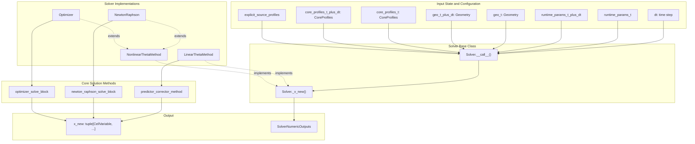
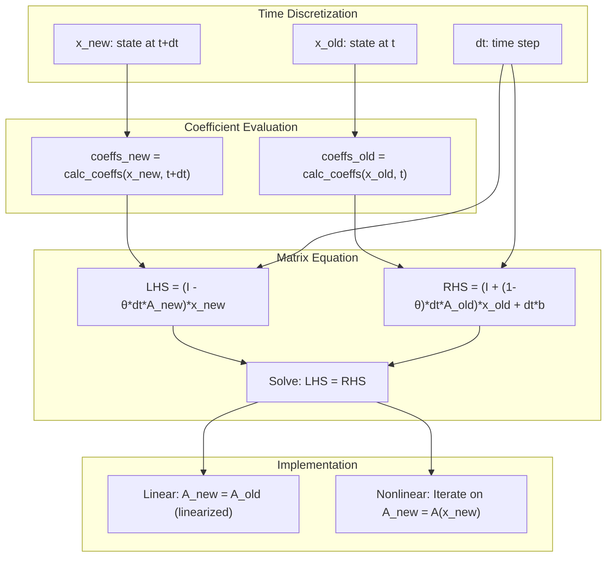
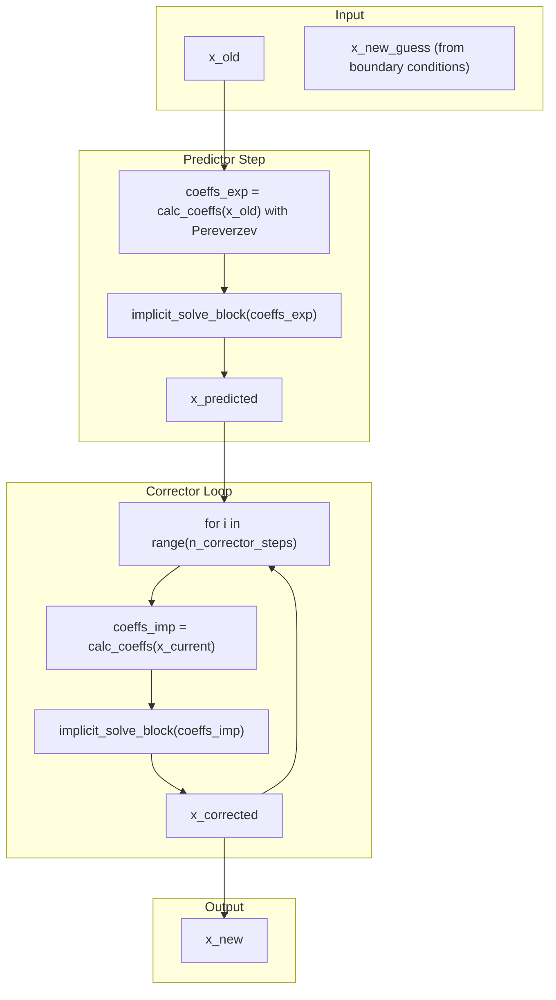
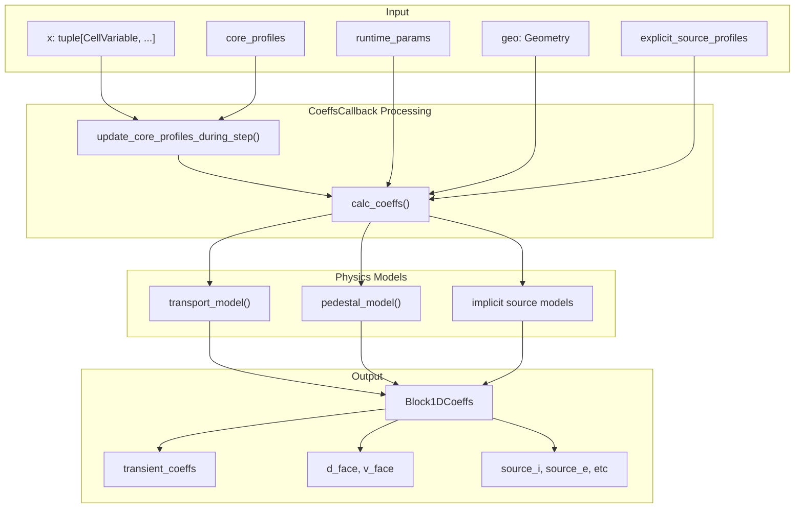
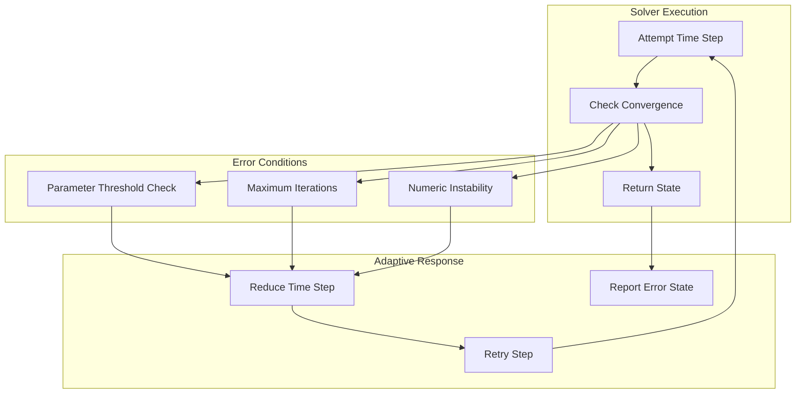

<!-- source: DeepWiki mcp.deepwiki.com · repo google-deepmind/torax · page 5.1 PDE Solvers · fetched 2026-10-26 -->

# PDE Solvers

<details>
<summary>Relevant source files</summary>

The following files were used as context for generating this wiki page:

- [torax/_src/fvm/calc_coeffs.py](torax/_src/fvm/calc_coeffs.py)
- [torax/_src/fvm/newton_raphson_solve_block.py](torax/_src/fvm/newton_raphson_solve_block.py)
- [torax/_src/fvm/optimizer_solve_block.py](torax/_src/fvm/optimizer_solve_block.py)
- [torax/_src/fvm/residual_and_loss.py](torax/_src/fvm/residual_and_loss.py)
- [torax/_src/fvm/tests/calc_coeffs_test.py](torax/_src/fvm/tests/calc_coeffs_test.py)
- [torax/_src/fvm/tests/fvm_test.py](torax/_src/fvm/tests/fvm_test.py)
- [torax/_src/solver/linear_theta_method.py](torax/_src/solver/linear_theta_method.py)
- [torax/_src/solver/nonlinear_theta_method.py](torax/_src/solver/nonlinear_theta_method.py)
- [torax/_src/solver/predictor_corrector_method.py](torax/_src/solver/predictor_corrector_method.py)
- [torax/_src/solver/solver.py](torax/_src/solver/solver.py)

</details>


This page documents the numerical PDE (Partial Differential Equation) solvers used in TORAX for evolving coupled plasma transport equations. The solvers implement finite volume discretization with theta-method time integration to advance ion temperature, electron temperature, electron density, and poloidal flux profiles.

For time stepping algorithms and adaptive time control, see [Time Stepping and Adaptive Control](#4.2). For the underlying transport equations and physics models, see [Physics Models](#3). For finite volume discretization details, see [Finite Volume Methods and Theta Integration](#5.2).

## Overview

TORAX provides two categories of PDE solvers:

1. **Linear Solver** (`LinearThetaMethod`): Uses a linearized theta-method based on transport coefficients at time t. Supports optional predictor-corrector iterations for improved accuracy.

2. **Nonlinear Solvers** (`NonlinearThetaMethod`): Iteratively solve the nonlinear system using either:
   - `NewtonRaphson`: Jacobian-based Newton-Raphson method with line search
   - `Optimizer`: JAXopt LBFGS optimizer minimizing residual norm

All solvers implement the abstract `Solver` base class and integrate with TORAX's physics models, geometry, and source calculations.
</thinking>

Sources: [torax/_src/solver/solver.py:35-60](), [torax/_src/solver/linear_theta_method.py:32-33](), [torax/_src/solver/nonlinear_theta_method.py:33-132](), [docs/configuration.rst:24]()

**Diagram: Solver Architecture and Data Flow**



Sources: [torax/_src/solver/solver.py:67-143](), [torax/_src/solver/linear_theta_method.py:32-74](), [torax/_src/solver/nonlinear_theta_method.py:82-132]()

## Solver Architecture

## Solver Types

### Base Solver Interface

The abstract `Solver` base class defines the interface for all PDE solvers. Key methods:

- `__call__()`: Main entry point for advancing a time step. Takes state at time `t` and returns evolved state at `t+dt`.
- `_x_new()`: Internal method that computes the new values of evolving variables. Subclasses must implement this.

**Solver Input Arguments**

| Argument | Type | Description |
|----------|------|-------------|
| `t` | `jax.Array` | Current simulation time |
| `dt` | `jax.Array` | Time step duration |
| `runtime_params_t` | `RuntimeParams` | Parameters at time t |
| `runtime_params_t_plus_dt` | `RuntimeParams` | Parameters at time t+dt (for implicit) |
| `geo_t` | `Geometry` | Geometry at time t |
| `geo_t_plus_dt` | `Geometry` | Geometry at time t+dt |
| `core_profiles_t` | `CoreProfiles` | Plasma profiles at time t |
| `core_profiles_t_plus_dt` | `CoreProfiles` | Boundary conditions and prescribed profiles at t+dt |
| `explicit_source_profiles` | `SourceProfiles` | Pre-calculated explicit source terms |

**Solver Outputs**

- `x_new`: Tuple of `CellVariable` instances containing evolved profiles
- `SolverNumericOutputs`: Dataclass with convergence diagnostics including iteration counts and error states

Sources: [torax/_src/solver/solver.py:35-192]()

### Linear Theta Method

The `LinearThetaMethod` class implements a linearized theta-method solver. The transport coefficients are evaluated at time `t` and used to solve the discretized system. This is the default solver for TORAX and is computationally efficient.

**Key Features:**

- Linearizes the nonlinear transport equations using coefficients from time `t`
- Supports optional predictor-corrector iterations (Picard method) for improved accuracy
- Can use Pereverzev-Corrigan stabilization terms for stiff transport coefficients
- Fully compatible with JAX automatic differentiation

**Configuration Parameters:**

| Parameter | Type | Default | Description |
|-----------|------|---------|-------------|
| `theta_implicit` | `float` | 1.0 | Theta parameter (0=explicit, 0.5=Crank-Nicolson, 1=fully implicit) |
| `use_predictor_corrector` | `bool` | True | Enable predictor-corrector iterations |
| `n_corrector_steps` | `int` | 1 | Number of corrector iterations |
| `use_pereverzev` | `bool` | True | Add Pereverzev-Corrigan terms for stability |
| `chi_pereverzev` | `float` | 30.0 | Diffusivity coefficient for Pereverzev terms |
| `D_pereverzev` | `float` | 15.0 | Particle diffusion coefficient for Pereverzev terms |

The solver configuration is specified in the `solver` section of the TORAX config with `solver_type: 'linear'`.

Sources: [torax/_src/solver/linear_theta_method.py:32-74](), [torax/_src/solver/predictor_corrector_method.py:40-121](), [docs/configuration.rst:1063-1081]()

### Nonlinear Theta Methods

The `NonlinearThetaMethod` abstract class extends `Solver` for solvers that iteratively solve the nonlinear transport equations. Two implementations are provided:

#### Newton-Raphson Solver

The `NewtonRaphson` class uses Newton's method with line search to solve the nonlinear system. At each iteration, it:

1. Evaluates the residual function and its Jacobian at the current guess
2. Solves the linearized system to compute a Newton step
3. Performs line search to ensure the residual decreases
4. Repeats until convergence or maximum iterations

**Configuration Parameters:**

| Parameter | Type | Default | Description |
|-----------|------|---------|-------------|
| `maxiter` | `int` | 30 | Maximum Newton iterations |
| `tol` | `float` | 1e-5 | Residual tolerance for convergence |
| `coarse_tol` | `float` | 0.1 | Coarser tolerance when steps become small |
| `delta_reduction_factor` | `float` | 2.0 | Factor to reduce step size during line search |
| `tau_min` | `float` | 1e-3 | Minimum step size ratio before restart |
| `initial_guess_mode` | `str` | 'linear' | 'linear' uses predictor-corrector, 'x_old' uses previous state |

The Newton-Raphson solver is selected with `solver_type: 'newton_raphson'` in the config.

Sources: [torax/_src/solver/nonlinear_theta_method.py:82-132](), [torax/_src/fvm/newton_raphson_solve_block.py:58-247](), [docs/configuration.rst:1063-1081]()

#### Optimizer-Based Solver

The `Optimizer` class minimizes the squared residual norm using JAXopt's LBFGS optimizer. This approach:

- Treats the PDE solution as an optimization problem
- Minimizes the loss function: mean squared residual
- Does not require explicit Jacobian calculation
- Uses quasi-Newton updates (LBFGS) for efficiency

**Configuration Parameters:**

| Parameter | Type | Default | Description |
|-----------|------|---------|-------------|
| `maxiter` | `int` | 30 | Maximum optimizer iterations |
| `tol` | `float` | 1e-5 | Loss tolerance for convergence |
| `initial_guess_mode` | `str` | 'linear' | Initial guess strategy |

The optimizer-based solver is selected with `solver_type: 'optimizer'` in the config.

Sources: [torax/_src/solver/nonlinear_theta_method.py:134-166](), [torax/_src/fvm/optimizer_solve_block.py:50-211](), [docs/configuration.rst:1063-1081]()

## Theta Method Time Integration

All TORAX solvers use the theta method for time discretization. The method blends explicit and implicit time integration using the parameter θ ∈ [0,1]:

```
x_new = x_old + dt * [θ * f(x_new, t+dt) + (1-θ) * f(x_old, t)]
```

Where:
- θ = 0: Fully explicit (forward Euler)
- θ = 0.5: Crank-Nicolson (second-order accurate)
- θ = 1: Fully implicit (backward Euler, unconditionally stable)

TORAX defaults to θ = 1 for stability with stiff transport equations.

**Diagram: Theta Method Discretization**



Sources: [torax/_src/fvm/residual_and_loss.py:54-108](), [docs/configuration.rst:1063-1070]()

## Predictor-Corrector Method

The predictor-corrector method provides an iterative approach to improve solution accuracy for the linearized solver. It implements Picard iterations:

1. **Predictor Step**: Solve using coefficients at time `t`
2. **Corrector Step(s)**: Re-evaluate coefficients at intermediate solution and re-solve
3. Repeat for `n_corrector_steps` iterations

This approach approximates the nonlinear solution while maintaining the efficiency of the linear solver.

**Diagram: Predictor-Corrector Algorithm**



The predictor-corrector method is enabled by setting `use_predictor_corrector: True` in the solver configuration. The number of corrector iterations is controlled by `n_corrector_steps`.

Sources: [torax/_src/solver/predictor_corrector_method.py:40-121](), [torax/_src/solver/linear_theta_method.py:42-74]()

## Numerical Details

### Coefficient Calculation

The `CoeffsCallback` class computes the finite volume coefficients (diffusion, convection, sources) needed for the PDE discretization. This callback:

- Takes the current state `x` and returns `Block1DCoeffs`
- Updates `core_profiles` with evolving variables from `x`
- Calls physics models to compute transport coefficients and sources
- Supports Pereverzev-Corrigan terms when `allow_pereverzev=True`
- Used repeatedly by iterative solvers (Newton-Raphson, optimizer)

**Diagram: Coefficient Calculation Flow**



Sources: [torax/_src/fvm/calc_coeffs.py:36-127](), [torax/_src/fvm/calc_coeffs.py:215-350]()

### Residual and Loss Functions

The residual function measures the difference between left-hand-side and right-hand-side of the discretized PDE:

```
R(x_new) = (x_new - x_old)/dt - [θ*f(x_new) + (1-θ)*f(x_old)]
```

For the Newton-Raphson solver, the residual is used directly. For the optimizer solver, it is converted to a scalar loss:

```
L(x_new) = mean(R(x_new)²)
```

Key functions:
- `theta_method_block_residual()`: Computes the residual vector
- `theta_method_block_loss()`: Computes the scalar loss from residual
- `jaxopt_solver()`: Wraps JAXopt LBFGS optimizer for minimization

Sources: [torax/_src/fvm/residual_and_loss.py:110-188](), [torax/_src/fvm/residual_and_loss.py:191-295]()

### Initial Guess Strategies

Both nonlinear solvers support two initial guess strategies configured by `initial_guess_mode`:

**LINEAR Mode** (`initial_guess_mode: 'linear'`):
- Uses predictor-corrector method to compute initial guess
- Applies Pereverzev-Corrigan terms for stability
- Provides better starting point for stiff transport models (e.g., QLKNN)
- Default and recommended for most cases

**X_OLD Mode** (`initial_guess_mode: 'x_old'`):
- Uses state from previous time step as initial guess
- Simpler but may require more iterations
- Can be faster when transport coefficients change slowly

Sources: [torax/_src/fvm/newton_raphson_solve_block.py:166-204](), [torax/_src/fvm/optimizer_solve_block.py:130-168]()

### Pereverzev-Corrigan Terms

Pereverzev-Corrigan terms add artificial diffusion to stabilize the linear solver when using stiff transport models. These terms:

- Add diffusive flux proportional to gradients
- Applied only in linear solver and for initial guess in nonlinear solvers
- Removed from pedestal region to avoid interfering with edge physics
- Configured via `chi_pereverzev` and `D_pereverzev` parameters

The heat diffusivities are augmented with:

```
chi_face_per = chi_pereverzev * g1_over_vpr_face * n * keV_to_J
v_heat_face = -(grad T / T) * chi_face_per
```

And particle diffusion with:

```
d_face_per = D_pereverzev * g1_over_vpr_face
v_face_per = -(grad n / n) * d_face_per * g0_face
```

Sources: [torax/_src/fvm/calc_coeffs.py:129-212](), [docs/configuration.rst:1073-1076]()

## Solver Configuration

Solvers are configured through the `solver` section of the TORAX configuration dictionary. Common parameters:

| Parameter | Type | Description |
|-----------|------|-------------|
| `solver_type` | `str` | Solver to use: 'linear', 'newton_raphson', or 'optimizer' |
| `theta_implicit` | `float` | Theta parameter for time integration (default: 1.0) |
| `use_predictor_corrector` | `bool` | Enable predictor-corrector in linear solver (default: True) |
| `n_corrector_steps` | `int` | Number of corrector iterations (default: 1) |
| `use_pereverzev` | `bool` | Add Pereverzev-Corrigan terms (default: True) |
| `chi_pereverzev` | `float` | Heat diffusivity for Pereverzev terms (default: 30.0) |
| `D_pereverzev` | `float` | Particle diffusivity for Pereverzev terms (default: 15.0) |
| `convection_dirichlet_mode` | `str` | Boundary handling for Dirichlet BCs: 'ghost' or 'fan' (default: 'ghost') |
| `convection_neumann_mode` | `str` | Boundary handling for Neumann BCs: 'ghost' or 'fan' (default: 'ghost') |

**Example: Linear Solver Configuration**

```python
'solver': {
    'solver_type': 'linear',
    'theta_implicit': 1.0,
    'use_predictor_corrector': True,
    'n_corrector_steps': 1,
    'use_pereverzev': True,
    'chi_pereverzev': 30.0,
    'D_pereverzev': 15.0,
}
```

**Example: Newton-Raphson Solver Configuration**

```python
'solver': {
    'solver_type': 'newton_raphson',
    'theta_implicit': 1.0,
    'initial_guess_mode': 'linear',
    'maxiter': 30,
    'tol': 1e-5,
    'coarse_tol': 0.1,
}
```

Sources: [docs/configuration.rst:1063-1081](), [torax/tests/test_data/test_iterhybrid_predictor_corrector_zeffprofile.nc]()

## Convergence and Error Handling

### SolverNumericOutputs

Solvers return a `SolverNumericOutputs` dataclass with diagnostic information:

| Field | Type | Description |
|-------|------|-------------|
| `inner_solver_iterations` | `int` | Number of inner iterations (Newton steps or optimizer iterations) |
| `outer_solver_iterations` | `int` | Number of outer iterations (predictor-corrector steps) |
| `solver_error_state` | `int` | Error flag: 0=success, 1=convergence failure |
| `sawtooth_crash` | `bool` | Whether a sawtooth crash occurred |

These outputs are used by the adaptive time stepping system (see [Time Stepping and Adaptive Control](#4.2)) to:
- Monitor solver performance
- Detect convergence failures
- Trigger time step reduction when needed
- Retry failed steps with smaller `dt`

Sources: [torax/_src/state.py](), [torax/_src/fvm/newton_raphson_solve_block.py:238-246](), [torax/_src/fvm/optimizer_solve_block.py:170-210]()

### Convergence Criteria

**Linear Solver:**
- Always returns after predictor + corrector steps
- Error state is 0 (no convergence failure for linear solver)

**Newton-Raphson Solver:**
- Converges when `mean(|residual|) < tol`
- Uses coarse tolerance `coarse_tol` when steps become small (`tau < tau_min`)
- Sets `solver_error_state=1` if maximum iterations exceeded

**Optimizer Solver:**
- Converges when `loss < tol`
- Sets `solver_error_state=1` if final loss exceeds tolerance

Sources: [torax/_src/fvm/newton_raphson_solve_block.py:58-247](), [torax/_src/fvm/optimizer_solve_block.py:50-211]()

## Error Handling and Adaptive Control

Solvers work with the adaptive time stepping system to handle convergence failures:



The test framework demonstrates error handling through parameter threshold checking, where solvers can signal convergence failure when combined parameter values exceed specified limits.

Sources: [torax/tests/sim_time_dependence_test.py:285-289](), [torax/tests/sim_time_dependence_test.py:66-75]()

---

