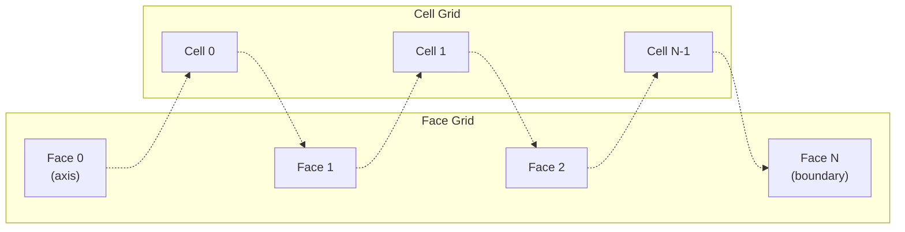
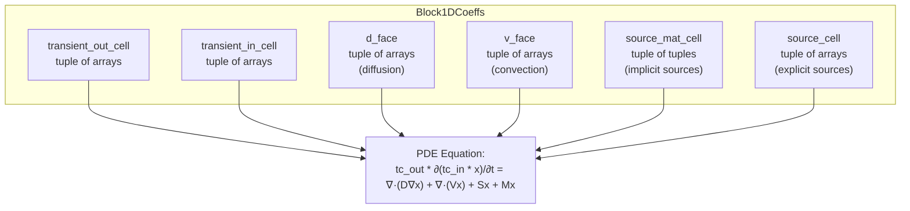
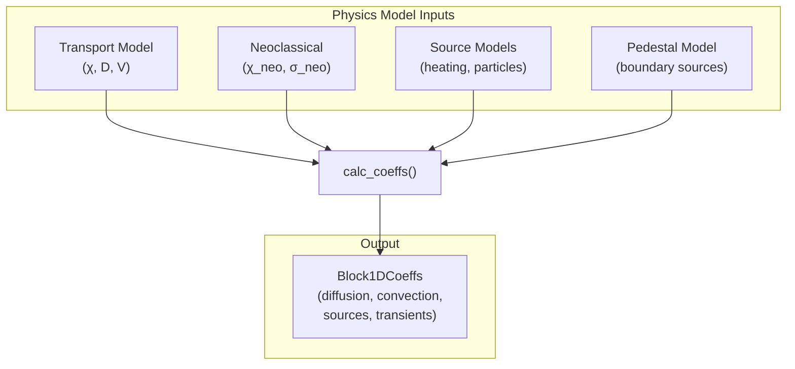
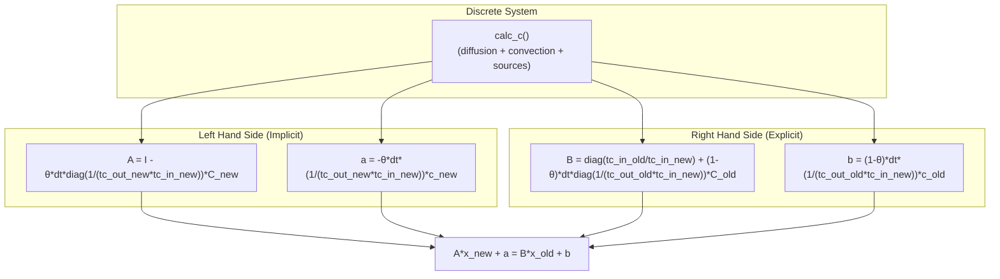
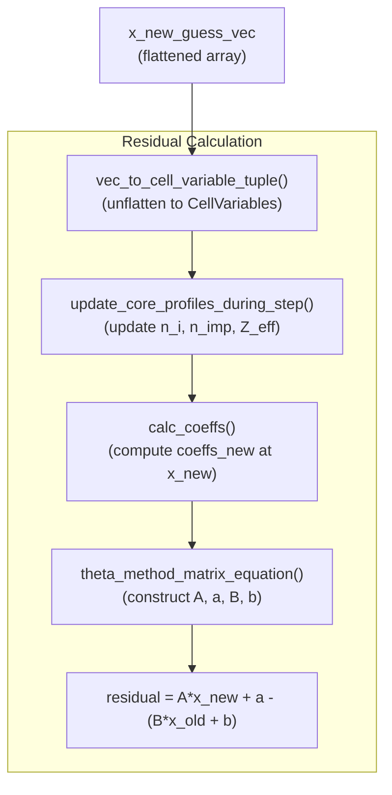
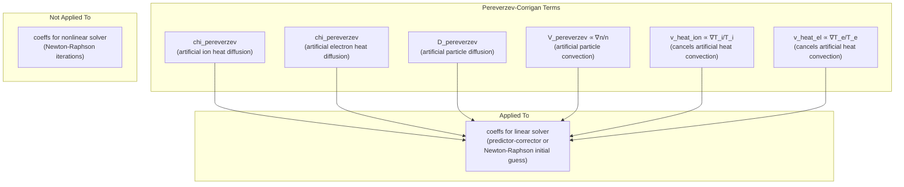
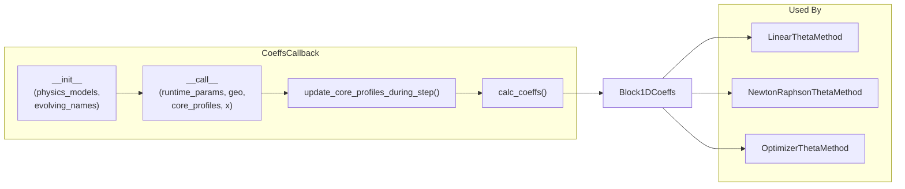

<!-- source: DeepWiki mcp.deepwiki.com · repo google-deepmind/torax · page 5.2 Finite Volume Methods and Theta Integration · fetched 2026-10-26 -->

# Finite Volume Methods and Theta Integration

<details>
<summary>Relevant source files</summary>

The following files were used as context for generating this wiki page:

- [torax/_src/fvm/calc_coeffs.py](torax/_src/fvm/calc_coeffs.py)
- [torax/_src/fvm/newton_raphson_solve_block.py](torax/_src/fvm/newton_raphson_solve_block.py)
- [torax/_src/fvm/optimizer_solve_block.py](torax/_src/fvm/optimizer_solve_block.py)
- [torax/_src/fvm/residual_and_loss.py](torax/_src/fvm/residual_and_loss.py)
- [torax/_src/fvm/tests/calc_coeffs_test.py](torax/_src/fvm/tests/calc_coeffs_test.py)
- [torax/_src/fvm/tests/fvm_test.py](torax/_src/fvm/tests/fvm_test.py)
- [torax/_src/solver/linear_theta_method.py](torax/_src/solver/linear_theta_method.py)
- [torax/_src/solver/nonlinear_theta_method.py](torax/_src/solver/nonlinear_theta_method.py)
- [torax/_src/solver/predictor_corrector_method.py](torax/_src/solver/predictor_corrector_method.py)
- [torax/_src/solver/solver.py](torax/_src/solver/solver.py)

</details>


## Purpose and Scope

This page explains the finite volume method (FVM) discretization and theta-method time integration used in TORAX to solve partial differential equations (PDEs) for plasma transport. It covers the mathematical formulation, data structures for PDE coefficients, and numerical implementation details.

For information about the higher-level solver classes that orchestrate these methods (LinearThetaMethod, Newton-Raphson, Optimizer), see [PDE Solvers](#5.1). For overall simulation execution flow, see [Simulation Orchestration and Step Function](#4.1).

---

## Finite Volume Discretization

TORAX uses a finite volume method on a 1D radial grid to discretize the transport equations. The spatial domain is divided into cells, with variables defined at cell centers and fluxes computed at cell faces.

### Grid Structure



**Spatial discretization in TORAX**

The cell grid stores the primary state variables (temperatures, densities, poloidal flux), while the face grid is used to compute spatial derivatives and fluxes for diffusion and convection terms.

Sources: [torax/_src/fvm/cell_variable.py](), [torax/_src/geometry/geometry.py]()

### CellVariable Structure

The `CellVariable` class represents a discretized variable on the cell grid with associated boundary conditions:

| Field | Type | Description |
|-------|------|-------------|
| `value` | `jax.Array` | Cell-centered values (shape: `[n_cells]`) |
| `dr` | `jax.Array` | Radial grid spacing |
| `right_face_constraint` | `Optional[float]` | Dirichlet boundary condition at outer edge |
| `right_face_grad_constraint` | `Optional[float]` | Neumann boundary condition at outer edge |

Key methods:
- `face_value()` - Interpolates cell values to face grid
- `face_grad()` - Computes spatial gradient at faces
- `grad()` - Computes gradient at cell centers

The `CellVariable` structure is used throughout the FVM implementation to maintain consistency between cell values, face values, and boundary conditions.

Sources: [torax/_src/fvm/cell_variable.py](), [torax/_src/fvm/fvm_conversions.py]()

---

## Block1DCoeffs Structure

The `Block1DCoeffs` dataclass encapsulates all PDE coefficients for a system of coupled equations. For a system evolving multiple variables (e.g., `T_i`, `T_e`, `n_e`, `psi`), it stores coefficients in a block structure.



**Block1DCoeffs structure and its role in PDE formulation**

### Coefficient Types

**Transient Coefficients:**
- `transient_out_cell` - Outside the time derivative (`tc_out`)
- `transient_in_cell` - Inside the time derivative (`tc_in`)
- Enables equations of form: `tc_out * ∂(tc_in * x)/∂t = ...`

**Spatial Transport Coefficients:**
- `d_face` - Diffusion coefficients at faces (e.g., `χ_i`, `χ_e`, `D_e`)
- `v_face` - Convection velocities at faces (e.g., pinch velocities)

**Source Terms:**
- `source_cell` - Explicit source vector (e.g., heating, particle sources)
- `source_mat_cell` - Implicit source matrix for coupled equations (e.g., `Q_ei` coupling)

The block structure allows multiple equations to be coupled through the `source_mat_cell` terms. For example, electron-ion energy exchange couples `T_i` and `T_e` equations.

Sources: [torax/_src/fvm/block_1d_coeffs.py](), [torax/_src/fvm/calc_coeffs.py:215-621]()

### Coefficient Calculation

The `calc_coeffs` function constructs `Block1DCoeffs` by assembling contributions from physics models:



**Coefficient calculation pipeline from physics models**

The function combines turbulent transport (`chi_face_ion`, `chi_face_el`, `d_face_el`), neoclassical transport, explicit and implicit sources, and pedestal boundary sources into a unified coefficient structure.

Sources: [torax/_src/fvm/calc_coeffs.py:215-621](), [torax/_src/fvm/calc_coeffs.py:36-127]()

---

## Theta Method Time Integration

The theta method is a family of finite difference schemes for time integration, parameterized by `θ ∈ [0, 1]`:

- `θ = 0`: Explicit (forward Euler)
- `θ = 1`: Fully implicit (backward Euler) - **TORAX default**
- `θ = 0.5`: Crank-Nicolson (second-order accurate)

### Mathematical Formulation

For a general transport equation:

```
tc_out * ∂(tc_in * x)/∂t = F(x)
```

where `F(x) = ∇·(D∇x) + ∇·(Vx) + Sx + Mx` combines diffusion, convection, and sources.

The theta method discretizes this as:

```
(tc_in_new * x_new - tc_in_old * x_old) / dt = 
    θ * F_new / tc_out_new + (1-θ) * F_old / tc_out_old
```

Rearranging to solve for `x_new`:

```
x_new - θ * dt * F_new / (tc_out_new * tc_in_new) = 
    (tc_in_old / tc_in_new) * x_old + (1-θ) * dt * F_old / (tc_out_old * tc_in_new)
```

Sources: [torax/_src/fvm/residual_and_loss.py:54-186]()

### Matrix Equation Formulation

The `theta_method_matrix_equation` function constructs the linear system `A*x_new + a = B*x_old + b`:



**Matrix equation construction for theta method**

The `calc_c` function (from `discrete_system` module) discretizes the spatial operators (diffusion, convection) into matrix `C` and vector `c` using the finite volume approach.

Sources: [torax/_src/fvm/residual_and_loss.py:54-186](), [torax/_src/fvm/discrete_system.py]()

### Implicit vs Explicit Terms

The theta parameter controls the balance between implicit and explicit evaluation:

| θ value | Implicit weight | Explicit weight | Properties |
|---------|----------------|-----------------|------------|
| 0.0 | 0 | 1 | Simple, conditionally stable, requires small `dt` |
| 0.5 | 0.5 | 0.5 | Second-order accurate, A-stable |
| 1.0 | 1 | 0 | Unconditionally stable, allows large `dt`, **TORAX default** |

When `θ = 1` (fully implicit), the explicit terms are not computed, saving computational cost. The code optimizes this case:

```python
# From residual_and_loss.py:166-184
if theta_exp > 0.0:
    # Compute explicit terms only if needed
    c_mat_old, c_old = discrete_system.calc_c(x_old, coeffs_old, ...)
    rhs_mat = right_transient + dt * theta_exp * broadcasted * c_mat_old
    rhs_vec = dt * theta_exp * (1 / (tc_out_old * tc_in_new)) * c_old
else:
    rhs_mat = right_transient
    rhs_vec = jnp.zeros_like(x_new_guess_vec)
```

Sources: [torax/_src/fvm/residual_and_loss.py:166-184](), [torax/_src/fvm/calc_coeffs.py:253-271]()

---

## Residual and Loss Functions

For iterative solvers (Newton-Raphson, optimizer-based), the theta method equation is expressed as a residual or loss function.

### Residual Function

The `theta_method_block_residual` computes the residual vector `R(x_new) = LHS - RHS`:



**Residual calculation for nonlinear solvers**

The residual function:
1. Converts the flattened guess vector to `CellVariable` tuple
2. Updates derived quantities (ion densities, charge states) dependent on the guess
3. Recalculates transport and source coefficients at the new state
4. Evaluates the matrix equation and returns the residual vector

Sources: [torax/_src/fvm/residual_and_loss.py:189-275](), [torax/_src/core_profiles/updaters.py]()

### Loss Function

For optimization-based solvers (using `jaxopt.LBFGS`), the `theta_method_block_loss` computes a scalar loss:

```python
loss = jnp.mean(jnp.square(residual))
```

This mean squared error metric provides a smooth objective function for gradient-based optimization.

Sources: [torax/_src/fvm/residual_and_loss.py:278-334](), [torax/_src/fvm/residual_and_loss.py:337-404]()

---

## Pereverzev-Corrigan Terms

When using stiff transport models (e.g., QLKNN neural network), the highly nonlinear transport coefficients can cause numerical instability. Pereverzev-Corrigan terms add artificial diffusion and convection to stabilize the linear solver.

### Motivation

Stiff transport coefficients can change rapidly with state variables, leading to:
- Poor convergence in linear solvers
- Requirement for very small time steps
- Non-physical oscillations

The Pereverzev-Corrigan method adds small corrective fluxes that smooth out the nonlinearity for the linear predictor step, while the nonlinear solver handles the full physics rigorously.

### Implementation

The `_calculate_pereverzev_flux` function adds stabilizing terms:



**Pereverzev-Corrigan term application**

The terms are:
- Added when `allow_pereverzev=True` in `CoeffsCallback`
- Enabled by `runtime_params.solver.use_pereverzev`
- Removed from pedestal region (for PDE stability)
- Heat convection terms cancel out the artificial heat flux

Configuration parameters:
- `chi_pereverzev` - Artificial heat diffusivity magnitude
- `D_pereverzev` - Artificial particle diffusivity magnitude

Sources: [torax/_src/fvm/calc_coeffs.py:129-212](), [torax/_src/fvm/calc_coeffs.py:410-436]()

---

## Implementation Details

### CoeffsCallback

The `CoeffsCallback` class wraps coefficient calculation for use in iterative solvers:



**CoeffsCallback usage in solvers**

The callback:
- Is statically typed (hashable and comparable) for JAX JIT compilation
- Updates core profiles with current guess of evolving variables
- Calls `calc_coeffs` with appropriate `use_pereverzev` flag
- Supports optimization for fully implicit case (`explicit_call=True`)

Sources: [torax/_src/fvm/calc_coeffs.py:36-127](), [torax/_src/solver/linear_theta_method.py:66-69]()

### Predictor-Corrector Method

For improved accuracy with the linear solver, TORAX supports a predictor-corrector approach using Picard iterations:

**Algorithm:**
1. **Predictor**: Solve with coefficients at time `t` (or with Pereverzev terms)
2. **Corrector**: Recalculate coefficients at predicted `x_new`, resolve
3. Repeat corrector step `n_corrector_steps` times

The `predictor_corrector_method` implements this as a fixed-point iteration:

```python
def loop_body(x_new_guess):
    coeffs_new = coeffs_callback(runtime_params_t_plus_dt, geo_t_plus_dt, 
                                  core_profiles_t_plus_dt, x_new_guess, ...)
    return implicit_solve_block.implicit_solve_block(dt, x_old, x_new_guess,
                                                      coeffs_old, coeffs_new, ...)

if use_predictor_corrector:
    x_new = jax_fixed_point.fixed_point(loop_body, x_new_guess, 
                                        maxiter=n_corrector_steps + 1)
else:
    x_new = loop_body(x_new_guess)
```

This approach approximates the nonlinear solution using only linear solves, but is less robust than full Newton-Raphson for highly nonlinear problems.

Sources: [torax/_src/solver/predictor_corrector_method.py:41-111](), [torax/_src/solver/linear_theta_method.py:87-97]()

### Reduced Coefficients for Fully Implicit

When `theta_implicit = 1.0`, the explicit terms are not needed. The code optimizes by computing only `transient_in_cell`:

```python
def _calc_coeffs_reduced(geo, core_profiles, evolving_names):
    """Calculates only the transient_in_cell terms in Block1DCoeffs."""
    # Only these terms are used for explicit calculation when theta_implicit=1
    var_to_tic = {
        'T_i': core_profiles.n_i.value * geo.vpr ** (5.0 / 3.0),
        'T_e': core_profiles.n_e.value * geo.vpr ** (5.0 / 3.0),
        'psi': jnp.ones_like(geo.vpr),
        'n_e': geo.vpr,
    }
    transient_in_cell = tuple(var_to_tic[var] for var in evolving_names)
    return Block1DCoeffs(transient_in_cell=transient_in_cell)
```

This optimization is triggered by `explicit_call=True` and saves significant computation in the default TORAX configuration.

Sources: [torax/_src/fvm/calc_coeffs.py:253-271](), [torax/_src/fvm/calc_coeffs.py:624-654]()

---

## Summary Table

| Component | Key Files | Purpose |
|-----------|-----------|---------|
| `CellVariable` | [torax/_src/fvm/cell_variable.py]() | Grid variable with boundary conditions |
| `Block1DCoeffs` | [torax/_src/fvm/block_1d_coeffs.py]() | PDE coefficient structure |
| `calc_coeffs` | [torax/_src/fvm/calc_coeffs.py]() | Assembles coefficients from physics models |
| `theta_method_matrix_equation` | [torax/_src/fvm/residual_and_loss.py:54-186]() | Constructs matrix system |
| `theta_method_block_residual` | [torax/_src/fvm/residual_and_loss.py:189-275]() | Residual for Newton-Raphson |
| `theta_method_block_loss` | [torax/_src/fvm/residual_and_loss.py:278-334]() | Loss for optimizer |
| `predictor_corrector_method` | [torax/_src/solver/predictor_corrector_method.py]() | Picard iterations for linear solver |
| Pereverzev-Corrigan | [torax/_src/fvm/calc_coeffs.py:129-212]() | Stabilization for stiff transport |

The finite volume method with theta integration provides TORAX with a flexible, numerically stable framework for solving coupled nonlinear transport equations across a wide range of plasma conditions.

---

