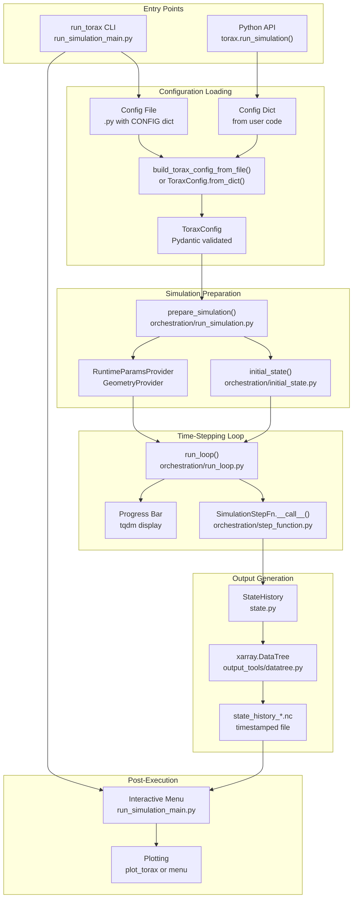
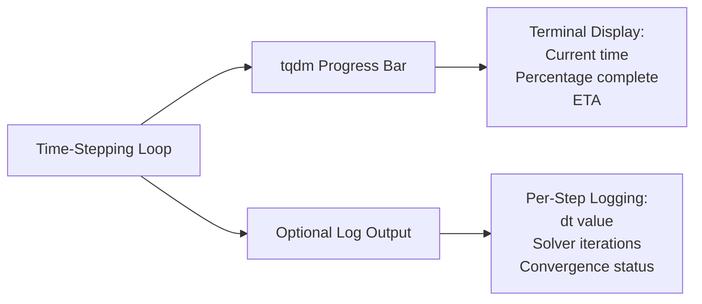
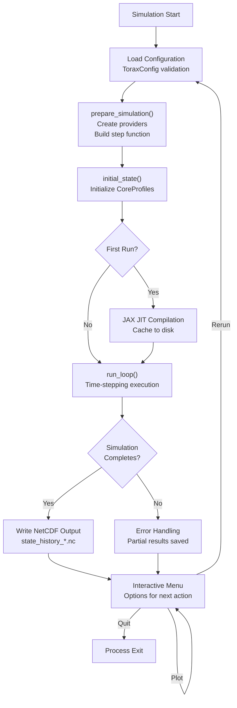

<!-- source: DeepWiki mcp.deepwiki.com · repo google-deepmind/torax · page 6 Running Simulations · fetched 2026-10-26 -->

# Running Simulations

<details>
<summary>Relevant source files</summary>

The following files were used as context for generating this wiki page:

- [docs/plotting.rst](docs/plotting.rst)
- [docs/quickstart.rst](docs/quickstart.rst)
- [docs/running.rst](docs/running.rst)

</details>


## Purpose and Scope

This page provides an overview of executing TORAX simulations and the various methods available for running and controlling them. It covers the high-level execution workflow, output file generation, and key environment variables that affect simulation behavior.

For detailed information on specific execution methods, see:
- **Command-line interface**: [Command Line Interface](#6.1)
- **Programmatic execution**: [Python API](#6.2)
- **Interactive development workflow**: [Interactive Menu and Workflow](#6.3)

For information on how simulations are orchestrated internally, see [Simulation Orchestration and Step Function](#4.1). For visualization of results, see [Plotting and Visualization](#7.3).

---

## Execution Methods

TORAX provides three primary methods for executing simulations, each suited to different use cases:

| Method | Entry Point | Use Case |
|--------|-------------|----------|
| **Command-line Interface** | `run_torax` command | Quick runs, parameter sweeps, production simulations |
| **Python API** | `torax.run_simulation()` | Integration with workflows, notebooks, custom scripts |
| **Interactive Menu** | Post-simulation prompt | Iterative development, parameter tuning, debugging |

All three methods ultimately invoke the same core simulation engine, differing only in how configuration is provided and how results are consumed.

**Sources:** [docs/running.rst:1-184](), [docs/quickstart.rst:1-94]()

---

## Simulation Execution Flow

The following diagram illustrates the complete flow from user input to simulation results:



**Key Components:**

- **Entry Points**: [`run_simulation_main.py`]() provides the CLI, while [`torax.__init__.py`]() exposes the programmatic API
- **Configuration Loading**: Converts Python config files or dictionaries into validated `ToraxConfig` objects
- **Simulation Preparation**: [`prepare_simulation()`]() initializes providers and creates the initial state
- **Time-Stepping Loop**: [`run_loop()`]() orchestrates the main simulation, calling `SimulationStepFn` at each timestep
- **Output Generation**: Results are accumulated in `StateHistory` and serialized to NetCDF format
- **Post-Execution**: Interactive menu allows re-running, plotting, and configuration changes

**Sources:** [docs/running.rst:1-184](), [docs/quickstart.rst:12-63]()

---

## Configuration Requirements

All simulation execution methods require a configuration that specifies simulation parameters. The configuration must contain:

- **Profile conditions**: Initial/boundary conditions for temperature, density, current
- **Numerics**: Time step, simulation duration, evolved variables
- **Geometry**: Magnetic equilibrium specification
- **Physics models**: Transport models, sources, pedestal models
- **Solver settings**: Linear, Newton-Raphson, or optimizer-based

When using the CLI, the configuration file must:
1. Be a Python file (`.py` extension)
2. Define a `CONFIG` variable as a dictionary
3. Contain valid configuration parameters recognized by `ToraxConfig`

Invalid configurations raise errors from the Pydantic validation layer, providing detailed feedback about missing or incorrect parameters.

**Example minimal configuration structure:**

```python
CONFIG = {
    'runtime_params': {
        'profile_conditions': {...},
        'numerics': {...},
    },
    'geometry': {...},
    'transport': {...},
    'sources': {...},
}
```

For detailed configuration documentation, see [Configuration System](#2).

**Sources:** [docs/running.rst:46-51]()

---

## Output Files

Upon simulation completion, TORAX writes results to a NetCDF file with the naming pattern:

```
state_history_YYYYMMDD_HHMMSS.nc
```

The timestamped filename ensures each simulation run produces a unique output file. The output directory is configurable:

| Method | Configuration |
|--------|--------------|
| **CLI** | `--output_dir` flag (default: `/tmp/torax_results`) |
| **Python API** | `output_dir` argument to `run_simulation()` |

The NetCDF file contains an `xarray.DataTree` structure with:
- **profiles**: Spatial profiles at each timestep (temperature, density, etc.)
- **scalars**: Time-varying scalar quantities (stored energy, confinement time, etc.)
- **numerics**: Solver diagnostics (iteration counts, convergence status)
- **edge**: Extended Lengyel edge model outputs (if enabled)

For details on the output data structure, see [Output Data Format](#7.1).

**Sources:** [docs/running.rst:23-29](), [docs/quickstart.rst:47-57]()

---

## Progress Monitoring

During execution, TORAX displays simulation progress in the terminal:



The progress bar shows:
- **Current simulation time**: Time value in seconds
- **Percentage complete**: Progress through total simulation duration
- **Time remaining**: Estimated completion time

Additional diagnostic logging can be enabled via flags (see [Command Line Interface](#6.1)).

**Sources:** [docs/running.rst:23-25](), [docs/running.rst:85-90]()

---

## Environment Variables

TORAX behavior can be controlled through environment variables that affect JAX compilation and internal error checking:

### `TORAX_ERRORS_ENABLED`

**Default:** `False`

Controls whether internal error checking routines are active. When enabled, provides detailed runtime validation but disables persistent compilation cache compatibility.

```bash
export TORAX_ERRORS_ENABLED=True
```

**Use case:** Debugging unexpected behavior, validating physics model outputs

**Caveat:** Incompatible with JAX persistent compilation cache

### `JAX_DISABLE_JIT`

**Default:** `False`

Disables JAX just-in-time compilation, running all functions in eager mode. Significantly reduces performance but enables standard Python debugging tools (breakpoints, print statements, profilers).

```bash
export JAX_DISABLE_JIT=True
```

**Use case:** Step-through debugging, understanding execution flow, development

**Impact:** Simulation runtime increases by 10-100x

These variables should be set in shell configuration files (`.bashrc`, `.zshrc`) or exported in the terminal session before running TORAX.

**Sources:** [docs/running.rst:60-78]()

---

## Simulation Lifecycle

The following diagram shows the complete lifecycle of a TORAX simulation execution:



**Key Phases:**

1. **Configuration Loading**: Validates and constructs `ToraxConfig` from user input
2. **Preparation**: Creates `RuntimeParamsProvider`, `GeometryProvider`, and `SimulationStepFn`
3. **Initialization**: Calls `initial_state()` to set up initial `CoreProfiles` and `SimState`
4. **Compilation**: On first run, JAX compiles functions and caches to disk for reuse
5. **Execution**: Main time-stepping loop progresses through simulation time
6. **Output**: Results written to NetCDF file regardless of success/error status
7. **Interactive Menu**: User chooses next action (rerun, plot, quit)

The persistent compilation cache significantly speeds up subsequent runs with similar configurations, enabling rapid iteration during parameter studies.

**Sources:** [docs/running.rst:140-183](), [docs/quickstart.rst:59-63]()

---

## Example Usage Patterns

### Quick Single Run

```bash
# Run with default output directory
run_torax --config='examples/basic_config.py'

# Run with custom output directory
run_torax --config='examples/basic_config.py' --output_dir=/path/to/results
```

### Development Iteration

```bash
# Run with progress logging for debugging
run_torax --config='my_config.py' --log_progress

# Use interactive menu to modify config and rerun
# Select 'mc' to modify existing config
# Select 'r' to run with changes
```

### Comparison Studies

```bash
# Run with reference for comparison
run_torax --config='new_config.py' --reference_run=/path/to/baseline.nc

# Plot both runs after simulation
# Select 'pr' then '2' in interactive menu
```

For complete flag documentation, see [Command Line Interface](#6.1). For programmatic execution patterns, see [Python API](#6.2).

**Sources:** [docs/running.rst:19-112](), [docs/quickstart.rst:15-39]()

---

## Recompilation Triggers

Understanding when JAX recompiles the simulation is important for performance. The following configuration changes trigger recompilation:

| Change Type | Triggers Recompilation | Example |
|-------------|----------------------|---------|
| Grid resolution | Yes | `nr` in numerics config |
| Evolved variables | Yes | `evolve_flag` in profile conditions |
| Physics models | Yes | Changing transport model, adding sources |
| Solver type | Yes | Switching between linear, Newton-Raphson, optimizer |
| Parameter values | No | Boundary conditions, heating power, time step |
| Initial conditions | No | Initial temperature, density profiles |

Changes that modify the computational graph or data structures require recompilation. Changes to numerical parameter values use the existing compiled code.

When using the interactive menu, recompilation occurs transparently when needed. The first run after a recompilation trigger may take 10-60 seconds while JAX compiles and caches the new functions.

**Sources:** [docs/running.rst:162-170]()

---

## Next Steps

- For command-line flag reference: [Command Line Interface](#6.1)
- For Python API usage: [Python API](#6.2)
- For interactive development workflow: [Interactive Menu and Workflow](#6.3)
- For understanding simulation internals: [Simulation Orchestration and Step Function](#4.1)
- For result analysis: [Results and Output](#7)

---

