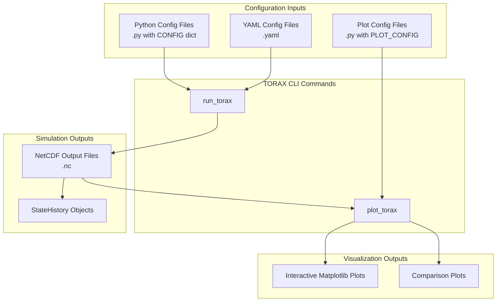
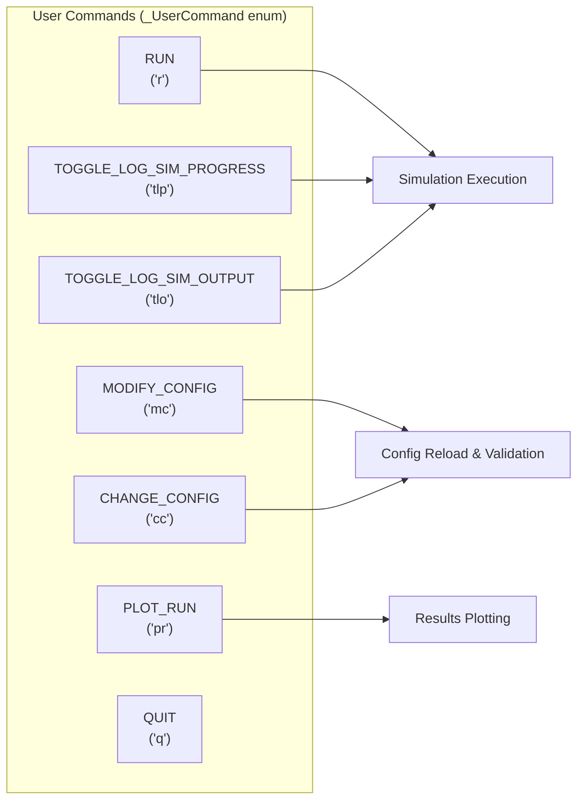
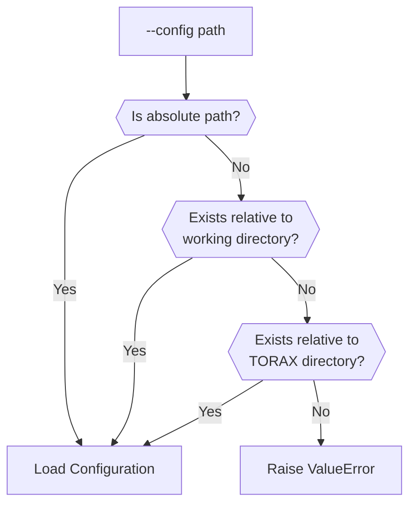
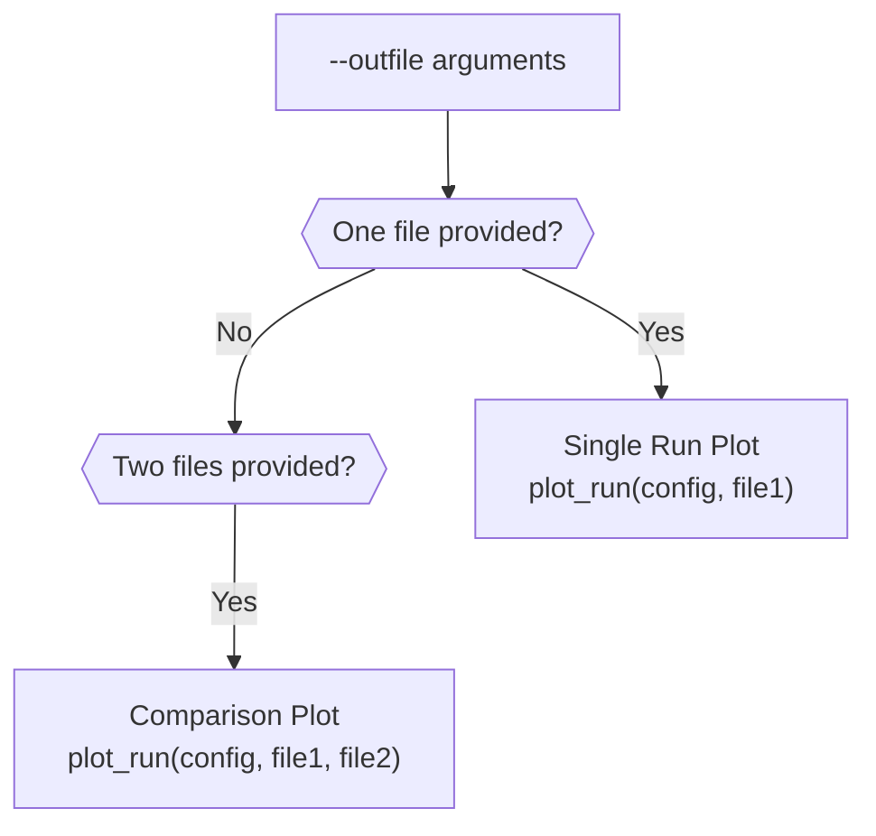
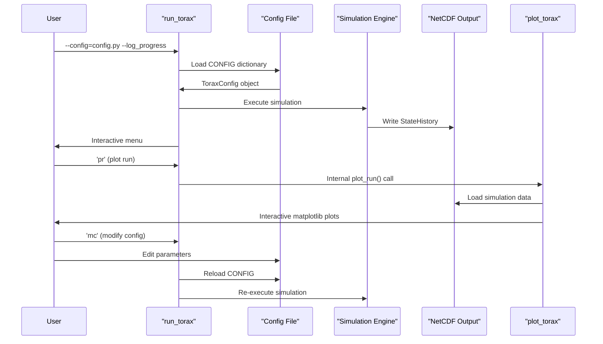

<!-- source: DeepWiki mcp.deepwiki.com · repo google-deepmind/torax · page 6.1 Command Line Interface · fetched 2026-10-26 -->

# Command Line Interface

<details>
<summary>Relevant source files</summary>

The following files were used as context for generating this wiki page:

- [.github/workflows/pytest.yml](.github/workflows/pytest.yml)
- [README.md](README.md)
- [docs/installation.rst](docs/installation.rst)
- [docs/plotting.rst](docs/plotting.rst)
- [docs/quickstart.rst](docs/quickstart.rst)
- [docs/running.rst](docs/running.rst)
- [pyproject.toml](pyproject.toml)
- [torax/__init__.py](torax/__init__.py)

</details>


TORAX provides two primary command-line tools for running tokamak plasma transport simulations and visualizing results. This page covers the command-line interface, including all available flags, interactive modes, and workflow patterns. For detailed information about configuration parameters, see [Configuration System](#2). For visualization capabilities beyond the CLI, see [Results and Visualization](#6).

## Overview

TORAX exposes two main command-line entry points through console scripts defined in the package installation:

| Command | Purpose | Entry Point |
|---------|---------|-------------|
| `run_torax` | Execute plasma transport simulations | `torax.run_simulation_main:run` |
| `plot_torax` | Visualize simulation results | `torax.plotting.plotruns:run` |

These commands provide a complete workflow from simulation execution to results analysis, with support for both batch processing and interactive development.



**Sources:** [pyproject.toml:49-51](), [torax/run_simulation_main.py:1-521](), [torax/plotting/plotruns.py:1-74]()

## run_torax Command

The `run_torax` command executes TORAX plasma transport simulations and provides an interactive development environment for iterative simulation workflows.

### Command-Line Flags

| Flag | Type | Required | Description |
|------|------|----------|-------------|
| `--config` | string | Yes | Path to Python configuration file containing `CONFIG` dictionary |
| `--log_progress` | boolean | No | Log timestep progress during simulation execution |
| `--plot_progress` | boolean | No | Display real-time plotting during simulation (currently disabled) |
| `--log_output` | boolean | No | Enable detailed logging output to stdout/stderr |
| `--reference_run` | string | No | Path to reference simulation for comparison plotting |
| `--use_jax_profiler` | boolean | No | Enable JAX profiler for performance analysis |
| `--quit` | boolean | No | Exit after first operation (disable interactive mode) |
| `--output_dir` | string | No | Override default output directory for simulation results |
| `--plot_config` | string | No | Path to plot configuration file (default: `plotting/configs/default_plot_config.py`) |

### Interactive Mode Commands

When `--quit` is not specified, `run_torax` enters interactive mode with the following commands:



**Sources:** [torax/run_simulation_main.py:46-108](), [torax/run_simulation_main.py:113-124]()

### Configuration File Resolution

The `--config` flag accepts both absolute and relative paths with the following resolution order:

1. **Absolute paths**: Used directly if the file exists
2. **Relative to working directory**: Resolved relative to `os.getcwd()`
3. **Relative to TORAX directory**: Resolved relative to the TORAX installation



**Sources:** [torax/_src/config/config_loader.py:93-127](), [torax/run_simulation_main.py:46-54]()

### Example Usage

```bash
# Basic simulation execution
run_torax --config=examples/iterhybrid_rampup.py --log_progress

# Batch mode with custom output directory
run_torax --config=examples/basic_config.py --output_dir=/tmp/torax_results --quit

# Interactive mode with profiling
run_torax --config=examples/iterhybrid_predictor_corrector.py --use_jax_profiler

# With reference comparison
run_torax --config=examples/iterhybrid_rampup.py --reference_run=reference_data.nc
```

**Sources:** [torax/run_simulation_main.py:17-20]()

## plot_torax Command

The `plot_torax` command provides visualization capabilities for TORAX simulation results, supporting both single-run analysis and comparative studies.

### Command-Line Flags

| Flag | Type | Required | Description |
|------|------|----------|-------------|
| `--outfile` | string(s) | Yes | Path(s) to NetCDF output files (1-2 files supported) |
| `--plot_config` | string | No | Path to plot configuration module (default: `plotting/configs/default_plot_config.py`) |

### Plot Configuration Options

TORAX includes several predefined plot configurations:

| Configuration | Purpose | File Path |
|---------------|---------|-----------|
| `default_plot_config` | Comprehensive plasma parameter visualization | `plotting/configs/default_plot_config.py` |
| `global_params_plot_config` | Time-series global parameters | `plotting/configs/global_params_plot_config.py` |
| `simple_plot_config` | Basic profile visualization | `plotting/configs/simple_plot_config.py` |
| `sources_plot_config` | Source term analysis | `plotting/configs/sources_plot_config.py` |

### Plotting Modes



### Interactive Features

The plotting interface includes several interactive elements:

- **Time slider**: Navigate through simulation timesteps for spatial profiles
- **Automatic scaling**: Percentile-based y-axis limits to handle volatile data
- **Legend management**: Configurable font sizes and positioning
- **Comparison labeling**: Automatic (1)/(2) labeling for two-file comparisons

**Sources:** [torax/plotting/plotruns.py:32-48](), [torax/plotting/plotruns.py:51-66]()

### Example Usage

```bash
# Single run visualization
plot_torax --outfile=simulation_output.nc

# Compare two simulations
plot_torax --outfile=sim1.nc sim2.nc

# Custom plot configuration
plot_torax --outfile=results.nc --plot_config=plotting/configs/sources_plot_config.py

# Using relative paths
plot_torax --outfile=examples/test_data.nc --plot_config=simple_plot_config.py
```

## Command Integration Workflow

The typical TORAX workflow integrates both commands in a development cycle:



### Error Handling

Both commands implement comprehensive error handling:

- **Configuration validation**: Pydantic-based parameter validation
- **File existence checks**: Verify input files before processing
- **JAX compilation errors**: Detailed error messages for numerical issues
- **Plot data compatibility**: Automatic handling of missing or zero-valued data

**Sources:** [torax/run_simulation_main.py:376-385](), [torax/plotting/plotruns.py:53-61](), [torax/_src/plotting/plotruns_lib.py:408-411]()

### Environment Integration

The CLI integrates with the broader TORAX environment:

- **JAX precision control**: Respects `JAX_PRECISION` environment variable
- **Error reporting**: Controlled by `TORAX_ERRORS_ENABLED` environment variable  
- **Parallel testing**: Supports `PYTEST_NUM_SHARDS` for CI/CD workflows

**Sources:** [torax/__init__.py:58-68](), [.github/workflows/pytest.yml:22-24]()

---

