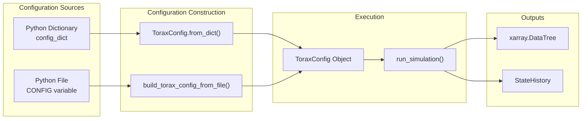
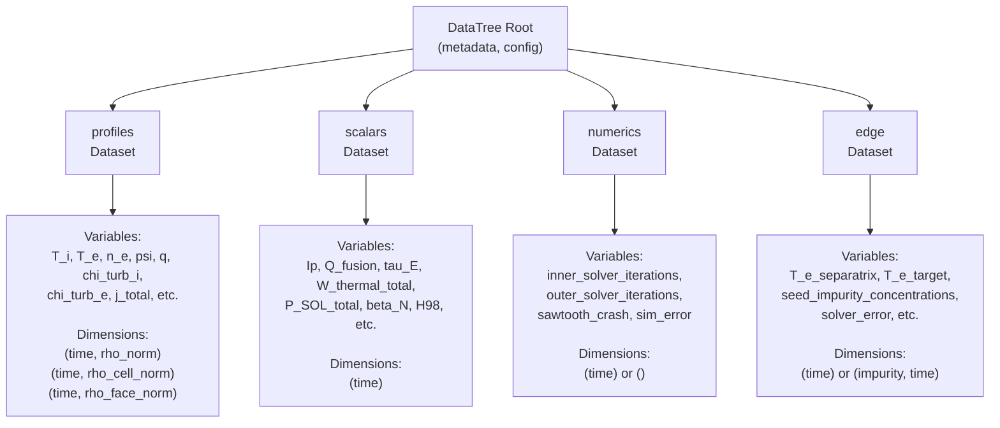
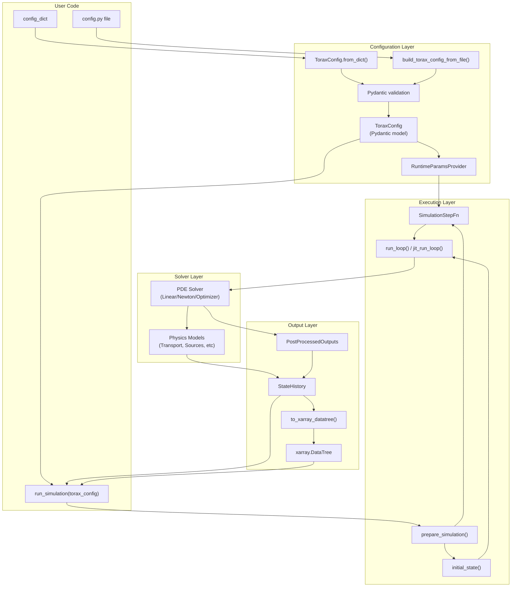

<!-- source: DeepWiki mcp.deepwiki.com · repo google-deepmind/torax · page 6.2 Python API · fetched 2026-10-26 -->

# Python API

<details>
<summary>Relevant source files</summary>

The following files were used as context for generating this wiki page:

- [docs/configuration.rst](docs/configuration.rst)
- [docs/edge_models.rst](docs/edge_models.rst)
- [docs/interfacing_with_surrogates.rst](docs/interfacing_with_surrogates.rst)
- [docs/links.rst](docs/links.rst)
- [docs/output.rst](docs/output.rst)
- [docs/physics_models.rst](docs/physics_models.rst)
- [docs/plotting.rst](docs/plotting.rst)
- [docs/quickstart.rst](docs/quickstart.rst)
- [docs/running.rst](docs/running.rst)
- [docs/running_programmatically.rst](docs/running_programmatically.rst)
- [docs/user_guides.rst](docs/user_guides.rst)
- [docs/using_jax.rst](docs/using_jax.rst)

</details>


This page documents the Python API for running TORAX simulations programmatically from within Python code. This enables integration into larger workflows, parameter sweeps, optimization loops, and custom analysis pipelines.

For command-line usage with the `run_torax` script, see [6.1 Command Line Interface](#6.1). For detailed configuration parameter documentation, see [2.1 ToraxConfig and Configuration Parameters](#2.1).

---

## Overview of Python API Functions

The TORAX Python API provides three primary functions for programmatic simulation execution:

| Function | Purpose | Returns |
|----------|---------|---------|
| `torax.ToraxConfig.from_dict(config_dict)` | Construct configuration from Python dictionary | `ToraxConfig` object |
| `torax.build_torax_config_from_file(filepath)` | Load configuration from Python file | `ToraxConfig` object |
| `torax.run_simulation(torax_config)` | Execute simulation with given configuration | `(xarray.DataTree, StateHistory)` tuple |

**API Flow Diagram**



Sources: [docs/running_programmatically.rst:1-36]()

---

## Configuration Construction

### Creating Configuration from Dictionary

The `ToraxConfig.from_dict()` class method constructs a validated `ToraxConfig` object from a nested dictionary. This is the most flexible approach when building configurations programmatically.

**Example: Basic Configuration from Dictionary**

```python
import torax

config_dict = {
    'profile_conditions': {
        'Ip': 15.0e6,  # 15 MA plasma current
        'T_i': {0.0: {0.0: 15.0, 1.0: 1.0}},  # Ion temperature profile
        'T_e': {0.0: {0.0: 15.0, 1.0: 1.0}},  # Electron temperature profile
        'n_e': {0.0: {0.0: 1.2e20, 1.0: 0.8e20}},  # Electron density profile
    },
    'numerics': {
        't_final': 5.0,  # 5 second simulation
        'fixed_dt': 0.1,  # 100 ms timesteps
    },
    'geometry': {
        'geometry_type': 'circular',
        'R_major': 6.2,
        'a_minor': 2.0,
        'B_0': 5.3,
    },
    'transport': {
        'model_name': 'constant',
    },
}

torax_config = torax.ToraxConfig.from_dict(config_dict)
```

The dictionary structure follows the same nested organization documented in [2 Configuration System](#2). Pydantic validation occurs during construction, raising informative errors for invalid configurations.

Sources: [docs/running_programmatically.rst:18-19](), [docs/configuration.rst:34-35]()

### Loading Configuration from File

The `build_torax_config_from_file()` function loads a Python module containing a `CONFIG` variable and constructs a `ToraxConfig` from it. This provides compatibility with TORAX's standard configuration file format.

**Example: Loading from Configuration File**

```python
import torax

# Load config from Python file with CONFIG variable
torax_config = torax.build_torax_config_from_file('examples/iterhybrid_rampup.py')
```

The configuration file must define a module-level `CONFIG` variable containing a valid configuration dictionary. This is the same format used by the command-line interface.

**Configuration File Structure (`examples/iterhybrid_rampup.py`)**

Configuration files follow this pattern:

```python
CONFIG = {
    'profile_conditions': { ... },
    'numerics': { ... },
    'geometry': { ... },
    'transport': { ... },
    'sources': { ... },
    # ... additional configuration sections
}
```

Sources: [docs/running_programmatically.rst:14-16](), [docs/configuration.rst:37-44]()

### Configuration Validation

Both construction methods use Pydantic for validation, which provides:

- **Type checking**: Ensures parameters have correct types (float, int, bool, dict, etc.)
- **Value validation**: Checks parameter values are within valid ranges
- **Required field checking**: Verifies all required parameters are present
- **Default values**: Applies defaults for unspecified optional parameters

Invalid configurations raise `ValidationError` with detailed error messages indicating the specific parameter and constraint violation.

Sources: [docs/configuration.rst:34-35]()

---

## Running Simulations

### Basic Simulation Execution

The `run_simulation()` function executes a TORAX simulation and returns the results as a tuple of `(xarray.DataTree, StateHistory)`.

**Example: Complete Simulation Workflow**

```python
import torax

# 1. Create configuration
torax_config = torax.build_torax_config_from_file('examples/iterhybrid_rampup.py')

# 2. Run simulation
data_tree, state_history = torax.run_simulation(torax_config)

# 3. Check for errors
if state_history.sim_error != torax.SimError.NO_ERROR:
    raise ValueError(
        f'TORAX failed with error: {state_history.sim_error}'
    )

# 4. Access results
Q_fusion_at_2s = data_tree.scalars.Q_fusion.sel(time=2.0, method='nearest')
print(f"Fusion gain at t=2s: {Q_fusion_at_2s.values}")
```

**Return Values**

| Object | Type | Description |
|--------|------|-------------|
| `data_tree` | `xarray.DataTree` | Hierarchical dataset containing profiles, scalars, numerics, and edge data across time |
| `state_history` | `StateHistory` | Object containing simulation states, post-processed outputs, and error status |

Sources: [docs/running_programmatically.rst:21-35]()

### Error Handling

The `state_history.sim_error` field indicates simulation success or failure. The `SimError` enum defines possible error states:

| `SimError` Value | Meaning |
|------------------|---------|
| `NO_ERROR` | Simulation completed successfully |
| Other values | Simulation failed (check specific error type) |

**Error Checking Pattern**

```python
import torax

data_tree, state_history = torax.run_simulation(torax_config)

if state_history.sim_error != torax.SimError.NO_ERROR:
    # Handle simulation failure
    error_code = state_history.sim_error
    print(f"Simulation failed with error code: {error_code}")
    # Could raise exception, log error, retry with different parameters, etc.
else:
    # Proceed with results analysis
    process_results(data_tree)
```

The `data_tree` dataset also contains a `numerics/sim_error` field (0 for success, 1 for failure) for compatibility with NetCDF output format.

Sources: [docs/running_programmatically.rst:28-32](), [docs/output.rst:115-116]()

### Multiple Sequential Runs

When running multiple simulations sequentially, JAX's JIT compilation cache allows subsequent runs to execute faster. The first run incurs compilation overhead; subsequent runs with similar configurations reuse compiled code.

**Example: Parameter Sweep**

```python
import torax
import numpy as np

base_config = torax.build_torax_config_from_file('examples/basic_config.py')

# Sweep over different current values
current_values = np.linspace(10e6, 20e6, 10)  # 10 to 20 MA
results = []

for Ip in current_values:
    # Modify configuration
    config_dict = base_config.model_dump()
    config_dict['profile_conditions']['Ip'] = float(Ip)
    modified_config = torax.ToraxConfig.from_dict(config_dict)
    
    # Run simulation
    data_tree, state_history = torax.run_simulation(modified_config)
    
    # Extract result of interest
    if state_history.sim_error == torax.SimError.NO_ERROR:
        tau_E = data_tree.scalars.tau_E.isel(time=-1).values
        results.append((Ip, tau_E))

# Analyze sweep results
for Ip, tau_E in results:
    print(f"Ip = {Ip/1e6:.1f} MA, tau_E = {tau_E:.3f} s")
```

Configuration changes that trigger recompilation include:
- Grid resolution (`geometry['n_rho']`)
- Evolved equations (`numerics['evolve_ion_heat']`, etc.)
- Physics models (`transport['model_name']`, solver type, sources)

Changes to parameter values (e.g., heating power, boundary conditions) generally do not trigger recompilation.

Sources: [docs/running.rst:162-170]()

---

## Working with Simulation Outputs

### DataTree Structure

The `xarray.DataTree` returned by `run_simulation()` contains four child datasets organized hierarchically:



**Dataset Organization**

| Child Dataset | Content | Typical Dimensions |
|---------------|---------|-------------------|
| `profiles` | Radial profiles (temperatures, densities, currents, transport coefficients) | `(time, rho_norm)` or `(time, rho_cell_norm)` or `(time, rho_face_norm)` |
| `scalars` | Global quantities (stored energy, confinement time, fusion gain) | `(time)` |
| `numerics` | Solver diagnostics (iteration counts, convergence status) | `(time)` or `()` |
| `edge` | Edge model outputs (separatrix temperature, impurity concentrations) | `(time)` or `(impurity, time)` |

The root dataset contains configuration metadata in its `attrs['config']` field as a JSON string.

Sources: [docs/output.rst:13-98]()

### Accessing Data Variables

**Accessing Profiles (1D spatial + time)**

```python
import xarray as xr

# Load or get data_tree from run_simulation()
data_tree, _ = torax.run_simulation(torax_config)

# Access electron temperature profile at all times
T_e_profile = data_tree.profiles.T_e  # xarray.DataArray with dims (time, rho_norm)

# Access at specific time
T_e_at_2s = data_tree.profiles.T_e.sel(time=2.0, method='nearest')

# Access at specific radius
T_e_at_rho_05 = data_tree.profiles.T_e.sel(rho_norm=0.5, method='nearest')

# Access single point
T_e_point = data_tree.profiles.T_e.sel(
    time=2.0, rho_norm=0.5, method='nearest'
).values
```

**Accessing Scalars (time series)**

```python
# Access confinement time evolution
tau_E = data_tree.scalars.tau_E  # xarray.DataArray with dim (time)

# Get final value
tau_E_final = data_tree.scalars.tau_E.isel(time=-1).values

# Access fusion gain at specific time
Q_fusion = data_tree.scalars.Q_fusion.sel(time=2.0, method='nearest').values
```

**Available Variables**

Complete lists of available variables are documented in:
- Profiles: [7.1 Output Data Format](#7.1) (see `profiles` section)
- Scalars: [7.1 Output Data Format](#7.1) (see `scalars` section)
- Numerics: [7.1 Output Data Format](#7.1) (see `numerics` section)
- Edge: [7.1 Output Data Format](#7.1) (see `edge` section)

Sources: [docs/output.rst:804-823]()

### StateHistory Object

The `StateHistory` object provides access to the time-ordered sequence of `SimState` objects and post-processed outputs at each timestep.

**StateHistory Structure**

| Attribute | Type | Description |
|-----------|------|-------------|
| `times` | `Array` | 1D array of simulation times [s] |
| `sim_error` | `SimError` | Overall simulation error status |
| Additional fields | Various | Stacked simulation states and outputs |

The `StateHistory` can be saved to NetCDF and reloaded for restart simulations or post-processing.

**Example: Accessing Intermediate States**

```python
data_tree, state_history = torax.run_simulation(torax_config)

# Times array
times = state_history.times  # Array of shape (n_timesteps,)

# Check error status
if state_history.sim_error == torax.SimError.NO_ERROR:
    print(f"Simulation completed successfully over {len(times)} timesteps")
```

Sources: [docs/output.rst:1-13]()

### Integration with Xarray Operations

The `xarray.DataTree` and `xarray.DataArray` objects support powerful array operations:

**Example: Computing Volume-Integrated Quantities**

```python
import numpy as np

# Get fusion power density profiles
p_alpha_e = data_tree.profiles.p_alpha_e
p_alpha_i = data_tree.profiles.p_alpha_i

# Get volume derivative (vpr) for integration
vpr = data_tree.profiles.vpr.sel(rho_norm=data_tree.rho_cell_norm)

# Select time slice
time_index = data_tree.time.sel(time=1.0, method='nearest')
p_alpha_e_t1 = p_alpha_e.sel(time=time_index)
p_alpha_i_t1 = p_alpha_i.sel(time=time_index)
vpr_t1 = vpr.sel(time=time_index)

# Volume integrate using trapezoidal rule
P_alpha_total = np.trapezoid(
    (p_alpha_e_t1 + p_alpha_i_t1) * vpr_t1,
    data_tree.rho_cell_norm
)

# Compare with pre-computed scalar
P_alpha_scalar = data_tree.scalars.P_alpha_total.sel(time=time_index).values
print(f"Manual integration: {P_alpha_total:.2e} W")
print(f"Pre-computed scalar: {P_alpha_scalar:.2e} W")
```

**Example: Plotting with Xarray**

```python
import matplotlib.pyplot as plt

# xarray provides convenient plotting
data_tree.profiles.T_e.sel(time=2.0, method='nearest').plot()
plt.xlabel('Normalized radius')
plt.ylabel('Electron temperature [keV]')
plt.title('Electron Temperature Profile at t=2s')
plt.show()

# Time series plot
data_tree.scalars.Q_fusion.plot()
plt.xlabel('Time [s]')
plt.ylabel('Fusion Gain')
plt.title('Fusion Gain Evolution')
plt.show()
```

Sources: [docs/output.rst:804-841]()

---

## Advanced API Usage

### Retrieving Configuration from Output

The configuration used for a simulation is stored in the `DataTree` root attributes and can be retrieved for replication or debugging:

```python
import json
import torax
import xarray as xr

# Load saved output
filepath = 'state_history.nc'
data_tree = xr.open_datatree(filepath)

# Extract configuration
config_dict = json.loads(data_tree.attrs['config'])

# Inspect configuration
print(f"Transport model: {config_dict['transport']['model_name']}")

# Create new ToraxConfig and re-run
torax_config = torax.ToraxConfig.from_dict(config_dict)
new_data_tree, new_state_history = torax.run_simulation(torax_config)
```

Sources: [docs/output.rst:824-840]()

### Dynamic Configuration Modification

Configurations can be modified programmatically by converting to dictionary, modifying, and reconstructing:

```python
import torax

# Load base configuration
base_config = torax.build_torax_config_from_file('examples/basic_config.py')

# Convert to dictionary (using Pydantic's model_dump)
config_dict = base_config.model_dump()

# Modify specific parameters
config_dict['numerics']['t_final'] = 10.0  # Extend simulation time
config_dict['transport']['model_name'] = 'qlknn'  # Change transport model
config_dict['sources']['fusion']['enabled'] = True  # Enable fusion source

# Reconstruct configuration
modified_config = torax.ToraxConfig.from_dict(config_dict)

# Run with modified configuration
data_tree, state_history = torax.run_simulation(modified_config)
```

This pattern enables:
- Parameter sweeps over configuration spaces
- Optimization algorithms that modify configurations
- Adaptive workflows that adjust parameters based on previous results

Sources: [docs/running_programmatically.rst:1-36]()

### Saving and Loading Results

**Saving DataTree to NetCDF**

```python
# After simulation
data_tree, state_history = torax.run_simulation(torax_config)

# Save to NetCDF file
output_path = 'my_simulation_output.nc'
data_tree.to_netcdf(output_path)
```

**Loading DataTree from NetCDF**

```python
import xarray as xr

# Load saved simulation
data_tree = xr.open_datatree('my_simulation_output.nc')

# Access data as normal
Q_fusion = data_tree.scalars.Q_fusion
T_e_profile = data_tree.profiles.T_e
```

The NetCDF format preserves all data, metadata, and configuration information, enabling full post-simulation analysis and reproducibility.

Sources: [docs/output.rst:1-13]()

### Integration with External Tools

**Example: Exporting to Pandas DataFrame**

```python
import pandas as pd

# Convert scalar quantities to DataFrame for analysis
scalars_df = data_tree.scalars.to_dataframe()

# Now can use pandas operations
print(scalars_df[['Q_fusion', 'tau_E', 'W_thermal_total']].describe())
scalars_df.to_csv('scalars_timeseries.csv')
```

**Example: Exporting Profile Data**

```python
import numpy as np

# Export electron temperature profile at specific time to NumPy
T_e_at_2s = data_tree.profiles.T_e.sel(time=2.0, method='nearest')
rho = T_e_at_2s.rho_norm.values
T_e = T_e_at_2s.values

# Save as text file
np.savetxt('T_e_profile_t2s.txt', np.column_stack([rho, T_e]),
           header='rho_norm T_e[keV]')
```

Sources: [docs/output.rst:804-841]()

---

## Python API Call Flow

This diagram shows the complete execution flow from API call to returned results:



Sources: [docs/running_programmatically.rst:1-36](), High-level system architecture diagrams

---

## Common Python API Patterns

### Pattern 1: Quick Single Run

```python
import torax

config = torax.build_torax_config_from_file('my_config.py')
data_tree, state_history = torax.run_simulation(config)

if state_history.sim_error == torax.SimError.NO_ERROR:
    print(f"Final Q_fusion: {data_tree.scalars.Q_fusion.isel(time=-1).values}")
```

### Pattern 2: Parameter Sweep with Results Collection

```python
import torax
import pandas as pd

results = []
for heating_power in [10e6, 20e6, 30e6, 40e6]:
    config_dict = base_config.model_dump()
    config_dict['sources']['generic_heat']['P_ext'] = heating_power
    config = torax.ToraxConfig.from_dict(config_dict)
    
    data_tree, state_history = torax.run_simulation(config)
    if state_history.sim_error == torax.SimError.NO_ERROR:
        results.append({
            'P_heat': heating_power / 1e6,
            'Q_fusion': data_tree.scalars.Q_fusion.isel(time=-1).values,
            'tau_E': data_tree.scalars.tau_E.isel(time=-1).values,
        })

results_df = pd.DataFrame(results)
print(results_df)
```

### Pattern 3: Error Handling and Retry

```python
import torax

config = torax.build_torax_config_from_file('my_config.py')
data_tree = None
state_history = None

max_attempts = 3
for attempt in range(max_attempts):
    data_tree, state_history = torax.run_simulation(config)
    
    if state_history.sim_error == torax.SimError.NO_ERROR:
        print(f"Simulation succeeded on attempt {attempt + 1}")
        break
    else:
        print(f"Attempt {attempt + 1} failed: {state_history.sim_error}")
        # Could modify config here for retry, e.g., smaller timestep
        config_dict = config.model_dump()
        config_dict['numerics']['fixed_dt'] *= 0.5
        config = torax.ToraxConfig.from_dict(config_dict)
else:
    raise RuntimeError("Simulation failed after all retry attempts")
```

### Pattern 4: Custom Post-Processing

```python
import torax
import numpy as np
import matplotlib.pyplot as plt

data_tree, state_history = torax.run_simulation(config)

# Custom analysis: compute temperature gradient length
T_e = data_tree.profiles.T_e.isel(time=-1)  # Final time
rho = T_e.rho_norm.values

# Compute gradient
dT_e_drho = np.gradient(T_e.values, rho)

# Gradient length L_T = T / (dT/dr)
L_T = T_e.values / np.abs(dT_e_drho)

# Plot
plt.figure(figsize=(10, 5))
plt.subplot(1, 2, 1)
plt.plot(rho, T_e.values)
plt.xlabel('rho_norm')
plt.ylabel('T_e [keV]')
plt.title('Electron Temperature')

plt.subplot(1, 2, 2)
plt.plot(rho, L_T)
plt.xlabel('rho_norm')
plt.ylabel('L_T [normalized]')
plt.title('Temperature Gradient Length')
plt.tight_layout()
plt.show()
```

Sources: [docs/running_programmatically.rst:1-36](), [docs/output.rst:804-841]()

---

