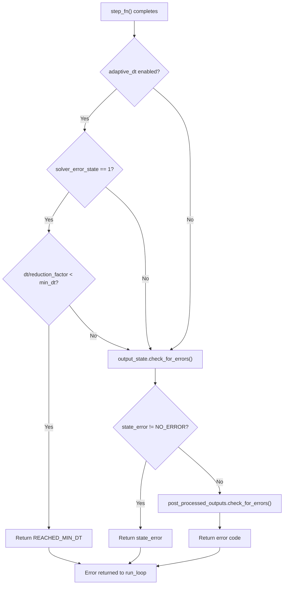
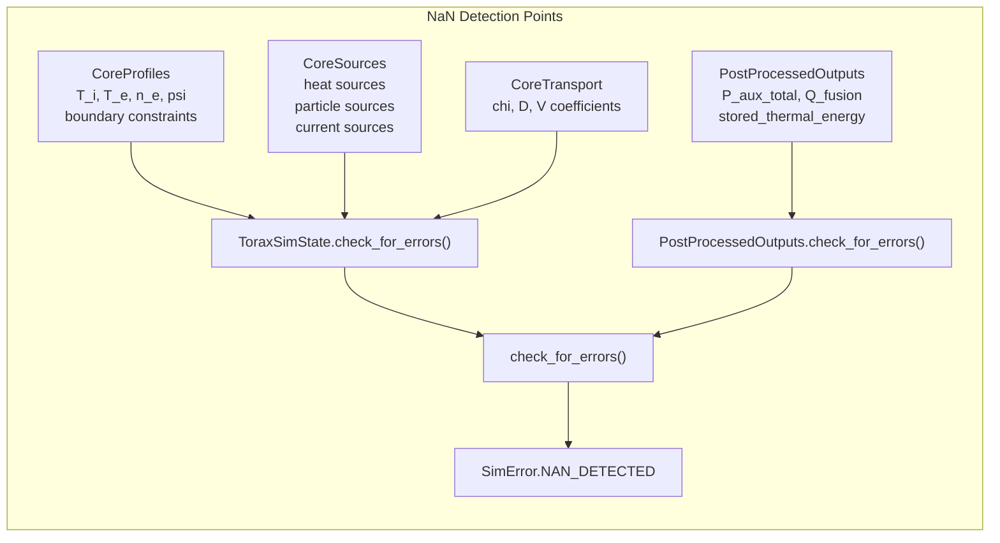
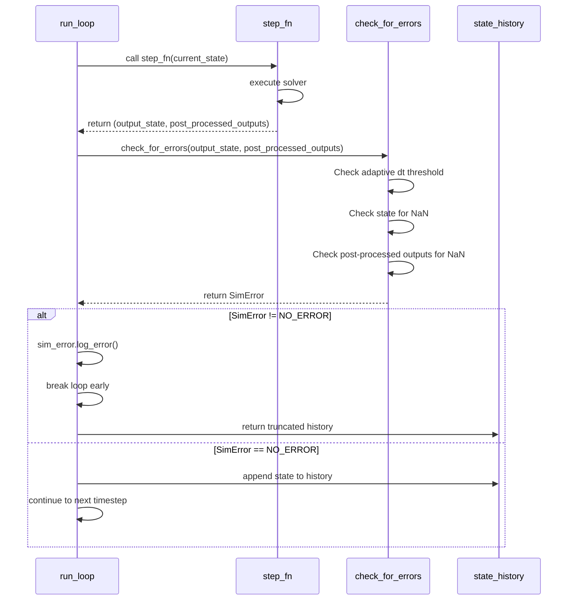
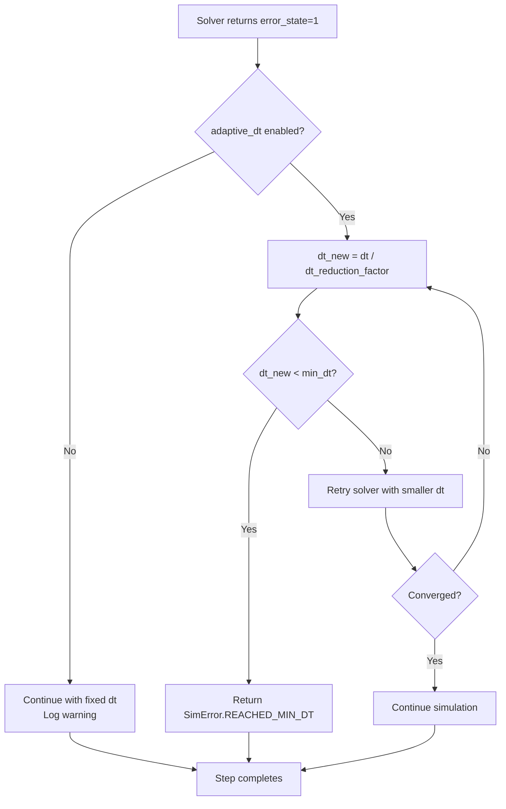
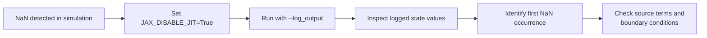
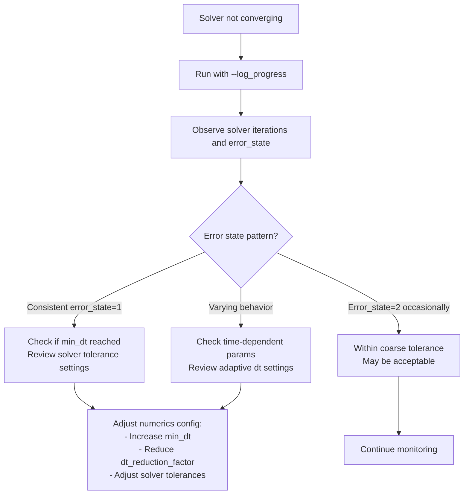
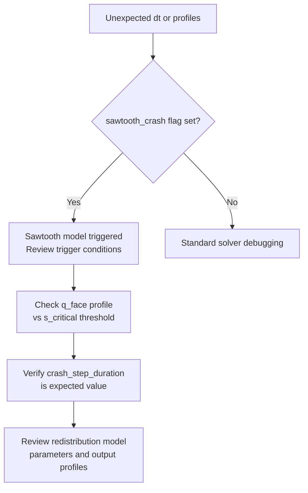
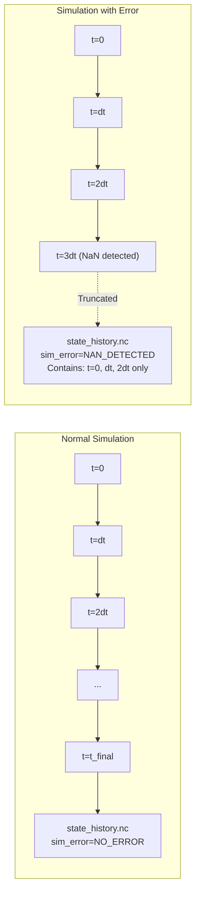

<!-- source: DeepWiki mcp.deepwiki.com · repo google-deepmind/torax · page 6.3 Interactive Menu and Workflow · fetched 2026-10-26 -->

# Error Handling and Debugging

<details>
<summary>Relevant source files</summary>

The following files were used as context for generating this wiki page:

- [docs/plotting.rst](docs/plotting.rst)
- [docs/quickstart.rst](docs/quickstart.rst)
- [docs/running.rst](docs/running.rst)

</details>


This page describes TORAX's error handling mechanisms and debugging tools. It covers how errors are detected during simulation, the types of errors that can occur, and practical debugging techniques for troubleshooting simulations. For information about testing and validation, see [Testing and Validation](#8).

## Error Detection System

TORAX implements a comprehensive error detection system that checks for invalid states during simulation execution. The core error checking occurs in the `check_for_errors` function, which validates the simulation state after each timestep.

### Error Types

TORAX defines several error states through the `SimError` enum:

| Error Type | Description | Detection Location |
|------------|-------------|-------------------|
| `NO_ERROR` | Simulation proceeding normally | Default state |
| `NAN_DETECTED` | NaN values found in state or outputs | `ToraxSimState.check_for_errors()`, `PostProcessedOutputs.check_for_errors()` |
| `REACHED_MIN_DT` | Adaptive timestep reduced below minimum threshold | `check_for_errors()` when solver fails to converge |

The error checking function is defined in [torax/_src/orchestration/step_function.py:49-65]():

```python
def check_for_errors(
    numerics: numerics_lib.Numerics,
    output_state: sim_state.ToraxSimState,
    post_processed_outputs: post_processing.PostProcessedOutputs,
) -> state.SimError:
```

### Error Detection Flow



**Sources:** [torax/_src/orchestration/step_function.py:49-65]()

### NaN Detection

NaN values are detected in multiple locations throughout the simulation state:



**Sources:** [torax/_src/orchestration/tests/step_function_test.py:53-101]()

## Error Handling in Simulation Loop

The main simulation loop in `run_loop.py` checks for errors after each timestep and can terminate early if an error is detected.

### Run Loop Error Handling



**Sources:** [torax/_src/orchestration/run_loop.py:130-146](), [torax/_src/orchestration/jit_run_loop.py:214-218]()

The run loop implementation [torax/_src/orchestration/run_loop.py:138-146]() shows the error handling logic:

- If `sim_error != SimError.NO_ERROR`, the error is logged and the loop breaks
- The simulation returns a **truncated history** containing only valid timesteps
- Users can inspect the partial results to understand where the simulation failed

### JIT Compiled Run Loop

The JIT-compiled version [torax/_src/orchestration/jit_run_loop.py:29-115]() pre-allocates history buffers and checks for errors only at the end of the simulation, returning the final error state.

## Debugging Tools and Environment Variables

TORAX provides several environment variables and configuration options to assist with debugging.

### Environment Variables for Debugging

| Variable | Default | Purpose | Usage |
|----------|---------|---------|-------|
| `TORAX_ERRORS_ENABLED` | `False` | Enable runtime error checking in internal routines | Set to `True` for debugging; incompatible with persistent cache |
| `JAX_DISABLE_JIT` | `False` | Disable JAX compilation | Set to `True` to debug without compilation overhead |
| `TORAX_JAXTYPING` | `False` | Enable JAX type checking with jaxtyping | Set to `True` for type validation during testing |
| `JAX_COMPILATION_CACHE_DIR` | (none) | Directory for JAX persistent cache | Set path to cache compiled functions |

**Sources:** [README.md:154-179](), [.github/workflows/pytest.yml:22-25](), [docs/installation.rst:65-89]()

### Enabling Error Checking

```bash
export TORAX_ERRORS_ENABLED=True
export TORAX_JAXTYPING=True
```

These settings enable comprehensive assertion checks but disable the persistent compilation cache. They are primarily used during testing and development.

### Disabling JIT Compilation

To debug without JAX compilation overhead:

```bash
export JAX_DISABLE_JIT=True
run_torax --config=examples/basic_config.py
```

This allows for easier debugging with standard Python debugging tools (e.g., `pdb`) and clearer stack traces. The test suite includes dedicated tests that run without compilation [torax/tests/sim_no_compile_test.py:1-57]().

### Logging Options

TORAX provides CLI flags for detailed logging:

```bash
# Log timestep information
run_torax --config=examples/basic_config.py --log_progress

# Log initial and final states
run_torax --config=examples/basic_config.py --log_output
```

The `--log_progress` flag outputs:
- Current simulation time
- Previous timestep duration (dt)
- Number of outer solver iterations
- Solver convergence status

**Sources:** [docs/running.rst:85-136](), [torax/_src/orchestration/run_loop.py:193-213]()

## Solver Error States

The solver returns numeric error codes that indicate convergence status:

| Error State | Meaning | Action Taken |
|-------------|---------|--------------|
| `0` | Solver converged with fine tolerance | Continue normally |
| `1` | Solver did not converge (above coarse tolerance) | Trigger dt backtracking if adaptive_dt enabled |
| `2` | Solver converged within coarse tolerance only | Log warning, continue with this timestep |

**Sources:** [torax/_src/orchestration/step_function.py:181-186](), [torax/_src/orchestration/run_loop.py:204-212]()

### Adaptive Timestep and Error Recovery



**Sources:** [torax/_src/orchestration/step_function.py:56-60](), [torax/_src/orchestration/adaptive_step.py]() (referenced)

The adaptive step mechanism [torax/_src/orchestration/step_function.py:364-439]() implements a while loop that:
1. Attempts to solve with current dt
2. If convergence fails (error_state=1), reduces dt by `dt_reduction_factor`
3. Retries until convergence or `min_dt` is reached
4. Accumulates inner and outer solver iteration counts

### Testing Adaptive Timestep Error Handling

The test [torax/tests/sim_time_dependence_test.py:64-156]() demonstrates how adaptive timestep interacts with error states:

```python
# FakeSolver returns error_state=1 when combined > max_value
# Triggers adaptive dt reduction until constraint satisfied
```

## Common Debugging Workflows

### Workflow 1: Investigating NaN Values



**Practical steps:**

1. Run without compilation to get clearer stack traces:
   ```bash
   JAX_DISABLE_JIT=True run_torax --config=my_config.py --log_output
   ```

2. Examine the logged output to identify which variable contains NaN
3. Check the configuration for invalid boundary conditions or source parameters
4. Review the `check_for_errors` implementation to understand detection points

**Sources:** [torax/_src/orchestration/tests/step_function_test.py:53-101]()

### Workflow 2: Solver Convergence Issues



**Sources:** [torax/tests/sim_time_dependence_test.py:64-156](), [torax/_src/orchestration/run_loop.py:204-212]()

### Workflow 3: Testing with Full Assertion Checks

For comprehensive debugging during development:

```bash
TORAX_JAXTYPING=True TORAX_ERRORS_ENABLED=True pytest . -n auto
```

This enables:
- Runtime type checking with `jaxtyping`
- Internal assertion checks in TORAX routines
- Full validation of data structures

**Sources:** [README.md:199-206](), [.github/workflows/pytest.yml:22-25]()

### Workflow 4: Analyzing Sawtooth Crashes

Sawtooth models can trigger early returns that bypass the main solver. To debug:



**Sources:** [torax/_src/orchestration/step_function.py:230-260](), [torax/_src/mhd/sawtooth/tests/sawtooth_model_test.py:115-147]()

The sawtooth test [torax/_src/mhd/sawtooth/tests/sawtooth_model_test.py:115-135]() demonstrates:
- Checking `solver_numeric_outputs.sawtooth_crash` flag
- Verifying `dt` equals `crash_step_duration` when sawtooth triggers
- Comparing post-crash profiles against expected values

## Debugging Output Files

TORAX writes simulation output to NetCDF files in the format `state_history_%Y%m%d_%H%M%S.nc`. When a simulation encounters an error:

- The output file contains a **truncated history** up to the last valid timestep
- The `sim_error` field in the state history indicates the error type
- All intermediate states remain accessible for post-mortem analysis



**Sources:** [torax/_src/orchestration/run_loop.py:138-146](), [torax/_src/simulation_app.py:102-108]()

## Integration with Testing Framework

The testing framework includes utilities for error detection validation:

- `SimTestCase` base class provides comparison utilities
- Tests can mock the run loop to inspect error handling [torax/tests/sim_time_dependence_test.py:106-156]()
- Parameterized tests verify error states across different configurations

```python
# Example from test suite
sim_error = step_function.check_for_errors(
    runtime_params_provider.numerics,
    output_state,
    post_processed_outputs,
)
self.assertEqual(sim_error, state.SimError.NO_ERROR)
```

**Sources:** [torax/_src/orchestration/tests/step_function_test.py:45-144](), [torax/tests/sim_time_dependence_test.py:141-145]()

---

