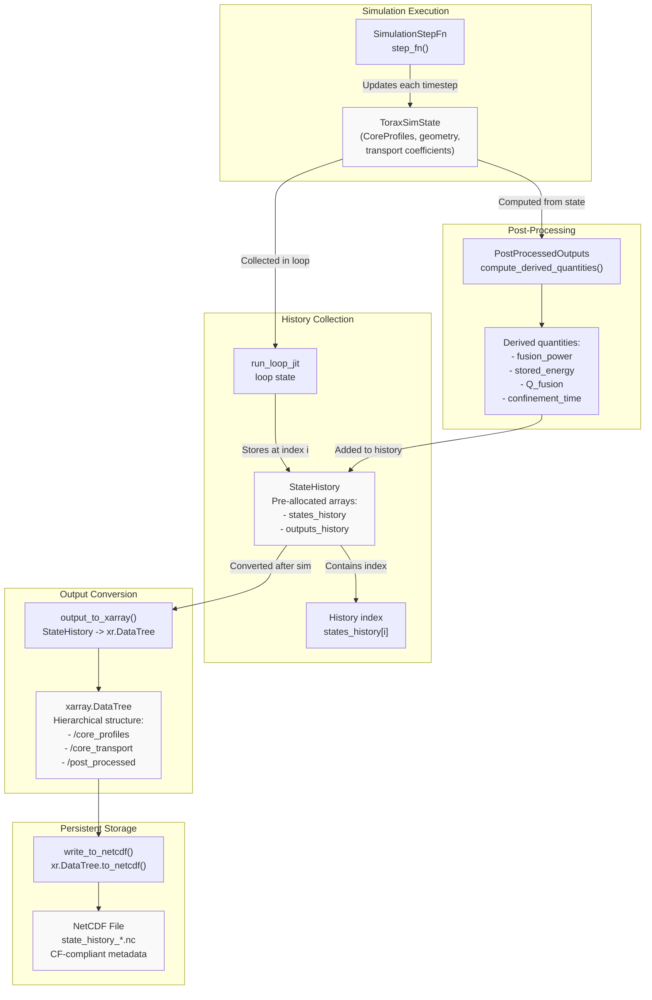
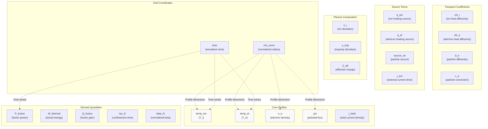
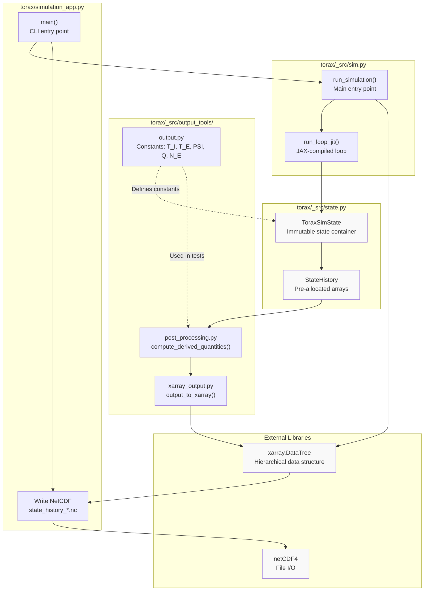

<!-- source: DeepWiki mcp.deepwiki.com · repo google-deepmind/torax · page 7 Results and Output · fetched 2026-10-26 -->

# Results and Output

<details>
<summary>Relevant source files</summary>

The following files were used as context for generating this wiki page:

- [docs/configuration.rst](docs/configuration.rst)
- [docs/edge_models.rst](docs/edge_models.rst)
- [docs/interfacing_with_surrogates.rst](docs/interfacing_with_surrogates.rst)
- [docs/links.rst](docs/links.rst)
- [docs/output.rst](docs/output.rst)
- [docs/physics_models.rst](docs/physics_models.rst)
- [docs/running_programmatically.rst](docs/running_programmatically.rst)
- [docs/user_guides.rst](docs/user_guides.rst)
- [docs/using_jax.rst](docs/using_jax.rst)
- [torax/_src/imas_tools/output/equilibrium.py](torax/_src/imas_tools/output/equilibrium.py)
- [torax/_src/orchestration/adaptive_step.py](torax/_src/orchestration/adaptive_step.py)
- [torax/_src/orchestration/initial_state.py](torax/_src/orchestration/initial_state.py)
- [torax/_src/orchestration/sawtooth_step.py](torax/_src/orchestration/sawtooth_step.py)
- [torax/_src/orchestration/sim_state.py](torax/_src/orchestration/sim_state.py)
- [torax/_src/orchestration/step_function_processing.py](torax/_src/orchestration/step_function_processing.py)
- [torax/_src/orchestration/tests/initial_state_test.py](torax/_src/orchestration/tests/initial_state_test.py)
- [torax/_src/output_tools/impurity_radiation.py](torax/_src/output_tools/impurity_radiation.py)
- [torax/_src/output_tools/output.py](torax/_src/output_tools/output.py)
- [torax/_src/output_tools/post_processing.py](torax/_src/output_tools/post_processing.py)
- [torax/_src/output_tools/tests/output_test.py](torax/_src/output_tools/tests/output_test.py)
- [torax/_src/output_tools/tests/post_processing_test.py](torax/_src/output_tools/tests/post_processing_test.py)

</details>


This section provides an overview of TORAX's output system, including the data structures, file formats, and tools available for analyzing simulation results. TORAX produces structured output in NetCDF format with xarray-based organization, along with post-processed derived quantities and visualization tools.

For detailed information on:
- Output file structure and variables, see [Output Data Format](#7.1)
- State history collection and derived quantities, see [State History and Post-Processing](#7.2)  
- Visualization and plotting tools, see [Plotting and Visualization](#7.3)

For information on running simulations that generate this output, see [Running Simulations](#6).

---

## Output System Overview

TORAX generates multiple types of output during and after simulation execution:

| Output Type | Description | Primary Use |
|------------|-------------|-------------|
| **State History** | Time series of core plasma profiles (T_i, T_e, n_e, psi) and transport coefficients | Primary simulation results, restart files |
| **Post-Processed Outputs** | Derived quantities computed from state (fusion power, stored energy, Q) | Physics analysis, validation |
| **NetCDF Files** | Persistent storage of state history and outputs in hierarchical format | Long-term storage, external analysis |
| **Log Files** | Solver diagnostics, convergence information, error messages | Debugging, performance analysis |

The output system is designed to be:
- **JAX-compatible**: All data structures use JAX arrays for differentiability
- **Structured**: Hierarchical organization via xarray.DataTree with named dimensions and coordinates
- **Persistent**: NetCDF format enables storage, sharing, and analysis with standard tools
- **Complete**: Includes both raw state variables and derived physics quantities

Sources: [torax/tests/sim_no_compile_test.py:23-29]()

---

## Data Flow Through the Output System

The following diagram shows how simulation data flows from execution through post-processing to persistent storage:



**Data Flow Description:**

1. **Simulation Execution**: Each call to `SimulationStepFn.step_fn()` updates the `ToraxSimState` with new profiles, geometry, and transport coefficients
2. **History Collection**: The JAX-compiled loop (`run_loop_jit`) stores each state in pre-allocated `StateHistory` buffers at index `i`
3. **Post-Processing**: Derived quantities like fusion power and Q are computed from the core profiles using physics formulas
4. **Output Conversion**: After simulation completion, `StateHistory` is converted to `xarray.DataTree` with proper coordinates and metadata
5. **Persistent Storage**: The DataTree is written to NetCDF format with CF-compliant metadata for long-term storage

This design separates the JAX-compiled simulation loop (which requires fixed-size arrays) from the flexible xarray-based output format used for analysis.

Sources: Based on high-level system architecture diagrams

---

## Core Output Data Structures

### ToraxSimState

`ToraxSimState` is the primary immutable state container used throughout the simulation. It contains:

- **CoreProfiles**: Temperature (T_i, T_e), density (n_e, n_i), and poloidal flux (psi) profiles
- **CoreTransport**: Transport coefficients (chi_i, chi_e, d_e, v_e) from transport models
- **Geometry**: Magnetic geometry information (StandardGeometry) at current time
- **Timestep information**: Current time, timestep size (dt)
- **Solver outputs**: Convergence information, iteration counts, error flags

### StateHistory

`StateHistory` collects simulation results over time using pre-allocated JAX arrays. It stores:

- **states_history**: Array of `ToraxSimState` at each timestep
- **outputs_history**: Array of `PostProcessedOutputs` at each timestep  
- **Length tracking**: Actual number of valid timesteps (may be less than allocated size if simulation terminates early)

Pre-allocation is required for JAX JIT compilation, which needs fixed array shapes.

### PostProcessedOutputs

`PostProcessedOutputs` contains derived physics quantities computed from the simulation state:

| Quantity | Symbol | Description |
|----------|--------|-------------|
| Fusion power | `P_fusion` | Thermal fusion power from DT reactions |
| Stored energy | `W_thermal` | Total thermal energy in plasma |
| Fusion gain | `Q_fusion` | Ratio of fusion power to input heating power |
| Energy confinement time | `tau_E` | Characteristic energy loss timescale |
| Normalized beta | `beta_N` | Plasma pressure normalized to critical value |
| Bootstrap fraction | `f_bootstrap` | Fraction of plasma current from bootstrap effect |

These quantities are essential for evaluating plasma performance and comparing with experimental targets or other codes.

Sources: Based on high-level system architecture diagrams, [torax/tests/sim_no_compile_test.py:23-29]()

---

## Output Variables and Profiles

The following diagram shows the key output variables organized by category:



**Output Variable Constants:**

TORAX defines constants for standard output variable names in the output module:
- `output.T_I`: Ion temperature profile
- `output.T_E`: Electron temperature profile  
- `output.N_E`: Electron density profile
- `output.PSI`: Poloidal flux profile
- `output.Q`: Fusion gain Q

These constants ensure consistency in variable naming across the codebase and tests.

Sources: [torax/tests/sim_no_compile_test.py:23-29]()

---

## Output File Naming and Organization

TORAX generates output files with structured naming conventions:

### NetCDF Output Files

Primary simulation results are saved as:
```
state_history_<timestamp>.nc
state_history_<config_name>.nc
```

The filename depends on the execution mode:
- When run via CLI without `--output_file`, a timestamp-based name is generated
- When `--output_file` is specified, that name is used
- When run via Python API, the output path can be specified in the return value

### File Location

By default, output files are written to:
- Current working directory when using CLI
- Configurable via `--output_dir` flag or function arguments

### Hierarchical Structure

NetCDF files contain xarray.DataTree hierarchical structure:
```
/
├── core_profiles/          (T_i, T_e, n_e, psi, etc.)
├── core_transport/         (chi_i, chi_e, d_e, v_e)
├── core_sources/           (q_ion, q_el, source_ne, j_ext)
├── post_processed/         (P_fusion, W_thermal, Q_fusion)
├── plasma_composition/     (n_i, n_imp, Z_eff)
└── coordinates/            (rho_norm, time)
```

This organization mirrors the internal data structure and makes it easy to load specific subsets of data.

---

## Accessing Output Data

### From NetCDF Files

```python
import xarray as xr

# Load the entire output tree
data = xr.open_datatree('state_history.nc')

# Access core profiles
temp_ion = data['core_profiles']['temp_ion']  # (time, rho)
temp_el = data['core_profiles']['temp_el']    # (time, rho)

# Access derived quantities
fusion_power = data['post_processed']['P_fusion']  # (time,)
```

### From Python API Return Value

When using the Python API, simulation results are returned directly:

```python
from torax import run_simulation

# Run simulation and get outputs
output = run_simulation(config, ...)

# output contains xarray.DataTree with same structure
temp_ion = output['core_profiles']['temp_ion']
```

### In Testing

Test utilities provide comparison functions for validating outputs:

```python
from torax._src.test_utils import sim_test_case

# Compare profiles against reference
self._test_run_simulation(
    config_name='test_psi_and_heat.py',
    profiles=(output.T_I, output.T_E, output.PSI, output.Q, output.N_E),
    rtol=1e-5,
    atol=1e-8,
)
```

Sources: [torax/tests/sim_no_compile_test.py:34-52]()

---

## Output System Architecture

The following diagram shows the relationship between output-related classes and modules:



**Architecture Key Points:**

1. **Separation of Concerns**: Simulation execution (`sim.py`) is separate from output formatting (`output_tools/`)
2. **JAX Compatibility**: `StateHistory` uses pre-allocated arrays, while `xarray.DataTree` conversion happens outside the compiled loop
3. **Constants Module**: `output.py` defines standard variable name constants used throughout the codebase
4. **Post-Processing**: Derived quantities are computed after state updates but before output conversion
5. **Standard Format**: NetCDF output uses CF conventions for metadata and is readable by standard tools

Sources: Based on high-level system architecture diagrams, [torax/tests/sim_no_compile_test.py:20]()

---

## Error Handling in Output

The output system includes error detection and handling:

### SimError States

When errors occur during simulation, the output includes diagnostic information:

- **Error flags**: Boolean indicators in simulation state
- **Truncated history**: Only valid timesteps before error are included
- **Convergence diagnostics**: Solver iteration counts, residuals

### Output Validation

The output system validates data integrity:

- **NaN detection**: Checks for numerical instabilities
- **Dimension consistency**: Ensures all profiles have correct shapes
- **Coordinate alignment**: Verifies time and spatial coordinates match data

### Testing Output

Tests validate output correctness using reference data:

```python
def test_run_simulation_no_compile(
    self,
    config_name: str,
    profiles: Sequence[str] = _ALL_PROFILES,
    rtol: float | None = None,
    atol: float | None = None,
):
  self._test_run_simulation(
      config_name,
      profiles,
      rtol=rtol,
      atol=atol,
  )
```

This ensures output consistency across code changes and different execution modes (compiled vs. non-compiled).

Sources: [torax/tests/sim_no_compile_test.py:40-52]()

---

## Performance Considerations

### Memory Efficiency

- **Pre-allocation**: History arrays are allocated once with maximum size, avoiding repeated allocations
- **Lazy conversion**: xarray conversion happens after simulation completes, not during the compiled loop
- **Selective output**: Users can configure which quantities to compute and save

### File Size

NetCDF files use compression by default:
- **Profile data**: Typically 1D arrays (rho dimension ~100 points)
- **Time series**: Length depends on simulation duration and timestep
- **Typical size**: 1-100 MB for standard ITER scenarios

### I/O Performance

- **Buffered writes**: NetCDF uses buffered I/O for efficiency
- **Parallel compatible**: Multiple simulations can write to different files simultaneously
- **Read optimization**: xarray enables lazy loading of large datasets

---

## Summary

TORAX's output system provides:

- **Structured data** via xarray.DataTree with named dimensions and coordinates
- **Persistent storage** in NetCDF format with CF-compliant metadata
- **Post-processed quantities** including fusion power, confinement time, and plasma performance metrics
- **Testing infrastructure** for validating output consistency and correctness
- **Visualization tools** for plotting profiles and time series (see [Plotting and Visualization](#7.3))

The output is designed to be both JAX-compatible for differentiability and accessible for standard analysis tools, balancing the needs of optimization workflows and physics validation.

For detailed information on specific aspects of the output system, see the child pages:
- [Output Data Format](#7.1) for NetCDF structure and variable definitions
- [State History and Post-Processing](#7.2) for derived quantities and physics analysis
- [Plotting and Visualization](#7.3) for visualization tools and examples

---

