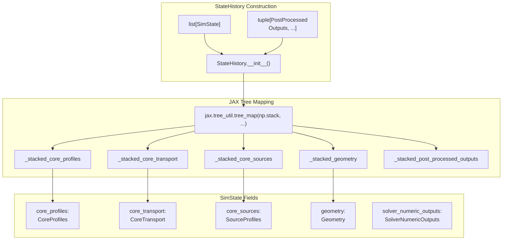
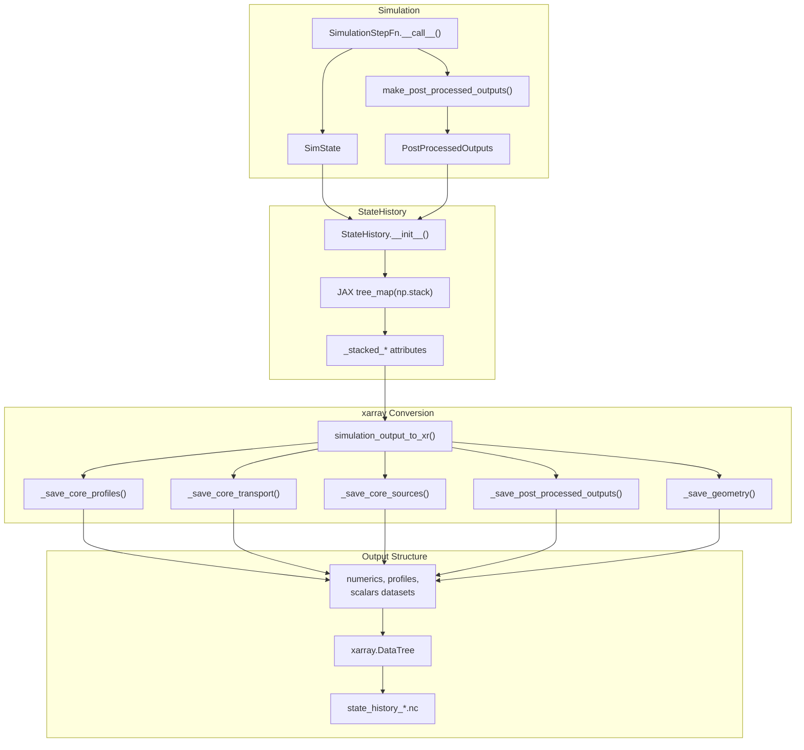
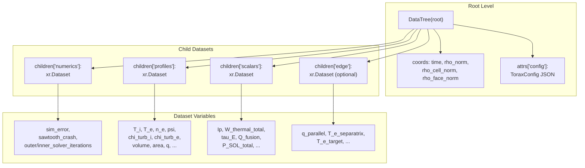
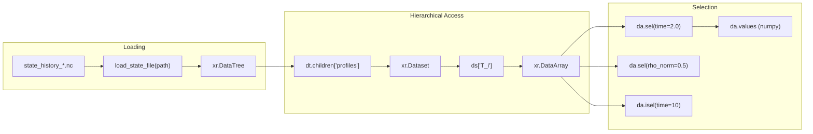
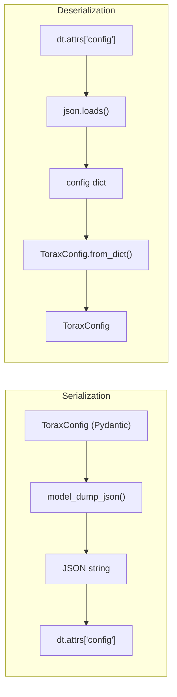
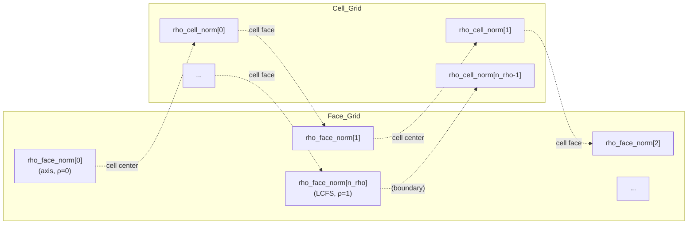
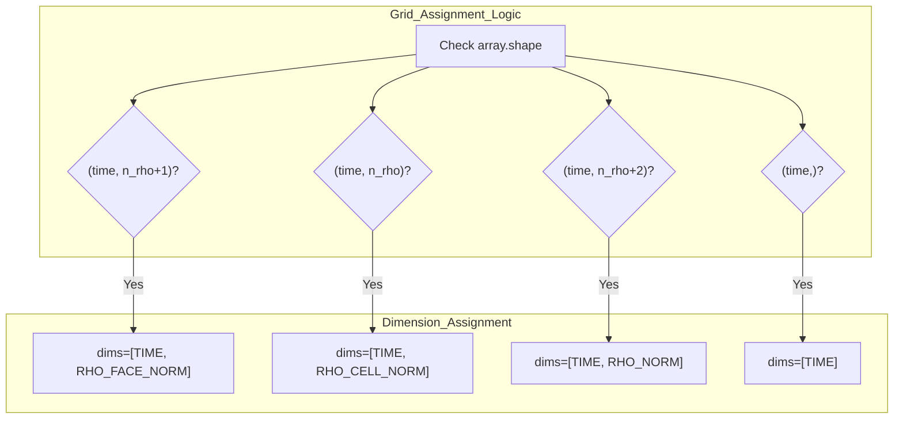
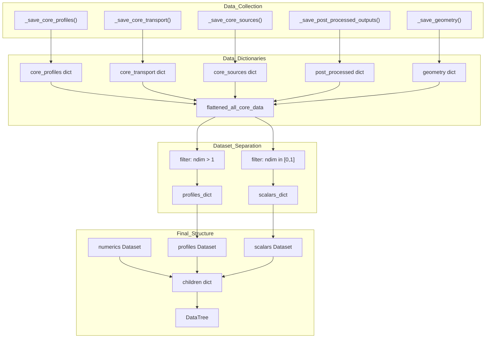
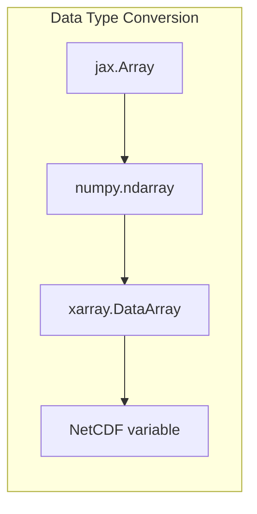

<!-- source: DeepWiki mcp.deepwiki.com · repo google-deepmind/torax · page 7.1 Output Data Format · fetched 2026-10-26 -->

# Output Data Format

<details>
<summary>Relevant source files</summary>

The following files were used as context for generating this wiki page:

- [docs/configuration.rst](docs/configuration.rst)
- [docs/edge_models.rst](docs/edge_models.rst)
- [docs/interfacing_with_surrogates.rst](docs/interfacing_with_surrogates.rst)
- [docs/links.rst](docs/links.rst)
- [docs/output.rst](docs/output.rst)
- [docs/physics_models.rst](docs/physics_models.rst)
- [docs/running_programmatically.rst](docs/running_programmatically.rst)
- [docs/user_guides.rst](docs/user_guides.rst)
- [docs/using_jax.rst](docs/using_jax.rst)
- [torax/_src/imas_tools/output/equilibrium.py](torax/_src/imas_tools/output/equilibrium.py)
- [torax/_src/orchestration/adaptive_step.py](torax/_src/orchestration/adaptive_step.py)
- [torax/_src/orchestration/initial_state.py](torax/_src/orchestration/initial_state.py)
- [torax/_src/orchestration/sawtooth_step.py](torax/_src/orchestration/sawtooth_step.py)
- [torax/_src/orchestration/sim_state.py](torax/_src/orchestration/sim_state.py)
- [torax/_src/orchestration/step_function_processing.py](torax/_src/orchestration/step_function_processing.py)
- [torax/_src/orchestration/tests/initial_state_test.py](torax/_src/orchestration/tests/initial_state_test.py)
- [torax/_src/output_tools/impurity_radiation.py](torax/_src/output_tools/impurity_radiation.py)
- [torax/_src/output_tools/output.py](torax/_src/output_tools/output.py)
- [torax/_src/output_tools/post_processing.py](torax/_src/output_tools/post_processing.py)
- [torax/_src/output_tools/tests/output_test.py](torax/_src/output_tools/tests/output_test.py)
- [torax/_src/output_tools/tests/post_processing_test.py](torax/_src/output_tools/tests/post_processing_test.py)

</details>


This page documents the structure and format of TORAX simulation output data, focusing on the `xarray.DataTree` structure, NetCDF file organization, coordinate systems, and variable naming conventions.

For information about plotting and visualization, see page 7.3. For post-processing and derived quantities, see page 7.2.

## Overview

TORAX simulation outputs are stored as hierarchical `xarray.DataTree` objects written to NetCDF files. The output structure consists of:

1. **Root DataTree** - Contains time and spatial coordinates, plus serialized configuration in attributes
2. **Child Datasets** - Separate `xarray.Dataset` objects for `numerics`, `profiles`, `scalars`, and optionally `edge`
3. **StateHistory Class** - Internal container ([torax/_src/output_tools/output.py:215-451]()) that converts simulation state sequences to `xarray.DataTree`

Output files are named `state_history_<YYYYMMDD_HHMMSS>.nc` and written to the directory specified by `--output_dir` (default: `/tmp/torax_results_<timestamp>/`).

Sources: [torax/_src/output_tools/output.py:45-50](), [torax/_src/output_tools/output.py:342-451](), [docs/output.rst:1-29]()

## StateHistory Class

### Internal Structure

The `StateHistory` class ([torax/_src/output_tools/output.py:215-283]()) is the primary container for simulation time series. It is constructed from:

- `state_history`: `list[SimState]` - Simulation state at each timestep
- `post_processed_outputs_history`: `tuple[PostProcessedOutputs, ...]` - Derived quantities
- `sim_error`: `state.SimError` - Final simulation error status
- `torax_config`: `model_config.ToraxConfig` - Configuration used for the run

The class performs stacking operations on JAX pytrees to create time-indexed arrays:

```python
# From output.py:251-266
self._stacked_core_profiles = jax.tree_util.tree_map(stack, *self._core_profiles)
self._stacked_core_sources = jax.tree_util.tree_map(stack, *self._core_sources)
self._stacked_core_transport = jax.tree_util.tree_map(stack, *self._transport)
```

**StateHistory Components and Stacking**


Sources: [torax/_src/output_tools/output.py:215-283](), [torax/_src/orchestration/sim_state.py:28-56]()

### Conversion to xarray.DataTree

The `StateHistory.simulation_output_to_xr()` method ([torax/_src/output_tools/output.py:342-451]()) converts the stacked arrays into an `xarray.DataTree` structure:

**Data Flow from Simulation to xarray.DataTree**


Sources: [torax/_src/output_tools/output.py:342-451](), [torax/_src/output_tools/output.py:498-587](), [torax/_src/output_tools/output.py:589-628]()

### SimState Components

Each `SimState` ([torax/_src/orchestration/sim_state.py:30-56]()) contains:

| Field | Type | Description |
|-------|------|-------------|
| `t` | `FloatScalar` | Current simulation time |
| `dt` | `FloatScalar` | Timestep duration |
| `core_profiles` | `state.CoreProfiles` | Plasma profiles (T_i, T_e, n_e, psi, currents) |
| `core_transport` | `state.CoreTransport` | Transport coefficients (chi, D, V) |
| `core_sources` | `source_profiles.SourceProfiles` | Source/sink profiles by name |
| `edge_outputs` | `EdgeModelOutputs` or `None` | Edge model results (if active) |
| `geometry` | `geometry.Geometry` | Magnetic geometry at this time |
| `solver_numeric_outputs` | `state.SolverNumericOutputs` | Solver convergence diagnostics |

Sources: [torax/_src/orchestration/sim_state.py:30-56](), [torax/_src/state.py]()

## xarray.DataTree Structure

### Hierarchy

The `simulation_output_to_xr()` method ([torax/_src/output_tools/output.py:342-451]()) creates a hierarchical `xarray.DataTree`:

**DataTree Hierarchy with Datasets**


The root DataTree contains four coordinate variables (lines [torax/_src/output_tools/output.py:365-383]()) and stores the serialized `ToraxConfig` in `attrs['config']` (line [torax/_src/output_tools/output.py:442]()).

Sources: [torax/_src/output_tools/output.py:342-451](), [torax/_src/output_tools/output.py:430-450](), [docs/output.rst:13-97]()

### Coordinates

Four coordinate arrays are defined at the root level ([torax/_src/output_tools/output.py:365-383]()):

| Coordinate Name | Dimension | Size | Description |
|-----------------|-----------|------|-------------|
| `time` | `TIME` | `n_timesteps` | Simulation times in seconds |
| `rho_cell_norm` | `RHO_CELL_NORM` | `n_rho` | Normalized toroidal flux at cell centers |
| `rho_face_norm` | `RHO_FACE_NORM` | `n_rho + 1` | Normalized toroidal flux at cell faces |
| `rho_norm` | `RHO_NORM` | `n_rho + 2` | Cell grid plus boundary faces |

These coordinates are shared across all child datasets.

Sources: [torax/_src/output_tools/output.py:365-383](), [torax/_src/output_tools/output.py:95-101]()

### Dataset Contents

#### Numerics Dataset

The `numerics` dataset ([torax/_src/output_tools/output.py:399-417]()) contains solver diagnostics with dimension `(time)`:

| Variable | Dimension | Description |
|----------|-----------|-------------|
| `sim_error` | scalar | `SimError` enum value: 0=NO_ERROR, 1=NAN_DETECTED, 2=NEGATIVE_CORE_PROFILES, 3=QUASINEUTRALITY_BROKEN |
| `sawtooth_crash` | `(time,)` | Boolean indicating sawtooth crash at this timestep |
| `outer_solver_iterations` | `(time,)` | Number of dt-backtracking retries (adaptive stepping) |
| `inner_solver_iterations` | `(time,)` | Number of Newton or predictor-corrector iterations |

Sources: [torax/_src/output_tools/output.py:399-417](), [torax/_src/state.py:17-26](), [docs/output.rst:99-117]()

#### Profiles Dataset

The `profiles` dataset contains radial profiles with dimensions `(time, spatial_coord)`. Variables are mapped to different spatial grids based on their physical definition:

**Core Profiles on `rho_norm` (cell + boundaries)**

The `_save_core_profiles()` method ([torax/_src/output_tools/output.py:498-587]()) merges cell and face values using `extend_cell_grid_to_boundaries()` ([torax/_src/output_tools/output.py:182-191]()):

| Variable | Units | Description |
|----------|-------|-------------|
| `T_i` | keV | Ion temperature (from `CellVariable.cell_plus_boundaries()`) |
| `T_e` | keV | Electron temperature |
| `n_e` | m^-3 | Electron density |
| `psi` | Wb | Poloidal flux |
| `n_i` | m^-3 | Main ion density |
| `q` | - | Safety factor (from `q_face`) |
| `magnetic_shear` | - | Magnetic shear (from `s_face`) |

**Transport Coefficients on `rho_face_norm`**

Saved by `_save_core_transport()` ([torax/_src/output_tools/output.py:589-628]()):

| Variable | Units | Description |
|----------|-------|-------------|
| `chi_turb_i` | m^2/s | Turbulent ion heat diffusivity |
| `chi_turb_e` | m^2/s | Turbulent electron heat diffusivity |
| `D_turb_e` | m^2/s | Turbulent electron particle diffusivity |
| `V_turb_e` | m/s | Turbulent electron particle convection |
| `chi_neo_i`, `chi_neo_e` | m^2/s | Neoclassical heat diffusivities |
| `D_neo_e`, `V_neo_e` | m^2/s, m/s | Neoclassical particle transport |

**Source Profiles on `rho_cell_norm`**

Saved by `_save_core_sources()` ([torax/_src/output_tools/output.py:630-670]()):

| Variable | Units | Description |
|----------|-------|-------------|
| `p_fusion_i`, `p_fusion_e` | W/m^3 | Fusion heating (renamed from `p_alpha_*`) |
| `p_ohmic_e` | W/m^3 | Ohmic heating |
| `p_ecrh_e` | W/m^3 | ECRH heating |
| `p_generic_heat_i`, `p_generic_heat_e` | W/m^3 | Generic heating sources |
| `j_parallel_<source>` | A/m^2 | Parallel current density by source |
| `s_<source>` | s^-1 m^-3 | Particle source profiles |

**Geometry Quantities**

Saved by `_save_geometry()` ([torax/_src/output_tools/output.py:709-783]()), using either cell or face grids depending on the variable, then extended to `rho_norm` where both exist:

| Variable | Units | Description |
|----------|-------|-------------|
| `volume`, `area` | m^3, m^2 | Flux surface volume and area |
| `vpr`, `spr` | m^3, m^2 | Radial derivatives of volume and area |
| `g0`, `g1`, `g2`, `g3` | various | Flux surface averaged metric coefficients |

Sources: [torax/_src/output_tools/output.py:498-783](), [docs/output.rst:118-418]()

#### Scalars Dataset

The `scalars` dataset contains time-dependent global quantities with dimension `(time)` or scalar (constant). Variables come from `_save_post_processed_outputs()` ([torax/_src/output_tools/output.py:672-707]()) and geometry scalars:

**Energy and Confinement**
| Variable | Units | Description |
|----------|-------|-------------|
| `W_thermal_i`, `W_thermal_e`, `W_thermal_total` | J | Ion, electron, and total thermal stored energy |
| `tau_E` | s | Energy confinement time |
| `H98`, `H89P`, `H97L`, `H20` | - | Confinement quality factors vs. scaling laws |
| `dW_thermal_dt` | W | Time derivative of total stored energy |

**Power Balance**
| Variable | Units | Description |
|----------|-------|-------------|
| `P_SOL_i`, `P_SOL_e`, `P_SOL_total` | W | Power crossing LCFS to SOL |
| `P_aux_i`, `P_aux_e`, `P_aux_total` | W | Auxiliary heating power absorbed |
| `P_alpha_i`, `P_alpha_e`, `P_alpha_total` | W | Fusion alpha heating |
| `P_ohmic_e` | W | Ohmic heating |
| `P_ecrh_e`, `P_icrh_i`, `P_icrh_e` | W | ECRH and ICRH power |
| `P_radiation_e` | W | Total radiated power |
| `P_external_injected`, `P_external_total` | W | External power before/after absorption |
| `P_fusion` | W | Total fusion power (5×P_alpha_total) |

**Fusion Performance**
| Variable | Units | Description |
|----------|-------|-------------|
| `Q_fusion` | - | Fusion gain (P_fusion / P_external_total) |
| `E_fusion`, `E_aux_total` | J | Cumulative fusion and auxiliary energy |

**Current and Plasma Geometry**
| Variable | Units | Description |
|----------|-------|-------------|
| `Ip` | A | Total plasma current |
| `I_bootstrap`, `I_ecrh`, `I_aux_generic` | A | Bootstrap, ECRH, and generic currents |
| `q95`, `q_min` | - | Safety factor at 95% flux surface and minimum |
| `li3` | - | Normalized internal inductance (ITER convention) |

**Density and Beta**
| Variable | Units | Description |
|----------|-------|-------------|
| `n_e_volume_avg`, `n_e_line_avg` | m^-3 | Volume and line-averaged electron density |
| `n_i_volume_avg`, `n_i_line_avg` | m^-3 | Volume and line-averaged ion density |
| `fgw_n_e_volume_avg`, `fgw_n_e_line_avg` | - | Greenwald fraction |
| `beta_tor`, `beta_pol`, `beta_N` | - | Toroidal, poloidal, normalized beta |

**Geometry Scalars**
| Variable | Units | Description |
|----------|-------|-------------|
| `R_major`, `a_minor` | m | Major and minor radius |
| `B_0` | T | Magnetic field at axis |
| `drho_norm` | - | Radial grid spacing (constant) |

Sources: [torax/_src/output_tools/output.py:672-707](), [torax/_src/output_tools/post_processing.py:42-268](), [docs/output.rst:419-720]()

#### Edge Dataset (Optional)

If an edge model is active, the `edge` dataset is created by `_save_edge_outputs()` ([torax/_src/output_tools/output.py:785-838]()). For the Extended Lengyel model:

| Variable | Dimension | Units | Description |
|----------|-----------|-------|-------------|
| `q_parallel` | `(time,)` | W/m^2 | Parallel heat flux at separatrix |
| `q_perpendicular_target` | `(time,)` | W/m^2 | Perpendicular heat flux at target |
| `T_e_separatrix` | `(time,)` | eV | Electron temperature at separatrix |
| `T_e_target` | `(time,)` | eV | Electron temperature at target |
| `Z_eff_separatrix` | `(time,)` | - | Effective charge at separatrix |
| `seed_impurity_concentrations` | `(impurity, time)` | - | Seeded impurity concentrations by species |
| `calculated_enrichment` | `(impurity, time)` | - | Calculated enrichment factors |
| `solver_physics_outcome` | `(time,)` | int | Edge solver physics outcome status |

Sources: [torax/_src/output_tools/output.py:785-838](), [docs/output.rst:118-418]()

## Data Access

### Loading and Accessing Output Files

**Loading with load_state_file()**
```python
# From output.py:136-146
def load_state_file(filepath: str) -> xr.DataTree:
    with open(filepath, "rb") as f:
        dt_open = xr.open_datatree(f)
        data_tree = dt_open.compute()
    return data_tree
```

**Access Pattern for Variables**


The `xarray.DataArray` methods enable coordinate-based selection, indexing, aggregation, and plotting.

Sources: [torax/_src/output_tools/output.py:136-146](), [docs/output.rst:560-608]()

### Configuration Storage

The `ToraxConfig` is serialized to JSON and stored in the root DataTree attributes ([torax/_src/output_tools/output.py:442]()):

```python
# From output.py:437-444
data_tree = xr.DataTree(
    children=children,
    dataset=xr.Dataset(
        data_vars=None,
        coords=coords,
        attrs={CONFIG: self.torax_config.model_dump_json()},
    ),
)
```

**Configuration Round-Trip**


This enables exact simulation reproducibility. Example from tests ([torax/_src/output_tools/tests/output_test.py:306-311]()):

```python
config_dict = json.loads(output_xr.dataset.attrs[output.CONFIG])
rebuilt_torax_config = model_config.ToraxConfig.from_dict(config_dict)
self.assertEqual(rebuilt_torax_config, self.torax_config)
```

Sources: [torax/_src/output_tools/output.py:437-444](), [torax/_src/output_tools/tests/output_test.py:291-311](), [docs/output.rst:82-92]()

## Coordinate Systems and Grids

### Spatial Grid Structure

TORAX uses a staggered grid based on the finite volume method. The coordinate `rho_norm` represents the normalized toroidal flux coordinate (0 at axis, 1 at LCFS):

**Finite Volume Grid Structure**


### Grid Coordinate Definitions

From [torax/_src/output_tools/output.py:274-278]():

| Coordinate | Size | Description |
|------------|------|-------------|
| `rho_cell_norm` | `n_rho` | Cell centers: `geo.rho_norm` |
| `rho_face_norm` | `n_rho + 1` | Cell faces: `geo.rho_face_norm` |
| `rho_norm` | `n_rho + 2` | Extended: `[0.0, *rho_cell_norm, 1.0]` |

The `rho_norm` coordinate is constructed to include both boundary face values:

```python
# From output.py:278
self._rho_norm = np.concatenate([[0.0], self.rho_cell_norm, [1.0]])
```

### Variable Grid Assignment

The `_pack_into_data_array()` method ([torax/_src/output_tools/output.py:453-496]()) assigns dimension names based on array shapes:



**Typical Variable Assignments:**
- **Face grid** (`rho_face_norm`): Transport coefficients (chi, D, V), safety factor q
- **Cell grid** (`rho_cell_norm`): Source profiles, some geometry quantities
- **Extended grid** (`rho_norm`): Core profiles merged with boundary values via `extend_cell_grid_to_boundaries()`

Sources: [torax/_src/output_tools/output.py:274-278](), [torax/_src/output_tools/output.py:453-496](), [torax/_src/output_tools/output.py:182-191](), [docs/output.rst:31-78]()

## Output Generation Pipeline

### Variable Packing and Dimension Assignment

The `_pack_into_data_array()` method ([torax/_src/output_tools/output.py:453-496]()) creates `xarray.DataArray` objects with appropriate dimensions:

**Dimension Assignment by Array Shape**
```python
# From output.py:462-493
is_face_var = lambda x: x.ndim == 2 and x.shape == (len(self.times), len(self.rho_face_norm))
is_cell_var = lambda x: x.ndim == 2 and x.shape == (len(self.times), len(self.rho_cell_norm))
is_cell_plus_boundaries_var = lambda x: x.ndim == 2 and x.shape == (len(self.times), len(self.rho_norm))
is_scalar = lambda x: x.ndim == 1 and x.shape == (len(self.times),)
is_constant = lambda x: x.ndim == 0

match data:
    case data if is_face_var(data): dims = [TIME, RHO_FACE_NORM]
    case data if is_cell_var(data): dims = [TIME, RHO_CELL_NORM]
    case data if is_scalar(data): dims = [TIME]
    case data if is_constant(data): dims = []
    case data if is_cell_plus_boundaries_var(data): dims = [TIME, RHO_NORM]
```

### Dataset Construction

The `simulation_output_to_xr()` method ([torax/_src/output_tools/output.py:342-451]()) builds child datasets:

**Dataset Construction Flow**


The separation logic ([torax/_src/output_tools/output.py:418-433]()):

```python
# From output.py:418-433
profiles_dict = {
    k: v for k, v in flattened_all_core_data.items()
    if v is not None and v.values.ndim > 1
}
profiles = xr.Dataset(profiles_dict)

scalars_dict = {
    k: v for k, v in flattened_all_core_data.items()
    if v is not None and v.values.ndim in [0, 1]
}
scalars = xr.Dataset(scalars_dict)

children = {
    NUMERICS: xr.DataTree(dataset=numerics),
    PROFILES: xr.DataTree(dataset=profiles),
    SCALARS: xr.DataTree(dataset=scalars),
}
```

Sources: [torax/_src/output_tools/output.py:342-451](), [torax/_src/output_tools/output.py:418-433](), [torax/_src/output_tools/output.py:453-496]()

## Implementation Details

### Key Classes and Functions

| Component | File Location | Primary Function |
|-----------|---------------|------------------|
| `StateHistory` | `torax/_src/output_tools/output.py` | Time series container |
| `build_datatree()` | `torax/_src/output_tools/output_datatree.py` | NetCDF structure creation |
| `post_process_step()` | `torax/_src/output_tools/post_processing.py` | Derived quantity calculation |
| `load_state_file()` | `torax/_src/output_tools/output.py` | Output file loading |

### Data Type Handling

TORAX handles various data types in the output system:



Sources: [torax/_src/output_tools/output_datatree.py](), [torax/_src/output_tools/output.py]()

---

