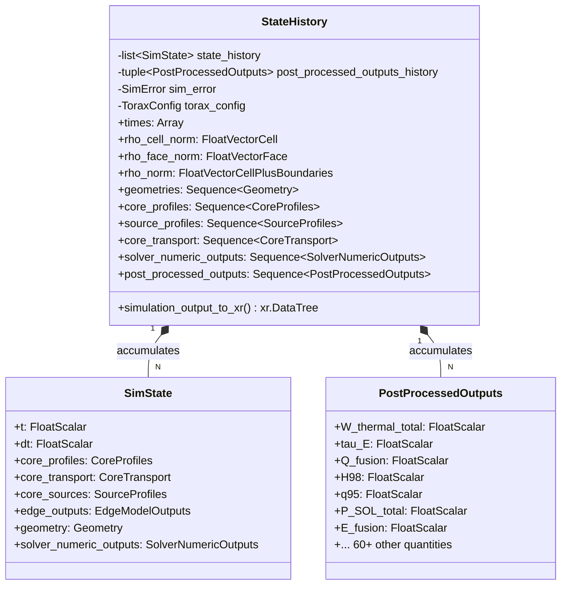
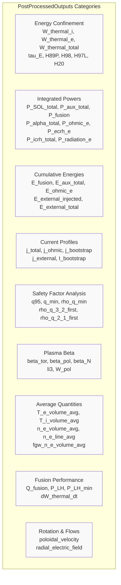
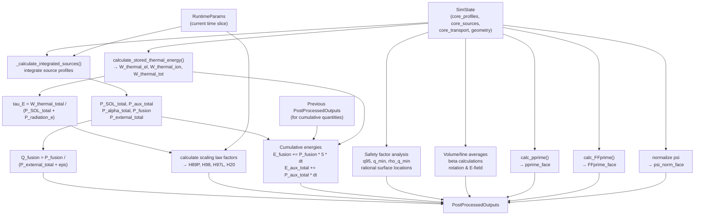
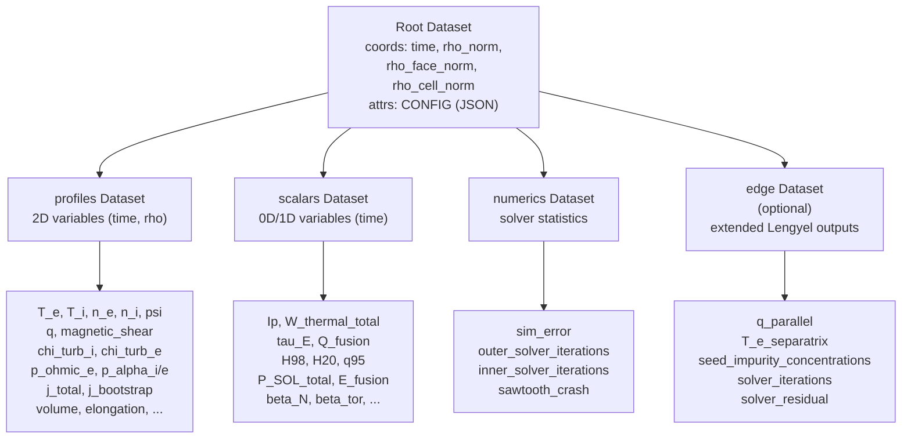
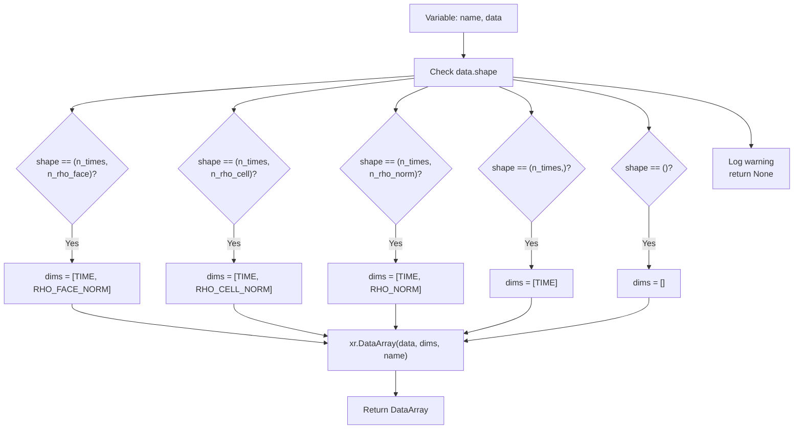
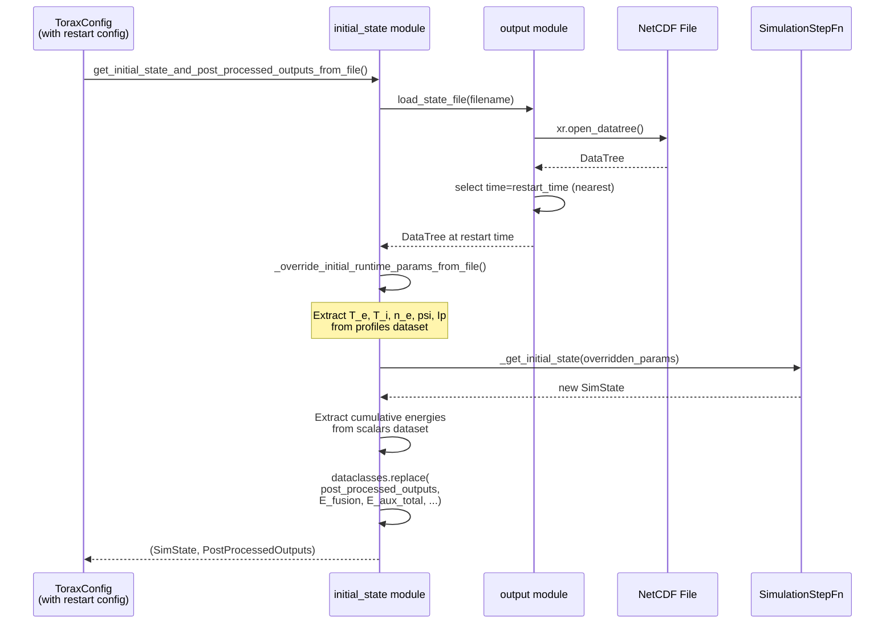
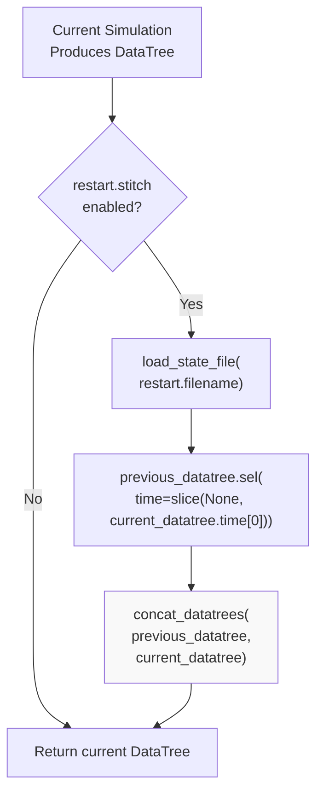

<!-- source: DeepWiki mcp.deepwiki.com · repo google-deepmind/torax · page 7.2 State History and Post-Processing · fetched 2026-10-26 -->

# State History and Post-Processing

<details>
<summary>Relevant source files</summary>

The following files were used as context for generating this wiki page:

- [torax/_src/imas_tools/output/equilibrium.py](torax/_src/imas_tools/output/equilibrium.py)
- [torax/_src/orchestration/adaptive_step.py](torax/_src/orchestration/adaptive_step.py)
- [torax/_src/orchestration/initial_state.py](torax/_src/orchestration/initial_state.py)
- [torax/_src/orchestration/sawtooth_step.py](torax/_src/orchestration/sawtooth_step.py)
- [torax/_src/orchestration/sim_state.py](torax/_src/orchestration/sim_state.py)
- [torax/_src/orchestration/step_function_processing.py](torax/_src/orchestration/step_function_processing.py)
- [torax/_src/orchestration/tests/initial_state_test.py](torax/_src/orchestration/tests/initial_state_test.py)
- [torax/_src/output_tools/impurity_radiation.py](torax/_src/output_tools/impurity_radiation.py)
- [torax/_src/output_tools/output.py](torax/_src/output_tools/output.py)
- [torax/_src/output_tools/post_processing.py](torax/_src/output_tools/post_processing.py)
- [torax/_src/output_tools/tests/output_test.py](torax/_src/output_tools/tests/output_test.py)
- [torax/_src/output_tools/tests/post_processing_test.py](torax/_src/output_tools/tests/post_processing_test.py)

</details>


This page documents the mechanisms for accumulating simulation state over time and computing derived quantities that are useful for analysis but not required for the core simulation. For information about the core simulation state structure itself, see [State Management and History](#4.3). For details on the output data format and visualization, see [Output Data Format](#7.1) and [Plotting and Visualization](#7.3).

## Overview

TORAX separates state accumulation and post-processing into two primary components:

- **`StateHistory`**: Accumulates all `SimState` and `PostProcessedOutputs` snapshots over the course of a simulation, providing methods to serialize them to xarray DataTree format for storage and analysis.
- **`PostProcessedOutputs`**: Calculates derived scalar and profile quantities from each simulation state, including confinement times, fusion gain factors, integrated powers, and various plasma metrics.

These components work together to provide a complete record of simulation evolution while maintaining a clean separation between quantities needed for time-stepping (in `SimState`) and quantities useful for analysis and validation.

Sources: [torax/_src/output_tools/output.py:215-276](), [torax/_src/output_tools/post_processing.py:42-268]()

## StateHistory Class

The `StateHistory` class serves as the primary container for simulation time-evolution data. It is constructed at the end of a simulation run and accumulates all states produced by the time-stepping loop.

### Structure and Initialization



Sources: [torax/_src/output_tools/output.py:215-276](), [torax/_src/orchestration/sim_state.py:29-56]()

### Internal State Management

Upon initialization, `StateHistory` processes the input lists to create both individual time-step access (via sequences) and stacked numpy arrays for efficient manipulation:

| Property | Type | Description |
|----------|------|-------------|
| `_core_profiles` | `list[CoreProfiles]` | Individual core profile snapshots |
| `_stacked_core_profiles` | `CoreProfiles` | Tree-mapped stack of all profiles |
| `_core_sources` | `list[SourceProfiles]` | Individual source profile snapshots |
| `_stacked_core_sources` | `SourceProfiles` | Tree-mapped stack of all sources |
| `_core_transport` | `list[CoreTransport]` | Individual transport coefficient snapshots |
| `_stacked_core_transport` | `CoreTransport` | Tree-mapped stack of all transport coefficients |
| `_geometries` | `list[Geometry]` | Individual geometry snapshots |
| `_stacked_geometry` | `Geometry` | Stacked geometry via `geometry_lib.stack_geometries` |

The stacking operation uses `jax.tree_util.tree_map(stack, *sequence)` to create arrays with shape `(n_times, ...)` for all quantities.

Sources: [torax/_src/output_tools/output.py:250-271]()

### Special Handling for Initial State

For simulations using the plasma current (`Ip`) boundary condition rather than the loop voltage boundary condition at the edge, `StateHistory` applies a special correction to avoid underconstraint issues:

```python
if (
    not torax_config.restart
    and not torax_config.profile_conditions.use_v_loop_lcfs_boundary_condition
    and len(state_history) >= 2
):
    # Set v_loop_lcfs[0] to the same value as v_loop_lcfs[1]
    self._core_profiles[0] = dataclasses.replace(
        self._core_profiles[0],
        v_loop_lcfs=self._core_profiles[1].v_loop_lcfs,
    )
```

This ensures that the initial loop voltage at the last closed flux surface is physically meaningful.

Sources: [torax/_src/output_tools/output.py:234-245]()

## PostProcessedOutputs Dataclass

The `PostProcessedOutputs` dataclass contains over 60 derived quantities computed from each `SimState`. These are calculated by `make_post_processed_outputs` and do not feed back into the simulation evolution.

### Categories of Post-Processed Quantities



Sources: [torax/_src/output_tools/post_processing.py:42-268]()

### Calculation Flow

The post-processing calculation follows a specific sequence to ensure all dependencies are satisfied:



Sources: [torax/_src/output_tools/post_processing.py:554-810]()

### Integrated Source Calculation

The `_calculate_integrated_sources` function performs volume or area integration of all source profiles to compute total powers and currents:

| Source Category | Output Variables | Integration Method |
|-----------------|------------------|-------------------|
| Ion-electron heat exchange | `P_ei_exchange_i`, `P_ei_exchange_e` | Volume integration of `qei_coef * (T_e - T_i)` |
| Ion/electron heating sources | `P_alpha_i/e`, `P_aux_generic_i/e`, `P_icrh_i/e` | Volume integration from `core_sources.T_i` and `core_sources.T_e` dicts |
| Electron-only heating | `P_ohmic_e`, `P_ecrh_e`, `P_bremsstrahlung_e`, `P_cyclotron_e` | Volume integration from `core_sources.T_e` dict |
| Current sources | `I_ecrh`, `I_aux_generic` | Area integration of toroidal current density |
| Particle sources | `S_gas_puff`, `S_pellet`, `S_generic_particle` | Volume integration from `core_sources.n_e` dict |

The function maintains dictionaries mapping internal TORAX source names to standardized output names:

```python
ION_EL_HEAT_SOURCE_TRANSFORMATIONS = {
    'generic_heat': 'P_aux_generic',
    'fusion': 'P_alpha',
    'icrh': 'P_icrh',
}
EL_HEAT_SOURCE_TRANSFORMATIONS = {
    'ohmic': 'P_ohmic_e',
    'bremsstrahlung': 'P_bremsstrahlung_e',
    'cyclotron_radiation': 'P_cyclotron_e',
    'ecrh': 'P_ecrh_e',
    'impurity_radiation': 'P_radiation_e',
}
```

Sources: [torax/_src/output_tools/post_processing.py:378-551]()

### Cumulative Energy Tracking

Several `PostProcessedOutputs` quantities track cumulative energies over the simulation:

```python
# E_fusion is the time integral of P_fusion (= 5 * P_alpha_total)
E_fusion_new = previous_post_processed_outputs.E_fusion + dt * P_fusion

# E_aux_total is the time integral of absorbed auxiliary power
E_aux_total_new = previous_post_processed_outputs.E_aux_total + dt * P_aux_total

# E_external_total includes ohmic heating
E_external_total_new = previous_post_processed_outputs.E_external_total + dt * P_external_total
```

These cumulative quantities require the `previous_post_processed_outputs` argument to maintain running totals. The first step uses `PostProcessedOutputs.zeros(geo)` which initializes all cumulative energies to zero.

Sources: [torax/_src/output_tools/post_processing.py:811-875]()

## Output to xarray DataTree

The `StateHistory.simulation_output_to_xr()` method converts the accumulated state history into a structured xarray DataTree suitable for NetCDF serialization and analysis.

### DataTree Structure



Sources: [torax/_src/output_tools/output.py:342-451]()

### Coordinate System

The DataTree uses multiple radial coordinate grids to represent different spatial discretizations:

| Coordinate | Grid Type | Usage |
|------------|-----------|-------|
| `rho_face_norm` | Face grid | Transport coefficients, fluxes, edge values |
| `rho_cell_norm` | Cell grid | State variables (T, n, psi) |
| `rho_norm` | Cell + boundaries | Combined grid with `[left_face, cells, right_face]` |

The `rho_norm` coordinate is constructed by concatenating boundary face values with cell values:

```python
self._rho_norm = np.concatenate([[0.0], self.rho_cell_norm, [1.0]])
```

This unified grid is used for variables that need both cell and boundary information in a single array.

Sources: [torax/_src/output_tools/output.py:275-308]()

### Variable Packing Logic

The `_pack_into_data_array` method determines the appropriate dimensions for each variable based on its shape:



Sources: [torax/_src/output_tools/output.py:453-496]()

### Cell and Face Variable Merging

For quantities available on both cell and face grids (e.g., volume, elongation), TORAX merges them into a single `rho_norm` coordinate array using `extend_cell_grid_to_boundaries`:

```python
def extend_cell_grid_to_boundaries(
    cell_var: array_typing.FloatVectorCell,
    face_var: array_typing.FloatVectorFace,
) -> array_typing.FloatVectorCellPlusBoundaries:
    """Merge face+cell grids into single [left_face, cells, right_face] grid."""
    left_value = np.expand_dims(face_var[:, 0], axis=-1)
    right_value = np.expand_dims(face_var[:, -1], axis=-1)
    return np.concatenate([left_value, cell_var, right_value], axis=-1)
```

This is applied during the save methods for core profiles, geometry, and post-processed outputs.

Sources: [torax/_src/output_tools/output.py:182-191](), [torax/_src/output_tools/output.py:569-581]()

### Special Output Types

#### Edge Model Outputs

When the Extended Lengyel edge model is active, `StateHistory._save_edge_outputs()` creates a separate edge dataset with model-specific quantities:

```python
if isinstance(outputs, extended_lengyel_standalone.ExtendedLengyelOutputs):
    # Standard scalar fields
    xr_dict['q_parallel'] = self._pack_into_data_array('q_parallel', outputs.q_parallel)
    xr_dict['T_e_separatrix'] = self._pack_into_data_array('T_e_separatrix', outputs.T_e_separatrix)
    
    # Dictionary fields (seed impurities) with impurity dimension
    if outputs.seed_impurity_concentrations:
        impurities = sorted(list(outputs.seed_impurity_concentrations.keys()))
        data_array = np.stack([outputs.seed_impurity_concentrations[i] for i in impurities], axis=0)
        xr_dict['seed_impurity_concentrations'] = xr.DataArray(
            data_array,
            dims=[IMPURITY, TIME],
            coords={IMPURITY: impurities, TIME: self.times},
        )
```

Sources: [torax/_src/output_tools/output.py:785-860]()

#### Impurity Radiation Outputs

When the Mavrin impurity radiation model is active, `PostProcessedOutputs` includes per-species radiation profiles organized by impurity symbol:

```python
if self._stacked_post_processed_outputs.impurity_species:
    radiation_outputs = impurity_radiation.construct_xarray_for_radiation_output(
        self._stacked_post_processed_outputs.impurity_species,
        self.times,
        self.rho_cell_norm,
        TIME,
        RHO_CELL_NORM,
    )
    # Adds: radiation_impurity_species, n_impurity_species, Z_impurity_species
    # with dimensions [impurity_symbol, time, rho_cell_norm]
```

Sources: [torax/_src/output_tools/output.py:694-706](), [torax/_src/output_tools/impurity_radiation.py:125-182]()

## Restart and Stitching Functionality

TORAX supports restarting simulations from saved NetCDF files and stitching together multiple simulation segments.

### File Restart Workflow



Sources: [torax/_src/orchestration/initial_state.py:164-280]()

### Runtime Parameter Override from File

When restarting from a file, several runtime parameters are overridden to match the saved state:

```python
def _override_initial_runtime_params_from_file(
    runtime_params: runtime_params_lib.RuntimeParams,
    geo: geometry.Geometry,
    t_restart: float,
    profiles_ds: xr.Dataset,
) -> tuple[runtime_params_lib.RuntimeParams, geometry.Geometry]:
    runtime_params.numerics.t_initial = t_restart
    runtime_params.profile_conditions.Ip = profiles_ds[IP_PROFILE][-1]
    runtime_params.profile_conditions.T_e = profiles_ds[T_E].sel(rho_norm=profiles_ds[RHO_CELL_NORM])
    runtime_params.profile_conditions.T_e_right_bc = profiles_ds[T_E].sel(rho_norm=profiles_ds[RHO_FACE_NORM][-1])
    # ... similar for T_i, n_e, psi
    
    # Disable density transformations when loading from file
    runtime_params.profile_conditions.n_e_right_bc_is_fGW = False
    runtime_params.profile_conditions.normalize_n_e_to_nbar = False
    runtime_params.profile_conditions.n_e_right_bc_is_absolute = True
```

This ensures the initial condition exactly matches the saved state rather than being recalculated from boundary conditions.

Sources: [torax/_src/orchestration/initial_state.py:283-343]()

### Stitching Multiple Simulations

When `ToraxConfig.restart.stitch = True`, the output from the current simulation is concatenated with the previous simulation file:



The `concat_datatrees` function handles time dimension concatenation with duplicate time handling:

```python
def concat_datatrees(tree1: xr.DataTree, tree2: xr.DataTree) -> xr.DataTree:
    def _concat_datasets(previous_ds: xr.Dataset, ds: xr.Dataset) -> xr.Dataset:
        ds = xr.concat([previous_ds, ds], dim=TIME, data_vars="minimal")
        # Drop duplicate time steps, keeping "first" (from previous dataset)
        ds = ds.drop_duplicates(dim=TIME, keep="first")
        return ds
    
    return xr.map_over_datasets(_concat_datasets, tree1, tree2)
```

The `keep="first"` policy preserves the complete state from the earlier simulation at overlapping time points, which includes transport and post-processed outputs that may not be available in the restart state.

Sources: [torax/_src/output_tools/output.py:149-179](), [torax/_src/output_tools/output.py:194-212](), [torax/_src/output_tools/output.py:445-450]()

## Integration with Simulation Loop

The state history and post-processing components integrate tightly with the simulation orchestration layer.

### State Accumulation Pattern

```mermaid
sequenceDiagram
    participant Loop as run_loop / jit_run_loop
    participant StepFn as SimulationStepFn
    participant Processing as step_function_processing
    participant PostProc as post_processing module
    participant History as Lists of states/outputs
    
    Loop->>Loop: Initialize empty lists<br/>state_history = []<br/>post_processed_history = []
    
    loop Each Time Step
        Loop->>StepFn: __call__(state_t)
        StepFn->>StepFn: pre_step()
        StepFn->>StepFn: solver()
        StepFn->>Processing: finalize_outputs()
        
        Processing->>Processing: update_core_and_source_profiles_after_step()
        Processing->>Processing: calculate_total_transport_coeffs()
        Processing->>PostProc: make_post_processed_outputs(<br/>new_state,<br/>runtime_params,<br/>previous_post_processed_outputs)
        
        PostProc-->>Processing: PostProcessedOutputs
        Processing-->>StepFn: (SimState, PostProcessedOutputs)
        StepFn-->>Loop: (SimState, PostProcessedOutputs)
        
        Loop->>Loop: state_history.append(sim_state)
        Loop->>Loop: post_processed_history.append(outputs)
    end
    
    Loop->>History: Pass lists to StateHistory()
    History->>History: Stack all states with tree_map
    History->>History: Stack all post-processed outputs
```

Sources: [torax/_src/orchestration/step_function_processing.py:106-162](), [torax/_src/output_tools/post_processing.py:554-633]()

### Sawtooth Step Integration

During sawtooth crashes, post-processed outputs receive special handling to maintain consistent `dW_thermal_dt`:

```python
def _evolve_x_after_sawtooth(...):
    # After redistribution, evolve temperatures to maintain constant dW/dt
    _, _, W_thermal_tot = formulas.calculate_stored_thermal_energy(...)
    dW_target = previous_post_processed_outputs.dW_thermal_dt * dt_crash
    factor = 1 + dW_target / W_thermal_tot
    
    updated_core_profiles = dataclasses.replace(
        updated_core_profiles,
        T_e=dataclasses.replace(updated_core_profiles.T_e, value=updated_core_profiles.T_e.value * factor),
        T_i=dataclasses.replace(updated_core_profiles.T_i, value=updated_core_profiles.T_i.value * factor),
    )
```

This avoids non-physical perturbations in the stored energy time derivative while maintaining the physics of the sawtooth redistribution.

Sources: [torax/_src/orchestration/sawtooth_step.py:118-154](), [torax/_src/orchestration/sawtooth_step.py:166-225]()

### Error Checking

Both `SimState` and `PostProcessedOutputs` implement error checking methods that are invoked during the simulation:

```python
# SimState.check_for_errors()
if self.core_profiles.negative_temperature_or_density():
    return SimError.NEGATIVE_CORE_PROFILES
if self.has_nan():
    return SimError.NAN_DETECTED
elif not self.core_profiles.quasineutrality_satisfied():
    return SimError.QUASINEUTRALITY_BROKEN
else:
    return SimError.NO_ERROR

# PostProcessedOutputs.check_for_errors()
if any([np.any(np.isnan(x)) for x in jax.tree.leaves(self)]):
    # Log paths to NaN values
    return SimError.NAN_DETECTED
else:
    return SimError.NO_ERROR
```

These checks help identify simulation failures early and provide diagnostic information about the source of errors.

Sources: [torax/_src/orchestration/sim_state.py:58-74](), [torax/_src/output_tools/post_processing.py:364-375]()

---

