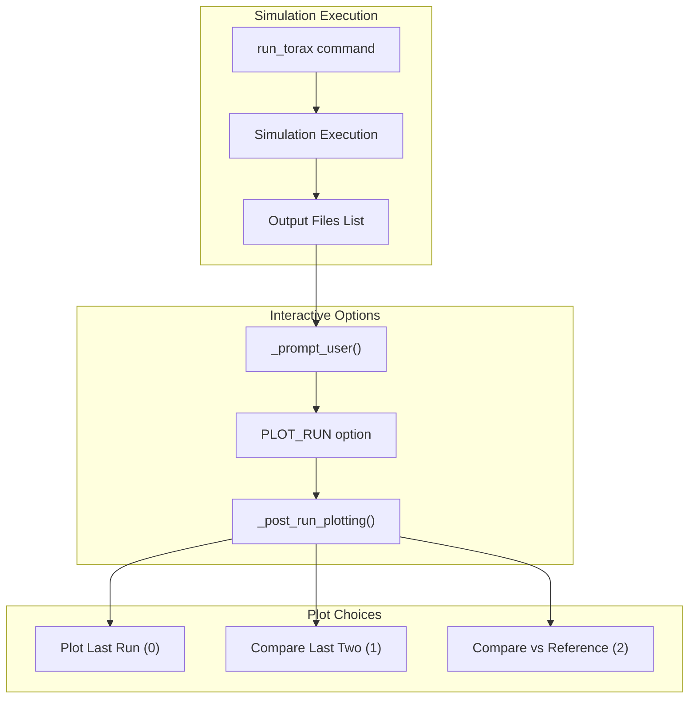

<!-- source: DeepWiki mcp.deepwiki.com · repo google-deepmind/torax · page 7.3 Plotting and Visualization · fetched 2026-10-26 -->

# Plotting and Visualization

<details>
<summary>Relevant source files</summary>

The following files were used as context for generating this wiki page:

- [docs/plotting.rst](docs/plotting.rst)
- [docs/quickstart.rst](docs/quickstart.rst)
- [docs/running.rst](docs/running.rst)

</details>


This section documents the plotting and visualization subsystem in TORAX. The plotting system enables users to analyze simulation results through interactive and static plots, with support for both command-line and programmatic workflows. It provides configurable plot layouts, supports comparison of multiple simulation runs, and is tightly integrated with the simulation output format.

For details on the output data structure, see page 7.1 (Output Data Format). For information on post-processing and derived quantities, see page 7.2 (State History and Post-Processing).

## System Overview

The plotting subsystem is composed of several modules and configuration files that together provide a flexible and extensible visualization pipeline. The main entry points are the `plot_torax` CLI and the `plotruns_lib` plotting engine. Plot configuration is handled through Python files that define figure and axis properties.

### Diagram: Plotting System Code Entities

```mermaid
graph TB
    subgraph "CLI Layer"
        "plot_torax[\"plot_torax CLI (torax/plotting/plotruns.py)\"]"
    end
    subgraph "Plotting Engine"
        "plotruns_lib[\"plotruns_lib.py (torax/_src/plotting/plotruns_lib.py)\"]"
        "PlotData[\"PlotData dataclass\"]"
        "FigureProperties[\"FigureProperties class\"]"
        "PlotProperties[\"PlotProperties class\"]"
    end
    subgraph "Configuration"
        "default_plot_config[\"default_plot_config.py\"]"
        "sources_plot_config[\"sources_plot_config.py\"]"
        "global_params_plot_config[\"global_params_plot_config.py\"]"
        "simple_plot_config[\"simple_plot_config.py\"]"
    end
    subgraph "Data Input"
        "NetCDF[\"NetCDF Output Files\"]"
        "StateHistory[\"StateHistory Objects\"]"
    end
    subgraph "Output"
        "matplotlib[\"Matplotlib Figures\"]"
        "slider[\"Time Slider Widget\"]"
    end

    "plot_torax" --> "plotruns_lib"
    "plotruns_lib" --> "PlotData"
    "plotruns_lib" --> "FigureProperties"
    "FigureProperties" --> "PlotProperties"
    "default_plot_config" --> "FigureProperties"
    "sources_plot_config" --> "FigureProperties"
    "global_params_plot_config" --> "FigureProperties"
    "simple_plot_config" --> "FigureProperties"
    "NetCDF" --> "PlotData"
    "StateHistory" --> "PlotData"
    "plotruns_lib" --> "matplotlib"
    "plotruns_lib" --> "slider"
```

**Sources:** [torax/plotting/plotruns.py:15-75](), [torax/_src/plotting/plotruns_lib.py:15-694]()

## Command Line Plotting: `plot_torax`

The primary interface for visualizing TORAX simulation results is the `plot_torax` command-line tool. This tool loads simulation output files (NetCDF format) and displays interactive or static plots according to a user-specified or default configuration.

### Diagram: CLI Argument and Function Flow

```mermaid
graph TB
    "plot_torax[\"plot_torax CLI\"]" --> "parse_flags[\"parse_flags() (plotruns.py)\"]"
    "parse_flags" --> "outfile[\"--outfile\"]"
    "parse_flags" --> "plot_config[\"--plot_config\"]"
    "parse_flags" --> "main[\"main() (plotruns.py)\"]"
    "main" --> "import_module[\"config_loader.import_module()\"]"
    "main" --> "plot_run[\"plotruns_lib.plot_run()\"]"
    "import_module" --> "plot_config"
    "plot_run" --> "outfile"
```

**Sources:** [torax/plotting/plotruns.py:32-66]()

### Usage Examples

```bash
# Plot a single simulation output
plot_torax --outfile path/to/output.nc

# Compare two simulation runs
plot_torax --outfile run1.nc run2.nc

# Use a custom plot configuration
plot_torax --outfile output.nc --plot_config custom_plot_config.py
```

#### Command Line Arguments

| Argument         | Description                                 | Default                                 |
|------------------|---------------------------------------------|-----------------------------------------|
| `--outfile`      | One or two NetCDF output file paths         | Required                                |
| `--plot_config`  | Path to plot configuration Python file      | `plotting/configs/default_plot_config.py` |

**Sources:** [torax/plotting/plotruns.py:32-66]()

## Plot Configuration System

TORAX plotting is controlled by Python configuration files that define the layout and content of figures. The configuration is structured using two main classes: `FigureProperties` and `PlotProperties`.

### Diagram: Plot Configuration Data Structures

```mermaid
graph TB
    "FigureProperties[\"FigureProperties (plotruns_lib.py)\"]" --> "PlotProperties[\"PlotProperties (plotruns_lib.py)\"]"
    "PlotProperties" --> "PlotType[\"PlotType Enum (SPATIAL, TIME_SERIES)\"]"
    "config_file[\"*.py config file (PLOT_CONFIG)\"]" --> "FigureProperties"
```

- `FigureProperties`: Controls the overall figure, including grid layout (`rows`, `cols`), figure size, font settings, and a tuple of `PlotProperties` for each subplot.
- `PlotProperties`: Specifies which data fields to plot (`attrs`), axis labels, plot type (spatial or time series), and axis scaling.
- `PlotType`: Enum with values `SPATIAL` (for 1D profiles) and `TIME_SERIES` (for scalar time evolution).

**Sources:** [torax/_src/plotting/plotruns_lib.py:51-92]()

### Example Plot Configurations

| Configuration                | Purpose                  | Layout   | Focus Areas                        |
|------------------------------|--------------------------|----------|------------------------------------|
| `default_plot_config`        | Full overview            | 4×4 grid | All major physics quantities       |
| `sources_plot_config`        | Source term analysis     | 2×4 grid | Heat/particle sources and sinks    |
| `global_params_plot_config`  | Global parameters        | 2×3 grid | Time-dependent scalars             |
| `simple_plot_config`         | Basic profiles           | 2×3 grid | Core temperature/density/current   |

**Sources:** [torax/plotting/configs/default_plot_config.py:19-189](), [torax/plotting/configs/sources_plot_config.py:19-135](), [torax/plotting/configs/global_params_plot_config.py:19-77](), [torax/plotting/configs/simple_plot_config.py:19-70]()

## Data Loading and PlotData Structure

The plotting system loads simulation output from NetCDF files and organizes it into a `PlotData` dataclass. This structure is used internally by the plotting engine to provide consistent access to all relevant simulation results.

### Diagram: Data Loading Pipeline and Code Entities

```mermaid
graph TB
    "NetCDF[\"NetCDF Output File\"]" --> "load_state_file[\"output.load_state_file()\"]"
    "load_state_file" --> "transform_data[\"_transform_data() (plotruns_lib.py)\"]"
    "transform_data" --> "unit_conversions[\"Unit Conversions\"]"
    "transform_data" --> "profiles_dataset[\"profiles dataset\"]"
    "transform_data" --> "scalars_dataset[\"scalars dataset\"]"
    "transform_data" --> "core_dataset[\"core dataset\"]"
    "profiles_dataset" --> "PlotData[\"PlotData dataclass\"]"
    "scalars_dataset" --> "PlotData"
    "core_dataset" --> "PlotData"
```

- Data is loaded from NetCDF using `output.load_state_file()`.
- `_transform_data()` in `plotruns_lib.py` processes the raw data, applies unit conversions, and organizes it into datasets for profiles, scalars, and core metadata.
- The `PlotData` dataclass aggregates all processed data for use in plotting.

**Sources:** [torax/_src/plotting/plotruns_lib.py:94-401]()

### PlotData Contents

| Category                | Example Fields                        | Units                |
|-------------------------|---------------------------------------|----------------------|
| Plasma Profiles         | `T_i`, `T_e`, `n_e`, `n_i`, `j_total` | keV, 10²⁰ m⁻³, MA/m² |
| Transport Coefficients  | `chi_turb_i`, `D_turb_e`              | m²/s, m/s            |
| Source Terms            | `p_alpha_i`, `p_ohmic_e`, `s_gas_puff`| MW/m³, 10²⁰ m⁻³/s    |
| Global Quantities       | `Q_fusion`, `Ip_profile`, `q95`       | MW, MA, dimensionless|

Unit conversions are applied for clarity (e.g., current in MA, density in 10²⁰ m⁻³).

**Sources:** [torax/_src/plotting/plotruns_lib.py:250-401](), [torax/_src/plotting/plotruns_lib.py:94-247]()

## Plot Types and Interactive Features

TORAX supports two main plot types, each with distinct interaction models:

- **Spatial Plots (`PlotType.SPATIAL`)**: 1D profiles (e.g., temperature, density) as a function of normalized radius (`rho_norm`). All spatial plots are synchronized by a time slider widget, allowing users to scroll through simulation timesteps.
- **Time Series Plots (`PlotType.TIME_SERIES`)**: Scalar quantities (e.g., fusion power, total current) as a function of simulation time. These plots are static; time is the x-axis.

### Diagram: Plot Types and Interactivity

```mermaid
graph TB
    "Slider[\"Time Slider (widgets.Slider)\"]" --> "update_callback[\"update() callback\"]"
    "update_callback" --> "Line2D_set_ydata[\"Line2D.set_ydata()\"]"
    "Line2D_set_ydata" --> "SPATIAL[\"SPATIAL plots (profile vs radius)\"]"
    "SPATIAL" --> "SingleRun[\"Single Run (solid lines)\"]"
    "SPATIAL" --> "ComparisonRun[\"Comparison Run (dashed lines)\"]"
    "TIME_SERIES[\"TIME_SERIES plots (scalar vs time)\"]" --> "SingleRun"
    "TIME_SERIES" --> "ComparisonRun"
```

- In comparison mode, two runs are overlaid with different line styles.
- The slider only affects spatial plots; time series plots always show the full simulation duration.

**Sources:** [torax/_src/plotting/plotruns_lib.py:38-49](), [torax/_src/plotting/plotruns_lib.py:443-486]()

## Integration with Simulation Workflow

The plotting system integrates with the main simulation execution through multiple pathways:

### Interactive Mode Integration

The `run_simulation_main.py` provides interactive plotting options after simulation completion:



### Configuration Loading

Plot configurations are loaded through the `config_loader` module:

```python
# Example configuration loading
plot_config = config_loader.get_plot_config_from_file('custom_config.py')
plotruns_lib.plot_run(plot_config, 'output.nc')
```

**Sources:** [torax/run_simulation_main.py:295-341](), [torax/_src/config/config_loader.py:165-188]()

---

