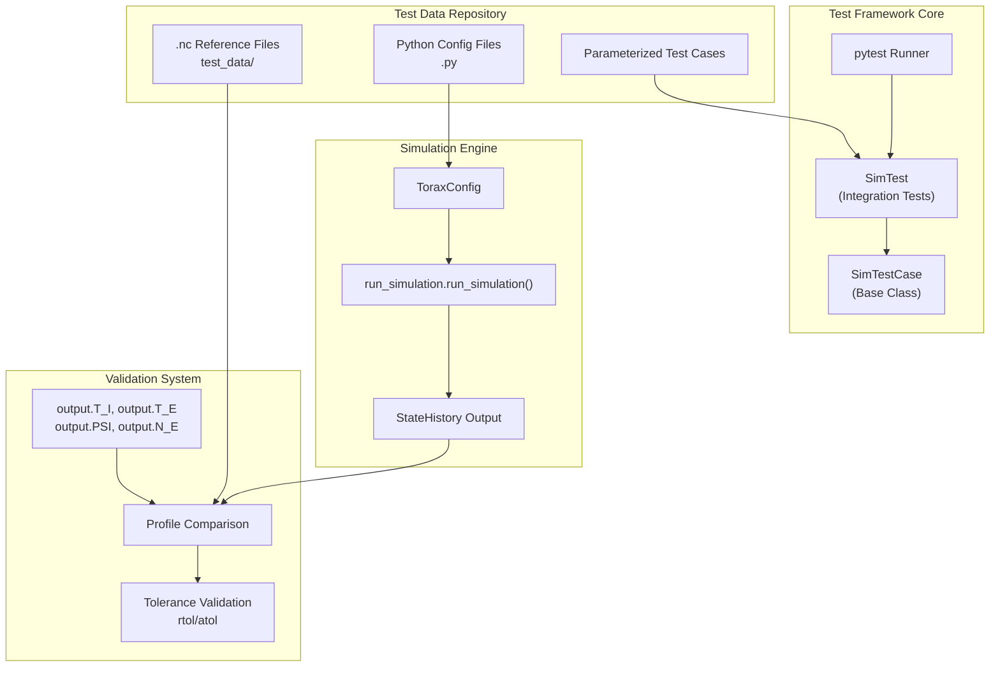
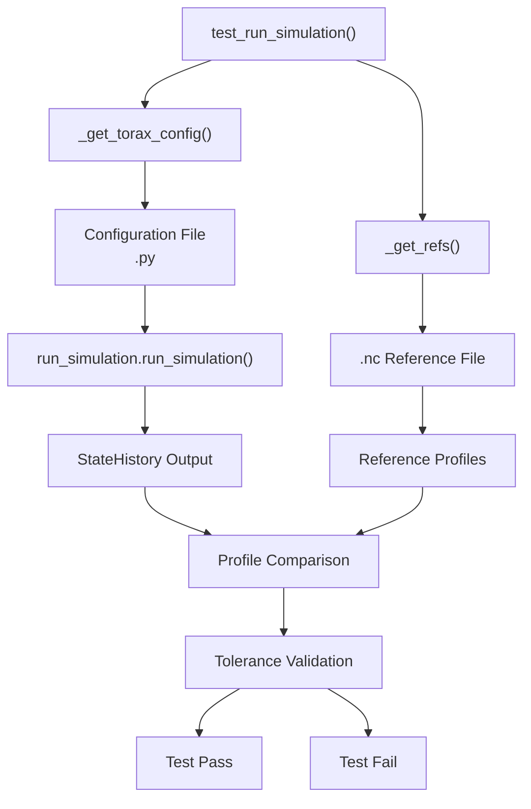
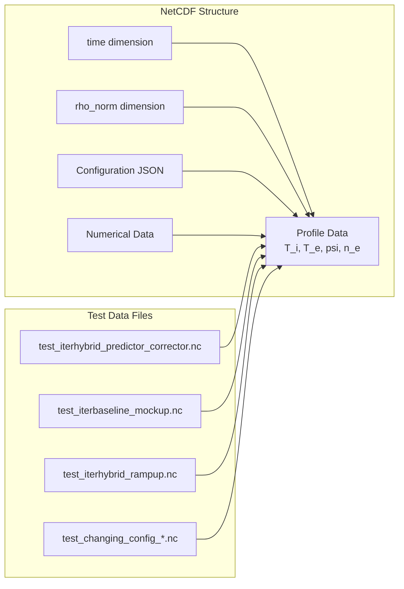
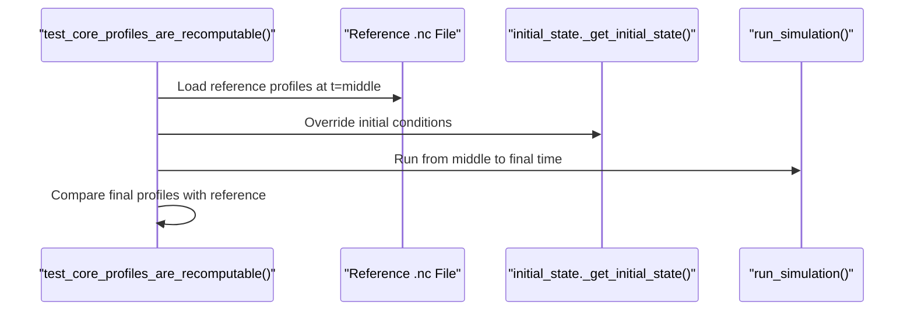
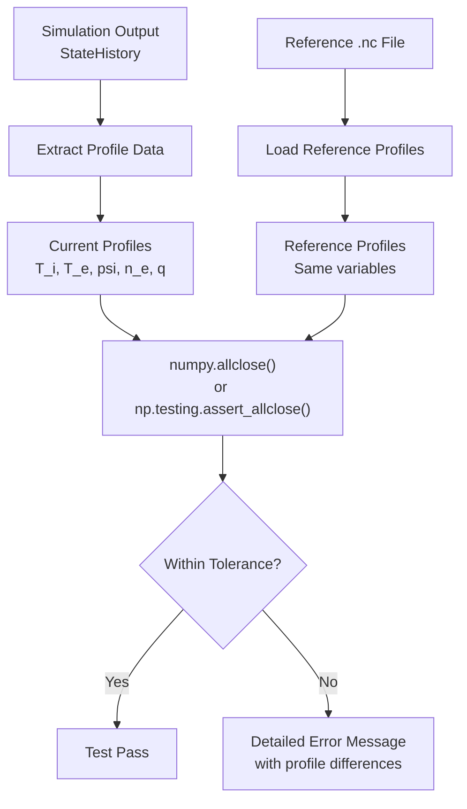

<!-- source: DeepWiki mcp.deepwiki.com · repo google-deepmind/torax · page 8 Testing and Validation · fetched 2026-10-26 -->

# Testing and Validation

<details>
<summary>Relevant source files</summary>

The following files were used as context for generating this wiki page:

- [.github/workflows/pytest.yml](.github/workflows/pytest.yml)
- [README.md](README.md)
- [docs/installation.rst](docs/installation.rst)
- [pyproject.toml](pyproject.toml)
- [torax/__init__.py](torax/__init__.py)
- [torax/tests/sim_test.py](torax/tests/sim_test.py)

</details>


This page describes TORAX's comprehensive testing and validation framework, which ensures the reliability and accuracy of plasma transport simulations through automated testing, reference data comparison, and quality assurance processes.

For information about running simulations, see [Running Simulations](#5). For details about configuration management, see [Configuration System](#2).

## Purpose and Scope

TORAX's testing framework validates simulation accuracy through integration tests that compare full simulation outputs against established reference data. The framework covers multiple physics models, solver configurations, and plasma scenarios to ensure robust behavior across the codebase's capabilities.

## Testing Architecture Overview

The testing system is built around a comprehensive integration testing framework that validates end-to-end simulation behavior rather than isolated unit functionality.



**Sources:** [torax/tests/sim_test.py:15-541]()

## Integration Test Framework

The integration testing framework is centered around the `SimTest` class, which provides comprehensive validation of simulation outputs against reference data.

### Test Case Structure



**Sources:** [torax/tests/sim_test.py:270-301]()

### Parameterized Test Cases

The framework uses extensive parameterization to test multiple scenarios with a single test method:

| Test Category | Examples | Configuration Files |
|---------------|----------|-------------------|
| Solver Types | Implicit, Predictor-Corrector, Newton-Raphson | `test_implicit.py`, `test_iterhybrid_predictor_corrector.py` |
| Transport Models | QLKNN, Bohm-GyroBohm, CGM | `test_bohmgyrobohm_all.py`, `test_particle_sources_cgm.py` |
| Geometry Models | CHEASE, EQDSK, Circular | `test_chease.py`, `test_eqdsk.py` |
| Physics Scenarios | ITER Hybrid, ITER Baseline, Rampup | `test_iterhybrid_mockup.py`, `test_iterbaseline_mockup.py` |

**Sources:** [torax/tests/sim_test.py:53-269]()

### Validation Profiles

The framework validates multiple plasma profiles against reference data:

```python
_ALL_PROFILES = (
    output.T_I,      # Ion temperature
    output.T_E,      # Electron temperature  
    output.PSI,      # Poloidal flux
    output.Q,        # Safety factor
    output.N_E,      # Electron density
)
```

**Sources:** [torax/tests/sim_test.py:38-44]()

## Test Data Repository

### Reference Data Format

Test reference data is stored in NetCDF (`.nc`) format files containing complete simulation state histories:



**Sources:** [torax/tests/test_data/test_changing_config_before.nc](), [torax/tests/test_data/test_iterhybrid_rampup.nc]()

### Test Configuration Management

Each test case consists of paired configuration and reference files:

- **Configuration File** (`.py`): Defines simulation parameters as Python dictionaries
- **Reference File** (`.nc`): Contains expected simulation outputs in NetCDF format

The mapping follows the convention: `test_name.py` → `test_name.nc`

**Sources:** [torax/tests/sim_test.py:47-49]()

## Specialized Test Scenarios

### Profile Recomputability Tests

The framework includes tests that verify simulation states can be reconstructed from intermediate time points:



**Sources:** [torax/tests/sim_test.py:365-476]()

### Boundary Condition Equivalence

Tests verify that different boundary condition formulations produce equivalent results:

```python
def test_ip_bc_v_loop_bc_equivalence(self):
    """Tests the equivalence of the Ip BC and the VLoop BC."""
```

This test runs the same scenario with both current (`Ip`) and voltage loop (`v_loop_lcfs`) boundary conditions to ensure numerical equivalence.

**Sources:** [torax/tests/sim_test.py:478-528]()

### Error Detection Validation

The framework includes tests that verify proper error handling:

```python
def test_nans_trigger_error(self):
    """Verify that NaNs in profile evolution triggers early stopping and an error."""
```

This ensures that numerical instabilities are properly detected and reported through the `SimError.NAN_DETECTED` mechanism.

**Sources:** [torax/tests/sim_test.py:531-537]()

## Tolerance and Comparison Methodology

### Numerical Tolerance Settings

The framework uses configurable relative (`rtol`) and absolute (`atol`) tolerances for profile comparisons:

| Test Type | Default rtol | Default atol | Notes |
|-----------|--------------|--------------|-------|
| Standard Tests | `None` (SimTestCase default) | `None` (SimTestCase default) | Uses framework defaults |
| Crank-Nicolson | `2e-1` | `0` | Reduced tolerance for different solver |
| Cross-solver Comparison | `1e-3` | - | For boundary condition equivalence |

**Sources:** [torax/tests/sim_test.py:56-62](), [torax/tests/sim_test.py:518-527]()

### Profile Comparison Process



**Sources:** [torax/tests/sim_test.py:278-288]()

## Test Execution Flow

### No-Op Validation

The framework includes a comprehensive test that verifies simulations remain stable when all evolution equations are disabled:

```python
def test_no_op(self):
    """Tests that running the solver with all equations off is a no-op."""
```

This test disables all transport equations and verifies that profiles remain constant over time, providing a baseline validation of numerical stability.

**Sources:** [torax/tests/sim_test.py:302-357]()

### CI/CD Integration

The testing framework integrates with continuous integration through pytest, with the test structure supporting:

- Parameterized execution across multiple scenarios
- Parallel test execution through pytest sharding
- Detailed failure reporting with profile difference analysis
- Reference data validation against simulation outputs

**Sources:** [torax/tests/sim_test.py:26-27]() (imports indicate pytest integration)

---

