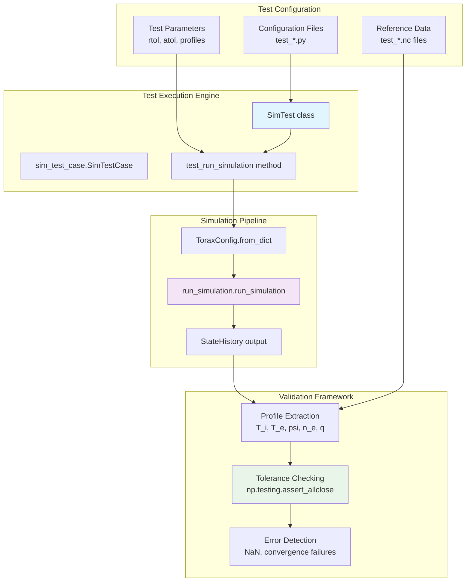
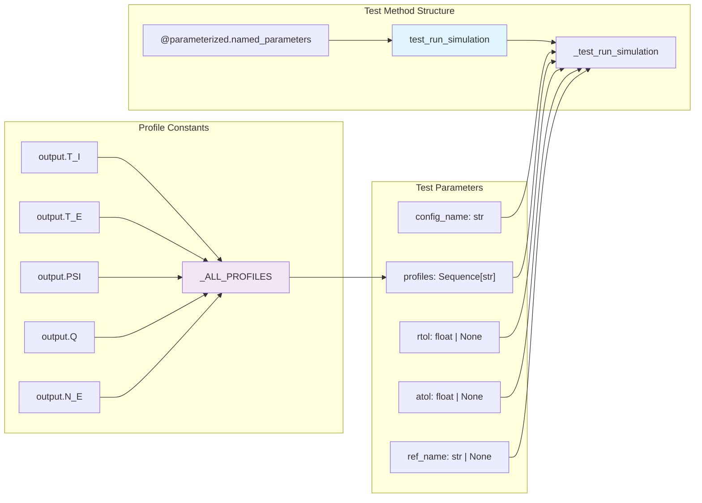
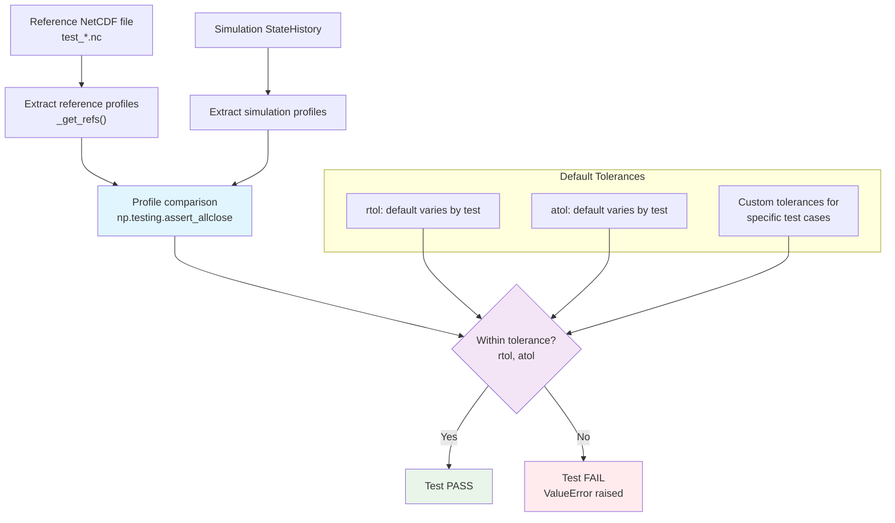
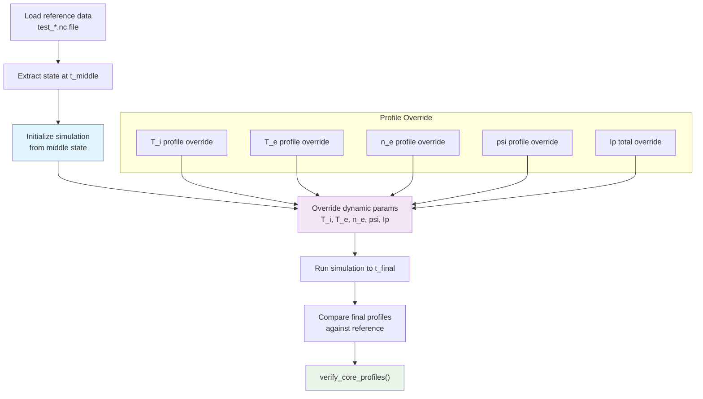
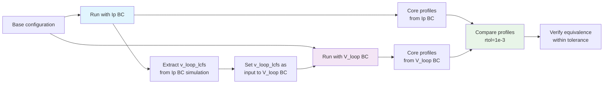
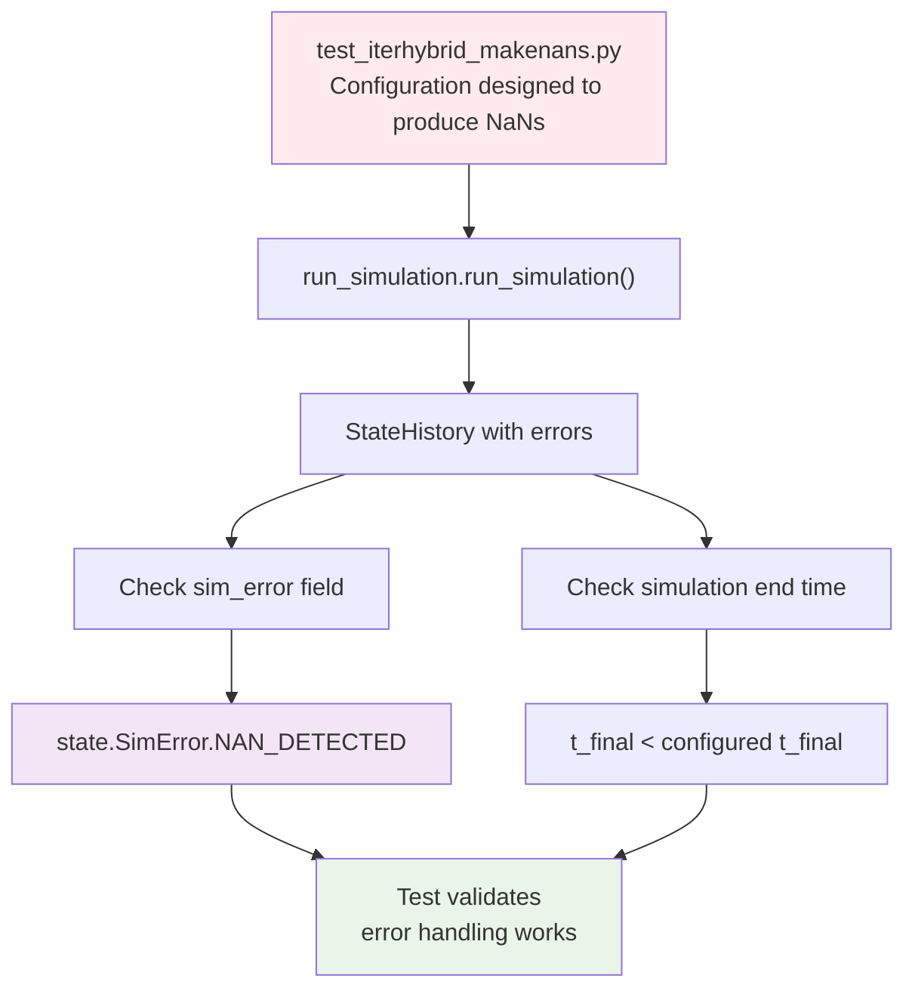
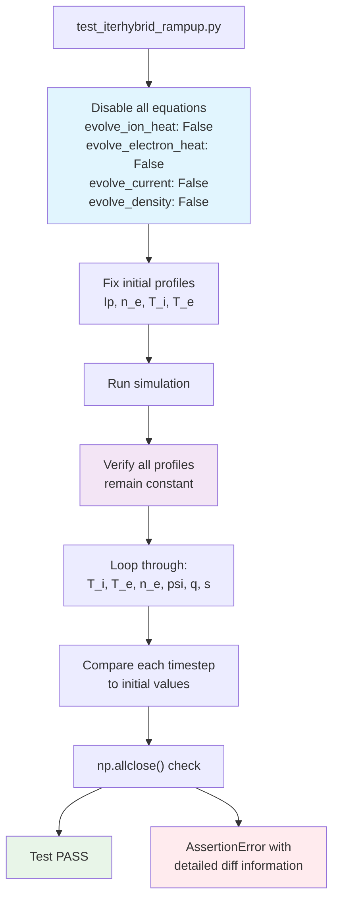

<!-- source: DeepWiki mcp.deepwiki.com · repo google-deepmind/torax · page 8.1 Integration Tests · fetched 2026-10-26 -->

# Integration Tests

Relevant source files

The following files were used as context for generating this wiki page:

- [torax/tests/sim_test.py](torax/tests/sim_test.py)

## Purpose and Scope

The integration testing framework provides comprehensive end-to-end validation of TORAX simulations by running complete physics simulations and comparing results against pre-computed reference data. These tests ensure that the entire simulation pipeline—from configuration parsing through physics model execution to output generation—produces consistent and accurate results.

For information about unit testing of individual components, see [Testing Framework](#9.3). For details about the test data repository structure, see [Test Data Repository](#7.2).

## Integration Testing Architecture

The integration testing system executes complete TORAX simulations and validates outputs against reference NetCDF files using configurable tolerance checking. The framework supports parameterized testing across multiple physics scenarios, solver configurations, and geometry models.

Sources: [torax/tests/sim_test.py:15-50]()

## Test Execution Framework

The `SimTest` class in [torax/tests/sim_test.py:50-51]() inherits from `sim_test_case.SimTestCase` and implements the core testing infrastructure. The main test method `test_run_simulation` uses parameterized testing to execute multiple simulation scenarios.

Sources: [torax/tests/sim_test.py:38-44](), [torax/tests/sim_test.py:270-288]()

## Test Scenario Coverage

The integration tests cover a comprehensive range of physics scenarios, solver configurations, and geometry models through parameterized test cases. Each test scenario validates specific combinations of TORAX capabilities.

### Solver and Numerical Method Tests

| Test Case | Solver Type | Physics Focus | Key Features |
|-----------|-------------|---------------|--------------|
| `test_crank_nicolson` | Implicit (θ=0.5) | Heat transport | Crank-Nicolson time stepping |
| `test_implicit` | Implicit (θ=1.0) | Heat transport | Backwards Euler |
| `test_semiimplicit_convection` | Semi-implicit | Convection stability | FiPy compatibility |
| `test_fixed_dt` | Fixed timestep | All transport | Non-adaptive stepping |

### Transport Model Tests

| Test Case | Transport Model | Equations | Geometry |
|-----------|----------------|-----------|----------|
| `test_bohmgyrobohm_all` | Bohm-GyroBohm | Heat only | Circular |
| `test_psi_and_heat` | QLKNN | Heat + Current | Circular |
| `test_particle_sources_cgm` | CGM | All transport | Circular |
| `test_all_transport_fusion_qlknn` | QLKNN | Heat + Particle + Current | Circular |

### Geometry Model Tests

| Test Case | Geometry Type | Transport Model | Solver |
|-----------|---------------|-----------------|--------|
| `test_chease` | CHEASE | Constant | Implicit |
| `test_eqdsk` | EQDSK | QLKNN | Predictor-corrector |
| `test_psichease_prescribed_jtot` | CHEASE | Constant | Implicit |

Sources: [torax/tests/sim_test.py:53-269]()

## ITER Scenario Tests

The framework includes comprehensive tests for ITER-like plasma scenarios covering different operational modes and physics phenomena:

```mermaid
graph TB
    subgraph "ITER Baseline Tests"
        ITERBaseline["test_iterbaseline_mockup"]
        BaselineConfig["ITER baseline configuration"]
        LinearSolver["Linear solver"]
    end
    
    subgraph "ITER Hybrid Tests"
        ITERHybrid["test_iterhybrid_mockup"]
        HybridPredCorr["test_iterhybrid_predictor_corrector"]
        HybridEQDSK["test_iterhybrid_predictor_corrector_eqdsk"]
        HybridClipping["test_iterhybrid_predictor_corrector_clip_inputs"]
    end
    
    subgraph "ITER Rampup Tests"
        ITERRampup["test_iterhybrid_rampup"]
        RampupSawtooth["test_iterhybrid_rampup_sawtooth"]
        NewtonSolver["Newton-Raphson solver"]
    end
    
    subgraph "Advanced Physics"
        Tungsten["test_iterhybrid_predictor_corrector_tungsten"]
        ECCD["test_iterhybrid_predictor_corrector_ec_linliu"]
        Radiation["test_iterhybrid_predictor_corrector_mavrin_impurity_radiation"]
        Pedestal["test_iterhybrid_predictor_corrector_set_pped_tpedratio_nped"]
    end
    
    ITERBaseline --> BaselineConfig
    BaselineConfig --> LinearSolver
    
    ITERHybrid --> HybridPredCorr
    HybridPredCorr --> HybridEQDSK
    HybridPredCorr --> HybridClipping
    
    ITERRampup --> RampupSawtooth
    ITERRampup --> NewtonSolver
    
    HybridPredCorr --> Tungsten
    HybridPredCorr --> ECCD
    HybridPredCorr --> Radiation
    HybridPredCorr --> Pedestal
    
    style ITERBaseline fill:#e1f5fe
    style HybridPredCorr fill:#f3e5f5
    style ITERRampup fill:#e8f5e8
```

Sources: [torax/tests/sim_test.py:157-238]()

## Reference Data Validation

The integration testing framework compares simulation outputs against reference NetCDF files using configurable tolerance checking. The validation process extracts specific physics profiles and performs numerical comparisons.

### Profile Validation Process

Sources: [torax/tests/sim_test.py:270-288](), [torax/tests/sim_test.py:53-63]()

### Validated Physics Profiles

The framework validates the following core physics profiles by default:

| Profile | Output Constant | Physical Quantity |
|---------|----------------|-------------------|
| `T_i` | `output.T_I` | Ion temperature |
| `T_e` | `output.T_E` | Electron temperature |
| `psi` | `output.PSI` | Poloidal flux |
| `q` | `output.Q` | Safety factor |
| `n_e` | `output.N_E` | Electron density |

Additional profiles can be validated for specific tests including current density, magnetic shear, and derived quantities.

Sources: [torax/tests/sim_test.py:38-44]()

## Specialized Integration Tests

### State Reproducibility Tests

The `test_core_profiles_are_recomputable` method validates that simulation states can be reproduced from intermediate points:

Sources: [torax/tests/sim_test.py:365-476]()

### Boundary Condition Equivalence Tests

The `test_ip_bc_v_loop_bc_equivalence` method validates that current profile boundary conditions (Ip BC and V_loop BC) produce equivalent results:

Sources: [torax/tests/sim_test.py:478-529]()

## Error Detection and Validation

### NaN Detection Tests

The framework includes tests to verify that numerical instabilities are properly detected and handled:

Sources: [torax/tests/sim_test.py:531-537]()

### No-Op Validation Tests

The `test_no_op` method verifies that when all physics equations are disabled, the simulation profiles remain constant:

Sources: [torax/tests/sim_test.py:302-357]()

## Test Configuration Management

The integration tests use a configuration management system that maps test names to configuration files and reference data:

| Component | Purpose | Location |
|-----------|---------|----------|
| Configuration files | Define simulation parameters | `test_*.py` files |
| Reference data | Expected simulation outputs | `test_*.nc` files |
| Test parameters | Tolerance settings, profile selection | Parameterized decorators |

The framework supports custom tolerance settings for specific test cases that require different numerical precision, such as the Crank-Nicolson test which uses `rtol=2e-1` due to different solver parameters.

Sources: [torax/tests/sim_test.py:47-49](), [torax/tests/sim_test.py:56-63]()

---

