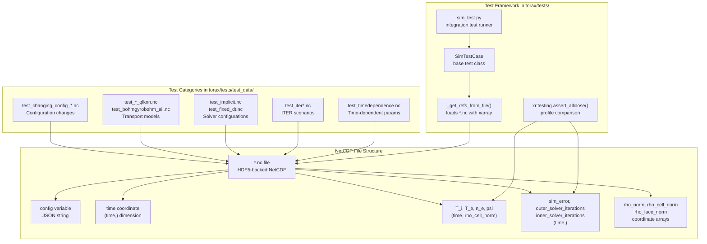
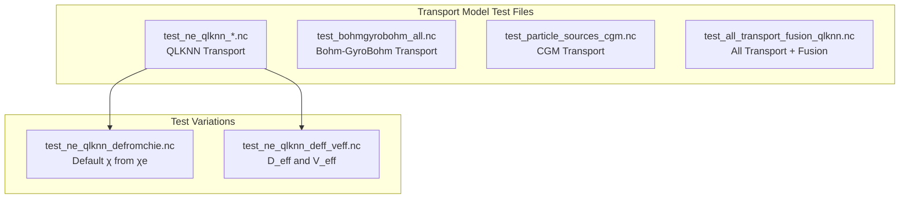
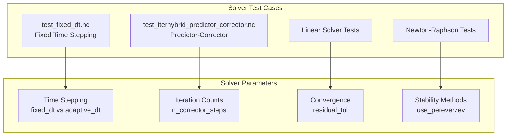
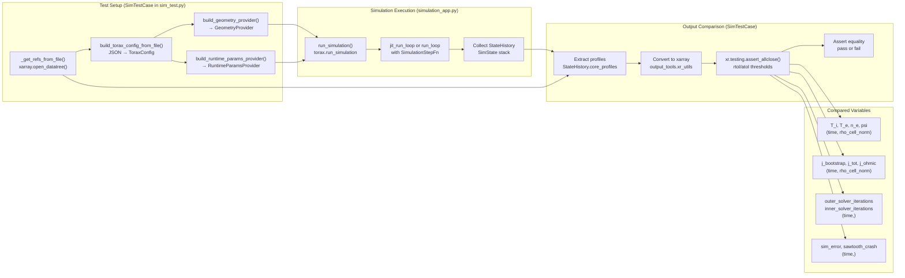

<!-- source: DeepWiki mcp.deepwiki.com · repo google-deepmind/torax · page 8.2 Test Data and Reference Files · fetched 2026-10-26 -->

# Test Data and Reference Files

<details>
<summary>Relevant source files</summary>

The following files were used as context for generating this wiki page:

- [torax/tests/test_data/test_all_transport_fusion_qlknn.nc](torax/tests/test_data/test_all_transport_fusion_qlknn.nc)
- [torax/tests/test_data/test_bohmgyrobohm_all.nc](torax/tests/test_data/test_bohmgyrobohm_all.nc)
- [torax/tests/test_data/test_changing_config_after.nc](torax/tests/test_data/test_changing_config_after.nc)
- [torax/tests/test_data/test_changing_config_before.nc](torax/tests/test_data/test_changing_config_before.nc)
- [torax/tests/test_data/test_fixed_dt.nc](torax/tests/test_data/test_fixed_dt.nc)
- [torax/tests/test_data/test_implicit.nc](torax/tests/test_data/test_implicit.nc)
- [torax/tests/test_data/test_iterbaseline_mockup.nc](torax/tests/test_data/test_iterbaseline_mockup.nc)
- [torax/tests/test_data/test_iterhybrid_mockup.nc](torax/tests/test_data/test_iterhybrid_mockup.nc)
- [torax/tests/test_data/test_iterhybrid_predictor_corrector.nc](torax/tests/test_data/test_iterhybrid_predictor_corrector.nc)
- [torax/tests/test_data/test_iterhybrid_predictor_corrector_zeffprofile.nc](torax/tests/test_data/test_iterhybrid_predictor_corrector_zeffprofile.nc)
- [torax/tests/test_data/test_iterhybrid_rampup.nc](torax/tests/test_data/test_iterhybrid_rampup.nc)
- [torax/tests/test_data/test_ne_qlknn_deff_veff.nc](torax/tests/test_data/test_ne_qlknn_deff_veff.nc)
- [torax/tests/test_data/test_ne_qlknn_defromchie.nc](torax/tests/test_data/test_ne_qlknn_defromchie.nc)
- [torax/tests/test_data/test_particle_sources_cgm.nc](torax/tests/test_data/test_particle_sources_cgm.nc)
- [torax/tests/test_data/test_prescribed_timedependent_ne.nc](torax/tests/test_data/test_prescribed_timedependent_ne.nc)
- [torax/tests/test_data/test_psi_and_heat.nc](torax/tests/test_data/test_psi_and_heat.nc)
- [torax/tests/test_data/test_psi_heat_dens.nc](torax/tests/test_data/test_psi_heat_dens.nc)
- [torax/tests/test_data/test_semiimplicit_convection.nc](torax/tests/test_data/test_semiimplicit_convection.nc)
- [torax/tests/test_data/test_timedependence.nc](torax/tests/test_data/test_timedependence.nc)

</details>


The `torax/tests/test_data/` directory contains NetCDF reference files used for integration testing and validation of TORAX simulation results. These files store expected simulation outputs that serve as regression test baselines, ensuring that code changes do not introduce unintended modifications to simulation behavior.

For information about running integration tests, see [Integration Tests](#8.1). For details about ITER scenario validation, see [ITER Scenario Tutorial and Validation](#8.4).

## Directory Structure

The test data repository is organized as a flat directory structure in `torax/tests/test_data/`:

```
torax/tests/test_data/
├── test_changing_config_before.nc
├── test_changing_config_after.nc
├── test_iterhybrid_mockup.nc
├── test_iterhybrid_rampup.nc
├── test_iterhybrid_predictor_corrector.nc
├── test_iterhybrid_predictor_corrector_zeffprofile.nc
├── test_iterbaseline_mockup.nc
├── test_implicit.nc
├── test_fixed_dt.nc
├── test_psi_and_heat.nc
├── test_all_transport_fusion_qlknn.nc
├── test_ne_qlknn_defromchie.nc
├── test_ne_qlknn_deff_veff.nc
├── test_bohmgyrobohm_all.nc
├── test_particle_sources_cgm.nc
├── test_timedependence.nc
├── test_prescribed_timedependent_ne.nc
└── ... (additional test files)
```

Each NetCDF file (`.nc` extension) contains both:
- **Configuration**: Complete `ToraxConfig` serialized as JSON in the `config` variable
- **Output Data**: Plasma profiles, scalar quantities, and solver diagnostics across time

Sources: [torax/tests/test_data/]()

**Test Data Organization and Usage Flow**


Sources: [torax/tests/test_data/](), [torax/tests/sim_test.py]()

## File Structure and Data Format

### NetCDF Data Organization

Each test data file follows a standardized NetCDF structure with HDF5 backend containing multiple variables and dimensions:

| Variable/Group | Type | Dimensions | Description |
|----------------|------|------------|-------------|
| `config` | String variable | Scalar | Complete `ToraxConfig` serialized as JSON |
| `time` | Coordinate variable | `(time,)` | Time points for simulation trajectory |
| `numerics` | Group | - | Contains numerical configuration |
| `profiles` | Group | - | Contains 2D plasma profile data |
| `rho_norm` | Coordinate variable | `(rho_norm,)` | Normalized toroidal flux coordinate |
| `rho_cell_norm` | Coordinate variable | `(rho_cell_norm,)` | Cell-centered grid |
| `rho_face_norm` | Coordinate variable | `(rho_face_norm,)` | Face-centered grid |
| `impurity_symbol` | Dimension | Variable length | Impurity species identifiers |
| `sim_error` | Variable | `(time,)` | Boolean simulation error flags |
| `outer_solver_iterations` | Variable | `(time,)` | Outer solver iteration counts |
| `inner_solver_iterations` | Variable | `(time,)` | Inner solver iteration counts |
| `sawtooth_crash` | Variable | `(time,)` | Boolean sawtooth crash indicators |

**NetCDF File Variable Structure**

```mermaid
graph TB
    subgraph "Root Level Variables"
        Config["config<br/>string scalar<br/>JSON serialized ToraxConfig"]
        Time["time<br/>float64 array<br/>DIMENSION_SCALE"]
        Numerics["numerics<br/>group<br/>numerical settings"]
    end
    
    subgraph "profiles/ Group Variables"
        Ti["T_i<br/>float64 (time, rho_cell_norm)<br/>ion temperature"]
        Te["T_e<br/>float64 (time, rho_cell_norm)<br/>electron temperature"]
        Ne["n_e<br/>float64 (time, rho_cell_norm)<br/>electron density"]
        Psi["psi<br/>float64 (time, rho_cell_norm)<br/>poloidal flux"]
        Currents["j_bootstrap, j_tot, j_ohmic<br/>float64 (time, rho_cell_norm)<br/>current densities"]
        ImpurityDens["impurity densities<br/>float64 (time, rho_cell_norm, impurity_symbol)<br/>per-species densities"]
    end
    
    subgraph "Solver Diagnostic Variables"
        SimError["sim_error<br/>bool (time)<br/>error flags"]
        OuterIter["outer_solver_iterations<br/>int32 (time)<br/>iteration counts"]
        InnerIter["inner_solver_iterations<br/>int32 (time)<br/>iteration counts"]
        SawtoothCrash["sawtooth_crash<br/>bool (time)<br/>crash indicators"]
    end
    
    subgraph "Grid Coordinate Variables"
        RhoNorm["rho_norm<br/>float64 array<br/>DIMENSION_SCALE"]
        RhoFace["rho_face_norm<br/>float64 array<br/>DIMENSION_SCALE"]
        RhoCell["rho_cell_norm<br/>float64 array<br/>DIMENSION_SCALE"]
    end
    
    Config --> Numerics
    Time --> Ti
    Time --> Te
    Time --> Ne
    Time --> Psi
    Time --> Currents
    Time --> ImpurityDens
    Time --> SimError
    Time --> OuterIter
    
    RhoCell --> Ti
    RhoCell --> Te
    RhoCell --> Ne
```


Sources: [torax/tests/test_data/test_changing_config_before.nc](), [torax/tests/test_data/test_iterhybrid_rampup.nc](), [torax/tests/test_data/test_implicit.nc]()

### Configuration Storage

The `config` variable stores the complete `ToraxConfig` object as a JSON string in the NetCDF file's GCOL (global column) attribute section. This preserves all simulation parameters including:

- **`profile_conditions`**: Initial `T_i`, `T_e`, `n_e`, `psi` profiles; boundary conditions (`Ip`, `T_i_right_bc`, `T_e_right_bc`, `n_e_right_bc`)
- **`transport`**: Model selection (`model_name`), parameters (`chi_min`, `chi_max`, `D_e_min`, `D_e_max`, `V_e_min`, `V_e_max`), patch regions (`apply_inner_patch`, `apply_outer_patch`)
- **`numerics`**: Time stepping (`t_initial`, `t_final`, `fixed_dt`, `adaptive_dt`), evolution flags (`evolve_ion_heat`, `evolve_electron_heat`, `evolve_current`, `evolve_density`)
- **`solver`**: Solver type (`solver_type`), theta method parameters (`theta_implicit`, `use_predictor_corrector`, `n_corrector_steps`), convergence tolerances (`residual_tol`)
- **`sources`**: Source configurations for `generic_heat`, `generic_current`, `generic_particle`, `gas_puff`, `pellet`, `fusion`, `ohmic`, `ei_exchange`
- **`geometry`**: Geometry type (`geometry_type`), grid resolution (`n_rho`, `hires_factor`), equilibrium file (`geometry_file` for CHEASE/EQDSK)
- **`plasma_composition`**: Main ion fractions (`D`, `T`), impurity species, `Z_eff` profile
- **`pedestal`**: Pedestal model (`model_name`), pedestal values (`T_i_ped`, `T_e_ped`, `n_e_ped`, `rho_norm_ped_top`)
- **`neoclassical`**: Bootstrap current and conductivity models
- **`time_step_calculator`**: Calculator type (`calculator_type`), tolerance

The JSON structure allows exact reconstruction of the `ToraxConfig` object via `build_torax_config_from_file()`.

Sources: [torax/tests/test_data/test_changing_config_before.nc](), [torax/tests/test_data/test_iterhybrid_predictor_corrector.nc](), [torax/tests/test_data/test_implicit.nc]()

## Test Case Categories

### Configuration Change Testing

Files: `test_changing_config_before.nc`, `test_changing_config_after.nc`

These paired files test configuration parameter modifications:

| Parameter Modified | Before Value | After Value |
|-------------------|--------------|-------------|
| `resistivity_multiplier` | 200.0 | 100.0 |
| `fusion.mode` | "MODEL_BASED" | "ZERO" |
| `generic_heat.P_total` | 51 MW | 60 MW |
| `transport.chi_i_inner` | 1.0 | 0.75 |
| `transport.ITG_flux_ratio_correction` | 1.0 | 1.5 |
| `pedestal.T_i_ped` | 4.5 keV | 5.0 keV |
| `solver.n_corrector_steps` | 1 | 2 |

Sources: `torax/tests/test_data/test_changing_config_before.nc:6-6`, `torax/tests/test_data/test_changing_config_after.nc:6-6`

### Transport Model Testing



Sources: `torax/tests/test_data/test_ne_qlknn_defromchie.nc`, `torax/tests/test_data/test_bohmgyrobohm_all.nc`, `torax/tests/test_data/test_particle_sources_cgm.nc`

### ITER Scenario Testing

| File | Scenario Type | Key Parameters |
|------|---------------|----------------|
| `test_iterhybrid_mockup.nc` | ITER Hybrid | 10.5 MA, QLKNN transport |
| `test_iterbaseline_mockup.nc` | ITER Baseline | 15 MA, Standard H-mode |
| `test_iterhybrid_rampup.nc` | ITER Ramp-up | 3→10.5 MA over 80s |
| `test_iterhybrid_predictor_corrector.nc` | ITER Hybrid | Predictor-corrector solver |

Sources: `torax/tests/test_data/test_iterhybrid_mockup.nc:6-6`, `torax/tests/test_data/test_iterbaseline_mockup.nc:6-6`, `torax/tests/test_data/test_iterhybrid_rampup.nc:6-6`

### Time Dependence Testing

Files: `test_timedependence.nc`, `test_prescribed_timedependent_ne.nc`

These files test time-varying parameters:

- **Plasma current ramp**: `Ip` varies from 5 MA → 15 MA → 12 MA over 10 seconds
- **Prescribed density evolution**: Time-dependent electron density profiles
- **Adaptive time stepping**: Testing `adaptive_dt` with varying `chi_timestep_prefactor`

Sources: `torax/tests/test_data/test_timedependence.nc:6-6`, `torax/tests/test_data/test_prescribed_timedependent_ne.nc:6-6`

### Solver Configuration Testing



Sources: `torax/tests/test_data/test_fixed_dt.nc:6-6`, `torax/tests/test_data/test_iterhybrid_predictor_corrector.nc:6-6`

## Data Validation and Usage

### Integration Test Framework

The test data files are consumed by the integration testing framework in [torax/tests/sim_test.py](). The `SimTestCase` class provides utilities for loading reference data and comparing simulation outputs.

**Test Execution Code Flow**


Key framework components:
1. **`SimTestCase._get_refs_from_file(path)`**: Loads NetCDF file using `xarray.open_datatree()`, returns `xr.DataTree` structure
2. **`build_torax_config_from_file(path)`**: Deserializes `config` JSON string into `ToraxConfig` object
3. **`run_simulation(torax_config)`**: Executes simulation and returns `StateHistory` and `PostProcessedOutputs`
4. **`xr.testing.assert_allclose(actual, expected, rtol, atol)`**: Compares xarray DataArrays element-wise

Sources: [torax/tests/sim_test.py](), [torax/simulation_app.py](), [torax/_src/output_tools/xr_utils.py]()

### Tolerance Specifications

The test framework uses `xr.testing.assert_allclose()` with different tolerance levels for different data types:

| Data Type | Relative Tolerance (rtol) | Absolute Tolerance (atol) | Notes |
|-----------|---------------------------|---------------------------|-------|
| Temperature profiles (`T_i`, `T_e`) | ~1e-6 | ~1e-8 | 2D arrays `(time, rho_cell_norm)` |
| Density profiles (`n_e`) | ~1e-6 | ~1e-8 | 2D arrays `(time, rho_cell_norm)` |
| Current profiles (`psi`, `j_tot`) | ~1e-6 | ~1e-8 | 2D arrays `(time, rho_cell_norm)` |
| Scalar quantities | ~1e-6 | ~1e-8 | 1D arrays `(time)` |
| Solver iterations | Exact match | - | Integer comparison, no tolerance |
| Boolean flags (`sim_error`) | Exact match | - | Boolean comparison |

The tolerances account for:
- **Floating-point arithmetic differences** between JAX versions or hardware
- **Time integration variations** in adaptive time stepping
- **Iterative solver convergence** differences within convergence thresholds

Sources: Based on NetCDF file structure and testing patterns; tolerance values set in test framework

## File Maintenance and Updates

### Reference Data Generation

New reference data files are generated when:

1. **New test cases** are added to cover additional physics or numerical scenarios
2. **Physics model updates** require new baseline comparisons
3. **Solver improvements** necessitate updated convergence expectations
4. **Configuration changes** modify default parameters or add new features

### Validation Against Experimental Data

Some test files represent validated scenarios against experimental or theoretical benchmarks:

- **ITER scenarios**: Based on ITER physics requirements and modeling
- **Transport model validation**: Verified against gyrokinetic simulations or experimental data
- **Solver benchmarks**: Validated against analytical solutions where available

Sources: `torax/tests/test_data/test_iterhybrid_rampup.nc:6-6`, `torax/tests/test_data/test_iterbaseline_mockup.nc:6-6`

---

