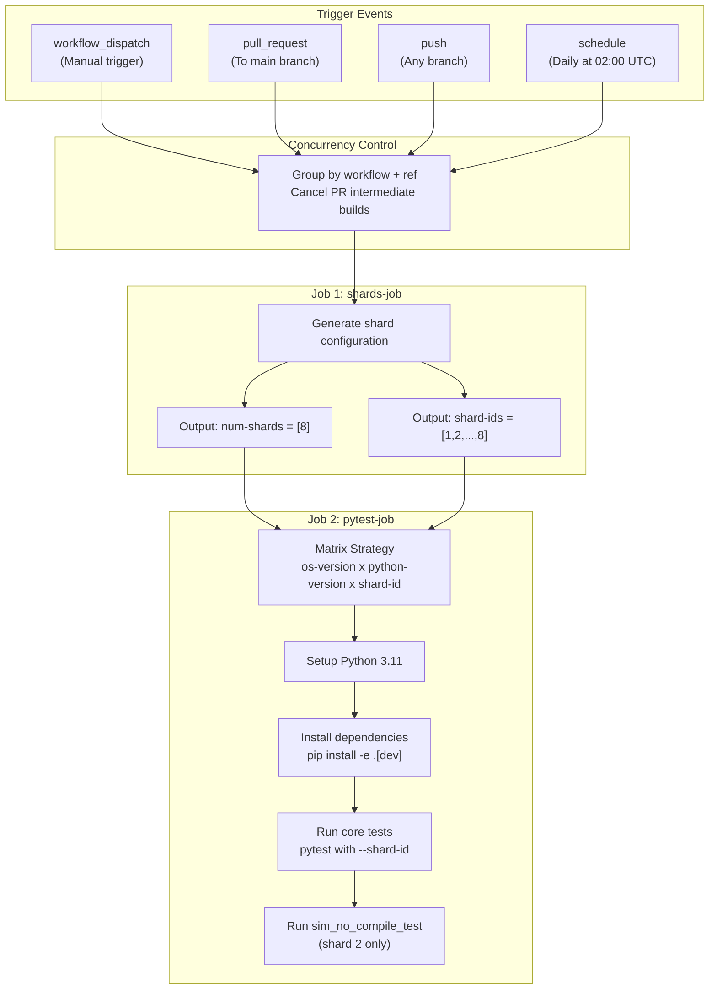
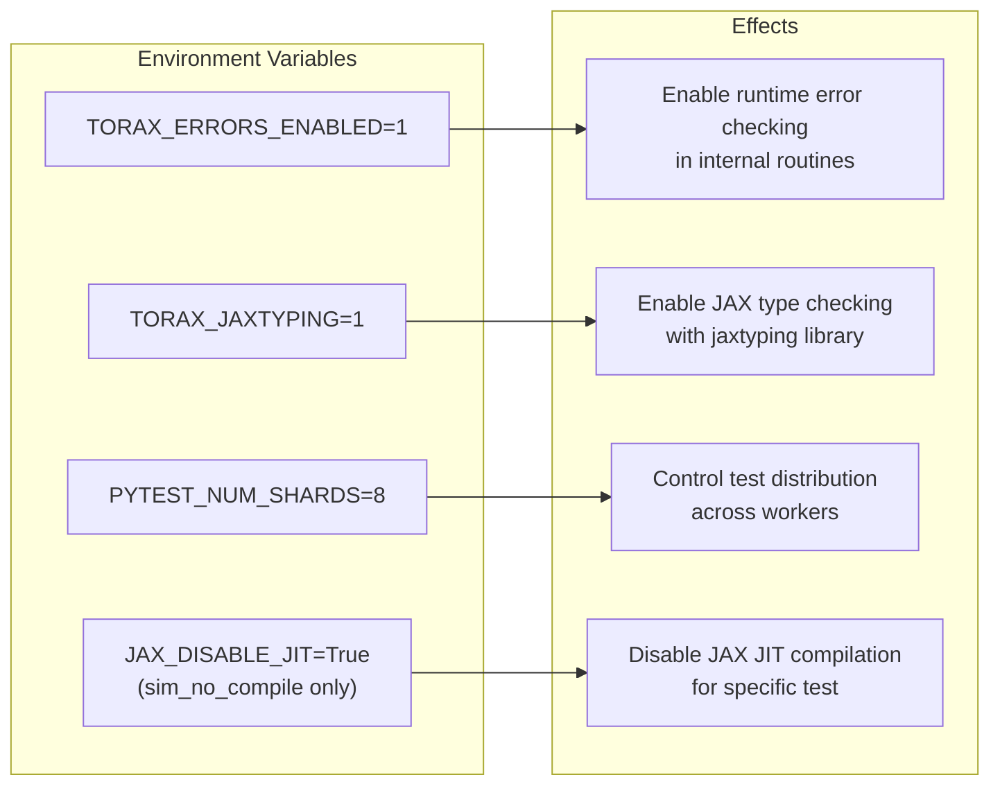
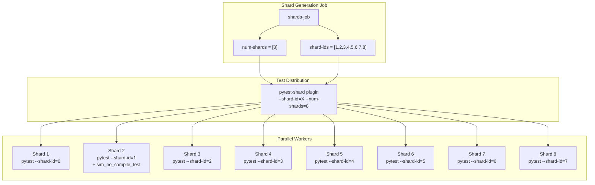
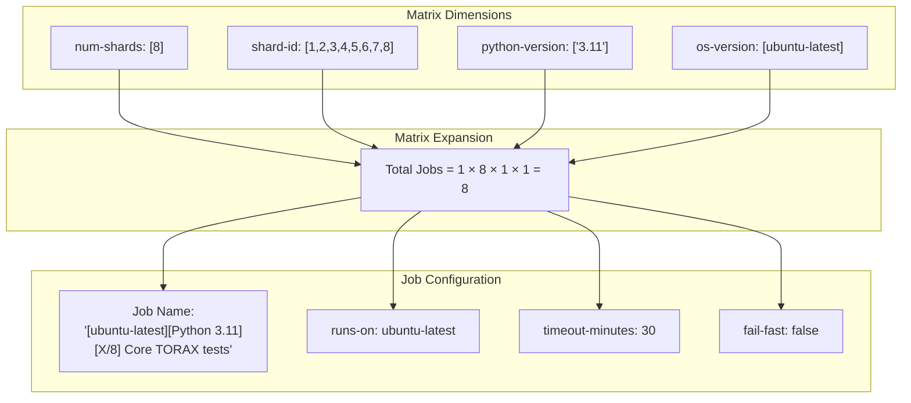
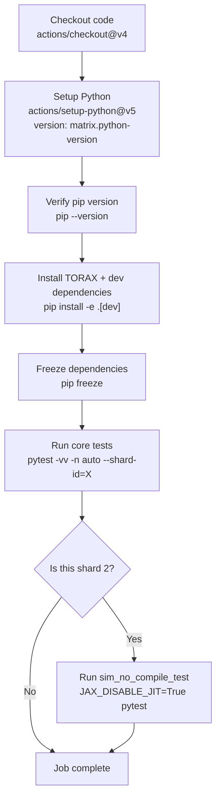
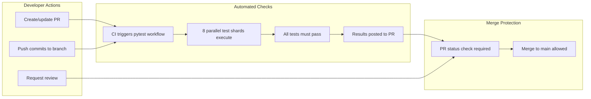

<!-- source: DeepWiki mcp.deepwiki.com · repo google-deepmind/torax · page 8.3 CI/CD Pipeline · fetched 2026-10-26 -->

# CI/CD Pipeline

<details>
<summary>Relevant source files</summary>

The following files were used as context for generating this wiki page:

- [.github/workflows/pytest.yml](.github/workflows/pytest.yml)
- [README.md](README.md)
- [docs/installation.rst](docs/installation.rst)
- [pyproject.toml](pyproject.toml)
- [torax/__init__.py](torax/__init__.py)

</details>


This page documents TORAX's continuous integration and continuous deployment (CI/CD) infrastructure, implemented using GitHub Actions. It covers the automated testing workflow, test sharding strategy, environment variable configuration, and integration with the development process.

For information about the testing framework itself and how to write tests, see [Testing Framework](#10.2). For details on test data and validation scenarios, see [Test Data Repository](#8.2) and [Integration Tests](#8.1).

## Overview

TORAX uses GitHub Actions to automatically run its comprehensive test suite on every code change. The CI/CD pipeline is configured in [.github/workflows/pytest.yml:1-84]() and implements:

- **Automated test execution** on pull requests, pushes, and scheduled runs
- **Parallel test sharding** across 8 worker nodes for improved execution speed
- **Environment validation** ensuring tests pass with full assertion checking enabled
- **Matrix testing** across multiple Python versions and operating systems
- **Special test handling** for JAX compilation-sensitive tests

Sources: [.github/workflows/pytest.yml:1-84](), [README.md:1-10]()

## Workflow Architecture

The CI/CD pipeline consists of two dependent jobs that coordinate test execution:



Sources: [.github/workflows/pytest.yml:4-14](), [.github/workflows/pytest.yml:16-19](), [.github/workflows/pytest.yml:28-41](), [.github/workflows/pytest.yml:43-84]()

### Trigger Configuration

The workflow is triggered by multiple events defined in [.github/workflows/pytest.yml:4-13]():

| Trigger Type | Condition | Purpose |
|-------------|-----------|---------|
| `workflow_dispatch` | Manual | Allow on-demand test execution |
| `pull_request` | Opened, synchronized, reopened to `main` | Validate changes before merge |
| `push` | Any branch | Continuous validation |
| `schedule` | Daily at 02:00 UTC (cron: `0 2 * * *`) | Detect integration issues and dependency breakage |

### Concurrency Control

The workflow implements intelligent concurrency management [.github/workflows/pytest.yml:16-19]():

- **Grouping**: `${{ github.workflow }}-${{ github.ref }}-${{ github.ref != 'refs/heads/master' || github.run_number }}`
- **Cancellation**: Intermediate builds are cancelled for pull requests using `cancel-in-progress: ${{ startsWith(github.ref, 'refs/pull/') }}`
- **Effect**: Multiple pushes to a PR branch will cancel in-progress test runs, conserving CI resources

Sources: [.github/workflows/pytest.yml:4-19]()

## Environment Variables

The CI/CD pipeline sets critical environment variables that enable comprehensive validation:



Sources: [.github/workflows/pytest.yml:22-25](), [.github/workflows/pytest.yml:82-83]()

### Environment Variable Details

**TORAX_ERRORS_ENABLED** [.github/workflows/pytest.yml:23]()
- Set to `1` to enable error checking in TORAX internal routines
- Used for debugging and validation during CI
- Note: Incompatible with JAX persistent compilation cache (see [README.md:156-161]())
- Checked in code via `os.environ.get('TORAX_ERRORS_ENABLED', False)`

**TORAX_JAXTYPING** [.github/workflows/pytest.yml:24]()
- Set to `1` to enable runtime type checking with the `jaxtyping` library
- Validates JAX array shapes and types at runtime
- Adds overhead but catches type-related bugs early

**PYTEST_NUM_SHARDS** [.github/workflows/pytest.yml:25]()
- Controls the number of parallel test shards
- Set to `8` for optimal CI performance
- Used by `pytest-shard` plugin to distribute tests

**JAX_DISABLE_JIT** [.github/workflows/pytest.yml:83]()
- Set to `True` only for `sim_no_compile_test.py`
- Disables JAX JIT compilation to test code paths without compilation
- Validates that simulation logic works in eager mode

Sources: [.github/workflows/pytest.yml:22-25](), [.github/workflows/pytest.yml:82-83](), [README.md:156-161](), [README.md:164-169]()

## Test Sharding Strategy

TORAX employs test sharding to parallelize test execution across multiple workers, significantly reducing CI runtime:



Sources: [.github/workflows/pytest.yml:28-41](), [.github/workflows/pytest.yml:73-78]()

### Shard Configuration

The `shards-job` [.github/workflows/pytest.yml:28-41]() dynamically generates shard configuration:

1. **Generate num-shards array**: `jq -n -c '[${{ env.PYTEST_NUM_SHARDS }}]'` produces `[8]`
2. **Generate shard-ids array**: `jq -n -c '[range(1;${{ env.PYTEST_NUM_SHARDS }}+1)]'` produces `[1,2,3,4,5,6,7,8]`
3. **Output as job outputs**: Used by dependent `pytest-job` matrix strategy

### Test Execution Command

Each shard executes pytest with specific flags [.github/workflows/pytest.yml:73-78]():

```bash
pytest \
  -vv -n auto \
  --ignore=torax/tests/sim_no_compile_test.py \
  --shard-id=$((${{ matrix.shard-id }} - 1)) \
  --num-shards=${{ env.PYTEST_NUM_SHARDS }}
```

**Flag Breakdown:**
- `-vv`: Verbose output (two levels)
- `-n auto`: pytest-xdist parallel execution within each shard
- `--ignore=torax/tests/sim_no_compile_test.py`: Exclude special test from main run
- `--shard-id`: Zero-indexed shard identifier (matrix.shard-id - 1)
- `--num-shards`: Total number of shards (8)

The `pytest-shard` plugin (listed in [pyproject.toml:68]()) deterministically distributes tests across shards based on the test collection order.

Sources: [.github/workflows/pytest.yml:28-41](), [.github/workflows/pytest.yml:73-78](), [pyproject.toml:68]()

## Matrix Testing Strategy

The `pytest-job` uses a matrix strategy to test across multiple configurations:



Sources: [.github/workflows/pytest.yml:46-57]()

### Matrix Configuration

The matrix is defined in [.github/workflows/pytest.yml:49-57]():

| Dimension | Values | Source |
|-----------|--------|--------|
| `num-shards` | `[8]` | From `shards-job` outputs |
| `shard-id` | `[1,2,3,4,5,6,7,8]` | From `shards-job` outputs |
| `python-version` | `['3.11']` | Static configuration |
| `os-version` | `[ubuntu-latest]` | Static configuration |

**Matrix Properties:**
- `fail-fast: false` [.github/workflows/pytest.yml:51]() - Jobs continue even if one fails
- Job name includes matrix variables for easy identification [.github/workflows/pytest.yml:46]()
- 30-minute timeout per job [.github/workflows/pytest.yml:48]()

Sources: [.github/workflows/pytest.yml:46-57]()

## Test Execution Workflow

The detailed test execution workflow within each matrix job:



Sources: [.github/workflows/pytest.yml:59-84]()

### Execution Steps

**1. Code Checkout** [.github/workflows/pytest.yml:60]()
```yaml
- uses: actions/checkout@v4
```

**2. Python Setup** [.github/workflows/pytest.yml:63-65]()
```yaml
- uses: actions/setup-python@v5
  with:
    python-version: ${{ matrix.python-version }}
```

**3. Dependency Installation** [.github/workflows/pytest.yml:69-70]()
```bash
pip install -e .[dev]
pip freeze  # Log installed versions
```

The `[dev]` extra installs testing dependencies defined in [pyproject.toml:64-77]():
- `pytest` - Test framework
- `pytest-xdist` - Parallel test execution
- `pytest-shard` - Test distribution across shards
- `pylint` - Code linting
- `pyink` - Code formatting

**4. Core Test Execution** [.github/workflows/pytest.yml:73-78]()
```bash
pytest \
  -vv -n auto \
  --ignore=torax/tests/sim_no_compile_test.py \
  --shard-id=$((${{ matrix.shard-id }} - 1)) \
  --num-shards=8
```

**5. Special Test (Shard 2 Only)** [.github/workflows/pytest.yml:80-83]()
```bash
if [ ${{ matrix.shard-id }} == 2 ]; then
  JAX_DISABLE_JIT=True pytest -vv -n auto torax/tests/sim_no_compile_test.py
fi
```

The `sim_no_compile_test.py` is run separately with `JAX_DISABLE_JIT=True` to validate simulation logic without JAX compilation. This test is only run on shard 2 to avoid redundant execution.

Sources: [.github/workflows/pytest.yml:59-84](), [pyproject.toml:64-77]()

## Pytest Configuration

The test framework is configured in [pyproject.toml:116-126]():

```toml
[tool.pytest.ini_options]
addopts = [
    "--ignore=torax/tests/test_data",
    "--ignore=torax/tests/scripts",
    "--ignore-glob=*lib*",
    "--ignore=torax/_src/transport_model/qualikiz_wrapper.py",
]
testpaths = "**/tests"
python_files = "*.py"
```

**Configuration Options:**

| Option | Value | Purpose |
|--------|-------|---------|
| `--ignore=torax/tests/test_data` | | Exclude test data directory from collection |
| `--ignore=torax/tests/scripts` | | Exclude test scripts directory |
| `--ignore-glob=*lib*` | | Exclude library files |
| `--ignore=qualikiz_wrapper.py` | | Skip file with optional dependencies |
| `testpaths` | `**/tests` | Search for tests in any `tests` directory |
| `python_files` | `*.py` | Consider all Python files as potential tests |

Sources: [pyproject.toml:116-126]()

## Integration with Development Workflow

The CI/CD pipeline integrates with TORAX development practices:



Sources: [.github/workflows/pytest.yml:6-9](), [README.md:1-2]()

### Running Tests Locally

Developers can replicate CI test conditions locally using commands documented in [README.md:199-206]():

**Full CI environment simulation:**
```bash
TORAX_JAXTYPING=True TORAX_ERRORS_ENABLED=True pytest . -n auto
```

**Without JAX compilation (debugging):**
```bash
JAX_DISABLE_JIT=True pytest -vv -n auto torax/tests/sim_no_compile_test.py
```

**Single shard execution (testing sharding):**
```bash
pytest -vv -n auto --shard-id=0 --num-shards=8
```

Sources: [README.md:199-206](), [docs/running.rst:65-78]()

### CI Status Badge

The repository README displays a CI status badge [README.md:1]():

```markdown
[](https://github.com/google-deepmind/torax/actions/workflows/pytest.yml)
```

This badge provides quick visibility into the current test suite status and links to the workflow execution history.

Sources: [README.md:1-2]()

## Performance Characteristics

The CI/CD pipeline is optimized for speed and reliability:

| Metric | Value | Configuration |
|--------|-------|---------------|
| Parallel Shards | 8 | `PYTEST_NUM_SHARDS=8` |
| Within-Shard Parallelism | Auto (CPU count) | `pytest -n auto` |
| Job Timeout | 30 minutes | `timeout-minutes: 30` |
| Python Version | 3.11 | `python-version: ['3.11']` |
| OS Platform | Ubuntu Latest | `os-version: [ubuntu-latest]` |

**Optimization Strategies:**

1. **Test Sharding**: Distributes tests across 8 workers for ~8x speedup
2. **pytest-xdist**: Additional parallelism within each shard
3. **Selective Test Execution**: Special tests run only on designated shards
4. **Concurrency Control**: Cancels redundant PR builds
5. **Fail-Fast Disabled**: All shards complete even if one fails, providing complete failure information

Sources: [.github/workflows/pytest.yml:25](), [.github/workflows/pytest.yml:48](), [.github/workflows/pytest.yml:51](), [.github/workflows/pytest.yml:56-57]()

## Maintenance and Extension

### Adding New Test Configurations

To test additional Python versions or operating systems, modify the matrix in [.github/workflows/pytest.yml:49-57]():

```yaml
matrix:
  python-version: ['3.11', '3.12']  # Add versions
  os-version: [ubuntu-latest, macos-latest]  # Add OSes
```

### Adjusting Shard Count

To change the number of parallel shards, update [.github/workflows/pytest.yml:25]():

```yaml
env:
  PYTEST_NUM_SHARDS: 16  # Increase for more parallelism
```

Note: More shards increase parallelism but also CI resource consumption.

### Special Test Handling

To add tests requiring special environment conditions:

1. Add test file to pytest ignore list [pyproject.toml:118]()
2. Create dedicated execution step [.github/workflows/pytest.yml:80-83]()
3. Set required environment variables
4. Assign to specific shard to avoid redundant execution

Sources: [.github/workflows/pytest.yml:25](), [.github/workflows/pytest.yml:49-57](), [.github/workflows/pytest.yml:80-83](), [pyproject.toml:116-126]()

---

