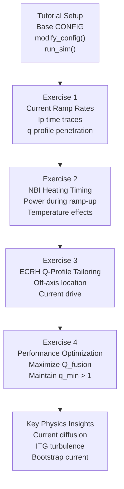
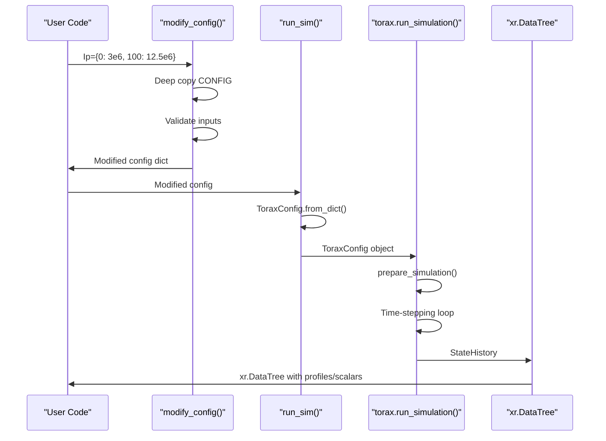
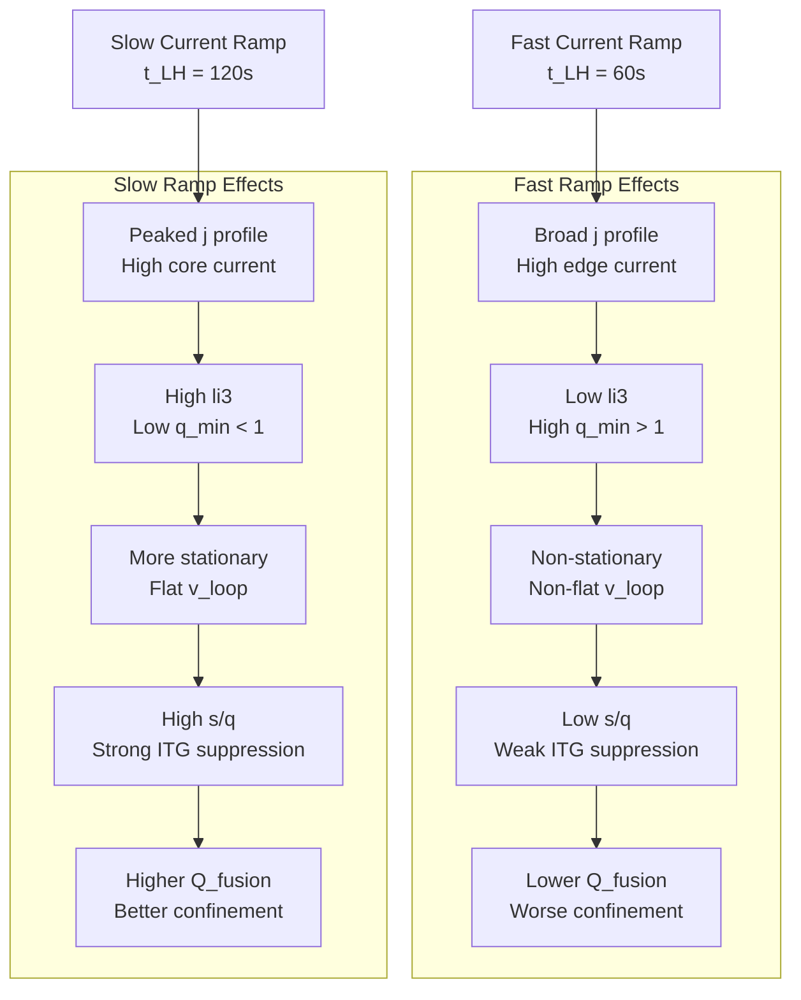
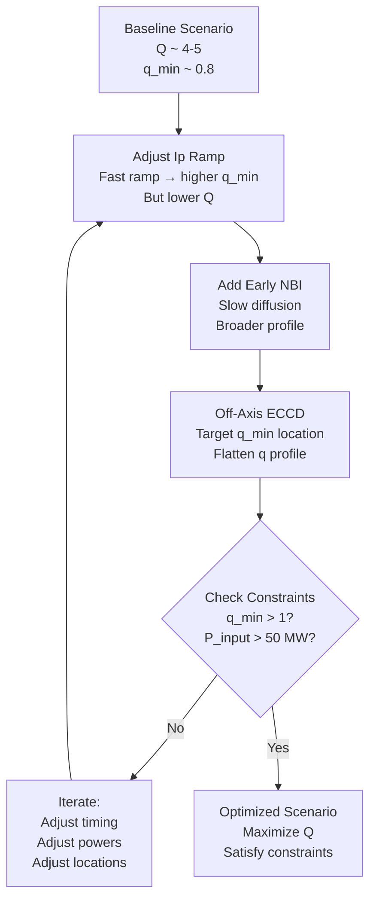
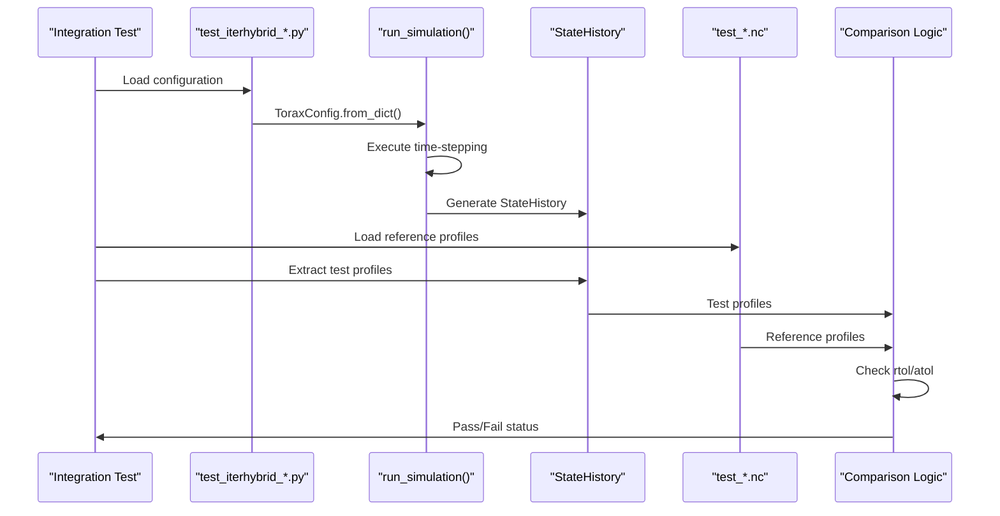
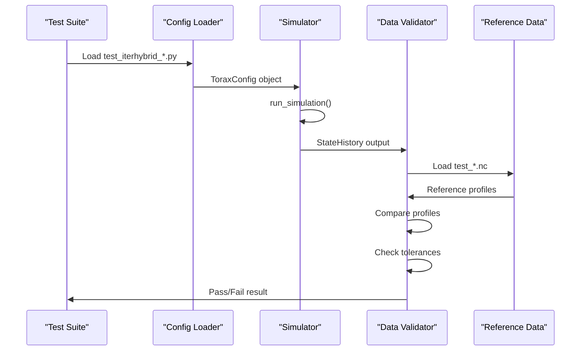

<!-- source: DeepWiki mcp.deepwiki.com · repo google-deepmind/torax · page 8.4 ITER Scenario Tutorial and Validation · fetched 2026-10-26 -->

# ITER Scenario Tutorial and Validation

<details>
<summary>Relevant source files</summary>

The following files were used as context for generating this wiki page:

- [docs/tutorials.rst](docs/tutorials.rst)
- [torax/tutorials/torax_tutorial_exercises.ipynb](torax/tutorials/torax_tutorial_exercises.ipynb)
- [torax/tutorials/torax_tutorial_exercises_with_solutions.ipynb](torax/tutorials/torax_tutorial_exercises_with_solutions.ipynb)

</details>


The ITER hybrid scenario tutorial provides a hands-on introduction to simulating advanced tokamak scenarios in TORAX. The tutorial focuses on q-profile tailoring through heating and current drive actuators, based on the ITER hybrid scenario from van Mulders et al., Nuclear Fusion 2021. Through a series of exercises, users investigate how plasma current ramp rates, neutral beam injection (NBI), and electron cyclotron resonance heating (ECRH) affect plasma performance and MHD stability.

For general information about TORAX's testing framework, see [Testing and Validation](#8). For configuration details, see [Configuration System](#2).

## Tutorial Overview

The tutorial is structured as an interactive Jupyter/Colab notebook with four progressive exercises investigating actuator effects on q-profile tailoring. Each exercise builds physical intuition about tokamak plasma control while demonstrating TORAX configuration and execution patterns.

### Learning Objectives

The tutorial teaches users how to:
- Configure ITER hybrid scenario parameters
- Manipulate time-dependent actuator inputs (Ip, NBI power, ECRH power)
- Analyze simulation outputs using provided plotting functions
- Understand relationships between current profile evolution, q-profile, and confinement
- Balance fusion performance (Q) against MHD stability constraints (q_min > 1)

### Tutorial Structure



Sources: [torax/tutorials/torax_tutorial_exercises.ipynb:8-11](), [torax/tutorials/torax_tutorial_exercises.ipynb:874-972]()

## Tutorial Setup and API

The tutorial provides helper functions that abstract TORAX configuration and execution details, allowing users to focus on physics exploration. The base configuration `CONFIG` defines an ITER hybrid scenario with 12.5 MA flat-top current, QLKNN transport, and H-mode pedestal.

### Base Configuration Structure

The `CONFIG` dictionary defines the baseline ITER hybrid scenario:

```python
CONFIG = {
    'plasma_composition': {
        'main_ion': {'D': 0.5, 'T': 0.5},  # 50-50 D-T mix
        'impurity': {'Ne': 1.0, 'W': 0.0},
        'Z_eff': {0.0: {0.0: 2.0, 1.0: 2.0}},  # Sets impurity densities
    },
    'profile_conditions': {
        'Ip': {0: 3e6, 100: 12.5e6},  # Current ramp: 3 MA → 12.5 MA
        'n_e_right_bc': {0: 0.35, 100: 0.35},  # Greenwald fraction at edge
        'nbar': 0.85,  # Line-averaged density (Greenwald fraction)
    },
    'geometry': {
        'geometry_type': 'chease',
        'geometry_file': 'iterhybrid.mat2cols',
        'R_major': 6.2,  # Major radius [m]
        'a_minor': 2.0,  # Minor radius [m]
        'B_0': 5.3,  # Toroidal field [T]
    },
    'transport': {
        'model_name': 'qlknn',  # Neural network transport model
        'apply_inner_patch': True,  # Ad-hoc MHD/EM transport
        'apply_outer_patch': True,  # L-mode edge transport
    },
    'pedestal': {
        'model_name': 'set_T_ped_n_ped',
        'T_i_ped': {0: 0.5, 100: 0.5, 105: 3.0},  # LH transition at t=100s
        'T_e_ped': {0: 0.5, 100: 0.5, 105: 3.0},
    },
}
```

Sources: [torax/tutorials/torax_tutorial_exercises.ipynb:76-231]()

### Configuration Modification API

The `modify_config()` function provides a simplified interface for modifying actuator parameters:

**Function Signature:**
```python
def modify_config(
    *,
    Ip = None,  # Time-varying plasma current [A]
    nbi_power = None,  # NBI heating power [W]
    off_axis_ec_power = None,  # ECRH power [W]
    off_axis_ec_location = None,  # ECRH deposition radius [rho_norm]
    Z_eff = None,  # Effective charge
    solver_type: str | None = None,  # 'linear' or 'newton_raphson'
    n_corrector_steps: int | None = None,
    use_radiation: bool | None = None
) -> dict[str, Any]
```

**Time-Dependent Parameters:**
Parameters like `Ip`, `nbi_power`, and `off_axis_ec_power` accept dictionaries mapping time values to parameter values. TORAX performs piecewise linear interpolation between specified time points:

```python
# Example: NBI power ramp
nbi_power = {0: 0.0, 99: 0.0, 100: 33e6}  # Switch on 33 MW at t=100s

# Example: Current ramp with intermediate point
Ip = {0: 3e6, 50: 10e6, 100: 12.5e6}  # Non-monotonic ramp allowed
```

Sources: [torax/tutorials/torax_tutorial_exercises.ipynb:728-848]()

### Simulation Execution Workflow



Sources: [torax/tutorials/torax_tutorial_exercises.ipynb:859-864]()

### Plotting Functions

Three visualization functions enable results analysis:

| Function | Purpose | Key Arguments |
|----------|---------|---------------|
| `detailed_plot_single_sim()` | Comprehensive single-simulation visualization | `dt: xr.DataTree`, `time: float` |
| `compare_timetraces()` | Multi-simulation time evolution comparison | `datatrees: list[xr.DataTree]`, `labels: list[str]` |
| `compare_profiles()` | Radial profile comparison at specified times | `datatrees: list`, `times: list[float]`, `labels: list[str]` |

**Key Plotted Quantities:**
- Time traces: `Ip`, `q_min`, `q95`, `li3`, `v_loop_lcfs`, `Q_fusion`, `T_i_avg`, `T_e_avg`
- Radial profiles: `T_e(rho)`, `T_i(rho)`, `j_total(rho)`, `q(rho)`, `v_loop(rho)`, `magnetic_shear(rho)`

Sources: [torax/tutorials/torax_tutorial_exercises.ipynb:236-449](), [torax/tutorials/torax_tutorial_exercises.ipynb:454-578]()

## Exercise 1: Current Ramp Rate Effects

This exercise investigates how plasma current ramp rate affects current penetration, q-profile evolution, and internal inductance. Users vary the LH transition time (equivalently, the current ramp rate) and observe effects on loop voltage, q-profile, and magnetic shear.

### Physics Background

Current diffusion in tokamaks follows a diffusion equation with time constant proportional to `μ₀ * σ * a²`, where `σ` is plasma conductivity. Since conductivity scales as `T_e^(3/2)`, current diffusion is extremely slow in hot plasmas. During current ramp-up, the applied loop voltage must balance resistive dissipation and inductive current penetration.

### Configuration Approach

The helper function `set_LH_transition_time()` modifies the baseline configuration to change when heating and pedestal formation occur:

```python
def set_LH_transition_time(*, LH_transition_time: float) -> dict[str, Any]:
    """Modifies CONFIG for different LH transition times."""
    config = copy.deepcopy(CONFIG)
    config['profile_conditions']['Ip'] = {0: 3e6, LH_transition_time: 12.5e6}
    config['sources']['ecrh']['P_total'] = {
        0: 0, LH_transition_time-1: 0, LH_transition_time: 20.0e6
    }
    config['sources']['generic_heat']['P_total'] = {
        0: 0, LH_transition_time-1: 0, LH_transition_time: 33.0e6
    }
    config['pedestal']['T_i_ped'] = {
        0: 0.5, LH_transition_time: 0.5, LH_transition_time+5: 3.0
    }
    # Similar for T_e_ped
    return config
```

Sources: [torax/tutorials/torax_tutorial_exercises.ipynb:694-717]()

### Key Observations

**Fast Ramp (LH transition at t=60s):**
- Less time for current penetration to core
- Broader current profile (higher current density near edge)
- Lower `li3` (normalized internal inductance)
- Higher `q_min` (minimum safety factor)
- Non-flat `v_loop` profile at flat-top start (non-stationary)
- Lower magnetic shear in periphery
- **Lower Q_fusion** due to reduced s/q ratio (worse ITG turbulence suppression)

**Slow Ramp (LH transition at t=120s):**
- More time for current diffusion inward
- Peaked current profile
- Higher `li3`
- Lower `q_min` (may drop below 1, triggering sawteeth)
- Flatter `v_loop` profile at flat-top (more stationary)
- Higher core magnetic shear
- **Higher Q_fusion** due to increased s/q ratio



Sources: [torax/tutorials/torax_tutorial_exercises_with_solutions.ipynb:969-997]()

### Physical Interpretation

The critical physics lesson is the trade-off between MHD stability and confinement:
- Fast ramps maintain `q_min > 1` (avoiding sawteeth) but sacrifice confinement
- Slow ramps achieve higher confinement but risk `q_min < 1` (sawtooth crashes)
- Internal inductance `li3` serves as a magnetic control diagnostic
- Current profile stationarity affects actuator efficiency and control

Sources: [torax/tutorials/torax_tutorial_exercises_with_solutions.ipynb:989-997]()

## Exercise 2: NBI Heating Timing

This exercise examines how NBI heating applied during current ramp-up affects temperature evolution, current diffusion, and q-profile formation. Users add 16.5 MW of NBI power at different times during the ramp-up phase.

### Physical Mechanism

NBI heating raises electron temperature `T_e`, which has two competing effects on current profile evolution:

1. **Increased conductivity:** `σ ∝ T_e^(3/2)` reduces loop voltage `E = j/σ`
2. **Slower diffusion:** Current diffusion time `τ_diff ∝ σ` increases dramatically
3. **NBI current drive:** Adds off-axis current source, broadening total current profile

The net effect: heating during ramp-up "freezes" current distribution, leaving more current at outer radii.

### Configuration Pattern

```python
# No heating during ramp-up (baseline)
nbi_power0 = {0: 0.0, 99: 0.0, 100: 33e6}

# Early heating from t=20s
nbi_power1 = {0: 0.0, 19: 0.0, 20: 16.5e6, 99: 16.5e6, 100: 33e6}

# Mid-ramp heating from t=50s  
nbi_power2 = {0: 0.0, 49: 0.0, 50: 16.5e6, 99: 16.5e6, 100: 33e6}

# Late heating from t=80s
nbi_power3 = {0: 0.0, 79: 0.0, 80: 16.5e6, 99: 16.5e6, 100: 33e6}

config = modify_config(nbi_power=nbi_power1)
```

Sources: [torax/tutorials/torax_tutorial_exercises_with_solutions.ipynb:1020-1049]()

### Key Findings

**Early NBI Heating (t=20s):**
- High `T_e` early → slow current diffusion throughout ramp
- Current accumulates at outer radii
- Broader current profile at flat-top start
- Higher `q` throughout plasma
- Higher `q_min` during flat-top
- Lower `li3` evolution

**Late NBI Heating (t=80s or 100s):**
- Current diffuses inward during cold phase
- Peaked current profile develops
- Lower `q` profile
- Lower `q_min` during flat-top  
- Higher `li3`

**NBI Current Drive Contribution:**
NBI drives current with Gaussian profile centered at `rho_norm = 0.25`, width `w = 0.25`. This off-axis current source displaces ohmic current (which naturally peaks on-axis in steady state), contributing to profile broadening.

Sources: [torax/tutorials/torax_tutorial_exercises_with_solutions.ipynb:1042-1049]()

### Physical Insights

This exercise demonstrates the critical importance of heating timing in scenario development:
- Heating during ramp-up → higher `q_min`, broader profiles, easier MHD stability
- Heating only at flat-top → lower `q_min`, peaked profiles, better confinement
- Real scenario development must balance these competing requirements
- Control strategies often use early heating for stability, then optimize for performance

Sources: [torax/tutorials/torax_tutorial_exercises_with_solutions.ipynb:1045-1049]()

## Exercise 3: ECRH Q-Profile Tailoring

This exercise explores off-axis electron cyclotron resonance heating (ECRH) for q-profile control. Users modify ECRH power (up to 40 MW) and deposition location (between `rho_norm = 0.1` to `0.8`) to shape the q-profile and investigate effects on ion temperature and fusion performance.

### Physics of ECRH Current Drive

ECRH provides localized electron heating with narrow deposition width (Gaussian width typically `~0.05` in `rho_norm`). The Lin-Liu model calculates ECCD (electron cyclotron current drive) efficiency based on local plasma parameters, magnetic field geometry, and wave propagation. Key features:

- Narrow, controllable deposition radius
- High current drive efficiency in low-collisionality plasmas
- Can drive current off-axis to shape q-profile
- Primarily heats electrons (vs. NBI which heats both species)

### Configuration Pattern

```python
# Vary ECRH power
off_axis_ec_power = {0: 0.0, 49: 0.0, 50: 30e6}  # 30 MW from t=50s

# Vary ECRH deposition location
off_axis_ec_location = 0.4  # Deposit at rho_norm = 0.4

config = modify_config(
    off_axis_ec_power=off_axis_ec_power,
    off_axis_ec_location=off_axis_ec_location
)
```

Sources: [torax/tutorials/torax_tutorial_exercises.ipynb:728-848]()

### Impact on Q-Profile

**Mid-radius ECRH (rho_norm ~ 0.3-0.4):**
- Drives off-axis current, flattening q-profile in core
- Increases `q_min` 
- Can achieve `q_min > 1.5` with sufficient power and appropriate `Ip`
- Creates positive magnetic shear region
- **Improved confinement:** Higher s/q ratio suppresses ITG turbulence
- **Higher fusion Q**

**Core ECRH (rho_norm ~ 0.1-0.2):**
- Drives near-axis current
- Minimal q-profile modification
- Less effective for q-profile tailoring
- Limited impact on turbulence suppression

**Outer ECRH (rho_norm ~ 0.5-0.7):**
- Can create reversed shear if power sufficient
- Complex interaction with pedestal region
- May reduce core current penetration effects

### Physical Interpretation

Off-axis ECCD is a powerful tool for q-profile control:
- Can maintain `q_min > 1` to avoid sawtooth instabilities
- Flattening q in core region increases average s/q
- Higher s/q → stronger ITG stabilization → reduced turbulent transport
- Trade-off: Must balance ECCD efficiency (better in core) vs. q-profile control (needs off-axis deposition)

The exercise demonstrates that optimal ECRH location depends on scenario objectives:
- For MHD stability: target location near `q_min` to raise it above threshold
- For confinement: maximize s/q ratio in regions with high turbulent transport
- For efficiency: deposit where ECCD efficiency is highest (typically mid-radius)

Sources: [torax/tutorials/torax_tutorial_exercises.ipynb:874-972](), [torax/tutorials/torax_tutorial_exercises_with_solutions.ipynb:1054-1079]()

## Exercise 4: Performance Optimization

The final exercise challenges users to maximize fusion gain `Q` while satisfying operational constraints. This open-ended exercise synthesizes lessons from previous exercises and demonstrates multi-objective optimization in scenario development.

### Constraints

**MHD Stability:** `q_min > 1.0` at all times (avoid sawteeth)

**Power Balance:** Total input power > 50 MW at LH transition (t=100s) to maintain H-mode

**Current Limits:** `Ip ≤ 18 MA` during ramp-up (engineering/coil constraints)

**Actuator Limits:**
- NBI power: 0-33 MW
- ECRH power: 0-40 MW
- ECRH location: `rho_norm` between 0.1-0.8

### Optimization Strategy



### Key Trade-Offs

**Current Ramp Rate:**
- Faster → Higher `q_min` (good for constraint)
- Faster → Lower Q (bad for objective)
- Solution: Moderate ramp rate, supplement with ECCD

**Heating Timing:**
- Early heating → Higher `q_min`, broader profiles
- Late heating → Better confinement
- Solution: Ramp heating power gradually, peak at flat-top

**ECRH Location:**
- Core ECRH → Better ECCD efficiency
- Mid-radius ECRH → Better q-profile control
- Solution: Target location just inside `q_min` location

**Power Distribution:**
- More NBI → More heating, more broadening
- More ECRH → More localized current control
- Solution: Use NBI for bulk heating, ECRH for q-profile tailoring

### Example Solution Approach

One effective strategy:
1. Use moderate current ramp: `Ip = {0: 3e6, 100: 13e6}` (slightly faster than baseline)
2. Apply early moderate NBI: `nbi_power = {0: 0, 30: 20e6, 99: 20e6, 100: 33e6}`
3. Apply strong off-axis ECCD: `off_axis_ec_power = {0: 0, 50: 35e6}` at `off_axis_ec_location = 0.35`
4. This combination maintains `q_min ~ 1.2` while achieving `Q ~ 6-7`

Sources: [torax/tutorials/torax_tutorial_exercises.ipynb:958-972](), [torax/tutorials/torax_tutorial_exercises_with_solutions.ipynb:1084-1113]()

## Scenario Validation Methodology

ITER scenarios serve dual purposes: interactive tutorials for learning and reference test cases for validation. The validation methodology compares simulation outputs against stored reference data to detect regressions and ensure reproducibility.

### Reference Data Structure

Reference data files (`test_*.nc`) are NetCDF files containing complete simulation outputs stored as xarray DataTrees. The structure matches the output format described in [Output Data Format](#7.1):

**Key Datasets:**
- `profiles`: Time-dependent radial profiles (`T_e`, `T_i`, `n_e`, `psi`, `j_total`, `q`, etc.)
- `scalars`: Integrated quantities (`Q_fusion`, `H98`, `tau_E`, `I_bootstrap`, `li3`, etc.)
- `numerics`: Solver diagnostics (iterations, convergence, timestep info)
- Coordinates: `time`, `rho_norm`, `rho_face_norm`

### Test Execution Framework



Sources: [torax/tests/sim_test.py](), [docs/tutorials.rst:1-99]()

### Tolerance Checking

The validation framework compares each output quantity using relative (`rtol`) and absolute (`atol`) tolerances:

```python
# Conceptual validation logic (actual implementation in sim_test.py)
def validate_output(test_output, reference_output, rtol=1e-5, atol=1e-8):
    """Compare test output against reference with tolerances."""
    for quantity in ['T_e', 'T_i', 'n_e', 'q', 'Q_fusion', 'tau_E']:
        test_values = test_output[quantity]
        ref_values = reference_output[quantity]
        
        # Check relative and absolute tolerance
        diff = abs(test_values - ref_values)
        tolerance = atol + rtol * abs(ref_values)
        
        if not all(diff <= tolerance):
            raise AssertionError(f"{quantity} exceeds tolerance")
```

**Tolerance Philosophy:**
- `rtol` (relative tolerance): Handles quantities spanning many orders of magnitude
- `atol` (absolute tolerance): Prevents false failures when values near zero
- Different tolerances for profiles vs. scalars (profiles more sensitive to numerical noise)

### Validation Coverage

The test suite validates multiple scenario variants to ensure robustness:

**Geometry Variants:**
- CHEASE equilibrium files
- EQDSK equilibrium files
- Circular analytic geometry

**Solver Variants:**
- Linear predictor-corrector
- Newton-Raphson nonlinear solver
- Different numbers of corrector steps

**Physics Variants:**
- QLKNN neural network transport
- Different transport patches (inner/outer)
- ECRH with Lin-Liu current drive
- Cyclotron radiation models
- Impurity radiation (Ne, W)

Each variant has a corresponding reference file ensuring comprehensive coverage of code paths and physics models.

Sources: [torax/tests/test_data/]() (directory containing multiple test_*.nc files)

### Regenerating Reference Data

Reference data must be regenerated when:
- Physics models are updated/corrected
- Numerical methods are improved
- Configuration changes affect expected behavior

The regeneration process:
1. Run simulations with updated code
2. Verify results are physically reasonable
3. Update reference NetCDF files
4. Document changes in commit message
5. Review with domain experts before merging

This ensures reference data represents current best understanding of physics while maintaining regression detection capability.

Sources: [docs/tutorials.rst:1-99]()

## Implementation Details

### Scenario Variants

ITER scenarios are implemented with multiple variants to test different physics models and numerical methods:

**Transport Model Variants:**
- QLKNN neural network transport (`model_name: 'qlknn'`)
- Qualikiz transport (`model_name: 'qualikiz'`) 
- Constant transport coefficients

**Geometry Variants:**
- CHEASE equilibrium files (`geometry_type: 'chease'`)
- EQDSK equilibrium files (`geometry_type: 'eqdsk'`)
- Circular geometry for simplified cases

**Solver Variants:**
- Linear solver (`solver_type: 'linear'`)
- Newton-Raphson nonlinear solver (`solver_type: 'newton_raphson'`)
- Predictor-corrector schemes (`use_predictor_corrector: true`)

**Physics Variants:**
- ECRH with Lin-Liu current drive model
- Cyclotron radiation losses
- Time-dependent isotope ratios
- Tungsten impurity radiation

### Common Parameter Patterns

All ITER scenarios share common parameter ranges and physical constraints:

```python
# Typical ITER hybrid parameters
'Ip': 10.5e6,  # Plasma current in Amperes
'R_major': 6.2,  # Major radius in meters  
'a_minor': 2.0,  # Minor radius in meters
'B_0': 5.3,  # Toroidal field in Tesla
'main_ion': {'D': 0.5, 'T': 0.5},  # 50-50 D-T mix
'Z_eff': 1.6,  # Effective charge
```

Transport patches are commonly applied to represent physics not captured by reduced models:
- Inner core patch for MHD/electromagnetic transport
- Outer core patch for L-mode edge transport
- Pedestal models for H-mode barrier

Sources: [torax/tests/test_data/test_iterhybrid_predictor_corrector.py:24-63](), [torax/tests/test_data/test_iterhybrid_predictor_corrector_qualikiz.py:20-23]()

## Usage in Testing Framework

ITER scenarios are integrated into TORAX's testing infrastructure through the integration test system. The test framework automatically loads scenario configurations, runs simulations, and compares outputs against reference data with specified tolerances.

### Test Execution Flow



### Key Test Classes and Functions

The scenarios are executed through several key code entities:

- `sim_test.py` - Main integration test runner
- `ToraxConfig.from_dict()` - Configuration object creation
- `run_simulation()` - Simulation execution
- `StateHistory` - Output data container
- Tolerance checking with `rtol` and `atol` parameters

Sources: [torax/tests/test_data/test_iterhybrid_rampup.py:22](), [torax/examples/iterhybrid_predictor_corrector.py:18]()

## Scenario-Specific Features

### ITER Hybrid Rampup

The rampup scenario features time-dependent plasma current evolution and adaptive time stepping:

```python
'Ip': {0: 3e6, 80: 10.5e6},  # Current ramp over 80 seconds
'solver_type': 'newton_raphson',
'n_corrector_steps': 10,
'calculator_type': 'fixed',
'fixed_dt': 2,
```

### ITER Baseline 

The baseline scenario uses higher plasma current and different impurity specifications:

```python
'Ip': 15e6,  # 15 MA baseline current
'Z_eff': 1.74,  # Higher impurity content
'Z_impurity_override': 6.3623,  # Effective charge state
```

### Physics Model Testing

Specialized variants test specific physics models:
- ECRH scenarios include `gaussian_lin_liu` current drive efficiency
- Cyclotron radiation scenarios use `albajar_artaud` model with wall reflection
- Tungsten scenarios test heavy impurity radiation

Sources: [torax/tests/test_data/test_iterhybrid_rampup.py:29-194](), [torax/tests/test_data/test_iterbaseline_mockup.py:28-176]()

---

