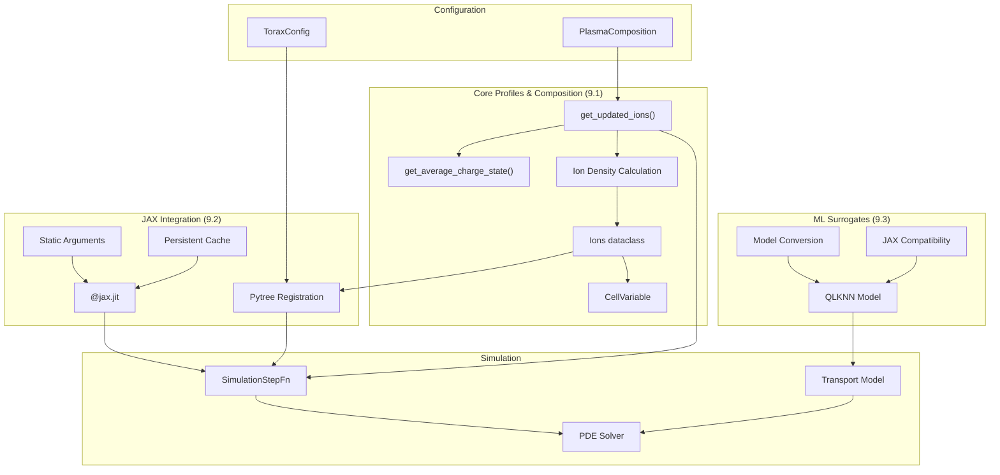
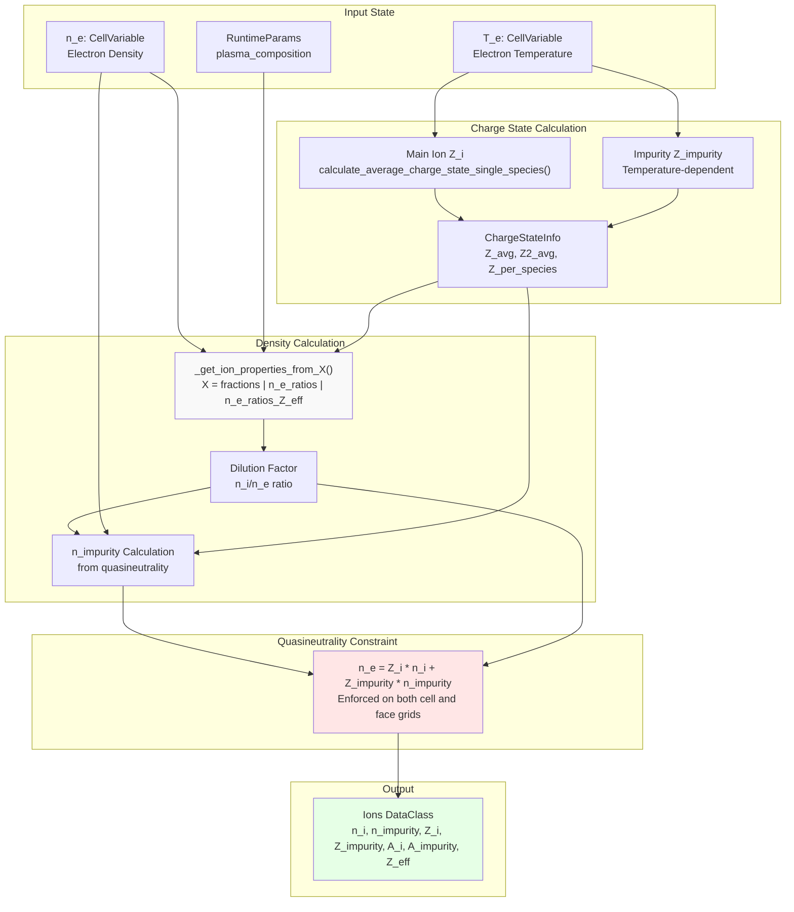
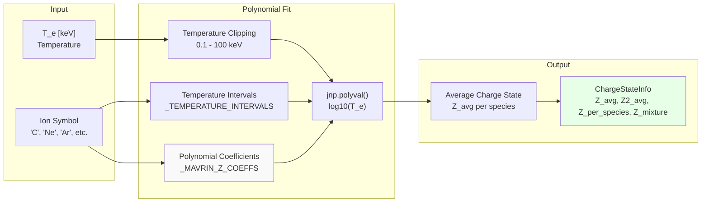

<!-- source: DeepWiki mcp.deepwiki.com · repo google-deepmind/torax · page 9 Advanced Topics · fetched 2026-10-26 -->

# Advanced Topics

<details>
<summary>Relevant source files</summary>

The following files were used as context for generating this wiki page:

- [torax/_src/core_profiles/getters.py](torax/_src/core_profiles/getters.py)
- [torax/_src/core_profiles/plasma_composition/electron_density_ratios.py](torax/_src/core_profiles/plasma_composition/electron_density_ratios.py)
- [torax/_src/core_profiles/plasma_composition/electron_density_ratios_zeff.py](torax/_src/core_profiles/plasma_composition/electron_density_ratios_zeff.py)
- [torax/_src/core_profiles/plasma_composition/impurity_fractions.py](torax/_src/core_profiles/plasma_composition/impurity_fractions.py)
- [torax/_src/core_profiles/plasma_composition/ion_mixture.py](torax/_src/core_profiles/plasma_composition/ion_mixture.py)
- [torax/_src/core_profiles/plasma_composition/plasma_composition.py](torax/_src/core_profiles/plasma_composition/plasma_composition.py)
- [torax/_src/core_profiles/tests/getters_test.py](torax/_src/core_profiles/tests/getters_test.py)
- [torax/_src/core_profiles/tests/plasma_composition_test.py](torax/_src/core_profiles/tests/plasma_composition_test.py)
- [torax/_src/physics/charge_states.py](torax/_src/physics/charge_states.py)
- [torax/_src/physics/tests/charge_states_test.py](torax/_src/physics/tests/charge_states_test.py)
- [torax/_src/sources/impurity_radiation_heat_sink/impurity_radiation_mavrin_fit.py](torax/_src/sources/impurity_radiation_heat_sink/impurity_radiation_mavrin_fit.py)
- [torax/_src/tests/state_test.py](torax/_src/tests/state_test.py)
- [torax/_src/transport_model/tests/bohm_gyrobohm_test.py](torax/_src/transport_model/tests/bohm_gyrobohm_test.py)

</details>


This page covers advanced internal architecture and implementation details in TORAX. The material is intended for developers who need to understand or extend the core systems. For basic usage, see the [Quick Start Guide](#1.2). For configuration details, see the [Configuration System](#2).

The page covers three main areas:
- **Core Profiles and Ion Composition**: Ion density calculations, charge state models, CellVariable structure, and quasineutrality enforcement (details in [9.1](#9.1))
- **JAX Integration and Compilation**: JIT compilation strategies, pytree structures, static vs. dynamic arguments, and performance optimization (details in [9.2](#9.2))
- **ML-Surrogate Integration**: How to integrate machine learning transport models like QLKNN and TGLFNN, conversion methods, and JAX compatibility requirements (details in [9.3](#9.3))

---

## Overview of Advanced Subsystems

The following diagram shows how the three advanced topic areas interact with each other and the broader TORAX simulation loop:



**Sources:**
- [torax/_src/core_profiles/getters.py:37-54]()
- [torax/_src/physics/charge_states.py:91-116]()
- [torax/_src/config/build_runtime_params.py]()

---

## Core Profiles and Plasma Composition

### Ion Density Calculation System

Ion densities in TORAX are calculated using a system that ensures quasineutrality and handles multiple impurity models. The core function is `get_updated_ions()` in [torax/_src/core_profiles/getters.py:475-624]().



**Sources:**
- [torax/_src/core_profiles/getters.py:476-624]()
- [torax/_src/physics/charge_states.py:169-243]()

### Impurity Mode Implementations

TORAX supports three modes for specifying impurity content, each with different inputs and calculation methods:

| Mode | Input Type | Z_eff Behavior | Typical Use Case |
|------|-----------|----------------|------------------|
| `fractions` | Relative abundances summing to 1.0 | User-specified constraint | Simple impurity mixtures with known Z_eff |
| `n_e_ratios` | Impurity density / electron density ratios | Emergent from densities | Direct density control, Z_eff not constrained |
| `n_e_ratios_Z_eff` | Ratios with one species TBD | One species solved from Z_eff | Complex scenarios with Z_eff constraint and partial density knowledge |

#### Fractions Mode

In fractions mode, impurities are specified as fractional abundances [torax/_src/core_profiles/plasma_composition/impurity_fractions.py:140-188]().

**Key calculation steps:**
1. Calculate average charge state `Z_impurity` from temperature-dependent charge states weighted by fractions
2. Calculate dilution factor from: `dilution = (Z_eff - Z_impurity²/Z_eff) / (Z_i² - Z_i * Z_impurity / Z_eff)` (simplified form)
3. Calculate ion density: `n_i = n_e * dilution`
4. Calculate impurity density from quasineutrality: `n_impurity = (n_e - n_i * Z_i) / Z_impurity`

**Sources:**
- [torax/_src/core_profiles/getters.py:178-223]()
- [torax/_src/core_profiles/plasma_composition/impurity_fractions.py:140-188]()

#### n_e_ratios Mode

In this mode, impurity densities are directly specified as ratios to electron density [torax/_src/core_profiles/plasma_composition/electron_density_ratios.py:83-148]().

**Key calculation steps:**
1. Calculate charge states for each impurity species
2. Calculate dilution factor directly from sum: `dilution = 1 - sum(Z_imp_i * (n_imp_i/n_e)) / Z_i`
3. Calculate Z_eff as emergent quantity: `Z_eff = dilution * Z_i² + sum(Z_imp_i² * (n_imp_i/n_e))`
4. Convert ratios to fractions for internal use: `fraction_i = ratio_i / sum(ratios)`

**Important:** Z_eff is **not** constrained in this mode; it emerges from the specified densities. A warning is issued if the user provides a Z_eff value [torax/_src/core_profiles/plasma_composition/plasma_composition.py:176-187]().

**Sources:**
- [torax/_src/core_profiles/getters.py:226-284]()
- [torax/_src/core_profiles/plasma_composition/electron_density_ratios.py:34-59]()

#### n_e_ratios_Z_eff Mode

This mode solves for one unknown impurity species density to satisfy the Z_eff constraint [torax/_src/core_profiles/plasma_composition/electron_density_ratios_zeff.py:41-88]().

**System of equations solved:**
```
x * Z_i + y * Z_unknown = 1 - sum(Z_known * n_known/n_e)
x * Z_i² + y * Z_unknown² = Z_eff - sum(Z_known² * n_known/n_e)
```

Where `x = n_i/n_e` (dilution factor) and `y = n_unknown/n_e` (unknown species ratio).

The system is solved using Cramer's rule [torax/_src/core_profiles/getters.py:375-402]().

**Sources:**
- [torax/_src/core_profiles/getters.py:289-471]()
- [torax/_src/core_profiles/plasma_composition/electron_density_ratios_zeff.py:41-88]()

### Charge State Calculations

Charge states for impurities are calculated using polynomial fits from Mavrin (2018) [torax/_src/physics/charge_states.py:118-166]().



For low-Z ions (H, D, T, He3, He4, Be, Li), the charge state is simply the atomic number as they are fully ionized above 0.1 keV [torax/_src/physics/charge_states.py:148-150]().

For a mixture of species, the effective mixture charge is calculated as:
- `Z_mixture = <Z²>/<Z>` where `<Z> = sum(fraction_i * Z_i)` and `<Z²> = sum(fraction_i * Z_i²)`

This ensures consistency between quasineutrality and Z_eff calculations [torax/_src/physics/charge_states.py:196-199]().

**Sources:**
- [torax/_src/physics/charge_states.py:118-243]()
- [torax/_src/core_profiles/getters.py:188-197]()

---

## JAX Integration and Compilation

### Pytree Registration

TORAX extensively uses JAX pytrees to make custom classes compatible with JAX transformations. All major data structures are registered as pytrees.

**Registration methods:**

1. **Automatic registration via decorator:**
```python
@jax.tree_util.register_dataclass
@dataclasses.dataclass(frozen=True)
class RuntimeParams:
  ...
```

2. **Manual registration via base class:**
```python
@jax.tree_util.register_pytree_node_class
class PlasmaComposition(torax_pydantic.BaseModelFrozen):
  def tree_flatten(self):
    children = (self.main_ion, self.impurity, ...)
    aux_data = ()
    return children, aux_data
```

The manual method is used when custom flattening logic is needed, such as for Pydantic models [torax/_src/core_profiles/plasma_composition/plasma_composition.py:189-217]().

**Sources:**
- [torax/_src/config/runtime_params_slice.py:61-87]()
- [torax/_src/core_profiles/plasma_composition/plasma_composition.py:189-217]()

### Static Arguments in JAX

Static arguments control compilation behavior. The table below summarizes how static arguments are used throughout TORAX:

| Class | Static Fields | Purpose |
|-------|--------------|---------|
| `RuntimeParams` | `evolve_ion_heat`, `evolve_electron_heat`, `evolve_current`, `evolve_density`, `adaptive_dt`, `exact_t_final` | Control which PDEs are solved |
| `Numerics` | Same as above | User-facing configuration |
| `SourceRuntimeParams` | `mode`, `is_explicit` | Control source calculation method |
| `TransportRuntimeParams` | Model-specific flags | Control transport calculation |
| `PlasmaComposition` | `main_ion_names`, `impurity_names` | Static list of ion species |

Static fields are identified via the `'static'` key in field metadata. JAX uses this to determine which arguments affect compilation [torax/_src/config/numerics.py:48-53]().

**Sources:**
- [torax/_src/config/numerics.py:30-68]()
- [torax/_src/config/runtime_params_slice.py:61-87]()

### Static vs. Dynamic Arguments

TORAX distinguishes between static and dynamic parameters to optimize JAX compilation. This distinction affects when functions need to be recompiled.

| Argument Type | Properties | Examples | Marked By |
|--------------|------------|----------|-----------|
| **Dynamic** | Can change without recompilation; must be arrays/scalars | `T_i`, `n_e`, `chi_multiplier` | Default for all fields |
| **Static** | Compile-time constant; triggers recompilation if changed | `evolve_ion_heat`, `mode`, `solver_type` | `metadata={'static': True}` or `torax_pydantic.JAX_STATIC` |

Static fields are marked using metadata in dataclass definitions:

```python
# In dataclasses
@dataclasses.dataclass
class RuntimeParams:
  evolve_ion_heat: bool = dataclasses.field(metadata={'static': True})
  
# In Pydantic models
class NumericsConfig(torax_pydantic.BaseModelFrozen):
  evolve_ion_heat: Annotated[bool, torax_pydantic.JAX_STATIC] = True
```

**Sources:**
- [torax/_src/config/runtime_params_slice.py:61-87]()
- [torax/_src/config/numerics.py:48-53]()

### Performance Considerations

#### Minimizing Recompilation

To avoid unnecessary recompilation:

1. **Use dynamic arguments for values that change frequently**: Time-dependent parameters, multipliers, coefficients
2. **Use static arguments only for logical branches**: Boolean flags that control which code paths execute
3. **Structure providers to be pytrees**: Allow passing entire provider objects to JIT functions

#### Cached Properties

Expensive calculations that depend only on configuration are cached using `functools.cached_property`:

```python
@functools.cached_property
def evolving_names(self) -> tuple[str, ...]:
  """Names of core_profiles variables evolved by solver."""
  ...
```

This is used in [torax/_src/config/numerics.py:55-67]() to avoid recomputing which variables are evolved.

**Sources:**
- [torax/_src/config/numerics.py:55-67]()
- [torax/_src/config/tests/build_runtime_params_test.py:253-285]()

### Persistent Cache

JAX provides a persistent compilation cache to avoid recompiling functions across Python sessions. TORAX benefits from this automatically for JIT-compiled functions. The cache is controlled by JAX environment variables:

- `JAX_COMPILATION_CACHE_DIR`: Directory for storing compiled functions
- `JAX_PERSISTENT_CACHE_MIN_COMPILE_TIME_SECS`: Minimum compilation time to cache

**Sources:**
- Standard JAX documentation (not specific to TORAX codebase)

### Callbacks and Host Operations

JAX JIT compilation does not support arbitrary Python code execution. For operations that must run on the host (e.g., logging, file I/O), TORAX uses JAX callbacks:

- `jax.debug.callback()`: For side effects during traced execution
- `jax.debug.print()`: For debugging output

These are used sparingly to maintain performance while enabling necessary host interactions.

**Sources:**
- Standard JAX documentation (not specific to TORAX codebase)

### JAX Environment Variables

TORAX supports standard JAX environment variables for debugging and performance tuning:

| Variable | Effect | Use Case |
|----------|--------|----------|
| `JAX_DISABLE_JIT` | Disables JIT compilation | Debugging with standard Python tools |
| `JAX_ENABLE_X64` | Enables 64-bit precision | High-precision studies (default is 32-bit) |
| `JAX_LOG_COMPILES` | Logs when functions are compiled | Detecting unwanted recompilations |

These are standard JAX variables documented in the JAX documentation. TORAX does not add custom environment variables for core functionality.

**Sources:**
- General JAX documentation (not specific to TORAX codebase)

---

