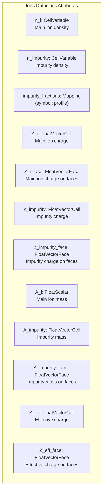
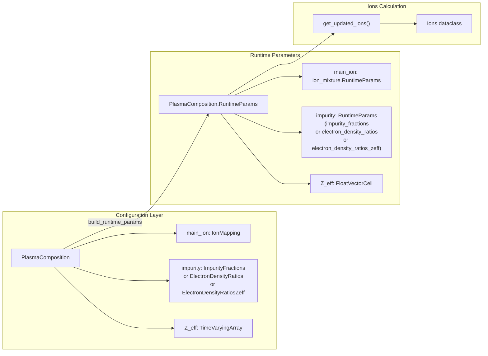
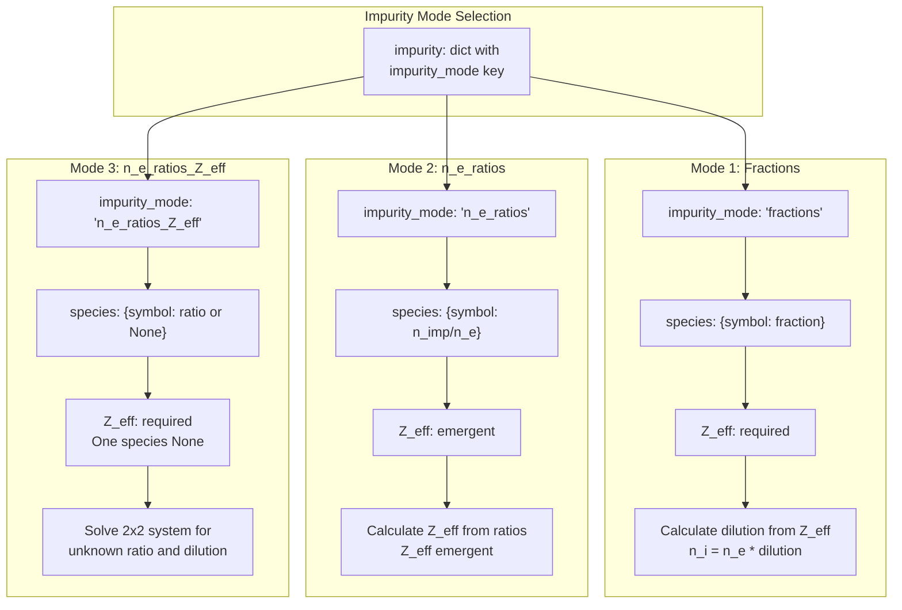
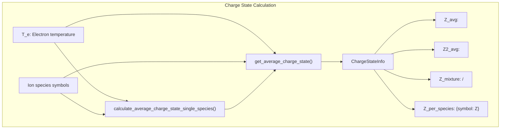
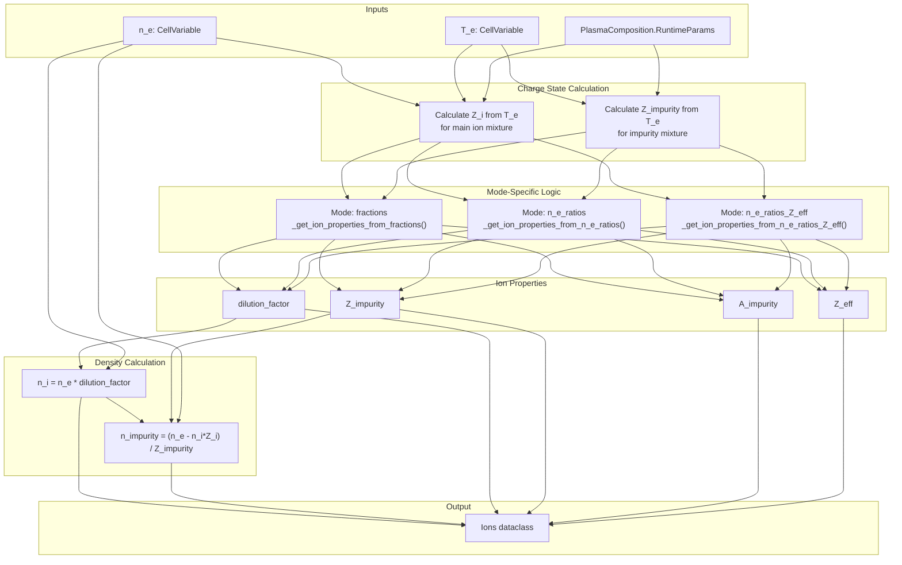

<!-- source: DeepWiki mcp.deepwiki.com · repo google-deepmind/torax · page 9.1 Core Profiles and Ion Composition · fetched 2026-10-26 -->

# Core Profiles and Ion Composition

<details>
<summary>Relevant source files</summary>

The following files were used as context for generating this wiki page:

- [torax/_src/core_profiles/getters.py](torax/_src/core_profiles/getters.py)
- [torax/_src/core_profiles/plasma_composition/electron_density_ratios.py](torax/_src/core_profiles/plasma_composition/electron_density_ratios.py)
- [torax/_src/core_profiles/plasma_composition/electron_density_ratios_zeff.py](torax/_src/core_profiles/plasma_composition/electron_density_ratios_zeff.py)
- [torax/_src/core_profiles/plasma_composition/impurity_fractions.py](torax/_src/core_profiles/plasma_composition/impurity_fractions.py)
- [torax/_src/core_profiles/plasma_composition/ion_mixture.py](torax/_src/core_profiles/plasma_composition/ion_mixture.py)
- [torax/_src/core_profiles/plasma_composition/plasma_composition.py](torax/_src/core_profiles/plasma_composition/plasma_composition.py)
- [torax/_src/core_profiles/tests/getters_test.py](torax/_src/core_profiles/tests/getters_test.py)
- [torax/_src/core_profiles/tests/plasma_composition_test.py](torax/_src/core_profiles/tests/plasma_composition_test.py)
- [torax/_src/physics/charge_states.py](torax/_src/physics/charge_states.py)
- [torax/_src/physics/tests/charge_states_test.py](torax/_src/physics/tests/charge_states_test.py)
- [torax/_src/sources/impurity_radiation_heat_sink/impurity_radiation_mavrin_fit.py](torax/_src/sources/impurity_radiation_heat_sink/impurity_radiation_mavrin_fit.py)
- [torax/_src/tests/state_test.py](torax/_src/tests/state_test.py)
- [torax/_src/transport_model/tests/bohm_gyrobohm_test.py](torax/_src/transport_model/tests/bohm_gyrobohm_test.py)

</details>


This page documents the structure and logic for managing plasma profiles and ion composition in TORAX. It covers the `CoreProfiles` dataclass, the `Ions` helper container, profile getter functions that create `CellVariable` objects, plasma composition configuration, and the calculation of ion densities from quasineutrality constraints.

For information about the geometry and magnetic field configuration, see [Geometry Providers](#3.2). For transport coefficients and sources that operate on these profiles, see [Transport Models](#3.1) and [Source Models](#3.3).

---

## Overview of Core Profiles

The `CoreProfiles` dataclass in [torax/_src/state.py]() stores the evolved plasma state at a single timestep. It contains:

- **Temperature profiles**: `T_i` (ion), `T_e` (electron) as `CellVariable` objects
- **Density profiles**: `n_e` (electron), `n_i` (main ion), `n_impurity` (impurity) as `CellVariable` objects
- **Flux profile**: `psi` (poloidal flux) as `CellVariable`
- **Ion properties**: `Z_i`, `Z_i_face`, `Z_impurity`, `Z_impurity_face`, `A_i`, `A_impurity`, `A_impurity_face`, `Z_eff`, `Z_eff_face`
- **Impurity fractions**: `impurity_fractions` mapping ion symbols to radial profiles
- **Current profiles**: `currents` dataclass with `j_total`, `Ip_profile`, etc.

Each `CellVariable` contains not only the radial profile values but also boundary conditions and grid spacing information. This allows the finite volume solver to properly discretize PDEs.

**Sources:** [torax/_src/state.py](), [torax/_src/tests/state_test.py:75-103](), [torax/_src/fvm/cell_variable.py]()

---

## Profile Getter Functions

Profile getter functions in [torax/_src/core_profiles/getters.py]() create or update `CellVariable` objects from configuration parameters and geometry. These functions are called during initialization and when profiles need to be prescribed.

### Key Getter Functions

| Function | Returns | Description |
|----------|---------|-------------|
| `get_updated_ion_temperature()` | `CellVariable` | Creates T_i profile from `profile_conditions` |
| `get_updated_electron_temperature()` | `CellVariable` | Creates T_e profile from `profile_conditions` |
| `get_updated_electron_density()` | `CellVariable` | Creates n_e profile with optional normalization to nbar |
| `get_updated_toroidal_velocity()` | `CellVariable` | Creates toroidal velocity profile |
| `get_updated_ions()` | `Ions` | Calculates ion densities and properties from quasineutrality |

**Sources:** [torax/_src/core_profiles/getters.py:56-180]()

### Electron Density Normalization

The `get_updated_electron_density()` function supports normalizing the density profile to achieve a target line-averaged density (`nbar`). When `normalize_n_e_to_nbar=True`:

1. The input `n_e` profile is treated as a shape
2. A normalization constant `C` is calculated such that the line-averaged density equals the target
3. The profile is scaled: `n_e_value = C * n_e_value`
4. If `n_e_right_bc_is_absolute=True`, the boundary condition is excluded from normalization

The line-averaged density is computed on the outer midplane:
```
nbar = integral(n_e(R)) dR / a_minor_out
```

**Sources:** [torax/_src/core_profiles/getters.py:86-161](), [torax/_src/core_profiles/tests/getters_test.py:145-175]()

---

## Ions Dataclass

The `Ions` dataclass is a helper container that holds all ion-related attributes calculated from the electron density, electron temperature, and composition constraints. It is returned by `get_updated_ions()` and used throughout the codebase.



### Ions Attributes

| Attribute | Type | Description |
|-----------|------|-------------|
| `n_i` | `CellVariable` | Main ion density [m^-3] |
| `n_impurity` | `CellVariable` | Total impurity density [m^-3] |
| `impurity_fractions` | `Mapping[str, FloatVectorCell]` | Fraction of each impurity species |
| `Z_i` | `FloatVectorCell` | Average main ion charge state |
| `Z_i_face` | `FloatVectorFace` | Average main ion charge state on face grid |
| `Z_impurity` | `FloatVectorCell` | Effective impurity charge |
| `Z_impurity_face` | `FloatVectorFace` | Effective impurity charge on face grid |
| `A_i` | `FloatScalar` | Average main ion mass [amu] |
| `A_impurity` | `FloatVectorCell` | Average impurity mass [amu] |
| `A_impurity_face` | `FloatVectorFace` | Average impurity mass on face grid |
| `Z_eff` | `FloatVectorCell` | Effective plasma charge |
| `Z_eff_face` | `FloatVectorFace` | Effective plasma charge on face grid |

**Sources:** [torax/_src/core_profiles/getters.py:37-54]()

---

## Plasma Composition Configuration

Plasma composition is configured through the `PlasmaComposition` Pydantic model, which specifies the main ion mixture and impurity content. The configuration is converted to `RuntimeParams` at each timestep, which are then used by `get_updated_ions()`.



**Sources:** [torax/_src/core_profiles/plasma_composition/plasma_composition.py:42-246]()

### Main Ion Configuration

Main ions are specified through the `main_ion` field, which accepts:
- A single ion symbol (e.g., `'D'` for deuterium)
- A mixture dictionary mapping symbols to fractions (e.g., `{'D': 0.5, 'T': 0.5}`)
- Time-dependent mixtures using `TimeVaryingScalar` syntax

The `IonMixture` class validates that fractions sum to 1 and computes average mass and charge properties.

**Sources:** [torax/_src/core_profiles/plasma_composition/ion_mixture.py:56-97](), [torax/_src/core_profiles/tests/plasma_composition_test.py:529-656]()

---

## Impurity Modes

TORAX supports three modes for specifying impurity content, each with different use cases:



### Mode 1: Fractions

In this mode, impurities are specified by their fractional abundance within the total impurity population. The user must provide `Z_eff`, which is used to calculate the main ion dilution factor.

**Configuration example:**
```python
'impurity': {
    'impurity_mode': 'fractions',
    'species': {'Ar': 0.6, 'Ne': 0.4},
},
'Z_eff': 2.0
```

**Calculation:**
1. Compute effective impurity charge: `Z_impurity = <Z²>/<Z>` weighted by fractions
2. Calculate dilution from `Z_eff`: `dilution = (Z_eff - Z_impurity²/Z_impurity) / (Z_i² - Z_i*Z_impurity/Z_impurity)`
3. Calculate densities: `n_i = n_e * dilution`, `n_impurity = (n_e - n_i*Z_i) / Z_impurity`

**Sources:** [torax/_src/core_profiles/getters.py:196-241](), [torax/_src/core_profiles/plasma_composition/impurity_fractions.py:140-188]()

### Mode 2: n_e_ratios

In this mode, impurity densities are specified directly as ratios to electron density: `n_impurity / n_e`. The `Z_eff` is calculated from these ratios and is an emergent quantity.

**Configuration example:**
```python
'impurity': {
    'impurity_mode': 'n_e_ratios',
    'species': {'C': 0.01, 'Ne': 0.005, 'Ar': 0.001},
}
```

**Calculation:**
1. For each species, `n_species = n_e * ratio`
2. Calculate `dilution = 1 - sum(Z_species * ratio) / Z_i`
3. Calculate `Z_eff = dilution * Z_i² + sum(Z_species² * ratio)`

**Sources:** [torax/_src/core_profiles/getters.py:244-302](), [torax/_src/core_profiles/plasma_composition/electron_density_ratios.py:83-148]()

### Mode 3: n_e_ratios_Z_eff

This mode combines aspects of the previous two: most impurity ratios are specified, but one species is left unknown (specified as `None`) and is constrained by the provided `Z_eff`.

**Configuration example:**
```python
'impurity': {
    'impurity_mode': 'n_e_ratios_Z_eff',
    'species': {'C': 0.02, 'W': None},
},
'Z_eff': 1.5
```

**Calculation:**

The function solves a 2×2 linear system:
```
x * Z_i + y * Z_unknown = 1 - sum(Z_known * n_known/n_e)
x * Z_i² + y * Z_unknown² = Z_eff - sum(Z_known² * n_known/n_e)
```

where `x = dilution`, `y = n_unknown/n_e`. This system is solved using Cramer's rule.

**Sources:** [torax/_src/core_profiles/getters.py:305-489](), [torax/_src/core_profiles/plasma_composition/electron_density_ratios_zeff.py:41-88]()

---

## Charge State Calculations

Impurity charge states are temperature-dependent and calculated using polynomial fits from Mavrin (2018). The `charge_states` module provides functions for single-species and mixture calculations.



### Single Species Charge State

The function `calculate_average_charge_state_single_species()` uses piecewise polynomial fits:

1. Temperature is clipped to [0.1, 100] keV to avoid extrapolation
2. The appropriate polynomial interval is selected based on `T_e`
3. `Z_avg = 10^(polyval(coeffs, log10(T_e)))`

For low-Z ions (H, D, T, He3, He4, Li, Be) that are fully ionized above 0.1 keV, the function returns the atomic number directly.

**Sources:** [torax/_src/physics/charge_states.py:119-167]()

### Mixture Charge State

The function `get_average_charge_state()` calculates properties for ion mixtures:

1. For each species, calculate `Z_i(T_e)`
2. Compute `<Z> = sum(fraction_i * Z_i)`
3. Compute `<Z²> = sum(fraction_i * Z_i²)`
4. Effective charge for quasineutrality: `Z_mixture = <Z²>/<Z>`

This effective charge definition ensures that when treating the mixture as a single species with density `n_mixture` and charge `Z_mixture`, the quasineutrality and `Z_eff` equations remain consistent with the full multi-species system.

**Sources:** [torax/_src/physics/charge_states.py:169-244]()

---

## Ion Density Calculation from Quasineutrality

The `get_updated_ions()` function calculates ion densities from quasineutrality and `Z_eff` constraints. The calculation depends on the impurity mode.



### Quasineutrality and Z_eff Equations

The fundamental equations governing ion densities are:

**Quasineutrality:**
```
n_e = Z_i * n_i + Z_impurity * n_impurity
```

**Z_eff definition:**
```
Z_eff = (Z_i² * n_i + Z_impurity² * n_impurity) / n_e
```

These two equations can be solved for `n_i` and `n_impurity` given `n_e`, `Z_i`, `Z_impurity`, and `Z_eff`:

```
dilution_factor = n_i / n_e
n_i = n_e * dilution_factor
n_impurity = (n_e - n_i * Z_i) / Z_impurity
```

The dilution factor calculation varies by impurity mode as described above.

**Sources:** [torax/_src/core_profiles/getters.py:494-642]()

### Z_eff Face Grid Recalculation

After calculating `n_i` and `n_impurity` on the cell grid, the `Z_eff` on the face grid is recalculated from the face-interpolated densities and charge states:

```python
Z_eff_face = (Z_i_face² * n_i_face + Z_impurity_face² * n_impurity_face) / n_e_face
```

This ensures physical consistency, as linearly interpolating `Z_eff` from the cell grid would not satisfy the `Z_eff` definition equation at the face points.

**Sources:** [torax/_src/core_profiles/getters.py:606-616](), [torax/_src/tests/state_test.py:275-344]()

---

## Impurity Fractions Output

The `impurity_fractions` attribute in `CoreProfiles` and `Ions` stores the fractional composition of each impurity species as a mapping from ion symbols to radial profiles. This is used by source models like impurity radiation.

For the `fractions` mode, these are directly from the configuration. For `n_e_ratios` modes, they are calculated from the ratios:

```python
fractions[species] = ratio[species] / sum(ratios.values())
```

When the total impurity content is zero (`sum(ratios) = 0`), uniform fractions `1/n_species` are returned to avoid division by zero. The actual impurity density will be zero, so the specific fraction values don't matter.

**Sources:** [torax/_src/core_profiles/getters.py:618-627](), [torax/_src/core_profiles/plasma_composition/electron_density_ratios.py:34-58](), [torax/_src/sources/impurity_radiation_heat_sink/impurity_radiation_mavrin_fit.py:206-238]()

---

## Usage in Sources and Transport

Ion composition information is accessed throughout the codebase:

**Source models** use `core_profiles.impurity_fractions`, `core_profiles.n_impurity`, `core_profiles.Z_impurity` to calculate:
- Impurity radiation (see [Mavrin fit implementation](torax/_src/sources/impurity_radiation_heat_sink/impurity_radiation_mavrin_fit.py:196-252))
- Fusion power (depends on `core_profiles.n_i`, `core_profiles.A_i`)

**Transport models** use `runtime_params.plasma_composition.main_ion.A_avg` and `runtime_params.plasma_composition.Z_eff_face` for:
- Bohm-GyroBohm diffusivity scaling
- Neoclassical transport

**Neoclassical models** use `core_profiles.Z_eff` for bootstrap current calculations.

**Sources:** [torax/_src/sources/impurity_radiation_heat_sink/impurity_radiation_mavrin_fit.py:196-252](), [torax/_src/transport_model/tests/bohm_gyrobohm_test.py:86-94]()

---

## Testing and Validation

Tests verify correctness of ion density calculations:

1. **Quasineutrality check**: `core_profiles.quasineutrality_satisfied()` verifies `n_e = Z_i*n_i + Z_impurity*n_impurity` to within tolerance
2. **Z_eff reconstruction**: Tests verify that `Z_eff` can be reconstructed from calculated densities and charge states
3. **Mode equivalence**: Tests compare results between different impurity modes with equivalent inputs (e.g., fractions vs n_e_ratios)
4. **Negative density detection**: The simulation halts if calculated ion densities become negative (unphysical)

**Sources:** [torax/_src/tests/state_test.py:75-103](), [torax/_src/core_profiles/tests/getters_test.py:223-273](), [torax/_src/core_profiles/tests/getters_test.py:346-443](), [torax/_src/core_profiles/tests/getters_test.py:550-656]()

---

