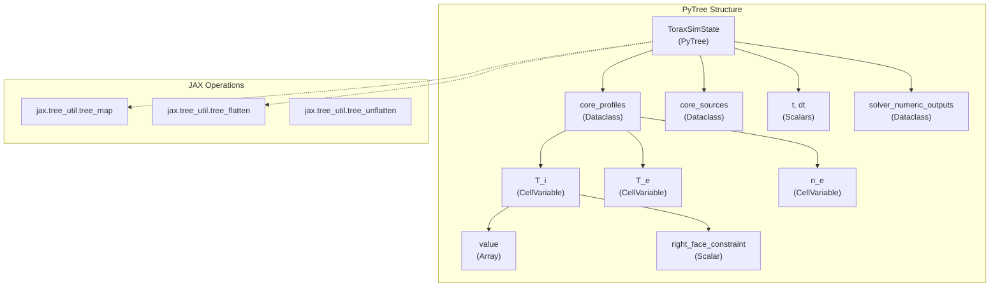
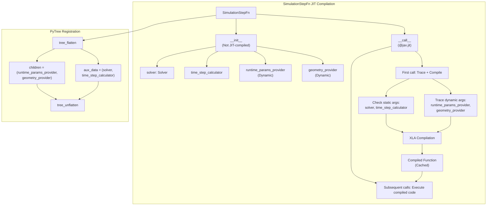
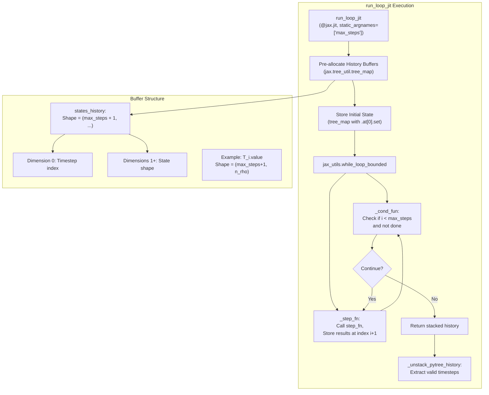
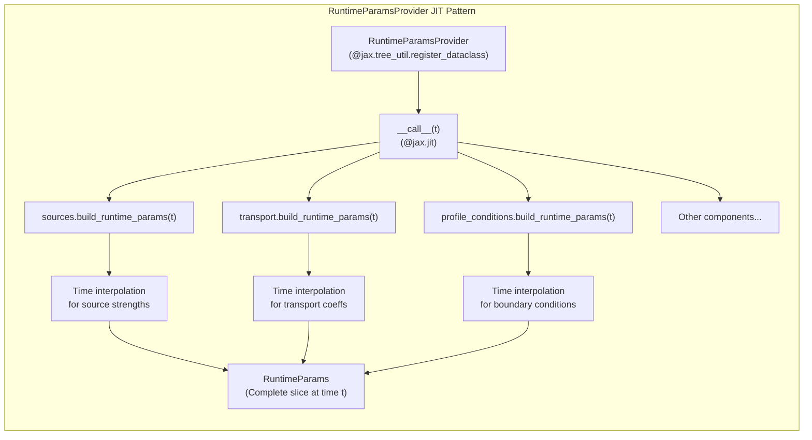

<!-- source: DeepWiki mcp.deepwiki.com · repo google-deepmind/torax · page 9.2 JAX Integration and Compilation · fetched 2026-10-26 -->

# JAX Integration and Compilation

<details>
<summary>Relevant source files</summary>

The following files were used as context for generating this wiki page:

- [.github/workflows/pytest.yml](.github/workflows/pytest.yml)
- [README.md](README.md)
- [docs/configuration.rst](docs/configuration.rst)
- [docs/edge_models.rst](docs/edge_models.rst)
- [docs/installation.rst](docs/installation.rst)
- [docs/interfacing_with_surrogates.rst](docs/interfacing_with_surrogates.rst)
- [docs/links.rst](docs/links.rst)
- [docs/output.rst](docs/output.rst)
- [docs/physics_models.rst](docs/physics_models.rst)
- [docs/running_programmatically.rst](docs/running_programmatically.rst)
- [docs/user_guides.rst](docs/user_guides.rst)
- [docs/using_jax.rst](docs/using_jax.rst)
- [pyproject.toml](pyproject.toml)
- [torax/__init__.py](torax/__init__.py)

</details>


This page describes how TORAX leverages JAX for compilation, automatic differentiation, and performance optimization. It covers JIT compilation patterns, PyTree structures, environment variables, and best practices for working with JAX in the TORAX codebase.

For information about the runtime parameters system and time-dependent parameters, see [Runtime Parameters System](#9.2). For general simulation execution, see [Simulation Execution](#4).

---

## JAX as the Foundation

TORAX is built entirely on JAX, a numerical computing library that provides composable transformations of Python+NumPy code. JAX enables three critical capabilities for TORAX:

1. **Just-In-Time (JIT) Compilation**: Compiles Python functions to optimized machine code for fast execution
2. **Automatic Differentiation**: Provides gradients of arbitrary functions via `jax.grad`, enabling gradient-based optimization and sensitivity analysis
3. **Hardware Acceleration**: Runs seamlessly on CPUs, GPUs, and TPUs

The JAX backend is logged at startup in [torax/__init__.py:72-73]() and precision settings are configured in [torax/__init__.py:62-69]().

**Sources**: [README.md:7-20](), [torax/__init__.py:21-76](), [pyproject.toml:21-22]()

---

## JIT Compilation Basics

### The `@jax.jit` Decorator

JAX's core compilation primitive is the `jax.jit` decorator, which traces a function and compiles it to XLA (Accelerated Linear Algebra). TORAX applies JIT compilation to performance-critical functions:

```python
@jax.jit
def __call__(self, input_state, previous_post_processed_outputs):
    # Function body executes under JIT compilation
    ...
```

The first call to a JIT-compiled function triggers **tracing** and **compilation**, which can take several seconds. Subsequent calls with arguments of the same shape and type reuse the compiled code, resulting in fast execution.

**Sources**: [torax/_src/orchestration/step_function.py:153-260](), [torax/_src/config/build_runtime_params.py:87-108]()

### Static vs Dynamic Arguments

JAX distinguishes between two types of function arguments:

| Argument Type | Properties | Use Case |
|--------------|------------|----------|
| **Dynamic** | Can change between calls without recompilation | Time-varying scalars, arrays, profile data |
| **Static** | Compilation-time constants; changes trigger recompilation | Flags, string identifiers, tuple lengths |

Static arguments are declared using the `static_argnames` parameter:

```python
@functools.partial(jax.jit, static_argnames=['max_steps'])
def run_loop_jit(initial_state, step_fn, max_steps):
    ...
```

Dynamic arguments must be JAX arrays, scalars, or standard Python containers (tuples, lists, dicts). Static arguments can be arbitrary Python objects but influence the logical control flow of the function.

**Sources**: [torax/_src/config/runtime_params_slice.py:17-38](), [torax/_src/orchestration/jit_run_loop.py:29-36](), [torax/_src/orchestration/step_function.py:505-511]()

### Compilation Triggers

A function recompiles when:

1. **First call**: Initial tracing and compilation
2. **Shape changes**: Input arrays with different shapes
3. **Type changes**: Input arrays with different dtypes
4. **Static argument changes**: Any modification to static arguments

The following changes do **not** trigger recompilation:
- Dynamic argument values (as long as shapes/types are unchanged)
- Time-dependent parameter values (if properly structured)

**Sources**: [README.md:217-222](), [docs/running.rst:162-169](), [torax/_src/config/runtime_params_slice.py:27-30]()

---

## PyTree Structures

### What are PyTrees?

A PyTree (Python tree) is a nested structure of containers (tuples, lists, dicts) with arrays or scalars at the leaves. JAX uses pytrees to represent complex state objects in a way that's compatible with JIT compilation and automatic differentiation.



**PyTree Registration in TORAX**

Sources: [torax/_src/orchestration/sim_state.py](), [torax/_src/state.py](), [torax/_src/orchestration/jit_run_loop.py:45-62]()

### Registration Patterns

TORAX uses two primary methods to register custom classes as pytrees:

#### 1. Dataclass Registration

For simple dataclasses with no custom pytree logic:

```python
@jax.tree_util.register_dataclass
@dataclasses.dataclass(frozen=True)
class RuntimeParams:
    t_initial: float
    t_final: float
    # ... other fields
```

This automatically generates `tree_flatten` and `tree_unflatten` methods based on dataclass fields.

**Sources**: [torax/_src/config/runtime_params_slice.py:61-87](), [torax/_src/config/build_runtime_params.py:42-85]()

#### 2. Custom PyTree Registration

For classes that need control over which fields are dynamic vs auxiliary:

```python
@jax.tree_util.register_pytree_node_class
class SimulationStepFn:
    def tree_flatten(self):
        # Dynamic children (can vary between calls)
        children = (self._runtime_params_provider, self._geometry_provider)
        # Static auxiliary data (triggers recompilation if changed)
        aux_data = (self._solver, self._time_step_calculator)
        return children, aux_data
    
    @classmethod
    def tree_unflatten(cls, aux_data, children):
        return cls(
            solver=aux_data[0],
            time_step_calculator=aux_data[1],
            runtime_params_provider=children[0],
            geometry_provider=children[1],
        )
```

**Sources**: [torax/_src/orchestration/step_function.py:68-139]()

### Tree Operations

JAX provides utilities for operating on pytrees:

- `jax.tree_util.tree_map(f, tree)`: Applies `f` to each leaf
- `jax.tree_util.tree_flatten(tree)`: Flattens to (leaves, treedef)
- `jax.tree_util.tree_unflatten(treedef, leaves)`: Reconstructs tree

These operations are used extensively in TORAX for:
- Pre-allocating history buffers [torax/_src/orchestration/jit_run_loop.py:45-62]()
- Storing timestep results [torax/_src/orchestration/jit_run_loop.py:84-91]()
- Unstacking simulation history [torax/_src/orchestration/jit_run_loop.py:118-150]()

**Sources**: [torax/_src/orchestration/jit_run_loop.py:45-150]()

---

## Environment Variables

### JAX Compilation Control

#### `JAX_DISABLE_JIT`

Disables JIT compilation, forcing Python execution. Useful for debugging but significantly slower.

```bash
export JAX_DISABLE_JIT=True
pytest torax/tests/sim_no_compile_test.py
```

Default: `False`

**Sources**: [README.md:163-169](), [docs/running.rst:73-78](), [.github/workflows/pytest.yml:82-83]()

#### `JAX_COMPILATION_CACHE_DIR`

Enables persistent compilation cache to avoid recompilation across Python sessions:

```bash
export JAX_COMPILATION_CACHE_DIR=~/jax_cache
export JAX_PERSISTENT_CACHE_MIN_ENTRY_SIZE_BYTES=-1
export JAX_PERSISTENT_CACHE_MIN_COMPILE_TIME_SECS=0.0
```

This caches compiled programs to the filesystem, significantly reducing startup time for repeated runs.

**Sources**: [README.md:173-178](), [docs/installation.rst:80-88]()

### TORAX-Specific Variables

#### `TORAX_ERRORS_ENABLED`

Enables runtime error checking in internal routines. Incompatible with persistent compilation cache.

```bash
export TORAX_ERRORS_ENABLED=True
```

Default: `False`

**Sources**: [README.md:155-161](), [docs/running.rst:65-71](), [.github/workflows/pytest.yml:23-24]()

#### `JAX_PRECISION`

Controls floating-point precision for JAX operations:

```bash
export JAX_PRECISION=f64  # Double precision (default)
# or
export JAX_PRECISION=f32  # Single precision
```

The precision is set at initialization in [torax/__init__.py:62-69]().

**Sources**: [torax/__init__.py:62-69]()

#### `TORAX_JAXTYPING`

Enables runtime type checking with jaxtyping for development and testing:

```bash
export TORAX_JAXTYPING=True
pytest torax/tests/
```

**Sources**: [.github/workflows/pytest.yml:24]()

---

## Compilation Patterns in TORAX

### SimulationStepFn Compilation

The `SimulationStepFn` is the core time-stepping function and is JIT-compiled for performance:



**Key Implementation Details**

The `SimulationStepFn.__call__` method is decorated with `@jax.jit` [torax/_src/orchestration/step_function.py:153]() and implements pytree protocol via:

- `tree_flatten()` [torax/_src/orchestration/step_function.py:121-130](): Separates dynamic providers from static components
- `tree_unflatten()` [torax/_src/orchestration/step_function.py:132-139](): Reconstructs the object

This allows the step function to be passed through JAX transformations while keeping the solver and time step calculator as static compilation constants.

**Sources**: [torax/_src/orchestration/step_function.py:68-260]()

### run_loop_jit Implementation

The `run_loop_jit` function compiles the entire simulation loop, providing significant performance benefits:



**Key Design Decisions**

1. **Pre-allocation**: All history arrays are pre-allocated with shape `(max_steps + 1, ...)` [torax/_src/orchestration/jit_run_loop.py:44-52]() because JAX requires fixed-size arrays
2. **Bounded loop**: Uses `while_loop_bounded` instead of standard `jax.lax.while_loop` to provide an upper bound on iterations [torax/_src/orchestration/jit_run_loop.py:101-113]()
3. **Static max_steps**: The `max_steps` parameter is marked static [torax/_src/orchestration/jit_run_loop.py:29]() to enable array pre-allocation

The function returns truncated history based on the actual number of steps taken [torax/_src/orchestration/jit_run_loop.py:205-223]().

**Sources**: [torax/_src/orchestration/jit_run_loop.py:29-223]()

### RuntimeParamsProvider Compilation

The `RuntimeParamsProvider` is compiled to efficiently interpolate time-dependent parameters:



**Compilation Behavior**

The `__call__` method is JIT-compiled [torax/_src/config/build_runtime_params.py:87](), allowing it to:
- Accept a time `t` as input (dynamic argument)
- Return interpolated parameters without recompilation
- Update parameter values without recompilation

This is demonstrated in tests that verify no recompilation occurs when updating time-dependent parameters [torax/_src/config/tests/build_runtime_params_test.py:253-285]().

**Sources**: [torax/_src/config/build_runtime_params.py:42-121](), [torax/_src/config/tests/build_runtime_params_test.py:253-285]()

---

## Performance Considerations

### Pre-allocation for Fixed-Size Arrays

JAX requires array shapes to be known at compile time. TORAX pre-allocates history buffers before the simulation loop:

```python
states_history = jax.tree_util.tree_map(
    lambda x: jnp.zeros((max_steps + 1,) + x.shape, dtype=x.dtype),
    initial_state,
)
```

This pattern appears in [torax/_src/orchestration/jit_run_loop.py:45-52]().

### Bounded Loops

Standard `jax.lax.while_loop` doesn't provide iteration bounds, which can cause issues with XLA compilation. TORAX uses `while_loop_bounded` to provide an upper bound:

```python
jax_utils.while_loop_bounded(
    cond_fun,
    body_fun,
    init_val,
    max_steps,  # Upper bound on iterations
)
```

**Sources**: [torax/_src/orchestration/jit_run_loop.py:95-113]()

### Avoiding Recompilation

To minimize recompilation overhead:

1. **Keep static arguments stable**: Grid resolution, evolved variables, and model choices should remain constant across runs
2. **Use dynamic arguments for parameters**: Time-dependent scalars and arrays can change freely
3. **Leverage persistent cache**: Configure `JAX_COMPILATION_CACHE_DIR` to reuse compilations across sessions

The following changes trigger recompilation [docs/running.rst:164-169]():
- Grid resolution (`n_rho`)
- Evolved variables (`evolve_ion_heat`, `evolve_electron_heat`, etc.)
- Transport models, source models, solver types

**Sources**: [docs/running.rst:162-169](), [README.md:217-222]()

---

## Testing and Debugging

### Running Without JIT

For debugging, disable JIT compilation:

```bash
JAX_DISABLE_JIT=True pytest torax/tests/sim_no_compile_test.py
```

This test specifically verifies TORAX runs correctly without compilation [.github/workflows/pytest.yml:80-83]().

### Monitoring Compilation Count

During development, track the number of compilations to identify unexpected recompilations:

```python
from torax._src import jax_utils

@jax.jit
def my_function(x):
    return x * 2

# Call the function
result = my_function(1.0)

# Check compilation count
num_compiles = jax_utils.get_number_of_compiles(my_function)
print(f"Number of compilations: {num_compiles}")
```

Tests use this pattern to verify expected compilation behavior [torax/_src/config/tests/build_runtime_params_test.py:275-284]().

### Integration Tests with JIT

The test suite runs with JIT enabled and full error checking:

```bash
TORAX_ERRORS_ENABLED=True TORAX_JAXTYPING=True pytest -n auto
```

This configuration is used in CI [.github/workflows/pytest.yml:73-78]().

**Sources**: [torax/_src/jax_utils.py](), [torax/_src/config/tests/build_runtime_params_test.py:253-285](), [.github/workflows/pytest.yml:73-83]()

---

## Summary

| Concept | Key Implementation | Location |
|---------|-------------------|----------|
| **JIT Compilation** | `@jax.jit` decorator | [torax/_src/orchestration/step_function.py:153]() |
| **Static Arguments** | `static_argnames` parameter | [torax/_src/orchestration/jit_run_loop.py:29]() |
| **PyTree Registration** | `@register_pytree_node_class` | [torax/_src/orchestration/step_function.py:68]() |
| **Pre-allocation** | `tree_map` with `jnp.zeros` | [torax/_src/orchestration/jit_run_loop.py:45-52]() |
| **Bounded Loops** | `while_loop_bounded` | [torax/_src/orchestration/jit_run_loop.py:101-113]() |
| **Environment Control** | `JAX_DISABLE_JIT`, `JAX_COMPILATION_CACHE_DIR` | [README.md:163-178]() |
| **Precision Settings** | `jax.config.update('jax_enable_x64')` | [torax/__init__.py:68-69]() |

JAX integration is fundamental to TORAX's performance and differentiability. Understanding compilation patterns, pytree structures, and environment variables enables effective development and debugging of TORAX simulations.

---

