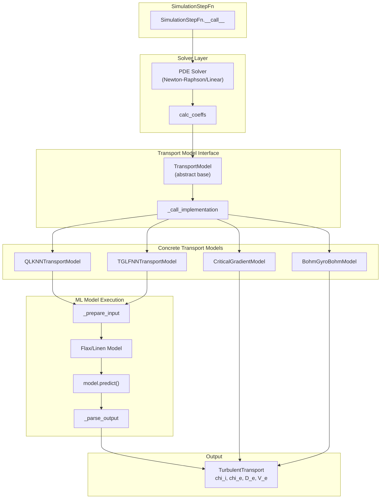
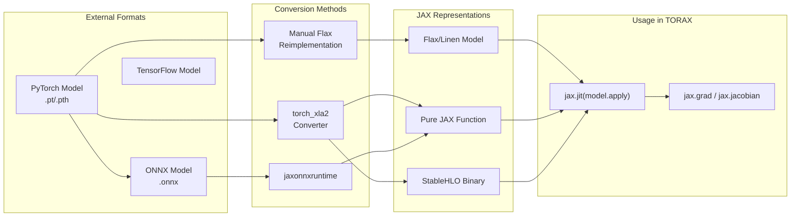

<!-- source: DeepWiki mcp.deepwiki.com · repo google-deepmind/torax · page 9.3 ML-Surrogate Integration · fetched 2026-10-26 -->

# ML-Surrogate Integration

<details>
<summary>Relevant source files</summary>

The following files were used as context for generating this wiki page:

- [.github/workflows/pytest.yml](.github/workflows/pytest.yml)
- [README.md](README.md)
- [docs/configuration.rst](docs/configuration.rst)
- [docs/edge_models.rst](docs/edge_models.rst)
- [docs/installation.rst](docs/installation.rst)
- [docs/interfacing_with_surrogates.rst](docs/interfacing_with_surrogates.rst)
- [docs/links.rst](docs/links.rst)
- [docs/output.rst](docs/output.rst)
- [docs/physics_models.rst](docs/physics_models.rst)
- [docs/running_programmatically.rst](docs/running_programmatically.rst)
- [docs/user_guides.rst](docs/user_guides.rst)
- [docs/using_jax.rst](docs/using_jax.rst)
- [pyproject.toml](pyproject.toml)
- [torax/__init__.py](torax/__init__.py)

</details>


## Purpose and Scope

This page documents how to integrate machine learning surrogate models into TORAX, covering conversion methods, JAX compatibility requirements, and implementation patterns. ML surrogates replace computationally expensive physics models (e.g., gyrokinetic codes) with fast neural network approximations while maintaining differentiability for gradient-based solvers.

For information about the underlying physics of transport models, see the physics models documentation. For general JAX usage patterns in TORAX, see [JAX Integration and Compilation](#9.2).

## Overview

TORAX leverages JAX's autodifferentiation and JIT compilation to enable fast, differentiable simulations. ML surrogates must be JAX-compatible to benefit from these features, particularly when using nonlinear solvers like Newton-Raphson that require gradients.

Key capabilities enabled by JAX-compatible ML surrogates:
- **Gradient-based PDE solvers**: Newton-Raphson and optimizer-based methods
- **Fast execution**: JIT compilation reduces per-call overhead by orders of magnitude
- **Differentiable simulations**: Enables trajectory optimization and sensitivity analysis
- **Seamless integration**: Surrogate models interact with other physics components through autodiff

Sources: [README.md:7-21](), [docs/interfacing_with_surrogates.rst:1-55]()

## Integration Architecture

### Transport Model System



**ML Surrogate Integration Flow**

The transport model system follows a plugin architecture where ML surrogates implement the `TransportModel` interface. During each solver iteration, `calc_coeffs` calls the configured transport model's `_call_implementation` method, which:

1. Converts TORAX state objects to neural network input tensors
2. Calls the ML model (typically a Flax model)
3. Parses output tensors to `TurbulentTransport` coefficients

Sources: [torax/_src/transport_model/transport_model.py](), [docs/interfacing_with_surrogates.rst:15-36]()

### TransportModel Base Class

The abstract `TransportModel` class defines the interface all transport models must implement:

| Method | Purpose |
|--------|---------|
| `_call_implementation` | Core model evaluation returning `TurbulentTransport` |
| `__call__` | Public interface handling pre/post-processing |

ML surrogates override `_call_implementation` to integrate their model inference:

```python
class MyMLSurrogateTransportModel(TransportModel):
    def _call_implementation(
        self,
        runtime_params: RuntimeParams,
        geo: Geometry,
        core_profiles: CoreProfiles,
    ) -> TurbulentTransport:
        # Convert TORAX structures to tensors
        input_tensor = self._prepare_input(runtime_params, geo, core_profiles)
        
        # Call ML model (must be JAX-compatible)
        output_tensor = self._call_surrogate_model(input_tensor)
        
        # Parse to transport coefficients
        chi_i, chi_e, d_e, v_e = self._parse_output(output_tensor)
        
        return TurbulentTransport(
            chi_face_ion=chi_i,
            chi_face_electron=chi_e,
            d_e=d_e,
            v_e=v_e,
        )
```

Sources: [docs/interfacing_with_surrogates.rst:17-36]()

## Available ML Surrogates

### QLKNN_7_11

**Default transport model** in TORAX. Neural network surrogate trained on QuaLiKiz v2.8.1 gyrokinetic simulations.

| Feature | Details |
|---------|---------|
| **Input dimensions** | 11D hypercube (bulk) + 7D hypercube (edge) |
| **Outputs** | Separate ITG, TEM, ETG turbulent fluxes |
| **Input features** | Temperature/density gradients, safety factor, magnetic shear, collisionality, impurity gradients |
| **Implementation** | Flax/Linen models in `fusion_surrogates` package |
| **Configuration** | Set `transport.model_name = 'qlknn'` in config |

Sources: [docs/physics_models.rst:249-265](), [pyproject.toml:25]()

### QLKNN10D (QLKNN-hyper)

**Legacy model** trained on QuaLiKiz data. Available for backward compatibility and benchmarking.

| Feature | Details |
|---------|---------|
| **Training set** | Older QuaLiKiz collision operator |
| **Configuration** | Requires manual installation and `model_path` setting |
| **Use cases** | Comparative studies with other simulators |

Sources: [README.md:232-251](), [docs/installation.rst:99-119]()

### TGLFNN-UKAEA

**Ion cyclotron heating surrogate**. Neural network trained on TORIC simulations.

| Feature | Details |
|---------|---------|
| **Purpose** | ICRH heating and current drive |
| **Input features** | Includes E×B shearing rate for rotation effects |
| **Configuration** | Set `use_rotation = True` to enable rotation coupling |

Sources: [docs/physics_models.rst:383-386](), [README.md:35]()

## Converting ML Models to JAX



**ML Model Conversion Pathways to JAX**

Sources: [docs/interfacing_with_surrogates.rst:42-54]()

### Option 1: Manual Reimplementation in Flax

**Approach**: Rewrite model architecture in Flax/Linen and load weights separately.

**When to use**:
- Simple architectures (MLPs, CNNs)
- Full control over implementation
- Already using Flax in TORAX ecosystem

**Example architecture conversion**:

PyTorch:
```python
class PyTorchMLP(torch.nn.Module):
    def __init__(self, hidden_dim, n_hidden, output_dim, input_dim):
        super().__init__()
        self.model = torch.nn.Sequential(
            torch.nn.Linear(input_dim, hidden_dim),
            torch.nn.ReLU(),
            ...
        )
```

Flax equivalent:
```python
class FlaxMLP(linen.Module):
    hidden_dim: int
    n_hidden: int
    
    @linen.compact
    def __call__(self, x):
        x = linen.Dense(self.hidden_dim)(x)
        x = linen.relu(x)
        # ... additional layers
        return x
```

**Weight loading**:

```python
# Load PyTorch checkpoint
state_dict = torch.load(CHECKPOINT_PATH)

# Map to Flax parameter structure
params = {}
for i in range(n_hidden):
    params[f"Dense_{i}"] = {
        "kernel": jnp.array(state_dict[f"model.{i*2}.weight"]).T,
        "bias": jnp.array(state_dict[f"model.{i*2}.bias"]),
    }
params = {'params': params}

# Call model
output = jax.jit(flax_model.apply)(params, input_tensor)
```

**Warning**: PyTorch and Flax may use different weight layouts (e.g., transposed matrices). Always validate outputs against the original model.

Sources: [docs/interfacing_with_surrogates.rst:57-152]()

### Option 2: PyTorch to JAX with torch_xla2

**Approach**: Automatically convert PyTorch models using `torch_xla2` package.

**When to use**:
- Complex models where manual conversion is error-prone
- Rapid prototyping
- Model architecture is supported by torch_xla2

**Conversion**:

```python
import torch_xla2 as tx

# Load trained PyTorch model
trained_model = torch.load(MODEL_PATH, weights_only=False)

# Extract JAX-compatible representation
params, jax_model = tx.extract_jax(trained_model)

# Call as pure JAX function
output = jax.jit(jax_model)(params, input_tensor)
```

**Serialization for reuse**:

```python
# Save as StableHLO binary (JAX's serialization format)
exported = jax.export.export(jax.jit(jax_model))
with open("model.hlo", "wb") as f:
    f.write(exported.serialize())

# Save weights as numpy arrays
np.savez("weights.npz", *params)

# Load later
with open('model.hlo', 'rb') as f:
    model = jax.export.deserialize(f.read())
weights_npz = np.load('weights.npz')
weights = [jnp.array(v) for v in weights_npz.values()]
```

**Warning**: `torch_xla2` is evolving rapidly. APIs may change with little notice.

Sources: [docs/interfacing_with_surrogates.rst:155-209]()

### Option 3: ONNX Models with jaxonnxruntime

**Approach**: Load ONNX format models using `jaxonnxruntime` for JAX compatibility.

**When to use**:
- Model already in ONNX format
- Interoperability with multiple frameworks
- Model comes from external sources

**Loading and inference**:

```python
import onnx
from jaxonnxruntime.backend import Backend as ONNXJaxBackend

# Load ONNX model
onnx_model = onnx.load_model(ONNX_MODEL_PATH)

# Prepare JAX backend
jax_model = ONNXJaxBackend.prepare(onnx_model)

# Run inference (returns list of output tensors)
outputs = jax.jit(jax_model.run)({
    "input": jnp.asarray(input_tensor, dtype=jnp.float32)
})
```

**Note**: Without `jaxonnxruntime`, raw ONNX models using `onnxruntime.InferenceSession` are not differentiable and cannot be JIT-compiled by JAX.

Sources: [docs/interfacing_with_surrogates.rst:211-250]()

### Option 4: JAX Callbacks

**Approach**: Use JAX callbacks to call non-JAX code (e.g., Fortran executables, Python libraries).

**When to use**:
- Model cannot be converted to JAX
- External code integration required
- Linear solver only (no autodiff needed)

**Requirements**:
- Must disable JIT: `JAX_DISABLE_JIT=True`
- Must use `linear` solver (not `newton_raphson`)
- Performance penalty: ~2-3 orders of magnitude slower

**Example use case**: QuaLiKiz transport model integration calls external Fortran executable via callbacks.

Sources: [docs/interfacing_with_surrogates.rst:252-254](), [docs/using_jax.rst:59-73](), [docs/physics_models.rst:267-292]()

## JAX Compatibility Requirements

### JIT Compilation

All ML surrogate forward passes **must** be wrapped in `jax.jit` for acceptable performance:

```python
# Good - JIT compiled
output = jax.jit(model.apply)(params, input_tensor)

# Bad - Interpreted execution (100-1000x slower)
output = model.apply(params, input_tensor)
```

JIT compilation traces the model once and compiles to optimized machine code. Without JIT, each operation executes individually in Python.

Sources: [docs/interfacing_with_surrogates.rst:287-295]()

### Autodifferentiation

Surrogate models must be differentiable for gradient-based solvers:

| Solver Type | Autodiff Required | Notes |
|-------------|-------------------|-------|
| `newton_raphson` | Yes | Uses `jax.jacobian` internally |
| `optimizer` | Yes | Uses `jax.grad` for optimization |
| `linear` | No | Predictor-corrector method only |

**Validation**: Test that gradients compute without errors:

```python
def loss_fn(params, inputs):
    return jnp.sum(model.apply(params, inputs))

grad_fn = jax.grad(loss_fn)
gradients = grad_fn(params, test_input)  # Should not raise
```

Sources: [docs/interfacing_with_surrogates.rst:46-54](), [README.md:29-31]()

### Static vs Dynamic Shapes

JAX requires array shapes to be static (known at compile time):

**Static shapes (required)**:
```python
def model_call(x):
    # Shape [batch_size, features] must be fixed
    return model.apply(params, x)
```

**Dynamic shapes (not compatible)**:
```python
def model_call(x):
    # Variable-length inputs cause recompilation
    if x.shape[0] > 100:
        return model_large.apply(params_large, x)
    else:
        return model_small.apply(params_small, x)
```

TORAX uses fixed radial grids (`n_rho`), so transport models operate on fixed-size tensors.

Sources: [README.md:27-31]()

## Best Practices

### Caching and Lazy Loading

**Pattern**: Load model once on first call, cache for subsequent calls.

```python
import functools

@functools.lru_cache(maxsize=1)
def get_model(path: str) -> BaseQLKNNModel:
    """Load model from disk once, cache result."""
    return qlknn_10d.QLKNN10D(path)

def _call_implementation(self, ...):
    model = get_model(self._model_path)
    output = model.predict(...)
```

**Rationale**:
- Model loading from disk is expensive (100s of ms)
- Model is reused across thousands of solver calls
- `functools.lru_cache` automatically handles caching

**Implementation in QLKNN**: The `get_model` function in QLKNN transport model uses `lru_cache(maxsize=1)` to ensure the model is loaded only once per unique path.

Sources: [docs/interfacing_with_surrogates.rst:260-285]()

### JIT Configuration

**Ensure all model calls are JIT-compiled**:

```python
class MyMLTransportModel(TransportModel):
    def __init__(self, model_path: str):
        self._model = self._load_model(model_path)
        # Pre-JIT the model call
        self._jit_predict = jax.jit(self._model.apply)
    
    def _call_implementation(self, ...):
        input_tensor = self._prepare_input(...)
        # Use pre-JITted function
        output = self._jit_predict(self._model_params, input_tensor)
        return self._parse_output(output)
```

**JAX persistent cache**: Enable to avoid recompilation across Python sessions:

```bash
export JAX_COMPILATION_CACHE_DIR=~/jax_cache
export JAX_PERSISTENT_CACHE_MIN_ENTRY_SIZE_BYTES=-1
export JAX_PERSISTENT_CACHE_MIN_COMPILE_TIME_SECS=0.0
```

Sources: [docs/using_jax.rst:7-43](), [docs/interfacing_with_surrogates.rst:287-295]()

### Testing and Validation

**Validate converted models against original implementation**:

```python
def test_jax_conversion():
    # Original PyTorch model
    torch_model = load_pytorch_model()
    torch_output = torch_model(torch_input)
    
    # Converted JAX model
    jax_model, params = convert_to_jax(torch_model)
    jax_output = jax_model.apply(params, jax_input)
    
    # Verify outputs match
    np.testing.assert_allclose(
        torch_output.detach().numpy(),
        np.array(jax_output),
        rtol=1e-5,
        atol=1e-6,
    )
```

**Gradient verification**:

```python
def test_gradients():
    def loss_fn(params):
        return jnp.sum(model.apply(params, test_input))
    
    # Should compute without error
    grad_fn = jax.grad(loss_fn)
    gradients = grad_fn(model_params)
    
    # Gradients should not be NaN or Inf
    assert jnp.all(jnp.isfinite(gradients))
```

Sources: [docs/interfacing_with_surrogates.rst:147-152]()

### Integration Checklist

When integrating a new ML surrogate:

1. **Subclass `TransportModel`**: Implement `_call_implementation` method
2. **Implement conversion methods**:
   - `_prepare_input`: TORAX structures → tensors
   - `_parse_output`: tensors → `TurbulentTransport`
3. **Load model with caching**: Use `functools.lru_cache`
4. **JIT-compile forward pass**: Wrap in `jax.jit`
5. **Test autodiff**: Verify `jax.grad` works
6. **Validate outputs**: Compare against reference implementation
7. **Add configuration**: Create config class with model parameters
8. **Document**: Add to transport model documentation

Sources: [docs/interfacing_with_surrogates.rst:15-36](), [docs/interfacing_with_surrogates.rst:257-295]()

---

