# Page: Overview

# Overview

<details>
<summary>Relevant source files</summary>

The following files were used as context for generating this wiki page:

- [.github/workflows/pytest.yml](.github/workflows/pytest.yml)
- [README.md](README.md)
- [docs/configuration.rst](docs/configuration.rst)
- [docs/edge_models.rst](docs/edge_models.rst)
- [docs/installation.rst](docs/installation.rst)
- [docs/interfacing_with_surrogates.rst](docs/interfacing_with_surrogates.rst)
- [docs/links.rst](docs/links.rst)
- [docs/output.rst](docs/output.rst)
- [docs/physics_models.rst](docs/physics_models.rst)
- [docs/running_programmatically.rst](docs/running_programmatically.rst)
- [docs/user_guides.rst](docs/user_guides.rst)
- [docs/using_jax.rst](docs/using_jax.rst)
- [pyproject.toml](pyproject.toml)
- [torax/__init__.py](torax/__init__.py)

</details>


TORAX is a differentiable 1D tokamak plasma transport simulator implemented in Python using JAX. It is designed for fast and accurate forward modeling, pulse design, trajectory optimization, and controller design workflows in magnetic confinement fusion research.

**Scope of this document:** This page provides a high-level overview of TORAX's architecture, key components, and data flow. For detailed information about specific subsystems:
- For installation instructions, see [Installation and Setup](#1.1)
- For running your first simulation, see [Quick Start Guide](#1.2)
- For configuration details, see [Configuration System](#2)
- For physics models, see [Physics Models](#3)
- For numerical methods, see [Numerical Methods](#5)

## Purpose and Key Features

TORAX is built on three core principles:

1. **Open Source and Extensible**: Flexible workflow coupling with modular physics components
2. **Differentiable and Fast**: JAX provides auto-differentiation and JIT compilation for gradient-based optimization and fast execution
3. **ML-Ready Framework**: Natural integration of machine learning surrogates alongside traditional physics models

### Physics Capabilities

| Feature | Description |
|---------|-------------|
| PDEs Solved | Ion/electron heat transport, electron particle transport, current diffusion |
| Discretization | Finite volume method (FVM) with theta-method time integration |
| Solvers | Linear (predictor-corrector, Pereverzev-Corrigan), Nonlinear (Newton-Raphson, optimizer-based) |
| Transport Models | QLKNN_7_11, QLKNN10D, CGM, Bohm-GyroBohm, user-defined |
| Sources | Ohmic, fusion, ICRH, ECRH, generic heating, particle sources, bootstrap current |
| Geometry | CHEASE, FBT, EQDSK, IMAS equilibrium formats; time-dependent geometry |
| Pedestal | Adaptive source models for internal boundary conditions |
| MHD | Sawtooth crash modeling |

**Sources:** [README.md:24-53](), [pyproject.toml:5-10]()

## System Architecture

### Layered Component Overview

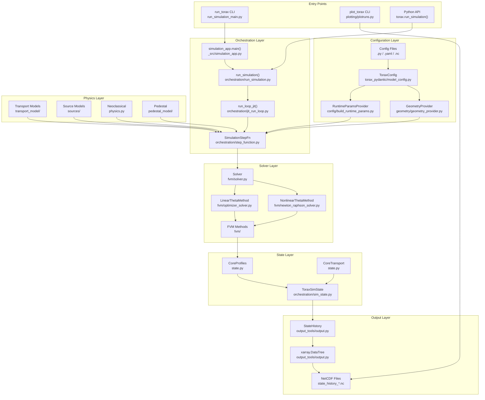

**Diagram: TORAX System Architecture**

This diagram shows the complete flow from user entry points through the various system layers to final outputs. The architecture is designed with clear separation of concerns:

- **Entry Points** provide both CLI and programmatic access
- **Configuration Layer** handles validation and time-dependent parameter interpolation
- **Orchestration Layer** manages simulation execution and JAX compilation
- **Physics Layer** contains modular, pluggable physics models
- **Solver Layer** implements numerical methods for PDE solution
- **State Layer** maintains immutable state structures for JAX compatibility
- **Output Layer** serializes results to NetCDF format

**Sources:** [torax/__init__.py:15-59](), [torax/_src/simulation_app.py:15-206](), [README.md:1-274]()

## Key Components and Code Entities

### Entry Points

The system provides three primary entry points:

| Entry Point | Module | Description |
|-------------|--------|-------------|
| `run_torax` | [pyproject.toml:54]() | CLI command for running simulations |
| `plot_torax` | [pyproject.toml:55]() | CLI command for plotting results |
| `run_simulation()` | [torax/__init__.py:26]() | Python API function |

**Sources:** [pyproject.toml:53-55](), [torax/__init__.py:20-35]()

### Configuration System

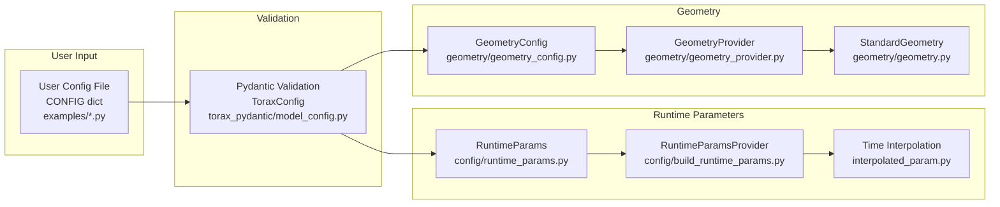

**Diagram: Configuration System Data Flow**

The configuration system uses Pydantic models for validation and provides time-dependent parameter interpolation:

- **`ToraxConfig`**: Top-level Pydantic model containing all simulation configuration
- **`RuntimeParamsProvider`**: Supplies time-interpolated parameters during simulation without recompilation
- **`GeometryProvider`**: Manages time-dependent equilibrium geometry

**Sources:** [torax/__init__.py:23-34](), [README.md:42-52]()

### Simulation Orchestration

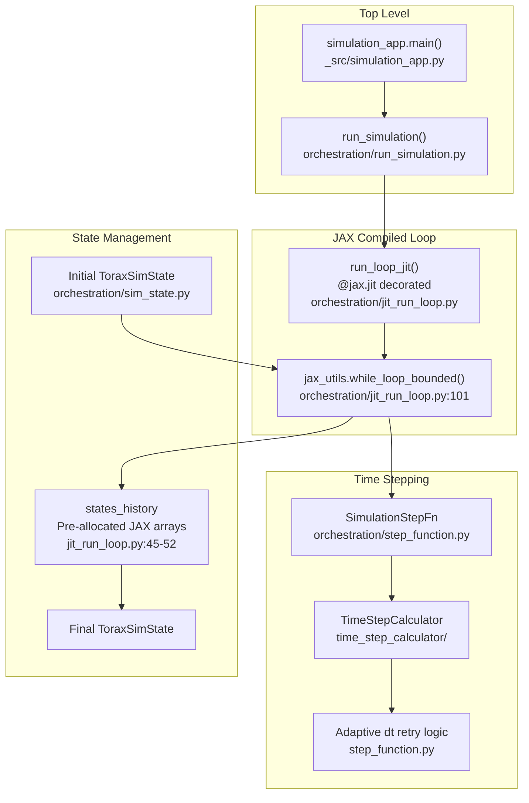

**Diagram: Simulation Execution Flow**

The orchestration layer manages the main simulation loop:

- **`simulation_app.main()`**: Entry point that writes output to NetCDF files
- **`run_simulation()`**: Builds simulation components and runs the loop
- **`run_loop_jit()`**: JAX-compiled loop using pre-allocated history buffers
- **`SimulationStepFn`**: Callable that advances the simulation by one timestep
- **`ToraxSimState`**: Immutable state structure containing `CoreProfiles`, `CoreTransport`, and `Geometry`

**Sources:** [torax/_src/simulation_app.py:149-206](), [torax/_src/orchestration/jit_run_loop.py:29-116]()

### Physics Models and State

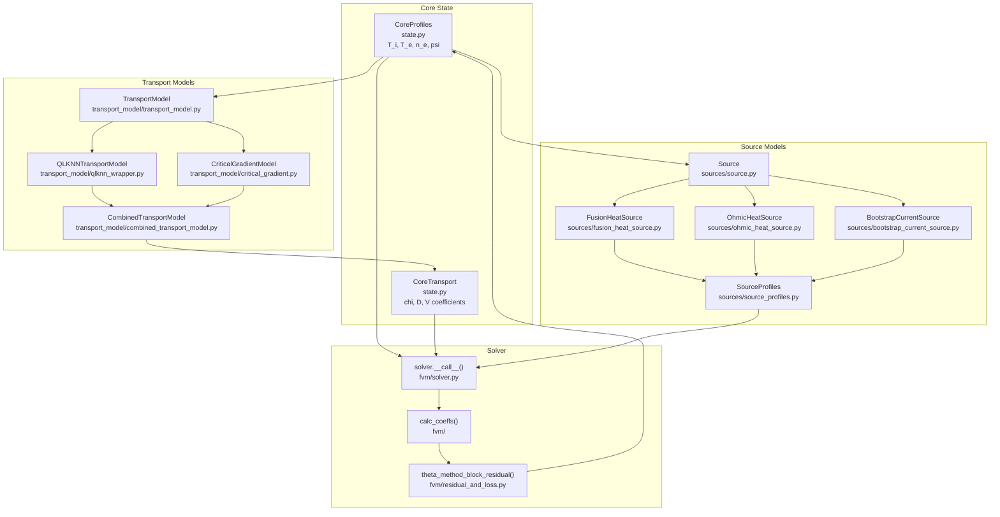

**Diagram: Physics Models and State Evolution**

Physics models are modular and interact through well-defined interfaces:

- **`CoreProfiles`**: Contains evolved state variables (temperature, density, poloidal flux)
- **`TransportModel`**: Abstract interface for transport coefficient calculation
- **`Source`**: Abstract interface for heat, particle, and current sources
- **`SourceProfiles`**: Collection of all source terms for a timestep
- **`Solver`**: Evolves `CoreProfiles` forward in time using transport coefficients and sources

**Sources:** [torax/__init__.py:30-31](), [README.md:26-42]()

## Data Flow from Configuration to Output

```mermaid
graph LR
    subgraph "Input"
        ConfigPy["examples/basic_config.py<br/>CONFIG dict"]
    end
    
    subgraph "Build Phase"
        BuildConfig["build_torax_config_from_file()<br/>config/config_loader.py"]
        ToraxCfg["ToraxConfig instance<br/>torax_pydantic/model_config.py"]
        BuildComponents["Build Runtime Providers<br/>Build Geometry Provider<br/>Build Physics Models<br/>Build Solver"]
    end
    
    subgraph "Execution"
        RunLoop["run_loop_jit()<br/>JAX compiled loop"]
        TimeSteps["Timestep Iterations<br/>while t < t_final"]
    end
    
    subgraph "Output"
        StateSeq["Tuple of ToraxSimState<br/>one per timestep"]
        ToDataTree["output.datatree_to_xr_datatree()<br/>output_tools/output.py"]
        NetCDFFile["state_history_*.nc<br/>/tmp/torax_results/"]
    end
    
    ConfigPy --> BuildConfig
    BuildConfig --> ToraxCfg
    ToraxCfg --> BuildComponents
    BuildComponents --> RunLoop
    RunLoop --> TimeSteps
    TimeSteps --> StateSeq
    StateSeq --> ToDataTree
    ToDataTree --> NetCDFFile
```

**Diagram: Complete Data Flow Pipeline**

The simulation follows a clear pipeline from configuration to output:

1. **Input**: User provides a Python file with a `CONFIG` dictionary
2. **Build**: Configuration is validated and components are constructed
3. **Execution**: JAX-compiled loop iterates through timesteps
4. **Output**: State history is converted to xarray `DataTree` and written to NetCDF

**Sources:** [torax/_src/simulation_app.py:149-206](), [torax/_src/orchestration/jit_run_loop.py:29-116]()

## JAX Integration

TORAX leverages JAX for performance and differentiability:

| Feature | Implementation |
|---------|----------------|
| JIT Compilation | `@jax.jit` decorator on `run_loop_jit()` [jit_run_loop.py:29]() |
| Pytree Compatibility | All state structures are JAX pytrees [state.py]() |
| Pre-allocated Arrays | History buffers allocated before loop [jit_run_loop.py:45-52]() |
| While Loop | `jax_utils.while_loop_bounded()` for iteration [jit_run_loop.py:101-112]() |
| Auto-differentiation | Enabled throughout for gradient-based optimization |

Environment variables control JAX behavior:

```python
# Disable JIT for debugging
export JAX_DISABLE_JIT=True

# Enable persistent compilation cache
export JAX_COMPILATION_CACHE_DIR=~/jax_cache
export JAX_PERSISTENT_CACHE_MIN_ENTRY_SIZE_BYTES=-1
export JAX_PERSISTENT_CACHE_MIN_COMPILE_TIME_SECS=0.0

# Set precision (default f64)
export JAX_PRECISION=f64
```

**Sources:** [torax/__init__.py:62-76](), [README.md:164-179](), [docs/running.rst:60-78]()

## Output System

Simulation results are stored in NetCDF files using xarray `DataTree` structures:

- **File Format**: NetCDF4 (`.nc` extension)
- **File Naming**: `state_history_YYYYMMDD_HHMMSS.nc`
- **Default Location**: `/tmp/torax_results/` (configurable via `--output_dir` flag)
- **Data Structure**: Hierarchical xarray `DataTree` with time-series data

The `StateHistory` class [output_tools/output.py]() collects:
- `CoreProfiles` evolution over time
- `CoreTransport` coefficients
- `Geometry` at each timestep
- Post-processed quantities (fusion power, stored energy, etc.)

**Visualization**: Use `plot_torax --outfile <path>` to visualize results with an interactive slider.

**Sources:** [torax/_src/simulation_app.py:102-119](), [docs/running.rst:23-29](), [docs/quickstart.rst:66-85]()

## Testing Framework

TORAX employs comprehensive testing:

| Test Type | Description |
|-----------|-------------|
| Unit Tests | Component-level tests for physics formulas, coefficient calculations |
| Integration Tests | Full simulation runs with reference output comparison |
| Parameterized Tests | Multiple physics model configurations tested systematically |
| CI/CD | GitHub Actions with 8-way parallel test sharding |

Key testing infrastructure:
- **Test Data**: Reference NetCDF files in `torax/tests/test_data/`
- **Test Sharding**: Controlled by `PYTEST_NUM_SHARDS` environment variable [pytest.yml:25]()
- **Error Checking**: `TORAX_ERRORS_ENABLED=1` enables assertions [pytest.yml:23]()
- **No-compile Tests**: `JAX_DISABLE_JIT=True` for debugging [pytest.yml:83]()

**Sources:** [.github/workflows/pytest.yml:1-84](), [README.md:199-206]()

## Getting Started

To run your first simulation:

```bash
# Install from PyPI
pip install torax

# Run basic example
run_torax --config=examples/basic_config.py

# Run with progress logging
run_torax --config=examples/basic_config.py --log_progress

# Plot results
plot_torax --outfile /tmp/torax_results/state_history_*.nc
```

For more details:
- Installation: See [Installation and Setup](#1.1)
- Running simulations: See [Quick Start Guide](#1.2)
- Configuration: See [Configuration System](#2)
- Python API usage: See [Python API](#6.2)

**Sources:** [README.md:103-150](), [docs/quickstart.rst:1-94](), [docs/running.rst:1-183]()

---

# Page: Installation and Setup

# Installation and Setup

<details>
<summary>Relevant source files</summary>

The following files were used as context for generating this wiki page:

- [.github/workflows/pytest.yml](.github/workflows/pytest.yml)
- [README.md](README.md)
- [docs/installation.rst](docs/installation.rst)
- [pyproject.toml](pyproject.toml)
- [torax/__init__.py](torax/__init__.py)

</details>


This document covers the installation process for TORAX, including system requirements, dependency management, environment configuration, and verification procedures. For information about running your first simulation, see [Quick Start Guide](#1.2). For detailed configuration of simulation parameters, see [Configuration System](#2).

## Overview

TORAX installation involves three main steps: setting up a Python environment, installing the package and its dependencies, and configuring JAX-specific environment variables for optimal performance. The system supports installation via PyPI for end users or from source for developers.

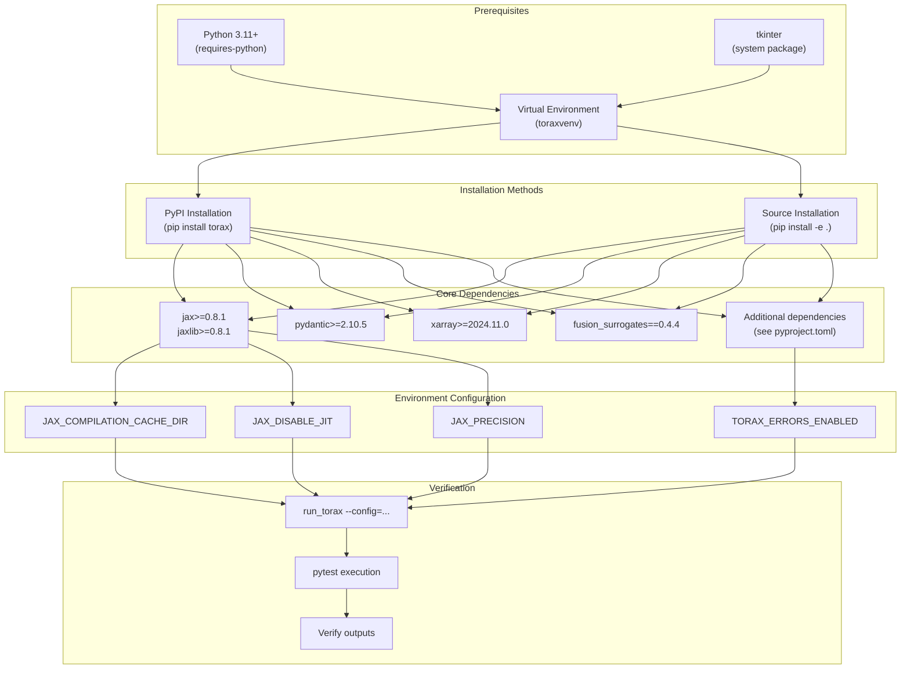

**Sources:** [pyproject.toml:1-128](), [README.md:69-232](), [docs/installation.rst:1-120]()

## System Requirements

### Python Version

TORAX requires Python 3.11 or greater, as specified in [pyproject.toml:9]().

```bash
python3 --version  # Should show 3.11 or higher
```

### System Dependencies

The `tkinter` library must be installed at the system level for visualization functionality:

```bash
sudo apt-get install python3-tk
```

**Sources:** [README.md:75-79](), [docs/installation.rst:8-17]()

## Virtual Environment Setup

TORAX should be installed in an isolated Python virtual environment to avoid dependency conflicts.

### Creating the Virtual Environment

```bash
# Install or upgrade pip and virtualenv
pip install --upgrade pip
pip install virtualenv

# Create virtual environment
python3 -m venv toraxvenv

# Activate virtual environment
source toraxvenv/bin/activate
```

The virtual environment name `toraxvenv` appears in documentation examples at [README.md:98-100]() and [docs/installation.rst:49]().

To deactivate the virtual environment later:

```bash
deactivate
```

**Sources:** [README.md:83-100](), [docs/installation.rst:24-57]()

## Installation Methods

### PyPI Installation (Recommended for Users)

For users who want to run simulations without modifying TORAX source code:

```bash
pip install torax
```

This installs the package registered at [pyproject.toml:6]() with all required dependencies specified in [pyproject.toml:17-46]().

### Source Installation (For Development)

For developers who need to modify TORAX code, install from the cloned repository:

```bash
git clone https://github.com/google-deepmind/torax
cd torax
pip install -e .[dev]
```

The `[dev]` extra installs additional development dependencies including `pytest`, `pylint`, and `pyink` as specified in [pyproject.toml:65-78]().

**Sources:** [README.md:102-119](), [docs/installation.rst:61-75](), [pyproject.toml:62-78]()

## Dependency Architecture

The following diagram maps TORAX's major dependency categories to their roles in the system:

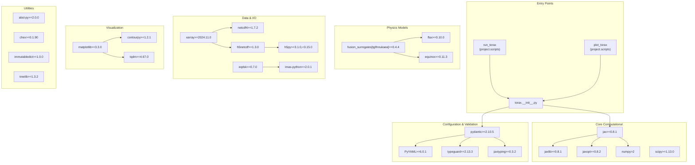

**Sources:** [pyproject.toml:17-46]()

### Core Dependencies Table

| Dependency | Version Constraint | Purpose |
|------------|-------------------|---------|
| `jax` | >=0.8.1 | Auto-differentiation and JIT compilation framework |
| `jaxlib` | >=0.8.1 | JAX backend implementation |
| `jaxopt` | >=0.8.2 | Optimization solvers (used in optimizer-based PDE solver) |
| `pydantic` | >=2.10.5 | Configuration validation via `ToraxConfig` |
| `xarray` | >=2024.11.0 | Multi-dimensional data structures for output |
| `netcdf4` | >=1.7.2 | NetCDF file I/O for simulation results |
| `fusion_surrogates` | ==0.4.4 | QLKNN neural network transport models |
| `matplotlib` | >=3.3.0 | Plotting and visualization |
| `numpy` | >2 | Numerical array operations |
| `scipy` | >=1.13.0 | Scientific computing utilities |
| `eqdsk` | >=0.7.0 | EQDSK equilibrium file parsing |
| `imas-python` | ==2.0.1 | ITER Integrated Modelling Analysis Suite interface |

**Sources:** [pyproject.toml:17-46]()

## Environment Configuration

TORAX behavior is controlled by several environment variables that configure JAX compilation, caching, and TORAX-specific error checking.

### JAX Environment Variables

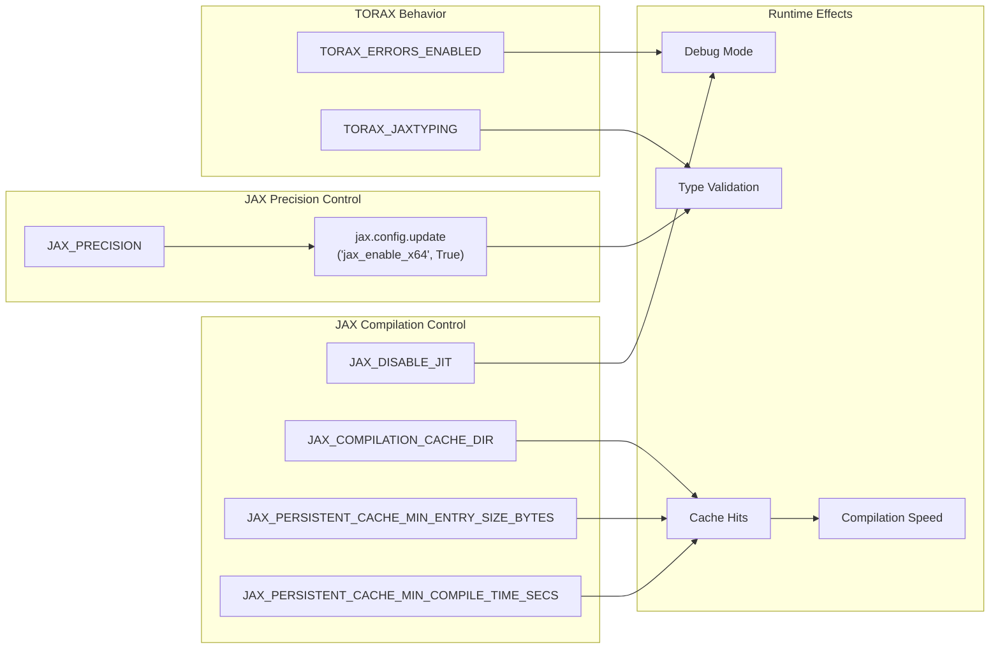

**Sources:** [README.md:152-189](), [torax/__init__.py:72-86](), [docs/installation.rst:77-90]()

### Environment Variables Table

| Variable | Default | Description | Code Reference |
|----------|---------|-------------|----------------|
| `JAX_DISABLE_JIT` | `False` | Disables JAX JIT compilation for debugging | [README.md:165-170]() |
| `JAX_COMPILATION_CACHE_DIR` | None | Directory for persistent compilation cache | [README.md:172-179]() |
| `JAX_PERSISTENT_CACHE_MIN_ENTRY_SIZE_BYTES` | N/A | Minimum cache entry size (-1 for all) | [README.md:177]() |
| `JAX_PERSISTENT_CACHE_MIN_COMPILE_TIME_SECS` | N/A | Minimum compile time to cache (0.0 for all) | [README.md:178]() |
| `JAX_PRECISION` | `f64` | Floating point precision (f32/f64) | [torax/__init__.py:74-79]() |
| `TORAX_ERRORS_ENABLED` | `False` | Enable error checking in internal routines | [README.md:154-161]() |
| `TORAX_JAXTYPING` | `False` | Enable runtime type checking | [.github/workflows/pytest.yml:24]() |

### Setting Environment Variables

**Persistent configuration (recommended):**

Add to `~/.bashrc` or `~/.bash_profile`:

```bash
# JAX persistent compilation cache
export JAX_COMPILATION_CACHE_DIR=~/jax_cache
export JAX_PERSISTENT_CACHE_MIN_ENTRY_SIZE_BYTES=-1
export JAX_PERSISTENT_CACHE_MIN_COMPILE_TIME_SECS=0.0

# Optional: Enable error checking (incompatible with cache)
# export TORAX_ERRORS_ENABLED=True
```

**Temporary configuration (for single session):**

```bash
# Disable JIT for debugging
export JAX_DISABLE_JIT=True

# Enable comprehensive error checking
export TORAX_ERRORS_ENABLED=True
export TORAX_JAXTYPING=True
```

**Note:** `TORAX_ERRORS_ENABLED=True` is incompatible with the persistent compilation cache as noted in [README.md:156-157]().

**Sources:** [README.md:152-189](), [torax/__init__.py:72-86](), [docs/installation.rst:77-91]()

## Verification

### Basic Verification

After installation, verify TORAX works correctly by running an example configuration:

```bash
run_torax --config=examples/basic_config.py --quit
```

The `--quit` flag exits immediately after simulation without entering the interactive menu. This command invokes the CLI entry point defined at [pyproject.toml:54]().

**Expected behavior:**
- Progress bar showing simulation time and completion percentage
- Output file written to `/tmp/torax_results/state_history_YYYYMMDD_HHMMSS.nc`
- Process exits with code 0

**Sources:** [README.md:110-114](), [pyproject.toml:53-55]()

### Running Example Configurations

Test more complex scenarios:

```bash
# ITER hybrid scenario with current ramp-up
run_torax --config=examples/iterhybrid_rampup.py

# Predictor-corrector solver
run_torax --config=examples/iterhybrid_predictor_corrector.py
```

These examples demonstrate time-dependent geometry, multiple physics models, and different solver configurations.

**Sources:** [README.md:120-142]()

### Running Test Suite

For development installations, verify all tests pass:

```bash
# Run tests with full error checking
TORAX_JAXTYPING=True TORAX_ERRORS_ENABLED=True pytest . -n auto
```

This command:
- Enables runtime type validation (`TORAX_JAXTYPING=True`)
- Enables internal error checking (`TORAX_ERRORS_ENABLED=True`)
- Runs tests in parallel (`-n auto`)
- Uses pytest configuration from [pyproject.toml:118-127]()

The CI/CD pipeline uses test sharding as configured in [.github/workflows/pytest.yml:25]() with `PYTEST_NUM_SHARDS=8`.

**Sources:** [README.md:199-206](), [.github/workflows/pytest.yml:21-84]()

## Optional Components

### GPU Support

For machines with NVIDIA GPUs, install GPU-enabled JAX following the instructions at:
https://jax.readthedocs.io/en/latest/installation.html#supported-platforms

This replaces the CPU-only `jaxlib` with a GPU-accelerated version.

**Sources:** [docs/installation.rst:92-96]()

### QLKNN-hyper-10D Transport Model

TORAX uses QLKNN_7_11 by default (included in `fusion_surrogates==0.4.4` dependency). For compatibility with older simulations or benchmarking against other codes, install the legacy QLKNN10D model:

```bash
git clone https://gitlab.com/qualikiz-group/qlknn-hyper.git
```

Configure the model path in your simulation configuration:

```python
CONFIG = {
    'transport': {
        'model_path': '/path/to/qlknn-hyper',
    },
}
```

**Differences between models:**
- QLKNN_7_11: Based on QuaLiKiz 2.8.1, includes impurity gradients, better near-edge coverage
- QLKNN10D: Legacy model based on older QuaLiKiz version

**Sources:** [README.md:232-252](), [docs/installation.rst:99-119]()

### Tutorial Dependencies

For running Jupyter notebooks in the tutorials:

```bash
pip install torax[tutorial]
```

This installs additional dependencies specified in [pyproject.toml:80-84]():
- `seaborn` - Statistical visualization
- `notebook` - Jupyter notebook interface

**Sources:** [pyproject.toml:80-84]()

## Installation Workflow Summary

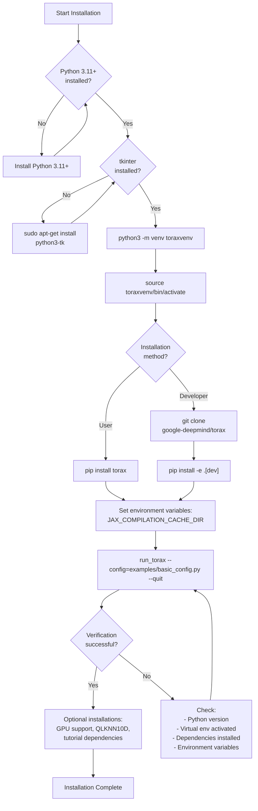

**Sources:** [README.md:69-232](), [docs/installation.rst:1-120]()

## Common Issues and Troubleshooting

### Import Errors

**Symptom:** `ModuleNotFoundError: No module named 'torax'`

**Solution:**
1. Verify virtual environment is activated: `which python` should point to `toraxvenv`
2. Reinstall TORAX: `pip install --force-reinstall torax`

### JAX Compilation Errors

**Symptom:** Compilation fails or is extremely slow

**Solution:**
1. Clear JAX cache: `rm -rf $JAX_COMPILATION_CACHE_DIR`
2. Disable persistent cache temporarily: `unset JAX_COMPILATION_CACHE_DIR`
3. Check available memory (compilation requires significant RAM)

### Precision Warnings

**Symptom:** Warnings about float32 vs float64

**Solution:**
The `set_jax_precision()` function at [torax/__init__.py:72-79]() sets default precision to f64. Override with:

```bash
export JAX_PRECISION=f32  # Use with caution - may affect accuracy
```

### Test Failures

**Symptom:** Tests fail with `TORAX_ERRORS_ENABLED=True`

**Solution:**
This is incompatible with the persistent cache. Either:
1. Disable cache: `unset JAX_COMPILATION_CACHE_DIR`
2. Run tests without error checking (not recommended)

**Sources:** [README.md:154-161](), [torax/__init__.py:72-86]()

---

# Page: Quick Start Guide

# Quick Start Guide

<details>
<summary>Relevant source files</summary>

The following files were used as context for generating this wiki page:

- [docs/configuration.rst](docs/configuration.rst)
- [docs/edge_models.rst](docs/edge_models.rst)
- [docs/interfacing_with_surrogates.rst](docs/interfacing_with_surrogates.rst)
- [docs/links.rst](docs/links.rst)
- [docs/output.rst](docs/output.rst)
- [docs/physics_models.rst](docs/physics_models.rst)
- [docs/plotting.rst](docs/plotting.rst)
- [docs/quickstart.rst](docs/quickstart.rst)
- [docs/running.rst](docs/running.rst)
- [docs/running_programmatically.rst](docs/running_programmatically.rst)
- [docs/user_guides.rst](docs/user_guides.rst)
- [docs/using_jax.rst](docs/using_jax.rst)

</details>


This page provides a rapid, hands-on introduction to running your first TORAX simulation, from configuration file to output visualization. For detailed installation instructions, see [Installation and Setup](#1.1). For comprehensive configuration options, see [Configuration System](#2). For detailed execution concepts, see [Simulation Execution](#4).

---

## Prerequisites

Before following this guide, ensure that:

1. TORAX is installed (see [Installation and Setup](#1.1))
2. Your Python virtual environment is activated
3. You have access to the `examples/` directory (either from PyPI installation or cloned repository)

The examples used in this guide are included with TORAX at [examples/](https://github.com/google-deepmind/torax/tree/main/examples).

**Sources:** [README.md:69-120](), [docs/installation.rst:1-120](), [pyproject.toml:53-55]()

---

## Basic Workflow Overview

The following diagram shows the complete quick start workflow from configuration to visualization:

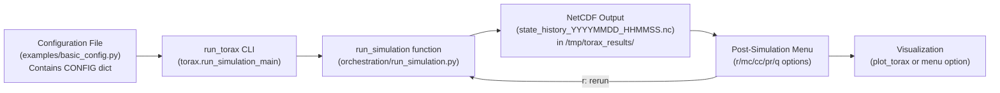

**Sources:** [torax/run_simulation_main.py:1-100](), [simulation_app.py:149-206](), [docs/running.rst:1-183]()

---

## Running Your First Simulation

### Basic Command

The simplest way to run TORAX is with the `run_torax` command-line interface:

```bash
run_torax --config='examples/basic_config.py'
```

This command:
1. Loads the configuration from `examples/basic_config.py`
2. Validates the `CONFIG` dictionary using Pydantic
3. Runs the simulation with progress bar
4. Writes output to `/tmp/torax_results/state_history_YYYYMMDD_HHMMSS.nc`

**Sources:** [README.md:122-128](), [docs/quickstart.rst:12-24](), [pyproject.toml:53-54]()

### Monitoring Progress

During execution, you will see a progress bar in the terminal:

```
Simulation Progress: 65%|████████████▌      | 3.25s/5.00s
```

The progress bar displays:
- Current simulation time
- Percentage complete relative to `t_final` configured in the `numerics` section
- Time remaining estimate

For additional timestep-level logging, use the `--log_progress` flag:

```bash
run_torax --config='examples/basic_config.py' --log_progress
```

This outputs detailed information for each timestep including `dt`, solver iterations, and convergence status.

**Sources:** [docs/running.rst:85-95](), [simulation_app.py:153-156]()

---

## Understanding Configuration Files

All TORAX simulations require a Python configuration file containing a `CONFIG` dictionary. This dictionary is automatically converted to a `ToraxConfig` Pydantic model for validation.

### Configuration File Structure

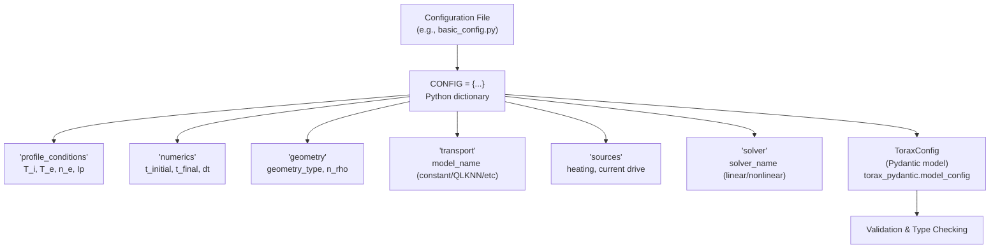

**Example: Minimal Configuration**

A minimal `CONFIG` dictionary requires only a geometry specification. All other parameters have defaults:

```python
# In my_config.py
CONFIG = {
    'geometry': {
        'geometry_type': 'circular',
        'n_rho': 25,
    }
}
```

**Sources:** [docs/configuration.rst:1-50](), [torax/__init__.py:34](), [docs/configuration.rst:33-47]()

### Available Example Configurations

TORAX provides several pre-configured examples with increasing complexity:

| Configuration File | Description | Solver | Transport Model |
|-------------------|-------------|--------|-----------------|
| `basic_config.py` | Simple constant transport | Linear | Constant |
| `iterhybrid_predictor_corrector.py` | ITER hybrid flat-top | Linear (predictor-corrector) | QLKNN |
| `iterhybrid_rampup.py` | ITER hybrid current rampup | Nonlinear (Newton-Raphson) | QLKNN |

To run any example:

```bash
run_torax --config='examples/<filename>.py'
```

**Sources:** [README.md:122-142](), [docs/quickstart.rst:26-40](), [docs/running.rst:31-45]()

---

## Output Files and Data Structure

### Output File Location

By default, simulation results are written to `/tmp/torax_results/` with timestamped filenames:

```
/tmp/torax_results/state_history_20240315_143022.nc
```

To specify a custom output directory:

```bash
run_torax --config='examples/basic_config.py' --output_dir=/path/to/my/results
```

**Sources:** [simulation_app.py:85-109](), [docs/running.rst:105-112]()

### NetCDF File Contents

The output file is a NetCDF file containing an `xarray.DataTree` with the following hierarchical structure:

**Title: TORAX Output DataTree Structure**

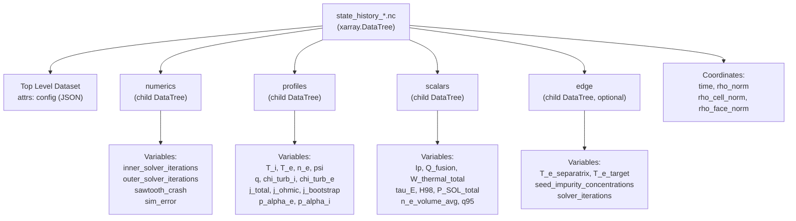

Key variables in the output:

**Profiles (1D radial profiles):**
- `T_i`, `T_e`: Ion and electron temperature [keV] - shape `(time, rho_norm)`
- `n_e`: Electron density [m⁻³] - shape `(time, rho_norm)`
- `psi`: Poloidal flux [Wb] - shape `(time, rho_norm)`
- `q`: Safety factor - shape `(time, rho_face_norm)`
- `chi_turb_i`, `chi_turb_e`: Turbulent heat conductivities [m²/s] - shape `(time, rho_face_norm)`
- `j_total`, `j_ohmic`, `j_bootstrap`: Current density profiles [A/m²]

**Scalars (time-dependent global quantities):**
- `Ip`: Plasma current [A] - shape `(time,)`
- `Q_fusion`: Fusion gain - shape `(time,)`
- `W_thermal_total`: Total stored energy [J] - shape `(time,)`
- `tau_E`: Energy confinement time [s] - shape `(time,)`
- `H98`: H-mode confinement factor - shape `(time,)`
- `P_SOL_total`: Power to scrape-off layer [W] - shape `(time,)`

For complete variable lists and definitions, see [Output Data Format](#7.1).

**Sources:** [docs/output.rst:11-95](), [docs/output.rst:119-735]()

---

## Visualizing Results

### Post-Simulation Menu

After simulation completion, `run_torax` presents an interactive menu rather than exiting immediately. This preserves the compiled simulation in memory for faster subsequent runs.

```
Menu Options:
  r  : RUN SIMULATION
  mc : modify the existing config and reload it
  cc : provide a new config file to load
  tlp: toggle --log_progress
  tlo: toggle --log_output
  pr : plot previous run(s) or against reference if provided
  q  : quit
```

To visualize your results:
1. Type `pr` and press Enter
2. Select option `0` to plot the last run
3. A matplotlib window will open with an interactive time slider

**Sources:** [docs/running.rst:139-183]()

### Standalone Plotting

Alternatively, use the `plot_torax` CLI command:

```bash
plot_torax --outfile /tmp/torax_results/state_history_20240315_143022.nc
```

**Title: Plot Window Features**

This opens an interactive matplotlib window with:
- **Time slider**: Scrub through all simulation timesteps
- **Spatial profiles**: Radial profiles (T_i, T_e, n_e, q) updated as slider moves
- **Time series plots**: Global quantities (if configured) showing full time evolution
- **Multiple runs**: Overlay two runs for comparison by providing both paths

To customize which quantities are plotted:

```bash
plot_torax --outfile <output_file> --plot_config=plotting/configs/custom_plot_config.py
```

Pre-configured plot layouts are available in `plotting/configs/`:
- `default_plot_config.py`: Comprehensive view of all quantities
- `simple_plot_config.py`: Basic kinetic profiles and currents
- `sources_plot_config.py`: Focus on heating and particle sources
- `global_params_plot_config.py`: Scalar time series (Q_fusion, H98, etc.)

**Sources:** [docs/quickstart.rst:66-84](), [docs/plotting.rst:10-91]()

---

## Common Command-Line Flags

The following table summarizes frequently used `run_torax` flags:

| Flag | Default | Description |
|------|---------|-------------|
| `--config` | (required) | Path to configuration file containing `CONFIG` dict |
| `--output_dir` | `/tmp/torax_results` | Directory for output NetCDF files |
| `--log_progress` | `False` | Log timestep details (time, dt, iterations) |
| `--log_output` | `False` | Log initial and final state to console |
| `--reference_run` | `None` | Path to reference NetCDF file for comparison plotting |
| `--plot_config` | `default_plot_config.py` | Custom plot configuration file |

**Example with multiple flags:**

```bash
run_torax \
  --config='examples/iterhybrid_rampup.py' \
  --output_dir=~/my_torax_results \
  --log_progress \
  --reference_run=/path/to/reference.nc
```

**Sources:** [docs/running.rst:60-137](), [README.md:144-197]()

---

## Environment Variables

Several environment variables control TORAX behavior:

| Variable | Default | Purpose |
|----------|---------|---------|
| `JAX_DISABLE_JIT` | `False` | Disable JAX compilation (debugging) |
| `TORAX_ERRORS_ENABLED` | `False` | Enable runtime error checking (debugging) |
| `JAX_COMPILATION_CACHE_DIR` | (none) | Enable persistent compilation cache |

**To enable compilation caching** (recommended for faster restarts):

```bash
export JAX_COMPILATION_CACHE_DIR=~/jax_cache
export JAX_PERSISTENT_CACHE_MIN_ENTRY_SIZE_BYTES=-1
export JAX_PERSISTENT_CACHE_MIN_COMPILE_TIME_SECS=0.0
```

**Sources:** [README.md:153-179](), [docs/running.rst:60-78](), [torax/__init__.py:38-70]()

---

## Quick Start Workflow Summary

The following diagram traces the execution path from CLI invocation to output file generation:

**Title: Code Execution Flow from CLI to NetCDF Output**

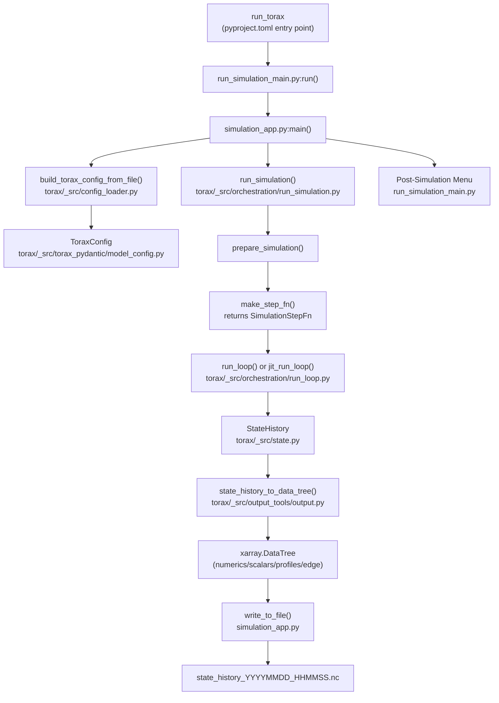

**Sources:** [docs/running.rst:1-184](), [docs/quickstart.rst:1-94]()

---

## Next Steps

Now that you've run your first simulation, explore:

- **[Configuration Parameters](#2.1)** - Comprehensive list of all configuration options
- **[Time-Dependent Parameters](#2.2)** - How to specify time-varying boundary conditions
- **[Physics Models](#3)** - Available transport models, sources, and geometries
- **[Simulation Execution](#4)** - Deep dive into step functions and state management
- **[Running Simulations](#6)** - Advanced CLI usage and Python API
- **[Results and Output](#7)** - Detailed output format and post-processing

For detailed configuration examples, see [Example Configurations](#2.4).

**Sources:** [docs/configuration.rst:1-50](), [docs/running.rst:1-183](), [docs/quickstart.rst:1-94]()

---

# Page: Configuration System

# Configuration System

<details>
<summary>Relevant source files</summary>

The following files were used as context for generating this wiki page:

- [docs/configuration.rst](docs/configuration.rst)
- [docs/edge_models.rst](docs/edge_models.rst)
- [docs/interfacing_with_surrogates.rst](docs/interfacing_with_surrogates.rst)
- [docs/links.rst](docs/links.rst)
- [docs/output.rst](docs/output.rst)
- [docs/physics_models.rst](docs/physics_models.rst)
- [docs/running_programmatically.rst](docs/running_programmatically.rst)
- [docs/user_guides.rst](docs/user_guides.rst)
- [docs/using_jax.rst](docs/using_jax.rst)
- [torax/_src/config/build_runtime_params.py](torax/_src/config/build_runtime_params.py)
- [torax/_src/config/numerics.py](torax/_src/config/numerics.py)
- [torax/_src/config/tests/build_runtime_params_test.py](torax/_src/config/tests/build_runtime_params_test.py)
- [torax/_src/config/tests/numerics_test.py](torax/_src/config/tests/numerics_test.py)

</details>


TORAX's configuration system provides a structured approach to defining simulation parameters, supporting both static values and time-dependent inputs with validation and type checking. This document covers the configuration architecture, parameter formats, validation mechanisms, and the conversion process from user-defined dictionaries to internal Pydantic models.

For information about running simulations with configurations, see [Running Simulations](#5). For details about specific configuration parameters, see [Configuration Parameters](#2.1).

## Configuration Architecture

The TORAX configuration system follows a layered architecture that transforms user-friendly Python dictionaries into validated, type-safe objects used throughout the simulation.

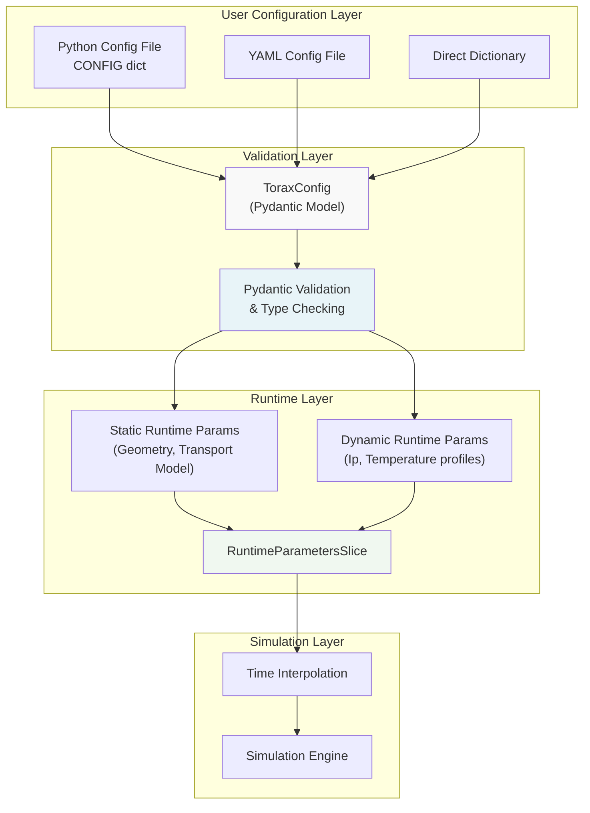

**Sources:** [docs/configuration.rst:26-36](), [docs/code_structure.rst:59-71]()

## Configuration Processing Flow

The configuration system processes user inputs through several stages, from initial parsing to runtime parameter interpolation.

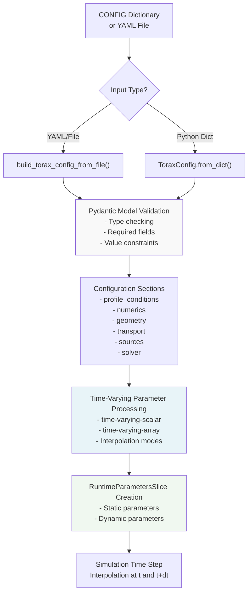

**Sources:** [docs/configuration.rst:26-36](), [docs/code_structure.rst:62-70]()

## Time-Dependent Parameter System

TORAX supports sophisticated time-dependent parameters through two main types: `time-varying-scalar` and `time-varying-array`. These parameters support multiple input formats and interpolation methods.

### Time-Varying Scalars

Time-varying scalars accept multiple input formats for specifying time evolution:

| Input Format | Example | Description |
|--------------|---------|-------------|
| Scalar | `15.0` | Constant value throughout simulation |
| Time dict | `{10: 2.0e6, 100: 15.0e6}` | Time-value pairs |
| Tuple | `(time_array, value_array)` | Arrays of times and values |
| xarray.DataArray | `xarray.DataArray(data=values, coords={'time': times})` | Structured array format |

**Sources:** [docs/configuration.rst:47-54]()

### Time-Varying Arrays

Time-varying arrays define spatial profiles that evolve over time, using the normalized flux coordinate ρ̂:

```python
# Nested dictionary format
T_i = {
    0.0: {0.0: 15.0, 0.95: 3.0, 1.0: 1.0},
    80.0: {0.0: 12.0, 0.95: 2.5, 1.0: 0.8}
}

# Array format
T_i = (time_array, rho_norm_array, values_array)
```

**Sources:** [docs/configuration.rst:100-172]()

### Interpolation Methods

Two interpolation modes are supported:

| Mode | Description | Usage |
|------|-------------|-------|
| `PIECEWISE_LINEAR` | Linear interpolation (default) | Smooth transitions |
| `STEP` | Stepwise changes | Discrete state changes |

**Sources:** [docs/configuration.rst:192-196]()

## Configuration Structure

The configuration system organizes parameters into logical sections, each controlling different aspects of the simulation:

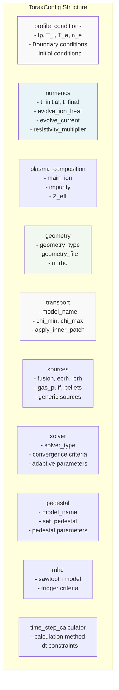

**Sources:** [docs/configuration.rst:11-25]()

### Core Configuration Sections

#### Profile Conditions
Controls plasma profiles and boundary conditions:
- `Ip`: Total plasma current (time-varying-scalar)
- `T_i`, `T_e`: Ion and electron temperatures (time-varying-array)
- `n_e`: Electron density (time-varying-array)
- `psi`: Poloidal flux (time-varying-array)

#### Numerics
Simulation control parameters:
- `t_initial`, `t_final`: Simulation time bounds
- `evolve_ion_heat`, `evolve_electron_heat`: Equation toggles
- `max_dt`, `min_dt`: Time step constraints
- `resistivity_multiplier`: Current diffusion scaling

#### Transport
Transport model configuration:
- `model_name`: `'constant'`, `'CGM'`, `'bohm-gyrobohm'`, `'qlknn'`, `'qualikiz'`
- `chi_min`, `chi_max`: Heat conductivity bounds
- `apply_inner_patch`, `apply_outer_patch`: Regional overrides

**Sources:** [docs/configuration.rst:205-873]()

## Validation and Type Checking

The configuration system uses Pydantic for comprehensive validation:

### Type Validation
- Automatic type conversion and checking
- Nested model validation
- Array shape and dimension validation
- Time coordinate validation

### Value Constraints
- Physical bounds checking (e.g., positive temperatures)
- Consistency validation between related parameters
- Required field enforcement
- Default value assignment

### Error Reporting
```python
# Invalid configuration raises informative errors
try:
    config = ToraxConfig.from_dict(invalid_config)
except ValidationError as e:
    # Detailed error messages with field paths
    print(e.errors())
```

**Sources:** [docs/configuration.rst:48-51](), [docs/running.rst:48-51]()

## Runtime Parameter Management

During simulation execution, the configuration system manages parameters through the `RuntimeParametersSlice` system:

### Static vs Dynamic Parameters
- **Static**: Don't change during simulation (transport model, geometry type)
- **Dynamic**: Change during simulation (plasma current, temperature profiles)
- Changing static parameters triggers JAX recompilation

### Parameter Interpolation
At each simulation step, time-dependent parameters are interpolated at both `t` and `t+dt` for the theta-method solver.

**Sources:** [docs/code_structure.rst:63-70](), [docs/configuration.rst:58-61]()

---

# Page: ToraxConfig and Configuration Parameters

# ToraxConfig and Configuration Parameters

<details>
<summary>Relevant source files</summary>

The following files were used as context for generating this wiki page:

- [docs/configuration.rst](docs/configuration.rst)
- [docs/edge_models.rst](docs/edge_models.rst)
- [docs/interfacing_with_surrogates.rst](docs/interfacing_with_surrogates.rst)
- [docs/links.rst](docs/links.rst)
- [docs/output.rst](docs/output.rst)
- [docs/physics_models.rst](docs/physics_models.rst)
- [docs/running_programmatically.rst](docs/running_programmatically.rst)
- [docs/user_guides.rst](docs/user_guides.rst)
- [docs/using_jax.rst](docs/using_jax.rst)
- [torax/_src/edge/extended_lengyel_model.py](torax/_src/edge/extended_lengyel_model.py)
- [torax/_src/edge/extended_lengyel_standalone.py](torax/_src/edge/extended_lengyel_standalone.py)
- [torax/_src/edge/pydantic_model.py](torax/_src/edge/pydantic_model.py)
- [torax/_src/edge/tests/edge_pydantic_model_test.py](torax/_src/edge/tests/edge_pydantic_model_test.py)
- [torax/_src/edge/tests/edge_updaters_test.py](torax/_src/edge/tests/edge_updaters_test.py)
- [torax/_src/edge/tests/extended_lengyel_model_test.py](torax/_src/edge/tests/extended_lengyel_model_test.py)
- [torax/_src/edge/updaters.py](torax/_src/edge/updaters.py)
- [torax/_src/torax_pydantic/model_config.py](torax/_src/torax_pydantic/model_config.py)
- [torax/_src/torax_pydantic/tests/model_config_test.py](torax/_src/torax_pydantic/tests/model_config_test.py)

</details>


## Purpose and Scope

This page documents the `ToraxConfig` Pydantic model and all top-level configuration sections that define TORAX simulation inputs. It provides a comprehensive reference for all configurable parameters, their data types, and their purposes.

For information about how configuration parameters are interpolated over time and converted to runtime parameters, see [Runtime Parameters and Time Interpolation](#2.2). For specific guidance on plasma composition configuration modes, see [Plasma Composition Configuration](#2.3). For complete example configurations, see [Example Configurations](#2.4).

## ToraxConfig Overview

`ToraxConfig` is the root configuration class for TORAX simulations. It is a Pydantic model that provides validation, type checking, and serialization for all simulation parameters. The configuration system follows a hierarchical structure where static configuration (defined in Python dictionaries or files) is validated by `ToraxConfig` and then converted to time-dependent runtime parameters.

The typical workflow is:
1. Define configuration as a Python dictionary with key `CONFIG`
2. Load configuration: `torax.build_torax_config_from_file('path/to/config.py')` or `ToraxConfig.from_dict(config_dict)`
3. `ToraxConfig` validates and structures the configuration
4. Runtime parameter providers interpolate time-dependent values during simulation

**Key Class:** `torax._src.torax_pydantic.model_config.ToraxConfig`

Sources: [torax/_src/torax_pydantic/model_config.py:45-93](), [docs/configuration.rst:1-50]()

## Configuration System Architecture

```mermaid
graph TB
    CONFIG_FILE["Config File<br/>(*.py with CONFIG dict)"]
    CONFIG_DICT["Python Dictionary<br/>(config_dict)"]
    
    TORAX_CONFIG["ToraxConfig<br/>(Pydantic Model)"]
    
    PROFILE["profile_conditions:<br/>ProfileConditions"]
    NUMERICS["numerics:<br/>Numerics"]
    COMPOSITION["plasma_composition:<br/>PlasmaComposition"]
    GEOMETRY["geometry:<br/>Geometry"]
    PEDESTAL["pedestal:<br/>PedestalConfig"]
    EDGE["edge:<br/>EdgeConfig | None"]
    SOURCES["sources:<br/>Sources"]
    SOLVER["solver:<br/>SolverConfig"]
    TRANSPORT["transport:<br/>TransportConfig"]
    NEOCLASSICAL["neoclassical:<br/>Neoclassical"]
    MHD["mhd:<br/>MHD"]
    TIME_STEP["time_step_calculator:<br/>TimeStepCalculator"]
    RESTART["restart:<br/>FileRestart | None"]
    
    CONFIG_FILE --> TORAX_CONFIG
    CONFIG_DICT --> TORAX_CONFIG
    
    TORAX_CONFIG --> PROFILE
    TORAX_CONFIG --> NUMERICS
    TORAX_CONFIG --> COMPOSITION
    TORAX_CONFIG --> GEOMETRY
    TORAX_CONFIG --> PEDESTAL
    TORAX_CONFIG --> EDGE
    TORAX_CONFIG --> SOURCES
    TORAX_CONFIG --> SOLVER
    TORAX_CONFIG --> TRANSPORT
    TORAX_CONFIG --> NEOCLASSICAL
    TORAX_CONFIG --> MHD
    TORAX_CONFIG --> TIME_STEP
    TORAX_CONFIG --> RESTART
    
    style TORAX_CONFIG fill:#f9f9f9
    style PROFILE fill:#e8f4f8
    style NUMERICS fill:#e8f4f8
    style COMPOSITION fill:#e8f4f8
    style GEOMETRY fill:#e8f4f8
```

**ToraxConfig Structure - Mapping Configuration Sections to Code Classes**

Sources: [torax/_src/torax_pydantic/model_config.py:45-93](), [docs/configuration.rst:14-32]()

## Top-Level Configuration Sections

`ToraxConfig` contains the following top-level configuration sections:

| Section | Type | Required | Description |
|---------|------|----------|-------------|
| `profile_conditions` | `ProfileConditions` | Yes | Boundary conditions, initial conditions, and prescribed time-dependence of temperature, density, and current |
| `numerics` | `Numerics` | Yes | Time stepping settings, equation evolution flags, and numerical parameters |
| `plasma_composition` | `PlasmaComposition` | Yes | Ion species distribution, main ions, impurities, and Z_eff |
| `geometry` | `Geometry` | Yes | Magnetic geometry configuration (CHEASE, EQDSK, FBT, IMAS, or circular) |
| `sources` | `Sources` | Yes | Configuration for all heating, current drive, and particle sources |
| `solver` | `SolverConfig` | Yes | PDE solver selection and parameters (defaults to `linear`) |
| `transport` | `TransportConfig` | Yes | Transport model selection and parameters (defaults to `constant`) |
| `neoclassical` | `Neoclassical` | No | Neoclassical bootstrap current and conductivity models |
| `pedestal` | `PedestalConfig` | Yes | Pedestal model configuration (defaults to `no_pedestal`) |
| `mhd` | `MHD` | No | MHD models (e.g., sawteeth) |
| `edge` | `EdgeConfig` | No | Edge physics model (e.g., Extended Lengyel) |
| `time_step_calculator` | `TimeStepCalculator` | No | Method for calculating timestep dt |
| `restart` | `FileRestart` | No | File restart behavior for continuing simulations |

Sources: [torax/_src/torax_pydantic/model_config.py:48-92](), [docs/configuration.rst:14-32]()

## profile_conditions

Configures boundary conditions, initial conditions, and optionally prescribed time-dependence of core plasma profiles (temperature, density, current).

**Key Parameters:**

| Parameter | Type | Default | Description |
|-----------|------|---------|-------------|
| `Ip` | time-varying-scalar | 15.0e6 | Total plasma current [A]. Boundary condition for ψ equation if not using v_loop |
| `use_v_loop_lcfs_boundary_condition` | bool | False | Use Vloop at LCFS as boundary condition instead of Ip |
| `v_loop_lcfs` | time-varying-scalar | 0.0 | Loop voltage at LCFS [V] (dpsi_lcfs/dt) |
| `T_i` | time-varying-array | {0: {0: 15.0, 1: 1.0}} | Ion temperature [keV] vs time and ρ̂ |
| `T_e` | time-varying-array | {0: {0: 15.0, 1: 1.0}} | Electron temperature [keV] vs time and ρ̂ |
| `T_i_right_bc` | time-varying-scalar | None | Ion temperature boundary condition at r=a_minor [keV] |
| `T_e_right_bc` | time-varying-scalar | None | Electron temperature boundary condition at r=a_minor [keV] |
| `n_e` | time-varying-array | {0: {0: 1.2e20, 1: 0.8e20}} | Electron density [m⁻³] vs time and ρ̂ |
| `nbar` | time-varying-scalar | 0.85e20 | Line-averaged density [m⁻³] or Greenwald fraction |
| `normalize_n_e_to_nbar` | bool | False | Renormalize density profile to match nbar |
| `n_e_right_bc` | time-varying-scalar | None | Electron density boundary condition at r=a_minor |
| `psi` | time-varying-array | None | Initial poloidal flux [Wb] |
| `psidot` | time-varying-array | None | Prescribed time derivative of poloidal flux [Wb/s] |
| `current_profile_nu` | float | 1.0 | Peaking factor for initial current: j ∝ (1-r²/a²)^ν |
| `initial_j_is_total_current` | bool | False | Whether current_profile_nu defines total or Ohmic current |
| `initial_psi_from_j` | bool | False | Calculate initial ψ from current formula vs geometry file |
| `toroidal_velocity` | time-varying-array | None | Toroidal velocity profile [m/s] |

**Code Class:** `torax._src.core_profiles.profile_conditions.ProfileConditions`

Sources: [docs/configuration.rst:239-351](), [torax/_src/torax_pydantic/model_config.py:68]()

## numerics

Configures simulation control parameters including time settings, timestep calculation, and which equations are evolved by the PDE solver.

**Key Parameters:**

| Parameter | Type | Default | Description |
|-----------|------|---------|-------------|
| `t_initial` | float | 0.0 | Simulation start time [s] |
| `t_final` | float | 5.0 | Simulation end time [s] |
| `exact_t_final` | bool | True | Ensure simulation ends exactly at t_final by adapting final dt |
| `fixed_dt` | time-varying-scalar | 1e-1 | Fixed timestep for `fixed_time_step_calculator` [s] |
| `max_dt` | float | 2.0 | Maximum timestep allowed [s] (for chi_time_step_calculator) |
| `min_dt` | float | 1e-8 | Minimum timestep allowed [s] |
| `chi_timestep_prefactor` | float | 50.0 | Prefactor for chi-based timestep: dt_base = dx²/(2χ) |
| `adaptive_dt` | bool | True | Enable dt-backtracking if nonlinear solver fails to converge |
| `dt_reduction_factor` | float | 3.0 | Factor to reduce dt during backtracking |
| `evolve_ion_heat` | bool | True | Solve ion heat equation in PDE |
| `evolve_electron_heat` | bool | True | Solve electron heat equation in PDE |
| `evolve_current` | bool | False | Solve current diffusion equation (evolving ψ) |
| `evolve_density` | bool | False | Solve electron density equation in PDE |
| `resistivity_multiplier` | time-varying-scalar | 1.0 | Multiplier for 1/σ to adjust current diffusion timescale |
| `adaptive_T_source_prefactor` | float | 1e10 | Prefactor for adaptive source term for temperature IBC |
| `adaptive_n_source_prefactor` | float | 1e8 | Prefactor for adaptive source term for density IBC |

**Evolution Flags:** The `evolve_*` flags determine which equations are solved by the PDE. When an equation is not evolved, prescribed time-dependent profiles can be provided in `profile_conditions`.

**Code Class:** `torax._src.config.numerics.Numerics`

Sources: [docs/configuration.rst:352-435](), [torax/_src/torax_pydantic/model_config.py:69]()

## plasma_composition

Defines the distribution of ion species, including main ions, impurities, and effective charge Z_eff. See [Plasma Composition Configuration](#2.3) for detailed documentation of the three impurity modes.

**Key Parameters:**

| Parameter | Type | Default | Description |
|-----------|------|---------|-------------|
| `main_ion` | str or dict | `{'D': 0.5, 'T': 0.5}` | Main ion species (single string or mixture dict) |
| `impurity` | dict | - | Impurity configuration with `impurity_mode` field |
| `Z_eff` | time-varying-array | 1.0 | Plasma effective charge (required for some modes) |
| `Z_i_override` | time-varying-scalar | None | Optional override for main ion charge |
| `A_i_override` | time-varying-scalar | None | Optional override for main ion mass [amu] |

**Impurity Modes:**
- `fractions`: Specify fractional abundances; Z_eff constrains total impurity density (default)
- `n_e_ratios`: Specify n_impurity/n_e for each species; Z_eff is calculated
- `n_e_ratios_Z_eff`: Specify ratios for all but one species; calculate remaining to match Z_eff

**Supported Ion Symbols:** H, D, T, He3, He4, Li, Be, C, N, O, Ne, Ar, Kr, Xe, W

**Code Classes:** 
- `torax._src.core_profiles.plasma_composition.plasma_composition.PlasmaComposition`
- Impurity modes: `electron_density_ratios.py`, `fractions.py`, etc.

Sources: [docs/configuration.rst:437-697](), [torax/_src/torax_pydantic/model_config.py:70]()

## geometry

Configures the magnetic geometry provider. TORAX supports CHEASE, EQDSK, IMAS, FBT, and analytical circular geometries.

**Common Parameters:**

| Parameter | Type | Default | Description |
|-----------|------|---------|-------------|
| `geometry_type` | str | - | Required: `'circular'`, `'chease'`, `'eqdsk'`, `'imas'`, or `'fbt'` |
| `n_rho` | int | 25 | Number of radial grid points |
| `hires_factor` | int | 4 | High-resolution mesh factor for j→ψ conversions |
| `geometry_file` | str | - | Path to geometry file (CHEASE, EQDSK, IMAS) |
| `geometry_directory` | str | None | Optional absolute path to geometry directory |
| `Ip_from_parameters` | bool | True | Use Ip from config vs geometry file |

**Circular Geometry (analytical):**
- `R_major`: Major radius [m] (default: 6.2)
- `a_minor`: Minor radius [m] (default: 2.0)
- `B_0`: Vacuum toroidal field on axis [T] (default: 5.3)
- `elongation_LCFS`: Plasma elongation (default: 1.72)

**FBT Geometry:**
- `divertor_domain`: `'lower_null'` or `'upper_null'`
- `LY_object`, `LY_bundle_object`, `L_object`: FBT geometry file objects
- `LY_to_torax_times`: Simulation times for bundle slices

**Code Classes:**
- `torax._src.geometry.geometry_pydantic_model.Geometry` (config)
- `torax._src.geometry.standard_geometry.StandardGeometry` (runtime)

Sources: [docs/configuration.rst:818-931](), [torax/_src/torax_pydantic/model_config.py:71]()

## pedestal

Configures pedestal models for setting internal boundary conditions (edge transport barrier). Default is `no_pedestal`.

**Available Models:**

| Model Name | Description |
|------------|-------------|
| `no_pedestal` | No pedestal profile set (default) |
| `set_T_ped_n_ped` | Directly specify pedestal width, Te, Ti, and ne |
| `set_P_ped_n_ped` | Specify total pressure and ne at pedestal |

**Key Parameters (set_T_ped_n_ped):**

| Parameter | Type | Default | Description |
|-----------|------|---------|-------------|
| `set_pedestal` | time-varying-scalar | False | Enable pedestal model |
| `T_e_ped` | time-varying-scalar | 5.0 | Electron temperature at pedestal top [keV] |
| `T_i_ped` | time-varying-scalar | 5.0 | Ion temperature at pedestal top [keV] |
| `n_e_ped` | time-varying-scalar | 0.7e20 | Electron density at pedestal top [m⁻³ or fGW] |
| `n_e_ped_is_fGW` | time-varying-scalar | False | Toggle units of n_e_ped |
| `rho_norm_ped_top` | time-varying-scalar | 0.91 | Location of pedestal top in ρ̂ |

**Code Class:** `torax._src.pedestal_model.pydantic_model.PedestalConfig`

Sources: [docs/configuration.rst:698-766](), [torax/_src/torax_pydantic/model_config.py:82-84]()

## edge

Configures edge physics models for calculating boundary conditions. Currently supports the Extended Lengyel model. See [Edge Physics and Extended Lengyel Model](#3.5) for detailed documentation.

**Available Models:**
- `extended_lengyel`: 1D SOL/divertor model calculating target temperature and separatrix conditions

**Key Parameters (Extended Lengyel):**

| Parameter | Type | Default | Description |
|-----------|------|---------|-------------|
| `model_name` | str | `'extended_lengyel'` | Edge model selection |
| `computation_mode` | str | `'forward'` | `'forward'` or `'inverse'` mode |
| `solver_mode` | str | `'hybrid'` | `'fixed_point'`, `'newton_raphson'`, or `'hybrid'` |
| `impurity_sot` | str | `'core'` | Source of truth: `'core'` or `'edge'` |
| `update_temperatures` | bool | True | Update core T_e/T_i boundary conditions |
| `update_impurities` | bool | True | Update core impurity profiles |
| `T_e_target` | time-varying-scalar | None | Target temperature [eV] (inverse mode) |
| `seed_impurity_weights` | dict | None | Relative weights for seeded impurities (inverse mode) |
| `fixed_impurity_concentrations` | dict | {} | Fixed background impurity concentrations |
| `enrichment_factor` | dict | None | Manual enrichment factors by species |
| `use_enrichment_model` | bool | True | Use Kallenbach 2024 enrichment model |
| `connection_length_target` | time-varying-scalar | None | Parallel connection length to target [m] |
| `diverted` | bool | None | Required for non-FBT geometries |

**Code Class:** `torax._src.edge.pydantic_model.ExtendedLengyelConfig`

Sources: [docs/configuration.rst:767-817](), [torax/_src/torax_pydantic/model_config.py:86](), [torax/_src/edge/pydantic_model.py:32-165]()

## sources

Configures all heating sources, current drive, particle sources, and radiation sinks. Each source is independently configured with parameters for profile shape, magnitude, and time-dependence.

**Available Sources:**

| Source | Type | Description |
|--------|------|-------------|
| `fusion` | Heating | Fusion alpha heating (Bosch-Hale formula) |
| `generic_heat` | Heating | Generic external heating to electrons and ions |
| `ecrh` | Heating + Current | Electron cyclotron resonance heating |
| `icrh` | Heating | Ion cyclotron resonance heating |
| `ohmic` | Heating | Ohmic heating |
| `bremsstrahlung` | Sink | Bremsstrahlung radiation |
| `impurity_radiation` | Sink | Impurity radiation (Mavrin fit model) |
| `cyclotron_radiation` | Sink | Cyclotron radiation |
| `qei` | Exchange | Electron-ion heat exchange (always active) |
| `generic_current` | Current | Generic non-inductive current drive |
| `gas_puff` | Particle | Gas puff particle source |
| `pellet` | Particle | Pellet injection particle source |
| `generic_particle` | Particle | Generic particle source |

**Common Source Parameters:**

| Parameter | Type | Description |
|-----------|------|-------------|
| `model` | str | Source model name (e.g., `'default'`, `'prescribed'`, `'zero'`) |
| `P_total` or `I_total` | time-varying-scalar | Total power [W] or current [A] |
| `gaussian_location` | time-varying-scalar | Peak location in normalized radius ρ̂ |
| `gaussian_width` | time-varying-scalar | Width of Gaussian profile |
| `is_explicit` | bool | Explicit (False) or implicit (True) time treatment |

**Code Class:** `torax._src.sources.pydantic_model.Sources`

Sources: [docs/configuration.rst:1005-1305](), [torax/_src/torax_pydantic/model_config.py:72]()

## solver

Configures the PDE solver for the time-dependent transport equations. Default is `linear` (predictor-corrector theta method).

**Available Solvers:**

| Solver Type | Description | Use Case |
|-------------|-------------|----------|
| `linear` | Linear theta method with predictor-corrector | Fast, suitable for weakly nonlinear problems |
| `newton_raphson` | Nonlinear Newton-Raphson solver | Handles strong nonlinearities, requires autodiff |
| `optimizer` | Optimizer-based solver (jaxopt.LBFGS) | For constrained optimization problems |

**Common Parameters:**

| Parameter | Type | Default | Description |
|-----------|------|---------|-------------|
| `solver_type` | str | `'linear'` | Solver selection (discriminator field) |
| `theta_imp` | float | 1.0 | Implicit theta parameter (0=explicit, 1=implicit) |
| `use_pereverzev` | bool | False | Enable Pereverzev-Corrigan terms for stability |

**Linear Solver Parameters:**
- `predictor_corrector`: bool = True (enable predictor-corrector)
- `corrector_steps`: int = 1 (number of corrector iterations)

**Newton-Raphson Solver Parameters:**
- `initial_guess_mode`: `'x_new'`, `'x_old'`, or `'linear'`
- `log_iterations`: bool = False
- `maxiter`: int = 30
- `tol`: float = 1e-5

**Code Classes:**
- `torax._src.solver.pydantic_model.SolverConfig` (base)
- `LinearThetaMethod`, `NewtonRaphsonThetaMethod`, `OptimizerThetaMethod`

Sources: [docs/configuration.rst:1306-1385](), [torax/_src/torax_pydantic/model_config.py:76-78]()

## transport

Configures the turbulent transport model that determines transport coefficients (χ_i, χ_e, D_e, V_e). Default is `constant`.

**Available Models:**

| Model Name | Description | Characteristics |
|------------|-------------|-----------------|
| `constant` | Constant transport coefficients | Simple, for testing |
| `CGM` | Critical Gradient Model | Theory-based, simple nonlinearity |
| `bohm-gyrobohm` | Bohm-GyroBohm scaling | Semi-empirical, widely used |
| `qlknn` | QLKNN-7-11 neural network | ML surrogate of QuaLiKiz, fast and accurate |
| `qualikiz` | QuaLiKiz quasilinear code | High-fidelity, requires external installation |

**Common Parameters:**

| Parameter | Type | Description |
|-----------|------|-------------|
| `model_name` | str | Transport model selection (discriminator field) |
| `apply_inner_patch` | bool | Apply fixed transport in inner region |
| `apply_outer_patch` | bool | Apply fixed transport in outer region |
| `De_min` | float | Minimum electron particle diffusivity [m²/s] |
| `Ve_min` | float | Minimum electron convection velocity [m/s] |
| `chimin` | float | Minimum heat diffusivity [m²/s] |
| `use_rotation` | bool | Enable rotation effects (model-dependent) |

**Model-Specific Parameters:**

*Constant Transport:*
- `chii_const`, `chie_const`, `De_const`, `Ve_const`: Fixed coefficient values

*QLKNN:*
- `include_ITG`, `include_TEM`, `include_ETG`: Enable turbulence mode channels
- `DVeff`: bool = True (use effective diffusion)

**Code Class:** `torax._src.transport_model.pydantic_model.TransportConfig`

Sources: [docs/configuration.rst:1386-1550](), [torax/_src/torax_pydantic/model_config.py:79-81]()

## neoclassical

Configures neoclassical physics models for bootstrap current and neoclassical conductivity. Uses Sauter 1999 formulas by default.

**Key Parameters:**

| Parameter | Type | Default | Description |
|-----------|------|---------|-------------|
| `bootstrap_model` | str | `'sauter'` | Bootstrap current model |
| `resistivity_model` | str | `'qlknn'` | Model for neoclassical resistivity calculation |
| `poloidal_velocity_multiplier` | float | 1.0 | Multiplier for poloidal velocity (rotation tuning) |

**Code Class:** `torax._src.neoclassical.pydantic_model.Neoclassical`

Sources: [torax/_src/torax_pydantic/model_config.py:73-75]()

## mhd

Configures MHD models. Currently only sawteeth are implemented.

**Key Parameters (Sawteeth):**

| Parameter | Type | Default | Description |
|-----------|------|---------|-------------|
| `sawteeth_model_name` | str | `'none'` | Sawtooth model: `'none'` or `'constant_mixing_radius'` |
| `sawteeth_period` | time-varying-scalar | 0.1 | Time between sawtooth crashes [s] |
| `sawteeth_mixing_radius` | time-varying-scalar | 0.3 | Mixing radius in normalized ρ̂ |

**Code Class:** `torax._src.mhd.pydantic_model.MHD`

Sources: [docs/configuration.rst:1551-1583](), [torax/_src/torax_pydantic/model_config.py:85]()

## time_step_calculator

Configures the method for calculating the timestep dt at each iteration.

**Available Calculators:**

| Calculator Type | Description |
|-----------------|-------------|
| `chi` | Adaptive based on chi timescale: dt = prefactor × dx²/(2χ_max) |
| `fixed` | Use fixed timestep from `numerics.fixed_dt` |

**Code Class:** `torax._src.time_step_calculator.pydantic_model.TimeStepCalculator`

Sources: [docs/configuration.rst:1584-1597](), [torax/_src/torax_pydantic/model_config.py:87-89]()

## restart

Configures file restart behavior for continuing simulations from saved state.

**Key Parameters:**

| Parameter | Type | Description |
|-----------|------|-------------|
| `run_id` | str | Run ID for loading previous state |
| `output_dir` | str | Directory containing state files |
| `t_start` | float | Time to restart from |

**Code Class:** `torax._src.torax_pydantic.file_restart.FileRestart`

Sources: [torax/_src/torax_pydantic/model_config.py:90-92]()

## Configuration to Runtime Parameter Flow

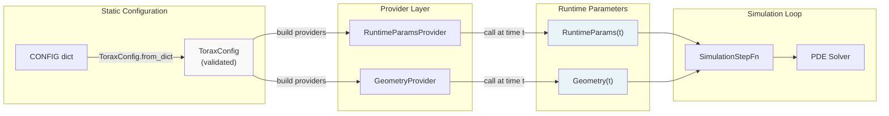

**Configuration Parameter Flow - From Static Configuration to Runtime Execution**

This diagram shows how static configuration in `ToraxConfig` flows through provider objects to produce time-dependent runtime parameters that are used during simulation execution. The separation between configuration and runtime parameters enables time interpolation and dynamic parameter updates.

Sources: [torax/_src/torax_pydantic/model_config.py:94-103](), [docs/configuration.rst:52-95]()

## Configuration Validation

`ToraxConfig` includes several model validators that check configuration consistency:

**Key Validations:**

1. **Pereverzev Warning:** Warns if nonlinear transport model is used with linear solver without Pereverzev terms enabled [torax/_src/torax_pydantic/model_config.py:138-172]()

2. **Psidot and Evolve Current:** Warns if `psidot` is provided but `evolve_current` is True (psidot is ignored) [torax/_src/torax_pydantic/model_config.py:174-187]()

3. **Edge with Circular Geometry:** Raises error if edge models are used with circular geometry [torax/_src/torax_pydantic/model_config.py:189-199]()

4. **Extended Lengyel Impurity Mode:** Ensures Extended Lengyel uses `n_e_ratios` impurity mode [torax/_src/torax_pydantic/model_config.py:201-215]()

5. **Edge Diverted Status:** Validates that `diverted` is set correctly based on geometry type [torax/_src/torax_pydantic/model_config.py:217-244]()

6. **Edge-Core Impurity Consistency:** Ensures impurity species match between core and edge configurations [torax/_src/torax_pydantic/model_config.py:246-283]()

Sources: [torax/_src/torax_pydantic/model_config.py:105-283]()

## Loading and Using Configuration

### From File

```python
import torax

# Load from Python file with CONFIG dict
torax_config = torax.build_torax_config_from_file('examples/iterhybrid_rampup.py')

# Or use command line
# run_torax --config='path/to/config.py'
```

### From Dictionary

```python
import torax

config_dict = {
    'profile_conditions': {...},
    'numerics': {...},
    'plasma_composition': {...},
    'geometry': {...},
    'sources': {...},
    # ... other sections
}

torax_config = torax.ToraxConfig.from_dict(config_dict)
```

### Serialization

```python
# Serialize to JSON
config_json = torax_config.model_dump_json()

# Deserialize from JSON
torax_config_roundtrip = torax.ToraxConfig.model_validate_json(config_json)
```

Sources: [docs/configuration.rst:37-48](), [docs/running_programmatically.rst:10-19]()

## Building Physics Models and Providers

Once `ToraxConfig` is constructed, it can build the required physics models and runtime parameter providers:

```python
# Build physics models (transport, sources, neoclassical, etc.)
physics_models = torax_config.build_physics_models()

# Build runtime parameter provider for time interpolation
from torax._src.config import build_runtime_params
provider = build_runtime_params.RuntimeParamsProvider.from_config(torax_config)

# Get runtime parameters at specific time
runtime_params = provider(t=1.5)
```

Sources: [torax/_src/torax_pydantic/model_config.py:94-103]()

---

# Page: Runtime Parameters and Time Interpolation

# Runtime Parameters and Time Interpolation

<details>
<summary>Relevant source files</summary>

The following files were used as context for generating this wiki page:

- [docs/configuration.rst](docs/configuration.rst)
- [docs/edge_models.rst](docs/edge_models.rst)
- [docs/interfacing_with_surrogates.rst](docs/interfacing_with_surrogates.rst)
- [docs/links.rst](docs/links.rst)
- [docs/output.rst](docs/output.rst)
- [docs/physics_models.rst](docs/physics_models.rst)
- [docs/running_programmatically.rst](docs/running_programmatically.rst)
- [docs/user_guides.rst](docs/user_guides.rst)
- [docs/using_jax.rst](docs/using_jax.rst)
- [torax/_src/config/build_runtime_params.py](torax/_src/config/build_runtime_params.py)
- [torax/_src/config/numerics.py](torax/_src/config/numerics.py)
- [torax/_src/config/tests/build_runtime_params_test.py](torax/_src/config/tests/build_runtime_params_test.py)
- [torax/_src/config/tests/numerics_test.py](torax/_src/config/tests/numerics_test.py)

</details>


## Purpose and Scope

This document explains how TORAX manages time-dependent simulation parameters through the `RuntimeParamsProvider` system and how parameter values are interpolated during simulation execution. 

For static configuration structure and validation, see [ToraxConfig and Configuration Parameters](#2.1). For how configurations are loaded from files, see [Example Configurations](#2.4). For details on specific parameter categories like plasma composition, see [Plasma Composition Configuration](#2.3).

The runtime parameter system enables:
- Time-dependent parameter values that change smoothly during simulation
- Consistent snapshots of all parameters at any time `t`
- Dynamic parameter updates during simulation execution
- JAX-compatible parameter handling for JIT compilation and autodiff

---

## RuntimeParamsProvider Overview

The `RuntimeParamsProvider` class serves as the bridge between static configuration (`ToraxConfig`) and time-dependent runtime parameters. It interpolates all time-varying parameters to produce a complete `RuntimeParams` snapshot at any simulation time.

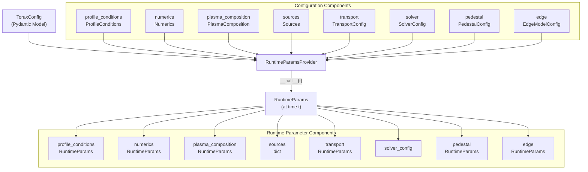

**Diagram: RuntimeParamsProvider Architecture**

The provider is constructed once from `ToraxConfig` and can be called repeatedly with different time values to obtain parameter snapshots.

Sources: [torax/_src/config/build_runtime_params.py:66-135]()

---

## RuntimeParamsProvider Class Structure

The `RuntimeParamsProvider` is a frozen dataclass containing all configuration components:

| Field | Type | Purpose |
|-------|------|---------|
| `sources` | `Sources` | Heating, current drive, and particle source configurations |
| `numerics` | `Numerics` | Time stepping and numerical control parameters |
| `profile_conditions` | `ProfileConditions` | Boundary conditions and initial profiles |
| `plasma_composition` | `PlasmaComposition` | Ion species and impurity configuration |
| `transport_model` | `TransportConfig` | Transport model selection and parameters |
| `solver` | `SolverConfig` | PDE solver configuration |
| `pedestal` | `PedestalConfig` | Pedestal model parameters |
| `mhd` | `MHD` | MHD model (e.g., sawtooth) configuration |
| `edge` | `EdgeModelConfig` | Edge model configuration (optional) |
| `neoclassical` | `Neoclassical` | Neoclassical physics parameters |
| `time_step_calculator` | `TimeStepCalculator` | Time step calculation method |

The provider implements a `__call__` method that builds `RuntimeParams` for a given time:

```python
runtime_params = provider(t=1.5)  # Get parameters at t=1.5 seconds
```

Sources: [torax/_src/config/build_runtime_params.py:66-91](), [docs/configuration.rst:13-32]()

---

## Time-Varying Parameter Types

TORAX supports two types of time-varying parameters, each handled by specialized classes.

### TimeVaryingScalar

`TimeVaryingScalar` represents a scalar value that changes over time. It supports multiple input formats:

| Input Format | Example | Description |
|--------------|---------|-------------|
| Scalar | `5.0` | Constant value (no time dependence) |
| Dict | `{10: 2.0e6, 100: 15.0e6}` | Time-value pairs |
| Tuple | `([10, 100], [2.0e6, 15.0e6])` | Time array and value array |
| xarray.DataArray | `xr.DataArray(values, coords={'time': times})` | xarray format |

Example from configuration:
```python
# Plasma current ramping from 2 MA to 15 MA
'Ip': {10: 2.0e6, 100: 15.0e6}

# Or with explicit interpolation mode
'Ip': ({10: 2.0e6, 100: 15.0e6}, 'PIECEWISE_LINEAR')
```

Sources: [docs/configuration.rst:58-116](), [torax/_src/torax_pydantic/interpolated_param_1d.py]()

### TimeVaryingArray

`TimeVaryingArray` represents a radial profile that varies over time, interpolated on a 2D grid of (time, ρ̂).

| Input Format | Example | Description |
|--------------|---------|-------------|
| Scalar | `6.0` | Constant profile at all times |
| Single dict | `{0.0: 18.0, 0.95: 5.0, 1.0: 0.2}` | Radial profile at t=0 |
| Nested dict | `{0.0: {0.0: 15.0, 1.0: 1.0}, 80: 1.0}` | Time-dependent profiles |
| Tuple | `(times, rho_norm, values)` | Array-based specification |

Example from configuration:
```python
# Ion temperature profile with pedestal at t=0
'T_i': {0.0: {0.0: 15.0, 0.95: 3.0, 1.0: 1.0}}

# Time-evolving profile
'T_i': {
    0.0: {0.0: 15.0, 0.95: 3.0, 1.0: 1.0},
    80: 1.0  # Decays to constant T_i=1 by t=80
}
```

Sources: [docs/configuration.rst:118-229](), [torax/_src/torax_pydantic/interpolated_param_2d.py]()

---

## Interpolation Modes

Both `TimeVaryingScalar` and `TimeVaryingArray` support two interpolation modes:

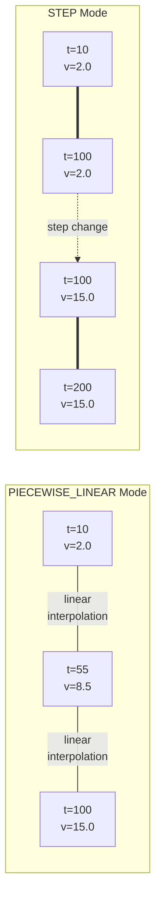

**Diagram: Interpolation Mode Behavior**

### PIECEWISE_LINEAR (Default)

Linear interpolation between specified time points. For times outside the specified range, the nearest value is used (constant extrapolation).

```python
# Linear ramp from 2 MA to 15 MA
'Ip': {10: 2.0e6, 100: 15.0e6}
# At t=55: Ip ≈ 8.5e6 (linearly interpolated)
```

### STEP

Stepwise changes at specified times. The value changes **after** crossing each time boundary.

```python
# Stepwise pedestal changes
'T_i_ped': ({2: 1.0, 8: 3.0, 20: 1.0}, 'STEP')
# t<2:  T_i_ped = 1.0
# 2≤t<8: T_i_ped = 1.0
# 8≤t<20: T_i_ped = 3.0
# t≥20: T_i_ped = 1.0
```

For `TimeVaryingArray`, interpolation modes can be specified separately for time and spatial dimensions:

```python
(
    time_varying_array_value,
    {'time_interpolation_mode': 'STEP', 'rho_interpolation_mode': 'PIECEWISE_LINEAR'}
)
```

Sources: [docs/configuration.rst:77-229]()

---

## Building Runtime Parameters

Each configuration component implements a `build_runtime_params(t)` method that produces a frozen runtime parameters object for a specific time.

```mermaid
graph TB
    subgraph "Configuration Classes (Pydantic)"
        ProfileConditions["ProfileConditions"]
        Numerics["Numerics"]
        Sources["GenericHeatSource"]
        PedestalConfig["SetTpedNped"]
    end
    
    subgraph "Runtime Parameter Classes (Frozen Dataclasses)"
        ProfileConditionsRP["profile_conditions.RuntimeParams"]
        NumericsRP["numerics.RuntimeParams"]
        SourcesRP["generic_heat_source.RuntimeParams"]
        PedestalRP["set_tped_nped.RuntimeParams"]
    end
    
    ProfileConditions -->|"build_runtime_params(t)"| ProfileConditionsRP
    Numerics -->|"build_runtime_params(t)"| NumericsRP
    Sources -->|"build_runtime_params(t)"| SourcesRP
    PedestalConfig -->|"build_runtime_params(t)"| PedestalRP
    
    ProfileConditionsRP -.->|"contains"| TimeInterpolatedValues["Interpolated values<br/>at time t"]
    NumericsRP -.->|"contains"| TimeInterpolatedValues
    SourcesRP -.->|"contains"| TimeInterpolatedValues
    PedestalRP -.->|"contains"| TimeInterpolatedValues
```

**Diagram: Configuration to Runtime Parameters Pattern**

### Example: ProfileConditions

The `ProfileConditions` class contains time-varying boundary conditions and profiles:

```python
profile_conditions = ProfileConditions(
    T_i_right_bc={0.0: 2.0, 4.0: 4.0},  # TimeVaryingScalar
    T_e_right_bc=4.5,                    # Constant
    n_e_right_bc=({5.0: 6.0e20, 7.0: 8.0e20}, 'step'),  # Step interpolation
)

# Build runtime params at t=2.0
runtime_params = profile_conditions.build_runtime_params(t=2.0)
# runtime_params.T_i_right_bc == 3.0  (linearly interpolated)
# runtime_params.T_e_right_bc == 4.5  (constant)
# runtime_params.n_e_right_bc == 6.0e20  (step: value at t=5.0)
```

Sources: [torax/_src/config/tests/build_runtime_params_test.py:61-88](), [torax/_src/core_profiles/profile_conditions.py]()

### Example: Numerics

The `Numerics` class contains time-varying numerical control parameters:

```python
numerics = Numerics(
    fixed_dt={0.0: 1e-1, 5.0: 1e-2, 10.0: 1e-1},  # TimeVaryingScalar with STEP mode
    resistivity_multiplier={0.0: 1.0, 10.0: 2.0},  # TimeVaryingScalar
)

runtime_params = numerics.build_runtime_params(t=7.0)
# runtime_params.fixed_dt == 1e-2  (step mode)
# runtime_params.resistivity_multiplier ≈ 1.7  (linear interpolation)
```

Note that `fixed_dt` internally uses `STEP` interpolation mode by default to ensure consistent time step sizes.

Sources: [torax/_src/config/numerics.py:158-177](), [docs/configuration.rst:381-398]()

---

## RuntimeParamsProvider Execution Flow

The `RuntimeParamsProvider.__call__(t)` method orchestrates parameter building across all components:

```mermaid
sequenceDiagram
    participant Sim as Simulation
    participant Provider as RuntimeParamsProvider
    participant Profile as profile_conditions
    participant Numerics as numerics
    participant Sources as sources dict
    participant Transport as transport_model
    
    Sim->>Provider: __call__(t=1.5)
    
    Provider->>Profile: build_runtime_params(1.5)
    Profile-->>Provider: ProfileConditions.RuntimeParams
    
    Provider->>Numerics: build_runtime_params(1.5)
    Numerics-->>Provider: Numerics.RuntimeParams
    
    Provider->>Sources: For each source config
    Sources->>Sources: source.build_runtime_params(1.5)
    Sources-->>Provider: dict of source RuntimeParams
    
    Provider->>Transport: build_runtime_params(1.5)
    Transport-->>Provider: TransportModel.RuntimeParams
    
    Note over Provider: Similar calls for:<br/>pedestal, edge, mhd, etc.
    
    Provider->>Provider: Construct RuntimeParams
    Provider-->>Sim: Complete RuntimeParams at t=1.5
```

**Diagram: RuntimeParams Construction Sequence**

The provider ensures all components produce consistent parameter snapshots at the same time point.

Sources: [torax/_src/config/build_runtime_params.py:113-134]()

---

## Integration with Geometry

Runtime parameters must be consistent with geometry, particularly regarding plasma current (`Ip`). The function `get_consistent_runtime_params_and_geometry` handles this coordination:

```mermaid
graph TB
    Input1["RuntimeParamsProvider"]
    Input2["GeometryProvider"]
    Input3["EdgeModelOutputs<br/>(optional)"]
    
    Function["get_consistent_runtime_params_and_geometry"]
    
    Step1["geometry_provider(t)<br/>→ Geometry"]
    Step2["runtime_params_provider(t)<br/>→ RuntimeParams"]
    Step3["edge_updaters.update_runtime_params<br/>(apply edge model results)"]
    Step4["make_ip_consistent<br/>(align Ip between params and geo)"]
    
    Output1["RuntimeParams<br/>(consistent)"]
    Output2["Geometry<br/>(at time t)"]
    
    Input1 --> Function
    Input2 --> Function
    Input3 --> Function
    
    Function --> Step1
    Function --> Step2
    Step1 --> Step3
    Step2 --> Step3
    Step3 --> Step4
    
    Step4 --> Output1
    Step1 --> Output2
```

**Diagram: Consistent Runtime Parameters and Geometry**

This function performs three key operations:
1. **Geometry interpolation**: Gets geometry at time `t`
2. **Edge model updates**: Applies edge model outputs (temperature boundary conditions, impurity concentrations) to runtime parameters
3. **Ip consistency**: Ensures plasma current is consistent between `RuntimeParams` and `Geometry`

```python
runtime_params, geo = get_consistent_runtime_params_and_geometry(
    t=current_time,
    runtime_params_provider=provider,
    geometry_provider=geo_provider,
    edge_outputs=edge_model_outputs,  # Optional
)
```

Sources: [torax/_src/config/build_runtime_params.py:290-303](), [torax/_src/edge/updaters.py]()

---

## Dynamic Provider Updates

The `RuntimeParamsProvider` supports dynamic updates to parameter values during simulation, enabling adaptive control and optimization workflows. Updates are designed to work within `jax.jit` for performance.

### Update Provider Method

The `update_provider` method replaces specific parameters using a functional approach:

```python
# Original provider
provider = RuntimeParamsProvider.from_config(torax_config)

# Define updates
ip_update = TimeVaryingScalarUpdate(value=new_ip_value)
T_e_update = TimeVaryingArrayUpdate(
    value=new_T_e_values,
    rho_norm=grid.cell_centers,
)

# Update provider (works under jax.jit)
updated_provider = provider.update_provider(
    get_nodes_to_replace=lambda x: (
        x.profile_conditions.Ip,
        x.profile_conditions.T_e,
    ),
    replacement_values=(ip_update, T_e_update),
)
```

The method uses `equinox.tree_at` internally to perform pytree-compatible updates that preserve JIT compilation.

Sources: [torax/_src/config/build_runtime_params.py:136-182]()

### Update Types

Different parameter types require specific update objects:

| Parameter Type | Update Type | Example |
|----------------|-------------|---------|
| `TimeVaryingScalar` | `TimeVaryingScalarUpdate` | `TimeVaryingScalarUpdate(value=new_value)` |
| `TimeVaryingArray` | `TimeVaryingArrayUpdate` | `TimeVaryingArrayUpdate(value=array, rho_norm=grid)` |
| Scalar/Array | Direct value | `2.0` or `jnp.array([...])` |

```python
# Update a TimeVaryingScalar (Ip)
ip_update = TimeVaryingScalarUpdate(value=ip_value * 2.0)

# Update a TimeVaryingArray (temperature profile)
T_e_update = TimeVaryingArrayUpdate(
    value=T_e_cell_value * 3.0,
    rho_norm=T_e.grid.cell_centers,
)

# Update a simple scalar multiplier
qei_update = 4.0  # Direct numeric value
```

Sources: [torax/_src/config/build_runtime_params.py:243-287](), [torax/_src/config/tests/build_runtime_params_test.py:308-369]()

### Update Provider from Mapping

For more convenient updates, `update_provider_from_mapping` accepts a dictionary with dot-separated paths:

```python
updated_provider = provider.update_provider_from_mapping({
    'profile_conditions.Ip': TimeVaryingScalarUpdate(value=new_ip),
    'profile_conditions.T_e': TimeVaryingArrayUpdate(value=new_T_e, rho_norm=grid),
    'sources.ei_exchange.Qei_multiplier': 2.0,
})
```

The method parses the string paths to navigate the provider's nested structure and apply updates to the correct fields.

Sources: [torax/_src/config/build_runtime_params.py:195-240](), [torax/_src/config/tests/build_runtime_params_test.py:431-499]()

### JIT Compatibility

Dynamic updates are designed to work efficiently under `jax.jit`:

```python
@jax.jit
def update_and_run(provider, ip_update, T_e_update):
    # Update provider inside JIT
    new_provider = provider.update_provider(
        lambda x: (x.profile_conditions.Ip, x.profile_conditions.T_e),
        (ip_update, T_e_update),
    )
    
    # Use updated provider
    runtime_params = new_provider(t=1.0)
    return runtime_params

# First call compiles
result1 = update_and_run(provider, ip_update1, T_e_update1)

# Subsequent calls with different values don't recompile
result2 = update_and_run(provider, ip_update2, T_e_update2)
```

The update mechanism uses JAX-compatible pytree operations, allowing the compiled function to be reused with different parameter values without recompilation.

Sources: [torax/_src/config/tests/build_runtime_params_test.py:326-369]()

---

## Time-Dependent Parameter Examples

### Plasma Current Ramp

A typical scenario for ITER-like ramp-up simulations:

```python
'profile_conditions': {
    'Ip': {
        0.0: 2.0e6,      # Start at 2 MA
        5.0: 8.0e6,      # Ramp to 8 MA at t=5s
        20.0: 15.0e6,    # Reach 15 MA at t=20s
    },
    # Ip remains 15 MA for t > 20s (constant extrapolation)
}
```

Sources: [docs/configuration.rst:93-106]()

### Variable Time Step

Adjusting time resolution during different simulation phases:

```python
'numerics': {
    'fixed_dt': ({
        0.0: 1e-1,     # 0.1s steps during initial phase
        5.0: 1e-2,     # 0.01s steps during transition (higher resolution)
        10.0: 1e-1,    # Back to 0.1s for steady state
    }, 'STEP'),  # STEP mode for consistent dt within each phase
}
```

Note: An epsilon offset may be needed to change `dt` exactly at the prescribed time due to step interpolation behavior:

```python
epsilon = 1e-5
'fixed_dt': {
    0.0: 1e-1,
    5.0 - epsilon: 1e-2,    # Changes to 1e-2 at t=5.0
    10.0 - epsilon: 1e-1,   # Changes to 1e-1 at t=10.0
}
```

Sources: [docs/configuration.rst:381-398]()

### Evolving Temperature Profile

Temperature profile that evolves from peaked to flat:

```python
'profile_conditions': {
    'T_i': {
        0.0: {0.0: 15.0, 0.95: 3.0, 1.0: 1.0},  # Initial peaked profile
        80.0: 1.0,  # Decays to constant T_i=1 keV everywhere by t=80s
    },
}
```

At t=40s, the profile is linearly interpolated between the two extremes.

Sources: [docs/configuration.rst:174-180]()

### Time-Varying Impurity Mix

Isotope ratio changing over time:

```python
'plasma_composition': {
    'main_ion': {
        'D': {0.0: 0.1, 5.0: 0.9},  # Deuterium fraction: 10% → 90%
        'T': {0.0: 0.9, 5.0: 0.1},  # Tritium fraction: 90% → 10%
    },
    'impurity': 'W',
    'Z_eff': 1.1,
}
```

Sources: [docs/configuration.rst:532-542]()

---

## Runtime Parameters in Simulation Loop

The following diagram shows how `RuntimeParamsProvider` integrates into the simulation time-stepping:

```mermaid
sequenceDiagram
    participant Loop as Time Loop
    participant StepFn as SimulationStepFn
    participant Provider as RuntimeParamsProvider
    participant GeoProvider as GeometryProvider
    participant Solver as PDE Solver
    
    Loop->>StepFn: step(t, dt, state)
    
    StepFn->>Provider: Get params at t
    StepFn->>GeoProvider: Get geometry at t
    StepFn->>StepFn: get_consistent_runtime_params_and_geometry
    Note over StepFn: Ensures Ip consistency,<br/>applies edge model updates
    
    StepFn->>Provider: Get params at t+dt
    StepFn->>GeoProvider: Get geometry at t+dt
    StepFn->>StepFn: get_consistent_runtime_params_and_geometry
    
    StepFn->>Solver: solve(state, params_t, params_t_plus_dt, geo_t, geo_t_plus_dt)
    Note over Solver: Theta-method uses<br/>params at both t and t+dt
    
    Solver-->>StepFn: new_state
    StepFn-->>Loop: new_state, t+dt
```

**Diagram: Runtime Parameters in Time Stepping**

The simulation step function retrieves parameter snapshots at both `t` and `t+dt` to support theta-method time integration, which blends values from the beginning and end of each time step.

Sources: [torax/_src/orchestration/step_function.py](), [torax/_src/config/build_runtime_params.py:290-303]()

---

## Performance Considerations

### Caching and Lazy Evaluation

`TimeVaryingScalar` and `TimeVaryingArray` use `functools.cached_property` to cache interpolated values:

```python
@functools.cached_property
def _interpolated_values(self):
    # Expensive interpolation computed once
    return self._build_interpolator()

def get_value(self, t):
    # Uses cached interpolator
    return self._interpolated_values(t)
```

This ensures interpolation setup happens once, even when the same parameter is queried multiple times.

Sources: [torax/_src/torax_pydantic/interpolated_param_1d.py](), [torax/_src/torax_pydantic/interpolated_param_2d.py]()

### JIT Compilation

The entire `RuntimeParamsProvider.__call__` method is JIT-compatible:

```python
@jax.jit
def get_params(provider: RuntimeParamsProvider, t: float):
    return provider(t)

# First call compiles
params1 = get_params(provider, 0.5)

# Subsequent calls reuse compilation
params2 = get_params(provider, 1.0)  # No recompile
```

This allows parameter interpolation to occur within compiled simulation loops without performance penalty.

Sources: [torax/_src/config/tests/build_runtime_params_test.py:257-288]()

---

## Common Patterns and Best Practices

### Pattern 1: Constant Parameters

For parameters that don't vary with time, simply provide a scalar:

```python
'profile_conditions': {
    'T_e_right_bc': 4.5,  # Constant 4.5 keV boundary condition
}
```

### Pattern 2: Ramp-Then-Hold

Common for actuator control (heating, current drive):

```python
'sources': {
    'generic_heat_source': {
        'rsource': 0.5,  # Deposition location (constant)
        'w': 0.1,        # Deposition width (constant)
        'P_e': {
            0.0: 0.0,      # No heating initially
            2.0: 0.0,      # Heating off until t=2s
            5.0: 10e6,     # Ramp to 10 MW by t=5s
            100.0: 10e6,   # Hold at 10 MW
        },
    },
}
```

### Pattern 3: Profile Shape Preservation

To maintain profile shape while changing magnitude:

```python
# Define shape once
base_profile = {0.0: 1.0, 0.5: 0.6, 1.0: 0.2}

'T_i': {
    0.0: {rho: 15.0 * val for rho, val in base_profile.items()},
    10.0: {rho: 10.0 * val for rho, val in base_profile.items()},
}
# Profile shape preserved, magnitude scales from 15 keV to 10 keV
```

### Pattern 4: Step Changes for Discrete Events

Use step interpolation for parameters that should change instantaneously:

```python
'pedestal': {
    'set_pedestal': ({0.0: False, 10.0: True}, 'STEP'),
    # Pedestal turns on exactly at t=10s
}
```

Sources: [docs/configuration.rst:52-229]()

---

## Summary

The `RuntimeParamsProvider` system provides:

- **Time interpolation**: Smooth parameter evolution using `TimeVaryingScalar` and `TimeVaryingArray`
- **Consistency**: Coordinated parameter and geometry snapshots via `get_consistent_runtime_params_and_geometry`
- **Flexibility**: Multiple input formats (dicts, tuples, xarray) and interpolation modes (linear, step)
- **Performance**: JIT-compatible design with caching for efficient execution
- **Dynamic updates**: In-simulation parameter modification through `update_provider` methods
- **Integration**: Seamless incorporation of edge model outputs and boundary condition updates

This architecture enables complex time-dependent scenarios (ramp-ups, transitions, adaptive control) while maintaining clean separation between configuration and runtime execution.

---

# Page: Plasma Composition Configuration

# Plasma Composition Configuration

<details>
<summary>Relevant source files</summary>

The following files were used as context for generating this wiki page:

- [docs/configuration.rst](docs/configuration.rst)
- [docs/edge_models.rst](docs/edge_models.rst)
- [docs/interfacing_with_surrogates.rst](docs/interfacing_with_surrogates.rst)
- [docs/links.rst](docs/links.rst)
- [docs/output.rst](docs/output.rst)
- [docs/physics_models.rst](docs/physics_models.rst)
- [docs/running_programmatically.rst](docs/running_programmatically.rst)
- [docs/user_guides.rst](docs/user_guides.rst)
- [docs/using_jax.rst](docs/using_jax.rst)
- [torax/_src/core_profiles/getters.py](torax/_src/core_profiles/getters.py)
- [torax/_src/core_profiles/plasma_composition/electron_density_ratios.py](torax/_src/core_profiles/plasma_composition/electron_density_ratios.py)
- [torax/_src/core_profiles/plasma_composition/electron_density_ratios_zeff.py](torax/_src/core_profiles/plasma_composition/electron_density_ratios_zeff.py)
- [torax/_src/core_profiles/plasma_composition/impurity_fractions.py](torax/_src/core_profiles/plasma_composition/impurity_fractions.py)
- [torax/_src/core_profiles/plasma_composition/ion_mixture.py](torax/_src/core_profiles/plasma_composition/ion_mixture.py)
- [torax/_src/core_profiles/plasma_composition/plasma_composition.py](torax/_src/core_profiles/plasma_composition/plasma_composition.py)
- [torax/_src/core_profiles/tests/getters_test.py](torax/_src/core_profiles/tests/getters_test.py)
- [torax/_src/core_profiles/tests/plasma_composition_test.py](torax/_src/core_profiles/tests/plasma_composition_test.py)
- [torax/_src/physics/charge_states.py](torax/_src/physics/charge_states.py)
- [torax/_src/physics/tests/charge_states_test.py](torax/_src/physics/tests/charge_states_test.py)
- [torax/_src/sources/impurity_radiation_heat_sink/impurity_radiation_mavrin_fit.py](torax/_src/sources/impurity_radiation_heat_sink/impurity_radiation_mavrin_fit.py)
- [torax/_src/tests/state_test.py](torax/_src/tests/state_test.py)
- [torax/_src/transport_model/tests/bohm_gyrobohm_test.py](torax/_src/transport_model/tests/bohm_gyrobohm_test.py)

</details>


## Purpose and Scope

This page describes how to configure the plasma composition in TORAX, including main ion species, impurity species, and the effective plasma charge (Z_eff). The configuration determines ion densities, charge states, and mass properties that affect transport equations, fusion power calculations, and impurity radiation. 

For information about how these parameters are used in runtime simulation, see [Advanced Topics: Core Profiles and Plasma Composition](#9.1). For general configuration structure, see [Configuration System](#2).

**Sources:** [docs/configuration.rst:412-673]()

## Configuration Model Structure

The plasma composition is configured through the `PlasmaComposition` Pydantic model, which validates and structures all ion-related parameters.

```mermaid
graph TB
    User["User Config Dictionary"]
    PC["PlasmaComposition<br/>(Pydantic Model)"]
    MainIon["main_ion<br/>(IonMixture)"]
    Impurity["impurity<br/>(ImpurityFractions |<br/>ElectronDensityRatios |<br/>ElectronDensityRatiosZeff)"]
    Zeff["Z_eff<br/>(TimeVaryingArray)"]
    
    User --> PC
    PC --> MainIon
    PC --> Impurity
    PC --> Zeff
    
    MainIon --> Species1["species: dict[str, TimeVaryingScalar]"]
    MainIon --> Overrides1["Z_override, A_override"]
    
    Impurity --> Mode["impurity_mode:<br/>'fractions' | 'n_e_ratios' |<br/>'n_e_ratios_Z_eff'"]
    Impurity --> Species2["species: dict[str, ...]"]
    Impurity --> Overrides2["Z_override, A_override"]
```

**Sources:** [torax/_src/core_profiles/plasma_composition/plasma_composition.py:59-246](), [docs/configuration.rst:412-450]()

## Main Ion Configuration

Main ions represent the bulk plasma species (typically hydrogen isotopes). They can be specified as a single ion or a mixture with time-dependent fractions.

### Single Ion Specification

For a pure species plasma:

```python
'plasma_composition': {
    'main_ion': 'D',  # Pure deuterium
}
```

### Ion Mixture Specification

For isotope mixtures or multi-species plasmas:

```python
'plasma_composition': {
    'main_ion': {'D': 0.5, 'T': 0.5},  # 50-50 D-T mixture
}
```

### Time-Dependent Mixtures

Fractions can vary in time to model changing isotope ratios:

```python
'plasma_composition': {
    'main_ion': {
        'D': {0.0: 0.1, 5.0: 0.9},  # D fraction from 0.1 to 0.9
        'T': {0.0: 0.9, 5.0: 0.1},  # T fraction from 0.9 to 0.1
    },
}
```

The `IonMixture` class enforces that fractions sum to 1.0 at all times (within tolerance of 1e-6).

**Sources:** [torax/_src/core_profiles/plasma_composition/ion_mixture.py:56-97](), [docs/configuration.rst:481-518]()

## Impurity Configuration Modes

TORAX supports three modes for specifying impurity content, each with different constraints and use cases.

```mermaid
graph LR
    subgraph "Impurity Mode Selection"
        IM["impurity_mode"]
        F["'fractions'"]
        NE["'n_e_ratios'"]
        NEZ["'n_e_ratios_Z_eff'"]
    end
    
    subgraph "Fractions Mode"
        F1["Specify fractional abundances"]
        F2["Require Z_eff as input"]
        F3["Calculate n_impurity from<br/>Z_eff constraint"]
    end
    
    subgraph "n_e_ratios Mode"
        N1["Specify n_imp/n_e for each species"]
        N2["Z_eff is calculated output"]
        N3["Direct control of impurity density"]
    end
    
    subgraph "n_e_ratios_Z_eff Mode"
        Z1["Specify n_imp/n_e for N-1 species"]
        Z2["One species set to None"]
        Z3["Z_eff constrains unknown species"]
    end
    
    IM --> F
    IM --> NE
    IM --> NEZ
    
    F --> F1 --> F2 --> F3
    NE --> N1 --> N2 --> N3
    NEZ --> Z1 --> Z2 --> Z3
```

**Sources:** [torax/_src/core_profiles/plasma_composition/plasma_composition.py:36-40](), [docs/configuration.rst:520-650]()

### Fractions Mode

In fractions mode, impurities are specified by their relative fractional abundances within the impurity mixture. Z_eff is required as input to constrain the total impurity density.

**Configuration Example:**

```python
'plasma_composition': {
    'main_ion': 'D',
    'impurity': {
        'impurity_mode': 'fractions',
        'species': {'Ne': 0.8, 'Ar': 0.2},  # 80% Ne, 20% Ar by fraction
    },
    'Z_eff': 2.0,
}
```

The fractions can be time- and space-varying:

```python
'impurity': {
    'impurity_mode': 'fractions',
    'species': {
        'Ne': {0.0: {0.0: 0.1}, 5.0: {0.0: 0.9}},
        'Ar': {0.0: {0.0: 0.9}, 5.0: {0.0: 0.1}},
    },
}
```

**Key constraint:** Fractions must sum to 1.0 at all times and radial positions.

**Sources:** [torax/_src/core_profiles/plasma_composition/impurity_fractions.py:1-148](), [docs/configuration.rst:520-571]()

### n_e_ratios Mode

In this mode, impurity densities are directly specified as ratios to electron density: `n_impurity / n_e`. Z_eff becomes an emergent calculated quantity rather than an input.

**Configuration Example:**

```python
'plasma_composition': {
    'main_ion': 'D',
    'impurity': {
        'impurity_mode': 'n_e_ratios',
        'species': {
            'W': {0.0: {0.0: 1e-5, 1.0: 1e-4}},  # Hollow W profile
            'Ne': 0.01,  # Constant Ne ratio
        },
    },
    # Z_eff input will be ignored with a warning
}
```

The dilution factor is calculated directly from the ratios:

```
dilution_factor = 1 - sum(Z_imp_i * (n_imp_i / n_e)) / Z_main
```

**Warning:** If Z_eff is provided in this mode, it will be ignored and a warning issued.

**Sources:** [torax/_src/core_profiles/plasma_composition/electron_density_ratios.py:1-148](), [docs/configuration.rst:572-610]()

### n_e_ratios_Z_eff Mode

This hybrid mode specifies ratios for N-1 impurity species, with exactly one species marked as `None`. The density of the unknown species is calculated to satisfy the provided Z_eff profile.

**Configuration Example:**

```python
'plasma_composition': {
    'main_ion': 'D',
    'impurity': {
        'impurity_mode': 'n_e_ratios_Z_eff',
        'species': {
            'Ne': 0.01,  # Known Ne ratio
            'W': None,   # W density calculated from Z_eff
        },
    },
    'Z_eff': {0.0: {0.0: 2.0}, 10.0: {0.0: 2.2}},  # Time-varying Z_eff
}
```

This solves a 2×2 system for the main ion dilution and unknown impurity ratio:

```
x * Z_i + y * Z_unknown = 1 - sum(Z_known * n_known / n_e)
x * Z_i^2 + y * Z_unknown^2 = Z_eff - sum(Z_known^2 * n_known / n_e)
```

**Sources:** [torax/_src/core_profiles/plasma_composition/electron_density_ratios_zeff.py:1-88](), [torax/_src/core_profiles/getters.py:287-471](), [docs/configuration.rst:611-650]()

## Charge State Calculations

TORAX calculates temperature-dependent charge states using Mavrin polynomial fits to ADAS atomic data.

```mermaid
graph TB
    subgraph "Charge State Calculation"
        Te["T_e profile<br/>(keV)"]
        Symbols["Ion Symbols<br/>(e.g., 'W', 'Ne', 'Ar')"]
        
        Mavrin["calculate_average_charge_state_single_species()"]
        
        LowZ{"Ion Z < 6?"}
        FullIon["Return Z from<br/>ION_PROPERTIES_DICT"]
        Poly["Apply Mavrin polynomial"]
        
        Result["Z_avg(T_e)"]
    end
    
    Te --> Mavrin
    Symbols --> Mavrin
    Mavrin --> LowZ
    LowZ -->|Yes| FullIon
    LowZ -->|No| Poly
    FullIon --> Result
    Poly --> Result
```

### Mavrin Polynomials

For ions with Z ≥ 6 (C and higher), charge states are calculated using polynomial fits:

```
log10(Z_avg) = c4*X^4 + c3*X^3 + c2*X^2 + c1*X + c0
where X = log10(T_e)
```

Temperature is clipped to the valid range [0.1, 100] keV to avoid extrapolation.

**Supported ions with temperature-dependent charge states:**
- Carbon (C)
- Nitrogen (N)
- Oxygen (O)
- Neon (Ne)
- Argon (Ar)
- Krypton (Kr)
- Xenon (Xe)
- Tungsten (W)

**Fully ionized ions (Z < 6):**
- H, D, T, He3, He4, Li, Be

### Effective Charge for Mixtures

For ion mixtures, the effective charge is calculated as:

```
Z_mixture = <Z^2> / <Z> = sum(fraction_i * Z_i^2) / sum(fraction_i * Z_i)
```

This definition ensures consistency with quasineutrality equations when treating the mixture as a single effective species.

**Sources:** [torax/_src/physics/charge_states.py:119-167](), [torax/_src/physics/charge_states.py:169-239](), [docs/configuration.rst:472-476]()

## Ion Density Calculations

The `get_updated_ions()` function calculates main ion and impurity densities from electron density, charge states, and Z_eff, enforcing quasineutrality.

```mermaid
graph TB
    subgraph "Input State"
        ne["n_e (CellVariable)"]
        Te["T_e (CellVariable)"]
        PC["RuntimeParams.<br/>plasma_composition"]
    end
    
    subgraph "Charge State Calculation"
        CS["get_average_charge_state()"]
        Zi["Z_i (main ion)"]
        Zimp["Z_impurity"]
    end
    
    subgraph "Mode-Specific Logic"
        Mode{"impurity_mode"}
        Frac["_get_ion_properties_from_fractions()"]
        Ratios["_get_ion_properties_from_n_e_ratios()"]
        RatiosZ["_get_ion_properties_from_n_e_ratios_Z_eff()"]
    end
    
    subgraph "Output"
        Props["_IonProperties:<br/>- dilution_factor<br/>- Z_impurity<br/>- A_impurity<br/>- Z_eff"]
        ni["n_i (CellVariable)"]
        nimp["n_impurity (CellVariable)"]
        Ions["Ions:<br/>- n_i, n_impurity<br/>- Z_i, Z_impurity<br/>- A_i, A_impurity<br/>- Z_eff, Z_eff_face"]
    end
    
    ne --> CS
    Te --> CS
    PC --> CS
    
    CS --> Zi
    CS --> Zimp
    
    Zi --> Mode
    Zimp --> Mode
    PC --> Mode
    
    Mode -->|fractions| Frac
    Mode -->|n_e_ratios| Ratios
    Mode -->|n_e_ratios_Z_eff| RatiosZ
    
    Frac --> Props
    Ratios --> Props
    RatiosZ --> Props
    
    Props --> ni
    Props --> nimp
    ne --> ni
    ne --> nimp
    
    ni --> Ions
    nimp --> Ions
    Zi --> Ions
    Zimp --> Ions
```

### Quasineutrality Constraint

All modes enforce quasineutrality:

```
n_i * Z_i + n_impurity * Z_impurity = n_e
```

Combined with the Z_eff definition:

```
n_i * Z_i^2 + n_impurity * Z_impurity^2 = n_e * Z_eff
```

These two equations are solved for `n_i` and `n_impurity`.

### Dilution Factor

The main ion dilution factor is defined as:

```
dilution_factor = n_i / n_e
```

This quantifies how much the main ion density is reduced by impurities.

**Sources:** [torax/_src/core_profiles/getters.py:474-625](), [torax/_src/core_profiles/getters.py:178-284]()

## Runtime Parameters Structure

The configuration is converted to runtime parameters for use in the simulation loop.

```mermaid
classDiagram
    class PlasmaComposition {
        +main_ion: IonMapping
        +impurity: ImpurityFractions | ElectronDensityRatios | ElectronDensityRatiosZeff
        +Z_eff: TimeVaryingArray
        +Z_i_override: TimeVaryingScalar
        +A_i_override: TimeVaryingScalar
        +build_runtime_params(t) RuntimeParams
    }
    
    class RuntimeParams {
        +main_ion_names: tuple[str, ...]
        +impurity_names: tuple[str, ...]
        +main_ion: ion_mixture.RuntimeParams
        +impurity: RuntimeParams (one of 3 types)
        +Z_eff: FloatVectorCell
        +Z_eff_face: FloatVectorFace
    }
    
    class IonMixtureRuntimeParams {
        +fractions: Mapping[str, FloatScalar]
        +A_avg: FloatScalar | FloatVectorCell
        +Z_override: FloatScalar | None
    }
    
    PlasmaComposition --> RuntimeParams : builds
    RuntimeParams --> IonMixtureRuntimeParams : contains
```

The `build_runtime_params(t)` method evaluates all time-varying parameters at time `t` and returns JAX-compatible arrays for use in compiled functions.

**Sources:** [torax/_src/core_profiles/plasma_composition/plasma_composition.py:42-55](), [torax/_src/core_profiles/plasma_composition/plasma_composition.py:237-246]()

## Configuration Examples

### Example 1: ITER-like D-T Plasma with Neon Impurity

```python
'plasma_composition': {
    'main_ion': {'D': 0.5, 'T': 0.5},
    'impurity': {
        'impurity_mode': 'fractions',
        'species': 'Ne',
    },
    'Z_eff': {
        0.0: {0.0: 1.2, 1.0: 1.5},  # Core to edge gradient
        5.0: {0.0: 2.0, 1.0: 2.5},  # Increases over time
    },
}
```

### Example 2: High-Z Contamination with n_e_ratios

```python
'plasma_composition': {
    'main_ion': 'D',
    'impurity': {
        'impurity_mode': 'n_e_ratios',
        'species': {
            'W': {
                0.0: {0.0: 1e-5, 1.0: 1e-4},  # Hollow profile initially
                10.0: {0.0: 1e-4},             # Flattens over time
            },
            'Ne': 0.01,  # Constant neon seeding
        },
    },
}
```

### Example 3: Mixed Impurity with Z_eff Constraint

```python
'plasma_composition': {
    'main_ion': 'D',
    'impurity': {
        'impurity_mode': 'n_e_ratios_Z_eff',
        'species': {
            'Ne': 0.01,      # Known Ne concentration
            'W': None,       # Tungsten adjusted to match Z_eff
        },
    },
    'Z_eff': {
        0.0: {0.0: 2.0},
        10.0: {0.0: 2.2},
    },
}
```

**Sources:** [docs/configuration.rst:481-650](), [torax/_src/core_profiles/tests/plasma_composition_test.py:148-269]()

## Overrides for Testing

Both main ions and impurities support Z and A overrides for testing or sensitivity studies:

```python
'plasma_composition': {
    'main_ion': {'D': 1.0},
    'Z_i_override': 1.5,     # Override deuterium charge
    'A_i_override': 2.5,     # Override deuterium mass
    'impurity': {
        'impurity_mode': 'fractions',
        'species': 'Ne',
        'Z_override': 8.0,   # Override neon charge state
        'A_override': 22.0,  # Override neon mass
    },
}
```

**Note:** Legacy top-level `Z_impurity_override` and `A_impurity_override` are deprecated. Use overrides within the `impurity` dictionary instead.

**Sources:** [torax/_src/core_profiles/plasma_composition/plasma_composition.py:113-116](), [docs/configuration.rst:448-471]()

## Allowed Ion Symbols

The following ion symbols are recognized in both `main_ion` and `impurity` specifications:

| Symbol | Name | Z | A (amu) |
|--------|------|---|---------|
| H | Hydrogen | 1 | 1.008 |
| D | Deuterium | 1 | 2.014 |
| T | Tritium | 1 | 3.016 |
| He3 | Helium-3 | 2 | 3.016 |
| He4 | Helium-4 | 2 | 4.003 |
| Li | Lithium | 3 | 6.941 |
| Be | Beryllium | 4 | 9.012 |
| C | Carbon | 6 | 12.011 |
| N | Nitrogen | 7 | 14.007 |
| O | Oxygen | 8 | 15.999 |
| Ne | Neon | 10 | 20.180 |
| Ar | Argon | 18 | 39.948 |
| Kr | Krypton | 36 | 83.798 |
| Xe | Xenon | 54 | 131.29 |
| W | Tungsten | 74 | 183.84 |

**Sources:** [docs/configuration.rst:651-673](), [torax/_src/constants.py:39-63]()

## Validation Rules

The configuration system enforces several validation rules:

1. **Fraction sum constraint:** For fractions mode, impurity fractions must sum to 1.0 within tolerance 1e-6
2. **Z_eff bounds:** Z_eff must be ≥ 1.0 (pure main ion plasma minimum)
3. **Non-negative ratios:** n_e_ratios must be non-negative
4. **Exactly one None:** n_e_ratios_Z_eff mode requires exactly one species with `None` ratio
5. **Consistent grids:** For time/space-varying fractions, all species must share the same time points and rho_norm coordinates
6. **Non-empty species:** At least one species must be specified for impurities

These validations are enforced during Pydantic model construction and will raise `ValidationError` if violated.

**Sources:** [torax/_src/core_profiles/plasma_composition/impurity_fractions.py:42-96](), [torax/_src/core_profiles/plasma_composition/electron_density_ratios_zeff.py:77-87]()

---

# Page: Example Configurations

# Example Configurations

<details>
<summary>Relevant source files</summary>

The following files were used as context for generating this wiki page:

- [docs/configuration.rst](docs/configuration.rst)
- [docs/edge_models.rst](docs/edge_models.rst)
- [docs/interfacing_with_surrogates.rst](docs/interfacing_with_surrogates.rst)
- [docs/links.rst](docs/links.rst)
- [docs/output.rst](docs/output.rst)
- [docs/physics_models.rst](docs/physics_models.rst)
- [docs/running_programmatically.rst](docs/running_programmatically.rst)
- [docs/user_guides.rst](docs/user_guides.rst)
- [docs/using_jax.rst](docs/using_jax.rst)
- [torax/tests/test_data/test_changing_config_after.nc](torax/tests/test_data/test_changing_config_after.nc)
- [torax/tests/test_data/test_changing_config_before.nc](torax/tests/test_data/test_changing_config_before.nc)
- [torax/tests/test_data/test_implicit.nc](torax/tests/test_data/test_implicit.nc)
- [torax/tests/test_data/test_iterbaseline_mockup.nc](torax/tests/test_data/test_iterbaseline_mockup.nc)
- [torax/tests/test_data/test_iterhybrid_mockup.nc](torax/tests/test_data/test_iterhybrid_mockup.nc)
- [torax/tests/test_data/test_iterhybrid_predictor_corrector.nc](torax/tests/test_data/test_iterhybrid_predictor_corrector.nc)
- [torax/tests/test_data/test_iterhybrid_predictor_corrector_zeffprofile.nc](torax/tests/test_data/test_iterhybrid_predictor_corrector_zeffprofile.nc)
- [torax/tests/test_data/test_iterhybrid_rampup.nc](torax/tests/test_data/test_iterhybrid_rampup.nc)
- [torax/tests/test_data/test_ne_qlknn_deff_veff.nc](torax/tests/test_data/test_ne_qlknn_deff_veff.nc)
- [torax/tests/test_data/test_ne_qlknn_defromchie.nc](torax/tests/test_data/test_ne_qlknn_defromchie.nc)
- [torax/tests/test_data/test_prescribed_timedependent_ne.nc](torax/tests/test_data/test_prescribed_timedependent_ne.nc)
- [torax/tests/test_data/test_timedependence.nc](torax/tests/test_data/test_timedependence.nc)

</details>


This page provides concrete examples of TORAX configuration files for different simulation scenarios, demonstrating common configuration patterns and best practices. These examples serve as templates for setting up new simulations and illustrate how to configure various physics models and numerical methods.

For detailed information about individual configuration parameters, see [Configuration Parameters](#2.1). For information about implementing time-varying parameters, see [Time-Dependent Parameters](#2.2).

## Configuration Categories

TORAX includes several categories of example configurations, each designed for specific simulation purposes and physics scenarios:

```mermaid
graph TD
    ExampleConfigs["Example Configurations"]
    
    ExampleConfigs --> ITERScenarios["ITER Scenarios"]
    ExampleConfigs --> SolverExamples["Solver Method Examples"]
    ExampleConfigs --> TestConfigs["Test Configurations"]
    
    ITERScenarios --> Hybrid["Hybrid Scenario<br/>test_iterhybrid_mockup.py"]
    ITERScenarios --> Baseline["Baseline Scenario<br/>test_iterbaseline_mockup.py"]
    ITERScenarios --> Rampup["Current Rampup<br/>test_iterhybrid_rampup.py"]
    
    SolverExamples --> PredCorr["Predictor-Corrector<br/>test_iterhybrid_predictor_corrector.py"]
    SolverExamples --> Qualikiz["QuaLiKiz Transport<br/>test_iterhybrid_predictor_corrector_qualikiz.py"]
    SolverExamples --> ZeffProfile["Z_eff Profile<br/>test_iterhybrid_predictor_corrector_zeffprofile.py"]
    
    TestConfigs --> ChangingBefore["Parameter Change Test (Before)<br/>test_changing_config_before.py"]
    TestConfigs --> ChangingAfter["Parameter Change Test (After)<br/>test_changing_config_after.py"]
    TestConfigs --> RampupShort["Short Rampup Test<br/>test_iterhybrid_rampup_short.py"]
```

Sources: [torax/tests/test_data/test_iterhybrid_mockup.py:15-18](), [torax/tests/test_data/test_iterbaseline_mockup.py:15-15](), [torax/tests/test_data/test_iterhybrid_rampup.py:15-19](), [torax/tests/test_data/test_iterhybrid_predictor_corrector.py:15-15]()

## Configuration Structure

All TORAX configurations follow a standard dictionary structure with major sections corresponding to different aspects of the simulation:

```mermaid
graph TD
    CONFIG["CONFIG Dictionary"]
    
    CONFIG --> PlasmaComp["plasma_composition<br/>Main ion species, impurities, Z_eff"]
    CONFIG --> ProfileCond["profile_conditions<br/>Initial conditions, boundary conditions"]
    CONFIG --> Numerics["numerics<br/>Time stepping, convergence, evolution flags"]
    CONFIG --> Geometry["geometry<br/>Equilibrium type and parameters"]
    CONFIG --> Sources["sources<br/>Heat, particle, and current sources"]
    CONFIG --> Transport["transport<br/>Transport model and coefficients"]
    CONFIG --> Solver["solver<br/>Linear/nonlinear solver settings"]
    CONFIG --> Pedestal["pedestal<br/>Edge transport barrier model"]
    CONFIG --> Neoclassical["neoclassical<br/>Bootstrap current, conductivity"]
    
    PlasmaComp --> MainIon["main_ion: {'D': 0.5, 'T': 0.5}"]
    PlasmaComp --> Impurity["impurity: 'Ne'"]
    PlasmaComp --> Zeff["Z_eff: 1.6"]
    
    ProfileCond --> Ip["Ip: plasma current"]
    ProfileCond --> TempBC["T_i_right_bc, T_e_right_bc"]
    ProfileCond --> DensBC["n_e_right_bc"]
    ProfileCond --> InitProfiles["T_i, T_e, n_e initial profiles"]
```

Sources: [torax/tests/test_data/test_iterhybrid_mockup.py:18-24](), [torax/tests/test_data/test_iterhybrid_mockup.py:40-56]()

## ITER Scenario Configurations

### Hybrid Scenario

The ITER hybrid scenario configuration provides a template for high-performance, steady-state-like discharges with current drive and transport barriers.

| Parameter Category | Key Settings |
|-------------------|--------------|
| **Plasma Current** | 10.5 MA |
| **Main Ion Mix** | D:T = 50:50 |
| **Z_eff** | 1.6 |
| **Transport Model** | QLKNN |
| **Geometry** | CHEASE equilibrium |
| **Solver** | Linear |

```python
# Key configuration sections from test_iterhybrid_mockup.py
CONFIG = {
    'plasma_composition': {
        'main_ion': {'D': 0.5, 'T': 0.5},
        'impurity': 'Ne',
        'Z_eff': 1.6,
    },
    'profile_conditions': {
        'Ip': 10.5e6,  # 10.5 MA plasma current
        'T_i': {0.0: {0.0: 15.0, 1.0: 0.2}},  # keV
        'T_e': {0.0: {0.0: 15.0, 1.0: 0.2}},  # keV
    },
    'transport': {
        'model_name': 'qlknn',
    }
}
```

Sources: [torax/tests/test_data/test_iterhybrid_mockup.py:18-39](), [torax/tests/test_data/test_iterhybrid_mockup.py:110-115]()

### Baseline Scenario

The ITER baseline scenario represents the reference inductive operational mode with lower performance requirements but higher reliability.

| Parameter Category | Key Settings |
|-------------------|--------------|
| **Plasma Current** | 15 MA |
| **Main Ion Mix** | D:T = 50:50 |
| **Z_eff** | 1.74 |
| **Transport Model** | QLKNN |
| **Impurity Override** | Z = 6.3623 |

The baseline scenario uses higher current and different impurity composition compared to the hybrid scenario, reflecting the different physics requirements.

Sources: [torax/tests/test_data/test_iterbaseline_mockup.py:18-30]()

### Current Rampup Scenario

The rampup configuration demonstrates time-dependent parameters, showing how to evolve plasma current from startup to flattop:

```python
'profile_conditions': {
    'Ip': {0: 3e6, 80: 10.5e6},  # Current ramp over 80 seconds
    'n_e_right_bc': {0: 0.1, 80: 0.3},  # Evolving density boundary
}
```

This configuration uses the Newton-Raphson solver to handle the nonlinear dynamics during the rampup phase.

Sources: [torax/tests/test_data/test_iterhybrid_rampup.py:28-39]()

## Solver Method Examples

### Predictor-Corrector Method

The predictor-corrector configuration shows how to enable iterative improvement of time step accuracy:

```python
'solver': {
    'use_predictor_corrector': True,
    'n_corrector_steps': 1,
    'solver_type': 'linear'
}
```

This method provides better accuracy for time-dependent simulations while maintaining computational efficiency.

Sources: [torax/tests/test_data/test_iterhybrid_predictor_corrector.py:124-129]()

### Transport Model Variations

Different transport models can be configured by changing the `model_name` parameter:

| Model | Configuration | Purpose |
|-------|--------------|---------|
| **QLKNN** | `'model_name': 'qlknn'` | Neural network transport model |
| **QuaLiKiz** | `'model_name': 'qualikiz'` | First-principles transport |
| **Constant** | `'model_name': 'constant'` | Fixed transport coefficients |

Sources: [torax/tests/test_data/test_iterhybrid_predictor_corrector_qualikiz.py:22-24]()

## Configuration-to-Physics Mapping

The following diagram shows how configuration sections map to physical models and computational components:

```mermaid
graph LR
    subgraph "Configuration Sections"
        PlasmaComp["plasma_composition"]
        Transport["transport"]
        Sources["sources"]
        Geometry["geometry"]
        Solver["solver"]
    end
    
    subgraph "Physics Models"
        TransportModel["Transport Model<br/>(QLKNN/QuaLiKiz)"]
        SourceTerms["Source Terms<br/>(Heat/Particle/Current)"]
        GeomProvider["Geometry Provider<br/>(CHEASE/EQDSK)"]
        PedestalModel["Pedestal Model"]
    end
    
    subgraph "Computational Components"
        PDESolver["PDE Solver"]
        TimeStep["Time Stepping"]
        StateEvolution["State Evolution"]
    end
    
    PlasmaComp --> SourceTerms
    Transport --> TransportModel
    Sources --> SourceTerms
    Geometry --> GeomProvider
    
    TransportModel --> PDESolver
    SourceTerms --> PDESolver
    GeomProvider --> PDESolver
    PedestalModel --> PDESolver
    
    Solver --> PDESolver
    PDESolver --> TimeStep
    TimeStep --> StateEvolution
```

Sources: [torax/tests/test_data/test_iterhybrid_mockup.py:75-115]()

## Test Data Correspondence

Each configuration file has corresponding NetCDF test data that serves as a reference output:

| Configuration File | Test Data File | Purpose |
|-------------------|----------------|---------|
| `test_iterhybrid_mockup.py` | `test_iterhybrid_mockup.nc` | Hybrid scenario validation |
| `test_iterbaseline_mockup.py` | `test_iterbaseline_mockup.nc` | Baseline scenario validation |
| `test_iterhybrid_rampup.py` | `test_iterhybrid_rampup.nc` | Rampup dynamics validation |
| `test_changing_config_before.py` | `test_changing_config_before.nc` | Parameter change testing |
| `test_changing_config_after.py` | `test_changing_config_after.nc` | Parameter change testing |

These test data files contain the expected simulation outputs and are used in the integration testing framework to ensure configuration changes don't break existing functionality.

Sources: [torax/tests/test_data/test_iterhybrid_mockup.nc:1-6](), [torax/tests/test_data/test_changing_config_before.nc:1-6]()

## Usage Patterns

### Creating New Configurations

To create a new configuration, start with an existing example and modify the relevant sections:

1. **Copy a base configuration** that matches your simulation type
2. **Modify plasma composition** for your species mix and impurity content
3. **Adjust profile conditions** for your initial and boundary conditions
4. **Select transport model** appropriate for your physics case
5. **Configure sources** to match your heating and current drive systems
6. **Set numerical parameters** for convergence and time stepping

### Time-Dependent Simulations

For simulations with evolving parameters, use the rampup configuration as a template and specify time-dependent values using the format shown in [Time-Dependent Parameters](#2.2).

### Testing Configurations

Before running production simulations, validate your configuration against similar test cases to ensure the parameters produce physically reasonable results.

Sources: [torax/tests/test_data/test_iterhybrid_rampup.py:22-111](), [torax/examples/iterhybrid_rampup.py:22-44]()

---

# Page: Physics Models

# Physics Models

<details>
<summary>Relevant source files</summary>

The following files were used as context for generating this wiki page:

- [docs/configuration.rst](docs/configuration.rst)
- [docs/edge_models.rst](docs/edge_models.rst)
- [docs/interfacing_with_surrogates.rst](docs/interfacing_with_surrogates.rst)
- [docs/links.rst](docs/links.rst)
- [docs/output.rst](docs/output.rst)
- [docs/physics_models.rst](docs/physics_models.rst)
- [docs/running_programmatically.rst](docs/running_programmatically.rst)
- [docs/user_guides.rst](docs/user_guides.rst)
- [docs/using_jax.rst](docs/using_jax.rst)

</details>


## Purpose and Scope

This page provides an overview of TORAX's modular physics model ecosystem and how different physics models integrate into the core transport simulation. Physics models in TORAX calculate transport coefficients, source terms, boundary conditions, and auxiliary physics effects that drive plasma evolution.

For detailed information on specific model categories:
- **Transport coefficient models**: See [Transport Models](#3.1)
- **Magnetic geometry configurations**: See [Geometry Providers](#3.2)
- **Heating, current drive, and particle sources**: See [Source Models](#3.3)
- **Pedestal boundary conditions**: See [Pedestal Models](#3.4)
- **Scrape-off layer and divertor physics**: See [Edge Physics and Extended Lengyel Model](#3.5)
- **Bootstrap current and MHD effects**: See [Neoclassical Effects and MHD](#3.6)

For information on numerical solution methods that use these physics models, see [Numerical Methods](#5). For configuration details, see [Configuration System](#2).

## Physics Model Architecture

TORAX employs a modular architecture where physics models are decoupled from the core PDE solver. Each model category provides specific physics outputs that feed into the simulation state, which is then evolved by the solver.

### Core State and Model Outputs

Physics models populate three primary state components:

| State Component | Description | Populated By |
|----------------|-------------|--------------|
| `CoreTransport` | Transport coefficients: `chi_i`, `chi_e`, `D_e`, `V_e` | Transport models, neoclassical models |
| `CoreSources` | Power densities, particle sources, current densities | Source models, neoclassical bootstrap |
| `Geometry` | Magnetic field configuration, flux surface geometry | Geometry providers |

**Physics Model Data Flow**

```mermaid
graph TB
    subgraph "Physics Models"
        TM["TransportModel<br/>(e.g. QLKNNTransportModel)"]
        SM["Source Models<br/>(FusionHeatSource, ECRHSource, etc.)"]
        NC["Neoclassical<br/>(Sauter model)"]
        PM["PedestalModel<br/>(SetTPedNPed)"]
        EM["EdgeModel<br/>(ExtendedLengyel)"]
        GM["GeometryProvider<br/>(StandardGeometry)"]
    end
    
    subgraph "State Components"
        CT["CoreTransport<br/>chi_face_ion, chi_face_electron<br/>d_face_electron, v_face_electron"]
        CS["CoreSources<br/>qei, profiles, j_bootstrap<br/>generic_current_source, fusion_heat_source"]
        GEO["Geometry<br/>rho_norm, g0, g1, g2, g3<br/>psi_from_geo, Ip_from_parameters"]
    end
    
    subgraph "Core State"
        CP["CoreProfiles<br/>temp_ion, temp_electron<br/>ne, psi, currents"]
    end
    
    subgraph "Simulation Control"
        RP["RuntimeParams"]
        SF["SimulationStepFn"]
    end
    
    TM --> CT
    NC --> CT
    NC --> CS
    SM --> CS
    PM --> RP
    EM --> RP
    GM --> GEO
    
    RP --> SF
    CT --> CP
    CS --> CP
    GEO --> CP
    CP --> SF
    
    SF --> TM
    SF --> SM
    SF --> NC
```

Sources: [docs/physics_models.rst:1-478](), [torax/_src/state.py](), [torax/_src/core_profiles.py]()

### Model Interface Pattern

All physics models follow a consistent interface pattern for integration with the solver:

```mermaid
graph LR
    subgraph "Model Base Classes"
        TBase["TransportModel"]
        SBase["Source"]
        PBase["PedestalModel"]
        EBase["EdgeModel"]
    end
    
    subgraph "Concrete Implementations"
        QLKNN["QLKNNTransportModel"]
        CGM["CGMTransportModel"]
        Fusion["FusionHeatSource"]
        ECRH["ECRHSource"]
        SetTPed["SetTPedNPedModel"]
        Lengyel["ExtendedLengyel"]
    end
    
    subgraph "Configuration"
        TConfig["TransportRuntimeParams"]
        SConfig["SourceRuntimeParams"]
        PConfig["PedestalRuntimeParams"]
        EConfig["EdgeRuntimeParams"]
    end
    
    TBase -.implements.-> QLKNN
    TBase -.implements.-> CGM
    SBase -.implements.-> Fusion
    SBase -.implements.-> ECRH
    PBase -.implements.-> SetTPed
    EBase -.implements.-> Lengyel
    
    TConfig --> QLKNN
    SConfig --> Fusion
    PConfig --> SetTPed
    EConfig --> Lengyel
```

Sources: [torax/_src/transport_model/transport_model.py](), [torax/_src/sources/source.py](), [torax/_src/pedestal_model/pedestal_model.py](), [torax/_src/edge/edge_model.py]()

## Physics Model Categories

### Transport Models

Transport models calculate turbulent transport coefficients that determine heat and particle diffusion in the plasma. TORAX supports multiple transport models:

| Model | Type | Key Features | Configuration Key |
|-------|------|--------------|-------------------|
| `QLKNNTransportModel` | ML surrogate | Neural network trained on QuaLiKiz data | `'qlknn'` |
| `CGMTransportModel` | Theory-based | Critical gradient model with GyroBohm scaling | `'CGM'` |
| `BohmGyroBohmTransportModel` | Semi-empirical | Bohm + GyroBohm scaling | `'bohm-gyrobohm'` |
| `ConstantTransportModel` | Simple | User-defined constant coefficients | `'constant'` |
| `RuntimeTransportModel` | Prescribed | Time-dependent prescribed values | `'runtime-prescribed'` |

Transport models output a `CoreTransport` object containing:
- `chi_face_ion`: Ion heat diffusivity [m²/s]
- `chi_face_electron`: Electron heat diffusivity [m²/s]
- `d_face_electron`: Electron particle diffusivity [m²/s]
- `v_face_electron`: Electron particle convection velocity [m/s]

See [Transport Models](#3.1) for detailed information.

Sources: [docs/physics_models.rst:111-315](), [torax/_src/transport_model/]()

### Geometry Providers

Geometry providers supply magnetic field configurations and flux surface geometry required for transport calculations:

| Provider | Source | Key Features |
|----------|--------|--------------|
| `StandardGeometry` (CHEASE) | CHEASE equilibrium solver | Fixed boundary Grad-Shafranov solution |
| `StandardGeometry` (EQDSK) | EQDSK G-file format | Flux surface averaged from 2D poloidal flux |
| `StandardGeometry` (IMAS) | IMAS equilibrium IDS | ITER data structure format |
| `FBTGeometry` | FBT equilibrium solver | Free boundary with edge geometry parameters |
| `StandardGeometry` (Circular) | Analytical | Simple circular approximation for testing |

Key geometry outputs: `g0`, `g1`, `g2`, `g3` (flux surface averaged geometric factors), `psi`, `Ip_profile`, `rho_norm`.

See [Geometry Providers](#3.2) for detailed information.

Sources: [docs/physics_models.rst:14-61](), [torax/_src/geometry/]()

### Source Models

Source models calculate heating power densities, particle sources, and current drive:

**Heating Sources:**
- `FusionHeatSource`: Alpha heating from D-T fusion reactions (Bosch-Hale parameterization)
- `ECRHSource`: Electron cyclotron resonance heating
- `ICRHSource`: Ion cyclotron resonance heating
- `OhmicHeatSource`: Resistive heating from plasma current
- `GenericHeatSource`: User-prescribed heating profiles

**Particle Sources:**
- `GasPuffSource`: Gas puff particle injection
- `PelletSource`: Pellet ablation
- `GenericParticleSource`: User-prescribed particle profiles

**Current Drive:**
- `GenericCurrentSource`: External non-inductive current drive
- Bootstrap current from neoclassical effects (see [Neoclassical Effects and MHD](#3.6))

**Radiation Sinks:**
- `BremsstrahlungHeatSink`: Bremsstrahlung radiation losses
- `CyclotronRadiationHeatSink`: Cyclotron radiation
- `ImpurityRadiationHeatSink`: Line radiation from impurities (Mavrin fits)

See [Source Models](#3.3) for detailed information.

Sources: [docs/physics_models.rst:478-647](), [torax/_src/sources/]()

### Pedestal Models

Pedestal models set internal boundary conditions for temperature and density at the pedestal top:

| Model | Description | Configuration |
|-------|-------------|---------------|
| `SetTPedNPedModel` | Directly specify pedestal height and width | `T_i_ped`, `T_e_ped`, `n_e_ped`, `rho_norm_ped_top` |
| `SetPPedNPedModel` | Specify pressure and temperature ratio | `P_ped`, `n_e_ped`, `T_i_T_e_ratio` |

Pedestal models work by adding adaptive source terms at the pedestal location to enforce the desired values.

See [Pedestal Models](#3.4) for detailed information.

Sources: [docs/configuration.rst:698-766](), [torax/_src/pedestal_model/]()

### Edge Models

Edge models couple the core transport solver to scrape-off layer (SOL) and divertor physics:

The `ExtendedLengyel` model provides:
- Separatrix temperature calculation from 2-point model
- Target temperature based on parallel SOL transport with impurity radiation
- Forward mode: Calculate target conditions from upstream state
- Inverse mode: Calculate required impurity seeding for target temperature
- Enrichment modeling for divertor impurity retention

See [Edge Physics and Extended Lengyel Model](#3.5) for detailed information.

Sources: [docs/edge_models.rst:1-269](), [docs/physics_models.rst:419-478](), [torax/_src/edge/]()

### Neoclassical Effects

Neoclassical models (Sauter formulation) calculate:
- Bootstrap current density `j_bootstrap`
- Neoclassical conductivity `sigma_neo`
- Neoclassical transport coefficients `chi_neo_i`, `chi_neo_e`, `D_neo_e`, `V_neo_e`

MHD effects include:
- Sawtooth crash model for core profile redistribution

See [Neoclassical Effects and MHD](#3.6) for detailed information.

Sources: [docs/physics_models.rst:317-329](), [torax/_src/neoclassical/](), [torax/_src/mhd/]()

## Integration with Simulation

### Execution Flow

Physics models are invoked at specific points in the simulation step:

```mermaid
graph TB
    Start["SimulationStepFn.__call__<br/>(time t)"]
    
    subgraph "Pre-Step Phase"
        GetParams["Get RuntimeParams<br/>and Geometry at t, t+dt"]
        BuildSources["build_sources_from_runtime_params<br/>(explicit sources)"]
        EdgeCall["edge_model.call<br/>(update boundary conditions)"]
    end
    
    subgraph "Solver Phase"
        SolverCall["solver.__call__"]
        CalcCoeffs["calc_coeffs<br/>(transport + implicit sources)"]
        TransCall["transport_model.__call__<br/>(chi, D, V)"]
        NeoCall["neoclassical calculations<br/>(bootstrap, sigma)"]
        ImplicitSrc["implicit source calculations"]
    end
    
    subgraph "Post-Step Phase"
        Finalize["finalize_outputs"]
        PostProc["make_post_processed_outputs"]
    end
    
    Start --> GetParams
    GetParams --> BuildSources
    BuildSources --> EdgeCall
    EdgeCall --> SolverCall
    
    SolverCall --> CalcCoeffs
    CalcCoeffs --> TransCall
    CalcCoeffs --> NeoCall
    CalcCoeffs --> ImplicitSrc
    CalcCoeffs --> SolverCall
    
    SolverCall --> Finalize
    Finalize --> PostProc
```

Sources: [torax/_src/orchestration/step_function.py](), [torax/_src/solver/solver.py]()

### Explicit vs. Implicit Treatment

Sources can be treated explicitly or implicitly:

**Explicit sources:**
- Calculated once at the beginning of the timestep using state at time `t`
- Used for all solver iterations at `t + dt`
- Computationally cheaper, less accurate for fast-evolving sources
- Do not require JAX compatibility (can use Python callbacks)

**Implicit sources:**
- Recalculated each solver iteration using current guess for state at `t + dt`
- More accurate for fast-evolving sources
- Must be JAX-compatible for Newton-Raphson solver
- Included in residual Jacobian calculations

Configuration example:
```python
'sources': {
    'fusion_heat_source': {
        'mode': 'formula_based',
        'is_explicit': False,  # Implicit treatment
    },
    'generic_heat_source': {
        'mode': 'prescribed',
        'is_explicit': True,  # Explicit treatment
    },
}
```

Sources: [docs/physics_models.rst:478-502](), [torax/_src/sources/source.py]()

## Model Configuration

### Configuration Structure

Physics models are configured through nested dictionaries in the `ToraxConfig`:

```mermaid
graph TB
    TC["ToraxConfig"]
    
    subgraph "Model Configs"
        TransConf["transport: TransportConfig<br/>model_name: str<br/>runtime_params: dict"]
        SourceConf["sources: dict[str, SourceConfig]<br/>mode, is_explicit, params"]
        PedConf["pedestal: PedestalConfig<br/>model_name: str<br/>runtime_params: dict"]
        EdgeConf["edge: EdgeConfig<br/>model_name: str<br/>runtime_params: dict"]
        GeoConf["geometry: GeometryConfig<br/>geometry_type: str<br/>geometry_file, n_rho"]
    end
    
    subgraph "Runtime Providers"
        TransRP["TransportRuntimeParams"]
        SourceRP["SourceRuntimeParams"]
        PedRP["PedestalRuntimeParams"]
        EdgeRP["EdgeRuntimeParams"]
        GeoRP["GeometryProvider"]
    end
    
    TC --> TransConf
    TC --> SourceConf
    TC --> PedConf
    TC --> EdgeConf
    TC --> GeoConf
    
    TransConf --> TransRP
    SourceConf --> SourceRP
    PedConf --> PedRP
    EdgeConf --> EdgeRP
    GeoConf --> GeoRP
```

Sources: [torax/_src/torax_pydantic.py](), [torax/_src/config/]()

### Model Selection

Models are selected by name in configuration:

```python
CONFIG = {
    'transport': {
        'model_name': 'qlknn',  # Options: 'qlknn', 'CGM', 'bohm-gyrobohm', 'constant'
    },
    'pedestal': {
        'model_name': 'set_T_ped_n_ped',  # Options: 'no_pedestal', 'set_T_ped_n_ped', 'set_P_ped_n_ped'
        'set_pedestal': True,
    },
    'edge': {
        'model_name': 'extended_lengyel',
        'computation_mode': 'inverse',  # Options: 'forward', 'inverse'
    },
    'geometry': {
        'geometry_type': 'chease',  # Options: 'chease', 'eqdsk', 'imas', 'fbt', 'circular'
    },
}
```

Sources: [docs/configuration.rst:23-31](), [examples/]()

### Time-Dependent Parameters

Many physics model parameters support time interpolation:

| Parameter Type | Configuration Format | Interpolation |
|---------------|---------------------|---------------|
| Scalar | `{time: value}` dict or `(times, values)` tuple | Linear or step |
| Array | `{time: {rho: value}}` nested dict | Linear in time and space |

Example with time-varying transport model parameters:
```python
'transport': {
    'model_name': 'CGM',
    'CGM_alpha': {0.0: 1.0, 5.0: 2.0},  # Time-dependent stiffness factor
    'CGM_C': 0.05,  # Constant multiplier
}
```

Sources: [docs/configuration.rst:52-229](), [torax/_src/config/runtime_params.py]()

## Model Factory Pattern

### Transport Model Factory

The `TransportModelBuilder` constructs transport models:

```mermaid
graph LR
    Config["TransportConfig<br/>model_name: str"]
    Builder["TransportModelBuilder.build_transport_model"]
    
    subgraph "Transport Models"
        QLKNN["QLKNNTransportModel"]
        CGM["CGMTransportModel"]
        BGB["BohmGyroBohmTransportModel"]
        Const["ConstantTransportModel"]
    end
    
    Config --> Builder
    Builder -->|"model_name='qlknn'"| QLKNN
    Builder -->|"model_name='CGM'"| CGM
    Builder -->|"model_name='bohm-gyrobohm'"| BGB
    Builder -->|"model_name='constant'"| Const
```

Sources: [torax/_src/transport_model/transport_model_builder.py]()

### Source Model Factory

The `SourceModelsBuilder` constructs source model collections:

```mermaid
graph TB
    Sources["sources config dict"]
    Builder["SourceModelsBuilder.build_source_models"]
    
    subgraph "Source Collections"
        Heat["heat_sources: dict[str, Source]"]
        Particle["particle_sources: dict[str, Source]"]
        Current["current_sources: dict[str, Source]"]
    end
    
    subgraph "Specific Sources"
        Fusion["FusionHeatSource"]
        ECRH["ECRHSource"]
        Gas["GasPuffSource"]
        Generic["GenericCurrentSource"]
    end
    
    Sources --> Builder
    Builder --> Heat
    Builder --> Particle
    Builder --> Current
    
    Heat --> Fusion
    Heat --> ECRH
    Particle --> Gas
    Current --> Generic
```

Sources: [torax/_src/sources/source_models_builder.py]()

### Geometry Provider Factory

The `GeometryProviderBuilder` constructs geometry providers:

```mermaid
graph LR
    GeoConfig["GeometryConfig<br/>geometry_type: str"]
    Builder["GeometryProviderBuilder.build_geometry_provider"]
    
    subgraph "Geometry Providers"
        Std["StandardGeometryProvider<br/>(CHEASE/EQDSK/IMAS/Circular)"]
        FBT["FBTGeometryProvider"]
    end
    
    GeoConfig --> Builder
    Builder -->|"geometry_type in<br/>['chease', 'eqdsk', 'imas', 'circular']"| Std
    Builder -->|"geometry_type='fbt'"| FBT
```

Sources: [torax/_src/geometry/geometry_provider_builder.py]()

## Physics Model Outputs

### Transport Coefficients

Transport models populate `CoreTransport`:

| Field | Description | Units | Grid |
|-------|-------------|-------|------|
| `chi_face_ion` | Ion heat diffusivity | m²/s | Face |
| `chi_face_electron` | Electron heat diffusivity | m²/s | Face |
| `d_face_electron` | Electron particle diffusivity | m²/s | Face |
| `v_face_electron` | Electron convection velocity | m/s | Face |

Neoclassical contributions are added separately in `CoreTransport`:
- `chi_face_neo_ion`, `chi_face_neo_electron`
- `d_face_neo_electron`, `v_face_neo_electron`

Sources: [torax/_src/core_profiles/core_transport.py](), [docs/output.rst:138-404]()

### Source Profiles

Source models populate `CoreSources`:

| Field | Description | Units | Grid |
|-------|-------------|-------|------|
| `qei` | Ion-electron heat exchange | W/m³ | Cell |
| `profiles` | Combined source profiles per equation | Various | Cell |
| `j_bootstrap` | Bootstrap current density | A/m² | Cell |

Individual source profiles are stored in source-specific fields (e.g., `fusion_heat_source`, `generic_current_source`).

Sources: [torax/_src/core_profiles/core_sources.py](), [docs/output.rst:170-365]()

### Geometry Data

Geometry providers populate `Geometry`:

| Field | Description | Units | Grid |
|-------|-------------|-------|------|
| `rho_norm` | Normalized toroidal flux coordinate | - | Cell+Face |
| `g0`, `g1`, `g2`, `g3` | Flux surface averaged geometric factors | Various | Cell |
| `psi` | Poloidal flux | Wb | Cell+Face |
| `Ip_profile` | Cumulative current profile | A | Face |

Sources: [torax/_src/geometry/geometry.py](), [docs/output.rst:136-393]()

## Summary

The physics model architecture in TORAX provides:

1. **Modularity**: Physics models are independent modules that can be swapped without modifying solver code
2. **Flexibility**: Multiple implementations per category with consistent interfaces
3. **Configurability**: Model selection and parameters via configuration dictionaries
4. **Time-dependence**: Support for time-varying parameters and geometry
5. **Coupling**: Edge models and pedestal models update boundary conditions for core transport
6. **Explicit/Implicit**: Flexible treatment of sources for performance vs. accuracy trade-offs

For implementation details on specific model categories, see the child pages [3.1](#3.1) through [3.6](#3.6).

Sources: [docs/physics_models.rst:1-647](), [torax/_src/]()

---

# Page: Transport Models

# Transport Models

<details>
<summary>Relevant source files</summary>

The following files were used as context for generating this wiki page:

- [docs/configuration.rst](docs/configuration.rst)
- [docs/edge_models.rst](docs/edge_models.rst)
- [docs/interfacing_with_surrogates.rst](docs/interfacing_with_surrogates.rst)
- [docs/links.rst](docs/links.rst)
- [docs/output.rst](docs/output.rst)
- [docs/physics_models.rst](docs/physics_models.rst)
- [docs/running_programmatically.rst](docs/running_programmatically.rst)
- [docs/user_guides.rst](docs/user_guides.rst)
- [docs/using_jax.rst](docs/using_jax.rst)
- [torax/tests/test_data/test_all_transport_fusion_qlknn.nc](torax/tests/test_data/test_all_transport_fusion_qlknn.nc)
- [torax/tests/test_data/test_bohmgyrobohm_all.nc](torax/tests/test_data/test_bohmgyrobohm_all.nc)
- [torax/tests/test_data/test_fixed_dt.nc](torax/tests/test_data/test_fixed_dt.nc)
- [torax/tests/test_data/test_particle_sources_cgm.nc](torax/tests/test_data/test_particle_sources_cgm.nc)
- [torax/tests/test_data/test_psi_and_heat.nc](torax/tests/test_data/test_psi_and_heat.nc)
- [torax/tests/test_data/test_psi_heat_dens.nc](torax/tests/test_data/test_psi_heat_dens.nc)
- [torax/tests/test_data/test_semiimplicit_convection.nc](torax/tests/test_data/test_semiimplicit_convection.nc)

</details>


## Purpose and Scope

This page describes the transport models implemented in TORAX, which calculate transport coefficients that govern heat and particle transport in tokamak plasmas. These models compute thermal diffusivities (`chi_i`, `chi_e`), particle diffusivity (`D_e`), and particle convection velocity (`V_e`) that are used in the core plasma evolution equations. For information about the numerical solvers that use these transport coefficients, see [PDE Solvers](#4.1). For details about geometry models that provide magnetic equilibrium data to transport models, see [Geometry Models](#3.2).

## Transport Model Architecture

TORAX implements multiple physics-based and empirical transport models that can be configured through the transport configuration section. The models range from simple analytical expressions to sophisticated neural network approximations of gyrokinetic simulations.

```mermaid
graph TB
    subgraph "Transport Configuration"
        TransportConfig["transport config section"]
        ModelName["model_name parameter"]
        Bounds["chi_min/max, D_e_min/max, V_e_min/max"]
        Patches["inner/outer patches"]
    end
    
    subgraph "Available Models"
        QLKNN["QLKNN Neural Network"]
        BohmeGyro["Bohm-GyroBohm"]
        CGM["CGM Model"]
        Constant["Constant Transport"]
    end
    
    subgraph "Transport Coefficients"
        ChiI["chi_i (ion thermal diffusivity)"]
        ChiE["chi_e (electron thermal diffusivity)"]
        De["D_e (particle diffusivity)"]
        Ve["V_e (particle convection)"]
    end
    
    subgraph "Core Physics"
        HeatEq["Heat Transport Equations"]
        ParticleEq["Particle Transport Equation"]
        PDESolver["PDE Solver"]
    end
    
    TransportConfig --> ModelName
    ModelName --> QLKNN
    ModelName --> BohmeGyro
    ModelName --> CGM
    ModelName --> Constant
    
    QLKNN --> ChiI
    QLKNN --> ChiE
    QLKNN --> De
    QLKNN --> Ve
    
    BohmeGyro --> ChiI
    BohmeGyro --> ChiE
    BohmeGyro --> De
    BohmeGyro --> Ve
    
    CGM --> ChiI
    CGM --> ChiE
    CGM --> De
    CGM --> Ve
    
    Constant --> ChiI
    Constant --> ChiE
    Constant --> De
    Constant --> Ve
    
    Bounds --> ChiI
    Bounds --> ChiE
    Bounds --> De
    Bounds --> Ve
    
    Patches --> ChiI
    Patches --> ChiE
    Patches --> De
    Patches --> Ve
    
    ChiI --> HeatEq
    ChiE --> HeatEq
    De --> ParticleEq
    Ve --> ParticleEq
    
    HeatEq --> PDESolver
    ParticleEq --> PDESolver
```

**Sources:** [torax/tests/test_data/test_bohmgyrobohm_all.nc:1-50](), [torax/tests/test_data/test_ne_qlknn_defromchie.nc:1-50](), [torax/tests/test_data/test_particle_sources_cgm.nc:1-50]()

## Transport Model Selection and Configuration

Transport models are selected via the `model_name` parameter in the transport configuration section. Each model has specific parameters that control its behavior and physics assumptions.

| Model Name | Description | Primary Use Case |
|------------|-------------|------------------|
| `"qlknn"` | Neural network approximation of gyrokinetic simulations | High-fidelity turbulent transport predictions |
| `"bohm-gyrobohm"` | Analytical scaling laws | Simple empirical transport |
| `"cgm"` | Critical gradient model | Stiff transport with threshold behavior |
| `"constant"` | Fixed transport coefficients | Testing and simplified scenarios |

### Common Transport Parameters

All transport models support these common configuration parameters:

```mermaid
graph TB
    subgraph "Bounds and Limits"
        ChiMin["chi_min: 0.05"]
        ChiMax["chi_max: 100.0"]
        DeMin["D_e_min: 0.05"] 
        DeMax["D_e_max: 100.0"]
        VeMin["V_e_min: -50.0"]
        VeMax["V_e_max: 50.0"]
    end
    
    subgraph "Manual Overrides"
        InnerPatch["apply_inner_patch"]
        InnerCoeffs["chi_i_inner, chi_e_inner, D_e_inner, V_e_inner"]
        InnerRho["rho_inner: 0.3"]
        OuterPatch["apply_outer_patch"]
        OuterCoeffs["chi_i_outer, chi_e_outer, D_e_outer, V_e_outer"] 
        OuterRho["rho_outer: 0.9"]
    end
    
    subgraph "Smoothing"
        SmoothWidth["smoothing_width: 0.1"]
        SmoothEverywhere["smooth_everywhere: false"]
    end
    
    InnerPatch --> InnerCoeffs
    InnerPatch --> InnerRho
    OuterPatch --> OuterCoeffs
    OuterPatch --> OuterRho
```

**Sources:** [torax/tests/test_data/test_bohmgyrobohm_all.nc:1-2000](), [torax/tests/test_data/test_ne_qlknn_defromchie.nc:1-2000]()

## QLKNN Neural Network Model

The QLKNN (QuaLiKiz Neural Network) model provides a fast approximation to full gyrokinetic transport calculations by using neural networks trained on QuaLiKiz database outputs.

### QLKNN Configuration

```mermaid
graph TB
    subgraph "Model Selection"
        ModelPath["model_path: ''"]
        ModelName["qlknn_model_name: 'qlknn_7_11_v1'"]
    end
    
    subgraph "Physics Modes"
        ITG["include_ITG: true"]
        TEM["include_TEM: true"] 
        ETG["include_ETG: true"]
    end
    
    subgraph "Corrections and Scaling"
        ITGRatio["ITG_flux_ratio_correction: 1.0"]
        ETGFactor["ETG_correction_factor: 0.3333"]
        CollMult["collisionality_multiplier: 1.0"]
    end
    
    subgraph "Input Processing"
        ClipInputs["clip_inputs: false"]
        ClipMargin["clip_margin: 0.95"]
        AvoidNegS["avoid_big_negative_s: true"]
    end
    
    subgraph "Physics Switches"
        SmagAlpha["smag_alpha_correction: true"]
        QSawtooth["q_sawtooth_proxy: true"]
        DVEff["DV_effective: false"]
        AnMin["An_min: 0.05"]
    end
    
    ModelName --> ITG
    ModelName --> TEM
    ModelName --> ETG
    
    ITG --> ITGRatio
    ETG --> ETGFactor
    
    ClipInputs --> ClipMargin
```

The QLKNN model computes transport coefficients by:
1. Taking plasma state inputs (temperatures, densities, gradients, magnetic geometry)
2. Processing through trained neural networks for each turbulence mode (ITG, TEM, ETG)
3. Applying physics corrections and scaling factors
4. Outputting thermal diffusivities and particle transport coefficients

**Sources:** [torax/tests/test_data/test_ne_qlknn_defromchie.nc:1-3000](), [torax/tests/test_data/test_all_transport_fusion_qlknn.nc:1-3000](), [torax/tests/test_data/test_ne_qlknn_deff_veff.nc:1-3000]()

## Bohm-GyroBohm Model

The Bohm-GyroBohm model uses analytical scaling expressions for transport coefficients based on plasma parameters and magnetic field strength.

### Bohm-GyroBohm Configuration

```mermaid
graph TB
    subgraph "Electron Thermal Transport"
        ChiEBohm["chi_e_bohm_coeff: 8e-5"]
        ChiEGyro["chi_e_gyrobohm_coeff: 5e-6"]
        ChiEBohmMult["chi_e_bohm_multiplier: 1.0"]
        ChiEGyroMult["chi_e_gyrobohm_multiplier: 1.0"]
    end
    
    subgraph "Ion Thermal Transport"
        ChiIBohm["chi_i_bohm_coeff: 8e-5"]
        ChiIGyro["chi_i_gyrobohm_coeff: 5e-6"]
        ChiIBohmMult["chi_i_bohm_multiplier: 1.0"]
        ChiIGyroMult["chi_i_gyrobohm_multiplier: 1.0"]
    end
    
    subgraph "Particle Transport"
        DFaceC1["D_face_c1: 1.0"]
        DFaceC2["D_face_c2: 0.3"]
        VFaceCoeff["V_face_coeff: -0.1"]
    end
    
    ChiEBohm --> ChiEBohmMult
    ChiEGyro --> ChiEGyroMult
    ChiIBohm --> ChiIBohmMult
    ChiIGyro --> ChiIGyroMult
```

The model combines Bohm and GyroBohm scaling:
- **Bohm scaling**: `chi ~ c_Bohm * T / eB` (independent of plasma size)
- **GyroBohm scaling**: `chi ~ c_GyroBohm * (rho*/a)^2 * T / eB` (scales with plasma size)

Where `rho*` is the ion gyroradius and `a` is the minor radius.

**Sources:** [torax/tests/test_data/test_bohmgyrobohm_all.nc:1-4000]()

## CGM (Critical Gradient Model)

The CGM model implements a critical gradient approach where transport coefficients increase sharply when local gradients exceed critical thresholds.

### CGM Characteristics

The CGM model provides:
- **Stiff transport**: Sharp increase in transport above critical gradients
- **Physics-based thresholds**: Critical gradients based on linear stability analysis
- **Profile stiffness**: Tendency to maintain near-critical gradient profiles

**Sources:** [torax/tests/test_data/test_particle_sources_cgm.nc:1-4000]()

## Transport Coefficient Application

Once computed by the selected transport model, the transport coefficients are processed through several stages before being used in the PDE solver:

```mermaid
graph TB
    subgraph "Transport Model Output"
        RawChi["Raw chi_i, chi_e"]
        RawD["Raw D_e"]
        RawV["Raw V_e"]
    end
    
    subgraph "Bounds Application"
        BoundsChi["Apply chi_min/chi_max"]
        BoundsD["Apply D_e_min/D_e_max"]
        BoundsV["Apply V_e_min/V_e_max"]
    end
    
    subgraph "Manual Overrides"
        InnerOverride["Inner patch override"]
        OuterOverride["Outer patch override"]
    end
    
    subgraph "Smoothing"
        Smooth["Spatial smoothing"]
    end
    
    subgraph "Final Coefficients"
        FinalChi["Final chi_i, chi_e"]
        FinalD["Final D_e"]
        FinalV["Final V_e"]
    end
    
    RawChi --> BoundsChi
    RawD --> BoundsD
    RawV --> BoundsV
    
    BoundsChi --> InnerOverride
    BoundsD --> InnerOverride
    BoundsV --> InnerOverride
    
    InnerOverride --> OuterOverride
    OuterOverride --> Smooth
    Smooth --> FinalChi
    Smooth --> FinalD
    Smooth --> FinalV
```

### Manual Patches

The inner and outer patch features allow manual override of transport coefficients in specific radial regions:

- **Inner patch** (`rho < rho_inner`): Often used to model enhanced transport in the core
- **Outer patch** (`rho > rho_outer`): Typically used to set edge transport conditions

When `apply_inner_patch` or `apply_outer_patch` is enabled, the specified constant values override the model-computed transport coefficients in those regions.

**Sources:** [torax/tests/test_data/test_timedependence.nc:1-4000](), [torax/tests/test_data/test_prescribed_timedependent_ne.nc:1-4000]()

## Integration with Core Physics

Transport coefficients are used in the core plasma evolution equations:

1. **Heat transport equations**: `chi_i` and `chi_e` appear in the ion and electron temperature evolution
2. **Particle transport equation**: `D_e` and `V_e` govern electron density evolution  
3. **Current transport**: Transport affects current profile evolution through temperature-dependent resistivity

The transport models form a critical bridge between microscopic turbulence physics and macroscopic plasma evolution, enabling predictive simulations of tokamak performance and confinement.

**Sources:** [torax/tests/test_data/test_psi_and_heat.nc:1-4000](), [torax/tests/test_data/test_fixed_dt.nc:1-4000]()

---

# Page: Geometry Providers

# Geometry Models

<details>
<summary>Relevant source files</summary>

The following files were used as context for generating this wiki page:

- [docs/configuration.rst](docs/configuration.rst)
- [docs/edge_models.rst](docs/edge_models.rst)
- [docs/interfacing_with_surrogates.rst](docs/interfacing_with_surrogates.rst)
- [docs/links.rst](docs/links.rst)
- [docs/output.rst](docs/output.rst)
- [docs/physics_models.rst](docs/physics_models.rst)
- [docs/running_programmatically.rst](docs/running_programmatically.rst)
- [docs/user_guides.rst](docs/user_guides.rst)
- [docs/using_jax.rst](docs/using_jax.rst)
- [torax/_src/geometry/chease.py](torax/_src/geometry/chease.py)
- [torax/_src/geometry/circular_geometry.py](torax/_src/geometry/circular_geometry.py)
- [torax/_src/geometry/eqdsk.py](torax/_src/geometry/eqdsk.py)
- [torax/_src/geometry/geometry_provider.py](torax/_src/geometry/geometry_provider.py)
- [torax/_src/geometry/imas.py](torax/_src/geometry/imas.py)
- [torax/_src/geometry/pydantic_model.py](torax/_src/geometry/pydantic_model.py)
- [torax/_src/geometry/standard_geometry.py](torax/_src/geometry/standard_geometry.py)
- [torax/_src/geometry/tests/circular_geometry_test.py](torax/_src/geometry/tests/circular_geometry_test.py)
- [torax/_src/geometry/tests/pydantic_model_test.py](torax/_src/geometry/tests/pydantic_model_test.py)

</details>


Geometry models in TORAX define the magnetic equilibrium and provide the geometric coefficients required for solving the transport equations. They determine flux surface geometry, metric coefficients, and other geometric quantities essential for accurate plasma transport modeling.

For information about transport coefficients and plasma profiles, see [Transport Models](#3.1). For source term modeling, see [Source Models](#3.3).

## Purpose and Scope

Geometry models serve several critical functions in TORAX:

- Provide flux surface averaged geometric quantities and metric coefficients
- Define the relationship between flux coordinates and physical space
- Enable calculation of current density and safety factor profiles
- Support both static and time-dependent magnetic equilibria
- Interface with external equilibrium reconstruction codes

The geometry system supports four distinct model types, ranging from simple analytical approximations to sophisticated numerical equilibrium data from external codes.

## Available Geometry Models

TORAX supports four geometry model types, each with different levels of fidelity and computational requirements:

```mermaid
graph TB
    subgraph "Geometry Model Types"
        Circular["Circular<br/>geometry_type='circular'"]
        CHEASE["CHEASE<br/>geometry_type='chease'"]
        FBT["FBT<br/>geometry_type='fbt'"]
        EQDSK["EQDSK<br/>geometry_type='eqdsk'"]
    end
    
    subgraph "Characteristics"
        Circular --> C1["Analytical approximation<br/>Elongation corrections<br/>Testing purposes"]
        CHEASE --> C2["Fixed boundary equilibrium<br/>CHEASE output files<br/>High fidelity"]
        FBT --> C3["Free boundary equilibrium<br/>FBT output files<br/>Time-dependent bundles"]
        EQDSK --> C4["Standard EQDSK format<br/>2D flux surface averaging<br/>COCOS=2 tested"]
    end
```

### Circular Geometry

The circular geometry model provides a simplified analytical representation for testing and demonstration purposes. It assumes circular plasma cross-sections with elongation corrections to approximate realistic metric coefficients.

**Key Features:**
- User-specified major radius (`R_major`), minor radius (`a_minor`), and magnetic field (`B_0`)
- Elongation factor (`elongation_LCFS`) for volume and area corrections
- Analytical current profile initialization using `current_profile_nu` parameter
- Not recommended for production simulations

### CHEASE Geometry

CHEASE geometry utilizes equilibrium data from the CHEASE fixed boundary Grad-Shafranov equilibrium solver. This provides high-fidelity geometric data for realistic tokamak configurations.

**Key Features:**
- Reads CHEASE output files (`.mat2cols` format)
- Requires denormalization parameters: `R_major`, `a_minor`, `B_0`
- Supports user control over plasma current via `Ip_from_parameters` flag
- Provides flux surface averaged quantities directly from equilibrium solution

### FBT Geometry

FBT geometry supports equilibrium data from the FBT free boundary Grad-Shafranov code, with special support for time-dependent geometry sequences.

**Key Features:**
- Single time-slice mode via `LY_object` and `L_object` parameters
- Time-dependent bundles via `LY_bundle_object` with automatic time interpolation
- Custom time mapping through `LY_to_torax_times` parameter
- Support for multiple geometry configurations via `geometry_configs`

### EQDSK Geometry

EQDSK geometry processes standard EQDSK format files, performing 2D flux surface averaging to extract 1D profile data required by TORAX.

**Key Features:**
- Standard EQDSK file format support
- Automatic flux surface averaging with configurable `n_surfaces`
- Boundary handling via `last_surface_factor` for diverted geometries
- Tested with CHEASE-generated EQDSK files using COCOS=2

Sources: [docs/physics_models.rst:14-61](), [docs/configuration.rst:497-639]()

## Configuration and Usage

Geometry models are configured through the `geometry` section of the TORAX configuration. The model type is selected via the `geometry_type` parameter, with additional parameters specific to each model.

```mermaid
graph TD
    Config["Configuration Dictionary"] --> GeomType["geometry_type"]
    GeomType --> Circ["'circular'"]
    GeomType --> Chease["'chease'"]
    GeomType --> FBT["'fbt'"]
    GeomType --> EQDSK["'eqdsk'"]
    
    Circ --> CircParams["R_major, a_minor, B_0<br/>elongation_LCFS"]
    Chease --> CheaseParams["geometry_file<br/>R_major, a_minor, B_0<br/>Ip_from_parameters"]
    FBT --> FBTParams["LY_object, L_object<br/>LY_bundle_object<br/>LY_to_torax_times"]
    EQDSK --> EQDSKParams["geometry_file<br/>n_surfaces<br/>last_surface_factor"]
    
    Config --> CommonParams["n_rho, hires_factor<br/>geometry_directory"]
```

### Common Configuration Parameters

All geometry types support these common parameters:

- `n_rho`: Number of radial grid points (default: 25)
- `hires_factor`: High-resolution factor for current-to-flux conversions (default: 4)
- `geometry_directory`: Directory path for geometry files (optional)

### Time-Dependent Geometry

Time-dependent geometry is supported through the `geometry_configs` parameter, which allows different geometry files or parameters at different simulation times:

```python
'geometry_configs': {
    20.0: {'LY_file': 'early_rampup.mat'},
    50.0: {'LY_file': 'mid_rampup.mat'},
    100.0: {'LY_file': 'end_rampup.mat'}
}
```

Sources: [docs/configuration.rst:497-639]()

## Code Architecture

The TORAX geometry system is built around several key classes that handle geometry data loading, processing, and time interpolation:

```mermaid
graph TB
    subgraph "Configuration Layer"
        GeomConfig["GeometryConfig"]
        GeomType["geometry_type enum"]
    end
    
    subgraph "Provider Layer"  
        GeomProvider["GeometryProvider"]
        StandardProvider["StandardGeometryProvider"]
    end
    
    subgraph "Geometry Objects"
        BaseGeom["Geometry (base class)"]
        CircGeom["CircularAnalyticalGeometry"]
        NumGeom["Geometry (numerical)"]
    end
    
    subgraph "Processing"
        GeomBuilder["geometry builders"]
        Interpolation["time interpolation"]
    end
    
    GeomConfig --> GeomProvider
    GeomType --> GeomBuilder
    GeomProvider --> StandardProvider
    StandardProvider --> BaseGeom
    BaseGeom --> CircGeom
    BaseGeom --> NumGeom
    GeomBuilder --> BaseGeom
    StandardProvider --> Interpolation
```

### Key Classes and Functions

**Core Geometry Classes:**
- `Geometry`: Base class representing geometry at a single time point
- `CircularAnalyticalGeometry`: Analytical circular geometry implementation
- `GeometryProvider`: Abstract interface for time-dependent geometry
- `StandardGeometryProvider`: Implementation for numerical geometries with interpolation

**Configuration and Building:**
- `GeometryConfig`: Pydantic configuration model for geometry parameters
- Individual builder functions for each geometry type (CHEASE, FBT, EQDSK, Circular)

**Time Interpolation:**
- Geometry objects are pre-computed at simulation initialization
- `StandardGeometryProvider` interpolates between time points during simulation
- Support for dynamic time stepping through on-the-fly interpolation

Sources: [docs/code_structure.rst:107-122]()

## Geometry Data Flow

The geometry system follows a structured data flow from configuration to runtime usage:

```mermaid
sequenceDiagram
    participant Config as "ToraxConfig"
    participant Builder as "geometry builders"
    participant Provider as "GeometryProvider"
    participant Solver as "PDE Solver"
    
    Config->>Builder: geometry configuration
    Builder->>Builder: load geometry files
    Builder->>Builder: process equilibrium data
    Builder->>Provider: create Geometry objects
    Provider->>Provider: setup time interpolation
    
    loop Simulation timesteps
        Solver->>Provider: request geometry(t)
        Provider->>Provider: interpolate if needed
        Provider->>Solver: return Geometry object
        Solver->>Solver: use metric coefficients
    end
```

### Geometric Quantities Computed

The geometry system provides essential quantities for the transport equations:

**Metric Coefficients:**
- `g0`, `g1`, `g2`, `g3`: Flux surface averaged metric terms
- `vpr`, `spr`: Volume and surface area derivatives
- `volume`, `area`: Enclosed volume and cross-sectional area

**Magnetic Quantities:**
- `F`: Flux function (B_tor * R)
- `psi`: Poloidal flux profiles
- Safety factor `q` and magnetic shear calculations

**Geometric Profiles:**
- `R_in`, `R_out`: Inner and outer radial positions
- `elongation`: Flux surface elongation
- `r_mid`: Mid-plane radius profiles

### Current and Safety Factor Calculations

The geometry system computes key magnetic quantities using the provided flux data:

**Toroidal Current Density:**
```
j_tor = (R_0^2)/(8π³μ₀) * ∂/∂V * (g₂g₃J/ρ * ∂ψ/∂ρ)
```

**Safety Factor:**
```
q = 2πB₀ρ * (∂ψ/∂ρ)⁻¹
```

With boundary condition: `q(ρ=0) = 2B₀/(μ₀j_tot(ρ=0)R₀)`

Sources: [docs/physics_models.rst:38-54](), [docs/code_structure.rst:107-122]()

---

# Page: Source Models

# Source Models

<details>
<summary>Relevant source files</summary>

The following files were used as context for generating this wiki page:

- [docs/configuration.rst](docs/configuration.rst)
- [docs/edge_models.rst](docs/edge_models.rst)
- [docs/interfacing_with_surrogates.rst](docs/interfacing_with_surrogates.rst)
- [docs/links.rst](docs/links.rst)
- [docs/output.rst](docs/output.rst)
- [docs/physics_models.rst](docs/physics_models.rst)
- [docs/running_programmatically.rst](docs/running_programmatically.rst)
- [docs/user_guides.rst](docs/user_guides.rst)
- [docs/using_jax.rst](docs/using_jax.rst)
- [torax/tests/test_data/test_all_transport_fusion_qlknn.nc](torax/tests/test_data/test_all_transport_fusion_qlknn.nc)
- [torax/tests/test_data/test_bohmgyrobohm_all.nc](torax/tests/test_data/test_bohmgyrobohm_all.nc)
- [torax/tests/test_data/test_fixed_dt.nc](torax/tests/test_data/test_fixed_dt.nc)
- [torax/tests/test_data/test_particle_sources_cgm.nc](torax/tests/test_data/test_particle_sources_cgm.nc)
- [torax/tests/test_data/test_psi_and_heat.nc](torax/tests/test_data/test_psi_and_heat.nc)
- [torax/tests/test_data/test_psi_heat_dens.nc](torax/tests/test_data/test_psi_heat_dens.nc)
- [torax/tests/test_data/test_semiimplicit_convection.nc](torax/tests/test_data/test_semiimplicit_convection.nc)

</details>


## Purpose and Scope

This document describes the source and sink models implemented in TORAX for heat, particle, and current deposition in tokamak plasmas. Source models calculate the spatial and temporal profiles of energy, particle, and current injection that drive plasma evolution.

For information about transport models that determine diffusive fluxes, see [Transport Models](#3.1). For geometry models that provide the spatial coordinate system, see [Geometry Models](#3.2).

## Source Model Architecture

TORAX implements a modular source framework where individual physics-based models calculate source terms that are combined in the transport equations. Each source can be configured to operate in different modes and can be treated either implicitly or explicitly in the numerical solver.

```mermaid
graph TB
    subgraph "Source Model Framework"
        SourceModels["SourceModels Container"]
        SourceModels --> HeatSources["Heat Sources"]
        SourceModels --> ParticleSources["Particle Sources"] 
        SourceModels --> CurrentSources["Current Sources"]
        SourceModels --> RadiationSinks["Radiation Sinks"]
    end
    
    subgraph "Heat Sources"
        HeatSources --> fusion["fusion (Bosch-Hale)"]
        HeatSources --> generic_heat["generic_heat (Gaussian)"]
        HeatSources --> ecrh_heat["ecrh (ECRH heating)"]
        HeatSources --> icrh_heat["icrh (ICRH heating)"]
        HeatSources --> ohmic["ohmic (Resistive heating)"]
        HeatSources --> ei_exchange["ei_exchange (Collisional)"]
    end
    
    subgraph "Particle Sources"
        ParticleSources --> gas_puff["gas_puff (Exponential)"]
        ParticleSources --> pellet["pellet (Gaussian)"]
        ParticleSources --> generic_particle["generic_particle (Gaussian)"]
    end
    
    subgraph "Current Sources"
        CurrentSources --> generic_current["generic_current (Gaussian)"]
        CurrentSources --> ecrh_current["ecrh (Current drive)"]
        CurrentSources --> bootstrap["bootstrap (Neoclassical)"]
    end
    
    subgraph "Radiation Sinks"
        RadiationSinks --> bremsstrahlung["bremsstrahlung"]
        RadiationSinks --> cyclotron_radiation["cyclotron_radiation"]
        RadiationSinks --> impurity_radiation["impurity_radiation"]
    end
```

Sources: [docs/physics_models.rst:331-587](), [docs/code_structure.rst:135-147]()

### Source Configuration Modes

Each source model supports three operational modes:

| Mode | Description | Configuration |
|------|-------------|---------------|
| `"MODEL_BASED"` | Physics-based calculation | Uses model-specific parameters |
| `"PRESCRIBED_VALUES"` | User-specified profiles | Direct profile specification |
| `"ZERO"` | Disabled source | No contribution |

```mermaid
graph LR
    subgraph "Source Mode Selection"
        ModelBased["MODEL_BASED"]
        Prescribed["PRESCRIBED_VALUES"] 
        Zero["ZERO"]
    end
    
    subgraph "Implementation Types"
        ModelBased --> Implicit["Implicit Treatment"]
        ModelBased --> Explicit["Explicit Treatment"]
        Prescribed --> PrescribedImpl["Direct Profile Input"]
        Zero --> ZeroImpl["Zero Contribution"]
    end
    
    subgraph "Code Integration"
        Implicit --> "Included in PDE residual"
        Explicit --> "Pre-calculated input"
        PrescribedImpl --> "Time/space interpolation"
        ZeroImpl --> "Bypassed in calculation"
    end
```

Sources: [docs/physics_models.rst:336-350](), [docs/configuration.rst:19]()

## Heat Sources

Heat sources provide power density profiles that appear as source terms in the ion and electron heat transport equations.

### Fusion Heating

The `fusion` source implements deuterium-tritium fusion power using the Bosch-Hale parameterization. It partitions power between ions and electrons based on the Mikkelsen slowing-down model.

**Key Implementation:**
- Model: `"bosch_hale"`
- Physics: D-T fusion reactivity calculation
- Power split: Parameterized ion/electron heating fractions

```mermaid
graph TB
    subgraph "Fusion Source Calculation"
        PlasmaState["Plasma State\n(T_i, n_i)"] --> FusionRate["Fusion Reactivity\n⟨σv⟩ Bosch-Hale"]
        FusionRate --> FusionPower["P_fus = E_fus × n_i²/4 × ⟨σv⟩"]
        FusionPower --> PowerSplit["Power Partitioning\n(Mikkelsen model)"]
        PowerSplit --> IonHeating["p_alpha_i profile"]
        PowerSplit --> ElectronHeating["p_alpha_e profile"]
    end
```

Sources: [docs/physics_models.rst:387-427]()

### Generic Heat Source

The `generic_heat` source provides flexible auxiliary heating with configurable spatial and temporal profiles.

**Configuration Parameters:**
- `gaussian_width`: Radial deposition width
- `gaussian_location`: Peak deposition location  
- `P_total`: Total injected power
- `electron_heat_fraction`: Power split between species

### Electron Cyclotron Heating (ECRH)

The `ecrh` source models electron cyclotron resonance heating and current drive.

**Current Drive Formula:**
```
⟨j_EC · B⟩ = (2πε₀²F)/(e³R_maj) × (T_e/n_e) × ζ_EC × Q_EC
```

Where `ζ_EC` is the dimensionless current drive efficiency profile.

Sources: [docs/physics_models.rst:460-477]()

### Ion-Electron Heat Exchange

The `ei_exchange` source calculates collisional power transfer between ion and electron populations.

**Physics Model:**
```
Q_ei = 1.5 n_e (T_i - T_e) / (A_i m_p τ_e)
```

Sources: [docs/physics_models.rst:357-385]()

## Particle Sources

Particle sources provide density source terms for the electron density equation when density evolution is enabled.

### Gas Puff Source

The `gas_puff` source models neutral gas injection from the plasma edge using an exponential penetration profile.

**Model Parameters:**
- `model_name`: `"exponential"`
- `puff_decay_length`: Penetration depth
- `S_total`: Total particle injection rate

### Pellet Injection

The `pellet` source models solid pellet injection with Gaussian deposition profiles.

**Configuration:**
- `pellet_width`: Deposition width
- `pellet_deposition_location`: Injection location
- `S_total`: Pellet particle content

```mermaid
graph LR
    subgraph "Particle Source Models"
        GasPuff["gas_puff"] --> Exponential["Exponential Profile\nS(ρ) ∝ exp(-ρ/λ)"]
        Pellet["pellet"] --> Gaussian["Gaussian Profile\nS(ρ) ∝ exp(-(ρ-ρ₀)²/w²)"]
        GenericParticle["generic_particle"] --> GenericGaussian["Configurable Gaussian"]
    end
    
    subgraph "Profile Characteristics"
        Exponential --> EdgePeaked["Edge-peaked deposition"]
        Gaussian --> Localized["Localized deposition"]
        GenericGaussian --> Flexible["User-defined location"]
    end
```

Sources: [docs/physics_models.rst:480-497]()

## Current Sources

Current sources provide non-inductive current drive profiles that appear in the poloidal flux evolution equation.

### Generic Current Drive

The `generic_current` source provides flexible current drive profiles with Gaussian spatial distribution.

**Configuration Modes:**
- `use_absolute_current`: Direct current specification
- `fraction_of_total_current`: Relative to total plasma current

### ECRH Current Drive

ECRH systems provide both heating and current drive through the Lin-Liu current drive efficiency model.

Sources: [docs/physics_models.rst:444-477]()

## Radiation Sinks

Radiation models remove energy from the electron population through various loss mechanisms.

### Bremsstrahlung Radiation

Implements continuum radiation losses with optional relativistic corrections.

**Model Options:**
- Base model: Wesson & Campbell formulation
- Relativistic correction: Stott PPCF 2005

### Cyclotron Radiation

Uses the Albajar total radiation model with Artaud deposition profiles.

### Impurity Radiation

Provides multiple impurity radiation models:

1. **Constant fraction model**: Fixed fraction of external power
2. **ADAS polynomial fits**: Temperature-dependent cooling rates for:
   - Light impurities: He, Li, Be, C, N, O
   - Medium impurities: Ne, Ar, Kr, Xe  
   - Heavy impurities: W

**Valid temperature range:** 0.1-100 keV

Sources: [docs/physics_models.rst:498-542]()

## Code Organization

The source model implementation follows a modular architecture centered around the `SourceModels` container class.

```mermaid
graph TB
    subgraph "torax/sources/"
        SourceModels["SourceModels\n(Container class)"]
        
        subgraph "Individual Source Modules"
            fusion_source["fusion_source.py"]
            ecrh_source["ecrh_source.py"] 
            gas_puff_source["gas_puff_source.py"]
            generic_sources["generic_sources.py"]
            pellet_source["pellet_source.py"]
            radiation_sources["radiation_sources.py"]
            bootstrap_current["bootstrap_current.py"]
        end
        
        subgraph "Source Base Classes"
            source_base["source.py\n(Base Source class)"]
            source_models_lib["source_models_lib.py\n(SourceModels class)"]
        end
    end
    
    subgraph "Configuration Integration"
        source_base --> ToraxConfig["ToraxConfig.sources"]
        SourceModels --> StepFunction["StepFunction integration"]
    end
```

**Key Implementation Files:**
- `source.py`: Base `Source` class defining the interface
- `source_models_lib.py`: `SourceModels` container implementation
- Individual source modules: Physics-specific implementations
- Configuration: Source parameters in `ToraxConfig.sources`

Sources: [docs/code_structure.rst:135-147](), [torax/tests/test_data/]()

### Source Integration in Simulation Loop

Sources are integrated into the TORAX simulation through the `SourceModels` object, which collects all active sources and provides their profiles to the PDE solver.

```mermaid
graph LR
    subgraph "Simulation Integration"
        ToraxConfig --> SourceModels
        SourceModels --> SourceTerms["Source Terms\n(Heat, Particle, Current)"]
        SourceTerms --> PDESolver["PDE Solver"]
        
        subgraph "Source Evaluation"
            PlasmaState["Current Plasma State"] --> SourceCalculation["Source Model Evaluation"]
            SourceCalculation --> SourceProfiles["Source Profiles"]
            SourceProfiles --> SourceTerms
        end
    end
```

Sources: [docs/code_structure.rst:76-94]()

---

# Page: Pedestal Models

# Pedestal Models

<details>
<summary>Relevant source files</summary>

The following files were used as context for generating this wiki page:

- [docs/configuration.rst](docs/configuration.rst)
- [docs/edge_models.rst](docs/edge_models.rst)
- [docs/interfacing_with_surrogates.rst](docs/interfacing_with_surrogates.rst)
- [docs/links.rst](docs/links.rst)
- [docs/output.rst](docs/output.rst)
- [docs/physics_models.rst](docs/physics_models.rst)
- [docs/running_programmatically.rst](docs/running_programmatically.rst)
- [docs/user_guides.rst](docs/user_guides.rst)
- [docs/using_jax.rst](docs/using_jax.rst)

</details>


## Purpose and Scope

This page documents the pedestal models available in TORAX for setting internal boundary conditions in the core transport solver. Pedestal models define conditions at the top of the pedestal (typically around ρ̂ ≈ 0.91) to represent the edge transport barrier (ETB) characteristic of H-mode plasmas.

For physics models that compute boundary conditions at the last closed flux surface (LCFS) through edge/divertor coupling, see [Edge Physics and Extended Lengyel Model](#3.5). For general transport models that determine turbulent transport coefficients throughout the plasma, see [Transport Models](#3.1).

---

## Pedestal Modeling Approach

TORAX implements pedestal constraints using **adaptive localized source terms** rather than prescribing transport coefficients in the pedestal region. This approach allows the solver to enforce desired values of temperature and density at a specified radial location (the pedestal top) while maintaining numerical stability.

The adaptive source mechanism works by adding strong source/sink terms that drive the local plasma parameters toward target values at the pedestal top location. These sources are proportional to the difference between the current and target values, with a large prefactor to ensure rapid convergence.

```mermaid
graph TB
    subgraph "Pedestal Model System"
        CONFIG["PedestalConfig<br/>(model_name, set_pedestal)"]
        RUNTIME["PedestalRuntimeParams<br/>(interpolated at time t)"]
        MODEL["PedestalModel<br/>(abstract base)"]
    end
    
    subgraph "Specific Models"
        NOPED["NoPedestalModel"]
        SETTPED["SetTPedNPedModel<br/>(T_i_ped, T_e_ped, n_e_ped)"]
        SETPPED["SetPPedNPedModel<br/>(P_ped, n_e_ped, T_i_T_e_ratio)"]
    end
    
    subgraph "Integration"
        SOURCES["CoreSources"]
        ADAPTIVE["Adaptive Source Terms<br/>(adaptive_T_source_prefactor)"]
        PROFILES["CoreProfiles<br/>(T_i, T_e, n_e boundary)"]
    end
    
    CONFIG --> RUNTIME
    RUNTIME --> MODEL
    MODEL --> NOPED
    MODEL --> SETTPED
    MODEL --> SETPPED
    
    SETTPED --> ADAPTIVE
    SETPPED --> ADAPTIVE
    ADAPTIVE --> SOURCES
    SOURCES --> PROFILES
    
    style CONFIG fill:#f9f9f9
    style MODEL fill:#f9f9f9
    style ADAPTIVE fill:#f9f9f9
```

**Diagram: Pedestal Model Architecture**

The pedestal models operate by:
1. Reading configuration parameters at each timestep (via `PedestalRuntimeParams`)
2. Computing target values for T_i, T_e, and n_e at the pedestal top location
3. Injecting adaptive source terms into the PDE source arrays
4. The PDE solver then enforces these boundary conditions during time evolution

Sources: [docs/configuration.rst:698-766](), [docs/physics_models.rst:300-314]()

---

## Available Pedestal Models

TORAX provides three pedestal model options, selected via the `model_name` parameter in the `pedestal` configuration section:

### Model Selection Table

| Model Name | Purpose | Key Parameters | Use Case |
|------------|---------|----------------|----------|
| `no_pedestal` | Disable pedestal | None | L-mode or testing without ETB |
| `set_T_ped_n_ped` | Directly specify pedestal values | `T_i_ped`, `T_e_ped`, `n_e_ped`, `rho_norm_ped_top` | When pedestal parameters are known |
| `set_P_ped_n_ped` | Specify pressure and ratios | `P_ped`, `n_e_ped`, `T_i_T_e_ratio`, `rho_norm_ped_top` | When total pressure is constrained |

Sources: [docs/configuration.rst:698-722]()

---

## Model Descriptions

### no_pedestal

The default model that disables all pedestal boundary condition enforcement. When `set_pedestal=False`, no adaptive source terms are added regardless of the `model_name` setting.

**Configuration:**
- No model-specific parameters required
- Equivalent to setting `set_pedestal: False` with any model

**Example:**
```python
'pedestal': {
    'model_name': 'no_pedestal',
    'set_pedestal': False,  # Can also be omitted (defaults to False)
}
```

Sources: [docs/configuration.rst:718-721]()

---

### set_T_ped_n_ped

Directly specifies the electron density, ion temperature, and electron temperature at the pedestal top. This is the most straightforward approach when pedestal values are known from experimental data or empirical scalings.

```mermaid
graph LR
    subgraph "Input Parameters"
        TEPED["T_e_ped<br/>(keV)"]
        TIPED["T_i_ped<br/>(keV)"]
        NEPED["n_e_ped<br/>(m^-3 or fGW)"]
        RHOPPED["rho_norm_ped_top<br/>(normalized radius)"]
    end
    
    subgraph "Adaptive Sources"
        QADAPT_E["Q_adaptive_e = prefactor * (T_e - T_e_ped)"]
        QADAPT_I["Q_adaptive_i = prefactor * (T_i - T_i_ped)"]
        SADAPT["S_adaptive = prefactor * (n_e - n_e_ped)"]
    end
    
    subgraph "Applied at Location"
        LOCATION["ρ̂ = rho_norm_ped_top<br/>(typically ~0.91)"]
    end
    
    TEPED --> QADAPT_E
    TIPED --> QADAPT_I
    NEPED --> SADAPT
    RHOPPED --> LOCATION
    
    QADAPT_E --> LOCATION
    QADAPT_I --> LOCATION
    SADAPT --> LOCATION
```

**Diagram: set_T_ped_n_ped Model Data Flow**

**Configuration Parameters:**

| Parameter | Type | Default | Units | Description |
|-----------|------|---------|-------|-------------|
| `n_e_ped` | time-varying-scalar | 0.7e20 | m^-3 or fGW | Electron density at pedestal top |
| `n_e_ped_is_fGW` | time-varying-scalar | False | boolean | Toggle for Greenwald fraction units |
| `T_i_ped` | time-varying-scalar | 5.0 | keV | Ion temperature at pedestal top |
| `T_e_ped` | time-varying-scalar | 5.0 | keV | Electron temperature at pedestal top |
| `rho_norm_ped_top` | time-varying-scalar | 0.91 | dimensionless | Pedestal top location in ρ̂ |

**Example Configuration:**
```python
'pedestal': {
    'model_name': 'set_T_ped_n_ped',
    'set_pedestal': True,
    'T_e_ped': {0.0: 5.0, 10.0: 8.0},  # Time-varying pedestal
    'T_i_ped': {0.0: 5.0, 10.0: 8.0},
    'n_e_ped': 0.7e20,  # Constant pedestal density
    'n_e_ped_is_fGW': False,
    'rho_norm_ped_top': 0.91,
}
```

**Notes:**
- All pedestal parameters can be time-varying to simulate L-H transitions or pedestal evolution
- The adaptive source prefactor is controlled by `numerics.adaptive_T_source_prefactor` (default: 1e10 for temperature) and `numerics.adaptive_n_source_prefactor` (default: 1e8 for density)
- Pedestal width is determined by `rho_norm_ped_top`; the model does not prescribe the shape inside the pedestal

Sources: [docs/configuration.rst:723-743]()

---

### set_P_ped_n_ped

Specifies the total plasma pressure at the pedestal top, along with the electron density and the ion-to-electron temperature ratio. The model calculates the individual ion and electron temperatures to satisfy the pressure constraint.

```mermaid
graph TB
    subgraph "Input Parameters"
        PPED["P_ped (Pa)"]
        NEPED["n_e_ped (m^-3 or fGW)"]
        RATIO["T_i_T_e_ratio"]
        RHOPPED["rho_norm_ped_top"]
    end
    
    subgraph "Calculation"
        CALC["Calculate T_i, T_e from:<br/>P = n_e * k_B * (T_e + T_i)<br/>T_i = ratio * T_e"]
    end
    
    subgraph "Adaptive Sources"
        SOURCES["Apply adaptive sources<br/>with calculated T_i, T_e"]
    end
    
    PPED --> CALC
    NEPED --> CALC
    RATIO --> CALC
    CALC --> SOURCES
    RHOPPED --> SOURCES
    
    style CALC fill:#f9f9f9
```

**Diagram: set_P_ped_n_ped Model Calculation**

**Configuration Parameters:**

| Parameter | Type | Default | Units | Description |
|-----------|------|---------|-------|-------------|
| `P_ped` | time-varying-scalar | 1e5 | Pa | Total plasma pressure at pedestal top |
| `n_e_ped` | time-varying-scalar | 0.7 | m^-3 or fGW | Electron density at pedestal top |
| `n_e_ped_is_fGW` | time-varying-scalar | False | boolean | Toggle for Greenwald fraction units |
| `T_i_T_e_ratio` | time-varying-scalar | 1.0 | dimensionless | Ratio T_i/T_e at pedestal |
| `rho_norm_ped_top` | time-varying-scalar | 0.91 | dimensionless | Pedestal top location in ρ̂ |

**Temperature Calculation:**

Given pressure P, density n_e, and ratio r = T_i/T_e:
- Total pressure: P = n_e * k_B * (T_e + T_i)
- With ratio: P = n_e * k_B * T_e * (1 + r)
- Therefore: T_e = P / (n_e * k_B * (1 + r))
- And: T_i = r * T_e

**Example Configuration:**
```python
'pedestal': {
    'model_name': 'set_P_ped_n_ped',
    'set_pedestal': True,
    'P_ped': {0.0: 1.0e5, 5.0: 1.5e5},  # Pressure ramp
    'n_e_ped': 0.7,  # In Greenwald fraction
    'n_e_ped_is_fGW': True,
    'T_i_T_e_ratio': 1.0,  # Equal ion and electron temperature
    'rho_norm_ped_top': 0.91,
}
```

**Use Cases:**
- When experimental measurements provide total pressure but not individual temperatures
- When maintaining a specific pressure profile constraint
- When the T_i/T_e ratio is better constrained than absolute temperatures

Sources: [docs/configuration.rst:745-766]()

---

## Adaptive Source Implementation

The adaptive source mechanism is a key component of how pedestal models enforce boundary conditions without modifying the transport solver's core algorithm.

### Source Term Formulation

For temperature boundary conditions at radial location ρ̂_ped:

**Electron heat source:**
```
Q_adaptive_e(ρ̂) = α_T * δ(ρ̂ - ρ̂_ped) * (T_e_target - T_e(ρ̂_ped))
```

**Ion heat source:**
```
Q_adaptive_i(ρ̂) = α_T * δ(ρ̂ - ρ̂_ped) * (T_i_target - T_i(ρ̂_ped))
```

**Particle source:**
```
S_adaptive(ρ̂) = α_n * δ(ρ̂ - ρ̂_ped) * (n_e_target - n_e(ρ̂_ped))
```

Where:
- α_T = `adaptive_T_source_prefactor` (default: 1e10 W/m³/keV)
- α_n = `adaptive_n_source_prefactor` (default: 1e8 s^-1·m^-3)
- δ(ρ̂ - ρ̂_ped) is a localized function centered at the pedestal top

### Numerical Prefactors

The adaptive source prefactors must be chosen carefully:
- **Too small**: Pedestal boundary condition is weakly enforced; solver may not converge to desired values
- **Too large**: Numerical stiffness increases; solver may become unstable or require smaller timesteps
- **Default values** (1e10 for T, 1e8 for n) typically provide good balance for ITER-scale plasmas

Configuration example showing how to adjust prefactors:

```python
'numerics': {
    'adaptive_T_source_prefactor': 1e10,  # Default for temperature
    'adaptive_n_source_prefactor': 1e8,   # Default for density
    # ... other numerics parameters
}

'pedestal': {
    'model_name': 'set_T_ped_n_ped',
    'set_pedestal': True,
    'T_e_ped': 8.0,
    'T_i_ped': 8.0,
    'n_e_ped': 0.8e20,
    'rho_norm_ped_top': 0.91,
}
```

### Integration with PDE Solver

```mermaid
sequenceDiagram
    participant Config as PedestalConfig
    participant Runtime as RuntimeParams
    participant Model as PedestalModel
    participant Solver as PDE Solver
    participant Sources as CoreSources
    participant Profiles as CoreProfiles
    
    Config->>Runtime: Interpolate at time t
    Runtime->>Model: Pass parameters
    Model->>Model: Calculate target values
    Model->>Sources: Add adaptive source terms
    Sources->>Solver: Source array input
    Solver->>Solver: Solve transport PDEs
    Solver->>Profiles: Update T_i, T_e, n_e
    Profiles->>Model: Feedback for next iteration
```

**Diagram: Pedestal Model Integration Sequence**

The pedestal model operates within the simulation loop:

1. **Pre-timestep**: RuntimeParamsProvider interpolates pedestal parameters at time t
2. **Source building**: Pedestal model computes target values and adds adaptive sources to `CoreSources`
3. **PDE solution**: Solver includes adaptive sources in the residual calculation
4. **Post-timestep**: Updated profiles reflect the enforced pedestal constraints

**Key Integration Points:**
- Pedestal sources are added to the same `CoreSources` arrays as physics sources (fusion, ECRH, etc.)
- Adaptive sources can be treated explicitly or implicitly depending on solver configuration
- The `set_pedestal` flag provides runtime control to enable/disable the model

Sources: [docs/configuration.rst:428-434](), [docs/physics_models.rst:300-314]()

---

## Configuration Guidelines

### Choosing a Pedestal Model

**Use `no_pedestal` when:**
- Simulating L-mode scenarios without ETB
- Testing core transport without edge constraints
- Boundary conditions are set directly via `profile_conditions` parameters

**Use `set_T_ped_n_ped` when:**
- Pedestal temperature and density values are known from experiments
- Using empirical pedestal scalings that provide T and n directly
- Maximum control over individual species temperatures is needed

**Use `set_P_ped_n_ped` when:**
- Total pedestal pressure is constrained (e.g., from stability limits)
- T_i/T_e ratio is better known than absolute values
- Pressure is the primary control parameter

### Time-Dependent Pedestals

All pedestal models support time-varying parameters to simulate:
- **L-H transitions**: Ramp pedestal values from low to high
- **ELM cycles**: Not directly supported by current models (future work)
- **Scenario evolution**: Adapt pedestal as plasma current or heating power changes

Example L-H transition configuration:
```python
'pedestal': {
    'model_name': 'set_T_ped_n_ped',
    'set_pedestal': {0.0: False, 5.0: True},  # Turn on at t=5s
    'T_e_ped': {0.0: 1.0, 5.0: 1.0, 5.1: 8.0},  # Sharp transition
    'T_i_ped': {0.0: 1.0, 5.0: 1.0, 5.1: 8.0},
    'n_e_ped': {0.0: 0.5e20, 5.0: 0.5e20, 5.1: 0.8e20},
    'rho_norm_ped_top': 0.91,
}
```

### Common Pitfalls

1. **Inconsistent boundary conditions**: Ensure `T_e_right_bc`, `T_i_right_bc`, and `n_e_right_bc` in `profile_conditions` are consistent with pedestal values or set to `None` to use values from profiles

2. **Pedestal location vs grid resolution**: The pedestal top location `rho_norm_ped_top` should align with grid points; typical value of 0.91 works well with default grid sizes

3. **Source prefactor tuning**: If solver convergence issues arise, try adjusting `adaptive_T_source_prefactor` or `adaptive_n_source_prefactor`

4. **Greenwald fraction units**: Be careful with `n_e_ped_is_fGW`; when True, `n_e_ped` is interpreted as a fraction of the Greenwald density n_GW = I_p/(πa²)

Sources: [docs/configuration.rst:698-766]()

---

## Future Developments

Current pedestal models in TORAX use adaptive source terms as a pragmatic approach for setting internal boundary conditions. Future development roadmap includes:

1. **Adaptive transport coefficients**: Modify transport model behavior in the pedestal region rather than adding source terms
2. **Pedestal predictive models**: Integration of theory-based models for pedestal height and width (e.g., EPED, neural network surrogates)
3. **ELM cycle modeling**: Periodic relaxation events that transiently modify pedestal profiles
4. **Self-consistent pedestal-core coupling**: Models that evolve pedestal parameters based on core conditions and stability constraints

For edge physics models that couple the core to scrape-off layer and divertor physics, see [Edge Physics and Extended Lengyel Model](#3.5).

Sources: [docs/physics_models.rst:306-314]()

---

# Page: Edge Physics and Extended Lengyel Model

# Edge Physics and Extended Lengyel Model

<details>
<summary>Relevant source files</summary>

The following files were used as context for generating this wiki page:

- [docs/configuration.rst](docs/configuration.rst)
- [docs/edge_models.rst](docs/edge_models.rst)
- [docs/interfacing_with_surrogates.rst](docs/interfacing_with_surrogates.rst)
- [docs/links.rst](docs/links.rst)
- [docs/output.rst](docs/output.rst)
- [docs/physics_models.rst](docs/physics_models.rst)
- [docs/running_programmatically.rst](docs/running_programmatically.rst)
- [docs/user_guides.rst](docs/user_guides.rst)
- [docs/using_jax.rst](docs/using_jax.rst)
- [torax/_src/edge/base.py](torax/_src/edge/base.py)
- [torax/_src/edge/divertor_sol_1d.py](torax/_src/edge/divertor_sol_1d.py)
- [torax/_src/edge/extended_lengyel_defaults.py](torax/_src/edge/extended_lengyel_defaults.py)
- [torax/_src/edge/extended_lengyel_formulas.py](torax/_src/edge/extended_lengyel_formulas.py)
- [torax/_src/edge/extended_lengyel_model.py](torax/_src/edge/extended_lengyel_model.py)
- [torax/_src/edge/extended_lengyel_solvers.py](torax/_src/edge/extended_lengyel_solvers.py)
- [torax/_src/edge/extended_lengyel_standalone.py](torax/_src/edge/extended_lengyel_standalone.py)
- [torax/_src/edge/pydantic_model.py](torax/_src/edge/pydantic_model.py)
- [torax/_src/edge/tests/divertor_sol_1d_test.py](torax/_src/edge/tests/divertor_sol_1d_test.py)
- [torax/_src/edge/tests/edge_pydantic_model_test.py](torax/_src/edge/tests/edge_pydantic_model_test.py)
- [torax/_src/edge/tests/edge_updaters_test.py](torax/_src/edge/tests/edge_updaters_test.py)
- [torax/_src/edge/tests/extended_lengyel_formulas_test.py](torax/_src/edge/tests/extended_lengyel_formulas_test.py)
- [torax/_src/edge/tests/extended_lengyel_model_test.py](torax/_src/edge/tests/extended_lengyel_model_test.py)
- [torax/_src/edge/tests/extended_lengyel_solver_test.py](torax/_src/edge/tests/extended_lengyel_solver_test.py)
- [torax/_src/edge/tests/extended_lengyel_standalone_test.py](torax/_src/edge/tests/extended_lengyel_standalone_test.py)
- [torax/_src/edge/third_party_licenses.txt](torax/_src/edge/third_party_licenses.txt)
- [torax/_src/edge/updaters.py](torax/_src/edge/updaters.py)
- [torax/_src/torax_pydantic/model_config.py](torax/_src/torax_pydantic/model_config.py)
- [torax/_src/torax_pydantic/tests/model_config_test.py](torax/_src/torax_pydantic/tests/model_config_test.py)

</details>


## Purpose and Scope

This page documents the Extended Lengyel edge physics model, which calculates 1D parallel heat and particle transport in the Scrape-Off Layer (SOL) and divertor region. The model provides physically consistent boundary conditions for the core transport solver, including separatrix temperature and impurity concentrations. 

The Extended Lengyel model is an optional component of TORAX. When enabled, it runs at each time step to update edge conditions based on upstream plasma parameters and power crossing the separatrix.

For general physics model overview, see [Physics Models](#3). For pedestal models that set internal boundary conditions, see [Pedestal Models](#3.4). For neoclassical effects, see [Neoclassical Effects and MHD](#3.6).

Sources: [docs/physics_models.rst:419-476](), [torax/_src/edge/extended_lengyel_model.py:1-40]()

---

## Model Overview

### Physics Foundation

The Extended Lengyel model extends the classic Lengyel two-point model by incorporating:
- Cross-field transport in the divertor
- Power and momentum loss due to neutral ionization near the target
- Turbulent broadening of the upstream heat flux channel
- Multiple impurity species with enrichment

The model relates upstream quantities (power crossing separatrix `P_SOL`, separatrix density `n_e_sep`) and divertor impurity content to downstream quantities such as target temperature `T_e_target`.

Sources: [docs/physics_models.rst:426-431](), [docs/configuration.rst:767-816](), [torax/_src/edge/extended_lengyel_standalone.py:1-16]()

### System Architecture

```mermaid
graph TB
    subgraph "TORAX Core"
        STEPFN["SimulationStepFn"]
        CORESTATE["CoreProfiles<br/>(T_e, T_i, n_e, psi)"]
        CORESOURCES["CoreSources<br/>(P_SOL)"]
        RUNTIME["RuntimeParams"]
    end
    
    subgraph "Edge Model Adapter"
        ADAPTER["ExtendedLengyelModel.__call__()"]
        EXTRACT["Extract upstream parameters"]
        RESOLVE["Resolve geometry parameters"]
    end
    
    subgraph "Standalone Model"
        STANDALONE["run_extended_lengyel_standalone()"]
        PARAMS["ExtendedLengyelParameters"]
        STATE["ExtendedLengyelState"]
        SOLVER["Solver<br/>(fixed-point/Newton-Raphson)"]
    end
    
    subgraph "Outputs"
        EDGEOUT["ExtendedLengyelOutputs"]
        UPDATE["Update RuntimeParams<br/>for next timestep"]
    end
    
    STEPFN --> ADAPTER
    CORESTATE --> ADAPTER
    CORESOURCES --> ADAPTER
    RUNTIME --> ADAPTER
    
    ADAPTER --> EXTRACT
    ADAPTER --> RESOLVE
    EXTRACT --> STANDALONE
    RESOLVE --> STANDALONE
    
    STANDALONE --> PARAMS
    STANDALONE --> STATE
    PARAMS --> SOLVER
    STATE --> SOLVER
    
    SOLVER --> EDGEOUT
    EDGEOUT --> UPDATE
    UPDATE --> RUNTIME
```

**Diagram: Extended Lengyel Integration with TORAX Core**

The edge model adapter [`ExtendedLengyelModel`]() extracts upstream conditions from `CoreProfiles` and `CoreSources`, resolves geometric parameters, then calls the standalone implementation. The outputs update `RuntimeParams` for the next time step, creating explicit coupling between edge and core.

Sources: [torax/_src/edge/extended_lengyel_model.py:136-146](), [torax/_src/edge/extended_lengyel_standalone.py:35-80]()

---

## Computation Modes

The model operates in two distinct modes, controlled by `computation_mode` in the configuration:

### Forward Mode

**Purpose**: Calculate target temperature given fixed impurity concentrations.

**Inputs**:
- Upstream conditions (`P_SOL`, `n_e_sep`, `T_e_sep`)
- Fixed impurity concentrations (`fixed_impurity_concentrations`)

**Outputs**:
- Target electron temperature `T_e_target`
- Separatrix temperature `T_e_separatrix`
- Heat flux at target `q_perpendicular_target`

**Use case**: Predict edge conditions for a given impurity scenario.

Sources: [docs/physics_models.rst:438-440](), [torax/_src/edge/extended_lengyel_enums.py:23-27]()

### Inverse Mode

**Purpose**: Calculate required seeded impurity concentration to achieve a specified target temperature.

**Inputs**:
- Upstream conditions (`P_SOL`, `n_e_sep`)
- Target temperature `T_e_target` (e.g., 5 eV for detachment onset)
- Seed impurity weights (`seed_impurity_weights`)
- Fixed background impurities (`fixed_impurity_concentrations`)

**Outputs**:
- Required seed impurity concentrations (`seed_impurity_concentrations`)
- Separatrix temperature `T_e_separatrix`
- Heat flux distributions

**Use case**: Determine impurity seeding rate needed for detachment control.

Sources: [docs/physics_models.rst:443-445](), [torax/_src/edge/extended_lengyel_enums.py:18-22]()

### Mode Selection and Validation

```mermaid
graph LR
    CONFIG["ExtendedLengyelConfig"]
    FORWARD["computation_mode: FORWARD"]
    INVERSE["computation_mode: INVERSE"]
    
    CONFIG --> FORWARD
    CONFIG --> INVERSE
    
    FORWARD --> FWD_REQ["Required:<br/>- fixed_impurity_concentrations<br/>Forbidden:<br/>- T_e_target<br/>- seed_impurity_weights"]
    
    INVERSE --> INV_REQ["Required:<br/>- T_e_target<br/>- seed_impurity_weights<br/>Optional:<br/>- fixed_impurity_concentrations"]
```

**Diagram: Computation Mode Requirements**

The configuration system validates that required parameters are present for each mode. Attempting to use inverse-mode parameters in forward mode (or vice versa) raises a validation error.

Sources: [torax/_src/edge/pydantic_model.py:166-243]()

---

## Solver Strategies

The model supports three solver modes to handle the nonlinear system of equations:

### Fixed-Point Iteration

**Method**: Iteratively update state variables until convergence.

**Implementation**:
- `inverse_mode_fixed_point_solver()` for inverse mode
- `forward_mode_fixed_point_solver()` for forward mode

**Characteristics**:
- Simple implementation
- Guaranteed progress (with relaxation in forward mode)
- May require many iterations
- Default: 25 iterations for hybrid mode, 50 for pure fixed-point

Sources: [torax/_src/edge/extended_lengyel_solvers.py:85-135](), [torax/_src/edge/extended_lengyel_defaults.py:40-41]()

### Newton-Raphson

**Method**: Solve nonlinear system using Jacobian-based root finding.

**Implementation**: `forward_mode_newton_solver()` and `inverse_mode_newton_solver()`

**Characteristics**:
- Faster convergence near solution
- Requires differentiability (uses JAX autodiff)
- May struggle far from solution or with ill-conditioned problems
- Default: 30 iterations, tolerance 1e-5

**State Vector** (forward mode):
```python
x = [log(q_parallel), alpha_t, log(kappa_e), log(T_e_target)]
```

Sources: [torax/_src/edge/extended_lengyel_solvers.py:225-276](), [torax/_src/edge/extended_lengyel_defaults.py:41-42]()

### Hybrid Mode (Recommended)

**Method**: Combines fixed-point and Newton-Raphson for robustness and speed.

**Strategy**:
1. Run fixed-point iterations to get close to solution
2. Use Newton-Raphson to refine to tight tolerance

**Configuration**:
- `solver_mode: 'hybrid'` (default)
- Default: 5 fixed-point iterations, then Newton-Raphson

**Benefits**:
- Robustness of fixed-point far from solution
- Speed of Newton-Raphson near solution
- Recommended for most use cases

Sources: [torax/_src/edge/extended_lengyel_enums.py:30-36](), [torax/_src/edge/pydantic_model.py:39-44]()

```mermaid
stateDiagram-v2
    [*] --> InitialGuess
    InitialGuess --> FixedPoint: Hybrid/Fixed-Point Mode
    InitialGuess --> Newton: Newton-Raphson Mode
    
    FixedPoint --> FixedPoint: Iterate<br/>(25 iterations for hybrid)
    FixedPoint --> Newton: Switch to Newton<br/>(Hybrid mode only)
    
    Newton --> Newton: Iterate<br/>(30 iterations max)
    Newton --> Converged: Residual < tol
    Newton --> Failed: Max iterations
    
    FixedPoint --> Complete: Fixed-Point mode only
    
    Converged --> [*]
    Complete --> [*]
    Failed --> [*]
```

**Diagram: Solver Mode State Machine**

Sources: [torax/_src/edge/extended_lengyel_standalone.py:145-232]()

---

## Impurity Handling and Enrichment

### Impurity Classification

The model distinguishes between two types of impurities:

**Seed Impurities** (inverse mode only):
- Concentrations calculated by the solver
- Specified via `seed_impurity_weights` (relative weights in a mixture)
- Example: `{'N': 1.0, 'Ar': 0.05}` for primarily nitrogen seeding with trace argon

**Fixed Impurities**:
- Concentrations specified as inputs
- Present in both forward and inverse modes
- Example: `{'He': 0.01}` for 1% helium (e.g., fusion-born alpha particles)

Sources: [torax/_src/edge/pydantic_model.py:145-152](), [docs/edge_models.rst:60-84]()

### Enrichment Model

**Enrichment** is the ratio of impurity concentration at the divertor to the upstream (core) concentration:

```
enrichment = c_divertor / c_core
```

The model supports two approaches:

#### Manual Enrichment

Set `use_enrichment_model: False` and provide `enrichment_factor`:

```python
'enrichment_factor': {
    'N': 2.5,
    'Ar': 3.0,
    'He': 1.5
}
```

Sources: [torax/_src/edge/pydantic_model.py:157-159]()

#### Empirical Enrichment Model

Set `use_enrichment_model: True` to calculate enrichment from the Kallenbach 2024 scaling:

```
E = 41.0 * Z^(-0.5) * p_0^(-0.4) * (E_ion_z / E_ion_D)^(-5.8)
```

where:
- `Z`: Impurity charge
- `p_0`: Neutral pressure in divertor
- `E_ion_z / E_ion_D`: Ratio of ionization energies

The model automatically calculates enrichment for each species. An optional multiplier `enrichment_model_multiplier` can scale the result.

Sources: [torax/_src/edge/extended_lengyel_formulas.py:294-334](), [docs/physics_models.rst:453-456]()

### Source of Truth for Fixed Impurities

The `impurity_sot` parameter controls consistency between core and edge:

**`impurity_sot: 'core'`** (default):
- Core impurity profiles drive edge concentrations
- Edge model uses: `c_edge = c_core_face[-1] * enrichment`
- Core remains unchanged

**`impurity_sot: 'edge'`**:
- Edge model's concentrations drive core profiles
- Core profiles scaled to match edge values
- Profile shape from core, magnitude from edge

This bidirectional coupling ensures consistency between core plasma composition and edge model predictions.

Sources: [torax/_src/edge/extended_lengyel_model.py:41-63](), [torax/_src/edge/extended_lengyel_model.py:204-248]()

```mermaid
graph TB
    subgraph "Core SOT (Default)"
        CORE_PROFILE["Core n_e_ratios_face"]
        CORE_EDGE["c_core_face[-1]"]
        ENRICH1["enrichment_factor"]
        EDGE_CALC1["c_edge = c_core * enrichment"]
        
        CORE_PROFILE --> CORE_EDGE
        CORE_EDGE --> EDGE_CALC1
        ENRICH1 --> EDGE_CALC1
    end
    
    subgraph "Edge SOT"
        EDGE_FIXED["edge fixed_impurity_concentrations"]
        ENRICH2["enrichment_factor"]
        CORE_CALC["c_core = c_edge / enrichment"]
        SCALE["Scale core profile to match"]
        
        EDGE_FIXED --> CORE_CALC
        ENRICH2 --> CORE_CALC
        CORE_CALC --> SCALE
    end
```

**Diagram: Impurity Source of Truth Logic**

Sources: [torax/_src/edge/extended_lengyel_model.py:226-248]()

---

## Edge-Core Coupling

### Boundary Condition Updates

The edge model updates the following runtime parameters for the next time step:

#### Temperature Boundary Conditions

```python
# Electron temperature at LCFS
runtime_params.profile_conditions.T_e_right_bc = T_e_separatrix

# Ion temperature at LCFS (via ratio)
T_i_separatrix = T_e_separatrix * T_i_T_e_ratio_separatrix
runtime_params.profile_conditions.T_i_right_bc = T_i_separatrix
```

Controlled by `update_temperatures` flag (default: `True`).

Sources: [torax/_src/edge/updaters.py:31-77]()

#### Impurity Concentration Updates

For **inverse mode**, seeded impurity concentrations are updated:

```python
# Scale by inverse enrichment to get core separatrix value
c_core_sep = seed_concentrations[species] / enrichment[species]

# Update core profile
n_e_ratios_face[species][-1] = c_core_sep
```

For **fixed impurities** with `impurity_sot: 'core'`, the edge model reads from core. With `impurity_sot: 'edge'`, it updates core profiles.

Controlled by `update_impurities` flag (default: `True`).

Sources: [torax/_src/edge/updaters.py:79-153]()

### Explicit Coupling Scheme

```mermaid
sequenceDiagram
    participant Core as Core Transport<br/>Solver
    participant Edge as Extended Lengyel<br/>Model
    participant Params as RuntimeParams<br/>(t + dt)
    
    Note over Core: Time step t → t+dt
    Core->>Core: Evolve PDE system
    Core->>Core: Calculate P_SOL(t+dt)
    
    Core->>Edge: CoreProfiles(t+dt)<br/>CoreSources(t+dt)<br/>RuntimeParams(t)
    
    Note over Edge: Run edge model
    Edge->>Edge: Extract P_SOL, n_e_sep
    Edge->>Edge: Solve for edge conditions
    
    Edge->>Params: Update T_e_right_bc(t+dt)
    Edge->>Params: Update T_i_right_bc(t+dt)
    Edge->>Params: Update impurity ratios(t+dt)
    
    Note over Core: Time step t+dt → t+2dt
    Core->>Core: Use updated BCs from Params(t+dt)
```

**Diagram: Explicit Coupling Sequence**

The edge model runs **after** each core transport time step using the new plasma state. Updated boundary conditions are applied at the **next** time step. This explicit coupling is stable for typical transport time scales.

Sources: [torax/_src/edge/extended_lengyel_model.py:140-146]()

### Geometric Parameter Resolution

When running within TORAX, the edge model resolves geometric parameters with the following precedence:

1. **FBT Geometry**: Use values from geometry object if available (connection lengths, angles, flux expansion)
2. **Edge Config**: Use values from `ExtendedLengyelConfig` if geometry doesn't provide them
3. **Validation**: Ensure all required parameters are available

For **limited configurations** (non-diverted), the broadening factor is forced to 1.0, and enrichment is set to 1.0.

Sources: [torax/_src/edge/extended_lengyel_model.py:249-332]()

---

## Data Structures

### Core Data Classes

```mermaid
classDiagram
    class ExtendedLengyelParameters {
        +major_radius: float
        +minor_radius: float
        +power_crossing_separatrix: float
        +separatrix_electron_density: float
        +seed_impurity_weights: Mapping
        +fixed_impurity_concentrations: Mapping
        +connection_length_target: float
        +connection_length_divertor: float
    }
    
    class ExtendedLengyelState {
        +q_parallel: float
        +alpha_t: float
        +kappa_e: float
        +T_e_target: float
        +c_z_prefactor: float
    }
    
    class DivertorSOL1D {
        +params: ExtendedLengyelParameters
        +state: ExtendedLengyelState
        +T_e_separatrix: property
        +Z_eff_separatrix: property
        +divertor_Z_eff: property
        +pressure_neutral_divertor: property
    }
    
    class ExtendedLengyelOutputs {
        +T_e_separatrix: float
        +T_e_target: float
        +q_parallel: float
        +q_perpendicular_target: float
        +alpha_t: float
        +Z_eff_separatrix: float
        +seed_impurity_concentrations: Mapping
        +solver_status: ExtendedLengyelSolverStatus
    }
    
    ExtendedLengyelParameters --* DivertorSOL1D
    ExtendedLengyelState --* DivertorSOL1D
    DivertorSOL1D ..> ExtendedLengyelOutputs : produces
```

**Diagram: Core Data Structures**

Sources: [torax/_src/edge/divertor_sol_1d.py:44-121](), [torax/_src/edge/extended_lengyel_standalone.py:35-80]()

### State Variables

`ExtendedLengyelState` contains the unknowns solved by the iterative methods:

| Variable | Description | Units | Initial Value |
|----------|-------------|-------|---------------|
| `q_parallel` | Parallel heat flux at separatrix | W/m² | Calculated from `P_SOL` |
| `alpha_t` | Turbulence broadening parameter | - | Calculated from geometry |
| `kappa_e` | Electron parallel conductivity parameter | - | `kappa_e_0 * (Z_eff)^(-1/2)` |
| `T_e_target` | Electron temperature at target | eV | 2.0 (forward) or specified (inverse) |
| `c_z_prefactor` | Seeded impurity concentration prefactor | - | 0.0 (forward) or calculated (inverse) |

These variables are updated iteratively by the solver until the system converges.

Sources: [torax/_src/edge/divertor_sol_1d.py:123-172]()

### Computed Properties

The `DivertorSOL1D` class provides lazy-evaluated properties from the current state:

**Key Properties**:
- `T_e_separatrix`: Separatrix temperature from two-point model
- `Z_eff_separatrix`: Effective charge at separatrix
- `Z_eff_divertor`: Effective charge in divertor (with enrichment)
- `divertor_Z_eff`: Alias for `Z_eff_divertor`
- `pressure_neutral_divertor`: Neutral pressure in divertor

These are recalculated on-demand whenever the underlying state changes.

Sources: [torax/_src/edge/divertor_sol_1d.py:174-290]()

---

## Configuration

### Basic Configuration Example

```python
config_dict = {
    'edge': {
        'model_name': 'extended_lengyel',
        'computation_mode': 'inverse',
        'solver_mode': 'hybrid',
        
        # Target for inverse mode
        'T_e_target': 5.0,  # eV, detachment onset
        
        # Impurities
        'seed_impurity_weights': {'N': 1.0},
        'fixed_impurity_concentrations': {'He': 0.02},
        
        # Enrichment
        'use_enrichment_model': True,
        
        # Geometry (required for non-FBT)
        'connection_length_target': 25.0,
        'connection_length_divertor': 8.0,
        'angle_of_incidence_target': 3.0,
        'diverted': True,
    }
}
```

Sources: [docs/edge_models.rst:24-84]()

### Required vs. Optional Parameters

**Always Required**:
- `model_name: 'extended_lengyel'`

**Mode-Dependent**:
- Forward mode: `fixed_impurity_concentrations`
- Inverse mode: `T_e_target`, `seed_impurity_weights`

**Geometry-Dependent**:
- Non-FBT geometries: `diverted`, `connection_length_target`, `connection_length_divertor`, `angle_of_incidence_target`
- FBT geometries: Geometry provides these; setting them in config raises error

**Enrichment**:
- If `use_enrichment_model: False`: Must provide `enrichment_factor`
- If `use_enrichment_model: True`: `enrichment_factor` calculated automatically

Sources: [torax/_src/edge/pydantic_model.py:106-243](), [torax/_src/torax_pydantic/model_config.py:217-243]()

### Plasma Composition Consistency

The edge model requires `plasma_composition.impurity.impurity_mode: 'n_e_ratios'` and enforces consistency between core and edge impurity species:

```python
# Core impurities
'plasma_composition': {
    'impurity': {
        'impurity_mode': 'n_e_ratios',
        'species': {
            'N': 0.01,   # 1% nitrogen
            'He': 0.02,  # 2% helium
        }
    }
}

# Edge impurities (must match core species)
'edge': {
    'seed_impurity_weights': {'N': 1.0},  # N is seeded
    'fixed_impurity_concentrations': {'He': 0.02},  # He is fixed
}
```

The validation ensures:
- All species in `seed_impurity_weights` + `fixed_impurity_concentrations` match core species
- No overlap between seed and fixed impurities
- All core species accounted for in edge configuration

Sources: [torax/_src/torax_pydantic/model_config.py:201-283]()

### Physical Parameters

Key physical parameters with defaults from [extended_lengyel_defaults.py]():

| Parameter | Default | Description |
|-----------|---------|-------------|
| `ne_tau` | 0.5e17 m⁻³·s | Non-coronal parameter for radiation |
| `divertor_broadening_factor` | 3.0 | Turbulent broadening (diverted) |
| `sheath_heat_transmission_factor` | 8.0 | Sheath heat transmission |
| `fraction_of_P_SOL_to_divertor` | 2/3 | Fraction of power to divertor |
| `SOL_conduction_fraction` | 1.0 | Fraction of conduction vs. convection |
| `ratio_of_molecular_to_ion_mass` | 2.0 | For neutral momentum loss |
| `T_wall` | 300.0 K | Wall temperature |
| `mach_separatrix` | 0.0 | Mach number at separatrix |
| `T_i_T_e_ratio_separatrix` | 1.0 | T_i/T_e at separatrix |
| `mach_target` | 1.0 | Mach number at target |

Sources: [torax/_src/edge/extended_lengyel_defaults.py:20-38](), [docs/edge_models.rst:118-175]()

---

## Implementation Details

### Solver Execution Flow

```mermaid
flowchart TD
    START["run_extended_lengyel_standalone()"]
    
    INIT_PARAMS["Initialize<br/>ExtendedLengyelParameters"]
    INIT_STATE["Initialize<br/>ExtendedLengyelState"]
    CREATE_MODEL["Create DivertorSOL1D"]
    
    MODE{Computation<br/>Mode?}
    
    FORWARD_SOLVER["forward_mode_solver()"]
    INVERSE_SOLVER["inverse_mode_solver()"]
    
    SOLVER_MODE_FWD{Solver<br/>Mode?}
    SOLVER_MODE_INV{Solver<br/>Mode?}
    
    FP_FWD["forward_mode_fixed_point_solver"]
    NR_FWD["forward_mode_newton_solver"]
    HYBRID_FWD["Fixed-point + Newton"]
    
    FP_INV["inverse_mode_fixed_point_solver"]
    NR_INV["inverse_mode_newton_solver"]
    HYBRID_INV["Fixed-point + Newton"]
    
    EXTRACT["Extract outputs from<br/>final DivertorSOL1D"]
    RETURN["Return<br/>ExtendedLengyelOutputs"]
    
    START --> INIT_PARAMS
    INIT_PARAMS --> INIT_STATE
    INIT_STATE --> CREATE_MODEL
    CREATE_MODEL --> MODE
    
    MODE -->|Forward| FORWARD_SOLVER
    MODE -->|Inverse| INVERSE_SOLVER
    
    FORWARD_SOLVER --> SOLVER_MODE_FWD
    INVERSE_SOLVER --> SOLVER_MODE_INV
    
    SOLVER_MODE_FWD -->|"FIXED_POINT"| FP_FWD
    SOLVER_MODE_FWD -->|"NEWTON_RAPHSON"| NR_FWD
    SOLVER_MODE_FWD -->|"HYBRID"| HYBRID_FWD
    
    SOLVER_MODE_INV -->|"FIXED_POINT"| FP_INV
    SOLVER_MODE_INV -->|"NEWTON_RAPHSON"| NR_INV
    SOLVER_MODE_INV -->|"HYBRID"| HYBRID_INV
    
    FP_FWD --> EXTRACT
    NR_FWD --> EXTRACT
    HYBRID_FWD --> EXTRACT
    FP_INV --> EXTRACT
    NR_INV --> EXTRACT
    HYBRID_INV --> EXTRACT
    
    EXTRACT --> RETURN
```

**Diagram: Solver Execution Flow**

Sources: [torax/_src/edge/extended_lengyel_standalone.py:145-232]()

### Physics Calculations

Key physics formulas implemented in [extended_lengyel_formulas.py]():

**Momentum Loss in Convection Layer**:
```
f_mom = 1 - A_mom * (1 - exp(-T_e_target/W_mom))^S_mom
```

**Density Ratio in Convection Layer**:
```
n_target/n_cc = 1 - A_n * (1 - exp(-T_e_target/W_n))^S_n
```

**Shaping Factor** (for separatrix geometry):
```
κ_s = sqrt((1 + κ² * (1 + 2δ² - 1.2δ³)) / 2)
```
where κ is elongation and δ is triangularity at ψ_N = 0.95.

**Z_eff Calculation**:
Includes contributions from main ions, fixed impurities, and seeded impurities with Mavrin 2017 charge state model.

Sources: [torax/_src/edge/extended_lengyel_formulas.py:39-291]()

### Solver Status and Error Handling

The solver returns a `ExtendedLengyelSolverStatus` containing:

**Physics Outcome**:
- `SUCCESS` (0): Normal operation
- `C_Z_PREFACTOR_NEGATIVE` (1): Inverse mode failed - cannot reach target temperature even with zero seeding
- `Q_CC_SQUARED_NEGATIVE` (2): Forward mode predicts full detachment

**Numerics Outcome**:
- Fixed-point: Always `SUCCESS` (no convergence criteria enforced)
- Newton-Raphson: `RootMetadata` with convergence status, iterations, residual

These status codes are output to the `edge` dataset in the simulation results for diagnostics.

Sources: [torax/_src/edge/extended_lengyel_solvers.py:36-83](), [docs/output.rst:735-798]()

---

## Output Variables

The edge model produces outputs stored in the `edge` dataset of the simulation results:

### Scalar Outputs

| Variable | Description | Units | Computation Mode |
|----------|-------------|-------|------------------|
| `T_e_separatrix` | Electron temperature at separatrix | keV | Both |
| `T_e_target` | Electron temperature at target | eV | Both |
| `Z_eff_separatrix` | Effective charge at separatrix | - | Both |
| `q_parallel` | Parallel heat flux at separatrix | W/m² | Both |
| `q_perpendicular_target` | Heat flux perpendicular to target | W/m² | Both |
| `alpha_t` | Turbulence broadening parameter | - | Both |
| `pressure_neutral_divertor` | Neutral pressure in divertor | Pa | Both |
| `calculated_enrichment` | Calculated enrichment per species | - | If enrichment model used |
| `seed_impurity_concentrations` | Required seeded concentrations | - | Inverse only |

### Status Outputs

| Variable | Description | Values |
|----------|-------------|--------|
| `solver_physics_outcome` | Physics validity status | 0 (success), 1 (negative seeding), 2 (detachment) |
| `solver_error` | Numeric solver status | 0 (converged), 1 (not converged), 2 (coarse tolerance) |
| `solver_iterations` | Number of Newton iterations | Integer |
| `solver_residual` | Final Newton residual | Float |

Sources: [docs/output.rst:735-798]()

---

## Usage Examples

### Example 1: Forward Mode with Manual Enrichment

```python
config = {
    'geometry': {'geometry_type': 'chease', ...},
    'plasma_composition': {
        'impurity': {
            'impurity_mode': 'n_e_ratios',
            'species': {'Ne': 0.05}
        }
    },
    'edge': {
        'model_name': 'extended_lengyel',
        'computation_mode': 'forward',
        'solver_mode': 'hybrid',
        'fixed_impurity_concentrations': {'Ne': 0.05},
        'use_enrichment_model': False,
        'enrichment_factor': {'Ne': 2.0},
        'connection_length_target': 20.0,
        'connection_length_divertor': 5.0,
        'angle_of_incidence_target': 3.0,
        'diverted': True,
    }
}
```

This configuration predicts the target temperature given 5% neon with 2x enrichment.

Sources: [docs/edge_models.rst:85-117]()

### Example 2: Inverse Mode with Enrichment Model

```python
config = {
    'geometry': {'geometry_type': 'fbt', ...},
    'plasma_composition': {
        'impurity': {
            'impurity_mode': 'n_e_ratios',
            'species': {'N': 0.01, 'Ar': 0.005}
        }
    },
    'edge': {
        'model_name': 'extended_lengyel',
        'computation_mode': 'inverse',
        'solver_mode': 'hybrid',
        'T_e_target': 5.0,  # Target 5 eV for detachment
        'seed_impurity_weights': {'N': 1.0, 'Ar': 0.1},
        'use_enrichment_model': True,
        'enrichment_model_multiplier': 1.5,
        # Geometry from FBT, no need to specify
    }
}
```

This configuration calculates the nitrogen and argon seeding rates needed to achieve 5 eV target temperature, using automatic enrichment calculation scaled by 1.5x.

Sources: [docs/edge_models.rst:186-238]()

### Example 3: Accessing Outputs

```python
import torax

torax_config = torax.ToraxConfig.from_dict(config_dict)
data_tree, state_history = torax.run_simulation(torax_config)

# Access edge outputs at t=2.0s
edge_data = data_tree.edge.sel(time=2.0, method='nearest')

T_e_separatrix = edge_data.T_e_separatrix  # in keV
T_e_target = edge_data.T_e_target  # in eV
q_parallel = edge_data.q_parallel  # in W/m²

# Check if solver succeeded
physics_outcome = edge_data.solver_physics_outcome
if physics_outcome != 0:
    print(f"Warning: Edge model physics issue: {physics_outcome}")
```

Sources: [docs/running_programmatically.rst:1-36]()

---

## Key Files and Classes

### Configuration and Runtime Parameters
- [`torax/_src/edge/pydantic_model.py`](): `ExtendedLengyelConfig` class for configuration
- [`torax/_src/edge/extended_lengyel_model.py`](): `RuntimeParams` class for time-dependent parameters
- [`torax/_src/edge/extended_lengyel_enums.py`](): `ComputationMode` and `SolverMode` enums

### Core Model Implementation
- [`torax/_src/edge/extended_lengyel_standalone.py`](): Standalone model entry point
- [`torax/_src/edge/divertor_sol_1d.py`](): Data structures and core physics logic
- [`torax/_src/edge/extended_lengyel_formulas.py`](): Self-contained physics formulas
- [`torax/_src/edge/extended_lengyel_solvers.py`](): Solver implementations

### Integration with TORAX
- [`torax/_src/edge/extended_lengyel_model.py`](): `ExtendedLengyelModel` adapter class
- [`torax/_src/edge/updaters.py`](): Functions to update runtime parameters from edge outputs
- [`torax/_src/edge/base.py`](): Base classes for edge models

### Default Parameters
- [`torax/_src/edge/extended_lengyel_defaults.py`](): Default values for all physical parameters

Sources: All files in [`torax/_src/edge/`]() directory

---

# Page: Neoclassical Effects and MHD

# Neoclassical Effects and MHD

<details>
<summary>Relevant source files</summary>

The following files were used as context for generating this wiki page:

- [docs/configuration.rst](docs/configuration.rst)
- [docs/edge_models.rst](docs/edge_models.rst)
- [docs/interfacing_with_surrogates.rst](docs/interfacing_with_surrogates.rst)
- [docs/links.rst](docs/links.rst)
- [docs/output.rst](docs/output.rst)
- [docs/physics_models.rst](docs/physics_models.rst)
- [docs/running_programmatically.rst](docs/running_programmatically.rst)
- [docs/user_guides.rst](docs/user_guides.rst)
- [docs/using_jax.rst](docs/using_jax.rst)
- [torax/_src/mhd/sawtooth/tests/sawtooth_model_test.py](torax/_src/mhd/sawtooth/tests/sawtooth_model_test.py)
- [torax/_src/orchestration/jit_run_loop.py](torax/_src/orchestration/jit_run_loop.py)
- [torax/_src/orchestration/run_loop.py](torax/_src/orchestration/run_loop.py)
- [torax/_src/orchestration/run_simulation.py](torax/_src/orchestration/run_simulation.py)
- [torax/_src/orchestration/step_function.py](torax/_src/orchestration/step_function.py)
- [torax/_src/orchestration/tests/step_function_test.py](torax/_src/orchestration/tests/step_function_test.py)
- [torax/tests/sim_time_dependence_test.py](torax/tests/sim_time_dependence_test.py)

</details>


## Purpose and Scope

This page documents the neoclassical physics and magnetohydrodynamic (MHD) models implemented in TORAX. Neoclassical effects include bootstrap current generation, neoclassical conductivity, and neoclassical transport coefficients that arise from collisional processes in a magnetized plasma. MHD effects currently focus on sawtooth oscillations, which are periodic instabilities causing rapid redistribution of temperature, density, and current profiles in the plasma core.

For information about turbulent transport models (QLKNN, CGM, Bohm-GyroBohm), see [Transport Models](#3.1). For edge physics and SOL models, see [Edge Physics and Extended Lengyel Model](#3.5).

## Neoclassical Physics

Neoclassical physics describes collisional transport in toroidal magnetic geometry. TORAX implements several neoclassical effects that contribute to current drive and transport coefficients.

### Bootstrap Current

The bootstrap current is a self-generated toroidal current driven by pressure and temperature gradients in the plasma. TORAX employs the Sauter model (Sauter PoP 1999) to calculate the parallel bootstrap current density `j_bootstrap`.

The bootstrap current model computes:
- Parallel bootstrap current density `j_parallel_bootstrap` 
- Profile of bootstrap current `I_bootstrap` (integrated quantity)

The model depends on:
- Plasma pressure gradients
- Magnetic geometry (safety factor `q`, flux surface averages)
- Collision frequencies
- Effective charge `Z_eff`

The bootstrap current contributes to the total current profile used in the current diffusion equation when `evolve_current=True`.

Sources: [docs/physics_models.rst:316-328](), [docs/output.rst:218-219]()

### Neoclassical Conductivity

The neoclassical conductivity `sigma_neo` (or `sigma_parallel`) represents the plasma conductivity parallel to the magnetic field. This quantity is essential for calculating the Ohmic current and resistive diffusion of the poloidal flux `psi`.

The Sauter model provides analytical formulas for neoclassical conductivity as a function of:
- Electron temperature `T_e`
- Electron density `n_e` 
- Effective charge `Z_eff`
- Collision frequencies
- Trapped particle fraction (geometry-dependent)

The neoclassical conductivity can be modified by the `resistivity_multiplier` parameter to artificially adjust current diffusion timescales for numerical testing purposes.

Sources: [docs/physics_models.rst:318-322](), [docs/configuration.rst:423-426](), [docs/output.rst:367-368]()

### Neoclassical Transport Coefficients

In addition to bootstrap current and conductivity, TORAX computes neoclassical contributions to heat and particle transport:

| Coefficient | Symbol | Description | Output Variable |
|-------------|--------|-------------|-----------------|
| Ion heat diffusivity | χ_neo_i | Neoclassical ion heat transport | `chi_neo_i` |
| Electron heat diffusivity | χ_neo_e | Neoclassical electron heat transport | `chi_neo_e` |
| Electron particle diffusivity | D_neo_e | Neoclassical particle diffusivity | `D_neo_e` |
| Electron convection | V_neo_e | Neoclassical particle convection | `V_neo_e` |
| Ware pinch | V_neo_ware_e | Convection from parallel electric field | `V_neo_ware_e` |

These coefficients are calculated on the face grid (`rho_face_norm`) and contribute to the total transport coefficients alongside turbulent components.

Sources: [docs/output.rst:152-166](), [docs/output.rst:394-403]()

### Rotation and Neoclassical Velocities

The radial electric field `E_r` and associated plasma rotation are computed using neoclassical theory. The implementation includes:

**Radial Electric Field:**
```
E_r = (1/(Z_i * e * n_i)) * dP_i/dr - v_phi * B_theta + v_theta * B_phi
```

**Neoclassical Poloidal Velocity:**

The poloidal velocity `v_theta` is calculated using Kim et al. (Phys. Fluids B 1991), Equation 33:

```
v_theta = k_neo * (1/(Z_i * e)) * dT_i/dr * B_tor/B_total^2
```

where `k_neo` is a neoclassical coefficient based on Hinton & Hazeltine (Rev. Mod. Phys. 1976), Equation 6.135. This coefficient transitions between the banana regime (ν*_i → 0, k_neo ≈ 1.17) and Pfirsch-Schluter regime (ν*_i → ∞, k_neo ≈ -2.1).

The normalized ion collisionality `nu_i_star` depends on:
- Safety factor `q`
- Geometry (inverse aspect ratio)
- Ion density `n_i` and temperature `T_i`
- Effective charge `Z_eff`
- Ion-ion Coulomb logarithm

**E×B Velocity:**
```
v_ExB = E_r / B_total
```

Rotation effects are currently disabled by default but can be enabled through transport model configuration.

Sources: [docs/physics_models.rst:331-380]()

### Neoclassical Physics Model Flow

```mermaid
graph TB
    subgraph "Input State"
        CP["CoreProfiles<br/>T_e, T_i, n_e, psi, q"]
        GEO["Geometry<br/>g-factors, B-fields"]
        ZEFF["Plasma Composition<br/>Z_eff, Z_i, A_i"]
    end
    
    subgraph "Sauter Model Calculations"
        COLL["Collision Frequencies<br/>nu_star_e, nu_star_i"]
        TRAPPED["Trapped Particle Fraction<br/>f_trapped(geometry)"]
        BOOT["Bootstrap Current<br/>j_bootstrap"]
        SIGMA["Neoclassical Conductivity<br/>sigma_neo"]
    end
    
    subgraph "Transport Coefficients"
        CHII["chi_neo_i"]
        CHIE["chi_neo_e"]
        DNE["D_neo_e"]
        VNE["V_neo_e"]
        VWARE["V_neo_ware_e"]
    end
    
    subgraph "Rotation Physics"
        COLLNU["Normalized Collisionality<br/>nu_i_star"]
        KNEO["k_neo coefficient<br/>Hinton-Hazeltine"]
        VTHETA["v_theta<br/>Poloidal velocity"]
        ER["E_r<br/>Radial electric field"]
        VEXB["v_ExB<br/>ExB velocity"]
    end
    
    subgraph "Output Integration"
        SOURCES["CoreSources<br/>j_bootstrap"]
        TRANS["CoreTransport<br/>chi_neo, D_neo, V_neo"]
        PROF["CoreProfiles<br/>E_r, velocities"]
    end
    
    CP --> COLL
    GEO --> TRAPPED
    ZEFF --> COLL
    
    COLL --> BOOT
    TRAPPED --> BOOT
    CP --> BOOT
    GEO --> BOOT
    
    COLL --> SIGMA
    CP --> SIGMA
    ZEFF --> SIGMA
    
    BOOT --> SOURCES
    SIGMA --> SOURCES
    
    COLL --> CHII
    COLL --> CHIE
    COLL --> DNE
    COLL --> VNE
    CP --> VNE
    
    CHII --> TRANS
    CHIE --> TRANS
    DNE --> TRANS
    VNE --> TRANS
    VWARE --> TRANS
    
    CP --> COLLNU
    GEO --> COLLNU
    ZEFF --> COLLNU
    
    COLLNU --> KNEO
    KNEO --> VTHETA
    CP --> VTHETA
    GEO --> VTHETA
    
    CP --> ER
    VTHETA --> ER
    GEO --> ER
    
    ER --> VEXB
    GEO --> VEXB
    
    VTHETA --> PROF
    ER --> PROF
    VEXB --> PROF
```

Sources: [docs/physics_models.rst:316-380]()

## MHD Effects: Sawtooth Model

TORAX currently implements sawtooth oscillations as the primary MHD instability model. Sawteeth are periodic relaxation events that flatten temperature, density, and current profiles within a mixing radius in the plasma core.

### Sawtooth Model Architecture

The sawtooth model consists of two components:

1. **Trigger Model**: Determines when a sawtooth crash occurs based on stability criteria
2. **Redistribution Model**: Calculates the post-crash profiles after redistribution

```mermaid
graph TB
    subgraph "Sawtooth Model Components"
        TRIGGER["Trigger Model<br/>simple_trigger_model"]
        REDIST["Redistribution Model<br/>simple_redistribution_model"]
    end
    
    subgraph "Trigger Model: SimpleTriggerModel"
        QFACE["q_face profile<br/>from CoreProfiles"]
        SCRIT["s_critical parameter<br/>magnetic shear threshold"]
        MINRAD["minimum_radius<br/>min radius for crash"]
        SLOCAL["s_local<br/>local magnetic shear"]
        QCHECK{"q < 1 and<br/>s_local > s_critical?"}
    end
    
    subgraph "Redistribution Model: SimpleRedistributionModel"
        FLAT["flattening_factor<br/>post-crash gradient"]
        MIXMULT["mixing_radius_multiplier<br/>sets mixing radius"]
        RMIX["r_mix<br/>mixing radius calculation"]
        FLATTEN["Profile Flattening<br/>T_e, T_i, n_e, psi"]
    end
    
    subgraph "Sawtooth Solver"
        SOLVER["SawtoothSolver<br/>__call__ method"]
        PROFILES["Updated CoreProfiles<br/>post-crash state"]
    end
    
    subgraph "Integration into Step Function"
        STEPFN["SimulationStepFn"]
        SAWSTEP["_sawtooth_step"]
        PRESTEP["pre_step<br/>build sources/edge"]
        COND{"crash triggered<br/>and dt > crash_duration?"}
        APPLY["Apply sawtooth<br/>redistribution"]
        NORMAL["Normal PDE<br/>solve step"]
    end
    
    TRIGGER --> QFACE
    QFACE --> SLOCAL
    SCRIT --> QCHECK
    MINRAD --> QCHECK
    SLOCAL --> QCHECK
    
    QCHECK -->|Yes| SOLVER
    QCHECK -->|No| NORMAL
    
    REDIST --> FLAT
    REDIST --> MIXMULT
    FLAT --> RMIX
    MIXMULT --> RMIX
    RMIX --> FLATTEN
    
    SOLVER --> FLATTEN
    FLATTEN --> PROFILES
    
    STEPFN --> PRESTEP
    PRESTEP --> SAWSTEP
    SAWSTEP --> COND
    COND -->|Yes| APPLY
    COND -->|No| NORMAL
    APPLY --> PROFILES
```

Sources: [torax/_src/orchestration/step_function.py:83-88](), [torax/_src/orchestration/step_function.py:347-398](), [torax/_src/mhd/sawtooth/tests/sawtooth_model_test.py:36-110]()

### Trigger Models

**SimpleTriggerModel** (`model_name: 'simple'`)

The simple trigger model checks for sawtooth instability based on the Porcelli criterion:

- **Condition**: A sawtooth crash is triggered when `q < 1` at the q=1 surface **and** the local magnetic shear `s_local > s_critical` within the mixing region
- **Key Parameters**:
  - `s_critical` (float, default=0.3): Threshold for magnetic shear
  - `minimum_radius` (float, default=0.0): Minimum normalized radius for a crash to occur

The magnetic shear is calculated as:
```
s_local = -rho/q * dq/drho
```

If both conditions are met and the previous step was not a sawtooth crash, the trigger model signals a crash.

Sources: [docs/configuration.rst:28-29](), [torax/_src/mhd/sawtooth/tests/sawtooth_model_test.py:72-76]()

### Redistribution Models

**SimpleRedistributionModel** (`model_name: 'simple'`)

After a crash is triggered, the redistribution model flattens profiles within a mixing radius:

- **Mixing Radius**: `r_mix = mixing_radius_multiplier * r_q1`, where `r_q1` is the radius where `q=1`
- **Flattening**: Profiles are set to `average_value * flattening_factor` within `r_mix`
- **Affected Profiles**: `T_e`, `T_i`, `n_e`, `psi`

**Key Parameters**:
- `flattening_factor` (float, default=1.0): Post-crash gradient relative to average. Values >1 create slight peaking
- `mixing_radius_multiplier` (float, default=1.0): Scales the mixing radius relative to q=1 surface

The redistribution conserves total energy and particle content within the mixing region while flattening gradients.

Sources: [torax/_src/mhd/sawtooth/tests/sawtooth_model_test.py:77-82](), [torax/_src/mhd/sawtooth/tests/sawtooth_model_test.py:130-141]()

### Sawtooth Step Function Logic

The sawtooth logic is integrated into the `SimulationStepFn` through special handling:

```mermaid
graph TB
    START["SimulationStepFn.__call__<br/>input: SimState"]
    PRESTEP["pre_step<br/>Build sources, edge model"]
    HASSAW{"Has sawtooth<br/>solver?"}
    SAWSTEP["_sawtooth_step<br/>Check trigger conditions"]
    PREVCRASH{"Previous state<br/>was crash?"}
    MAXDT{"max_dt ><br/>crash_step_duration?"}
    TRIGGER{"Trigger<br/>condition met?"}
    REDIST["Apply redistribution<br/>Update profiles"]
    SETCRASH["Set sawtooth_crash=True<br/>dt=crash_step_duration"]
    EARLYEXIT["Return state<br/>Skip PDE solve"]
    NORMALSTEP["Normal step<br/>Adaptive or fixed"]
    OUTPUT["Output state<br/>dt, profiles, errors"]
    
    START --> PRESTEP
    PRESTEP --> HASSAW
    HASSAW -->|Yes| SAWSTEP
    HASSAW -->|No| NORMALSTEP
    
    SAWSTEP --> PREVCRASH
    PREVCRASH -->|Yes| NORMALSTEP
    PREVCRASH -->|No| MAXDT
    MAXDT -->|No| NORMALSTEP
    MAXDT -->|Yes| TRIGGER
    
    TRIGGER -->|Yes| REDIST
    TRIGGER -->|No| NORMALSTEP
    
    REDIST --> SETCRASH
    SETCRASH --> EARLYEXIT
    EARLYEXIT --> OUTPUT
    
    NORMALSTEP --> OUTPUT
```

**Key Logic**:

1. **Pre-Step Check**: Before attempting a normal time step, check if sawtooth conditions are met
2. **Crash Prevention**: If the previous step was a crash (`sawtooth_crash=True`), no new crash can occur this step
3. **Duration Check**: The crash only triggers if `max_dt > crash_step_duration` to ensure the crash fits within the available time
4. **Early Exit**: When a crash occurs, the PDE solver is skipped and the state is updated directly with redistributed profiles
5. **Time Step**: The time step `dt` is set to `crash_step_duration` (typically ~1e-3 seconds)
6. **Flag Persistence**: The `sawtooth_crash` flag remains `True` for the output state, preventing consecutive crashes

Sources: [torax/_src/orchestration/step_function.py:249-274](), [torax/_src/orchestration/step_function.py:347-398](), [torax/_src/mhd/sawtooth/tests/sawtooth_model_test.py:169-240]()

### Sawtooth Configuration Example

```python
'mhd': {
    'sawtooth': {
        'trigger_model': {
            'model_name': 'simple',
            's_critical': 0.3,
            'minimum_radius': 0.0,
        },
        'redistribution_model': {
            'model_name': 'simple',
            'flattening_factor': 1.0,
            'mixing_radius_multiplier': 1.0,
        },
        'crash_step_duration': 1e-3,  # seconds
    }
}
```

**Configuration Parameters**:

| Parameter | Type | Default | Description |
|-----------|------|---------|-------------|
| `crash_step_duration` | time-varying-scalar | 1e-3 | Duration of a sawtooth crash event [s] |
| `trigger_model.model_name` | str | 'simple' | Name of trigger model |
| `trigger_model.s_critical` | float | 0.3 | Critical magnetic shear threshold |
| `trigger_model.minimum_radius` | float | 0.0 | Minimum radius for crash [normalized] |
| `redistribution_model.model_name` | str | 'simple' | Name of redistribution model |
| `redistribution_model.flattening_factor` | float | 1.0 | Post-crash gradient scaling |
| `redistribution_model.mixing_radius_multiplier` | float | 1.0 | Mixing radius scaling factor |

Sources: [docs/configuration.rst:28-29](), [torax/_src/mhd/sawtooth/tests/sawtooth_model_test.py:70-84]()

## Outputs

### Neoclassical Outputs

**Profile Outputs** (time, rho_norm or rho_face_norm):
- `chi_neo_e`: Neoclassical electron heat conductivity [m²/s]
- `chi_neo_i`: Neoclassical ion heat conductivity [m²/s]
- `D_neo_e`: Neoclassical electron particle diffusivity [m²/s]
- `V_neo_e`: Neoclassical electron particle convection [m/s]
- `V_neo_ware_e`: Ware pinch convection velocity [m/s]
- `j_bootstrap`: Bootstrap current density [A/m²]
- `sigma_parallel`: Plasma conductivity parallel to B-field [S/m]
- `radial_electric_field`: Radial electric field [V/m]
- `poloidal_velocity`: Poloidal velocity [m/s]
- `toroidal_velocity`: Toroidal velocity [m/s]

**Scalar Outputs** (time):
- `I_bootstrap`: Total bootstrap current [A]

### MHD Outputs

**Numeric Outputs** (time):
- `sawtooth_crash`: Boolean flag indicating post-crash state

The sawtooth crash flag is stored in `SolverNumericOutputs.sawtooth_crash` and included in the output DataTree under `numerics.sawtooth_crash`.

Sources: [docs/output.rst:110-113](), [docs/output.rst:152-156](), [docs/output.rst:218-219](), [docs/output.rst:394-403](), [docs/output.rst:521-522]()

## Integration with Transport and Sources

Neoclassical effects integrate into the broader TORAX simulation through `CoreSources` and `CoreTransport`:

```mermaid
graph LR
    subgraph "Physics Models"
        NEO["Neoclassical Models"]
        TURB["Turbulent Transport"]
        SOURCE["Source Models"]
    end
    
    subgraph "Core State Updates"
        CT["CoreTransport<br/>chi_i, chi_e, D_e, V_e"]
        CS["CoreSources<br/>j_bootstrap, j_ext"]
        CP["CoreProfiles<br/>T_e, T_i, n_e, psi"]
    end
    
    subgraph "PDE Solver"
        COEFF["calc_coeffs<br/>Combine transport"]
        SOLVE["Solver<br/>Update profiles"]
    end
    
    NEO -->|"chi_neo, D_neo, V_neo"| CT
    TURB -->|"chi_turb, D_turb, V_turb"| CT
    NEO -->|"j_bootstrap, sigma_neo"| CS
    SOURCE -->|"j_ext, heating"| CS
    
    CT --> COEFF
    CS --> COEFF
    CP --> COEFF
    
    COEFF --> SOLVE
    SOLVE --> CP
```

**Transport Coefficient Addition**:
- `chi_i_total = chi_turb_i + chi_neo_i`
- `chi_e_total = chi_turb_e + chi_neo_e`
- `D_e_total = D_turb_e + D_neo_e`
- `V_e_total = V_turb_e + V_neo_e + V_neo_ware_e`

**Current Profile Calculation**:
- `j_total = j_ohmic + j_bootstrap + j_external`

Sources: [torax/_src/orchestration/step_function.py:215-222](), [torax/_src/orchestration/step_function.py:531-541]()

---

# Page: Simulation Execution

# Simulation Execution

<details>
<summary>Relevant source files</summary>

The following files were used as context for generating this wiki page:

- [torax/_src/mhd/sawtooth/tests/sawtooth_model_test.py](torax/_src/mhd/sawtooth/tests/sawtooth_model_test.py)
- [torax/_src/orchestration/jit_run_loop.py](torax/_src/orchestration/jit_run_loop.py)
- [torax/_src/orchestration/run_loop.py](torax/_src/orchestration/run_loop.py)
- [torax/_src/orchestration/run_simulation.py](torax/_src/orchestration/run_simulation.py)
- [torax/_src/orchestration/step_function.py](torax/_src/orchestration/step_function.py)
- [torax/_src/orchestration/tests/step_function_test.py](torax/_src/orchestration/tests/step_function_test.py)
- [torax/tests/sim_time_dependence_test.py](torax/tests/sim_time_dependence_test.py)

</details>


This page describes how TORAX orchestrates the execution of plasma transport simulations, from configuration input to output generation. It covers the main execution loop, the step function that advances the simulation through time, and the entry points for running simulations.

**Scope**: This page focuses on the orchestration layer that manages simulation execution. For details on configuration parameters, see [Configuration System](#2). For numerical solver implementations, see [Numerical Methods](#5). For time stepping strategies and adaptive control, see [Time Stepping and Adaptive Control](#4.2). For state data structures and history collection, see [State Management and History](#4.3).

## Execution Architecture

TORAX simulations follow a clear execution pipeline from configuration to output:

```mermaid
graph TB
    Config["ToraxConfig<br/>(Pydantic model)"]
    PrepSim["prepare_simulation()<br/>torax/_src/orchestration/run_simulation.py"]
    
    subgraph "Preparation Phase"
        BuildPhysics["Build PhysicsModels<br/>transport, sources, pedestal"]
        BuildSolver["Build Solver<br/>linear/nonlinear"]
        BuildProviders["Build Providers<br/>RuntimeParamsProvider<br/>GeometryProvider"]
        BuildStepFn["Build SimulationStepFn<br/>step_function.py"]
        InitState["Initialize State<br/>ToraxSimState at t=t_initial"]
    end
    
    subgraph "Execution Phase"
        RunLoop["run_loop()<br/>torax/_src/orchestration/run_loop.py"]
        StepLoop["while not done"]
        StepFnCall["step_fn(state, outputs)"]
        CheckError["check_for_errors()"]
        AppendHistory["Append to history"]
    end
    
    subgraph "Output Phase"
        StateHistory["StateHistory<br/>(tuples of states)"]
        DataTree["xarray.DataTree<br/>(structured output)"]
        NetCDF["NetCDF file<br/>state_history_*.nc"]
    end
    
    Config --> PrepSim
    PrepSim --> BuildPhysics
    PrepSim --> BuildSolver
    PrepSim --> BuildProviders
    BuildPhysics --> BuildSolver
    BuildSolver --> BuildStepFn
    BuildProviders --> BuildStepFn
    BuildProviders --> InitState
    
    BuildStepFn --> RunLoop
    InitState --> RunLoop
    
    RunLoop --> StepLoop
    StepLoop --> StepFnCall
    StepFnCall --> CheckError
    CheckError -->|No error| AppendHistory
    AppendHistory --> StepLoop
    CheckError -->|Error| StateHistory
    StepLoop -->|Done| StateHistory
    
    StateHistory --> DataTree
    DataTree --> NetCDF
    
    style Config fill:#e1f5ff
    style PrepSim fill:#ffe1e1
    style RunLoop fill:#ffe1ff
    style DataTree fill:#e1ffe1
```

**Diagram**: End-to-end execution flow showing the three main phases of a TORAX simulation.

Sources: [torax/_src/orchestration/run_simulation.py:37-101](), [torax/_src/orchestration/run_loop.py:30-190]()

## Key Components

### run_simulation Function

The primary programmatic entry point is `run_simulation()`, which orchestrates the complete simulation workflow:

```mermaid
graph LR
    subgraph "run_simulation.run_simulation()"
        Input["ToraxConfig<br/>log_timestep_info<br/>progress_bar"]
        Prepare["prepare_simulation()"]
        Loop["run_loop.run_loop()"]
        Package["Package outputs"]
        Output["(DataTree, StateHistory)"]
        
        Input --> Prepare
        Prepare --> Loop
        Loop --> Package
        Package --> Output
    end
    
    subgraph "prepare_simulation() returns"
        RPP["RuntimeParamsProvider"]
        InitState["initial_state"]
        InitOutputs["initial_post_processed_outputs"]
        StepFn["SimulationStepFn"]
    end
    
    Prepare --> RPP
    Prepare --> InitState
    Prepare --> InitOutputs
    Prepare --> StepFn
    
    RPP --> Loop
    InitState --> Loop
    InitOutputs --> Loop
    StepFn --> Loop
```

**Diagram**: Structure of the `run_simulation` function showing preparation and execution phases.

The `prepare_simulation()` function [torax/_src/orchestration/run_simulation.py:37-101]() constructs all necessary components:

| Component | Type | Purpose |
|-----------|------|---------|
| `RuntimeParamsProvider` | Provider object | Supplies time-dependent runtime parameters |
| `GeometryProvider` | Provider object | Supplies time-dependent geometry |
| `PhysicsModels` | Container | Holds transport, sources, pedestal, MHD models |
| `Solver` | Solver instance | Numerical PDE solver (linear or nonlinear) |
| `SimulationStepFn` | Step function | Advances simulation by one time step |
| `initial_state` | `ToraxSimState` | Starting plasma state at `t_initial` |
| `initial_post_processed_outputs` | `PostProcessedOutputs` | Derived quantities at `t_initial` |

Sources: [torax/_src/orchestration/run_simulation.py:37-101](), [torax/_src/orchestration/step_function.py:81-114]()

### SimulationStepFn Class

`SimulationStepFn` [torax/_src/orchestration/step_function.py:69-261]() is the core component that advances the simulation by one time step:

```mermaid
graph TB
    subgraph "SimulationStepFn Attributes"
        Solver["_solver: Solver<br/>(linear or nonlinear)"]
        TSCalc["_time_step_calculator<br/>TimeStepCalculator"]
        RPP["_runtime_params_provider<br/>RuntimeParamsProvider"]
        GeoProvider["_geometry_provider<br/>GeometryProvider"]
        SawtoothSolver["_sawtooth_solver<br/>SawtoothSolver | None"]
    end
    
    subgraph "SimulationStepFn.__call__()"
        InputState["input_state:<br/>ToraxSimState"]
        GetParams["Get runtime_params_t<br/>and geo_t"]
        BuildSources["Build explicit<br/>source_profiles"]
        
        CheckSawtooth{"Sawtooth model<br/>provided?"}
        TriggerCheck{"Sawtooth<br/>triggered?"}
        SawtoothStep["_sawtooth_step()"]
        
        AdaptiveCheck{"adaptive_dt?"}
        AdaptiveStep["_adaptive_step()"]
        FixedStep["_fixed_step()"]
        
        FinalizeOutputs["_finalize_outputs()"]
        OutputState["output_state:<br/>ToraxSimState"]
    end
    
    Solver --> SimulationStepFn
    TSCalc --> SimulationStepFn
    RPP --> SimulationStepFn
    GeoProvider --> SimulationStepFn
    
    InputState --> GetParams
    GetParams --> BuildSources
    BuildSources --> CheckSawtooth
    
    CheckSawtooth -->|Yes| TriggerCheck
    CheckSawtooth -->|No| AdaptiveCheck
    
    TriggerCheck -->|Yes| SawtoothStep
    TriggerCheck -->|No| AdaptiveCheck
    
    SawtoothStep --> OutputState
    
    AdaptiveCheck -->|Yes| AdaptiveStep
    AdaptiveCheck -->|No| FixedStep
    
    AdaptiveStep --> FinalizeOutputs
    FixedStep --> FinalizeOutputs
    FinalizeOutputs --> OutputState
```

**Diagram**: Internal structure and execution flow of `SimulationStepFn.__call__()` method.

The step function orchestrates several key operations:

1. **Parameter retrieval**: Gets `runtime_params_t` and `geo_t` at the current time [torax/_src/orchestration/step_function.py:191-197]()
2. **Explicit source calculation**: Computes sources marked as explicit [torax/_src/orchestration/step_function.py:202-209]()
3. **Sawtooth handling**: Checks for sawtooth crash conditions and redistributes profiles if triggered [torax/_src/orchestration/step_function.py:236-258]()
4. **Time stepping**: Executes either adaptive or fixed time stepping [torax/_src/orchestration/step_function.py:213-228]()
5. **Finalization**: Updates state with evolved profiles and recalculates transport [torax/_src/orchestration/step_function.py:512-566]()

Sources: [torax/_src/orchestration/step_function.py:69-261](), [torax/_src/orchestration/step_function.py:300-363]()

### Run Loop Implementations

TORAX provides two implementations of the main simulation loop:

#### Non-JIT Loop (Default)

The standard `run_loop()` function [torax/_src/orchestration/run_loop.py:30-190]() uses a Python while loop:

```python
# Pseudo-code structure from run_loop.py
current_state = initial_state
state_history = [current_state]

while time_step_calculator.not_done(current_state.t, t_final):
    current_state, post_processed_outputs = step_fn(current_state, ...)
    sim_error = check_for_errors(current_state, post_processed_outputs)
    
    if sim_error != SimError.NO_ERROR:
        break
    
    state_history.append(current_state)

return tuple(state_history), sim_error
```

**Advantages**:
- Supports logging and progress bars [torax/_src/orchestration/run_loop.py:109-157]()
- Can terminate early on errors [torax/_src/orchestration/run_loop.py:138-143]()
- Easier to debug

**Disadvantages**:
- Not efficient for gradients
- Loop overhead not compiled away

Sources: [torax/_src/orchestration/run_loop.py:30-190]()

#### JIT Loop (Experimental)

The `run_loop_jit()` function [torax/_src/orchestration/jit_run_loop.py:29-116]() uses JAX-compiled control flow:

```python
# Pseudo-code structure from jit_run_loop.py
@jax.jit
def run_loop_jit(initial_state, step_fn, max_steps):
    # Pre-allocate history buffers
    states_history = jax.tree_map(
        lambda x: jnp.zeros((max_steps + 1,) + x.shape), 
        initial_state
    )
    
    # JAX while loop with pre-allocated arrays
    final_i, states_history = jax_utils.while_loop_bounded(
        cond_fun, step_fn, initial_inputs, max_steps
    )
    
    return states_history, final_i
```

**Advantages**:
- Entire simulation compiled as single XLA graph
- Efficient for gradient computation
- No Python loop overhead

**Disadvantages**:
- No logging or progress bars during execution
- Must pre-allocate history buffers [torax/_src/orchestration/jit_run_loop.py:44-62]()
- Requires bounded loop (fixed `max_steps`)

Sources: [torax/_src/orchestration/jit_run_loop.py:29-116](), [torax/_src/orchestration/jit_run_loop.py:153-223]()

## Detailed Execution Flow

The following sequence diagram shows a single time step iteration:

```mermaid
sequenceDiagram
    participant RL as run_loop
    participant SF as SimulationStepFn
    participant RPP as RuntimeParamsProvider
    participant GP as GeometryProvider
    participant Solver as Solver
    participant TSC as TimeStepCalculator
    
    RL->>SF: __call__(input_state, prev_outputs)
    
    SF->>RPP: Get runtime_params at t
    RPP-->>SF: runtime_params_t
    
    SF->>GP: Get geometry at t
    GP-->>SF: geo_t
    
    SF->>SF: Build explicit_source_profiles
    
    alt Has sawtooth model and triggers
        SF->>SF: _sawtooth_step()
        SF->>RPP: Get runtime_params at t+dt_crash
        SF->>GP: Get geometry at t+dt_crash
        SF->>Solver: Apply sawtooth redistribution
        SF-->>RL: Return early with redistributed state
    else Normal PDE step
        alt adaptive_dt enabled
            SF->>TSC: Calculate initial dt
            SF->>SF: _adaptive_step()
            loop Until convergence or min_dt
                SF->>RPP: Get runtime_params at t+dt
                SF->>GP: Get geometry at t+dt
                SF->>Solver: Attempt solve with dt
                alt Solver converged
                    SF->>SF: Break loop
                else Solver failed
                    SF->>SF: Reduce dt by dt_reduction_factor
                end
            end
        else fixed_dt
            SF->>TSC: Calculate dt
            SF->>RPP: Get runtime_params at t+dt
            SF->>GP: Get geometry at t+dt
            SF->>Solver: Single solve with dt
        end
        
        SF->>SF: _finalize_outputs()
        Note over SF: Update profiles from x_new<br/>Recalculate transport coefficients<br/>Compute post-processed outputs
    end
    
    SF-->>RL: (output_state, post_processed_outputs)
    
    RL->>RL: check_for_errors()
    
    alt No error
        RL->>RL: Append to history
        RL->>RL: Update progress bar
    else Error detected
        RL->>RL: Break loop, return truncated history
    end
```

**Diagram**: Sequence of operations during a single time step showing interactions between orchestration components.

Key steps in this flow:

1. **Time-dependent parameter retrieval**: The step function queries providers for parameters at both `t` and `t+dt` [torax/_src/orchestration/step_function.py:191-197](), [torax/_src/orchestration/step_function.py:461-467]()

2. **Explicit source calculation**: Sources marked as explicit in configuration are computed using the state at time `t` [torax/_src/orchestration/step_function.py:202-209]()

3. **Sawtooth check**: If a sawtooth model is configured, checks trigger conditions and may bypass PDE solve [torax/_src/orchestration/step_function.py:236-258]()

4. **Solver invocation**: Either adaptive retry loop or single fixed step [torax/_src/orchestration/step_function.py:364-439](), [torax/_src/orchestration/step_function.py:441-502]()

5. **State finalization**: Updates `CoreProfiles` with evolved variables, recalculates transport coefficients and implicit sources [torax/_src/orchestration/step_function.py:512-566]()

6. **Error checking**: Validates for NaN values, minimum dt violations, and other error conditions [torax/_src/orchestration/step_function.py:49-65]()

Sources: [torax/_src/orchestration/step_function.py:154-260](), [torax/_src/orchestration/run_loop.py:116-157]()

## Entry Points

TORAX provides two primary entry points for running simulations:

### Python API Entry Point

The `torax.run_simulation()` function is the programmatic interface:

```python
import torax

# Load configuration
torax_config = torax.ToraxConfig.from_dict(config_dict)
# or
torax_config = torax.build_torax_config_from_file('path/to/config.py')

# Run simulation
data_tree, state_history = torax.run_simulation(
    torax_config,
    log_timestep_info=False,  # Optional: log each timestep
    progress_bar=True,         # Optional: show progress bar
)

# Access outputs
temperatures = data_tree['core_profiles']['T_e'].values
```

This function returns:
- `data_tree`: `xarray.DataTree` with all simulation outputs in structured format
- `state_history`: `StateHistory` object containing raw state dataclasses for debugging

Sources: [torax/__init__.py:46-59](), [torax/_src/orchestration/run_simulation.py:104-148]()

### CLI Entry Point

The command-line interface is provided via the `run_torax` script [pyproject.toml:54]():

```bash
run_torax --config='examples/basic_config.py' \
          --output_dir='/path/to/output' \
          --log_progress
```

The CLI invokes `simulation_app.main()` [torax/_src/simulation_app.py:149-205](), which:

1. Loads configuration from file
2. Calls `run_simulation.run_simulation()`
3. Writes output to timestamped NetCDF file: `state_history_YYYYMMDD_HHMMSS.nc`
4. Presents interactive post-simulation menu for rerunning or plotting

**Common CLI flags**:

| Flag | Default | Description |
|------|---------|-------------|
| `--config` | (required) | Path to Python configuration file |
| `--output_dir` | `/tmp/torax_results` | Directory for output files |
| `--log_progress` | `False` | Log timestep info during execution |
| `--log_output` | `False` | Log initial/final state profiles |
| `--reference_run` | `None` | Path to reference run for comparison plotting |
| `--plot_config` | `default_plot_config.py` | Plotting configuration file |

Sources: [pyproject.toml:53-55](), [torax/_src/simulation_app.py:149-205](), [docs/running.rst:80-138]()

## Output Generation

After simulation completion, outputs are packaged into two formats:

### StateHistory Object

The `StateHistory` class [torax/_src/output_tools/output.py]() wraps simulation outputs:

```mermaid
graph TB
    subgraph "StateHistory Attributes"
        StateHist["state_history:<br/>tuple[ToraxSimState]"]
        OutputsHist["post_processed_outputs_history:<br/>tuple[PostProcessedOutputs]"]
        SimError["sim_error:<br/>SimError enum"]
        Config["torax_config:<br/>ToraxConfig"]
    end
    
    subgraph "Each ToraxSimState contains"
        CP["core_profiles:<br/>CoreProfiles"]
        CS["core_sources:<br/>SourceProfiles"]
        CT["core_transport:<br/>TotalTransport"]
        Geo["geometry:<br/>Geometry"]
        Sol["solver_numeric_outputs:<br/>SolverNumericOutputs"]
    end
    
    subgraph "Each PostProcessedOutputs contains"
        Derived["Derived quantities:<br/>Q_fusion, W_thermal, P_SOL, etc."]
        Cumulative["Cumulative quantities:<br/>E_cumulative_fusion"]
    end
    
    StateHist --> CP
    StateHist --> CS
    StateHist --> CT
    StateHist --> Geo
    StateHist --> Sol
    
    OutputsHist --> Derived
    OutputsHist --> Cumulative
```

**Diagram**: Structure of `StateHistory` and contained state objects.

Sources: [torax/__init__.py:57](), [torax/_src/orchestration/run_simulation.py:138-148]()

### xarray DataTree

The `simulation_output_to_xr()` method converts `StateHistory` to an `xarray.DataTree` with hierarchical structure:

```
DataTree
├── time (dimension)
├── rho_norm (dimension)
├── core_profiles/
│   ├── T_e [time, rho_norm]
│   ├── T_i [time, rho_norm]
│   ├── n_e [time, rho_norm]
│   ├── psi [time, rho_norm]
│   └── ...
├── core_sources/
│   ├── ohmic_heat_source [time, rho_norm]
│   ├── fusion_heat_source [time, rho_norm]
│   └── ...
├── core_transport/
│   ├── chi_face_ion [time, rho_face]
│   ├── d_face_el [time, rho_face]
│   └── ...
├── geometry/
│   ├── Rmaj [time, rho_norm]
│   ├── Rmin [time, rho_norm]
│   └── ...
└── post_processed_outputs/
    ├── Q_fusion [time]
    ├── W_thermal_tot [time]
    └── ...
```

This format:
- Enables easy NetCDF I/O via `data_tree.to_netcdf(path)`
- Supports xarray-based analysis and plotting
- Preserves metadata and dimensional information
- Compatible with standard scientific Python tools

Sources: [torax/_src/orchestration/run_simulation.py:138-148](), [torax/_src/simulation_app.py:102-118]()

## Error Handling and Simulation Termination

The `check_for_errors()` function [torax/_src/orchestration/step_function.py:49-65]() validates simulation state after each step:

**Error conditions checked**:

| Error Code | Condition | Action |
|------------|-----------|--------|
| `NO_ERROR` | All checks pass | Continue simulation |
| `NAN_DETECTED` | NaN in state or outputs | Terminate, return truncated history |
| `REACHED_MIN_DT` | `dt < min_dt` and solver failed | Terminate, return truncated history |

The error checking scans:
- All `CellVariable` values and boundary constraints in `CoreProfiles`
- All source profiles in `SourceProfiles`
- All transport coefficients in `TotalTransport`
- All post-processed outputs in `PostProcessedOutputs`

When an error is detected, the run loop terminates immediately [torax/_src/orchestration/run_loop.py:138-143]() and returns the state history collected up to (but not including) the failed step. The `SimError` enum value is returned along with the truncated history to indicate what went wrong.

Sources: [torax/_src/orchestration/step_function.py:49-65](), [torax/_src/orchestration/run_loop.py:130-143](), [torax/__init__.py:32-33]()

---

# Page: Simulation Orchestration and Step Function

# Simulation Orchestration

<details>
<summary>Relevant source files</summary>

The following files were used as context for generating this wiki page:

- [torax/_src/mhd/sawtooth/tests/sawtooth_model_test.py](torax/_src/mhd/sawtooth/tests/sawtooth_model_test.py)
- [torax/_src/orchestration/jit_run_loop.py](torax/_src/orchestration/jit_run_loop.py)
- [torax/_src/orchestration/run_loop.py](torax/_src/orchestration/run_loop.py)
- [torax/_src/orchestration/run_simulation.py](torax/_src/orchestration/run_simulation.py)
- [torax/_src/orchestration/step_function.py](torax/_src/orchestration/step_function.py)
- [torax/_src/orchestration/tests/step_function_test.py](torax/_src/orchestration/tests/step_function_test.py)
- [torax/tests/sim_time_dependence_test.py](torax/tests/sim_time_dependence_test.py)

</details>


This page describes how TORAX orchestrates the execution of a simulation from configuration to completion. It covers the high-level workflow of `run_simulation()`, the role of `SimulationStepFn` in advancing the simulation, and how the various components (solver, geometry provider, runtime parameters, time step calculator) interact during execution. For details on time stepping logic and adaptive control, see [Time Stepping and Adaptive Control](#4.2). For state management and history tracking, see [State Management and History](#4.3).

## Overview

TORAX simulation orchestration follows a preparation-execution-output pattern:

1. **Preparation**: Build all components from configuration
2. **Initialization**: Create initial state at `t_initial`
3. **Execution**: Iterate through time steps via a run loop
4. **Output**: Collect results into structured data formats

```mermaid
graph TB
    ToraxConfig["ToraxConfig<br/>(Pydantic model)"]
    PrepSim["prepare_simulation()<br/>torax/_src/orchestration/run_simulation.py"]
    
    subgraph "Component Building"
        GeoProv["GeometryProvider"]
        PhysModels["PhysicsModels"]
        Solver["Solver"]
        RuntimeProv["RuntimeParamsProvider"]
        StepCalc["TimeStepCalculator"]
    end
    
    StepFn["SimulationStepFn"]
    InitState["get_initial_state()"]
    RunLoop["run_loop()"]
    
    subgraph "Loop Execution"
        StepCall["step_fn() call"]
        CheckError["check_for_errors()"]
        UpdateState["Update state"]
    end
    
    StateHistory["StateHistory"]
    XarrayOutput["xarray.DataTree"]
    
    ToraxConfig --> PrepSim
    PrepSim --> GeoProv
    PrepSim --> PhysModels
    PhysModels --> Solver
    PrepSim --> RuntimeProv
    PrepSim --> StepCalc
    
    Solver --> StepFn
    StepCalc --> StepFn
    GeoProv --> StepFn
    RuntimeProv --> StepFn
    
    StepFn --> InitState
    InitState --> RunLoop
    StepFn --> RunLoop
    
    RunLoop --> StepCall
    StepCall --> CheckError
    CheckError --> UpdateState
    UpdateState --> StepCall
    
    RunLoop --> StateHistory
    StateHistory --> XarrayOutput
    
    style PrepSim fill:#f9f9f9
    style StepFn fill:#f9f9f9
    style RunLoop fill:#f9f9f9
```

**Sources:** [torax/_src/orchestration/run_simulation.py:37-101](), [torax/_src/orchestration/step_function.py:69-140]()

## The `run_simulation()` Entry Point

The primary programmatic entry point for running a TORAX simulation is `run_simulation()` in [torax/_src/orchestration/run_simulation.py:104-148](). This function accepts a `ToraxConfig` and returns simulation outputs as both an `xarray.DataTree` and a `StateHistory` object.

### Workflow

```mermaid
graph LR
    A["run_simulation()"] --> B["prepare_simulation()"]
    B --> C["Build components"]
    C --> D["get_initial_state()"]
    D --> E["run_loop()"]
    E --> F["Collect StateHistory"]
    F --> G["Convert to xarray.DataTree"]
    G --> H["Return outputs"]
    
    style A fill:#f9f9f9
    style B fill:#f9f9f9
    style E fill:#f9f9f9
```

**Key Function Signature:**

```python
def run_simulation(
    torax_config: model_config.ToraxConfig,
    log_timestep_info: bool = False,
    progress_bar: bool = True,
) -> tuple[xr.DataTree, output.StateHistory]
```

**Sources:** [torax/_src/orchestration/run_simulation.py:104-148]()

## Component Preparation

The `prepare_simulation()` function [torax/_src/orchestration/run_simulation.py:37-101]() builds all necessary components from the configuration:

| Component | Purpose | Built From |
|-----------|---------|------------|
| `GeometryProvider` | Provides time-dependent geometry | `torax_config.geometry.build_provider` |
| `PhysicsModels` | Contains transport, source, pedestal, MHD models | `torax_config.build_physics_models()` |
| `Solver` | Evolves core profiles via PDE solving | `torax_config.solver.build_solver()` |
| `RuntimeParamsProvider` | Provides time-dependent runtime parameters | `RuntimeParamsProvider.from_config()` |
| `TimeStepCalculator` | Determines `dt` for each step | `torax_config.time_step_calculator` |
| `SimulationStepFn` | Orchestrates a single time step | Constructed from above components |

```mermaid
graph TB
    Config["ToraxConfig"]
    
    subgraph "Component Building"
        Geo["geometry.build_provider<br/>→ GeometryProvider"]
        Phys["build_physics_models()<br/>→ PhysicsModels"]
        Sol["solver.build_solver()<br/>→ Solver"]
        Rtp["RuntimeParamsProvider.from_config()<br/>→ RuntimeParamsProvider"]
        Tsc["time_step_calculator<br/>→ TimeStepCalculator"]
    end
    
    StepFn["SimulationStepFn"]
    InitState["Initial ToraxSimState"]
    InitPP["Initial PostProcessedOutputs"]
    
    Config --> Geo
    Config --> Phys
    Config --> Sol
    Config --> Rtp
    Config --> Tsc
    
    Phys --> Sol
    Sol --> StepFn
    Tsc --> StepFn
    Geo --> StepFn
    Rtp --> StepFn
    
    Rtp --> InitState
    Geo --> InitState
    StepFn --> InitState
    
    InitState --> InitPP
    
    style StepFn fill:#f9f9f9
```

**Sources:** [torax/_src/orchestration/run_simulation.py:37-101]()

## The `SimulationStepFn` Class

`SimulationStepFn` [torax/_src/orchestration/step_function.py:69-502]() is a JAX pytree that advances the simulation by one time step. It wraps the `Solver` with robustness features like adaptive time stepping and sawtooth handling.

### Architecture

```mermaid
graph TB
    subgraph "SimulationStepFn Components"
        Solver["_solver: Solver<br/>(Evolves core profiles)"]
        TSC["_time_step_calculator<br/>TimeStepCalculator"]
        RPP["_runtime_params_provider<br/>RuntimeParamsProvider"]
        GP["_geometry_provider<br/>GeometryProvider"]
        ST["_sawtooth_solver<br/>SawtoothSolver (optional)"]
    end
    
    Call["__call__()"]
    
    subgraph "Step Logic"
        CheckST["Check sawtooth trigger"]
        AdaptStep["_adaptive_step()<br/>(if adaptive_dt=True)"]
        FixedStep["_fixed_step()<br/>(if adaptive_dt=False)"]
        Finalize["_finalize_outputs()"]
    end
    
    Input["input_state: ToraxSimState<br/>previous_post_processed_outputs"]
    Output["output_state: ToraxSimState<br/>post_processed_outputs"]
    
    Input --> Call
    Call --> CheckST
    CheckST -->|"No crash"| AdaptStep
    CheckST -->|"No crash"| FixedStep
    CheckST -->|"Crash"| Finalize
    AdaptStep --> Finalize
    FixedStep --> Finalize
    Finalize --> Output
    
    Solver -.-> AdaptStep
    Solver -.-> FixedStep
    TSC -.-> AdaptStep
    TSC -.-> FixedStep
    RPP -.-> Call
    GP -.-> Call
    ST -.-> CheckST
    
    style Call fill:#f9f9f9
    style Finalize fill:#f9f9f9
```

**Sources:** [torax/_src/orchestration/step_function.py:69-260]()

### Key Methods

| Method | Purpose | Line Reference |
|--------|---------|----------------|
| `__call__()` | Main entry point for taking one step | [step_function.py:153-260]() |
| `step()` | Performs solver call with given `dt` | [step_function.py:300-362]() |
| `_adaptive_step()` | Handles adaptive time stepping with retries | [step_function.py:364-439]() |
| `_fixed_step()` | Executes single step with fixed `dt` | [step_function.py:441-502]() |
| `_sawtooth_step()` | Handles sawtooth crash if triggered | [step_function.py:262-298]() |
| `_finalize_outputs()` | Updates profiles and calculates transport | [step_function.py:512-566]() |

**Sources:** [torax/_src/orchestration/step_function.py:153-566]()

## Single Time Step Execution Flow

Each call to `SimulationStepFn.__call__()` follows this sequence:

```mermaid
graph TB
    Start["__call__() entry"]
    GetParams["get_consistent_runtime_params_and_geometry()<br/>for time t"]
    BuildSrc["build_source_profiles()<br/>explicit sources only"]
    
    CheckST{"Sawtooth model<br/>enabled?"}
    TriggerCheck{"Sawtooth<br/>triggered?"}
    STStep["_sawtooth_step()"]
    
    AdaptCheck{"adaptive_dt?"}
    AdaptStep["_adaptive_step()"]
    FixedStep["_fixed_step()"]
    
    Finalize["_finalize_outputs()"]
    Return["Return output_state,<br/>post_processed_outputs"]
    
    Start --> GetParams
    GetParams --> BuildSrc
    BuildSrc --> CheckST
    
    CheckST -->|"Yes"| TriggerCheck
    CheckST -->|"No"| AdaptCheck
    
    TriggerCheck -->|"Yes"| STStep
    TriggerCheck -->|"No"| AdaptCheck
    
    STStep --> Return
    
    AdaptCheck -->|"Yes"| AdaptStep
    AdaptCheck -->|"No"| FixedStep
    
    AdaptStep --> Finalize
    FixedStep --> Finalize
    Finalize --> Return
    
    style Start fill:#f9f9f9
    style Finalize fill:#f9f9f9
```

**Sources:** [torax/_src/orchestration/step_function.py:153-260](), [torax/_src/orchestration/step_function.py:512-566]()

### Runtime Parameters and Geometry Retrieval

At each time step, `SimulationStepFn` retrieves runtime parameters and geometry for both `t` and `t+dt` using `get_consistent_runtime_params_and_geometry()` [torax/_src/config/build_runtime_params.py](). This ensures that implicit solvers have access to boundary conditions and geometry at the end of the time step.

```mermaid
graph LR
    StepFn["SimulationStepFn"]
    RPP["RuntimeParamsProvider"]
    GP["GeometryProvider"]
    
    GetConsistent["get_consistent_runtime_params<br/>_and_geometry()"]
    
    RTP_t["runtime_params_t"]
    Geo_t["geo_t"]
    RTP_tdt["runtime_params_t_plus_dt"]
    Geo_tdt["geo_t_plus_dt"]
    
    Solver["Solver"]
    
    StepFn --> GetConsistent
    RPP --> GetConsistent
    GP --> GetConsistent
    
    GetConsistent --> RTP_t
    GetConsistent --> Geo_t
    GetConsistent --> RTP_tdt
    GetConsistent --> Geo_tdt
    
    RTP_t --> Solver
    Geo_t --> Solver
    RTP_tdt --> Solver
    Geo_tdt --> Solver
    
    style GetConsistent fill:#f9f9f9
```

**Sources:** [torax/_src/orchestration/step_function.py:191-197](), [torax/_src/config/build_runtime_params.py]()

## The Run Loop

After preparation and initialization, `run_loop()` [torax/_src/orchestration/run_loop.py:30-190]() iterates the `SimulationStepFn` until completion or error. Two implementations exist:

1. **Python while loop** (`run_loop.py`): Supports logging, progress bar, and early termination
2. **JAX JIT loop** (`jit_run_loop.py`): Fully compiled for maximum performance

### Python While Loop Implementation

```mermaid
graph TB
    Init["Initialize:<br/>current_state = initial_state<br/>state_history = [initial_state]<br/>sim_error = NO_ERROR"]
    
    Cond{"time_step_calculator<br/>.not_done()?"}
    
    LogStep["log_timestep_info<br/>(optional)"]
    StepCall["current_state, ppo =<br/>step_fn(current_state, previous_ppo)"]
    CheckErr["sim_error =<br/>check_for_errors()"]
    
    ErrCheck{"sim_error ==<br/>NO_ERROR?"}
    Append["Append to<br/>state_history"]
    UpdateBar["Update progress bar"]
    
    Break["Break loop<br/>(truncate history)"]
    Return["Return:<br/>state_history,<br/>post_processed_outputs_history,<br/>sim_error"]
    
    Init --> Cond
    Cond -->|"Yes"| LogStep
    Cond -->|"No"| Return
    
    LogStep --> StepCall
    StepCall --> CheckErr
    CheckErr --> ErrCheck
    
    ErrCheck -->|"Yes"| Append
    ErrCheck -->|"No"| Break
    
    Append --> UpdateBar
    UpdateBar --> Cond
    Break --> Return
    
    style Init fill:#f9f9f9
    style StepCall fill:#f9f9f9
    style Return fill:#f9f9f9
```

**Sources:** [torax/_src/orchestration/run_loop.py:30-190]()

### JAX JIT Loop Implementation

For fully compiled execution, `jit_run_loop.py` [torax/_src/orchestration/jit_run_loop.py:29-115]() uses `jax.lax.while_loop` with pre-allocated history buffers:

```python
@functools.partial(jax.jit, static_argnames=['max_steps'])
def run_loop_jit(
    initial_state: sim_state.ToraxSimState,
    initial_post_processed_outputs: post_processing.PostProcessedOutputs,
    step_fn: step_function.SimulationStepFn,
    max_steps: int,
) -> tuple[sim_state.ToraxSimState, post_processing.PostProcessedOutputs, chex.Numeric]
```

Key differences from the Python loop:

| Aspect | Python Loop | JAX JIT Loop |
|--------|-------------|--------------|
| Compilation | Step function JIT-ed | Entire loop JIT-ed |
| History | Appended dynamically | Pre-allocated arrays |
| Logging | Supported | Not supported |
| Progress bar | Supported | Not supported |
| Early exit | Immediate | Via condition check |

**Sources:** [torax/_src/orchestration/jit_run_loop.py:29-223]()

## Error Checking

`check_for_errors()` [torax/_src/orchestration/step_function.py:49-65]() validates the simulation state after each step:

```mermaid
graph TB
    CheckFunc["check_for_errors()"]
    
    subgraph "Checks Performed"
        MinDt["Min dt reached?<br/>(if adaptive_dt and solver failed)"]
        StateErr["output_state.check_for_errors()<br/>(NaN detection in state)"]
        PPErr["post_processed_outputs<br/>.check_for_errors()<br/>(NaN in derived quantities)"]
    end
    
    Error["Return SimError enum"]
    
    CheckFunc --> MinDt
    CheckFunc --> StateErr
    CheckFunc --> PPErr
    
    MinDt --> Error
    StateErr --> Error
    PPErr --> Error
    
    style CheckFunc fill:#f9f9f9
```

**Error Types:**

- `SimError.NO_ERROR`: Simulation proceeding normally
- `SimError.NAN_DETECTED`: NaN found in state or outputs
- `SimError.REACHED_MIN_DT`: Adaptive stepping hit minimum `dt`

**Sources:** [torax/_src/orchestration/step_function.py:49-65](), [torax/_src/state.py]()

## Fixed vs Adaptive Time Stepping

`SimulationStepFn` supports both fixed and adaptive time stepping modes, determined by `numerics.adaptive_dt`:

### Fixed Time Step Flow

```mermaid
graph TB
    Start["_fixed_step()"]
    CalcDt["dt = time_step_calculator<br/>.next_dt()"]
    GetParams["Get runtime_params_t_plus_dt<br/>and geo_t_plus_dt"]
    CoreProf["provide_core_profiles<br/>_t_plus_dt()"]
    SolverCall["solver()"]
    Finalize["_finalize_outputs()"]
    Return["Return output_state,<br/>post_processed_outputs"]
    
    Start --> CalcDt
    CalcDt --> GetParams
    GetParams --> CoreProf
    CoreProf --> SolverCall
    SolverCall --> Finalize
    Finalize --> Return
    
    style Start fill:#f9f9f9
    style SolverCall fill:#f9f9f9
    style Finalize fill:#f9f9f9
```

**Sources:** [torax/_src/orchestration/step_function.py:441-502]()

### Adaptive Time Step Flow

For adaptive stepping, see [Time Stepping and Adaptive Control](#4.2) for detailed coverage of the retry mechanism.

**Sources:** [torax/_src/orchestration/step_function.py:364-439]()

## Finalization and Output Processing

`_finalize_outputs()` [torax/_src/orchestration/step_function.py:512-566]() performs the final updates after solver convergence:

1. **Update core profiles**: Convert solver output `x_new` to `CoreProfiles`
2. **Recalculate sources**: Build implicit source profiles based on updated state
3. **Calculate transport**: Compute total transport coefficients at `t+dt`
4. **Create output state**: Construct `ToraxSimState` with updated profiles, sources, transport
5. **Post-process**: Calculate derived quantities (fusion power, stored energy, etc.)

```mermaid
graph TB
    Input["x_new (solver output)<br/>runtime_params_t_plus_dt<br/>geometry_t_plus_dt"]
    
    UpdateCP["update_core_and_source<br/>_profiles_after_step()"]
    FinalCP["final_core_profiles"]
    FinalSrc["final_source_profiles"]
    
    CalcTrans["calculate_total_transport_coeffs()"]
    FinalTrans["final_total_transport"]
    
    BuildState["Construct ToraxSimState<br/>with updated components"]
    
    PostProc["make_post_processed_outputs()"]
    
    Output["output_state,<br/>post_processed_outputs"]
    
    Input --> UpdateCP
    UpdateCP --> FinalCP
    UpdateCP --> FinalSrc
    
    FinalCP --> CalcTrans
    CalcTrans --> FinalTrans
    
    FinalCP --> BuildState
    FinalSrc --> BuildState
    FinalTrans --> BuildState
    
    BuildState --> PostProc
    PostProc --> Output
    
    style UpdateCP fill:#f9f9f9
    style CalcTrans fill:#f9f9f9
    style PostProc fill:#f9f9f9
```

**Sources:** [torax/_src/orchestration/step_function.py:512-566]()

## Sawtooth Handling

If a sawtooth model is configured, `SimulationStepFn` checks for crash triggers before the main PDE solve:

```mermaid
graph TB
    Call["__call__() entry"]
    BuildSrc["Build explicit sources"]
    
    STCheck{"Sawtooth model<br/>configured?"}
    PrevCrash{"Previous step<br/>was crash?"}
    
    TriggerCheck["Check trigger condition<br/>(e.g., q_0 < 1)"]
    Triggered{"Crash<br/>triggered?"}
    
    Crash["_sawtooth_step():<br/>Redistribute profiles<br/>dt = crash_step_duration"]
    
    MainStep["Continue to<br/>_adaptive_step() or<br/>_fixed_step()"]
    
    Return["Return early<br/>with crash state"]
    
    Call --> BuildSrc
    BuildSrc --> STCheck
    
    STCheck -->|"No"| MainStep
    STCheck -->|"Yes"| PrevCrash
    
    PrevCrash -->|"Yes"| MainStep
    PrevCrash -->|"No"| TriggerCheck
    
    TriggerCheck --> Triggered
    Triggered -->|"No"| MainStep
    Triggered -->|"Yes"| Crash
    Crash --> Return
    
    style Crash fill:#f9f9f9
```

**Key Points:**
- Sawtooth crashes bypass the main PDE solver
- The `dt` for a crash step is set by `crash_step_duration` configuration
- Consecutive crashes are prevented by checking `sawtooth_crash` flag
- After redistribution, profiles are evolved to maintain constant `dW/dt`

**Sources:** [torax/_src/orchestration/step_function.py:236-260](), [torax/_src/orchestration/step_function.py:575-684]()

## Integration with Other Systems

The simulation orchestration layer integrates with several other TORAX subsystems:

| System | Interface | Purpose |
|--------|-----------|---------|
| Configuration | `ToraxConfig` → components | Builds all simulation components |
| Geometry | `GeometryProvider` | Supplies time-dependent geometry |
| Runtime Params | `RuntimeParamsProvider` | Supplies time-dependent parameters |
| Solver | `Solver.__call__()` | Evolves state variables via PDE solving |
| Physics Models | `PhysicsModels` | Provides transport, sources, pedestal |
| State | `ToraxSimState` | Contains all simulation state at time `t` |
| Post-processing | `PostProcessedOutputs` | Derived quantities and cumulative values |
| Output | `StateHistory` → `xarray.DataTree` | Structured output for analysis |

**Sources:** [torax/_src/orchestration/run_simulation.py:37-148](), [torax/_src/orchestration/step_function.py:69-502]()

## Restart Capability

TORAX supports restarting simulations from saved state files. When `torax_config.restart.do_restart` is `True`, `get_initial_state_and_post_processed_outputs_from_file()` loads the state at `t_initial` from a NetCDF file instead of computing it from scratch.

**Sources:** [torax/_src/orchestration/run_simulation.py:76-94](), [torax/_src/orchestration/initial_state.py]()

## CLI and Application Entry Points

While this page focuses on the programmatic API, TORAX also provides command-line entry points:

- `run_torax` CLI: Defined in [pyproject.toml:54](), implemented via `torax.run_simulation_main:run`
- `simulation_app.main()`: Higher-level wrapper in [torax/_src/simulation_app.py:149-205]() that adds file I/O, logging, and menu-driven interaction

For details on using the CLI, see [Command Line Interface](#6.1).

**Sources:** [pyproject.toml:53-55](), [torax/_src/simulation_app.py:149-205]()

---

# Page: Time Stepping and Adaptive Control

# Time Stepping and Adaptive Control

<details>
<summary>Relevant source files</summary>

The following files were used as context for generating this wiki page:

- [docs/configuration.rst](docs/configuration.rst)
- [docs/edge_models.rst](docs/edge_models.rst)
- [docs/interfacing_with_surrogates.rst](docs/interfacing_with_surrogates.rst)
- [docs/links.rst](docs/links.rst)
- [docs/output.rst](docs/output.rst)
- [docs/physics_models.rst](docs/physics_models.rst)
- [docs/running_programmatically.rst](docs/running_programmatically.rst)
- [docs/user_guides.rst](docs/user_guides.rst)
- [docs/using_jax.rst](docs/using_jax.rst)
- [torax/_src/mhd/sawtooth/tests/sawtooth_model_test.py](torax/_src/mhd/sawtooth/tests/sawtooth_model_test.py)
- [torax/_src/orchestration/jit_run_loop.py](torax/_src/orchestration/jit_run_loop.py)
- [torax/_src/orchestration/run_loop.py](torax/_src/orchestration/run_loop.py)
- [torax/_src/orchestration/run_simulation.py](torax/_src/orchestration/run_simulation.py)
- [torax/_src/orchestration/step_function.py](torax/_src/orchestration/step_function.py)
- [torax/_src/orchestration/tests/step_function_test.py](torax/_src/orchestration/tests/step_function_test.py)
- [torax/tests/sim_time_dependence_test.py](torax/tests/sim_time_dependence_test.py)

</details>


## Purpose and Scope

This page explains how TORAX controls the size and adaptation of time steps during simulation execution. It covers the mechanisms for computing the time step duration (`dt`) at each iteration, the distinction between fixed and adaptive time stepping modes, and the retry logic used when solvers fail to converge.

For information about the overall simulation execution flow and how time stepping fits into the broader orchestration, see [Simulation Orchestration](#4.1). For details on the numerical PDE solvers that these time stepping strategies control, see [PDE Solvers](#5.1).

---

## Overview

TORAX supports two time stepping strategies:

1. **Fixed Time Stepping**: The time step is calculated once per iteration based on a configured calculator. If the solver fails to converge, the simulation continues with the failed state or terminates.

2. **Adaptive Time Stepping**: When solver convergence fails, the time step is automatically reduced by a configurable factor and the solver is retried. This process repeats until either convergence succeeds or a minimum time step threshold is reached.

The choice between these modes is controlled by the `adaptive_dt` boolean parameter in the `numerics` configuration section.

Sources: [torax/_src/orchestration/step_function.py:69-502](), [docs/configuration.rst:375-383]()

---

## Time Step Calculation

### TimeStepCalculator Interface

Time steps are computed by a `TimeStepCalculator` object, which is configured via the `time_step_calculator` section of the configuration. The calculator provides two key methods:

- `next_dt(t, runtime_params, geo, core_profiles, core_transport)`: Computes the next time step duration based on current simulation state
- `not_done(t, t_final, params)`: Determines whether the simulation should continue

Sources: [torax/_src/orchestration/step_function.py:84-93](), [torax/_src/orchestration/step_function.py:377-383]()

### Calculation Methods

The `time_step_calculator.calculator_type` configuration parameter selects the calculation method:

| Calculator Type | Description | Primary Control Parameter |
|-----------------|-------------|---------------------------|
| `'fixed'` | Returns a constant time step | `numerics.fixed_dt` |
| `'chi'` | Calculates dt based on transport timescales: `dt = prefactor * dx²/(2*chi)` | `numerics.chi_timestep_prefactor`, `numerics.max_dt` |

The `chi` calculator ensures numerical stability by respecting the diffusive CFL condition. The calculated dt is clamped to `[min_dt, max_dt]`.

Sources: [docs/configuration.rst:360-373](), [torax/_src/time_step_calculator/time_step_calculator.py]()

### Exact Final Time

When `numerics.exact_t_final = True`, the final time step is adjusted to land exactly on `t_final`. This prevents small overshoots and ensures reproducible endpoint conditions.

Sources: [docs/configuration.rst:356-358]()

---

## Fixed Time Stepping Mode

```mermaid
graph TD
    A["SimulationStepFn.__call__()"] --> B["time_step_calculator.next_dt()"]
    B --> C["Calculate dt"]
    C --> D["Get runtime_params at t+dt"]
    D --> E["solver.__call__()"]
    E --> F["Return x_new, solver_numeric_outputs"]
    F --> G["_finalize_outputs()"]
    G --> H["Return ToraxSimState at t+dt"]
    
    style A fill:#f9f9f9
    style E fill:#f9f9f9
    style H fill:#f9f9f9
```

**Diagram 1: Fixed Time Stepping Flow**

In fixed mode (`adaptive_dt=False`), the `_fixed_step()` method executes the following sequence:

1. **Calculate dt**: Call `time_step_calculator.next_dt()` with current state
2. **Get future parameters**: Retrieve `runtime_params` and `geometry` at `t + dt`
3. **Update boundary conditions**: Build `core_profiles_t_plus_dt` with new boundary conditions
4. **Invoke solver**: Call `solver(...)` once with the calculated dt
5. **Finalize outputs**: Update state, compute transport coefficients and post-processed outputs
6. **Return**: Provide the updated `ToraxSimState`

If the solver reports non-convergence (`solver_error_state != 0`), the simulation continues to the next step. The `check_for_errors()` function will detect this condition but does not automatically retry in fixed mode.

Sources: [torax/_src/orchestration/step_function.py:441-502]()

---

## Adaptive Time Stepping Mode

### Retry Mechanism

Adaptive mode enables automatic dt reduction and retry when the solver fails to converge. This improves robustness for stiff or nonlinear problems.

```mermaid
graph TD
    A["SimulationStepFn.__call__()"] --> B["_adaptive_step()"]
    B --> C["time_step_calculator.next_dt()"]
    C --> D["initial_dt"]
    D --> E["Create AdaptiveStepState"]
    E --> F["whilei_loop.whilei_loop()"]
    F --> G{"cond_fun: converged<br/>or dt < min_dt?"}
    G -->|No| H["compute_state()"]
    H --> I["dt_new = dt / dt_reduction_factor"]
    I --> J["solver.__call__() with dt_new"]
    J --> G
    G -->|Yes| K["_finalize_outputs()"]
    K --> L["Return ToraxSimState"]
    
    style F fill:#f9f9f9
    style J fill:#f9f9f9
```

**Diagram 2: Adaptive Time Stepping Retry Loop**

Sources: [torax/_src/orchestration/step_function.py:364-439](), [torax/_src/orchestration/adaptive_step.py]()

### Adaptive Step State

The retry loop uses an `AdaptiveStepState` dataclass to track:

- `dt`: Current time step being attempted
- `x_new`: Evolved state variables from last solver call
- `solver_numeric_outputs`: Convergence status and iteration counts
- `runtime_params`, `geo`: Runtime parameters and geometry at `t + dt`
- `core_profiles`: Updated core profiles

Sources: [torax/_src/orchestration/adaptive_step.py]()

### Convergence Criteria

The adaptive loop terminates when:

1. **Solver converges**: `solver_numeric_outputs.solver_error_state == 0`
2. **Minimum dt reached**: `dt / dt_reduction_factor < min_dt`

If minimum dt is reached without convergence, `check_for_errors()` returns `SimError.REACHED_MIN_DT` and the simulation terminates.

Sources: [torax/_src/orchestration/step_function.py:49-65](), [torax/tests/sim_time_dependence_test.py:60-72]()

### Iteration Tracking

The `SolverNumericOutputs` dataclass records:

- `outer_solver_iterations`: Number of dt reduction attempts (adaptive mode only)
- `inner_solver_iterations`: Total solver iterations across all retries
- `solver_error_state`: Final convergence status (0=converged, 1=failed, 2=coarse tolerance)

In adaptive mode, `outer_solver_iterations` counts how many times dt was reduced. The sum of `inner_solver_iterations` across retries is accumulated.

Sources: [torax/_src/orchestration/step_function.py:411-424](), [torax/tests/sim_time_dependence_test.py:127-132]()

---

## Configuration Parameters

### Numerics Section

The following parameters in the `numerics` configuration section control time stepping:

```python
'numerics': {
    # Time control
    't_initial': 0.0,              # Simulation start time (s)
    't_final': 5.0,                # Simulation end time (s)
    'exact_t_final': True,         # Adjust final dt to hit t_final exactly
    
    # Fixed stepping
    'fixed_dt': 0.1,               # Time step for 'fixed' calculator (s)
    
    # Adaptive dt limits
    'max_dt': 2.0,                 # Maximum allowed time step (s)
    'min_dt': 1e-8,                # Minimum allowed time step (s)
    
    # Chi-based calculator
    'chi_timestep_prefactor': 50.0, # Prefactor for chi-based dt calculation
    
    # Adaptive mode
    'adaptive_dt': True,           # Enable dt reduction on solver failure
    'dt_reduction_factor': 3.0,    # Factor to reduce dt by on failure
}
```

Sources: [docs/configuration.rst:343-383]()

### Parameter Details

| Parameter | Type | Default | Description |
|-----------|------|---------|-------------|
| `t_initial` | float | 0.0 | Simulation start time in seconds |
| `t_final` | float | 5.0 | Simulation end time in seconds |
| `exact_t_final` | bool | True | If True, final dt adjusted to hit t_final exactly |
| `max_dt` | float | 2.0 | Maximum time step; only used with `chi_time_step_calculator` |
| `min_dt` | float | 1e-8 | Minimum time step; simulation errors if dt goes below this |
| `chi_timestep_prefactor` | float | 50.0 | Prefactor for chi-based dt: `dt = prefactor * dx²/(2*chi)` |
| `fixed_dt` | float | 0.1 | Time step used by `fixed_time_step_calculator` |
| `adaptive_dt` | bool | True | Enable automatic dt reduction on solver failure |
| `dt_reduction_factor` | float | 3.0 | Factor to divide dt by when solver fails to converge |

Sources: [docs/configuration.rst:343-383]()

---

## Code Structure

```mermaid
graph TB
    subgraph "Configuration"
        Config["ToraxConfig<br/>(model_config.py)"]
        Numerics["numerics: Numerics<br/>(numerics_lib)"]
        TSCalcConfig["time_step_calculator:<br/>TimeStepCalculatorConfig"]
    end
    
    subgraph "Step Function"
        StepFn["SimulationStepFn<br/>(step_function.py)"]
        FixedStep["_fixed_step()"]
        AdaptiveStep["_adaptive_step()"]
    end
    
    subgraph "Time Step Calculation"
        TSCalc["TimeStepCalculator<br/>(time_step_calculator.py)"]
        NextDT["next_dt()"]
        NotDone["not_done()"]
    end
    
    subgraph "Adaptive Control"
        WhileiLoop["whilei_loop()<br/>(whilei_loop.py)"]
        CondFun["cond_fun()"]
        ComputeState["compute_state()"]
        AdaptiveState["AdaptiveStepState<br/>(adaptive_step.py)"]
    end
    
    subgraph "Error Checking"
        CheckErrors["check_for_errors()<br/>(step_function.py:49-65)"]
        SimError["SimError enum<br/>(state.py)"]
    end
    
    Config --> StepFn
    Numerics --> StepFn
    TSCalcConfig --> TSCalc
    StepFn --> FixedStep
    StepFn --> AdaptiveStep
    StepFn --> TSCalc
    TSCalc --> NextDT
    TSCalc --> NotDone
    AdaptiveStep --> WhileiLoop
    WhileiLoop --> CondFun
    WhileiLoop --> ComputeState
    ComputeState --> AdaptiveState
    StepFn --> CheckErrors
    CheckErrors --> SimError
    
    style StepFn fill:#f9f9f9
    style AdaptiveStep fill:#f9f9f9
    style CheckErrors fill:#f9f9f9
```

**Diagram 3: Time Stepping Components and Dependencies**

Sources: [torax/_src/orchestration/step_function.py:68-139](), [torax/_src/time_step_calculator/](), [torax/_src/orchestration/adaptive_step.py]()

---

## Sawtooth Crash Handling

When MHD sawtooth models are enabled, the step function checks for sawtooth trigger conditions before attempting the main PDE solve. If a crash is triggered:

1. The sawtooth solver performs profile redistribution
2. The time step is overridden to `crash_step_duration` (typically ~1ms)
3. The step function returns early, bypassing the main solver
4. Subsequent sawtooth crashes are prevented until at least one regular PDE step occurs

This ensures sawtooth events do not interfere with the adaptive dt mechanism.

Sources: [torax/_src/orchestration/step_function.py:230-260](), [torax/_src/orchestration/step_function.py:575-684](), [torax/_src/mhd/sawtooth/tests/sawtooth_model_test.py:115-174]()

---

## Error States and Termination

### Error Detection

The `check_for_errors()` function validates the simulation state after each step:

```python
def check_for_errors(
    numerics: numerics_lib.Numerics,
    output_state: sim_state.ToraxSimState,
    post_processed_outputs: post_processing.PostProcessedOutputs,
) -> state.SimError
```

It returns a `SimError` enum value:

| Error Code | Name | Condition |
|------------|------|-----------|
| 0 | `NO_ERROR` | Simulation proceeding normally |
| 1 | `NAN_DETECTED` | NaN found in state arrays or post-processed outputs |
| 2 | `REACHED_MIN_DT` | dt reduced below `min_dt` without convergence |

Sources: [torax/_src/orchestration/step_function.py:49-65]()

### Minimum dt Check

When `adaptive_dt=True`, if the solver fails to converge and dt reduction would result in `dt / dt_reduction_factor < min_dt`, the simulation terminates with `REACHED_MIN_DT` error. This prevents infinite retry loops.

The check only triggers when the solver error state is 1 (non-convergence). If the solver converged at a small dt, no error is raised even if dt < min_dt.

Sources: [torax/_src/orchestration/step_function.py:55-60](), [torax/_src/orchestration/tests/step_function_test.py:103-144]()

### NaN Detection

NaN checks scan:
- Core profile arrays (`T_i`, `T_e`, `n_e`, `psi`, etc.)
- Boundary condition constraints (`right_face_constraint`)
- Source profiles (`j_bootstrap`, `Q_fusion`, etc.)
- Post-processed scalar outputs (`P_aux_total`, `W_thermal`, etc.)

If NaN is detected anywhere, the simulation terminates immediately.

Sources: [torax/_src/orchestration/tests/step_function_test.py:53-101](), [torax/_src/state.py]()

---

## Integration with Run Loop

The outer simulation loop in `run_loop.py` repeatedly calls the step function until termination:

```mermaid
sequenceDiagram
    participant RL as run_loop()
    participant SF as SimulationStepFn
    participant TSC as TimeStepCalculator
    participant CEF as check_for_errors()
    
    loop while not_done(t, t_final)
        RL->>SF: step_fn(current_state)
        SF->>TSC: next_dt(t, ...)
        TSC-->>SF: dt
        Note over SF: Fixed or adaptive stepping
        SF-->>RL: new_state, post_outputs
        RL->>CEF: check_for_errors(new_state)
        CEF-->>RL: sim_error
        alt sim_error != NO_ERROR
            Note over RL: Break loop, return history
        else
            Note over RL: Append to history, continue
        end
    end
```

**Diagram 4: Run Loop Integration**

The loop terminates when:
1. `time_step_calculator.not_done()` returns False (normal completion at `t >= t_final`)
2. `check_for_errors()` returns a non-zero error code

In case of error, the loop breaks and returns a truncated state history up to the last valid time step.

Sources: [torax/_src/orchestration/run_loop.py:30-190](), [torax/_src/orchestration/step_function.py:49-65]()

---

## Testing and Validation

### Adaptive dt Test Cases

The test suite validates adaptive stepping behavior:

```python
# Test: Adaptive dt with 3 outer iterations, converging at reduced dt
test_time_dependent_params_update_in_adaptive_dt(
    adaptive_dt=True,
    expected_outer_solver_iterations=3,
    expected_error_state=0,
    expected_combined_value=2.44444444444,
)

# Test: Fixed dt with single attempt, failing but continuing
test_time_dependent_params_update_in_adaptive_dt(
    adaptive_dt=False,
    expected_outer_solver_iterations=1,
    expected_error_state=1,
    expected_combined_value=3.0,
)
```

These tests use a `FakeSolver` that fails convergence based on a time-dependent parameter threshold, demonstrating dt reduction and retry in adaptive mode versus immediate failure in fixed mode.

Sources: [torax/tests/sim_time_dependence_test.py:60-156]()

### Error State Tests

Unit tests verify error detection:

- `test_below_min_dt()`: Confirms `REACHED_MIN_DT` error when dt reduction exceeds limit
- `test_no_error_when_below_min_dt_but_solver_converged()`: Ensures no error if solver succeeds at small dt
- `test_nan_in_bc()`, `test_nan_in_source_array()`: Validate NaN detection in various state components

Sources: [torax/_src/orchestration/tests/step_function_test.py:30-144]()

---

## Configuration Examples

### Basic Fixed Stepping

```python
CONFIG = {
    'numerics': {
        'adaptive_dt': False,
        'fixed_dt': 0.05,  # 50ms time steps
        't_final': 10.0,
    },
    'time_step_calculator': {
        'calculator_type': 'fixed',
    },
    # ... other config sections
}
```

### Chi-Based Adaptive Stepping

```python
CONFIG = {
    'numerics': {
        'adaptive_dt': True,
        'chi_timestep_prefactor': 100.0,  # More conservative
        'max_dt': 1.0,
        'min_dt': 1e-6,
        'dt_reduction_factor': 2.0,  # Halve dt on failure
        't_final': 20.0,
    },
    'time_step_calculator': {
        'calculator_type': 'chi',
    },
    # ... other config sections
}
```

### Aggressive Adaptive Strategy

```python
CONFIG = {
    'numerics': {
        'adaptive_dt': True,
        'max_dt': 0.1,  # Small max for tight control
        'min_dt': 1e-10,  # Very small min for robustness
        'dt_reduction_factor': 1.5,  # Gradual reduction
    },
    'time_step_calculator': {
        'calculator_type': 'chi',
    },
    'solver': {
        'solver_type': 'newton_raphson',  # Nonlinear solver
    },
}
```

Sources: [docs/configuration.rst:343-383](), [torax/tests/sim_time_dependence_test.py:75-103]()

---

# Page: State Management and History

# State Management and History

<details>
<summary>Relevant source files</summary>

The following files were used as context for generating this wiki page:

- [torax/_src/imas_tools/output/equilibrium.py](torax/_src/imas_tools/output/equilibrium.py)
- [torax/_src/orchestration/adaptive_step.py](torax/_src/orchestration/adaptive_step.py)
- [torax/_src/orchestration/initial_state.py](torax/_src/orchestration/initial_state.py)
- [torax/_src/orchestration/sawtooth_step.py](torax/_src/orchestration/sawtooth_step.py)
- [torax/_src/orchestration/sim_state.py](torax/_src/orchestration/sim_state.py)
- [torax/_src/orchestration/step_function_processing.py](torax/_src/orchestration/step_function_processing.py)
- [torax/_src/orchestration/tests/initial_state_test.py](torax/_src/orchestration/tests/initial_state_test.py)
- [torax/_src/output_tools/impurity_radiation.py](torax/_src/output_tools/impurity_radiation.py)
- [torax/_src/output_tools/output.py](torax/_src/output_tools/output.py)
- [torax/_src/output_tools/post_processing.py](torax/_src/output_tools/post_processing.py)
- [torax/_src/output_tools/tests/output_test.py](torax/_src/output_tools/tests/output_test.py)
- [torax/_src/output_tools/tests/post_processing_test.py](torax/_src/output_tools/tests/post_processing_test.py)

</details>


This page documents how TORAX manages simulation state throughout execution and collects history for analysis. It covers the structure of `ToraxSimState`, how state evolves through time steps, and how history is collected and output. For information about the simulation loop mechanics, see [Simulation Orchestration](#4.1). For details on post-processing derived quantities, see [State History and Post-Processing](#7.2).

## Core State Structures

TORAX uses immutable data structures compatible with JAX's functional programming model. The primary state container is `ToraxSimState`, which holds all information needed to advance the simulation.

### ToraxSimState Components

`ToraxSimState` contains five major components:

| Component | Type | Purpose |
|-----------|------|---------|
| `t` | `jax.Array` | Current simulation time |
| `dt` | `jax.Array` | Time step duration used to reach current state |
| `core_profiles` | `state.CoreProfiles` | Plasma profiles (T_i, T_e, n_e, psi, etc.) |
| `core_sources` | `source_profiles.SourceProfiles` | Heat, particle, and current sources |
| `core_transport` | `transport_model.TransportCoefficients` | Transport coefficients (chi, D, V) |
| `geometry` | `geometry.Geometry` | Magnetic geometry configuration |
| `solver_numeric_outputs` | `state.SolverNumericOutputs` | Solver convergence diagnostics |

Sources: [torax/_src/orchestration/step_function.py:552-560]()

### State Flow Through Simulation Step

```mermaid
graph TB
    subgraph "Input State at t"
        A["ToraxSimState(t)"]
        A1["core_profiles(t)"]
        A2["core_transport(t-dt)"]
        A3["geometry(t)"]
        A --> A1
        A --> A2
        A --> A3
    end
    
    subgraph "SimulationStepFn Processing"
        B["Get runtime_params(t)"]
        C["Get runtime_params(t+dt)"]
        D["Get geometry(t+dt)"]
        E["Build explicit_source_profiles"]
        F["Solver.__call__"]
        G["x_new from solver"]
        H["update_core_and_source_profiles"]
        I["calculate_total_transport_coeffs"]
        
        B --> E
        E --> F
        C --> F
        D --> F
        F --> G
        G --> H
        H --> I
    end
    
    subgraph "Output State at t+dt"
        J["ToraxSimState(t+dt)"]
        J1["core_profiles(t+dt)"]
        J2["core_transport(t+dt)"]
        J3["geometry(t+dt)"]
        J --> J1
        J --> J2
        J --> J3
    end
    
    A1 --> F
    I --> J2
    H --> J1
    D --> J3
    
    K["PostProcessedOutputs"] --> L["Fusion power<br/>Stored energy<br/>Cumulative quantities"]
```

Sources: [torax/_src/orchestration/step_function.py:154-260](), [torax/_src/orchestration/step_function.py:512-566]()

## State Evolution and Immutability

TORAX follows JAX's functional programming paradigm where state objects are immutable. Each simulation step creates new state objects rather than modifying existing ones.

### Core Profiles Update Flow

The solver returns updated `CellVariable` objects (`x_new`) which are converted back into `CoreProfiles`:

```mermaid
graph LR
    A["CoreProfiles(t)"] --> B["core_profiles_to_solver_x_tuple"]
    B --> C["Solver evolves x"]
    C --> D["x_new tuple"]
    D --> E["solver_x_tuple_to_core_profiles"]
    E --> F["CoreProfiles(t+dt)"]
```

The conversion happens in `_finalize_outputs()`:

- `x_new` contains evolved state variables (T_i, T_e, n_e, psi, etc.)
- Non-evolved profiles are updated from prescribed values
- Ion densities recalculated for quasineutrality
- Source profiles recomputed for both explicit and implicit sources

Sources: [torax/_src/orchestration/step_function.py:527-540](), [torax/_src/orchestration/step_function.py:687-752]()

### SolverNumericOutputs

The `SolverNumericOutputs` dataclass tracks solver convergence and diagnostics:

| Field | Type | Description |
|-------|------|-------------|
| `solver_error_state` | `int` | 0=converged fine, 1=not converged, 2=coarse convergence |
| `outer_solver_iterations` | `int` | Number of adaptive dt retry attempts |
| `inner_solver_iterations` | `int` | Number of solver iterations (predictor-corrector or Newton) |
| `sawtooth_crash` | `bool` | Whether a sawtooth crash occurred this step |

These outputs are used for error checking and determining whether to retry with smaller `dt` in adaptive mode.

Sources: [torax/_src/orchestration/step_function.py:411-424](), [torax/tests/sim_time_dependence_test.py:246-251]()

## State History Collection

The simulation loop collects state at each time step into tuples for output and analysis.

### History Accumulation in run_loop

```mermaid
graph TB
    subgraph "run_loop Initialization"
        A["initial_state: ToraxSimState"]
        B["initial_post_processed_outputs"]
        C["state_history = [initial_state]"]
        D["post_processing_history = [initial_post_processed_outputs]"]
    end
    
    subgraph "Loop Iteration"
        E["step_fn(current_state)"]
        F["current_state, post_processed_outputs"]
        G["check_for_errors()"]
        H{"Error?"}
        I["state_history.append(current_state)"]
        J["post_processing_history.append(...)"]
        K["Break loop"]
    end
    
    subgraph "Output"
        L["tuple(state_history)"]
        M["tuple(post_processing_history)"]
        N["sim_error"]
    end
    
    A --> C
    B --> D
    C --> E
    D --> E
    E --> F
    F --> G
    G --> H
    H -->|"NO_ERROR"| I
    H -->|"Error"| K
    I --> J
    J --> E
    K --> L
    J --> L
    L --> M
    M --> N
```

The `run_loop()` function uses a Python `while` loop (not JAX-compiled) to allow dynamic history accumulation:

- Cannot use `jax.lax.while_loop` because history length is unknown at compile time
- Appends to Python lists which are converted to tuples at the end
- If an error occurs, returns truncated history up to last valid state

Sources: [torax/_src/orchestration/run_loop.py:30-190]()

### History Data Structure

```mermaid
graph TB
    subgraph "StateHistory Class"
        A["StateHistory"]
        B["state_history: tuple[ToraxSimState]"]
        C["post_processed_outputs_history: tuple[PostProcessedOutputs]"]
        D["sim_error: SimError"]
        E["torax_config: ToraxConfig"]
    end
    
    A --> B
    A --> C
    A --> D
    A --> E
    
    subgraph "Each ToraxSimState Contains"
        F["core_profiles"]
        G["core_sources"]
        H["core_transport"]
        I["geometry"]
        J["t, dt"]
        K["solver_numeric_outputs"]
    end
    
    B --> F
    B --> G
    B --> H
    B --> I
    B --> J
    B --> K
    
    L["simulation_output_to_xr()"] --> M["xarray.DataTree"]
```

The `StateHistory` object is created at the end of `run_simulation()` and provides methods to convert to output formats.

Sources: [torax/_src/orchestration/run_simulation.py:129-143]()

## Post-Processed Outputs

Post-processed outputs are derived quantities computed from the core state, such as fusion power and stored energy.

### PostProcessedOutputs Structure

`PostProcessedOutputs` contains:

- **Instantaneous quantities**: `Q_fusion`, `P_ohmic`, `P_external`, `P_alpha_electron`, etc.
- **Cumulative quantities**: `Q_fusion_cum`, `W_thermal_cum` (cumulative integral over time)
- **Profile derivatives**: `dW_thermal_dt` (rate of change of stored energy)

These are computed by `make_post_processed_outputs()` which:
1. Calculates pressures from temperatures and densities
2. Integrates over volume to get stored energies
3. Computes power terms from sources
4. Updates cumulative quantities from previous step

Sources: [torax/_src/orchestration/step_function.py:561-566]()

### Evolution During Sawtooth Events

Sawtooth crashes require special handling to maintain consistent `dW_thermal_dt`:

```mermaid
graph LR
    A["Sawtooth redistribution"] --> B["x_redistributed"]
    B --> C["_evolve_x_after_sawtooth"]
    C --> D["Calculate W_thermal_tot"]
    D --> E["dW_target = dW_dt * dt_crash"]
    E --> F["factor = 1 + dW_target / W_thermal_tot"]
    F --> G["Scale T_e and T_i by factor"]
    G --> H["x_evolved"]
    H --> I["_finalize_outputs"]
```

This adjustment prevents non-physical discontinuities in `dW_thermal_dt` during sawtooth crashes. The temperature profiles are scaled to maintain the same energy evolution rate over the crash duration.

Sources: [torax/_src/orchestration/step_function.py:687-752]()

## Error Checking and State Validation

The `check_for_errors()` function validates simulation state at each step.

### Error Types

| Error Code | Enum Value | Condition |
|------------|------------|-----------|
| 0 | `SimError.NO_ERROR` | Simulation proceeding normally |
| 1 | `SimError.REACHED_MIN_DT` | Adaptive dt fell below `min_dt` threshold |
| 2 | `SimError.NAN_DETECTED` | NaN found in state arrays |

The function performs three checks:

1. **Adaptive dt validation**: If solver failed to converge and `dt / dt_reduction_factor < min_dt`, return `REACHED_MIN_DT`
2. **State NaN check**: Call `output_state.check_for_errors()` to scan all state arrays
3. **Post-processed outputs check**: Call `post_processed_outputs.check_for_errors()`

Sources: [torax/_src/orchestration/step_function.py:49-65](), [torax/_src/orchestration/tests/step_function_test.py:45-101]()

### NaN Detection

NaN checks traverse the entire state tree:

```mermaid
graph TB
    A["check_for_errors()"] --> B["output_state.check_for_errors()"]
    A --> C["post_processed_outputs.check_for_errors()"]
    
    B --> D["CoreProfiles.check_for_errors()"]
    B --> E["CoreSources.check_for_errors()"]
    B --> F["CoreTransport.check_for_errors()"]
    
    D --> G["Check T_i.value, T_i.right_face_constraint"]
    D --> H["Check T_e, n_e, psi arrays"]
    
    E --> I["Check source profile arrays"]
    F --> J["Check transport coefficient arrays"]
    
    K["Any NaN found"] --> L["Return SimError.NAN_DETECTED"]
    K --> M["Return SimError.NO_ERROR"]
```

Each dataclass implements `check_for_errors()` that recursively checks nested structures and arrays using `jnp.any(jnp.isnan(...))`.

Sources: [torax/_src/orchestration/tests/step_function_test.py:53-101]()

## State Persistence and Output

After simulation completes, state history is converted to persistent output formats.

### Output Conversion Pipeline

```mermaid
graph LR
    A["run_loop returns:<br/>state_history tuple<br/>post_processing_history tuple<br/>sim_error"]
    B["StateHistory object created"]
    C["simulation_output_to_xr()"]
    D["xarray.DataTree"]
    E["NetCDF file<br/>state_history_*.nc"]
    
    A --> B
    B --> C
    C --> D
    D --> E
```

The `StateHistory` class:
- Wraps the raw tuples from `run_loop()`
- Stores reference to original `ToraxConfig`
- Provides `simulation_output_to_xr()` method to convert to `xarray.DataTree`
- DataTree organizes outputs hierarchically by category (core_profiles, core_sources, etc.)

Sources: [torax/_src/orchestration/run_simulation.py:138-148]()

### In-Memory Access

For debugging and analysis within Python, `StateHistory` provides direct access to dataclasses:

```python
state_history, post_processed_outputs_history, sim_error = run_loop(...)

# Access state at step i
state_i = state_history[i]
T_e_profile = state_i.core_profiles.T_e.value
transport_coeffs = state_i.core_transport.chi_face_ion

# Access post-processed outputs
Q_fusion = post_processed_outputs_history[i].Q_fusion
```

This allows inspection of full state without converting to output format, which is useful for:
- Integration tests that compare against reference states
- Custom post-processing scripts
- Debugging convergence issues

Sources: [torax/_src/orchestration/run_loop.py:30-190](), [torax/tests/sim_time_dependence_test.py:106-146]()

### Restart Capability

TORAX supports restarting simulations from saved state:

1. **Save state**: History is automatically written to NetCDF
2. **Load state**: `get_initial_state_and_post_processed_outputs_from_file()` reads saved state
3. **Continue**: New simulation starts from loaded state with updated `t_initial`

The restart mechanism:
- Loads `CoreProfiles` from specified timestep in NetCDF file
- Reconstructs `ToraxSimState` with loaded profiles
- Recalculates sources and transport for consistency with new configuration

Sources: [torax/_src/orchestration/run_simulation.py:76-94]()

---

# Page: Numerical Methods

# Numerical Methods

<details>
<summary>Relevant source files</summary>

The following files were used as context for generating this wiki page:

- [torax/_src/fvm/calc_coeffs.py](torax/_src/fvm/calc_coeffs.py)
- [torax/_src/fvm/newton_raphson_solve_block.py](torax/_src/fvm/newton_raphson_solve_block.py)
- [torax/_src/fvm/optimizer_solve_block.py](torax/_src/fvm/optimizer_solve_block.py)
- [torax/_src/fvm/residual_and_loss.py](torax/_src/fvm/residual_and_loss.py)
- [torax/_src/fvm/tests/calc_coeffs_test.py](torax/_src/fvm/tests/calc_coeffs_test.py)
- [torax/_src/fvm/tests/fvm_test.py](torax/_src/fvm/tests/fvm_test.py)
- [torax/_src/solver/linear_theta_method.py](torax/_src/solver/linear_theta_method.py)
- [torax/_src/solver/nonlinear_theta_method.py](torax/_src/solver/nonlinear_theta_method.py)
- [torax/_src/solver/predictor_corrector_method.py](torax/_src/solver/predictor_corrector_method.py)
- [torax/_src/solver/solver.py](torax/_src/solver/solver.py)

</details>


This page provides an overview of the numerical methods used in TORAX for solving the transport equations that govern tokamak plasma dynamics. It covers PDE discretization, solver algorithms, and time stepping strategies that enable efficient and accurate simulation of plasma evolution.

For detailed information about specific solver implementations, see [PDE Solvers](#4.1). For time stepping strategies and adaptive algorithms, see [Time Stepping](#4.2).

## Overview

TORAX employs a finite volume method (FVM) for spatial discretization combined with implicit time stepping to solve the coupled system of nonlinear partial differential equations governing plasma transport. The numerical approach is designed to handle the multi-scale nature of plasma transport phenomena while maintaining computational efficiency through JAX compilation.

## Finite Volume Discretization

TORAX uses a finite volume method to discretize the transport equations in the radial direction. The domain is divided into discrete cells with transport coefficients defined on cell faces and source terms on cell centers.

### Finite Volume Method Architecture

```mermaid
graph TB
    subgraph "Spatial Grid"
        CellGrid["Cell Grid (n_rho points)<br/>rho_cell_norm"]
        FaceGrid["Face Grid (n_rho+1 points)<br/>rho_face_norm"]
        BoundaryGrid["Boundary Grid (n_rho+2 points)<br/>rho_norm"]
    end
    
    subgraph "Transport Coefficients"
        Chi["Heat Conductivity χ<br/>on Face Grid"]
        Diffusion["Particle Diffusivity D<br/>on Face Grid"]
        Convection["Particle Convection V<br/>on Face Grid"]
    end
    
    subgraph "Sources and State"
        Sources["Source Terms<br/>on Cell Grid"]
        CoreProfiles["Core Profiles<br/>T_i, T_e, n_e, ψ<br/>on Cell Grid"]
    end
    
    FaceGrid --> Chi
    FaceGrid --> Diffusion
    FaceGrid --> Convection
    CellGrid --> Sources
    CellGrid --> CoreProfiles
    BoundaryGrid --> BoundaryConditions["Boundary Conditions"]
```

Sources: [docs/output.rst:40-77](), [docs/configuration.rst:522-524]()

## Solver Algorithms

TORAX provides multiple solver algorithms to handle different numerical requirements and convergence characteristics of the transport equations.

### Solver Algorithm Selection

```mermaid
graph TB
    ToraxConfig["ToraxConfig"]
    SolverType["solver_type parameter"]
    
    ToraxConfig --> SolverType
    
    SolverType --> LinearSolver["Linear Solver<br/>solver_type='linear'"]
    SolverType --> NewtonSolver["Newton-Raphson Solver<br/>solver_type='newton_raphson'"]
    
    subgraph "Linear Solver Features"
        ThetaMethod["Theta-method<br/>theta_implicit parameter"]
        PredictorCorrector["Predictor-Corrector<br/>use_predictor_corrector"]
        PereverzevMethod["Pereverzev Method<br/>use_pereverzev"]
    end
    
    subgraph "Newton-Raphson Features"
        JacobianComputation["JAX Automatic Differentiation<br/>Jacobian Computation"]
        AdaptiveDt["Adaptive Time Stepping<br/>adaptive_dt parameter"]
        BacktrackingSearch["Backtracking Line Search"]
    end
    
    LinearSolver --> ThetaMethod
    LinearSolver --> PredictorCorrector
    LinearSolver --> PereverzevMethod
    
    NewtonSolver --> JacobianComputation
    NewtonSolver --> AdaptiveDt
    NewtonSolver --> BacktrackingSearch
```

Sources: [docs/configuration.rst:889-911](), [torax/tests/test_data/test_implicit.nc:1](), [torax/tests/test_data/test_semiimplicit_convection.nc:1]()

### Theta-Method Implementation

The theta-method provides a unified framework for implicit time stepping with configurable implicitness through the `theta_implicit` parameter:

- `theta_implicit = 0.0`: Explicit Euler (forward Euler)
- `theta_implicit = 0.5`: Crank-Nicolson (trapezoidal rule)  
- `theta_implicit = 1.0`: Implicit Euler (backward Euler)

```mermaid
graph LR
    StateN["State at t^n"]
    ThetaMethod["Theta-Method<br/>θ ∈ [0,1]"]
    StateN1["State at t^(n+1)"]
    
    StateN --> ThetaMethod
    ThetaMethod --> StateN1
    
    subgraph "Theta-Method Formula"
        Formula["(φ^(n+1) - φ^n)/Δt = <br/>(1-θ)·R(φ^n, t^n) + θ·R(φ^(n+1), t^(n+1))"]
    end
    
    ThetaMethod --> Formula
```

Sources: [docs/configuration.rst:889]()

## Time Stepping Strategies

TORAX implements multiple time stepping strategies to balance accuracy and computational efficiency based on the timescales present in the plasma transport problem.

### Time Step Calculator Architecture

```mermaid
graph TB
    TimeStepCalculatorConfig["time_step_calculator config"]
    CalculatorType["calculator_type parameter"]
    
    TimeStepCalculatorConfig --> CalculatorType
    
    CalculatorType --> ChiCalculator["Chi Time Step Calculator<br/>calculator_type='chi'"]
    CalculatorType --> FixedCalculator["Fixed Time Step Calculator<br/>calculator_type='fixed'"]
    
    subgraph "Chi Calculator Parameters"
        MaxDt["max_dt: Maximum allowed timestep"]
        MinDt["min_dt: Minimum allowed timestep"]
        ChiPrefactor["chi_timestep_prefactor: Safety factor"]
        AdaptiveDt["adaptive_dt: Enable adaptation"]
    end
    
    subgraph "Fixed Calculator Parameters"
        FixedDt["fixed_dt: Constant timestep"]
        ExactFinal["exact_t_final: Exact end time"]
    end
    
    ChiCalculator --> MaxDt
    ChiCalculator --> MinDt
    ChiCalculator --> ChiPrefactor
    ChiCalculator --> AdaptiveDt
    
    FixedCalculator --> FixedDt
    FixedCalculator --> ExactFinal
```

Sources: [docs/configuration.rst:289-301](), [docs/configuration.rst:986-989]()

### Adaptive Time Stepping Algorithm

The chi-based time step calculator determines the time step based on transport coefficient values and grid spacing to maintain numerical stability:

```
dt_base = dx² / (2 * max(χ))
dt = min(max_dt, chi_timestep_prefactor * dt_base)
```

Where `χ` represents the maximum heat conductivity across the domain and `dx` is the grid spacing.

## Convection Treatment

TORAX provides multiple approaches for handling convection terms in the transport equations, which can be numerically challenging due to their potential to introduce instabilities.

### Convection Discretization Methods

```mermaid
graph TB
    ConvectionConfig["Convection Configuration"]
    DirichletMode["convection_dirichlet_mode"]
    NeumannMode["convection_neumann_mode"]
    
    ConvectionConfig --> DirichletMode
    ConvectionConfig --> NeumannMode
    
    DirichletMode --> Ghost1["Ghost Cell Method<br/>'ghost'"]
    DirichletMode --> SemiImplicit1["Semi-Implicit Method<br/>'semi-implicit'"]
    
    NeumannMode --> Ghost2["Ghost Cell Method<br/>'ghost'"]
    NeumannMode --> SemiImplicit2["Semi-Implicit Method<br/>'semi-implicit'"]
    
    subgraph "Numerical Stability"
        PereverzevFlag["use_pereverzev: Enable stabilization"]
        ChiPerev["chi_pereverzev: Heat diffusion coefficient"]
        DPerev["D_pereverzev: Particle diffusion coefficient"]
    end
    
    Ghost1 --> PereverzevFlag
    Ghost2 --> PereverzevFlag
    PereverzevFlag --> ChiPerev
    PereverzevFlag --> DPerev
```

Sources: [docs/configuration.rst:896-899](), [torax/tests/test_data/test_semiimplicit_convection.nc:1]()

## Numerical Performance and JAX Integration

TORAX leverages JAX for high-performance numerical computation, enabling automatic differentiation for Newton-Raphson solvers and JIT compilation for computational efficiency.

### JAX Compilation Strategy

```mermaid
graph LR
    subgraph "JAX Features"
        AutoDiff["Automatic Differentiation<br/>for Jacobian computation"]
        JITCompilation["JIT Compilation<br/>for performance"]
        DeviceComputation["Device Computation<br/>CPU/GPU support"]
    end
    
    subgraph "Solver Integration"
        NewtonRaphson["Newton-Raphson Solver<br/>requires autodiff"]
        LinearSolver["Linear Solver<br/>benefits from JIT"]
        TransportModels["Transport Models<br/>compiled functions"]
    end
    
    AutoDiff --> NewtonRaphson
    JITCompilation --> LinearSolver
    JITCompilation --> TransportModels
    DeviceComputation --> NewtonRaphson
    DeviceComputation --> LinearSolver
```

### Environment Variables for Numerical Control

TORAX provides environment variables to control numerical behavior:

- `TORAX_COMPILATION_ENABLED`: Controls JAX compilation (default: True)
- `TORAX_ERRORS_ENABLED`: Enables error checking in numerical routines (default: False)

Sources: [docs/running.rst:65-78]()

## Convergence and Stability

The numerical methods incorporate several mechanisms to ensure convergence and maintain stability across the range of plasma transport timescales.

### Convergence Criteria

For iterative solvers, convergence is determined by:
- Tolerance settings in the time step calculator (`tolerance` parameter)
- Maximum iteration limits for Newton-Raphson (`n_corrector_steps` for predictor-corrector)
- Adaptive time step reduction when convergence fails (`dt_reduction_factor`)

### Numerical Stability Features

1. **Transport Coefficient Bounds**: Upper and lower bounds on transport coefficients prevent numerical instabilities
2. **Adaptive Source Terms**: Large prefactors for boundary condition enforcement (`adaptive_T_source_prefactor`, `adaptive_n_source_prefactor`)
3. **Pereverzev Stabilization**: Additional diffusion terms to handle convection-dominated regimes
4. **Time Step Adaptation**: Automatic reduction of time steps when convergence issues arise

Sources: [docs/configuration.rst:289-323](), [docs/configuration.rst:986-989]()

---

# Page: PDE Solvers

# PDE Solvers

<details>
<summary>Relevant source files</summary>

The following files were used as context for generating this wiki page:

- [torax/_src/fvm/calc_coeffs.py](torax/_src/fvm/calc_coeffs.py)
- [torax/_src/fvm/newton_raphson_solve_block.py](torax/_src/fvm/newton_raphson_solve_block.py)
- [torax/_src/fvm/optimizer_solve_block.py](torax/_src/fvm/optimizer_solve_block.py)
- [torax/_src/fvm/residual_and_loss.py](torax/_src/fvm/residual_and_loss.py)
- [torax/_src/fvm/tests/calc_coeffs_test.py](torax/_src/fvm/tests/calc_coeffs_test.py)
- [torax/_src/fvm/tests/fvm_test.py](torax/_src/fvm/tests/fvm_test.py)
- [torax/_src/solver/linear_theta_method.py](torax/_src/solver/linear_theta_method.py)
- [torax/_src/solver/nonlinear_theta_method.py](torax/_src/solver/nonlinear_theta_method.py)
- [torax/_src/solver/predictor_corrector_method.py](torax/_src/solver/predictor_corrector_method.py)
- [torax/_src/solver/solver.py](torax/_src/solver/solver.py)

</details>


This page documents the numerical PDE (Partial Differential Equation) solvers used in TORAX for evolving coupled plasma transport equations. The solvers implement finite volume discretization with theta-method time integration to advance ion temperature, electron temperature, electron density, and poloidal flux profiles.

For time stepping algorithms and adaptive time control, see [Time Stepping and Adaptive Control](#4.2). For the underlying transport equations and physics models, see [Physics Models](#3). For finite volume discretization details, see [Finite Volume Methods and Theta Integration](#5.2).

## Overview

TORAX provides two categories of PDE solvers:

1. **Linear Solver** (`LinearThetaMethod`): Uses a linearized theta-method based on transport coefficients at time t. Supports optional predictor-corrector iterations for improved accuracy.

2. **Nonlinear Solvers** (`NonlinearThetaMethod`): Iteratively solve the nonlinear system using either:
   - `NewtonRaphson`: Jacobian-based Newton-Raphson method with line search
   - `Optimizer`: JAXopt LBFGS optimizer minimizing residual norm

All solvers implement the abstract `Solver` base class and integrate with TORAX's physics models, geometry, and source calculations.
</thinking>

Sources: [torax/_src/solver/solver.py:35-60](), [torax/_src/solver/linear_theta_method.py:32-33](), [torax/_src/solver/nonlinear_theta_method.py:33-132](), [docs/configuration.rst:24]()

**Diagram: Solver Architecture and Data Flow**

```mermaid
graph TB
    subgraph "Input State and Configuration"
        dt["dt: time step"]
        runtime_t["runtime_params_t"]
        runtime_tdt["runtime_params_t_plus_dt"]
        geo_t["geo_t: Geometry"]
        geo_tdt["geo_t_plus_dt: Geometry"]
        profiles_t["core_profiles_t: CoreProfiles"]
        profiles_tdt["core_profiles_t_plus_dt: CoreProfiles"]
        explicit_src["explicit_source_profiles"]
    end
    
    subgraph "Solver Base Class"
        solver_call["Solver.__call__()"]
        x_new_method["Solver._x_new()"]
    end
    
    subgraph "Solver Implementations"
        linear["LinearThetaMethod"]
        nonlinear["NonlinearThetaMethod"]
        newton["NewtonRaphson"]
        optimizer["Optimizer"]
    end
    
    subgraph "Core Solution Methods"
        pred_corr["predictor_corrector_method"]
        nr_solve["newton_raphson_solve_block"]
        opt_solve["optimizer_solve_block"]
    end
    
    subgraph "Output"
        x_new["x_new: tuple[CellVariable, ...]"]
        numeric_out["SolverNumericOutputs"]
    end
    
    dt --> solver_call
    runtime_t --> solver_call
    runtime_tdt --> solver_call
    geo_t --> solver_call
    geo_tdt --> solver_call
    profiles_t --> solver_call
    profiles_tdt --> solver_call
    explicit_src --> solver_call
    
    solver_call --> x_new_method
    
    linear -.->|implements| x_new_method
    nonlinear -.->|implements| x_new_method
    
    newton -.->|extends| nonlinear
    optimizer -.->|extends| nonlinear
    
    linear --> pred_corr
    newton --> nr_solve
    optimizer --> opt_solve
    
    pred_corr --> x_new
    nr_solve --> x_new
    opt_solve --> x_new
    
    x_new_method --> numeric_out
```

Sources: [torax/_src/solver/solver.py:67-143](), [torax/_src/solver/linear_theta_method.py:32-74](), [torax/_src/solver/nonlinear_theta_method.py:82-132]()

## Solver Architecture

## Solver Types

### Base Solver Interface

The abstract `Solver` base class defines the interface for all PDE solvers. Key methods:

- `__call__()`: Main entry point for advancing a time step. Takes state at time `t` and returns evolved state at `t+dt`.
- `_x_new()`: Internal method that computes the new values of evolving variables. Subclasses must implement this.

**Solver Input Arguments**

| Argument | Type | Description |
|----------|------|-------------|
| `t` | `jax.Array` | Current simulation time |
| `dt` | `jax.Array` | Time step duration |
| `runtime_params_t` | `RuntimeParams` | Parameters at time t |
| `runtime_params_t_plus_dt` | `RuntimeParams` | Parameters at time t+dt (for implicit) |
| `geo_t` | `Geometry` | Geometry at time t |
| `geo_t_plus_dt` | `Geometry` | Geometry at time t+dt |
| `core_profiles_t` | `CoreProfiles` | Plasma profiles at time t |
| `core_profiles_t_plus_dt` | `CoreProfiles` | Boundary conditions and prescribed profiles at t+dt |
| `explicit_source_profiles` | `SourceProfiles` | Pre-calculated explicit source terms |

**Solver Outputs**

- `x_new`: Tuple of `CellVariable` instances containing evolved profiles
- `SolverNumericOutputs`: Dataclass with convergence diagnostics including iteration counts and error states

Sources: [torax/_src/solver/solver.py:35-192]()

### Linear Theta Method

The `LinearThetaMethod` class implements a linearized theta-method solver. The transport coefficients are evaluated at time `t` and used to solve the discretized system. This is the default solver for TORAX and is computationally efficient.

**Key Features:**

- Linearizes the nonlinear transport equations using coefficients from time `t`
- Supports optional predictor-corrector iterations (Picard method) for improved accuracy
- Can use Pereverzev-Corrigan stabilization terms for stiff transport coefficients
- Fully compatible with JAX automatic differentiation

**Configuration Parameters:**

| Parameter | Type | Default | Description |
|-----------|------|---------|-------------|
| `theta_implicit` | `float` | 1.0 | Theta parameter (0=explicit, 0.5=Crank-Nicolson, 1=fully implicit) |
| `use_predictor_corrector` | `bool` | True | Enable predictor-corrector iterations |
| `n_corrector_steps` | `int` | 1 | Number of corrector iterations |
| `use_pereverzev` | `bool` | True | Add Pereverzev-Corrigan terms for stability |
| `chi_pereverzev` | `float` | 30.0 | Diffusivity coefficient for Pereverzev terms |
| `D_pereverzev` | `float` | 15.0 | Particle diffusion coefficient for Pereverzev terms |

The solver configuration is specified in the `solver` section of the TORAX config with `solver_type: 'linear'`.

Sources: [torax/_src/solver/linear_theta_method.py:32-74](), [torax/_src/solver/predictor_corrector_method.py:40-121](), [docs/configuration.rst:1063-1081]()

### Nonlinear Theta Methods

The `NonlinearThetaMethod` abstract class extends `Solver` for solvers that iteratively solve the nonlinear transport equations. Two implementations are provided:

#### Newton-Raphson Solver

The `NewtonRaphson` class uses Newton's method with line search to solve the nonlinear system. At each iteration, it:

1. Evaluates the residual function and its Jacobian at the current guess
2. Solves the linearized system to compute a Newton step
3. Performs line search to ensure the residual decreases
4. Repeats until convergence or maximum iterations

**Configuration Parameters:**

| Parameter | Type | Default | Description |
|-----------|------|---------|-------------|
| `maxiter` | `int` | 30 | Maximum Newton iterations |
| `tol` | `float` | 1e-5 | Residual tolerance for convergence |
| `coarse_tol` | `float` | 0.1 | Coarser tolerance when steps become small |
| `delta_reduction_factor` | `float` | 2.0 | Factor to reduce step size during line search |
| `tau_min` | `float` | 1e-3 | Minimum step size ratio before restart |
| `initial_guess_mode` | `str` | 'linear' | 'linear' uses predictor-corrector, 'x_old' uses previous state |

The Newton-Raphson solver is selected with `solver_type: 'newton_raphson'` in the config.

Sources: [torax/_src/solver/nonlinear_theta_method.py:82-132](), [torax/_src/fvm/newton_raphson_solve_block.py:58-247](), [docs/configuration.rst:1063-1081]()

#### Optimizer-Based Solver

The `Optimizer` class minimizes the squared residual norm using JAXopt's LBFGS optimizer. This approach:

- Treats the PDE solution as an optimization problem
- Minimizes the loss function: mean squared residual
- Does not require explicit Jacobian calculation
- Uses quasi-Newton updates (LBFGS) for efficiency

**Configuration Parameters:**

| Parameter | Type | Default | Description |
|-----------|------|---------|-------------|
| `maxiter` | `int` | 30 | Maximum optimizer iterations |
| `tol` | `float` | 1e-5 | Loss tolerance for convergence |
| `initial_guess_mode` | `str` | 'linear' | Initial guess strategy |

The optimizer-based solver is selected with `solver_type: 'optimizer'` in the config.

Sources: [torax/_src/solver/nonlinear_theta_method.py:134-166](), [torax/_src/fvm/optimizer_solve_block.py:50-211](), [docs/configuration.rst:1063-1081]()

## Theta Method Time Integration

All TORAX solvers use the theta method for time discretization. The method blends explicit and implicit time integration using the parameter θ ∈ [0,1]:

```
x_new = x_old + dt * [θ * f(x_new, t+dt) + (1-θ) * f(x_old, t)]
```

Where:
- θ = 0: Fully explicit (forward Euler)
- θ = 0.5: Crank-Nicolson (second-order accurate)
- θ = 1: Fully implicit (backward Euler, unconditionally stable)

TORAX defaults to θ = 1 for stability with stiff transport equations.

**Diagram: Theta Method Discretization**

```mermaid
graph TB
    subgraph "Time Discretization"
        x_old["x_old: state at t"]
        x_new["x_new: state at t+dt"]
        dt_val["dt: time step"]
    end
    
    subgraph "Coefficient Evaluation"
        coeffs_old["coeffs_old = calc_coeffs(x_old, t)"]
        coeffs_new["coeffs_new = calc_coeffs(x_new, t+dt)"]
    end
    
    subgraph "Matrix Equation"
        lhs["LHS = (I - θ*dt*A_new)*x_new"]
        rhs["RHS = (I + (1-θ)*dt*A_old)*x_old + dt*b"]
        solve_sys["Solve: LHS = RHS"]
    end
    
    subgraph "Implementation"
        linear_impl["Linear: A_new = A_old (linearized)"]
        nonlinear_impl["Nonlinear: Iterate on A_new = A(x_new)"]
    end
    
    x_old --> coeffs_old
    x_new --> coeffs_new
    
    coeffs_old --> rhs
    coeffs_new --> lhs
    dt_val --> lhs
    dt_val --> rhs
    
    lhs --> solve_sys
    rhs --> solve_sys
    
    solve_sys --> linear_impl
    solve_sys --> nonlinear_impl
```

Sources: [torax/_src/fvm/residual_and_loss.py:54-108](), [docs/configuration.rst:1063-1070]()

## Predictor-Corrector Method

The predictor-corrector method provides an iterative approach to improve solution accuracy for the linearized solver. It implements Picard iterations:

1. **Predictor Step**: Solve using coefficients at time `t`
2. **Corrector Step(s)**: Re-evaluate coefficients at intermediate solution and re-solve
3. Repeat for `n_corrector_steps` iterations

This approach approximates the nonlinear solution while maintaining the efficiency of the linear solver.

**Diagram: Predictor-Corrector Algorithm**

```mermaid
graph TB
    subgraph "Input"
        x_old_in["x_old"]
        x_new_guess["x_new_guess (from boundary conditions)"]
    end
    
    subgraph "Predictor Step"
        coeffs_exp["coeffs_exp = calc_coeffs(x_old) with Pereverzev"]
        pred_solve["implicit_solve_block(coeffs_exp)"]
        x_pred["x_predicted"]
    end
    
    subgraph "Corrector Loop"
        corrector_iter["for i in range(n_corrector_steps)"]
        coeffs_imp["coeffs_imp = calc_coeffs(x_current)"]
        corr_solve["implicit_solve_block(coeffs_imp)"]
        x_corr["x_corrected"]
    end
    
    subgraph "Output"
        x_final["x_new"]
    end
    
    x_old_in --> coeffs_exp
    coeffs_exp --> pred_solve
    pred_solve --> x_pred
    
    x_pred --> corrector_iter
    corrector_iter --> coeffs_imp
    coeffs_imp --> corr_solve
    corr_solve --> x_corr
    x_corr --> corrector_iter
    
    x_corr --> x_final
```

The predictor-corrector method is enabled by setting `use_predictor_corrector: True` in the solver configuration. The number of corrector iterations is controlled by `n_corrector_steps`.

Sources: [torax/_src/solver/predictor_corrector_method.py:40-121](), [torax/_src/solver/linear_theta_method.py:42-74]()

## Numerical Details

### Coefficient Calculation

The `CoeffsCallback` class computes the finite volume coefficients (diffusion, convection, sources) needed for the PDE discretization. This callback:

- Takes the current state `x` and returns `Block1DCoeffs`
- Updates `core_profiles` with evolving variables from `x`
- Calls physics models to compute transport coefficients and sources
- Supports Pereverzev-Corrigan terms when `allow_pereverzev=True`
- Used repeatedly by iterative solvers (Newton-Raphson, optimizer)

**Diagram: Coefficient Calculation Flow**

```mermaid
graph TB
    subgraph "Input"
        x_state["x: tuple[CellVariable, ...]"]
        runtime["runtime_params"]
        geo["geo: Geometry"]
        profiles["core_profiles"]
        sources["explicit_source_profiles"]
    end
    
    subgraph "CoeffsCallback Processing"
        update_profiles["update_core_profiles_during_step()"]
        calc_coeffs_fn["calc_coeffs()"]
    end
    
    subgraph "Physics Models"
        transport_model["transport_model()"]
        pedestal_model["pedestal_model()"]
        implicit_sources["implicit source models"]
    end
    
    subgraph "Output"
        block_coeffs["Block1DCoeffs"]
        transient["transient_coeffs"]
        diffusion["d_face, v_face"]
        source_terms["source_i, source_e, etc"]
    end
    
    x_state --> update_profiles
    profiles --> update_profiles
    update_profiles --> calc_coeffs_fn
    
    runtime --> calc_coeffs_fn
    geo --> calc_coeffs_fn
    sources --> calc_coeffs_fn
    
    calc_coeffs_fn --> transport_model
    calc_coeffs_fn --> pedestal_model
    calc_coeffs_fn --> implicit_sources
    
    transport_model --> block_coeffs
    pedestal_model --> block_coeffs
    implicit_sources --> block_coeffs
    
    block_coeffs --> transient
    block_coeffs --> diffusion
    block_coeffs --> source_terms
```

Sources: [torax/_src/fvm/calc_coeffs.py:36-127](), [torax/_src/fvm/calc_coeffs.py:215-350]()

### Residual and Loss Functions

The residual function measures the difference between left-hand-side and right-hand-side of the discretized PDE:

```
R(x_new) = (x_new - x_old)/dt - [θ*f(x_new) + (1-θ)*f(x_old)]
```

For the Newton-Raphson solver, the residual is used directly. For the optimizer solver, it is converted to a scalar loss:

```
L(x_new) = mean(R(x_new)²)
```

Key functions:
- `theta_method_block_residual()`: Computes the residual vector
- `theta_method_block_loss()`: Computes the scalar loss from residual
- `jaxopt_solver()`: Wraps JAXopt LBFGS optimizer for minimization

Sources: [torax/_src/fvm/residual_and_loss.py:110-188](), [torax/_src/fvm/residual_and_loss.py:191-295]()

### Initial Guess Strategies

Both nonlinear solvers support two initial guess strategies configured by `initial_guess_mode`:

**LINEAR Mode** (`initial_guess_mode: 'linear'`):
- Uses predictor-corrector method to compute initial guess
- Applies Pereverzev-Corrigan terms for stability
- Provides better starting point for stiff transport models (e.g., QLKNN)
- Default and recommended for most cases

**X_OLD Mode** (`initial_guess_mode: 'x_old'`):
- Uses state from previous time step as initial guess
- Simpler but may require more iterations
- Can be faster when transport coefficients change slowly

Sources: [torax/_src/fvm/newton_raphson_solve_block.py:166-204](), [torax/_src/fvm/optimizer_solve_block.py:130-168]()

### Pereverzev-Corrigan Terms

Pereverzev-Corrigan terms add artificial diffusion to stabilize the linear solver when using stiff transport models. These terms:

- Add diffusive flux proportional to gradients
- Applied only in linear solver and for initial guess in nonlinear solvers
- Removed from pedestal region to avoid interfering with edge physics
- Configured via `chi_pereverzev` and `D_pereverzev` parameters

The heat diffusivities are augmented with:

```
chi_face_per = chi_pereverzev * g1_over_vpr_face * n * keV_to_J
v_heat_face = -(grad T / T) * chi_face_per
```

And particle diffusion with:

```
d_face_per = D_pereverzev * g1_over_vpr_face
v_face_per = -(grad n / n) * d_face_per * g0_face
```

Sources: [torax/_src/fvm/calc_coeffs.py:129-212](), [docs/configuration.rst:1073-1076]()

## Solver Configuration

Solvers are configured through the `solver` section of the TORAX configuration dictionary. Common parameters:

| Parameter | Type | Description |
|-----------|------|-------------|
| `solver_type` | `str` | Solver to use: 'linear', 'newton_raphson', or 'optimizer' |
| `theta_implicit` | `float` | Theta parameter for time integration (default: 1.0) |
| `use_predictor_corrector` | `bool` | Enable predictor-corrector in linear solver (default: True) |
| `n_corrector_steps` | `int` | Number of corrector iterations (default: 1) |
| `use_pereverzev` | `bool` | Add Pereverzev-Corrigan terms (default: True) |
| `chi_pereverzev` | `float` | Heat diffusivity for Pereverzev terms (default: 30.0) |
| `D_pereverzev` | `float` | Particle diffusivity for Pereverzev terms (default: 15.0) |
| `convection_dirichlet_mode` | `str` | Boundary handling for Dirichlet BCs: 'ghost' or 'fan' (default: 'ghost') |
| `convection_neumann_mode` | `str` | Boundary handling for Neumann BCs: 'ghost' or 'fan' (default: 'ghost') |

**Example: Linear Solver Configuration**

```python
'solver': {
    'solver_type': 'linear',
    'theta_implicit': 1.0,
    'use_predictor_corrector': True,
    'n_corrector_steps': 1,
    'use_pereverzev': True,
    'chi_pereverzev': 30.0,
    'D_pereverzev': 15.0,
}
```

**Example: Newton-Raphson Solver Configuration**

```python
'solver': {
    'solver_type': 'newton_raphson',
    'theta_implicit': 1.0,
    'initial_guess_mode': 'linear',
    'maxiter': 30,
    'tol': 1e-5,
    'coarse_tol': 0.1,
}
```

Sources: [docs/configuration.rst:1063-1081](), [torax/tests/test_data/test_iterhybrid_predictor_corrector_zeffprofile.nc]()

## Convergence and Error Handling

### SolverNumericOutputs

Solvers return a `SolverNumericOutputs` dataclass with diagnostic information:

| Field | Type | Description |
|-------|------|-------------|
| `inner_solver_iterations` | `int` | Number of inner iterations (Newton steps or optimizer iterations) |
| `outer_solver_iterations` | `int` | Number of outer iterations (predictor-corrector steps) |
| `solver_error_state` | `int` | Error flag: 0=success, 1=convergence failure |
| `sawtooth_crash` | `bool` | Whether a sawtooth crash occurred |

These outputs are used by the adaptive time stepping system (see [Time Stepping and Adaptive Control](#4.2)) to:
- Monitor solver performance
- Detect convergence failures
- Trigger time step reduction when needed
- Retry failed steps with smaller `dt`

Sources: [torax/_src/state.py](), [torax/_src/fvm/newton_raphson_solve_block.py:238-246](), [torax/_src/fvm/optimizer_solve_block.py:170-210]()

### Convergence Criteria

**Linear Solver:**
- Always returns after predictor + corrector steps
- Error state is 0 (no convergence failure for linear solver)

**Newton-Raphson Solver:**
- Converges when `mean(|residual|) < tol`
- Uses coarse tolerance `coarse_tol` when steps become small (`tau < tau_min`)
- Sets `solver_error_state=1` if maximum iterations exceeded

**Optimizer Solver:**
- Converges when `loss < tol`
- Sets `solver_error_state=1` if final loss exceeds tolerance

Sources: [torax/_src/fvm/newton_raphson_solve_block.py:58-247](), [torax/_src/fvm/optimizer_solve_block.py:50-211]()

## Error Handling and Adaptive Control

Solvers work with the adaptive time stepping system to handle convergence failures:

```mermaid
graph TB
    subgraph "Solver Execution"
        TryStep["Attempt Time Step"]
        CheckConv["Check Convergence"]
        ReturnState["Return State"]
    end
    
    subgraph "Error Conditions"
        ParamThreshold["Parameter Threshold Check"]
        MaxIter["Maximum Iterations"]
        NumericError["Numeric Instability"]
    end
    
    subgraph "Adaptive Response"
        ReduceDT["Reduce Time Step"]
        RetryStep["Retry Step"]
        ErrorReport["Report Error State"]
    end
    
    TryStep --> CheckConv
    CheckConv --> ParamThreshold
    CheckConv --> MaxIter
    CheckConv --> NumericError
    
    ParamThreshold --> ReduceDT
    MaxIter --> ReduceDT
    NumericError --> ReduceDT
    
    ReduceDT --> RetryStep
    RetryStep --> TryStep
    
    CheckConv --> ReturnState
    ReturnState --> ErrorReport
```

The test framework demonstrates error handling through parameter threshold checking, where solvers can signal convergence failure when combined parameter values exceed specified limits.

Sources: [torax/tests/sim_time_dependence_test.py:285-289](), [torax/tests/sim_time_dependence_test.py:66-75]()

---

# Page: Finite Volume Methods and Theta Integration

# Finite Volume Methods and Theta Integration

<details>
<summary>Relevant source files</summary>

The following files were used as context for generating this wiki page:

- [torax/_src/fvm/calc_coeffs.py](torax/_src/fvm/calc_coeffs.py)
- [torax/_src/fvm/newton_raphson_solve_block.py](torax/_src/fvm/newton_raphson_solve_block.py)
- [torax/_src/fvm/optimizer_solve_block.py](torax/_src/fvm/optimizer_solve_block.py)
- [torax/_src/fvm/residual_and_loss.py](torax/_src/fvm/residual_and_loss.py)
- [torax/_src/fvm/tests/calc_coeffs_test.py](torax/_src/fvm/tests/calc_coeffs_test.py)
- [torax/_src/fvm/tests/fvm_test.py](torax/_src/fvm/tests/fvm_test.py)
- [torax/_src/solver/linear_theta_method.py](torax/_src/solver/linear_theta_method.py)
- [torax/_src/solver/nonlinear_theta_method.py](torax/_src/solver/nonlinear_theta_method.py)
- [torax/_src/solver/predictor_corrector_method.py](torax/_src/solver/predictor_corrector_method.py)
- [torax/_src/solver/solver.py](torax/_src/solver/solver.py)

</details>


## Purpose and Scope

This page explains the finite volume method (FVM) discretization and theta-method time integration used in TORAX to solve partial differential equations (PDEs) for plasma transport. It covers the mathematical formulation, data structures for PDE coefficients, and numerical implementation details.

For information about the higher-level solver classes that orchestrate these methods (LinearThetaMethod, Newton-Raphson, Optimizer), see [PDE Solvers](#5.1). For overall simulation execution flow, see [Simulation Orchestration and Step Function](#4.1).

---

## Finite Volume Discretization

TORAX uses a finite volume method on a 1D radial grid to discretize the transport equations. The spatial domain is divided into cells, with variables defined at cell centers and fluxes computed at cell faces.

### Grid Structure

```mermaid
graph LR
    subgraph "Face Grid"
        F0["Face 0<br/>(axis)"]
        F1["Face 1"]
        F2["Face 2"]
        FN["Face N<br/>(boundary)"]
    end
    
    subgraph "Cell Grid"
        C0["Cell 0"]
        C1["Cell 1"]
        CN["Cell N-1"]
    end
    
    F0 -.-> C0
    C0 -.-> F1
    F1 -.-> C1
    C1 -.-> F2
    F2 -.-> CN
    CN -.-> FN
```

**Spatial discretization in TORAX**

The cell grid stores the primary state variables (temperatures, densities, poloidal flux), while the face grid is used to compute spatial derivatives and fluxes for diffusion and convection terms.

Sources: [torax/_src/fvm/cell_variable.py](), [torax/_src/geometry/geometry.py]()

### CellVariable Structure

The `CellVariable` class represents a discretized variable on the cell grid with associated boundary conditions:

| Field | Type | Description |
|-------|------|-------------|
| `value` | `jax.Array` | Cell-centered values (shape: `[n_cells]`) |
| `dr` | `jax.Array` | Radial grid spacing |
| `right_face_constraint` | `Optional[float]` | Dirichlet boundary condition at outer edge |
| `right_face_grad_constraint` | `Optional[float]` | Neumann boundary condition at outer edge |

Key methods:
- `face_value()` - Interpolates cell values to face grid
- `face_grad()` - Computes spatial gradient at faces
- `grad()` - Computes gradient at cell centers

The `CellVariable` structure is used throughout the FVM implementation to maintain consistency between cell values, face values, and boundary conditions.

Sources: [torax/_src/fvm/cell_variable.py](), [torax/_src/fvm/fvm_conversions.py]()

---

## Block1DCoeffs Structure

The `Block1DCoeffs` dataclass encapsulates all PDE coefficients for a system of coupled equations. For a system evolving multiple variables (e.g., `T_i`, `T_e`, `n_e`, `psi`), it stores coefficients in a block structure.

```mermaid
graph TB
    subgraph "Block1DCoeffs"
        TRANSIENT_OUT["transient_out_cell<br/>tuple of arrays"]
        TRANSIENT_IN["transient_in_cell<br/>tuple of arrays"]
        D_FACE["d_face<br/>tuple of arrays<br/>(diffusion)"]
        V_FACE["v_face<br/>tuple of arrays<br/>(convection)"]
        SOURCE_MAT["source_mat_cell<br/>tuple of tuples<br/>(implicit sources)"]
        SOURCE_VEC["source_cell<br/>tuple of arrays<br/>(explicit sources)"]
    end
    
    TRANSIENT_OUT --> EQ["PDE Equation:<br/>tc_out * ∂(tc_in * x)/∂t = ∇·(D∇x) + ∇·(Vx) + Sx + Mx"]
    TRANSIENT_IN --> EQ
    D_FACE --> EQ
    V_FACE --> EQ
    SOURCE_MAT --> EQ
    SOURCE_VEC --> EQ
```

**Block1DCoeffs structure and its role in PDE formulation**

### Coefficient Types

**Transient Coefficients:**
- `transient_out_cell` - Outside the time derivative (`tc_out`)
- `transient_in_cell` - Inside the time derivative (`tc_in`)
- Enables equations of form: `tc_out * ∂(tc_in * x)/∂t = ...`

**Spatial Transport Coefficients:**
- `d_face` - Diffusion coefficients at faces (e.g., `χ_i`, `χ_e`, `D_e`)
- `v_face` - Convection velocities at faces (e.g., pinch velocities)

**Source Terms:**
- `source_cell` - Explicit source vector (e.g., heating, particle sources)
- `source_mat_cell` - Implicit source matrix for coupled equations (e.g., `Q_ei` coupling)

The block structure allows multiple equations to be coupled through the `source_mat_cell` terms. For example, electron-ion energy exchange couples `T_i` and `T_e` equations.

Sources: [torax/_src/fvm/block_1d_coeffs.py](), [torax/_src/fvm/calc_coeffs.py:215-621]()

### Coefficient Calculation

The `calc_coeffs` function constructs `Block1DCoeffs` by assembling contributions from physics models:

```mermaid
graph TB
    CALC["calc_coeffs()"]
    
    subgraph "Physics Model Inputs"
        TRANSPORT["Transport Model<br/>(χ, D, V)"]
        NEOCLASSICAL["Neoclassical<br/>(χ_neo, σ_neo)"]
        SOURCES["Source Models<br/>(heating, particles)"]
        PEDESTAL["Pedestal Model<br/>(boundary sources)"]
    end
    
    subgraph "Output"
        COEFFS["Block1DCoeffs<br/>(diffusion, convection,<br/>sources, transients)"]
    end
    
    TRANSPORT --> CALC
    NEOCLASSICAL --> CALC
    SOURCES --> CALC
    PEDESTAL --> CALC
    CALC --> COEFFS
```

**Coefficient calculation pipeline from physics models**

The function combines turbulent transport (`chi_face_ion`, `chi_face_el`, `d_face_el`), neoclassical transport, explicit and implicit sources, and pedestal boundary sources into a unified coefficient structure.

Sources: [torax/_src/fvm/calc_coeffs.py:215-621](), [torax/_src/fvm/calc_coeffs.py:36-127]()

---

## Theta Method Time Integration

The theta method is a family of finite difference schemes for time integration, parameterized by `θ ∈ [0, 1]`:

- `θ = 0`: Explicit (forward Euler)
- `θ = 1`: Fully implicit (backward Euler) - **TORAX default**
- `θ = 0.5`: Crank-Nicolson (second-order accurate)

### Mathematical Formulation

For a general transport equation:

```
tc_out * ∂(tc_in * x)/∂t = F(x)
```

where `F(x) = ∇·(D∇x) + ∇·(Vx) + Sx + Mx` combines diffusion, convection, and sources.

The theta method discretizes this as:

```
(tc_in_new * x_new - tc_in_old * x_old) / dt = 
    θ * F_new / tc_out_new + (1-θ) * F_old / tc_out_old
```

Rearranging to solve for `x_new`:

```
x_new - θ * dt * F_new / (tc_out_new * tc_in_new) = 
    (tc_in_old / tc_in_new) * x_old + (1-θ) * dt * F_old / (tc_out_old * tc_in_new)
```

Sources: [torax/_src/fvm/residual_and_loss.py:54-186]()

### Matrix Equation Formulation

The `theta_method_matrix_equation` function constructs the linear system `A*x_new + a = B*x_old + b`:

```mermaid
graph TB
    subgraph "Left Hand Side (Implicit)"
        LHS_MAT["A = I - θ*dt*diag(1/(tc_out_new*tc_in_new))*C_new"]
        LHS_VEC["a = -θ*dt*(1/(tc_out_new*tc_in_new))*c_new"]
    end
    
    subgraph "Right Hand Side (Explicit)"
        RHS_MAT["B = diag(tc_in_old/tc_in_new) + (1-θ)*dt*diag(1/(tc_out_old*tc_in_new))*C_old"]
        RHS_VEC["b = (1-θ)*dt*(1/(tc_out_old*tc_in_new))*c_old"]
    end
    
    subgraph "Discrete System"
        CALC_C["calc_c()<br/>(diffusion + convection + sources)"]
    end
    
    CALC_C --> LHS_MAT
    CALC_C --> LHS_VEC
    CALC_C --> RHS_MAT
    CALC_C --> RHS_VEC
    
    LHS_MAT --> SOLVE["A*x_new + a = B*x_old + b"]
    LHS_VEC --> SOLVE
    RHS_MAT --> SOLVE
    RHS_VEC --> SOLVE
```

**Matrix equation construction for theta method**

The `calc_c` function (from `discrete_system` module) discretizes the spatial operators (diffusion, convection) into matrix `C` and vector `c` using the finite volume approach.

Sources: [torax/_src/fvm/residual_and_loss.py:54-186](), [torax/_src/fvm/discrete_system.py]()

### Implicit vs Explicit Terms

The theta parameter controls the balance between implicit and explicit evaluation:

| θ value | Implicit weight | Explicit weight | Properties |
|---------|----------------|-----------------|------------|
| 0.0 | 0 | 1 | Simple, conditionally stable, requires small `dt` |
| 0.5 | 0.5 | 0.5 | Second-order accurate, A-stable |
| 1.0 | 1 | 0 | Unconditionally stable, allows large `dt`, **TORAX default** |

When `θ = 1` (fully implicit), the explicit terms are not computed, saving computational cost. The code optimizes this case:

```python
# From residual_and_loss.py:166-184
if theta_exp > 0.0:
    # Compute explicit terms only if needed
    c_mat_old, c_old = discrete_system.calc_c(x_old, coeffs_old, ...)
    rhs_mat = right_transient + dt * theta_exp * broadcasted * c_mat_old
    rhs_vec = dt * theta_exp * (1 / (tc_out_old * tc_in_new)) * c_old
else:
    rhs_mat = right_transient
    rhs_vec = jnp.zeros_like(x_new_guess_vec)
```

Sources: [torax/_src/fvm/residual_and_loss.py:166-184](), [torax/_src/fvm/calc_coeffs.py:253-271]()

---

## Residual and Loss Functions

For iterative solvers (Newton-Raphson, optimizer-based), the theta method equation is expressed as a residual or loss function.

### Residual Function

The `theta_method_block_residual` computes the residual vector `R(x_new) = LHS - RHS`:

```mermaid
graph TB
    X_NEW["x_new_guess_vec<br/>(flattened array)"]
    
    subgraph "Residual Calculation"
        VEC_TO_TUPLE["vec_to_cell_variable_tuple()<br/>(unflatten to CellVariables)"]
        UPDATE_PROFILES["update_core_profiles_during_step()<br/>(update n_i, n_imp, Z_eff)"]
        CALC_COEFFS_NEW["calc_coeffs()<br/>(compute coeffs_new at x_new)"]
        MATRIX_EQ["theta_method_matrix_equation()<br/>(construct A, a, B, b)"]
        RESIDUAL["residual = A*x_new + a - (B*x_old + b)"]
    end
    
    X_NEW --> VEC_TO_TUPLE
    VEC_TO_TUPLE --> UPDATE_PROFILES
    UPDATE_PROFILES --> CALC_COEFFS_NEW
    CALC_COEFFS_NEW --> MATRIX_EQ
    MATRIX_EQ --> RESIDUAL
```

**Residual calculation for nonlinear solvers**

The residual function:
1. Converts the flattened guess vector to `CellVariable` tuple
2. Updates derived quantities (ion densities, charge states) dependent on the guess
3. Recalculates transport and source coefficients at the new state
4. Evaluates the matrix equation and returns the residual vector

Sources: [torax/_src/fvm/residual_and_loss.py:189-275](), [torax/_src/core_profiles/updaters.py]()

### Loss Function

For optimization-based solvers (using `jaxopt.LBFGS`), the `theta_method_block_loss` computes a scalar loss:

```python
loss = jnp.mean(jnp.square(residual))
```

This mean squared error metric provides a smooth objective function for gradient-based optimization.

Sources: [torax/_src/fvm/residual_and_loss.py:278-334](), [torax/_src/fvm/residual_and_loss.py:337-404]()

---

## Pereverzev-Corrigan Terms

When using stiff transport models (e.g., QLKNN neural network), the highly nonlinear transport coefficients can cause numerical instability. Pereverzev-Corrigan terms add artificial diffusion and convection to stabilize the linear solver.

### Motivation

Stiff transport coefficients can change rapidly with state variables, leading to:
- Poor convergence in linear solvers
- Requirement for very small time steps
- Non-physical oscillations

The Pereverzev-Corrigan method adds small corrective fluxes that smooth out the nonlinearity for the linear predictor step, while the nonlinear solver handles the full physics rigorously.

### Implementation

The `_calculate_pereverzev_flux` function adds stabilizing terms:

```mermaid
graph TB
    subgraph "Pereverzev-Corrigan Terms"
        CHI_PER_ION["chi_pereverzev<br/>(artificial ion heat diffusion)"]
        CHI_PER_EL["chi_pereverzev<br/>(artificial electron heat diffusion)"]
        D_PER_EL["D_pereverzev<br/>(artificial particle diffusion)"]
        V_PER_EL["V_pereverzev ∝ ∇n/n<br/>(artificial particle convection)"]
        V_HEAT_ION["v_heat_ion ∝ ∇T_i/T_i<br/>(cancels artificial heat convection)"]
        V_HEAT_EL["v_heat_el ∝ ∇T_e/T_e<br/>(cancels artificial heat convection)"]
    end
    
    subgraph "Applied To"
        COEFFS_LINEAR["coeffs for linear solver<br/>(predictor-corrector or<br/>Newton-Raphson initial guess)"]
    end
    
    subgraph "Not Applied To"
        COEFFS_NONLINEAR["coeffs for nonlinear solver<br/>(Newton-Raphson iterations)"]
    end
    
    CHI_PER_ION --> COEFFS_LINEAR
    CHI_PER_EL --> COEFFS_LINEAR
    D_PER_EL --> COEFFS_LINEAR
    V_PER_EL --> COEFFS_LINEAR
    V_HEAT_ION --> COEFFS_LINEAR
    V_HEAT_EL --> COEFFS_LINEAR
```

**Pereverzev-Corrigan term application**

The terms are:
- Added when `allow_pereverzev=True` in `CoeffsCallback`
- Enabled by `runtime_params.solver.use_pereverzev`
- Removed from pedestal region (for PDE stability)
- Heat convection terms cancel out the artificial heat flux

Configuration parameters:
- `chi_pereverzev` - Artificial heat diffusivity magnitude
- `D_pereverzev` - Artificial particle diffusivity magnitude

Sources: [torax/_src/fvm/calc_coeffs.py:129-212](), [torax/_src/fvm/calc_coeffs.py:410-436]()

---

## Implementation Details

### CoeffsCallback

The `CoeffsCallback` class wraps coefficient calculation for use in iterative solvers:

```mermaid
graph LR
    subgraph "CoeffsCallback"
        INIT["__init__<br/>(physics_models,<br/>evolving_names)"]
        CALL["__call__<br/>(runtime_params, geo,<br/>core_profiles, x)"]
        UPDATE["update_core_profiles_during_step()"]
        CALC["calc_coeffs()"]
    end
    
    INIT --> CALL
    CALL --> UPDATE
    UPDATE --> CALC
    CALC --> OUTPUT["Block1DCoeffs"]
    
    subgraph "Used By"
        LINEAR["LinearThetaMethod"]
        NEWTON["NewtonRaphsonThetaMethod"]
        OPTIMIZER["OptimizerThetaMethod"]
    end
    
    OUTPUT --> LINEAR
    OUTPUT --> NEWTON
    OUTPUT --> OPTIMIZER
```

**CoeffsCallback usage in solvers**

The callback:
- Is statically typed (hashable and comparable) for JAX JIT compilation
- Updates core profiles with current guess of evolving variables
- Calls `calc_coeffs` with appropriate `use_pereverzev` flag
- Supports optimization for fully implicit case (`explicit_call=True`)

Sources: [torax/_src/fvm/calc_coeffs.py:36-127](), [torax/_src/solver/linear_theta_method.py:66-69]()

### Predictor-Corrector Method

For improved accuracy with the linear solver, TORAX supports a predictor-corrector approach using Picard iterations:

**Algorithm:**
1. **Predictor**: Solve with coefficients at time `t` (or with Pereverzev terms)
2. **Corrector**: Recalculate coefficients at predicted `x_new`, resolve
3. Repeat corrector step `n_corrector_steps` times

The `predictor_corrector_method` implements this as a fixed-point iteration:

```python
def loop_body(x_new_guess):
    coeffs_new = coeffs_callback(runtime_params_t_plus_dt, geo_t_plus_dt, 
                                  core_profiles_t_plus_dt, x_new_guess, ...)
    return implicit_solve_block.implicit_solve_block(dt, x_old, x_new_guess,
                                                      coeffs_old, coeffs_new, ...)

if use_predictor_corrector:
    x_new = jax_fixed_point.fixed_point(loop_body, x_new_guess, 
                                        maxiter=n_corrector_steps + 1)
else:
    x_new = loop_body(x_new_guess)
```

This approach approximates the nonlinear solution using only linear solves, but is less robust than full Newton-Raphson for highly nonlinear problems.

Sources: [torax/_src/solver/predictor_corrector_method.py:41-111](), [torax/_src/solver/linear_theta_method.py:87-97]()

### Reduced Coefficients for Fully Implicit

When `theta_implicit = 1.0`, the explicit terms are not needed. The code optimizes by computing only `transient_in_cell`:

```python
def _calc_coeffs_reduced(geo, core_profiles, evolving_names):
    """Calculates only the transient_in_cell terms in Block1DCoeffs."""
    # Only these terms are used for explicit calculation when theta_implicit=1
    var_to_tic = {
        'T_i': core_profiles.n_i.value * geo.vpr ** (5.0 / 3.0),
        'T_e': core_profiles.n_e.value * geo.vpr ** (5.0 / 3.0),
        'psi': jnp.ones_like(geo.vpr),
        'n_e': geo.vpr,
    }
    transient_in_cell = tuple(var_to_tic[var] for var in evolving_names)
    return Block1DCoeffs(transient_in_cell=transient_in_cell)
```

This optimization is triggered by `explicit_call=True` and saves significant computation in the default TORAX configuration.

Sources: [torax/_src/fvm/calc_coeffs.py:253-271](), [torax/_src/fvm/calc_coeffs.py:624-654]()

---

## Summary Table

| Component | Key Files | Purpose |
|-----------|-----------|---------|
| `CellVariable` | [torax/_src/fvm/cell_variable.py]() | Grid variable with boundary conditions |
| `Block1DCoeffs` | [torax/_src/fvm/block_1d_coeffs.py]() | PDE coefficient structure |
| `calc_coeffs` | [torax/_src/fvm/calc_coeffs.py]() | Assembles coefficients from physics models |
| `theta_method_matrix_equation` | [torax/_src/fvm/residual_and_loss.py:54-186]() | Constructs matrix system |
| `theta_method_block_residual` | [torax/_src/fvm/residual_and_loss.py:189-275]() | Residual for Newton-Raphson |
| `theta_method_block_loss` | [torax/_src/fvm/residual_and_loss.py:278-334]() | Loss for optimizer |
| `predictor_corrector_method` | [torax/_src/solver/predictor_corrector_method.py]() | Picard iterations for linear solver |
| Pereverzev-Corrigan | [torax/_src/fvm/calc_coeffs.py:129-212]() | Stabilization for stiff transport |

The finite volume method with theta integration provides TORAX with a flexible, numerically stable framework for solving coupled nonlinear transport equations across a wide range of plasma conditions.

---

# Page: Running Simulations

# Running Simulations

<details>
<summary>Relevant source files</summary>

The following files were used as context for generating this wiki page:

- [docs/plotting.rst](docs/plotting.rst)
- [docs/quickstart.rst](docs/quickstart.rst)
- [docs/running.rst](docs/running.rst)

</details>


## Purpose and Scope

This page provides an overview of executing TORAX simulations and the various methods available for running and controlling them. It covers the high-level execution workflow, output file generation, and key environment variables that affect simulation behavior.

For detailed information on specific execution methods, see:
- **Command-line interface**: [Command Line Interface](#6.1)
- **Programmatic execution**: [Python API](#6.2)
- **Interactive development workflow**: [Interactive Menu and Workflow](#6.3)

For information on how simulations are orchestrated internally, see [Simulation Orchestration and Step Function](#4.1). For visualization of results, see [Plotting and Visualization](#7.3).

---

## Execution Methods

TORAX provides three primary methods for executing simulations, each suited to different use cases:

| Method | Entry Point | Use Case |
|--------|-------------|----------|
| **Command-line Interface** | `run_torax` command | Quick runs, parameter sweeps, production simulations |
| **Python API** | `torax.run_simulation()` | Integration with workflows, notebooks, custom scripts |
| **Interactive Menu** | Post-simulation prompt | Iterative development, parameter tuning, debugging |

All three methods ultimately invoke the same core simulation engine, differing only in how configuration is provided and how results are consumed.

**Sources:** [docs/running.rst:1-184](), [docs/quickstart.rst:1-94]()

---

## Simulation Execution Flow

The following diagram illustrates the complete flow from user input to simulation results:

```mermaid
graph TD
    subgraph "Entry Points"
        CLI["run_torax CLI<br/>run_simulation_main.py"]
        API["Python API<br/>torax.run_simulation()"]
    end
    
    subgraph "Configuration Loading"
        CONFIGFILE["Config File<br/>.py with CONFIG dict"]
        CONFIGDICT["Config Dict<br/>from user code"]
        BUILD["build_torax_config_from_file()<br/>or ToraxConfig.from_dict()"]
        TORAXCONFIG["ToraxConfig<br/>Pydantic validated"]
    end
    
    subgraph "Simulation Preparation"
        PREP["prepare_simulation()<br/>orchestration/run_simulation.py"]
        INITSTATE["initial_state()<br/>orchestration/initial_state.py"]
        PROVIDER["RuntimeParamsProvider<br/>GeometryProvider"]
    end
    
    subgraph "Time-Stepping Loop"
        LOOP["run_loop()<br/>orchestration/run_loop.py"]
        STEPFN["SimulationStepFn.__call__()<br/>orchestration/step_function.py"]
        PROGRESSBAR["Progress Bar<br/>tqdm display"]
    end
    
    subgraph "Output Generation"
        HISTORY["StateHistory<br/>state.py"]
        DATATREE["xarray.DataTree<br/>output_tools/datatree.py"]
        NETCDF["state_history_*.nc<br/>timestamped file"]
    end
    
    subgraph "Post-Execution"
        MENU["Interactive Menu<br/>run_simulation_main.py"]
        PLOT["Plotting<br/>plot_torax or menu"]
    end
    
    CLI --> CONFIGFILE
    API --> CONFIGDICT
    
    CONFIGFILE --> BUILD
    CONFIGDICT --> BUILD
    BUILD --> TORAXCONFIG
    
    TORAXCONFIG --> PREP
    PREP --> INITSTATE
    PREP --> PROVIDER
    INITSTATE --> LOOP
    PROVIDER --> LOOP
    
    LOOP --> STEPFN
    LOOP --> PROGRESSBAR
    STEPFN --> HISTORY
    
    HISTORY --> DATATREE
    DATATREE --> NETCDF
    
    NETCDF --> MENU
    CLI --> MENU
    MENU --> PLOT
```

**Key Components:**

- **Entry Points**: [`run_simulation_main.py`]() provides the CLI, while [`torax.__init__.py`]() exposes the programmatic API
- **Configuration Loading**: Converts Python config files or dictionaries into validated `ToraxConfig` objects
- **Simulation Preparation**: [`prepare_simulation()`]() initializes providers and creates the initial state
- **Time-Stepping Loop**: [`run_loop()`]() orchestrates the main simulation, calling `SimulationStepFn` at each timestep
- **Output Generation**: Results are accumulated in `StateHistory` and serialized to NetCDF format
- **Post-Execution**: Interactive menu allows re-running, plotting, and configuration changes

**Sources:** [docs/running.rst:1-184](), [docs/quickstart.rst:12-63]()

---

## Configuration Requirements

All simulation execution methods require a configuration that specifies simulation parameters. The configuration must contain:

- **Profile conditions**: Initial/boundary conditions for temperature, density, current
- **Numerics**: Time step, simulation duration, evolved variables
- **Geometry**: Magnetic equilibrium specification
- **Physics models**: Transport models, sources, pedestal models
- **Solver settings**: Linear, Newton-Raphson, or optimizer-based

When using the CLI, the configuration file must:
1. Be a Python file (`.py` extension)
2. Define a `CONFIG` variable as a dictionary
3. Contain valid configuration parameters recognized by `ToraxConfig`

Invalid configurations raise errors from the Pydantic validation layer, providing detailed feedback about missing or incorrect parameters.

**Example minimal configuration structure:**

```python
CONFIG = {
    'runtime_params': {
        'profile_conditions': {...},
        'numerics': {...},
    },
    'geometry': {...},
    'transport': {...},
    'sources': {...},
}
```

For detailed configuration documentation, see [Configuration System](#2).

**Sources:** [docs/running.rst:46-51]()

---

## Output Files

Upon simulation completion, TORAX writes results to a NetCDF file with the naming pattern:

```
state_history_YYYYMMDD_HHMMSS.nc
```

The timestamped filename ensures each simulation run produces a unique output file. The output directory is configurable:

| Method | Configuration |
|--------|--------------|
| **CLI** | `--output_dir` flag (default: `/tmp/torax_results`) |
| **Python API** | `output_dir` argument to `run_simulation()` |

The NetCDF file contains an `xarray.DataTree` structure with:
- **profiles**: Spatial profiles at each timestep (temperature, density, etc.)
- **scalars**: Time-varying scalar quantities (stored energy, confinement time, etc.)
- **numerics**: Solver diagnostics (iteration counts, convergence status)
- **edge**: Extended Lengyel edge model outputs (if enabled)

For details on the output data structure, see [Output Data Format](#7.1).

**Sources:** [docs/running.rst:23-29](), [docs/quickstart.rst:47-57]()

---

## Progress Monitoring

During execution, TORAX displays simulation progress in the terminal:

```mermaid
graph LR
    LOOP["Time-Stepping Loop"]
    TQDM["tqdm Progress Bar"]
    LOG["Optional Log Output"]
    
    LOOP --> TQDM
    LOOP --> LOG
    
    TQDM --> DISPLAY["Terminal Display:<br/>Current time<br/>Percentage complete<br/>ETA"]
    LOG --> LOGOUTPUT["Per-Step Logging:<br/>dt value<br/>Solver iterations<br/>Convergence status"]
```

The progress bar shows:
- **Current simulation time**: Time value in seconds
- **Percentage complete**: Progress through total simulation duration
- **Time remaining**: Estimated completion time

Additional diagnostic logging can be enabled via flags (see [Command Line Interface](#6.1)).

**Sources:** [docs/running.rst:23-25](), [docs/running.rst:85-90]()

---

## Environment Variables

TORAX behavior can be controlled through environment variables that affect JAX compilation and internal error checking:

### `TORAX_ERRORS_ENABLED`

**Default:** `False`

Controls whether internal error checking routines are active. When enabled, provides detailed runtime validation but disables persistent compilation cache compatibility.

```bash
export TORAX_ERRORS_ENABLED=True
```

**Use case:** Debugging unexpected behavior, validating physics model outputs

**Caveat:** Incompatible with JAX persistent compilation cache

### `JAX_DISABLE_JIT`

**Default:** `False`

Disables JAX just-in-time compilation, running all functions in eager mode. Significantly reduces performance but enables standard Python debugging tools (breakpoints, print statements, profilers).

```bash
export JAX_DISABLE_JIT=True
```

**Use case:** Step-through debugging, understanding execution flow, development

**Impact:** Simulation runtime increases by 10-100x

These variables should be set in shell configuration files (`.bashrc`, `.zshrc`) or exported in the terminal session before running TORAX.

**Sources:** [docs/running.rst:60-78]()

---

## Simulation Lifecycle

The following diagram shows the complete lifecycle of a TORAX simulation execution:

```mermaid
graph TD
    START["Simulation Start"]
    LOAD["Load Configuration<br/>ToraxConfig validation"]
    PREPARE["prepare_simulation()<br/>Create providers<br/>Build step function"]
    INIT["initial_state()<br/>Initialize CoreProfiles"]
    COMPILE{"First Run?"}
    JIT["JAX JIT Compilation<br/>Cache to disk"]
    EXECUTE["run_loop()<br/>Time-stepping execution"]
    SUCCESS{"Simulation<br/>Completes?"}
    WRITE["Write NetCDF Output<br/>state_history_*.nc"]
    ERROR["Error Handling<br/>Partial results saved"]
    MENU["Interactive Menu<br/>Options for next action"]
    END["Process Exit"]
    
    START --> LOAD
    LOAD --> PREPARE
    PREPARE --> INIT
    INIT --> COMPILE
    
    COMPILE -->|Yes| JIT
    COMPILE -->|No| EXECUTE
    JIT --> EXECUTE
    
    EXECUTE --> SUCCESS
    SUCCESS -->|Yes| WRITE
    SUCCESS -->|No| ERROR
    
    WRITE --> MENU
    ERROR --> MENU
    
    MENU -->|Quit| END
    MENU -->|Rerun| LOAD
    MENU -->|Plot| MENU
```

**Key Phases:**

1. **Configuration Loading**: Validates and constructs `ToraxConfig` from user input
2. **Preparation**: Creates `RuntimeParamsProvider`, `GeometryProvider`, and `SimulationStepFn`
3. **Initialization**: Calls `initial_state()` to set up initial `CoreProfiles` and `SimState`
4. **Compilation**: On first run, JAX compiles functions and caches to disk for reuse
5. **Execution**: Main time-stepping loop progresses through simulation time
6. **Output**: Results written to NetCDF file regardless of success/error status
7. **Interactive Menu**: User chooses next action (rerun, plot, quit)

The persistent compilation cache significantly speeds up subsequent runs with similar configurations, enabling rapid iteration during parameter studies.

**Sources:** [docs/running.rst:140-183](), [docs/quickstart.rst:59-63]()

---

## Example Usage Patterns

### Quick Single Run

```bash
# Run with default output directory
run_torax --config='examples/basic_config.py'

# Run with custom output directory
run_torax --config='examples/basic_config.py' --output_dir=/path/to/results
```

### Development Iteration

```bash
# Run with progress logging for debugging
run_torax --config='my_config.py' --log_progress

# Use interactive menu to modify config and rerun
# Select 'mc' to modify existing config
# Select 'r' to run with changes
```

### Comparison Studies

```bash
# Run with reference for comparison
run_torax --config='new_config.py' --reference_run=/path/to/baseline.nc

# Plot both runs after simulation
# Select 'pr' then '2' in interactive menu
```

For complete flag documentation, see [Command Line Interface](#6.1). For programmatic execution patterns, see [Python API](#6.2).

**Sources:** [docs/running.rst:19-112](), [docs/quickstart.rst:15-39]()

---

## Recompilation Triggers

Understanding when JAX recompiles the simulation is important for performance. The following configuration changes trigger recompilation:

| Change Type | Triggers Recompilation | Example |
|-------------|----------------------|---------|
| Grid resolution | Yes | `nr` in numerics config |
| Evolved variables | Yes | `evolve_flag` in profile conditions |
| Physics models | Yes | Changing transport model, adding sources |
| Solver type | Yes | Switching between linear, Newton-Raphson, optimizer |
| Parameter values | No | Boundary conditions, heating power, time step |
| Initial conditions | No | Initial temperature, density profiles |

Changes that modify the computational graph or data structures require recompilation. Changes to numerical parameter values use the existing compiled code.

When using the interactive menu, recompilation occurs transparently when needed. The first run after a recompilation trigger may take 10-60 seconds while JAX compiles and caches the new functions.

**Sources:** [docs/running.rst:162-170]()

---

## Next Steps

- For command-line flag reference: [Command Line Interface](#6.1)
- For Python API usage: [Python API](#6.2)
- For interactive development workflow: [Interactive Menu and Workflow](#6.3)
- For understanding simulation internals: [Simulation Orchestration and Step Function](#4.1)
- For result analysis: [Results and Output](#7)

---

# Page: Command Line Interface

# Command Line Interface

<details>
<summary>Relevant source files</summary>

The following files were used as context for generating this wiki page:

- [.github/workflows/pytest.yml](.github/workflows/pytest.yml)
- [README.md](README.md)
- [docs/installation.rst](docs/installation.rst)
- [docs/plotting.rst](docs/plotting.rst)
- [docs/quickstart.rst](docs/quickstart.rst)
- [docs/running.rst](docs/running.rst)
- [pyproject.toml](pyproject.toml)
- [torax/__init__.py](torax/__init__.py)

</details>


TORAX provides two primary command-line tools for running tokamak plasma transport simulations and visualizing results. This page covers the command-line interface, including all available flags, interactive modes, and workflow patterns. For detailed information about configuration parameters, see [Configuration System](#2). For visualization capabilities beyond the CLI, see [Results and Visualization](#6).

## Overview

TORAX exposes two main command-line entry points through console scripts defined in the package installation:

| Command | Purpose | Entry Point |
|---------|---------|-------------|
| `run_torax` | Execute plasma transport simulations | `torax.run_simulation_main:run` |
| `plot_torax` | Visualize simulation results | `torax.plotting.plotruns:run` |

These commands provide a complete workflow from simulation execution to results analysis, with support for both batch processing and interactive development.

```mermaid
graph TB
    subgraph "TORAX CLI Commands"
        RunTorax["run_torax"]
        PlotTorax["plot_torax"]
    end
    
    subgraph "Configuration Inputs"
        PythonConfig["Python Config Files<br/>.py with CONFIG dict"]
        YAMLConfig["YAML Config Files<br/>.yaml"]
        PlotConfig["Plot Config Files<br/>.py with PLOT_CONFIG"]
    end
    
    subgraph "Simulation Outputs"
        NetCDFFiles["NetCDF Output Files<br/>.nc"]
        StateHistory["StateHistory Objects"]
    end
    
    subgraph "Visualization Outputs"
        InteractivePlots["Interactive Matplotlib Plots"]
        ComparisonPlots["Comparison Plots"]
    end
    
    PythonConfig --> RunTorax
    YAMLConfig --> RunTorax
    RunTorax --> NetCDFFiles
    NetCDFFiles --> StateHistory
    
    NetCDFFiles --> PlotTorax
    PlotConfig --> PlotTorax
    PlotTorax --> InteractivePlots
    PlotTorax --> ComparisonPlots
```

**Sources:** [pyproject.toml:49-51](), [torax/run_simulation_main.py:1-521](), [torax/plotting/plotruns.py:1-74]()

## run_torax Command

The `run_torax` command executes TORAX plasma transport simulations and provides an interactive development environment for iterative simulation workflows.

### Command-Line Flags

| Flag | Type | Required | Description |
|------|------|----------|-------------|
| `--config` | string | Yes | Path to Python configuration file containing `CONFIG` dictionary |
| `--log_progress` | boolean | No | Log timestep progress during simulation execution |
| `--plot_progress` | boolean | No | Display real-time plotting during simulation (currently disabled) |
| `--log_output` | boolean | No | Enable detailed logging output to stdout/stderr |
| `--reference_run` | string | No | Path to reference simulation for comparison plotting |
| `--use_jax_profiler` | boolean | No | Enable JAX profiler for performance analysis |
| `--quit` | boolean | No | Exit after first operation (disable interactive mode) |
| `--output_dir` | string | No | Override default output directory for simulation results |
| `--plot_config` | string | No | Path to plot configuration file (default: `plotting/configs/default_plot_config.py`) |

### Interactive Mode Commands

When `--quit` is not specified, `run_torax` enters interactive mode with the following commands:

```mermaid
graph LR
    subgraph "User Commands (_UserCommand enum)"
        RUN["RUN<br/>('r')"]
        ModifyConfig["MODIFY_CONFIG<br/>('mc')"]
        ChangeConfig["CHANGE_CONFIG<br/>('cc')"]
        ToggleLogProgress["TOGGLE_LOG_SIM_PROGRESS<br/>('tlp')"]
        ToggleLogOutput["TOGGLE_LOG_SIM_OUTPUT<br/>('tlo')"]
        PlotRun["PLOT_RUN<br/>('pr')"]
        Quit["QUIT<br/>('q')"]
    end
    
    ConfigReload["Config Reload & Validation"]
    SimExecution["Simulation Execution"]
    ResultsPlotting["Results Plotting"]
    
    RUN --> SimExecution
    ModifyConfig --> ConfigReload
    ChangeConfig --> ConfigReload
    PlotRun --> ResultsPlotting
    ToggleLogProgress --> SimExecution
    ToggleLogOutput --> SimExecution
```

**Sources:** [torax/run_simulation_main.py:46-108](), [torax/run_simulation_main.py:113-124]()

### Configuration File Resolution

The `--config` flag accepts both absolute and relative paths with the following resolution order:

1. **Absolute paths**: Used directly if the file exists
2. **Relative to working directory**: Resolved relative to `os.getcwd()`
3. **Relative to TORAX directory**: Resolved relative to the TORAX installation

```mermaid
flowchart TD
    ConfigPath["--config path"]
    AbsolutePath{{"Is absolute path?"}}
    ExistsWorking{{"Exists relative to<br/>working directory?"}}
    ExistsTorax{{"Exists relative to<br/>TORAX directory?"}}
    LoadConfig["Load Configuration"]
    Error["Raise ValueError"]
    
    ConfigPath --> AbsolutePath
    AbsolutePath -->|Yes| LoadConfig
    AbsolutePath -->|No| ExistsWorking
    ExistsWorking -->|Yes| LoadConfig
    ExistsWorking -->|No| ExistsTorax
    ExistsTorax -->|Yes| LoadConfig
    ExistsTorax -->|No| Error
```

**Sources:** [torax/_src/config/config_loader.py:93-127](), [torax/run_simulation_main.py:46-54]()

### Example Usage

```bash
# Basic simulation execution
run_torax --config=examples/iterhybrid_rampup.py --log_progress

# Batch mode with custom output directory
run_torax --config=examples/basic_config.py --output_dir=/tmp/torax_results --quit

# Interactive mode with profiling
run_torax --config=examples/iterhybrid_predictor_corrector.py --use_jax_profiler

# With reference comparison
run_torax --config=examples/iterhybrid_rampup.py --reference_run=reference_data.nc
```

**Sources:** [torax/run_simulation_main.py:17-20]()

## plot_torax Command

The `plot_torax` command provides visualization capabilities for TORAX simulation results, supporting both single-run analysis and comparative studies.

### Command-Line Flags

| Flag | Type | Required | Description |
|------|------|----------|-------------|
| `--outfile` | string(s) | Yes | Path(s) to NetCDF output files (1-2 files supported) |
| `--plot_config` | string | No | Path to plot configuration module (default: `plotting/configs/default_plot_config.py`) |

### Plot Configuration Options

TORAX includes several predefined plot configurations:

| Configuration | Purpose | File Path |
|---------------|---------|-----------|
| `default_plot_config` | Comprehensive plasma parameter visualization | `plotting/configs/default_plot_config.py` |
| `global_params_plot_config` | Time-series global parameters | `plotting/configs/global_params_plot_config.py` |
| `simple_plot_config` | Basic profile visualization | `plotting/configs/simple_plot_config.py` |
| `sources_plot_config` | Source term analysis | `plotting/configs/sources_plot_config.py` |

### Plotting Modes

```mermaid
graph TB
    OutfileArgs["--outfile arguments"]
    SingleFile{{"One file provided?"}}
    TwoFiles{{"Two files provided?"}}
    
    SinglePlot["Single Run Plot<br/>plot_run(config, file1)"]
    ComparisonPlot["Comparison Plot<br/>plot_run(config, file1, file2)"]
    
    OutfileArgs --> SingleFile
    SingleFile -->|Yes| SinglePlot
    SingleFile -->|No| TwoFiles
    TwoFiles -->|Yes| ComparisonPlot
```

### Interactive Features

The plotting interface includes several interactive elements:

- **Time slider**: Navigate through simulation timesteps for spatial profiles
- **Automatic scaling**: Percentile-based y-axis limits to handle volatile data
- **Legend management**: Configurable font sizes and positioning
- **Comparison labeling**: Automatic (1)/(2) labeling for two-file comparisons

**Sources:** [torax/plotting/plotruns.py:32-48](), [torax/plotting/plotruns.py:51-66]()

### Example Usage

```bash
# Single run visualization
plot_torax --outfile=simulation_output.nc

# Compare two simulations
plot_torax --outfile=sim1.nc sim2.nc

# Custom plot configuration
plot_torax --outfile=results.nc --plot_config=plotting/configs/sources_plot_config.py

# Using relative paths
plot_torax --outfile=examples/test_data.nc --plot_config=simple_plot_config.py
```

## Command Integration Workflow

The typical TORAX workflow integrates both commands in a development cycle:

```mermaid
sequenceDiagram
    participant User
    participant RunTorax as "run_torax"
    participant ConfigFile as "Config File"
    participant SimEngine as "Simulation Engine"
    participant OutputFile as "NetCDF Output"
    participant PlotTorax as "plot_torax"
    
    User->>RunTorax: --config=config.py --log_progress
    RunTorax->>ConfigFile: Load CONFIG dictionary
    ConfigFile->>RunTorax: ToraxConfig object
    RunTorax->>SimEngine: Execute simulation
    SimEngine->>OutputFile: Write StateHistory
    RunTorax->>User: Interactive menu
    
    User->>RunTorax: 'pr' (plot run)
    RunTorax->>PlotTorax: Internal plot_run() call
    PlotTorax->>OutputFile: Load simulation data
    PlotTorax->>User: Interactive matplotlib plots
    
    User->>RunTorax: 'mc' (modify config)
    User->>ConfigFile: Edit parameters
    RunTorax->>ConfigFile: Reload CONFIG
    RunTorax->>SimEngine: Re-execute simulation
```

### Error Handling

Both commands implement comprehensive error handling:

- **Configuration validation**: Pydantic-based parameter validation
- **File existence checks**: Verify input files before processing
- **JAX compilation errors**: Detailed error messages for numerical issues
- **Plot data compatibility**: Automatic handling of missing or zero-valued data

**Sources:** [torax/run_simulation_main.py:376-385](), [torax/plotting/plotruns.py:53-61](), [torax/_src/plotting/plotruns_lib.py:408-411]()

### Environment Integration

The CLI integrates with the broader TORAX environment:

- **JAX precision control**: Respects `JAX_PRECISION` environment variable
- **Error reporting**: Controlled by `TORAX_ERRORS_ENABLED` environment variable  
- **Parallel testing**: Supports `PYTEST_NUM_SHARDS` for CI/CD workflows

**Sources:** [torax/__init__.py:58-68](), [.github/workflows/pytest.yml:22-24]()

---

# Page: Python API

# Python API

<details>
<summary>Relevant source files</summary>

The following files were used as context for generating this wiki page:

- [docs/configuration.rst](docs/configuration.rst)
- [docs/edge_models.rst](docs/edge_models.rst)
- [docs/interfacing_with_surrogates.rst](docs/interfacing_with_surrogates.rst)
- [docs/links.rst](docs/links.rst)
- [docs/output.rst](docs/output.rst)
- [docs/physics_models.rst](docs/physics_models.rst)
- [docs/plotting.rst](docs/plotting.rst)
- [docs/quickstart.rst](docs/quickstart.rst)
- [docs/running.rst](docs/running.rst)
- [docs/running_programmatically.rst](docs/running_programmatically.rst)
- [docs/user_guides.rst](docs/user_guides.rst)
- [docs/using_jax.rst](docs/using_jax.rst)

</details>


This page documents the Python API for running TORAX simulations programmatically from within Python code. This enables integration into larger workflows, parameter sweeps, optimization loops, and custom analysis pipelines.

For command-line usage with the `run_torax` script, see [6.1 Command Line Interface](#6.1). For detailed configuration parameter documentation, see [2.1 ToraxConfig and Configuration Parameters](#2.1).

---

## Overview of Python API Functions

The TORAX Python API provides three primary functions for programmatic simulation execution:

| Function | Purpose | Returns |
|----------|---------|---------|
| `torax.ToraxConfig.from_dict(config_dict)` | Construct configuration from Python dictionary | `ToraxConfig` object |
| `torax.build_torax_config_from_file(filepath)` | Load configuration from Python file | `ToraxConfig` object |
| `torax.run_simulation(torax_config)` | Execute simulation with given configuration | `(xarray.DataTree, StateHistory)` tuple |

**API Flow Diagram**

```mermaid
graph LR
    subgraph "Configuration Sources"
        DICT["Python Dictionary<br/>config_dict"]
        FILE["Python File<br/>CONFIG variable"]
    end
    
    subgraph "Configuration Construction"
        FROM_DICT["ToraxConfig.from_dict()"]
        FROM_FILE["build_torax_config_from_file()"]
    end
    
    subgraph "Execution"
        TORAX_CONFIG["ToraxConfig Object"]
        RUN_SIM["run_simulation()"]
    end
    
    subgraph "Outputs"
        DATATREE["xarray.DataTree"]
        STATE_HISTORY["StateHistory"]
    end
    
    DICT --> FROM_DICT
    FILE --> FROM_FILE
    FROM_DICT --> TORAX_CONFIG
    FROM_FILE --> TORAX_CONFIG
    TORAX_CONFIG --> RUN_SIM
    RUN_SIM --> DATATREE
    RUN_SIM --> STATE_HISTORY
```

Sources: [docs/running_programmatically.rst:1-36]()

---

## Configuration Construction

### Creating Configuration from Dictionary

The `ToraxConfig.from_dict()` class method constructs a validated `ToraxConfig` object from a nested dictionary. This is the most flexible approach when building configurations programmatically.

**Example: Basic Configuration from Dictionary**

```python
import torax

config_dict = {
    'profile_conditions': {
        'Ip': 15.0e6,  # 15 MA plasma current
        'T_i': {0.0: {0.0: 15.0, 1.0: 1.0}},  # Ion temperature profile
        'T_e': {0.0: {0.0: 15.0, 1.0: 1.0}},  # Electron temperature profile
        'n_e': {0.0: {0.0: 1.2e20, 1.0: 0.8e20}},  # Electron density profile
    },
    'numerics': {
        't_final': 5.0,  # 5 second simulation
        'fixed_dt': 0.1,  # 100 ms timesteps
    },
    'geometry': {
        'geometry_type': 'circular',
        'R_major': 6.2,
        'a_minor': 2.0,
        'B_0': 5.3,
    },
    'transport': {
        'model_name': 'constant',
    },
}

torax_config = torax.ToraxConfig.from_dict(config_dict)
```

The dictionary structure follows the same nested organization documented in [2 Configuration System](#2). Pydantic validation occurs during construction, raising informative errors for invalid configurations.

Sources: [docs/running_programmatically.rst:18-19](), [docs/configuration.rst:34-35]()

### Loading Configuration from File

The `build_torax_config_from_file()` function loads a Python module containing a `CONFIG` variable and constructs a `ToraxConfig` from it. This provides compatibility with TORAX's standard configuration file format.

**Example: Loading from Configuration File**

```python
import torax

# Load config from Python file with CONFIG variable
torax_config = torax.build_torax_config_from_file('examples/iterhybrid_rampup.py')
```

The configuration file must define a module-level `CONFIG` variable containing a valid configuration dictionary. This is the same format used by the command-line interface.

**Configuration File Structure (`examples/iterhybrid_rampup.py`)**

Configuration files follow this pattern:

```python
CONFIG = {
    'profile_conditions': { ... },
    'numerics': { ... },
    'geometry': { ... },
    'transport': { ... },
    'sources': { ... },
    # ... additional configuration sections
}
```

Sources: [docs/running_programmatically.rst:14-16](), [docs/configuration.rst:37-44]()

### Configuration Validation

Both construction methods use Pydantic for validation, which provides:

- **Type checking**: Ensures parameters have correct types (float, int, bool, dict, etc.)
- **Value validation**: Checks parameter values are within valid ranges
- **Required field checking**: Verifies all required parameters are present
- **Default values**: Applies defaults for unspecified optional parameters

Invalid configurations raise `ValidationError` with detailed error messages indicating the specific parameter and constraint violation.

Sources: [docs/configuration.rst:34-35]()

---

## Running Simulations

### Basic Simulation Execution

The `run_simulation()` function executes a TORAX simulation and returns the results as a tuple of `(xarray.DataTree, StateHistory)`.

**Example: Complete Simulation Workflow**

```python
import torax

# 1. Create configuration
torax_config = torax.build_torax_config_from_file('examples/iterhybrid_rampup.py')

# 2. Run simulation
data_tree, state_history = torax.run_simulation(torax_config)

# 3. Check for errors
if state_history.sim_error != torax.SimError.NO_ERROR:
    raise ValueError(
        f'TORAX failed with error: {state_history.sim_error}'
    )

# 4. Access results
Q_fusion_at_2s = data_tree.scalars.Q_fusion.sel(time=2.0, method='nearest')
print(f"Fusion gain at t=2s: {Q_fusion_at_2s.values}")
```

**Return Values**

| Object | Type | Description |
|--------|------|-------------|
| `data_tree` | `xarray.DataTree` | Hierarchical dataset containing profiles, scalars, numerics, and edge data across time |
| `state_history` | `StateHistory` | Object containing simulation states, post-processed outputs, and error status |

Sources: [docs/running_programmatically.rst:21-35]()

### Error Handling

The `state_history.sim_error` field indicates simulation success or failure. The `SimError` enum defines possible error states:

| `SimError` Value | Meaning |
|------------------|---------|
| `NO_ERROR` | Simulation completed successfully |
| Other values | Simulation failed (check specific error type) |

**Error Checking Pattern**

```python
import torax

data_tree, state_history = torax.run_simulation(torax_config)

if state_history.sim_error != torax.SimError.NO_ERROR:
    # Handle simulation failure
    error_code = state_history.sim_error
    print(f"Simulation failed with error code: {error_code}")
    # Could raise exception, log error, retry with different parameters, etc.
else:
    # Proceed with results analysis
    process_results(data_tree)
```

The `data_tree` dataset also contains a `numerics/sim_error` field (0 for success, 1 for failure) for compatibility with NetCDF output format.

Sources: [docs/running_programmatically.rst:28-32](), [docs/output.rst:115-116]()

### Multiple Sequential Runs

When running multiple simulations sequentially, JAX's JIT compilation cache allows subsequent runs to execute faster. The first run incurs compilation overhead; subsequent runs with similar configurations reuse compiled code.

**Example: Parameter Sweep**

```python
import torax
import numpy as np

base_config = torax.build_torax_config_from_file('examples/basic_config.py')

# Sweep over different current values
current_values = np.linspace(10e6, 20e6, 10)  # 10 to 20 MA
results = []

for Ip in current_values:
    # Modify configuration
    config_dict = base_config.model_dump()
    config_dict['profile_conditions']['Ip'] = float(Ip)
    modified_config = torax.ToraxConfig.from_dict(config_dict)
    
    # Run simulation
    data_tree, state_history = torax.run_simulation(modified_config)
    
    # Extract result of interest
    if state_history.sim_error == torax.SimError.NO_ERROR:
        tau_E = data_tree.scalars.tau_E.isel(time=-1).values
        results.append((Ip, tau_E))

# Analyze sweep results
for Ip, tau_E in results:
    print(f"Ip = {Ip/1e6:.1f} MA, tau_E = {tau_E:.3f} s")
```

Configuration changes that trigger recompilation include:
- Grid resolution (`geometry['n_rho']`)
- Evolved equations (`numerics['evolve_ion_heat']`, etc.)
- Physics models (`transport['model_name']`, solver type, sources)

Changes to parameter values (e.g., heating power, boundary conditions) generally do not trigger recompilation.

Sources: [docs/running.rst:162-170]()

---

## Working with Simulation Outputs

### DataTree Structure

The `xarray.DataTree` returned by `run_simulation()` contains four child datasets organized hierarchically:

```mermaid
graph TB
    ROOT["DataTree Root<br/>(metadata, config)"]
    
    PROFILES["profiles<br/>Dataset"]
    SCALARS["scalars<br/>Dataset"]
    NUMERICS["numerics<br/>Dataset"]
    EDGE["edge<br/>Dataset"]
    
    ROOT --> PROFILES
    ROOT --> SCALARS
    ROOT --> NUMERICS
    ROOT --> EDGE
    
    PROFILES_DATA["Variables:<br/>T_i, T_e, n_e, psi, q, chi_turb_i,<br/>chi_turb_e, j_total, etc.<br/><br/>Dimensions:<br/>(time, rho_norm)<br/>(time, rho_cell_norm)<br/>(time, rho_face_norm)"]
    
    SCALARS_DATA["Variables:<br/>Ip, Q_fusion, tau_E, W_thermal_total,<br/>P_SOL_total, beta_N, H98, etc.<br/><br/>Dimensions:<br/>(time)"]
    
    NUMERICS_DATA["Variables:<br/>inner_solver_iterations,<br/>outer_solver_iterations,<br/>sawtooth_crash, sim_error<br/><br/>Dimensions:<br/>(time) or ()"]
    
    EDGE_DATA["Variables:<br/>T_e_separatrix, T_e_target,<br/>seed_impurity_concentrations,<br/>solver_error, etc.<br/><br/>Dimensions:<br/>(time) or (impurity, time)"]
    
    PROFILES --> PROFILES_DATA
    SCALARS --> SCALARS_DATA
    NUMERICS --> NUMERICS_DATA
    EDGE --> EDGE_DATA
```

**Dataset Organization**

| Child Dataset | Content | Typical Dimensions |
|---------------|---------|-------------------|
| `profiles` | Radial profiles (temperatures, densities, currents, transport coefficients) | `(time, rho_norm)` or `(time, rho_cell_norm)` or `(time, rho_face_norm)` |
| `scalars` | Global quantities (stored energy, confinement time, fusion gain) | `(time)` |
| `numerics` | Solver diagnostics (iteration counts, convergence status) | `(time)` or `()` |
| `edge` | Edge model outputs (separatrix temperature, impurity concentrations) | `(time)` or `(impurity, time)` |

The root dataset contains configuration metadata in its `attrs['config']` field as a JSON string.

Sources: [docs/output.rst:13-98]()

### Accessing Data Variables

**Accessing Profiles (1D spatial + time)**

```python
import xarray as xr

# Load or get data_tree from run_simulation()
data_tree, _ = torax.run_simulation(torax_config)

# Access electron temperature profile at all times
T_e_profile = data_tree.profiles.T_e  # xarray.DataArray with dims (time, rho_norm)

# Access at specific time
T_e_at_2s = data_tree.profiles.T_e.sel(time=2.0, method='nearest')

# Access at specific radius
T_e_at_rho_05 = data_tree.profiles.T_e.sel(rho_norm=0.5, method='nearest')

# Access single point
T_e_point = data_tree.profiles.T_e.sel(
    time=2.0, rho_norm=0.5, method='nearest'
).values
```

**Accessing Scalars (time series)**

```python
# Access confinement time evolution
tau_E = data_tree.scalars.tau_E  # xarray.DataArray with dim (time)

# Get final value
tau_E_final = data_tree.scalars.tau_E.isel(time=-1).values

# Access fusion gain at specific time
Q_fusion = data_tree.scalars.Q_fusion.sel(time=2.0, method='nearest').values
```

**Available Variables**

Complete lists of available variables are documented in:
- Profiles: [7.1 Output Data Format](#7.1) (see `profiles` section)
- Scalars: [7.1 Output Data Format](#7.1) (see `scalars` section)
- Numerics: [7.1 Output Data Format](#7.1) (see `numerics` section)
- Edge: [7.1 Output Data Format](#7.1) (see `edge` section)

Sources: [docs/output.rst:804-823]()

### StateHistory Object

The `StateHistory` object provides access to the time-ordered sequence of `SimState` objects and post-processed outputs at each timestep.

**StateHistory Structure**

| Attribute | Type | Description |
|-----------|------|-------------|
| `times` | `Array` | 1D array of simulation times [s] |
| `sim_error` | `SimError` | Overall simulation error status |
| Additional fields | Various | Stacked simulation states and outputs |

The `StateHistory` can be saved to NetCDF and reloaded for restart simulations or post-processing.

**Example: Accessing Intermediate States**

```python
data_tree, state_history = torax.run_simulation(torax_config)

# Times array
times = state_history.times  # Array of shape (n_timesteps,)

# Check error status
if state_history.sim_error == torax.SimError.NO_ERROR:
    print(f"Simulation completed successfully over {len(times)} timesteps")
```

Sources: [docs/output.rst:1-13]()

### Integration with Xarray Operations

The `xarray.DataTree` and `xarray.DataArray` objects support powerful array operations:

**Example: Computing Volume-Integrated Quantities**

```python
import numpy as np

# Get fusion power density profiles
p_alpha_e = data_tree.profiles.p_alpha_e
p_alpha_i = data_tree.profiles.p_alpha_i

# Get volume derivative (vpr) for integration
vpr = data_tree.profiles.vpr.sel(rho_norm=data_tree.rho_cell_norm)

# Select time slice
time_index = data_tree.time.sel(time=1.0, method='nearest')
p_alpha_e_t1 = p_alpha_e.sel(time=time_index)
p_alpha_i_t1 = p_alpha_i.sel(time=time_index)
vpr_t1 = vpr.sel(time=time_index)

# Volume integrate using trapezoidal rule
P_alpha_total = np.trapezoid(
    (p_alpha_e_t1 + p_alpha_i_t1) * vpr_t1,
    data_tree.rho_cell_norm
)

# Compare with pre-computed scalar
P_alpha_scalar = data_tree.scalars.P_alpha_total.sel(time=time_index).values
print(f"Manual integration: {P_alpha_total:.2e} W")
print(f"Pre-computed scalar: {P_alpha_scalar:.2e} W")
```

**Example: Plotting with Xarray**

```python
import matplotlib.pyplot as plt

# xarray provides convenient plotting
data_tree.profiles.T_e.sel(time=2.0, method='nearest').plot()
plt.xlabel('Normalized radius')
plt.ylabel('Electron temperature [keV]')
plt.title('Electron Temperature Profile at t=2s')
plt.show()

# Time series plot
data_tree.scalars.Q_fusion.plot()
plt.xlabel('Time [s]')
plt.ylabel('Fusion Gain')
plt.title('Fusion Gain Evolution')
plt.show()
```

Sources: [docs/output.rst:804-841]()

---

## Advanced API Usage

### Retrieving Configuration from Output

The configuration used for a simulation is stored in the `DataTree` root attributes and can be retrieved for replication or debugging:

```python
import json
import torax
import xarray as xr

# Load saved output
filepath = 'state_history.nc'
data_tree = xr.open_datatree(filepath)

# Extract configuration
config_dict = json.loads(data_tree.attrs['config'])

# Inspect configuration
print(f"Transport model: {config_dict['transport']['model_name']}")

# Create new ToraxConfig and re-run
torax_config = torax.ToraxConfig.from_dict(config_dict)
new_data_tree, new_state_history = torax.run_simulation(torax_config)
```

Sources: [docs/output.rst:824-840]()

### Dynamic Configuration Modification

Configurations can be modified programmatically by converting to dictionary, modifying, and reconstructing:

```python
import torax

# Load base configuration
base_config = torax.build_torax_config_from_file('examples/basic_config.py')

# Convert to dictionary (using Pydantic's model_dump)
config_dict = base_config.model_dump()

# Modify specific parameters
config_dict['numerics']['t_final'] = 10.0  # Extend simulation time
config_dict['transport']['model_name'] = 'qlknn'  # Change transport model
config_dict['sources']['fusion']['enabled'] = True  # Enable fusion source

# Reconstruct configuration
modified_config = torax.ToraxConfig.from_dict(config_dict)

# Run with modified configuration
data_tree, state_history = torax.run_simulation(modified_config)
```

This pattern enables:
- Parameter sweeps over configuration spaces
- Optimization algorithms that modify configurations
- Adaptive workflows that adjust parameters based on previous results

Sources: [docs/running_programmatically.rst:1-36]()

### Saving and Loading Results

**Saving DataTree to NetCDF**

```python
# After simulation
data_tree, state_history = torax.run_simulation(torax_config)

# Save to NetCDF file
output_path = 'my_simulation_output.nc'
data_tree.to_netcdf(output_path)
```

**Loading DataTree from NetCDF**

```python
import xarray as xr

# Load saved simulation
data_tree = xr.open_datatree('my_simulation_output.nc')

# Access data as normal
Q_fusion = data_tree.scalars.Q_fusion
T_e_profile = data_tree.profiles.T_e
```

The NetCDF format preserves all data, metadata, and configuration information, enabling full post-simulation analysis and reproducibility.

Sources: [docs/output.rst:1-13]()

### Integration with External Tools

**Example: Exporting to Pandas DataFrame**

```python
import pandas as pd

# Convert scalar quantities to DataFrame for analysis
scalars_df = data_tree.scalars.to_dataframe()

# Now can use pandas operations
print(scalars_df[['Q_fusion', 'tau_E', 'W_thermal_total']].describe())
scalars_df.to_csv('scalars_timeseries.csv')
```

**Example: Exporting Profile Data**

```python
import numpy as np

# Export electron temperature profile at specific time to NumPy
T_e_at_2s = data_tree.profiles.T_e.sel(time=2.0, method='nearest')
rho = T_e_at_2s.rho_norm.values
T_e = T_e_at_2s.values

# Save as text file
np.savetxt('T_e_profile_t2s.txt', np.column_stack([rho, T_e]),
           header='rho_norm T_e[keV]')
```

Sources: [docs/output.rst:804-841]()

---

## Python API Call Flow

This diagram shows the complete execution flow from API call to returned results:

```mermaid
graph TB
    subgraph "User Code"
        USER_DICT["config_dict"]
        USER_FILE["config.py file"]
        USER_CALL["run_simulation(torax_config)"]
    end
    
    subgraph "Configuration Layer"
        FROM_DICT["ToraxConfig.from_dict()"]
        FROM_FILE["build_torax_config_from_file()"]
        TORAX_CONFIG["ToraxConfig<br/>(Pydantic model)"]
        VALIDATE["Pydantic validation"]
        RUNTIME_PROVIDER["RuntimeParamsProvider"]
    end
    
    subgraph "Execution Layer"
        PREPARE["prepare_simulation()"]
        INIT_STATE["initial_state()"]
        STEP_FN["SimulationStepFn"]
        LOOP["run_loop() / jit_run_loop()"]
    end
    
    subgraph "Solver Layer"
        SOLVER["PDE Solver<br/>(Linear/Newton/Optimizer)"]
        PHYSICS["Physics Models<br/>(Transport, Sources, etc)"]
    end
    
    subgraph "Output Layer"
        STATE_HIST["StateHistory"]
        POST_PROC["PostProcessedOutputs"]
        TO_DATATREE["to_xarray_datatree()"]
        DATATREE["xarray.DataTree"]
    end
    
    USER_DICT --> FROM_DICT
    USER_FILE --> FROM_FILE
    FROM_DICT --> VALIDATE
    FROM_FILE --> VALIDATE
    VALIDATE --> TORAX_CONFIG
    TORAX_CONFIG --> RUNTIME_PROVIDER
    TORAX_CONFIG --> USER_CALL
    
    USER_CALL --> PREPARE
    PREPARE --> INIT_STATE
    PREPARE --> STEP_FN
    RUNTIME_PROVIDER --> STEP_FN
    INIT_STATE --> LOOP
    STEP_FN --> LOOP
    
    LOOP --> SOLVER
    SOLVER --> PHYSICS
    PHYSICS --> STATE_HIST
    SOLVER --> POST_PROC
    POST_PROC --> STATE_HIST
    
    STATE_HIST --> TO_DATATREE
    TO_DATATREE --> DATATREE
    STATE_HIST --> USER_CALL
    DATATREE --> USER_CALL
```

Sources: [docs/running_programmatically.rst:1-36](), High-level system architecture diagrams

---

## Common Python API Patterns

### Pattern 1: Quick Single Run

```python
import torax

config = torax.build_torax_config_from_file('my_config.py')
data_tree, state_history = torax.run_simulation(config)

if state_history.sim_error == torax.SimError.NO_ERROR:
    print(f"Final Q_fusion: {data_tree.scalars.Q_fusion.isel(time=-1).values}")
```

### Pattern 2: Parameter Sweep with Results Collection

```python
import torax
import pandas as pd

results = []
for heating_power in [10e6, 20e6, 30e6, 40e6]:
    config_dict = base_config.model_dump()
    config_dict['sources']['generic_heat']['P_ext'] = heating_power
    config = torax.ToraxConfig.from_dict(config_dict)
    
    data_tree, state_history = torax.run_simulation(config)
    if state_history.sim_error == torax.SimError.NO_ERROR:
        results.append({
            'P_heat': heating_power / 1e6,
            'Q_fusion': data_tree.scalars.Q_fusion.isel(time=-1).values,
            'tau_E': data_tree.scalars.tau_E.isel(time=-1).values,
        })

results_df = pd.DataFrame(results)
print(results_df)
```

### Pattern 3: Error Handling and Retry

```python
import torax

config = torax.build_torax_config_from_file('my_config.py')
data_tree = None
state_history = None

max_attempts = 3
for attempt in range(max_attempts):
    data_tree, state_history = torax.run_simulation(config)
    
    if state_history.sim_error == torax.SimError.NO_ERROR:
        print(f"Simulation succeeded on attempt {attempt + 1}")
        break
    else:
        print(f"Attempt {attempt + 1} failed: {state_history.sim_error}")
        # Could modify config here for retry, e.g., smaller timestep
        config_dict = config.model_dump()
        config_dict['numerics']['fixed_dt'] *= 0.5
        config = torax.ToraxConfig.from_dict(config_dict)
else:
    raise RuntimeError("Simulation failed after all retry attempts")
```

### Pattern 4: Custom Post-Processing

```python
import torax
import numpy as np
import matplotlib.pyplot as plt

data_tree, state_history = torax.run_simulation(config)

# Custom analysis: compute temperature gradient length
T_e = data_tree.profiles.T_e.isel(time=-1)  # Final time
rho = T_e.rho_norm.values

# Compute gradient
dT_e_drho = np.gradient(T_e.values, rho)

# Gradient length L_T = T / (dT/dr)
L_T = T_e.values / np.abs(dT_e_drho)

# Plot
plt.figure(figsize=(10, 5))
plt.subplot(1, 2, 1)
plt.plot(rho, T_e.values)
plt.xlabel('rho_norm')
plt.ylabel('T_e [keV]')
plt.title('Electron Temperature')

plt.subplot(1, 2, 2)
plt.plot(rho, L_T)
plt.xlabel('rho_norm')
plt.ylabel('L_T [normalized]')
plt.title('Temperature Gradient Length')
plt.tight_layout()
plt.show()
```

Sources: [docs/running_programmatically.rst:1-36](), [docs/output.rst:804-841]()

---

# Page: Interactive Menu and Workflow

# Error Handling and Debugging

<details>
<summary>Relevant source files</summary>

The following files were used as context for generating this wiki page:

- [docs/plotting.rst](docs/plotting.rst)
- [docs/quickstart.rst](docs/quickstart.rst)
- [docs/running.rst](docs/running.rst)

</details>


This page describes TORAX's error handling mechanisms and debugging tools. It covers how errors are detected during simulation, the types of errors that can occur, and practical debugging techniques for troubleshooting simulations. For information about testing and validation, see [Testing and Validation](#8).

## Error Detection System

TORAX implements a comprehensive error detection system that checks for invalid states during simulation execution. The core error checking occurs in the `check_for_errors` function, which validates the simulation state after each timestep.

### Error Types

TORAX defines several error states through the `SimError` enum:

| Error Type | Description | Detection Location |
|------------|-------------|-------------------|
| `NO_ERROR` | Simulation proceeding normally | Default state |
| `NAN_DETECTED` | NaN values found in state or outputs | `ToraxSimState.check_for_errors()`, `PostProcessedOutputs.check_for_errors()` |
| `REACHED_MIN_DT` | Adaptive timestep reduced below minimum threshold | `check_for_errors()` when solver fails to converge |

The error checking function is defined in [torax/_src/orchestration/step_function.py:49-65]():

```python
def check_for_errors(
    numerics: numerics_lib.Numerics,
    output_state: sim_state.ToraxSimState,
    post_processed_outputs: post_processing.PostProcessedOutputs,
) -> state.SimError:
```

### Error Detection Flow

```mermaid
flowchart TD
    Start["step_fn() completes"] --> CheckAdaptive{"adaptive_dt enabled?"}
    
    CheckAdaptive -->|Yes| CheckSolverError{"solver_error_state == 1?"}
    CheckAdaptive -->|No| CheckStateError["output_state.check_for_errors()"]
    
    CheckSolverError -->|Yes| CheckMinDt{"dt/reduction_factor < min_dt?"}
    CheckSolverError -->|No| CheckStateError
    
    CheckMinDt -->|Yes| ReturnMinDt["Return REACHED_MIN_DT"]
    CheckMinDt -->|No| CheckStateError
    
    CheckStateError --> StateErrorResult{"state_error != NO_ERROR?"}
    
    StateErrorResult -->|Yes| ReturnStateError["Return state_error"]
    StateErrorResult -->|No| CheckPostProcessed["post_processed_outputs.check_for_errors()"]
    
    CheckPostProcessed --> ReturnFinal["Return error code"]
    
    ReturnMinDt --> End["Error returned to run_loop"]
    ReturnStateError --> End
    ReturnFinal --> End
```

**Sources:** [torax/_src/orchestration/step_function.py:49-65]()

### NaN Detection

NaN values are detected in multiple locations throughout the simulation state:

```mermaid
graph LR
    subgraph "NaN Detection Points"
        CoreProfiles["CoreProfiles<br/>T_i, T_e, n_e, psi<br/>boundary constraints"] --> StateCheck["ToraxSimState.check_for_errors()"]
        CoreSources["CoreSources<br/>heat sources<br/>particle sources<br/>current sources"] --> StateCheck
        CoreTransport["CoreTransport<br/>chi, D, V coefficients"] --> StateCheck
        PostProcessed["PostProcessedOutputs<br/>P_aux_total, Q_fusion<br/>stored_thermal_energy"] --> PostCheck["PostProcessedOutputs.check_for_errors()"]
        
        StateCheck --> FinalCheck["check_for_errors()"]
        PostCheck --> FinalCheck
        
        FinalCheck --> SimError["SimError.NAN_DETECTED"]
    end
```

**Sources:** [torax/_src/orchestration/tests/step_function_test.py:53-101]()

## Error Handling in Simulation Loop

The main simulation loop in `run_loop.py` checks for errors after each timestep and can terminate early if an error is detected.

### Run Loop Error Handling

```mermaid
sequenceDiagram
    participant RL as run_loop
    participant SF as step_fn
    participant CE as check_for_errors
    participant SH as state_history
    
    RL->>SF: call step_fn(current_state)
    SF->>SF: execute solver
    SF-->>RL: return (output_state, post_processed_outputs)
    
    RL->>CE: check_for_errors(output_state, post_processed_outputs)
    CE->>CE: Check adaptive dt threshold
    CE->>CE: Check state for NaN
    CE->>CE: Check post-processed outputs for NaN
    CE-->>RL: return SimError
    
    alt SimError != NO_ERROR
        RL->>RL: sim_error.log_error()
        RL->>RL: break loop early
        RL->>SH: return truncated history
    else SimError == NO_ERROR
        RL->>SH: append state to history
        RL->>RL: continue to next timestep
    end
```

**Sources:** [torax/_src/orchestration/run_loop.py:130-146](), [torax/_src/orchestration/jit_run_loop.py:214-218]()

The run loop implementation [torax/_src/orchestration/run_loop.py:138-146]() shows the error handling logic:

- If `sim_error != SimError.NO_ERROR`, the error is logged and the loop breaks
- The simulation returns a **truncated history** containing only valid timesteps
- Users can inspect the partial results to understand where the simulation failed

### JIT Compiled Run Loop

The JIT-compiled version [torax/_src/orchestration/jit_run_loop.py:29-115]() pre-allocates history buffers and checks for errors only at the end of the simulation, returning the final error state.

## Debugging Tools and Environment Variables

TORAX provides several environment variables and configuration options to assist with debugging.

### Environment Variables for Debugging

| Variable | Default | Purpose | Usage |
|----------|---------|---------|-------|
| `TORAX_ERRORS_ENABLED` | `False` | Enable runtime error checking in internal routines | Set to `True` for debugging; incompatible with persistent cache |
| `JAX_DISABLE_JIT` | `False` | Disable JAX compilation | Set to `True` to debug without compilation overhead |
| `TORAX_JAXTYPING` | `False` | Enable JAX type checking with jaxtyping | Set to `True` for type validation during testing |
| `JAX_COMPILATION_CACHE_DIR` | (none) | Directory for JAX persistent cache | Set path to cache compiled functions |

**Sources:** [README.md:154-179](), [.github/workflows/pytest.yml:22-25](), [docs/installation.rst:65-89]()

### Enabling Error Checking

```bash
export TORAX_ERRORS_ENABLED=True
export TORAX_JAXTYPING=True
```

These settings enable comprehensive assertion checks but disable the persistent compilation cache. They are primarily used during testing and development.

### Disabling JIT Compilation

To debug without JAX compilation overhead:

```bash
export JAX_DISABLE_JIT=True
run_torax --config=examples/basic_config.py
```

This allows for easier debugging with standard Python debugging tools (e.g., `pdb`) and clearer stack traces. The test suite includes dedicated tests that run without compilation [torax/tests/sim_no_compile_test.py:1-57]().

### Logging Options

TORAX provides CLI flags for detailed logging:

```bash
# Log timestep information
run_torax --config=examples/basic_config.py --log_progress

# Log initial and final states
run_torax --config=examples/basic_config.py --log_output
```

The `--log_progress` flag outputs:
- Current simulation time
- Previous timestep duration (dt)
- Number of outer solver iterations
- Solver convergence status

**Sources:** [docs/running.rst:85-136](), [torax/_src/orchestration/run_loop.py:193-213]()

## Solver Error States

The solver returns numeric error codes that indicate convergence status:

| Error State | Meaning | Action Taken |
|-------------|---------|--------------|
| `0` | Solver converged with fine tolerance | Continue normally |
| `1` | Solver did not converge (above coarse tolerance) | Trigger dt backtracking if adaptive_dt enabled |
| `2` | Solver converged within coarse tolerance only | Log warning, continue with this timestep |

**Sources:** [torax/_src/orchestration/step_function.py:181-186](), [torax/_src/orchestration/run_loop.py:204-212]()

### Adaptive Timestep and Error Recovery

```mermaid
flowchart TD
    Start["Solver returns error_state=1"] --> AdaptiveCheck{"adaptive_dt enabled?"}
    
    AdaptiveCheck -->|No| Continue["Continue with fixed dt<br/>Log warning"]
    AdaptiveCheck -->|Yes| ReduceDt["dt_new = dt / dt_reduction_factor"]
    
    ReduceDt --> CheckMin{"dt_new < min_dt?"}
    
    CheckMin -->|Yes| Error["Return SimError.REACHED_MIN_DT"]
    CheckMin -->|No| Retry["Retry solver with smaller dt"]
    
    Retry --> RetryResult{"Converged?"}
    RetryResult -->|No| ReduceDt
    RetryResult -->|Yes| Success["Continue simulation"]
    
    Continue --> End["Step completes"]
    Error --> End
    Success --> End
```

**Sources:** [torax/_src/orchestration/step_function.py:56-60](), [torax/_src/orchestration/adaptive_step.py]() (referenced)

The adaptive step mechanism [torax/_src/orchestration/step_function.py:364-439]() implements a while loop that:
1. Attempts to solve with current dt
2. If convergence fails (error_state=1), reduces dt by `dt_reduction_factor`
3. Retries until convergence or `min_dt` is reached
4. Accumulates inner and outer solver iteration counts

### Testing Adaptive Timestep Error Handling

The test [torax/tests/sim_time_dependence_test.py:64-156]() demonstrates how adaptive timestep interacts with error states:

```python
# FakeSolver returns error_state=1 when combined > max_value
# Triggers adaptive dt reduction until constraint satisfied
```

## Common Debugging Workflows

### Workflow 1: Investigating NaN Values

```mermaid
flowchart LR
    Detect["NaN detected in simulation"] --> Disable["Set JAX_DISABLE_JIT=True"]
    Disable --> LogOutput["Run with --log_output"]
    LogOutput --> Inspect["Inspect logged state values"]
    Inspect --> Identify["Identify first NaN occurrence"]
    Identify --> Check["Check source terms and<br/>boundary conditions"]
```

**Practical steps:**

1. Run without compilation to get clearer stack traces:
   ```bash
   JAX_DISABLE_JIT=True run_torax --config=my_config.py --log_output
   ```

2. Examine the logged output to identify which variable contains NaN
3. Check the configuration for invalid boundary conditions or source parameters
4. Review the `check_for_errors` implementation to understand detection points

**Sources:** [torax/_src/orchestration/tests/step_function_test.py:53-101]()

### Workflow 2: Solver Convergence Issues

```mermaid
flowchart TD
    Issue["Solver not converging"] --> EnableLog["Run with --log_progress"]
    EnableLog --> Observe["Observe solver iterations and error_state"]
    
    Observe --> Analysis{"Error state pattern?"}
    
    Analysis -->|"Consistent error_state=1"| CheckParams["Check if min_dt reached<br/>Review solver tolerance settings"]
    Analysis -->|"Error_state=2 occasionally"| AcceptableWarning["Within coarse tolerance<br/>May be acceptable"]
    Analysis -->|"Varying behavior"| CheckTimeDependent["Check time-dependent params<br/>Review adaptive dt settings"]
    
    CheckParams --> AdjustConfig["Adjust numerics config:<br/>- Increase min_dt<br/>- Reduce dt_reduction_factor<br/>- Adjust solver tolerances"]
    CheckTimeDependent --> AdjustConfig
    AcceptableWarning --> Continue["Continue monitoring"]
```

**Sources:** [torax/tests/sim_time_dependence_test.py:64-156](), [torax/_src/orchestration/run_loop.py:204-212]()

### Workflow 3: Testing with Full Assertion Checks

For comprehensive debugging during development:

```bash
TORAX_JAXTYPING=True TORAX_ERRORS_ENABLED=True pytest . -n auto
```

This enables:
- Runtime type checking with `jaxtyping`
- Internal assertion checks in TORAX routines
- Full validation of data structures

**Sources:** [README.md:199-206](), [.github/workflows/pytest.yml:22-25]()

### Workflow 4: Analyzing Sawtooth Crashes

Sawtooth models can trigger early returns that bypass the main solver. To debug:

```mermaid
flowchart TD
    Start["Unexpected dt or profiles"] --> CheckSawtooth{"sawtooth_crash flag set?"}
    
    CheckSawtooth -->|Yes| InspectSawtooth["Sawtooth model triggered<br/>Review trigger conditions"]
    CheckSawtooth -->|No| NormalDebug["Standard solver debugging"]
    
    InspectSawtooth --> CheckQ["Check q_face profile<br/>vs s_critical threshold"]
    CheckQ --> CheckCrashDt["Verify crash_step_duration<br/>is expected value"]
    
    CheckCrashDt --> ReviewRedistribution["Review redistribution model<br/>parameters and output profiles"]
```

**Sources:** [torax/_src/orchestration/step_function.py:230-260](), [torax/_src/mhd/sawtooth/tests/sawtooth_model_test.py:115-147]()

The sawtooth test [torax/_src/mhd/sawtooth/tests/sawtooth_model_test.py:115-135]() demonstrates:
- Checking `solver_numeric_outputs.sawtooth_crash` flag
- Verifying `dt` equals `crash_step_duration` when sawtooth triggers
- Comparing post-crash profiles against expected values

## Debugging Output Files

TORAX writes simulation output to NetCDF files in the format `state_history_%Y%m%d_%H%M%S.nc`. When a simulation encounters an error:

- The output file contains a **truncated history** up to the last valid timestep
- The `sim_error` field in the state history indicates the error type
- All intermediate states remain accessible for post-mortem analysis

```mermaid
graph LR
    subgraph "Normal Simulation"
        N1["t=0"] --> N2["t=dt"] --> N3["t=2dt"] --> N4["..."] --> N5["t=t_final"]
        N5 --> NFile["state_history.nc<br/>sim_error=NO_ERROR"]
    end
    
    subgraph "Simulation with Error"
        E1["t=0"] --> E2["t=dt"] --> E3["t=2dt"] --> E4["t=3dt (NaN detected)"]
        E4 -.->|"Truncated"| EFile["state_history.nc<br/>sim_error=NAN_DETECTED<br/>Contains: t=0, dt, 2dt only"]
    end
```

**Sources:** [torax/_src/orchestration/run_loop.py:138-146](), [torax/_src/simulation_app.py:102-108]()

## Integration with Testing Framework

The testing framework includes utilities for error detection validation:

- `SimTestCase` base class provides comparison utilities
- Tests can mock the run loop to inspect error handling [torax/tests/sim_time_dependence_test.py:106-156]()
- Parameterized tests verify error states across different configurations

```python
# Example from test suite
sim_error = step_function.check_for_errors(
    runtime_params_provider.numerics,
    output_state,
    post_processed_outputs,
)
self.assertEqual(sim_error, state.SimError.NO_ERROR)
```

**Sources:** [torax/_src/orchestration/tests/step_function_test.py:45-144](), [torax/tests/sim_time_dependence_test.py:141-145]()

---

# Page: Results and Output

# Results and Output

<details>
<summary>Relevant source files</summary>

The following files were used as context for generating this wiki page:

- [docs/configuration.rst](docs/configuration.rst)
- [docs/edge_models.rst](docs/edge_models.rst)
- [docs/interfacing_with_surrogates.rst](docs/interfacing_with_surrogates.rst)
- [docs/links.rst](docs/links.rst)
- [docs/output.rst](docs/output.rst)
- [docs/physics_models.rst](docs/physics_models.rst)
- [docs/running_programmatically.rst](docs/running_programmatically.rst)
- [docs/user_guides.rst](docs/user_guides.rst)
- [docs/using_jax.rst](docs/using_jax.rst)
- [torax/_src/imas_tools/output/equilibrium.py](torax/_src/imas_tools/output/equilibrium.py)
- [torax/_src/orchestration/adaptive_step.py](torax/_src/orchestration/adaptive_step.py)
- [torax/_src/orchestration/initial_state.py](torax/_src/orchestration/initial_state.py)
- [torax/_src/orchestration/sawtooth_step.py](torax/_src/orchestration/sawtooth_step.py)
- [torax/_src/orchestration/sim_state.py](torax/_src/orchestration/sim_state.py)
- [torax/_src/orchestration/step_function_processing.py](torax/_src/orchestration/step_function_processing.py)
- [torax/_src/orchestration/tests/initial_state_test.py](torax/_src/orchestration/tests/initial_state_test.py)
- [torax/_src/output_tools/impurity_radiation.py](torax/_src/output_tools/impurity_radiation.py)
- [torax/_src/output_tools/output.py](torax/_src/output_tools/output.py)
- [torax/_src/output_tools/post_processing.py](torax/_src/output_tools/post_processing.py)
- [torax/_src/output_tools/tests/output_test.py](torax/_src/output_tools/tests/output_test.py)
- [torax/_src/output_tools/tests/post_processing_test.py](torax/_src/output_tools/tests/post_processing_test.py)

</details>


This section provides an overview of TORAX's output system, including the data structures, file formats, and tools available for analyzing simulation results. TORAX produces structured output in NetCDF format with xarray-based organization, along with post-processed derived quantities and visualization tools.

For detailed information on:
- Output file structure and variables, see [Output Data Format](#7.1)
- State history collection and derived quantities, see [State History and Post-Processing](#7.2)  
- Visualization and plotting tools, see [Plotting and Visualization](#7.3)

For information on running simulations that generate this output, see [Running Simulations](#6).

---

## Output System Overview

TORAX generates multiple types of output during and after simulation execution:

| Output Type | Description | Primary Use |
|------------|-------------|-------------|
| **State History** | Time series of core plasma profiles (T_i, T_e, n_e, psi) and transport coefficients | Primary simulation results, restart files |
| **Post-Processed Outputs** | Derived quantities computed from state (fusion power, stored energy, Q) | Physics analysis, validation |
| **NetCDF Files** | Persistent storage of state history and outputs in hierarchical format | Long-term storage, external analysis |
| **Log Files** | Solver diagnostics, convergence information, error messages | Debugging, performance analysis |

The output system is designed to be:
- **JAX-compatible**: All data structures use JAX arrays for differentiability
- **Structured**: Hierarchical organization via xarray.DataTree with named dimensions and coordinates
- **Persistent**: NetCDF format enables storage, sharing, and analysis with standard tools
- **Complete**: Includes both raw state variables and derived physics quantities

Sources: [torax/tests/sim_no_compile_test.py:23-29]()

---

## Data Flow Through the Output System

The following diagram shows how simulation data flows from execution through post-processing to persistent storage:

```mermaid
graph TB
    subgraph "Simulation Execution"
        StepFn["SimulationStepFn<br/>step_fn()"]
        SimState["ToraxSimState<br/>(CoreProfiles, geometry,<br/>transport coefficients)"]
    end
    
    subgraph "History Collection"
        LoopState["run_loop_jit<br/>loop state"]
        StateHistory["StateHistory<br/>Pre-allocated arrays:<br/>- states_history<br/>- outputs_history"]
        HistoryIdx["History index<br/>states_history[i]"]
    end
    
    subgraph "Post-Processing"
        PostProc["PostProcessedOutputs<br/>compute_derived_quantities()"]
        DerivedQty["Derived quantities:<br/>- fusion_power<br/>- stored_energy<br/>- Q_fusion<br/>- confinement_time"]
    end
    
    subgraph "Output Conversion"
        XarrayConv["output_to_xarray()<br/>StateHistory -> xr.DataTree"]
        DataTree["xarray.DataTree<br/>Hierarchical structure:<br/>- /core_profiles<br/>- /core_transport<br/>- /post_processed"]
    end
    
    subgraph "Persistent Storage"
        NetCDF["NetCDF File<br/>state_history_*.nc<br/>CF-compliant metadata"]
        WriteFile["write_to_netcdf()<br/>xr.DataTree.to_netcdf()"]
    end
    
    StepFn -->|"Updates each timestep"| SimState
    SimState -->|"Collected in loop"| LoopState
    LoopState -->|"Stores at index i"| StateHistory
    StateHistory -->|"Contains index"| HistoryIdx
    
    SimState -->|"Computed from state"| PostProc
    PostProc --> DerivedQty
    DerivedQty -->|"Added to history"| StateHistory
    
    StateHistory -->|"Converted after sim"| XarrayConv
    XarrayConv --> DataTree
    DataTree --> WriteFile
    WriteFile --> NetCDF
    
    style SimState fill:#f9f9f9
    style StateHistory fill:#f9f9f9
    style DataTree fill:#f9f9f9
    style NetCDF fill:#f9f9f9
```

**Data Flow Description:**

1. **Simulation Execution**: Each call to `SimulationStepFn.step_fn()` updates the `ToraxSimState` with new profiles, geometry, and transport coefficients
2. **History Collection**: The JAX-compiled loop (`run_loop_jit`) stores each state in pre-allocated `StateHistory` buffers at index `i`
3. **Post-Processing**: Derived quantities like fusion power and Q are computed from the core profiles using physics formulas
4. **Output Conversion**: After simulation completion, `StateHistory` is converted to `xarray.DataTree` with proper coordinates and metadata
5. **Persistent Storage**: The DataTree is written to NetCDF format with CF-compliant metadata for long-term storage

This design separates the JAX-compiled simulation loop (which requires fixed-size arrays) from the flexible xarray-based output format used for analysis.

Sources: Based on high-level system architecture diagrams

---

## Core Output Data Structures

### ToraxSimState

`ToraxSimState` is the primary immutable state container used throughout the simulation. It contains:

- **CoreProfiles**: Temperature (T_i, T_e), density (n_e, n_i), and poloidal flux (psi) profiles
- **CoreTransport**: Transport coefficients (chi_i, chi_e, d_e, v_e) from transport models
- **Geometry**: Magnetic geometry information (StandardGeometry) at current time
- **Timestep information**: Current time, timestep size (dt)
- **Solver outputs**: Convergence information, iteration counts, error flags

### StateHistory

`StateHistory` collects simulation results over time using pre-allocated JAX arrays. It stores:

- **states_history**: Array of `ToraxSimState` at each timestep
- **outputs_history**: Array of `PostProcessedOutputs` at each timestep  
- **Length tracking**: Actual number of valid timesteps (may be less than allocated size if simulation terminates early)

Pre-allocation is required for JAX JIT compilation, which needs fixed array shapes.

### PostProcessedOutputs

`PostProcessedOutputs` contains derived physics quantities computed from the simulation state:

| Quantity | Symbol | Description |
|----------|--------|-------------|
| Fusion power | `P_fusion` | Thermal fusion power from DT reactions |
| Stored energy | `W_thermal` | Total thermal energy in plasma |
| Fusion gain | `Q_fusion` | Ratio of fusion power to input heating power |
| Energy confinement time | `tau_E` | Characteristic energy loss timescale |
| Normalized beta | `beta_N` | Plasma pressure normalized to critical value |
| Bootstrap fraction | `f_bootstrap` | Fraction of plasma current from bootstrap effect |

These quantities are essential for evaluating plasma performance and comparing with experimental targets or other codes.

Sources: Based on high-level system architecture diagrams, [torax/tests/sim_no_compile_test.py:23-29]()

---

## Output Variables and Profiles

The following diagram shows the key output variables organized by category:

```mermaid
graph TB
    subgraph "Core Profiles"
        TI["temp_ion<br/>(T_i)"]
        TE["temp_el<br/>(T_e)"]
        NE["n_e<br/>(electron density)"]
        PSI["psi<br/>(poloidal flux)"]
        JTotal["j_total<br/>(total current density)"]
    end
    
    subgraph "Transport Coefficients"
        CHI_I["chi_i<br/>(ion heat diffusivity)"]
        CHI_E["chi_e<br/>(electron heat diffusivity)"]
        D_E["d_e<br/>(particle diffusivity)"]
        V_E["v_e<br/>(particle convection)"]
    end
    
    subgraph "Source Terms"
        Q_ION["q_ion<br/>(ion heating source)"]
        Q_EL["q_el<br/>(electron heating source)"]
        S_PART["source_ne<br/>(particle source)"]
        J_EXT["j_ext<br/>(external current drive)"]
    end
    
    subgraph "Plasma Composition"
        NI["n_i<br/>(ion densities)"]
        NIMP["n_imp<br/>(impurity densities)"]
        ZEFF["Z_eff<br/>(effective charge)"]
    end
    
    subgraph "Derived Quantities"
        P_FUS["P_fusion<br/>(fusion power)"]
        W_TH["W_thermal<br/>(stored energy)"]
        Q_FUS["Q_fusion<br/>(fusion gain)"]
        TAU_E["tau_E<br/>(confinement time)"]
        BETA_N["beta_N<br/>(normalized beta)"]
    end
    
    subgraph "Grid Coordinates"
        RHO["rho_norm<br/>(normalized radius)"]
        TIME["time<br/>(simulation time)"]
    end
    
    RHO -.->|"Profile dimension"| TI
    RHO -.->|"Profile dimension"| TE
    RHO -.->|"Profile dimension"| NE
    RHO -.->|"Profile dimension"| PSI
    
    TIME -.->|"Time series"| TI
    TIME -.->|"Time series"| TE
    TIME -.->|"Time series"| P_FUS
    
    style TI fill:#f9f9f9
    style TE fill:#f9f9f9
    style NE fill:#f9f9f9
    style PSI fill:#f9f9f9
```

**Output Variable Constants:**

TORAX defines constants for standard output variable names in the output module:
- `output.T_I`: Ion temperature profile
- `output.T_E`: Electron temperature profile  
- `output.N_E`: Electron density profile
- `output.PSI`: Poloidal flux profile
- `output.Q`: Fusion gain Q

These constants ensure consistency in variable naming across the codebase and tests.

Sources: [torax/tests/sim_no_compile_test.py:23-29]()

---

## Output File Naming and Organization

TORAX generates output files with structured naming conventions:

### NetCDF Output Files

Primary simulation results are saved as:
```
state_history_<timestamp>.nc
state_history_<config_name>.nc
```

The filename depends on the execution mode:
- When run via CLI without `--output_file`, a timestamp-based name is generated
- When `--output_file` is specified, that name is used
- When run via Python API, the output path can be specified in the return value

### File Location

By default, output files are written to:
- Current working directory when using CLI
- Configurable via `--output_dir` flag or function arguments

### Hierarchical Structure

NetCDF files contain xarray.DataTree hierarchical structure:
```
/
├── core_profiles/          (T_i, T_e, n_e, psi, etc.)
├── core_transport/         (chi_i, chi_e, d_e, v_e)
├── core_sources/           (q_ion, q_el, source_ne, j_ext)
├── post_processed/         (P_fusion, W_thermal, Q_fusion)
├── plasma_composition/     (n_i, n_imp, Z_eff)
└── coordinates/            (rho_norm, time)
```

This organization mirrors the internal data structure and makes it easy to load specific subsets of data.

---

## Accessing Output Data

### From NetCDF Files

```python
import xarray as xr

# Load the entire output tree
data = xr.open_datatree('state_history.nc')

# Access core profiles
temp_ion = data['core_profiles']['temp_ion']  # (time, rho)
temp_el = data['core_profiles']['temp_el']    # (time, rho)

# Access derived quantities
fusion_power = data['post_processed']['P_fusion']  # (time,)
```

### From Python API Return Value

When using the Python API, simulation results are returned directly:

```python
from torax import run_simulation

# Run simulation and get outputs
output = run_simulation(config, ...)

# output contains xarray.DataTree with same structure
temp_ion = output['core_profiles']['temp_ion']
```

### In Testing

Test utilities provide comparison functions for validating outputs:

```python
from torax._src.test_utils import sim_test_case

# Compare profiles against reference
self._test_run_simulation(
    config_name='test_psi_and_heat.py',
    profiles=(output.T_I, output.T_E, output.PSI, output.Q, output.N_E),
    rtol=1e-5,
    atol=1e-8,
)
```

Sources: [torax/tests/sim_no_compile_test.py:34-52]()

---

## Output System Architecture

The following diagram shows the relationship between output-related classes and modules:

```mermaid
graph TB
    subgraph "torax/_src/sim.py"
        RunSim["run_simulation()<br/>Main entry point"]
        RunLoop["run_loop_jit()<br/>JAX-compiled loop"]
    end
    
    subgraph "torax/_src/state.py"
        SimState["ToraxSimState<br/>Immutable state container"]
        StateHist["StateHistory<br/>Pre-allocated arrays"]
    end
    
    subgraph "torax/_src/output_tools/"
        OutputMod["output.py<br/>Constants: T_I, T_E, PSI, Q, N_E"]
        PostProc["post_processing.py<br/>compute_derived_quantities()"]
        XarrayConv["xarray_output.py<br/>output_to_xarray()"]
    end
    
    subgraph "torax/simulation_app.py"
        SimApp["main()<br/>CLI entry point"]
        WriteNC["Write NetCDF<br/>state_history_*.nc"]
    end
    
    subgraph "External Libraries"
        Xarray["xarray.DataTree<br/>Hierarchical data structure"]
        NetCDF4["netCDF4<br/>File I/O"]
    end
    
    RunSim --> RunLoop
    RunLoop --> SimState
    SimState --> StateHist
    StateHist --> PostProc
    PostProc --> XarrayConv
    XarrayConv --> Xarray
    
    RunSim --> Xarray
    SimApp --> RunSim
    SimApp --> WriteNC
    Xarray --> WriteNC
    WriteNC --> NetCDF4
    
    OutputMod -.->|"Defines constants"| SimState
    OutputMod -.->|"Used in tests"| PostProc
    
    style SimState fill:#f9f9f9
    style StateHist fill:#f9f9f9
    style Xarray fill:#f9f9f9
    style NetCDF4 fill:#f9f9f9
```

**Architecture Key Points:**

1. **Separation of Concerns**: Simulation execution (`sim.py`) is separate from output formatting (`output_tools/`)
2. **JAX Compatibility**: `StateHistory` uses pre-allocated arrays, while `xarray.DataTree` conversion happens outside the compiled loop
3. **Constants Module**: `output.py` defines standard variable name constants used throughout the codebase
4. **Post-Processing**: Derived quantities are computed after state updates but before output conversion
5. **Standard Format**: NetCDF output uses CF conventions for metadata and is readable by standard tools

Sources: Based on high-level system architecture diagrams, [torax/tests/sim_no_compile_test.py:20]()

---

## Error Handling in Output

The output system includes error detection and handling:

### SimError States

When errors occur during simulation, the output includes diagnostic information:

- **Error flags**: Boolean indicators in simulation state
- **Truncated history**: Only valid timesteps before error are included
- **Convergence diagnostics**: Solver iteration counts, residuals

### Output Validation

The output system validates data integrity:

- **NaN detection**: Checks for numerical instabilities
- **Dimension consistency**: Ensures all profiles have correct shapes
- **Coordinate alignment**: Verifies time and spatial coordinates match data

### Testing Output

Tests validate output correctness using reference data:

```python
def test_run_simulation_no_compile(
    self,
    config_name: str,
    profiles: Sequence[str] = _ALL_PROFILES,
    rtol: float | None = None,
    atol: float | None = None,
):
  self._test_run_simulation(
      config_name,
      profiles,
      rtol=rtol,
      atol=atol,
  )
```

This ensures output consistency across code changes and different execution modes (compiled vs. non-compiled).

Sources: [torax/tests/sim_no_compile_test.py:40-52]()

---

## Performance Considerations

### Memory Efficiency

- **Pre-allocation**: History arrays are allocated once with maximum size, avoiding repeated allocations
- **Lazy conversion**: xarray conversion happens after simulation completes, not during the compiled loop
- **Selective output**: Users can configure which quantities to compute and save

### File Size

NetCDF files use compression by default:
- **Profile data**: Typically 1D arrays (rho dimension ~100 points)
- **Time series**: Length depends on simulation duration and timestep
- **Typical size**: 1-100 MB for standard ITER scenarios

### I/O Performance

- **Buffered writes**: NetCDF uses buffered I/O for efficiency
- **Parallel compatible**: Multiple simulations can write to different files simultaneously
- **Read optimization**: xarray enables lazy loading of large datasets

---

## Summary

TORAX's output system provides:

- **Structured data** via xarray.DataTree with named dimensions and coordinates
- **Persistent storage** in NetCDF format with CF-compliant metadata
- **Post-processed quantities** including fusion power, confinement time, and plasma performance metrics
- **Testing infrastructure** for validating output consistency and correctness
- **Visualization tools** for plotting profiles and time series (see [Plotting and Visualization](#7.3))

The output is designed to be both JAX-compatible for differentiability and accessible for standard analysis tools, balancing the needs of optimization workflows and physics validation.

For detailed information on specific aspects of the output system, see the child pages:
- [Output Data Format](#7.1) for NetCDF structure and variable definitions
- [State History and Post-Processing](#7.2) for derived quantities and physics analysis
- [Plotting and Visualization](#7.3) for visualization tools and examples

---

# Page: Output Data Format

# Output Data Format

<details>
<summary>Relevant source files</summary>

The following files were used as context for generating this wiki page:

- [docs/configuration.rst](docs/configuration.rst)
- [docs/edge_models.rst](docs/edge_models.rst)
- [docs/interfacing_with_surrogates.rst](docs/interfacing_with_surrogates.rst)
- [docs/links.rst](docs/links.rst)
- [docs/output.rst](docs/output.rst)
- [docs/physics_models.rst](docs/physics_models.rst)
- [docs/running_programmatically.rst](docs/running_programmatically.rst)
- [docs/user_guides.rst](docs/user_guides.rst)
- [docs/using_jax.rst](docs/using_jax.rst)
- [torax/_src/imas_tools/output/equilibrium.py](torax/_src/imas_tools/output/equilibrium.py)
- [torax/_src/orchestration/adaptive_step.py](torax/_src/orchestration/adaptive_step.py)
- [torax/_src/orchestration/initial_state.py](torax/_src/orchestration/initial_state.py)
- [torax/_src/orchestration/sawtooth_step.py](torax/_src/orchestration/sawtooth_step.py)
- [torax/_src/orchestration/sim_state.py](torax/_src/orchestration/sim_state.py)
- [torax/_src/orchestration/step_function_processing.py](torax/_src/orchestration/step_function_processing.py)
- [torax/_src/orchestration/tests/initial_state_test.py](torax/_src/orchestration/tests/initial_state_test.py)
- [torax/_src/output_tools/impurity_radiation.py](torax/_src/output_tools/impurity_radiation.py)
- [torax/_src/output_tools/output.py](torax/_src/output_tools/output.py)
- [torax/_src/output_tools/post_processing.py](torax/_src/output_tools/post_processing.py)
- [torax/_src/output_tools/tests/output_test.py](torax/_src/output_tools/tests/output_test.py)
- [torax/_src/output_tools/tests/post_processing_test.py](torax/_src/output_tools/tests/post_processing_test.py)

</details>


This page documents the structure and format of TORAX simulation output data, focusing on the `xarray.DataTree` structure, NetCDF file organization, coordinate systems, and variable naming conventions.

For information about plotting and visualization, see page 7.3. For post-processing and derived quantities, see page 7.2.

## Overview

TORAX simulation outputs are stored as hierarchical `xarray.DataTree` objects written to NetCDF files. The output structure consists of:

1. **Root DataTree** - Contains time and spatial coordinates, plus serialized configuration in attributes
2. **Child Datasets** - Separate `xarray.Dataset` objects for `numerics`, `profiles`, `scalars`, and optionally `edge`
3. **StateHistory Class** - Internal container ([torax/_src/output_tools/output.py:215-451]()) that converts simulation state sequences to `xarray.DataTree`

Output files are named `state_history_<YYYYMMDD_HHMMSS>.nc` and written to the directory specified by `--output_dir` (default: `/tmp/torax_results_<timestamp>/`).

Sources: [torax/_src/output_tools/output.py:45-50](), [torax/_src/output_tools/output.py:342-451](), [docs/output.rst:1-29]()

## StateHistory Class

### Internal Structure

The `StateHistory` class ([torax/_src/output_tools/output.py:215-283]()) is the primary container for simulation time series. It is constructed from:

- `state_history`: `list[SimState]` - Simulation state at each timestep
- `post_processed_outputs_history`: `tuple[PostProcessedOutputs, ...]` - Derived quantities
- `sim_error`: `state.SimError` - Final simulation error status
- `torax_config`: `model_config.ToraxConfig` - Configuration used for the run

The class performs stacking operations on JAX pytrees to create time-indexed arrays:

```python
# From output.py:251-266
self._stacked_core_profiles = jax.tree_util.tree_map(stack, *self._core_profiles)
self._stacked_core_sources = jax.tree_util.tree_map(stack, *self._core_sources)
self._stacked_core_transport = jax.tree_util.tree_map(stack, *self._transport)
```

**StateHistory Components and Stacking**
```mermaid
graph TB
    subgraph "StateHistory Construction"
        SH["StateHistory.__init__()"]
        STATE_LIST["list[SimState]"]
        PPO_LIST["tuple[PostProcessed<br/>Outputs, ...]"]
    end
    
    subgraph "JAX Tree Mapping"
        STACK["jax.tree_util.tree_map(np.stack, ...)"]
        STACKED_CP["_stacked_core_profiles"]
        STACKED_CT["_stacked_core_transport"]
        STACKED_CS["_stacked_core_sources"]
        STACKED_GEO["_stacked_geometry"]
        STACKED_PPO["_stacked_post_processed_outputs"]
    end
    
    subgraph "SimState Fields"
        CP["core_profiles:<br/>CoreProfiles"]
        CT["core_transport:<br/>CoreTransport"]
        CS["core_sources:<br/>SourceProfiles"]
        GEO["geometry:<br/>Geometry"]
        SNO["solver_numeric_outputs:<br/>SolverNumericOutputs"]
    end
    
    STATE_LIST --> SH
    PPO_LIST --> SH
    SH --> STACK
    STACK --> STACKED_CP
    STACK --> STACKED_CT
    STACK --> STACKED_CS
    STACK --> STACKED_GEO
    STACK --> STACKED_PPO
    
    STACKED_CP --> CP
    STACKED_CT --> CT
    STACKED_CS --> CS
    STACKED_GEO --> GEO
```

Sources: [torax/_src/output_tools/output.py:215-283](), [torax/_src/orchestration/sim_state.py:28-56]()

### Conversion to xarray.DataTree

The `StateHistory.simulation_output_to_xr()` method ([torax/_src/output_tools/output.py:342-451]()) converts the stacked arrays into an `xarray.DataTree` structure:

**Data Flow from Simulation to xarray.DataTree**
```mermaid
flowchart TD
    subgraph "Simulation"
        STEP["SimulationStepFn.__call__()"]
        SIMSTATE["SimState"]
        MAKE_PP["make_post_processed_outputs()"]
        PPO["PostProcessedOutputs"]
    end
    
    subgraph "StateHistory"
        COLLECT["StateHistory.__init__()"]
        STACK["JAX tree_map(np.stack)"]
        STACKED["_stacked_* attributes"]
    end
    
    subgraph "xarray Conversion"
        TO_XR["simulation_output_to_xr()"]
        SAVE_CP["_save_core_profiles()"]
        SAVE_CT["_save_core_transport()"]
        SAVE_CS["_save_core_sources()"]
        SAVE_PPO["_save_post_processed_outputs()"]
        SAVE_GEO["_save_geometry()"]
    end
    
    subgraph "Output Structure"
        DT["xarray.DataTree"]
        DATASETS["numerics, profiles,<br/>scalars datasets"]
        NC["state_history_*.nc"]
    end
    
    STEP --> SIMSTATE
    STEP --> MAKE_PP
    MAKE_PP --> PPO
    SIMSTATE --> COLLECT
    PPO --> COLLECT
    COLLECT --> STACK
    STACK --> STACKED
    STACKED --> TO_XR
    TO_XR --> SAVE_CP
    TO_XR --> SAVE_CT
    TO_XR --> SAVE_CS
    TO_XR --> SAVE_PPO
    TO_XR --> SAVE_GEO
    SAVE_CP --> DATASETS
    SAVE_CT --> DATASETS
    SAVE_CS --> DATASETS
    SAVE_PPO --> DATASETS
    SAVE_GEO --> DATASETS
    DATASETS --> DT
    DT --> NC
```

Sources: [torax/_src/output_tools/output.py:342-451](), [torax/_src/output_tools/output.py:498-587](), [torax/_src/output_tools/output.py:589-628]()

### SimState Components

Each `SimState` ([torax/_src/orchestration/sim_state.py:30-56]()) contains:

| Field | Type | Description |
|-------|------|-------------|
| `t` | `FloatScalar` | Current simulation time |
| `dt` | `FloatScalar` | Timestep duration |
| `core_profiles` | `state.CoreProfiles` | Plasma profiles (T_i, T_e, n_e, psi, currents) |
| `core_transport` | `state.CoreTransport` | Transport coefficients (chi, D, V) |
| `core_sources` | `source_profiles.SourceProfiles` | Source/sink profiles by name |
| `edge_outputs` | `EdgeModelOutputs` or `None` | Edge model results (if active) |
| `geometry` | `geometry.Geometry` | Magnetic geometry at this time |
| `solver_numeric_outputs` | `state.SolverNumericOutputs` | Solver convergence diagnostics |

Sources: [torax/_src/orchestration/sim_state.py:30-56](), [torax/_src/state.py]()

## xarray.DataTree Structure

### Hierarchy

The `simulation_output_to_xr()` method ([torax/_src/output_tools/output.py:342-451]()) creates a hierarchical `xarray.DataTree`:

**DataTree Hierarchy with Datasets**
```mermaid
graph TB
    subgraph "Root Level"
        ROOT["DataTree(root)"]
        COORDS["coords: time, rho_norm,<br/>rho_cell_norm, rho_face_norm"]
        ATTRS["attrs['config']:<br/>ToraxConfig JSON"]
    end
    
    subgraph "Child Datasets"
        NUM["children['numerics']:<br/>xr.Dataset"]
        PROF["children['profiles']:<br/>xr.Dataset"]
        SCAL["children['scalars']:<br/>xr.Dataset"]
        EDGE["children['edge']:<br/>xr.Dataset (optional)"]
    end
    
    subgraph "Dataset Variables"
        NUM_VARS["sim_error,<br/>sawtooth_crash,<br/>outer/inner_solver_iterations"]
        PROF_VARS["T_i, T_e, n_e, psi,<br/>chi_turb_i, chi_turb_e,<br/>volume, area, q, ..."]
        SCAL_VARS["Ip, W_thermal_total,<br/>tau_E, Q_fusion,<br/>P_SOL_total, ..."]
        EDGE_VARS["q_parallel, T_e_separatrix,<br/>T_e_target, ..."]
    end
    
    ROOT --> COORDS
    ROOT --> ATTRS
    ROOT --> NUM
    ROOT --> PROF
    ROOT --> SCAL
    ROOT --> EDGE
    
    NUM --> NUM_VARS
    PROF --> PROF_VARS
    SCAL --> SCAL_VARS
    EDGE --> EDGE_VARS
```

The root DataTree contains four coordinate variables (lines [torax/_src/output_tools/output.py:365-383]()) and stores the serialized `ToraxConfig` in `attrs['config']` (line [torax/_src/output_tools/output.py:442]()).

Sources: [torax/_src/output_tools/output.py:342-451](), [torax/_src/output_tools/output.py:430-450](), [docs/output.rst:13-97]()

### Coordinates

Four coordinate arrays are defined at the root level ([torax/_src/output_tools/output.py:365-383]()):

| Coordinate Name | Dimension | Size | Description |
|-----------------|-----------|------|-------------|
| `time` | `TIME` | `n_timesteps` | Simulation times in seconds |
| `rho_cell_norm` | `RHO_CELL_NORM` | `n_rho` | Normalized toroidal flux at cell centers |
| `rho_face_norm` | `RHO_FACE_NORM` | `n_rho + 1` | Normalized toroidal flux at cell faces |
| `rho_norm` | `RHO_NORM` | `n_rho + 2` | Cell grid plus boundary faces |

These coordinates are shared across all child datasets.

Sources: [torax/_src/output_tools/output.py:365-383](), [torax/_src/output_tools/output.py:95-101]()

### Dataset Contents

#### Numerics Dataset

The `numerics` dataset ([torax/_src/output_tools/output.py:399-417]()) contains solver diagnostics with dimension `(time)`:

| Variable | Dimension | Description |
|----------|-----------|-------------|
| `sim_error` | scalar | `SimError` enum value: 0=NO_ERROR, 1=NAN_DETECTED, 2=NEGATIVE_CORE_PROFILES, 3=QUASINEUTRALITY_BROKEN |
| `sawtooth_crash` | `(time,)` | Boolean indicating sawtooth crash at this timestep |
| `outer_solver_iterations` | `(time,)` | Number of dt-backtracking retries (adaptive stepping) |
| `inner_solver_iterations` | `(time,)` | Number of Newton or predictor-corrector iterations |

Sources: [torax/_src/output_tools/output.py:399-417](), [torax/_src/state.py:17-26](), [docs/output.rst:99-117]()

#### Profiles Dataset

The `profiles` dataset contains radial profiles with dimensions `(time, spatial_coord)`. Variables are mapped to different spatial grids based on their physical definition:

**Core Profiles on `rho_norm` (cell + boundaries)**

The `_save_core_profiles()` method ([torax/_src/output_tools/output.py:498-587]()) merges cell and face values using `extend_cell_grid_to_boundaries()` ([torax/_src/output_tools/output.py:182-191]()):

| Variable | Units | Description |
|----------|-------|-------------|
| `T_i` | keV | Ion temperature (from `CellVariable.cell_plus_boundaries()`) |
| `T_e` | keV | Electron temperature |
| `n_e` | m^-3 | Electron density |
| `psi` | Wb | Poloidal flux |
| `n_i` | m^-3 | Main ion density |
| `q` | - | Safety factor (from `q_face`) |
| `magnetic_shear` | - | Magnetic shear (from `s_face`) |

**Transport Coefficients on `rho_face_norm`**

Saved by `_save_core_transport()` ([torax/_src/output_tools/output.py:589-628]()):

| Variable | Units | Description |
|----------|-------|-------------|
| `chi_turb_i` | m^2/s | Turbulent ion heat diffusivity |
| `chi_turb_e` | m^2/s | Turbulent electron heat diffusivity |
| `D_turb_e` | m^2/s | Turbulent electron particle diffusivity |
| `V_turb_e` | m/s | Turbulent electron particle convection |
| `chi_neo_i`, `chi_neo_e` | m^2/s | Neoclassical heat diffusivities |
| `D_neo_e`, `V_neo_e` | m^2/s, m/s | Neoclassical particle transport |

**Source Profiles on `rho_cell_norm`**

Saved by `_save_core_sources()` ([torax/_src/output_tools/output.py:630-670]()):

| Variable | Units | Description |
|----------|-------|-------------|
| `p_fusion_i`, `p_fusion_e` | W/m^3 | Fusion heating (renamed from `p_alpha_*`) |
| `p_ohmic_e` | W/m^3 | Ohmic heating |
| `p_ecrh_e` | W/m^3 | ECRH heating |
| `p_generic_heat_i`, `p_generic_heat_e` | W/m^3 | Generic heating sources |
| `j_parallel_<source>` | A/m^2 | Parallel current density by source |
| `s_<source>` | s^-1 m^-3 | Particle source profiles |

**Geometry Quantities**

Saved by `_save_geometry()` ([torax/_src/output_tools/output.py:709-783]()), using either cell or face grids depending on the variable, then extended to `rho_norm` where both exist:

| Variable | Units | Description |
|----------|-------|-------------|
| `volume`, `area` | m^3, m^2 | Flux surface volume and area |
| `vpr`, `spr` | m^3, m^2 | Radial derivatives of volume and area |
| `g0`, `g1`, `g2`, `g3` | various | Flux surface averaged metric coefficients |

Sources: [torax/_src/output_tools/output.py:498-783](), [docs/output.rst:118-418]()

#### Scalars Dataset

The `scalars` dataset contains time-dependent global quantities with dimension `(time)` or scalar (constant). Variables come from `_save_post_processed_outputs()` ([torax/_src/output_tools/output.py:672-707]()) and geometry scalars:

**Energy and Confinement**
| Variable | Units | Description |
|----------|-------|-------------|
| `W_thermal_i`, `W_thermal_e`, `W_thermal_total` | J | Ion, electron, and total thermal stored energy |
| `tau_E` | s | Energy confinement time |
| `H98`, `H89P`, `H97L`, `H20` | - | Confinement quality factors vs. scaling laws |
| `dW_thermal_dt` | W | Time derivative of total stored energy |

**Power Balance**
| Variable | Units | Description |
|----------|-------|-------------|
| `P_SOL_i`, `P_SOL_e`, `P_SOL_total` | W | Power crossing LCFS to SOL |
| `P_aux_i`, `P_aux_e`, `P_aux_total` | W | Auxiliary heating power absorbed |
| `P_alpha_i`, `P_alpha_e`, `P_alpha_total` | W | Fusion alpha heating |
| `P_ohmic_e` | W | Ohmic heating |
| `P_ecrh_e`, `P_icrh_i`, `P_icrh_e` | W | ECRH and ICRH power |
| `P_radiation_e` | W | Total radiated power |
| `P_external_injected`, `P_external_total` | W | External power before/after absorption |
| `P_fusion` | W | Total fusion power (5×P_alpha_total) |

**Fusion Performance**
| Variable | Units | Description |
|----------|-------|-------------|
| `Q_fusion` | - | Fusion gain (P_fusion / P_external_total) |
| `E_fusion`, `E_aux_total` | J | Cumulative fusion and auxiliary energy |

**Current and Plasma Geometry**
| Variable | Units | Description |
|----------|-------|-------------|
| `Ip` | A | Total plasma current |
| `I_bootstrap`, `I_ecrh`, `I_aux_generic` | A | Bootstrap, ECRH, and generic currents |
| `q95`, `q_min` | - | Safety factor at 95% flux surface and minimum |
| `li3` | - | Normalized internal inductance (ITER convention) |

**Density and Beta**
| Variable | Units | Description |
|----------|-------|-------------|
| `n_e_volume_avg`, `n_e_line_avg` | m^-3 | Volume and line-averaged electron density |
| `n_i_volume_avg`, `n_i_line_avg` | m^-3 | Volume and line-averaged ion density |
| `fgw_n_e_volume_avg`, `fgw_n_e_line_avg` | - | Greenwald fraction |
| `beta_tor`, `beta_pol`, `beta_N` | - | Toroidal, poloidal, normalized beta |

**Geometry Scalars**
| Variable | Units | Description |
|----------|-------|-------------|
| `R_major`, `a_minor` | m | Major and minor radius |
| `B_0` | T | Magnetic field at axis |
| `drho_norm` | - | Radial grid spacing (constant) |

Sources: [torax/_src/output_tools/output.py:672-707](), [torax/_src/output_tools/post_processing.py:42-268](), [docs/output.rst:419-720]()

#### Edge Dataset (Optional)

If an edge model is active, the `edge` dataset is created by `_save_edge_outputs()` ([torax/_src/output_tools/output.py:785-838]()). For the Extended Lengyel model:

| Variable | Dimension | Units | Description |
|----------|-----------|-------|-------------|
| `q_parallel` | `(time,)` | W/m^2 | Parallel heat flux at separatrix |
| `q_perpendicular_target` | `(time,)` | W/m^2 | Perpendicular heat flux at target |
| `T_e_separatrix` | `(time,)` | eV | Electron temperature at separatrix |
| `T_e_target` | `(time,)` | eV | Electron temperature at target |
| `Z_eff_separatrix` | `(time,)` | - | Effective charge at separatrix |
| `seed_impurity_concentrations` | `(impurity, time)` | - | Seeded impurity concentrations by species |
| `calculated_enrichment` | `(impurity, time)` | - | Calculated enrichment factors |
| `solver_physics_outcome` | `(time,)` | int | Edge solver physics outcome status |

Sources: [torax/_src/output_tools/output.py:785-838](), [docs/output.rst:118-418]()

## Data Access

### Loading and Accessing Output Files

**Loading with load_state_file()**
```python
# From output.py:136-146
def load_state_file(filepath: str) -> xr.DataTree:
    with open(filepath, "rb") as f:
        dt_open = xr.open_datatree(f)
        data_tree = dt_open.compute()
    return data_tree
```

**Access Pattern for Variables**
```mermaid
flowchart LR
    subgraph "Loading"
        FILE["state_history_*.nc"]
        LOAD["load_state_file(path)"]
        DT["xr.DataTree"]
    end
    
    subgraph "Hierarchical Access"
        CHILD["dt.children['profiles']"]
        DS["xr.Dataset"]
        VAR["ds['T_i']"]
        DA["xr.DataArray"]
    end
    
    subgraph "Selection"
        SEL_TIME["da.sel(time=2.0)"]
        SEL_RHO["da.sel(rho_norm=0.5)"]
        ISEL["da.isel(time=10)"]
        VALUES["da.values (numpy)"]
    end
    
    FILE --> LOAD
    LOAD --> DT
    DT --> CHILD
    CHILD --> DS
    DS --> VAR
    VAR --> DA
    DA --> SEL_TIME
    DA --> SEL_RHO
    DA --> ISEL
    SEL_TIME --> VALUES
```

The `xarray.DataArray` methods enable coordinate-based selection, indexing, aggregation, and plotting.

Sources: [torax/_src/output_tools/output.py:136-146](), [docs/output.rst:560-608]()

### Configuration Storage

The `ToraxConfig` is serialized to JSON and stored in the root DataTree attributes ([torax/_src/output_tools/output.py:442]()):

```python
# From output.py:437-444
data_tree = xr.DataTree(
    children=children,
    dataset=xr.Dataset(
        data_vars=None,
        coords=coords,
        attrs={CONFIG: self.torax_config.model_dump_json()},
    ),
)
```

**Configuration Round-Trip**
```mermaid
flowchart LR
    subgraph "Serialization"
        TC["ToraxConfig (Pydantic)"]
        DUMP["model_dump_json()"]
        JSON_STR["JSON string"]
        ATTRS["dt.attrs['config']"]
    end
    
    subgraph "Deserialization"
        LOAD_ATTRS["dt.attrs['config']"]
        PARSE["json.loads()"]
        DICT["config dict"]
        FROM_DICT["ToraxConfig.from_dict()"]
        TC_RECOVERED["ToraxConfig"]
    end
    
    TC --> DUMP
    DUMP --> JSON_STR
    JSON_STR --> ATTRS
    
    LOAD_ATTRS --> PARSE
    PARSE --> DICT
    DICT --> FROM_DICT
    FROM_DICT --> TC_RECOVERED
```

This enables exact simulation reproducibility. Example from tests ([torax/_src/output_tools/tests/output_test.py:306-311]()):

```python
config_dict = json.loads(output_xr.dataset.attrs[output.CONFIG])
rebuilt_torax_config = model_config.ToraxConfig.from_dict(config_dict)
self.assertEqual(rebuilt_torax_config, self.torax_config)
```

Sources: [torax/_src/output_tools/output.py:437-444](), [torax/_src/output_tools/tests/output_test.py:291-311](), [docs/output.rst:82-92]()

## Coordinate Systems and Grids

### Spatial Grid Structure

TORAX uses a staggered grid based on the finite volume method. The coordinate `rho_norm` represents the normalized toroidal flux coordinate (0 at axis, 1 at LCFS):

**Finite Volume Grid Structure**
```mermaid
graph LR
    subgraph "Face_Grid"
        F0["rho_face_norm[0]<br/>(axis, ρ=0)"]
        F1["rho_face_norm[1]"]
        F2["rho_face_norm[2]"]
        Fdot["..."]
        FN["rho_face_norm[n_rho]<br/>(LCFS, ρ=1)"]
    end
    
    subgraph "Cell_Grid"
        C0["rho_cell_norm[0]"]
        C1["rho_cell_norm[1]"]
        Cdot["..."]
        CN["rho_cell_norm[n_rho-1]"]
    end
    
    F0 -.->|"cell center"| C0
    C0 -.->|"cell face"| F1
    F1 -.->|"cell center"| C1
    C1 -.->|"cell face"| F2
    Cdot -.->|"cell face"| FN
    FN -.->|"(boundary)"| CN
```

### Grid Coordinate Definitions

From [torax/_src/output_tools/output.py:274-278]():

| Coordinate | Size | Description |
|------------|------|-------------|
| `rho_cell_norm` | `n_rho` | Cell centers: `geo.rho_norm` |
| `rho_face_norm` | `n_rho + 1` | Cell faces: `geo.rho_face_norm` |
| `rho_norm` | `n_rho + 2` | Extended: `[0.0, *rho_cell_norm, 1.0]` |

The `rho_norm` coordinate is constructed to include both boundary face values:

```python
# From output.py:278
self._rho_norm = np.concatenate([[0.0], self.rho_cell_norm, [1.0]])
```

### Variable Grid Assignment

The `_pack_into_data_array()` method ([torax/_src/output_tools/output.py:453-496]()) assigns dimension names based on array shapes:

```mermaid
graph TB
    subgraph "Grid_Assignment_Logic"
        CHECK["Check array.shape"]
        IS_FACE{"(time, n_rho+1)?"}
        IS_CELL{"(time, n_rho)?"}
        IS_EXTENDED{"(time, n_rho+2)?"}
        IS_SCALAR{"(time,)?"}
    end
    
    subgraph "Dimension_Assignment"
        DIM_FACE["dims=[TIME, RHO_FACE_NORM]"]
        DIM_CELL["dims=[TIME, RHO_CELL_NORM]"]
        DIM_EXTENDED["dims=[TIME, RHO_NORM]"]
        DIM_SCALAR["dims=[TIME]"]
    end
    
    CHECK --> IS_FACE
    CHECK --> IS_CELL
    CHECK --> IS_EXTENDED
    CHECK --> IS_SCALAR
    
    IS_FACE -->|"Yes"| DIM_FACE
    IS_CELL -->|"Yes"| DIM_CELL
    IS_EXTENDED -->|"Yes"| DIM_EXTENDED
    IS_SCALAR -->|"Yes"| DIM_SCALAR
```

**Typical Variable Assignments:**
- **Face grid** (`rho_face_norm`): Transport coefficients (chi, D, V), safety factor q
- **Cell grid** (`rho_cell_norm`): Source profiles, some geometry quantities
- **Extended grid** (`rho_norm`): Core profiles merged with boundary values via `extend_cell_grid_to_boundaries()`

Sources: [torax/_src/output_tools/output.py:274-278](), [torax/_src/output_tools/output.py:453-496](), [torax/_src/output_tools/output.py:182-191](), [docs/output.rst:31-78]()

## Output Generation Pipeline

### Variable Packing and Dimension Assignment

The `_pack_into_data_array()` method ([torax/_src/output_tools/output.py:453-496]()) creates `xarray.DataArray` objects with appropriate dimensions:

**Dimension Assignment by Array Shape**
```python
# From output.py:462-493
is_face_var = lambda x: x.ndim == 2 and x.shape == (len(self.times), len(self.rho_face_norm))
is_cell_var = lambda x: x.ndim == 2 and x.shape == (len(self.times), len(self.rho_cell_norm))
is_cell_plus_boundaries_var = lambda x: x.ndim == 2 and x.shape == (len(self.times), len(self.rho_norm))
is_scalar = lambda x: x.ndim == 1 and x.shape == (len(self.times),)
is_constant = lambda x: x.ndim == 0

match data:
    case data if is_face_var(data): dims = [TIME, RHO_FACE_NORM]
    case data if is_cell_var(data): dims = [TIME, RHO_CELL_NORM]
    case data if is_scalar(data): dims = [TIME]
    case data if is_constant(data): dims = []
    case data if is_cell_plus_boundaries_var(data): dims = [TIME, RHO_NORM]
```

### Dataset Construction

The `simulation_output_to_xr()` method ([torax/_src/output_tools/output.py:342-451]()) builds child datasets:

**Dataset Construction Flow**
```mermaid
flowchart TD
    subgraph "Data_Collection"
        SAVE_CP["_save_core_profiles()"]
        SAVE_CT["_save_core_transport()"]
        SAVE_CS["_save_core_sources()"]
        SAVE_PPO["_save_post_processed_outputs()"]
        SAVE_GEO["_save_geometry()"]
    end
    
    subgraph "Data_Dictionaries"
        DICT_CP["core_profiles dict"]
        DICT_CT["core_transport dict"]
        DICT_CS["core_sources dict"]
        DICT_PPO["post_processed dict"]
        DICT_GEO["geometry dict"]
        FLAT["flattened_all_core_data"]
    end
    
    subgraph "Dataset_Separation"
        FILTER_PROF["filter: ndim > 1"]
        FILTER_SCAL["filter: ndim in [0,1]"]
        PROF_DS["profiles_dict"]
        SCAL_DS["scalars_dict"]
    end
    
    subgraph "Final_Structure"
        NUM_DS["numerics Dataset"]
        PROF_FINAL["profiles Dataset"]
        SCAL_FINAL["scalars Dataset"]
        CHILDREN["children dict"]
        DT["DataTree"]
    end
    
    SAVE_CP --> DICT_CP
    SAVE_CT --> DICT_CT
    SAVE_CS --> DICT_CS
    SAVE_PPO --> DICT_PPO
    SAVE_GEO --> DICT_GEO
    
    DICT_CP --> FLAT
    DICT_CT --> FLAT
    DICT_CS --> FLAT
    DICT_PPO --> FLAT
    DICT_GEO --> FLAT
    
    FLAT --> FILTER_PROF
    FLAT --> FILTER_SCAL
    FILTER_PROF --> PROF_DS
    FILTER_SCAL --> SCAL_DS
    
    PROF_DS --> PROF_FINAL
    SCAL_DS --> SCAL_FINAL
    
    NUM_DS --> CHILDREN
    PROF_FINAL --> CHILDREN
    SCAL_FINAL --> CHILDREN
    CHILDREN --> DT
```

The separation logic ([torax/_src/output_tools/output.py:418-433]()):

```python
# From output.py:418-433
profiles_dict = {
    k: v for k, v in flattened_all_core_data.items()
    if v is not None and v.values.ndim > 1
}
profiles = xr.Dataset(profiles_dict)

scalars_dict = {
    k: v for k, v in flattened_all_core_data.items()
    if v is not None and v.values.ndim in [0, 1]
}
scalars = xr.Dataset(scalars_dict)

children = {
    NUMERICS: xr.DataTree(dataset=numerics),
    PROFILES: xr.DataTree(dataset=profiles),
    SCALARS: xr.DataTree(dataset=scalars),
}
```

Sources: [torax/_src/output_tools/output.py:342-451](), [torax/_src/output_tools/output.py:418-433](), [torax/_src/output_tools/output.py:453-496]()

## Implementation Details

### Key Classes and Functions

| Component | File Location | Primary Function |
|-----------|---------------|------------------|
| `StateHistory` | `torax/_src/output_tools/output.py` | Time series container |
| `build_datatree()` | `torax/_src/output_tools/output_datatree.py` | NetCDF structure creation |
| `post_process_step()` | `torax/_src/output_tools/post_processing.py` | Derived quantity calculation |
| `load_state_file()` | `torax/_src/output_tools/output.py` | Output file loading |

### Data Type Handling

TORAX handles various data types in the output system:

```mermaid
graph LR
    subgraph "Data Type Conversion"
        JAX_ARRAY["jax.Array"]
        NUMPY_ARRAY["numpy.ndarray"]
        XARRAY_VAR["xarray.DataArray"]
        NETCDF_VAR["NetCDF variable"]
    end
    
    JAX_ARRAY --> NUMPY_ARRAY
    NUMPY_ARRAY --> XARRAY_VAR
    XARRAY_VAR --> NETCDF_VAR
```

Sources: [torax/_src/output_tools/output_datatree.py](), [torax/_src/output_tools/output.py]()

---

# Page: State History and Post-Processing

# State History and Post-Processing

<details>
<summary>Relevant source files</summary>

The following files were used as context for generating this wiki page:

- [torax/_src/imas_tools/output/equilibrium.py](torax/_src/imas_tools/output/equilibrium.py)
- [torax/_src/orchestration/adaptive_step.py](torax/_src/orchestration/adaptive_step.py)
- [torax/_src/orchestration/initial_state.py](torax/_src/orchestration/initial_state.py)
- [torax/_src/orchestration/sawtooth_step.py](torax/_src/orchestration/sawtooth_step.py)
- [torax/_src/orchestration/sim_state.py](torax/_src/orchestration/sim_state.py)
- [torax/_src/orchestration/step_function_processing.py](torax/_src/orchestration/step_function_processing.py)
- [torax/_src/orchestration/tests/initial_state_test.py](torax/_src/orchestration/tests/initial_state_test.py)
- [torax/_src/output_tools/impurity_radiation.py](torax/_src/output_tools/impurity_radiation.py)
- [torax/_src/output_tools/output.py](torax/_src/output_tools/output.py)
- [torax/_src/output_tools/post_processing.py](torax/_src/output_tools/post_processing.py)
- [torax/_src/output_tools/tests/output_test.py](torax/_src/output_tools/tests/output_test.py)
- [torax/_src/output_tools/tests/post_processing_test.py](torax/_src/output_tools/tests/post_processing_test.py)

</details>


This page documents the mechanisms for accumulating simulation state over time and computing derived quantities that are useful for analysis but not required for the core simulation. For information about the core simulation state structure itself, see [State Management and History](#4.3). For details on the output data format and visualization, see [Output Data Format](#7.1) and [Plotting and Visualization](#7.3).

## Overview

TORAX separates state accumulation and post-processing into two primary components:

- **`StateHistory`**: Accumulates all `SimState` and `PostProcessedOutputs` snapshots over the course of a simulation, providing methods to serialize them to xarray DataTree format for storage and analysis.
- **`PostProcessedOutputs`**: Calculates derived scalar and profile quantities from each simulation state, including confinement times, fusion gain factors, integrated powers, and various plasma metrics.

These components work together to provide a complete record of simulation evolution while maintaining a clean separation between quantities needed for time-stepping (in `SimState`) and quantities useful for analysis and validation.

Sources: [torax/_src/output_tools/output.py:215-276](), [torax/_src/output_tools/post_processing.py:42-268]()

## StateHistory Class

The `StateHistory` class serves as the primary container for simulation time-evolution data. It is constructed at the end of a simulation run and accumulates all states produced by the time-stepping loop.

### Structure and Initialization

```mermaid
classDiagram
    class StateHistory {
        -list~SimState~ state_history
        -tuple~PostProcessedOutputs~ post_processed_outputs_history
        -SimError sim_error
        -ToraxConfig torax_config
        +times: Array
        +rho_cell_norm: FloatVectorCell
        +rho_face_norm: FloatVectorFace
        +rho_norm: FloatVectorCellPlusBoundaries
        +geometries: Sequence~Geometry~
        +core_profiles: Sequence~CoreProfiles~
        +source_profiles: Sequence~SourceProfiles~
        +core_transport: Sequence~CoreTransport~
        +solver_numeric_outputs: Sequence~SolverNumericOutputs~
        +post_processed_outputs: Sequence~PostProcessedOutputs~
        +simulation_output_to_xr() xr.DataTree
    }
    
    class SimState {
        +t: FloatScalar
        +dt: FloatScalar
        +core_profiles: CoreProfiles
        +core_transport: CoreTransport
        +core_sources: SourceProfiles
        +edge_outputs: EdgeModelOutputs
        +geometry: Geometry
        +solver_numeric_outputs: SolverNumericOutputs
    }
    
    class PostProcessedOutputs {
        +W_thermal_total: FloatScalar
        +tau_E: FloatScalar
        +Q_fusion: FloatScalar
        +H98: FloatScalar
        +q95: FloatScalar
        +P_SOL_total: FloatScalar
        +E_fusion: FloatScalar
        +... 60+ other quantities
    }
    
    StateHistory "1" *-- "N" SimState : accumulates
    StateHistory "1" *-- "N" PostProcessedOutputs : accumulates
```

Sources: [torax/_src/output_tools/output.py:215-276](), [torax/_src/orchestration/sim_state.py:29-56]()

### Internal State Management

Upon initialization, `StateHistory` processes the input lists to create both individual time-step access (via sequences) and stacked numpy arrays for efficient manipulation:

| Property | Type | Description |
|----------|------|-------------|
| `_core_profiles` | `list[CoreProfiles]` | Individual core profile snapshots |
| `_stacked_core_profiles` | `CoreProfiles` | Tree-mapped stack of all profiles |
| `_core_sources` | `list[SourceProfiles]` | Individual source profile snapshots |
| `_stacked_core_sources` | `SourceProfiles` | Tree-mapped stack of all sources |
| `_core_transport` | `list[CoreTransport]` | Individual transport coefficient snapshots |
| `_stacked_core_transport` | `CoreTransport` | Tree-mapped stack of all transport coefficients |
| `_geometries` | `list[Geometry]` | Individual geometry snapshots |
| `_stacked_geometry` | `Geometry` | Stacked geometry via `geometry_lib.stack_geometries` |

The stacking operation uses `jax.tree_util.tree_map(stack, *sequence)` to create arrays with shape `(n_times, ...)` for all quantities.

Sources: [torax/_src/output_tools/output.py:250-271]()

### Special Handling for Initial State

For simulations using the plasma current (`Ip`) boundary condition rather than the loop voltage boundary condition at the edge, `StateHistory` applies a special correction to avoid underconstraint issues:

```python
if (
    not torax_config.restart
    and not torax_config.profile_conditions.use_v_loop_lcfs_boundary_condition
    and len(state_history) >= 2
):
    # Set v_loop_lcfs[0] to the same value as v_loop_lcfs[1]
    self._core_profiles[0] = dataclasses.replace(
        self._core_profiles[0],
        v_loop_lcfs=self._core_profiles[1].v_loop_lcfs,
    )
```

This ensures that the initial loop voltage at the last closed flux surface is physically meaningful.

Sources: [torax/_src/output_tools/output.py:234-245]()

## PostProcessedOutputs Dataclass

The `PostProcessedOutputs` dataclass contains over 60 derived quantities computed from each `SimState`. These are calculated by `make_post_processed_outputs` and do not feed back into the simulation evolution.

### Categories of Post-Processed Quantities

```mermaid
graph TB
    subgraph "PostProcessedOutputs Categories"
        A["Energy Confinement<br/>W_thermal_i, W_thermal_e, W_thermal_total<br/>tau_E, H89P, H98, H97L, H20"]
        B["Integrated Powers<br/>P_SOL_total, P_aux_total, P_fusion<br/>P_alpha_total, P_ohmic_e, P_ecrh_e<br/>P_icrh_total, P_radiation_e"]
        C["Cumulative Energies<br/>E_fusion, E_aux_total, E_ohmic_e<br/>E_external_injected, E_external_total"]
        D["Current Profiles<br/>j_total, j_ohmic, j_bootstrap<br/>j_external, I_bootstrap"]
        E["Safety Factor Analysis<br/>q95, q_min, rho_q_min<br/>rho_q_3_2_first, rho_q_2_1_first"]
        F["Plasma Beta<br/>beta_tor, beta_pol, beta_N<br/>li3, W_pol"]
        G["Average Quantities<br/>T_e_volume_avg, T_i_volume_avg<br/>n_e_volume_avg, n_e_line_avg<br/>fgw_n_e_volume_avg"]
        H["Fusion Performance<br/>Q_fusion, P_LH, P_LH_min<br/>dW_thermal_dt"]
        I["Rotation & Flows<br/>poloidal_velocity<br/>radial_electric_field"]
    end
    
    style A fill:#f9f9f9
    style B fill:#f9f9f9
    style C fill:#f9f9f9
    style D fill:#f9f9f9
    style E fill:#f9f9f9
    style F fill:#f9f9f9
    style G fill:#f9f9f9
    style H fill:#f9f9f9
    style I fill:#f9f9f9
```

Sources: [torax/_src/output_tools/post_processing.py:42-268]()

### Calculation Flow

The post-processing calculation follows a specific sequence to ensure all dependencies are satisfied:

```mermaid
graph TD
    SimState["SimState<br/>(core_profiles, core_sources,<br/>core_transport, geometry)"]
    RuntimeParams["RuntimeParams<br/>(current time slice)"]
    PrevPost["Previous PostProcessedOutputs<br/>(for cumulative quantities)"]
    
    SimState --> CalcStorage["calculate_stored_thermal_energy()<br/>→ W_thermal_el, W_thermal_ion, W_thermal_tot"]
    SimState --> CalcPprime["calc_pprime()<br/>→ pprime_face"]
    SimState --> CalcFFprime["calc_FFprime()<br/>→ FFprime_face"]
    SimState --> CalcPsiNorm["normalize psi<br/>→ psi_norm_face"]
    
    SimState --> IntegSources["_calculate_integrated_sources()<br/>integrate source profiles"]
    RuntimeParams --> IntegSources
    
    IntegSources --> Powers["P_SOL_total, P_aux_total<br/>P_alpha_total, P_fusion<br/>P_external_total"]
    
    Powers --> Qfusion["Q_fusion = P_fusion /<br/>(P_external_total + eps)"]
    
    CalcStorage --> TauE["tau_E = W_thermal_total /<br/>(P_SOL_total + P_radiation_e)"]
    
    TauE --> Hfactors["calculate scaling law factors<br/>→ H89P, H98, H97L, H20"]
    RuntimeParams --> Hfactors
    
    Powers --> CumulEnergy["Cumulative energies<br/>E_fusion += P_fusion * 5 * dt<br/>E_aux_total += P_aux_total * dt"]
    PrevPost --> CumulEnergy
    
    SimState --> SafetyFactor["Safety factor analysis<br/>q95, q_min, rho_q_min<br/>rational surface locations"]
    
    SimState --> PlasmaMetrics["Volume/line averages<br/>beta calculations<br/>rotation & E-field"]
    
    CalcStorage --> CumulEnergy
    Qfusion --> Output["PostProcessedOutputs"]
    Hfactors --> Output
    CumulEnergy --> Output
    SafetyFactor --> Output
    PlasmaMetrics --> Output
    CalcPprime --> Output
    CalcFFprime --> Output
    CalcPsiNorm --> Output
```

Sources: [torax/_src/output_tools/post_processing.py:554-810]()

### Integrated Source Calculation

The `_calculate_integrated_sources` function performs volume or area integration of all source profiles to compute total powers and currents:

| Source Category | Output Variables | Integration Method |
|-----------------|------------------|-------------------|
| Ion-electron heat exchange | `P_ei_exchange_i`, `P_ei_exchange_e` | Volume integration of `qei_coef * (T_e - T_i)` |
| Ion/electron heating sources | `P_alpha_i/e`, `P_aux_generic_i/e`, `P_icrh_i/e` | Volume integration from `core_sources.T_i` and `core_sources.T_e` dicts |
| Electron-only heating | `P_ohmic_e`, `P_ecrh_e`, `P_bremsstrahlung_e`, `P_cyclotron_e` | Volume integration from `core_sources.T_e` dict |
| Current sources | `I_ecrh`, `I_aux_generic` | Area integration of toroidal current density |
| Particle sources | `S_gas_puff`, `S_pellet`, `S_generic_particle` | Volume integration from `core_sources.n_e` dict |

The function maintains dictionaries mapping internal TORAX source names to standardized output names:

```python
ION_EL_HEAT_SOURCE_TRANSFORMATIONS = {
    'generic_heat': 'P_aux_generic',
    'fusion': 'P_alpha',
    'icrh': 'P_icrh',
}
EL_HEAT_SOURCE_TRANSFORMATIONS = {
    'ohmic': 'P_ohmic_e',
    'bremsstrahlung': 'P_bremsstrahlung_e',
    'cyclotron_radiation': 'P_cyclotron_e',
    'ecrh': 'P_ecrh_e',
    'impurity_radiation': 'P_radiation_e',
}
```

Sources: [torax/_src/output_tools/post_processing.py:378-551]()

### Cumulative Energy Tracking

Several `PostProcessedOutputs` quantities track cumulative energies over the simulation:

```python
# E_fusion is the time integral of P_fusion (= 5 * P_alpha_total)
E_fusion_new = previous_post_processed_outputs.E_fusion + dt * P_fusion

# E_aux_total is the time integral of absorbed auxiliary power
E_aux_total_new = previous_post_processed_outputs.E_aux_total + dt * P_aux_total

# E_external_total includes ohmic heating
E_external_total_new = previous_post_processed_outputs.E_external_total + dt * P_external_total
```

These cumulative quantities require the `previous_post_processed_outputs` argument to maintain running totals. The first step uses `PostProcessedOutputs.zeros(geo)` which initializes all cumulative energies to zero.

Sources: [torax/_src/output_tools/post_processing.py:811-875]()

## Output to xarray DataTree

The `StateHistory.simulation_output_to_xr()` method converts the accumulated state history into a structured xarray DataTree suitable for NetCDF serialization and analysis.

### DataTree Structure

```mermaid
graph TB
    Root["Root Dataset<br/>coords: time, rho_norm,<br/>rho_face_norm, rho_cell_norm<br/>attrs: CONFIG (JSON)"]
    
    Root --> Profiles["profiles Dataset<br/>2D variables (time, rho)"]
    Root --> Scalars["scalars Dataset<br/>0D/1D variables (time)"]
    Root --> Numerics["numerics Dataset<br/>solver statistics"]
    Root --> Edge["edge Dataset<br/>(optional)<br/>extended Lengyel outputs"]
    
    Profiles --> Prof1["T_e, T_i, n_e, n_i, psi<br/>q, magnetic_shear<br/>chi_turb_i, chi_turb_e<br/>p_ohmic_e, p_alpha_i/e<br/>j_total, j_bootstrap<br/>volume, elongation, ..."]
    
    Scalars --> Scal1["Ip, W_thermal_total<br/>tau_E, Q_fusion<br/>H98, H20, q95<br/>P_SOL_total, E_fusion<br/>beta_N, beta_tor, ..."]
    
    Numerics --> Num1["sim_error<br/>outer_solver_iterations<br/>inner_solver_iterations<br/>sawtooth_crash"]
    
    Edge --> EdgeOut["q_parallel<br/>T_e_separatrix<br/>seed_impurity_concentrations<br/>solver_iterations<br/>solver_residual"]
```

Sources: [torax/_src/output_tools/output.py:342-451]()

### Coordinate System

The DataTree uses multiple radial coordinate grids to represent different spatial discretizations:

| Coordinate | Grid Type | Usage |
|------------|-----------|-------|
| `rho_face_norm` | Face grid | Transport coefficients, fluxes, edge values |
| `rho_cell_norm` | Cell grid | State variables (T, n, psi) |
| `rho_norm` | Cell + boundaries | Combined grid with `[left_face, cells, right_face]` |

The `rho_norm` coordinate is constructed by concatenating boundary face values with cell values:

```python
self._rho_norm = np.concatenate([[0.0], self.rho_cell_norm, [1.0]])
```

This unified grid is used for variables that need both cell and boundary information in a single array.

Sources: [torax/_src/output_tools/output.py:275-308]()

### Variable Packing Logic

The `_pack_into_data_array` method determines the appropriate dimensions for each variable based on its shape:

```mermaid
graph TD
    Start["Variable: name, data"] --> CheckShape["Check data.shape"]
    
    CheckShape --> IsFace{"shape == (n_times,<br/>n_rho_face)"?}
    CheckShape --> IsCell{"shape == (n_times,<br/>n_rho_cell)"?}
    CheckShape --> IsCellBound{"shape == (n_times,<br/>n_rho_norm)"?}
    CheckShape --> IsScalar{"shape == (n_times,)"?}
    CheckShape --> IsConstant{"shape == ()"?}
    CheckShape --> Unsupported["Log warning<br/>return None"]
    
    IsFace -->|Yes| FaceDims["dims = [TIME, RHO_FACE_NORM]"]
    IsCell -->|Yes| CellDims["dims = [TIME, RHO_CELL_NORM]"]
    IsCellBound -->|Yes| BoundDims["dims = [TIME, RHO_NORM]"]
    IsScalar -->|Yes| TimeDims["dims = [TIME]"]
    IsConstant -->|Yes| EmptyDims["dims = []"]
    
    FaceDims --> CreateDA["xr.DataArray(data, dims, name)"]
    CellDims --> CreateDA
    BoundDims --> CreateDA
    TimeDims --> CreateDA
    EmptyDims --> CreateDA
    
    CreateDA --> Return["Return DataArray"]
```

Sources: [torax/_src/output_tools/output.py:453-496]()

### Cell and Face Variable Merging

For quantities available on both cell and face grids (e.g., volume, elongation), TORAX merges them into a single `rho_norm` coordinate array using `extend_cell_grid_to_boundaries`:

```python
def extend_cell_grid_to_boundaries(
    cell_var: array_typing.FloatVectorCell,
    face_var: array_typing.FloatVectorFace,
) -> array_typing.FloatVectorCellPlusBoundaries:
    """Merge face+cell grids into single [left_face, cells, right_face] grid."""
    left_value = np.expand_dims(face_var[:, 0], axis=-1)
    right_value = np.expand_dims(face_var[:, -1], axis=-1)
    return np.concatenate([left_value, cell_var, right_value], axis=-1)
```

This is applied during the save methods for core profiles, geometry, and post-processed outputs.

Sources: [torax/_src/output_tools/output.py:182-191](), [torax/_src/output_tools/output.py:569-581]()

### Special Output Types

#### Edge Model Outputs

When the Extended Lengyel edge model is active, `StateHistory._save_edge_outputs()` creates a separate edge dataset with model-specific quantities:

```python
if isinstance(outputs, extended_lengyel_standalone.ExtendedLengyelOutputs):
    # Standard scalar fields
    xr_dict['q_parallel'] = self._pack_into_data_array('q_parallel', outputs.q_parallel)
    xr_dict['T_e_separatrix'] = self._pack_into_data_array('T_e_separatrix', outputs.T_e_separatrix)
    
    # Dictionary fields (seed impurities) with impurity dimension
    if outputs.seed_impurity_concentrations:
        impurities = sorted(list(outputs.seed_impurity_concentrations.keys()))
        data_array = np.stack([outputs.seed_impurity_concentrations[i] for i in impurities], axis=0)
        xr_dict['seed_impurity_concentrations'] = xr.DataArray(
            data_array,
            dims=[IMPURITY, TIME],
            coords={IMPURITY: impurities, TIME: self.times},
        )
```

Sources: [torax/_src/output_tools/output.py:785-860]()

#### Impurity Radiation Outputs

When the Mavrin impurity radiation model is active, `PostProcessedOutputs` includes per-species radiation profiles organized by impurity symbol:

```python
if self._stacked_post_processed_outputs.impurity_species:
    radiation_outputs = impurity_radiation.construct_xarray_for_radiation_output(
        self._stacked_post_processed_outputs.impurity_species,
        self.times,
        self.rho_cell_norm,
        TIME,
        RHO_CELL_NORM,
    )
    # Adds: radiation_impurity_species, n_impurity_species, Z_impurity_species
    # with dimensions [impurity_symbol, time, rho_cell_norm]
```

Sources: [torax/_src/output_tools/output.py:694-706](), [torax/_src/output_tools/impurity_radiation.py:125-182]()

## Restart and Stitching Functionality

TORAX supports restarting simulations from saved NetCDF files and stitching together multiple simulation segments.

### File Restart Workflow

```mermaid
sequenceDiagram
    participant Config as ToraxConfig<br/>(with restart config)
    participant InitState as initial_state module
    participant Output as output module
    participant File as NetCDF File
    participant StepFn as SimulationStepFn
    
    Config->>InitState: get_initial_state_and_post_processed_outputs_from_file()
    InitState->>Output: load_state_file(filename)
    Output->>File: xr.open_datatree()
    File-->>Output: DataTree
    Output->>Output: select time=restart_time (nearest)
    Output-->>InitState: DataTree at restart time
    
    InitState->>InitState: _override_initial_runtime_params_from_file()
    Note over InitState: Extract T_e, T_i, n_e, psi, Ip<br/>from profiles dataset
    
    InitState->>StepFn: _get_initial_state(overridden_params)
    StepFn-->>InitState: new SimState
    
    InitState->>InitState: Extract cumulative energies<br/>from scalars dataset
    InitState->>InitState: dataclasses.replace(<br/>post_processed_outputs,<br/>E_fusion, E_aux_total, ...)
    
    InitState-->>Config: (SimState, PostProcessedOutputs)
```

Sources: [torax/_src/orchestration/initial_state.py:164-280]()

### Runtime Parameter Override from File

When restarting from a file, several runtime parameters are overridden to match the saved state:

```python
def _override_initial_runtime_params_from_file(
    runtime_params: runtime_params_lib.RuntimeParams,
    geo: geometry.Geometry,
    t_restart: float,
    profiles_ds: xr.Dataset,
) -> tuple[runtime_params_lib.RuntimeParams, geometry.Geometry]:
    runtime_params.numerics.t_initial = t_restart
    runtime_params.profile_conditions.Ip = profiles_ds[IP_PROFILE][-1]
    runtime_params.profile_conditions.T_e = profiles_ds[T_E].sel(rho_norm=profiles_ds[RHO_CELL_NORM])
    runtime_params.profile_conditions.T_e_right_bc = profiles_ds[T_E].sel(rho_norm=profiles_ds[RHO_FACE_NORM][-1])
    # ... similar for T_i, n_e, psi
    
    # Disable density transformations when loading from file
    runtime_params.profile_conditions.n_e_right_bc_is_fGW = False
    runtime_params.profile_conditions.normalize_n_e_to_nbar = False
    runtime_params.profile_conditions.n_e_right_bc_is_absolute = True
```

This ensures the initial condition exactly matches the saved state rather than being recalculated from boundary conditions.

Sources: [torax/_src/orchestration/initial_state.py:283-343]()

### Stitching Multiple Simulations

When `ToraxConfig.restart.stitch = True`, the output from the current simulation is concatenated with the previous simulation file:

```mermaid
graph TD
    CurrentSim["Current Simulation<br/>Produces DataTree"]
    
    CurrentSim --> CheckStitch{"restart.stitch<br/>enabled?"}
    
    CheckStitch -->|Yes| LoadPrev["load_state_file(<br/>restart.filename)"]
    LoadPrev --> SliceTime["previous_datatree.sel(<br/>time=slice(None, current_datatree.time[0]))"]
    SliceTime --> Concat["concat_datatrees(<br/>previous_datatree,<br/>current_datatree)"]
    
    CheckStitch -->|No| Return["Return current DataTree"]
    Concat --> Return
    
    style Concat fill:#f9f9f9
```

The `concat_datatrees` function handles time dimension concatenation with duplicate time handling:

```python
def concat_datatrees(tree1: xr.DataTree, tree2: xr.DataTree) -> xr.DataTree:
    def _concat_datasets(previous_ds: xr.Dataset, ds: xr.Dataset) -> xr.Dataset:
        ds = xr.concat([previous_ds, ds], dim=TIME, data_vars="minimal")
        # Drop duplicate time steps, keeping "first" (from previous dataset)
        ds = ds.drop_duplicates(dim=TIME, keep="first")
        return ds
    
    return xr.map_over_datasets(_concat_datasets, tree1, tree2)
```

The `keep="first"` policy preserves the complete state from the earlier simulation at overlapping time points, which includes transport and post-processed outputs that may not be available in the restart state.

Sources: [torax/_src/output_tools/output.py:149-179](), [torax/_src/output_tools/output.py:194-212](), [torax/_src/output_tools/output.py:445-450]()

## Integration with Simulation Loop

The state history and post-processing components integrate tightly with the simulation orchestration layer.

### State Accumulation Pattern

```mermaid
sequenceDiagram
    participant Loop as run_loop / jit_run_loop
    participant StepFn as SimulationStepFn
    participant Processing as step_function_processing
    participant PostProc as post_processing module
    participant History as Lists of states/outputs
    
    Loop->>Loop: Initialize empty lists<br/>state_history = []<br/>post_processed_history = []
    
    loop Each Time Step
        Loop->>StepFn: __call__(state_t)
        StepFn->>StepFn: pre_step()
        StepFn->>StepFn: solver()
        StepFn->>Processing: finalize_outputs()
        
        Processing->>Processing: update_core_and_source_profiles_after_step()
        Processing->>Processing: calculate_total_transport_coeffs()
        Processing->>PostProc: make_post_processed_outputs(<br/>new_state,<br/>runtime_params,<br/>previous_post_processed_outputs)
        
        PostProc-->>Processing: PostProcessedOutputs
        Processing-->>StepFn: (SimState, PostProcessedOutputs)
        StepFn-->>Loop: (SimState, PostProcessedOutputs)
        
        Loop->>Loop: state_history.append(sim_state)
        Loop->>Loop: post_processed_history.append(outputs)
    end
    
    Loop->>History: Pass lists to StateHistory()
    History->>History: Stack all states with tree_map
    History->>History: Stack all post-processed outputs
```

Sources: [torax/_src/orchestration/step_function_processing.py:106-162](), [torax/_src/output_tools/post_processing.py:554-633]()

### Sawtooth Step Integration

During sawtooth crashes, post-processed outputs receive special handling to maintain consistent `dW_thermal_dt`:

```python
def _evolve_x_after_sawtooth(...):
    # After redistribution, evolve temperatures to maintain constant dW/dt
    _, _, W_thermal_tot = formulas.calculate_stored_thermal_energy(...)
    dW_target = previous_post_processed_outputs.dW_thermal_dt * dt_crash
    factor = 1 + dW_target / W_thermal_tot
    
    updated_core_profiles = dataclasses.replace(
        updated_core_profiles,
        T_e=dataclasses.replace(updated_core_profiles.T_e, value=updated_core_profiles.T_e.value * factor),
        T_i=dataclasses.replace(updated_core_profiles.T_i, value=updated_core_profiles.T_i.value * factor),
    )
```

This avoids non-physical perturbations in the stored energy time derivative while maintaining the physics of the sawtooth redistribution.

Sources: [torax/_src/orchestration/sawtooth_step.py:118-154](), [torax/_src/orchestration/sawtooth_step.py:166-225]()

### Error Checking

Both `SimState` and `PostProcessedOutputs` implement error checking methods that are invoked during the simulation:

```python
# SimState.check_for_errors()
if self.core_profiles.negative_temperature_or_density():
    return SimError.NEGATIVE_CORE_PROFILES
if self.has_nan():
    return SimError.NAN_DETECTED
elif not self.core_profiles.quasineutrality_satisfied():
    return SimError.QUASINEUTRALITY_BROKEN
else:
    return SimError.NO_ERROR

# PostProcessedOutputs.check_for_errors()
if any([np.any(np.isnan(x)) for x in jax.tree.leaves(self)]):
    # Log paths to NaN values
    return SimError.NAN_DETECTED
else:
    return SimError.NO_ERROR
```

These checks help identify simulation failures early and provide diagnostic information about the source of errors.

Sources: [torax/_src/orchestration/sim_state.py:58-74](), [torax/_src/output_tools/post_processing.py:364-375]()

---

# Page: Plotting and Visualization

# Plotting and Visualization

<details>
<summary>Relevant source files</summary>

The following files were used as context for generating this wiki page:

- [docs/plotting.rst](docs/plotting.rst)
- [docs/quickstart.rst](docs/quickstart.rst)
- [docs/running.rst](docs/running.rst)

</details>


This section documents the plotting and visualization subsystem in TORAX. The plotting system enables users to analyze simulation results through interactive and static plots, with support for both command-line and programmatic workflows. It provides configurable plot layouts, supports comparison of multiple simulation runs, and is tightly integrated with the simulation output format.

For details on the output data structure, see page 7.1 (Output Data Format). For information on post-processing and derived quantities, see page 7.2 (State History and Post-Processing).

## System Overview

The plotting subsystem is composed of several modules and configuration files that together provide a flexible and extensible visualization pipeline. The main entry points are the `plot_torax` CLI and the `plotruns_lib` plotting engine. Plot configuration is handled through Python files that define figure and axis properties.

### Diagram: Plotting System Code Entities

```mermaid
graph TB
    subgraph "CLI Layer"
        "plot_torax[\"plot_torax CLI (torax/plotting/plotruns.py)\"]"
    end
    subgraph "Plotting Engine"
        "plotruns_lib[\"plotruns_lib.py (torax/_src/plotting/plotruns_lib.py)\"]"
        "PlotData[\"PlotData dataclass\"]"
        "FigureProperties[\"FigureProperties class\"]"
        "PlotProperties[\"PlotProperties class\"]"
    end
    subgraph "Configuration"
        "default_plot_config[\"default_plot_config.py\"]"
        "sources_plot_config[\"sources_plot_config.py\"]"
        "global_params_plot_config[\"global_params_plot_config.py\"]"
        "simple_plot_config[\"simple_plot_config.py\"]"
    end
    subgraph "Data Input"
        "NetCDF[\"NetCDF Output Files\"]"
        "StateHistory[\"StateHistory Objects\"]"
    end
    subgraph "Output"
        "matplotlib[\"Matplotlib Figures\"]"
        "slider[\"Time Slider Widget\"]"
    end

    "plot_torax" --> "plotruns_lib"
    "plotruns_lib" --> "PlotData"
    "plotruns_lib" --> "FigureProperties"
    "FigureProperties" --> "PlotProperties"
    "default_plot_config" --> "FigureProperties"
    "sources_plot_config" --> "FigureProperties"
    "global_params_plot_config" --> "FigureProperties"
    "simple_plot_config" --> "FigureProperties"
    "NetCDF" --> "PlotData"
    "StateHistory" --> "PlotData"
    "plotruns_lib" --> "matplotlib"
    "plotruns_lib" --> "slider"
```

**Sources:** [torax/plotting/plotruns.py:15-75](), [torax/_src/plotting/plotruns_lib.py:15-694]()

## Command Line Plotting: `plot_torax`

The primary interface for visualizing TORAX simulation results is the `plot_torax` command-line tool. This tool loads simulation output files (NetCDF format) and displays interactive or static plots according to a user-specified or default configuration.

### Diagram: CLI Argument and Function Flow

```mermaid
graph TB
    "plot_torax[\"plot_torax CLI\"]" --> "parse_flags[\"parse_flags() (plotruns.py)\"]"
    "parse_flags" --> "outfile[\"--outfile\"]"
    "parse_flags" --> "plot_config[\"--plot_config\"]"
    "parse_flags" --> "main[\"main() (plotruns.py)\"]"
    "main" --> "import_module[\"config_loader.import_module()\"]"
    "main" --> "plot_run[\"plotruns_lib.plot_run()\"]"
    "import_module" --> "plot_config"
    "plot_run" --> "outfile"
```

**Sources:** [torax/plotting/plotruns.py:32-66]()

### Usage Examples

```bash
# Plot a single simulation output
plot_torax --outfile path/to/output.nc

# Compare two simulation runs
plot_torax --outfile run1.nc run2.nc

# Use a custom plot configuration
plot_torax --outfile output.nc --plot_config custom_plot_config.py
```

#### Command Line Arguments

| Argument         | Description                                 | Default                                 |
|------------------|---------------------------------------------|-----------------------------------------|
| `--outfile`      | One or two NetCDF output file paths         | Required                                |
| `--plot_config`  | Path to plot configuration Python file      | `plotting/configs/default_plot_config.py` |

**Sources:** [torax/plotting/plotruns.py:32-66]()

## Plot Configuration System

TORAX plotting is controlled by Python configuration files that define the layout and content of figures. The configuration is structured using two main classes: `FigureProperties` and `PlotProperties`.

### Diagram: Plot Configuration Data Structures

```mermaid
graph TB
    "FigureProperties[\"FigureProperties (plotruns_lib.py)\"]" --> "PlotProperties[\"PlotProperties (plotruns_lib.py)\"]"
    "PlotProperties" --> "PlotType[\"PlotType Enum (SPATIAL, TIME_SERIES)\"]"
    "config_file[\"*.py config file (PLOT_CONFIG)\"]" --> "FigureProperties"
```

- `FigureProperties`: Controls the overall figure, including grid layout (`rows`, `cols`), figure size, font settings, and a tuple of `PlotProperties` for each subplot.
- `PlotProperties`: Specifies which data fields to plot (`attrs`), axis labels, plot type (spatial or time series), and axis scaling.
- `PlotType`: Enum with values `SPATIAL` (for 1D profiles) and `TIME_SERIES` (for scalar time evolution).

**Sources:** [torax/_src/plotting/plotruns_lib.py:51-92]()

### Example Plot Configurations

| Configuration                | Purpose                  | Layout   | Focus Areas                        |
|------------------------------|--------------------------|----------|------------------------------------|
| `default_plot_config`        | Full overview            | 4×4 grid | All major physics quantities       |
| `sources_plot_config`        | Source term analysis     | 2×4 grid | Heat/particle sources and sinks    |
| `global_params_plot_config`  | Global parameters        | 2×3 grid | Time-dependent scalars             |
| `simple_plot_config`         | Basic profiles           | 2×3 grid | Core temperature/density/current   |

**Sources:** [torax/plotting/configs/default_plot_config.py:19-189](), [torax/plotting/configs/sources_plot_config.py:19-135](), [torax/plotting/configs/global_params_plot_config.py:19-77](), [torax/plotting/configs/simple_plot_config.py:19-70]()

## Data Loading and PlotData Structure

The plotting system loads simulation output from NetCDF files and organizes it into a `PlotData` dataclass. This structure is used internally by the plotting engine to provide consistent access to all relevant simulation results.

### Diagram: Data Loading Pipeline and Code Entities

```mermaid
graph TB
    "NetCDF[\"NetCDF Output File\"]" --> "load_state_file[\"output.load_state_file()\"]"
    "load_state_file" --> "transform_data[\"_transform_data() (plotruns_lib.py)\"]"
    "transform_data" --> "unit_conversions[\"Unit Conversions\"]"
    "transform_data" --> "profiles_dataset[\"profiles dataset\"]"
    "transform_data" --> "scalars_dataset[\"scalars dataset\"]"
    "transform_data" --> "core_dataset[\"core dataset\"]"
    "profiles_dataset" --> "PlotData[\"PlotData dataclass\"]"
    "scalars_dataset" --> "PlotData"
    "core_dataset" --> "PlotData"
```

- Data is loaded from NetCDF using `output.load_state_file()`.
- `_transform_data()` in `plotruns_lib.py` processes the raw data, applies unit conversions, and organizes it into datasets for profiles, scalars, and core metadata.
- The `PlotData` dataclass aggregates all processed data for use in plotting.

**Sources:** [torax/_src/plotting/plotruns_lib.py:94-401]()

### PlotData Contents

| Category                | Example Fields                        | Units                |
|-------------------------|---------------------------------------|----------------------|
| Plasma Profiles         | `T_i`, `T_e`, `n_e`, `n_i`, `j_total` | keV, 10²⁰ m⁻³, MA/m² |
| Transport Coefficients  | `chi_turb_i`, `D_turb_e`              | m²/s, m/s            |
| Source Terms            | `p_alpha_i`, `p_ohmic_e`, `s_gas_puff`| MW/m³, 10²⁰ m⁻³/s    |
| Global Quantities       | `Q_fusion`, `Ip_profile`, `q95`       | MW, MA, dimensionless|

Unit conversions are applied for clarity (e.g., current in MA, density in 10²⁰ m⁻³).

**Sources:** [torax/_src/plotting/plotruns_lib.py:250-401](), [torax/_src/plotting/plotruns_lib.py:94-247]()

## Plot Types and Interactive Features

TORAX supports two main plot types, each with distinct interaction models:

- **Spatial Plots (`PlotType.SPATIAL`)**: 1D profiles (e.g., temperature, density) as a function of normalized radius (`rho_norm`). All spatial plots are synchronized by a time slider widget, allowing users to scroll through simulation timesteps.
- **Time Series Plots (`PlotType.TIME_SERIES`)**: Scalar quantities (e.g., fusion power, total current) as a function of simulation time. These plots are static; time is the x-axis.

### Diagram: Plot Types and Interactivity

```mermaid
graph TB
    "Slider[\"Time Slider (widgets.Slider)\"]" --> "update_callback[\"update() callback\"]"
    "update_callback" --> "Line2D_set_ydata[\"Line2D.set_ydata()\"]"
    "Line2D_set_ydata" --> "SPATIAL[\"SPATIAL plots (profile vs radius)\"]"
    "SPATIAL" --> "SingleRun[\"Single Run (solid lines)\"]"
    "SPATIAL" --> "ComparisonRun[\"Comparison Run (dashed lines)\"]"
    "TIME_SERIES[\"TIME_SERIES plots (scalar vs time)\"]" --> "SingleRun"
    "TIME_SERIES" --> "ComparisonRun"
```

- In comparison mode, two runs are overlaid with different line styles.
- The slider only affects spatial plots; time series plots always show the full simulation duration.

**Sources:** [torax/_src/plotting/plotruns_lib.py:38-49](), [torax/_src/plotting/plotruns_lib.py:443-486]()

## Integration with Simulation Workflow

The plotting system integrates with the main simulation execution through multiple pathways:

### Interactive Mode Integration

The `run_simulation_main.py` provides interactive plotting options after simulation completion:

```mermaid
graph TB
    subgraph "Simulation Execution"
        run_torax["run_torax command"]
        simulation_run["Simulation Execution"]
        output_files["Output Files List"]
    end
    
    subgraph "Interactive Options"
        prompt_user["_prompt_user()"]
        plot_option["PLOT_RUN option"]
        post_run_plotting["_post_run_plotting()"]
    end
    
    subgraph "Plot Choices"
        last_run["Plot Last Run (0)"]
        compare_two["Compare Last Two (1)"]
        vs_reference["Compare vs Reference (2)"]
    end
    
    run_torax --> simulation_run
    simulation_run --> output_files
    output_files --> prompt_user
    prompt_user --> plot_option
    plot_option --> post_run_plotting
    
    post_run_plotting --> last_run
    post_run_plotting --> compare_two
    post_run_plotting --> vs_reference
```

### Configuration Loading

Plot configurations are loaded through the `config_loader` module:

```python
# Example configuration loading
plot_config = config_loader.get_plot_config_from_file('custom_config.py')
plotruns_lib.plot_run(plot_config, 'output.nc')
```

**Sources:** [torax/run_simulation_main.py:295-341](), [torax/_src/config/config_loader.py:165-188]()

---

# Page: Testing and Validation

# Testing and Validation

<details>
<summary>Relevant source files</summary>

The following files were used as context for generating this wiki page:

- [.github/workflows/pytest.yml](.github/workflows/pytest.yml)
- [README.md](README.md)
- [docs/installation.rst](docs/installation.rst)
- [pyproject.toml](pyproject.toml)
- [torax/__init__.py](torax/__init__.py)
- [torax/tests/sim_test.py](torax/tests/sim_test.py)

</details>


This page describes TORAX's comprehensive testing and validation framework, which ensures the reliability and accuracy of plasma transport simulations through automated testing, reference data comparison, and quality assurance processes.

For information about running simulations, see [Running Simulations](#5). For details about configuration management, see [Configuration System](#2).

## Purpose and Scope

TORAX's testing framework validates simulation accuracy through integration tests that compare full simulation outputs against established reference data. The framework covers multiple physics models, solver configurations, and plasma scenarios to ensure robust behavior across the codebase's capabilities.

## Testing Architecture Overview

The testing system is built around a comprehensive integration testing framework that validates end-to-end simulation behavior rather than isolated unit functionality.

```mermaid
graph TB
    subgraph "Test Framework Core"
        SimTestCase["SimTestCase<br/>(Base Class)"]
        SimTest["SimTest<br/>(Integration Tests)"]
        TestRunner["pytest Runner"]
    end
    
    subgraph "Test Data Repository"
        NetCDFFiles[".nc Reference Files<br/>test_data/"]
        ConfigFiles["Python Config Files<br/>.py"]
        TestCases["Parameterized Test Cases"]
    end
    
    subgraph "Simulation Engine"
        ToraxConfig["ToraxConfig"]
        RunSimulation["run_simulation.run_simulation()"]
        StateHistory["StateHistory Output"]
    end
    
    subgraph "Validation System"
        ProfileComparison["Profile Comparison"]
        ToleranceChecks["Tolerance Validation<br/>rtol/atol"]
        OutputConstants["output.T_I, output.T_E<br/>output.PSI, output.N_E"]
    end
    
    TestRunner --> SimTest
    SimTest --> SimTestCase
    
    ConfigFiles --> ToraxConfig
    ToraxConfig --> RunSimulation
    RunSimulation --> StateHistory
    
    StateHistory --> ProfileComparison
    NetCDFFiles --> ProfileComparison
    ProfileComparison --> ToleranceChecks
    OutputConstants --> ProfileComparison
    
    TestCases --> SimTest
```

**Sources:** [torax/tests/sim_test.py:15-541]()

## Integration Test Framework

The integration testing framework is centered around the `SimTest` class, which provides comprehensive validation of simulation outputs against reference data.

### Test Case Structure

```mermaid
flowchart TD
    TestMethod["test_run_simulation()"] --> GetConfig["_get_torax_config()"]
    GetConfig --> ConfigName["Configuration File<br/>.py"]
    ConfigName --> RunSim["run_simulation.run_simulation()"]
    
    RunSim --> SimOutput["StateHistory Output"]
    
    TestMethod --> GetRefs["_get_refs()"]
    GetRefs --> RefFile[".nc Reference File"]
    RefFile --> RefProfiles["Reference Profiles"]
    
    SimOutput --> Comparison["Profile Comparison"]
    RefProfiles --> Comparison
    Comparison --> ToleranceCheck["Tolerance Validation"]
    
    ToleranceCheck --> Pass["Test Pass"]
    ToleranceCheck --> Fail["Test Fail"]
```

**Sources:** [torax/tests/sim_test.py:270-301]()

### Parameterized Test Cases

The framework uses extensive parameterization to test multiple scenarios with a single test method:

| Test Category | Examples | Configuration Files |
|---------------|----------|-------------------|
| Solver Types | Implicit, Predictor-Corrector, Newton-Raphson | `test_implicit.py`, `test_iterhybrid_predictor_corrector.py` |
| Transport Models | QLKNN, Bohm-GyroBohm, CGM | `test_bohmgyrobohm_all.py`, `test_particle_sources_cgm.py` |
| Geometry Models | CHEASE, EQDSK, Circular | `test_chease.py`, `test_eqdsk.py` |
| Physics Scenarios | ITER Hybrid, ITER Baseline, Rampup | `test_iterhybrid_mockup.py`, `test_iterbaseline_mockup.py` |

**Sources:** [torax/tests/sim_test.py:53-269]()

### Validation Profiles

The framework validates multiple plasma profiles against reference data:

```python
_ALL_PROFILES = (
    output.T_I,      # Ion temperature
    output.T_E,      # Electron temperature  
    output.PSI,      # Poloidal flux
    output.Q,        # Safety factor
    output.N_E,      # Electron density
)
```

**Sources:** [torax/tests/sim_test.py:38-44]()

## Test Data Repository

### Reference Data Format

Test reference data is stored in NetCDF (`.nc`) format files containing complete simulation state histories:

```mermaid
graph LR
    subgraph "NetCDF Structure"
        TimeAxis["time dimension"]
        RhoAxis["rho_norm dimension"]
        Profiles["Profile Data<br/>T_i, T_e, psi, n_e"]
        Config["Configuration JSON"]
        Numerics["Numerical Data"]
    end
    
    subgraph "Test Data Files"
        ITERHybrid["test_iterhybrid_predictor_corrector.nc"]
        ITERBaseline["test_iterbaseline_mockup.nc"] 
        Rampup["test_iterhybrid_rampup.nc"]
        ConfigChange["test_changing_config_*.nc"]
    end
    
    TimeAxis --> Profiles
    RhoAxis --> Profiles
    Config --> Profiles
    Numerics --> Profiles
    
    ITERHybrid --> Profiles
    ITERBaseline --> Profiles
    Rampup --> Profiles
    ConfigChange --> Profiles
```

**Sources:** [torax/tests/test_data/test_changing_config_before.nc](), [torax/tests/test_data/test_iterhybrid_rampup.nc]()

### Test Configuration Management

Each test case consists of paired configuration and reference files:

- **Configuration File** (`.py`): Defines simulation parameters as Python dictionaries
- **Reference File** (`.nc`): Contains expected simulation outputs in NetCDF format

The mapping follows the convention: `test_name.py` → `test_name.nc`

**Sources:** [torax/tests/sim_test.py:47-49]()

## Specialized Test Scenarios

### Profile Recomputability Tests

The framework includes tests that verify simulation states can be reconstructed from intermediate time points:

```mermaid
sequenceDiagram
    participant Test as "test_core_profiles_are_recomputable()"
    participant RefData as "Reference .nc File"
    participant InitState as "initial_state._get_initial_state()"
    participant Simulation as "run_simulation()"
    
    Test->>RefData: Load reference profiles at t=middle
    Test->>InitState: Override initial conditions
    Test->>Simulation: Run from middle to final time
    Test->>Test: Compare final profiles with reference
```

**Sources:** [torax/tests/sim_test.py:365-476]()

### Boundary Condition Equivalence

Tests verify that different boundary condition formulations produce equivalent results:

```python
def test_ip_bc_v_loop_bc_equivalence(self):
    """Tests the equivalence of the Ip BC and the VLoop BC."""
```

This test runs the same scenario with both current (`Ip`) and voltage loop (`v_loop_lcfs`) boundary conditions to ensure numerical equivalence.

**Sources:** [torax/tests/sim_test.py:478-528]()

### Error Detection Validation

The framework includes tests that verify proper error handling:

```python
def test_nans_trigger_error(self):
    """Verify that NaNs in profile evolution triggers early stopping and an error."""
```

This ensures that numerical instabilities are properly detected and reported through the `SimError.NAN_DETECTED` mechanism.

**Sources:** [torax/tests/sim_test.py:531-537]()

## Tolerance and Comparison Methodology

### Numerical Tolerance Settings

The framework uses configurable relative (`rtol`) and absolute (`atol`) tolerances for profile comparisons:

| Test Type | Default rtol | Default atol | Notes |
|-----------|--------------|--------------|-------|
| Standard Tests | `None` (SimTestCase default) | `None` (SimTestCase default) | Uses framework defaults |
| Crank-Nicolson | `2e-1` | `0` | Reduced tolerance for different solver |
| Cross-solver Comparison | `1e-3` | - | For boundary condition equivalence |

**Sources:** [torax/tests/sim_test.py:56-62](), [torax/tests/sim_test.py:518-527]()

### Profile Comparison Process

```mermaid
flowchart TB
    SimOutput["Simulation Output<br/>StateHistory"] --> ExtractProfiles["Extract Profile Data"]
    RefFile["Reference .nc File"] --> LoadRef["Load Reference Profiles"]
    
    ExtractProfiles --> ProfileData["Current Profiles<br/>T_i, T_e, psi, n_e, q"]
    LoadRef --> RefData["Reference Profiles<br/>Same variables"]
    
    ProfileData --> Compare["numpy.allclose()<br/>or np.testing.assert_allclose()"]
    RefData --> Compare
    
    Compare --> PassCheck{"Within Tolerance?"}
    PassCheck -->|Yes| TestPass["Test Pass"]
    PassCheck -->|No| ErrorReport["Detailed Error Message<br/>with profile differences"]
```

**Sources:** [torax/tests/sim_test.py:278-288]()

## Test Execution Flow

### No-Op Validation

The framework includes a comprehensive test that verifies simulations remain stable when all evolution equations are disabled:

```python
def test_no_op(self):
    """Tests that running the solver with all equations off is a no-op."""
```

This test disables all transport equations and verifies that profiles remain constant over time, providing a baseline validation of numerical stability.

**Sources:** [torax/tests/sim_test.py:302-357]()

### CI/CD Integration

The testing framework integrates with continuous integration through pytest, with the test structure supporting:

- Parameterized execution across multiple scenarios
- Parallel test execution through pytest sharding
- Detailed failure reporting with profile difference analysis
- Reference data validation against simulation outputs

**Sources:** [torax/tests/sim_test.py:26-27]() (imports indicate pytest integration)

---

# Page: Integration Tests

# Integration Tests

<details>
<summary>Relevant source files</summary>

The following files were used as context for generating this wiki page:

- [torax/tests/sim_test.py](torax/tests/sim_test.py)

</details>


## Purpose and Scope

The integration testing framework provides comprehensive end-to-end validation of TORAX simulations by running complete physics simulations and comparing results against pre-computed reference data. These tests ensure that the entire simulation pipeline—from configuration parsing through physics model execution to output generation—produces consistent and accurate results.

For information about unit testing of individual components, see [Testing Framework](#9.3). For details about the test data repository structure, see [Test Data Repository](#7.2).

## Integration Testing Architecture

The integration testing system executes complete TORAX simulations and validates outputs against reference NetCDF files using configurable tolerance checking. The framework supports parameterized testing across multiple physics scenarios, solver configurations, and geometry models.

```mermaid
graph TB
    subgraph "Test Configuration"
        ConfigFiles["Configuration Files<br/>test_*.py"]
        RefData["Reference Data<br/>test_*.nc files"]
        TestParams["Test Parameters<br/>rtol, atol, profiles"]
    end
    
    subgraph "Test Execution Engine"
        SimTestCase["sim_test_case.SimTestCase"]
        SimTest["SimTest class"]
        TestRunner["test_run_simulation method"]
    end
    
    subgraph "Simulation Pipeline"
        ToraxConfig["ToraxConfig.from_dict"]
        RunSim["run_simulation.run_simulation"]
        StateHistory["StateHistory output"]
    end
    
    subgraph "Validation Framework"
        ProfileExtraction["Profile Extraction<br/>T_i, T_e, psi, n_e, q"]
        ToleranceCheck["Tolerance Checking<br/>np.testing.assert_allclose"]
        ErrorDetection["Error Detection<br/>NaN, convergence failures"]
    end
    
    ConfigFiles --> SimTest
    TestParams --> TestRunner
    SimTest --> TestRunner
    TestRunner --> ToraxConfig
    ToraxConfig --> RunSim
    RunSim --> StateHistory
    
    StateHistory --> ProfileExtraction
    RefData --> ProfileExtraction
    ProfileExtraction --> ToleranceCheck
    ToleranceCheck --> ErrorDetection
    
    style SimTest fill:#e1f5fe
    style RunSim fill:#f3e5f5
    style ToleranceCheck fill:#e8f5e8
```

Sources: [torax/tests/sim_test.py:15-50]()

## Test Execution Framework

The `SimTest` class in [torax/tests/sim_test.py:50-51]() inherits from `sim_test_case.SimTestCase` and implements the core testing infrastructure. The main test method `test_run_simulation` uses parameterized testing to execute multiple simulation scenarios.

```mermaid
graph LR
    subgraph "Test Method Structure"
        ParamDecorator["@parameterized.named_parameters"]
        TestMethod["test_run_simulation"]
        HelperMethod["_test_run_simulation"]
    end
    
    subgraph "Test Parameters"
        ConfigName["config_name: str"]
        Profiles["profiles: Sequence[str]"]
        Rtol["rtol: float | None"]
        Atol["atol: float | None"]
        RefName["ref_name: str | None"]
    end
    
    subgraph "Profile Constants"
        AllProfiles["_ALL_PROFILES"]
        TI["output.T_I"]
        TE["output.T_E"]
        PSI["output.PSI"]
        Q["output.Q"]
        NE["output.N_E"]
    end
    
    ParamDecorator --> TestMethod
    TestMethod --> HelperMethod
    
    ConfigName --> HelperMethod
    Profiles --> HelperMethod
    Rtol --> HelperMethod
    Atol --> HelperMethod
    RefName --> HelperMethod
    
    TI --> AllProfiles
    TE --> AllProfiles
    PSI --> AllProfiles
    Q --> AllProfiles
    NE --> AllProfiles
    AllProfiles --> Profiles
    
    style TestMethod fill:#e1f5fe
    style AllProfiles fill:#f3e5f5
```

Sources: [torax/tests/sim_test.py:38-44](), [torax/tests/sim_test.py:270-288]()

## Test Scenario Coverage

The integration tests cover a comprehensive range of physics scenarios, solver configurations, and geometry models through parameterized test cases. Each test scenario validates specific combinations of TORAX capabilities.

### Solver and Numerical Method Tests

| Test Case | Solver Type | Physics Focus | Key Features |
|-----------|-------------|---------------|--------------|
| `test_crank_nicolson` | Implicit (θ=0.5) | Heat transport | Crank-Nicolson time stepping |
| `test_implicit` | Implicit (θ=1.0) | Heat transport | Backwards Euler |
| `test_semiimplicit_convection` | Semi-implicit | Convection stability | FiPy compatibility |
| `test_fixed_dt` | Fixed timestep | All transport | Non-adaptive stepping |

### Transport Model Tests

| Test Case | Transport Model | Equations | Geometry |
|-----------|----------------|-----------|----------|
| `test_bohmgyrobohm_all` | Bohm-GyroBohm | Heat only | Circular |
| `test_psi_and_heat` | QLKNN | Heat + Current | Circular |
| `test_particle_sources_cgm` | CGM | All transport | Circular |
| `test_all_transport_fusion_qlknn` | QLKNN | Heat + Particle + Current | Circular |

### Geometry Model Tests

| Test Case | Geometry Type | Transport Model | Solver |
|-----------|---------------|-----------------|--------|
| `test_chease` | CHEASE | Constant | Implicit |
| `test_eqdsk` | EQDSK | QLKNN | Predictor-corrector |
| `test_psichease_prescribed_jtot` | CHEASE | Constant | Implicit |

Sources: [torax/tests/sim_test.py:53-269]()

## ITER Scenario Tests

The framework includes comprehensive tests for ITER-like plasma scenarios covering different operational modes and physics phenomena:

```mermaid
graph TB
    subgraph "ITER Baseline Tests"
        ITERBaseline["test_iterbaseline_mockup"]
        BaselineConfig["ITER baseline configuration"]
        LinearSolver["Linear solver"]
    end
    
    subgraph "ITER Hybrid Tests"
        ITERHybrid["test_iterhybrid_mockup"]
        HybridPredCorr["test_iterhybrid_predictor_corrector"]
        HybridEQDSK["test_iterhybrid_predictor_corrector_eqdsk"]
        HybridClipping["test_iterhybrid_predictor_corrector_clip_inputs"]
    end
    
    subgraph "ITER Rampup Tests"
        ITERRampup["test_iterhybrid_rampup"]
        RampupSawtooth["test_iterhybrid_rampup_sawtooth"]
        NewtonSolver["Newton-Raphson solver"]
    end
    
    subgraph "Advanced Physics"
        Tungsten["test_iterhybrid_predictor_corrector_tungsten"]
        ECCD["test_iterhybrid_predictor_corrector_ec_linliu"]
        Radiation["test_iterhybrid_predictor_corrector_mavrin_impurity_radiation"]
        Pedestal["test_iterhybrid_predictor_corrector_set_pped_tpedratio_nped"]
    end
    
    ITERBaseline --> BaselineConfig
    BaselineConfig --> LinearSolver
    
    ITERHybrid --> HybridPredCorr
    HybridPredCorr --> HybridEQDSK
    HybridPredCorr --> HybridClipping
    
    ITERRampup --> RampupSawtooth
    ITERRampup --> NewtonSolver
    
    HybridPredCorr --> Tungsten
    HybridPredCorr --> ECCD
    HybridPredCorr --> Radiation
    HybridPredCorr --> Pedestal
    
    style ITERBaseline fill:#e1f5fe
    style HybridPredCorr fill:#f3e5f5
    style ITERRampup fill:#e8f5e8
```

Sources: [torax/tests/sim_test.py:157-238]()

## Reference Data Validation

The integration testing framework compares simulation outputs against reference NetCDF files using configurable tolerance checking. The validation process extracts specific physics profiles and performs numerical comparisons.

### Profile Validation Process

```mermaid
flowchart TD
    RefFile["Reference NetCDF file<br/>test_*.nc"]
    SimOutput["Simulation StateHistory"]
    
    RefFile --> ProfileExtract["Extract reference profiles<br/>_get_refs()"]
    SimOutput --> SimExtract["Extract simulation profiles"]
    
    ProfileExtract --> Comparison["Profile comparison<br/>np.testing.assert_allclose"]
    SimExtract --> Comparison
    
    Comparison --> ToleranceCheck{"Within tolerance?<br/>rtol, atol"}
    ToleranceCheck -->|Yes| TestPass["Test PASS"]
    ToleranceCheck -->|No| TestFail["Test FAIL<br/>ValueError raised"]
    
    subgraph "Default Tolerances"
        DefaultRtol["rtol: default varies by test"]
        DefaultAtol["atol: default varies by test"]
        CustomTol["Custom tolerances for<br/>specific test cases"]
    end
    
    DefaultRtol --> ToleranceCheck
    DefaultAtol --> ToleranceCheck
    CustomTol --> ToleranceCheck
    
    style Comparison fill:#e1f5fe
    style ToleranceCheck fill:#f3e5f5
    style TestPass fill:#e8f5e8
    style TestFail fill:#ffebee
```

Sources: [torax/tests/sim_test.py:270-288](), [torax/tests/sim_test.py:53-63]()

### Validated Physics Profiles

The framework validates the following core physics profiles by default:

| Profile | Output Constant | Physical Quantity |
|---------|----------------|-------------------|
| `T_i` | `output.T_I` | Ion temperature |
| `T_e` | `output.T_E` | Electron temperature |
| `psi` | `output.PSI` | Poloidal flux |
| `q` | `output.Q` | Safety factor |
| `n_e` | `output.N_E` | Electron density |

Additional profiles can be validated for specific tests including current density, magnetic shear, and derived quantities.

Sources: [torax/tests/sim_test.py:38-44]()

## Specialized Integration Tests

### State Reproducibility Tests

The `test_core_profiles_are_recomputable` method validates that simulation states can be reproduced from intermediate points:

```mermaid
flowchart TD
    RefData["Load reference data<br/>test_*.nc file"]
    MiddleTime["Extract state at t_middle"]
    
    RefData --> MiddleTime
    MiddleTime --> InitState["Initialize simulation<br/>from middle state"]
    
    InitState --> Override["Override dynamic params<br/>T_i, T_e, n_e, psi, Ip"]
    Override --> RunToEnd["Run simulation to t_final"]
    
    RunToEnd --> Compare["Compare final profiles<br/>against reference"]
    Compare --> Verify["verify_core_profiles()"]
    
    subgraph "Profile Override"
        TiOverride["T_i profile override"]
        TeOverride["T_e profile override"]
        NeOverride["n_e profile override"]
        PsiOverride["psi profile override"]
        IpOverride["Ip total override"]
    end
    
    TiOverride --> Override
    TeOverride --> Override
    NeOverride --> Override
    PsiOverride --> Override
    IpOverride --> Override
    
    style InitState fill:#e1f5fe
    style Override fill:#f3e5f5
    style Verify fill:#e8f5e8
```

Sources: [torax/tests/sim_test.py:365-476]()

### Boundary Condition Equivalence Tests

The `test_ip_bc_v_loop_bc_equivalence` method validates that current profile boundary conditions (Ip BC and V_loop BC) produce equivalent results:

```mermaid
flowchart LR
    Config["Base configuration"]
    
    Config --> IpBC["Run with Ip BC"]
    Config --> VLoopBC["Run with V_loop BC"]
    
    IpBC --> IpOutput["Extract v_loop_lcfs<br/>from Ip BC simulation"]
    IpOutput --> VLoopInput["Set v_loop_lcfs as<br/>input to V_loop BC"]
    VLoopInput --> VLoopBC
    
    IpBC --> IpProfiles["Core profiles<br/>from Ip BC"]
    VLoopBC --> VLoopProfiles["Core profiles<br/>from V_loop BC"]
    
    IpProfiles --> Compare["Compare profiles<br/>rtol=1e-3"]
    VLoopProfiles --> Compare
    
    Compare --> Equivalent["Verify equivalence<br/>within tolerance"]
    
    style IpBC fill:#e1f5fe
    style VLoopBC fill:#f3e5f5
    style Compare fill:#e8f5e8
```

Sources: [torax/tests/sim_test.py:478-529]()

## Error Detection and Validation

### NaN Detection Tests

The framework includes tests to verify that numerical instabilities are properly detected and handled:

```mermaid
flowchart TD
    BadConfig["test_iterhybrid_makenans.py<br/>Configuration designed to produce NaNs"]
    
    BadConfig --> RunSim["run_simulation.run_simulation()"]
    RunSim --> StateHistory["StateHistory with errors"]
    
    StateHistory --> ErrorCheck["Check sim_error field"]
    ErrorCheck --> NanDetected["state.SimError.NAN_DETECTED"]
    
    StateHistory --> TimeCheck["Check simulation end time"]
    TimeCheck --> EarlyStop["t_final < configured t_final"]
    
    NanDetected --> TestPass["Test validates<br/>error handling works"]
    EarlyStop --> TestPass
    
    style BadConfig fill:#ffebee
    style NanDetected fill:#f3e5f5
    style TestPass fill:#e8f5e8
```

Sources: [torax/tests/sim_test.py:531-537]()

### No-Op Validation Tests

The `test_no_op` method verifies that when all physics equations are disabled, the simulation profiles remain constant:

```mermaid
flowchart TD
    BaseConfig["test_iterhybrid_rampup.py"]
    
    BaseConfig --> DisableEqs["Disable all equations<br/>evolve_ion_heat: False<br/>evolve_electron_heat: False<br/>evolve_current: False<br/>evolve_density: False"]
    
    DisableEqs --> FixProfiles["Fix initial profiles<br/>Ip, n_e, T_i, T_e"]
    FixProfiles --> RunSim["Run simulation"]
    
    RunSim --> CheckConstant["Verify all profiles<br/>remain constant"]
    CheckConstant --> ProfileLoop["Loop through:<br/>T_i, T_e, n_e, psi, q, s"]
    
    ProfileLoop --> Compare["Compare each timestep<br/>to initial values"]
    Compare --> AllClose["np.allclose() check"]
    
    AllClose --> Pass["Test PASS"]
    AllClose --> Fail["AssertionError with<br/>detailed diff information"]
    
    style DisableEqs fill:#e1f5fe
    style CheckConstant fill:#f3e5f5
    style Pass fill:#e8f5e8
    style Fail fill:#ffebee
```

Sources: [torax/tests/sim_test.py:302-357]()

## Test Configuration Management

The integration tests use a configuration management system that maps test names to configuration files and reference data:

| Component | Purpose | Location |
|-----------|---------|----------|
| Configuration files | Define simulation parameters | `test_*.py` files |
| Reference data | Expected simulation outputs | `test_*.nc` files |
| Test parameters | Tolerance settings, profile selection | Parameterized decorators |

The framework supports custom tolerance settings for specific test cases that require different numerical precision, such as the Crank-Nicolson test which uses `rtol=2e-1` due to different solver parameters.

Sources: [torax/tests/sim_test.py:47-49](), [torax/tests/sim_test.py:56-63]()

---

# Page: Test Data and Reference Files

# Test Data and Reference Files

<details>
<summary>Relevant source files</summary>

The following files were used as context for generating this wiki page:

- [torax/tests/test_data/test_all_transport_fusion_qlknn.nc](torax/tests/test_data/test_all_transport_fusion_qlknn.nc)
- [torax/tests/test_data/test_bohmgyrobohm_all.nc](torax/tests/test_data/test_bohmgyrobohm_all.nc)
- [torax/tests/test_data/test_changing_config_after.nc](torax/tests/test_data/test_changing_config_after.nc)
- [torax/tests/test_data/test_changing_config_before.nc](torax/tests/test_data/test_changing_config_before.nc)
- [torax/tests/test_data/test_fixed_dt.nc](torax/tests/test_data/test_fixed_dt.nc)
- [torax/tests/test_data/test_implicit.nc](torax/tests/test_data/test_implicit.nc)
- [torax/tests/test_data/test_iterbaseline_mockup.nc](torax/tests/test_data/test_iterbaseline_mockup.nc)
- [torax/tests/test_data/test_iterhybrid_mockup.nc](torax/tests/test_data/test_iterhybrid_mockup.nc)
- [torax/tests/test_data/test_iterhybrid_predictor_corrector.nc](torax/tests/test_data/test_iterhybrid_predictor_corrector.nc)
- [torax/tests/test_data/test_iterhybrid_predictor_corrector_zeffprofile.nc](torax/tests/test_data/test_iterhybrid_predictor_corrector_zeffprofile.nc)
- [torax/tests/test_data/test_iterhybrid_rampup.nc](torax/tests/test_data/test_iterhybrid_rampup.nc)
- [torax/tests/test_data/test_ne_qlknn_deff_veff.nc](torax/tests/test_data/test_ne_qlknn_deff_veff.nc)
- [torax/tests/test_data/test_ne_qlknn_defromchie.nc](torax/tests/test_data/test_ne_qlknn_defromchie.nc)
- [torax/tests/test_data/test_particle_sources_cgm.nc](torax/tests/test_data/test_particle_sources_cgm.nc)
- [torax/tests/test_data/test_prescribed_timedependent_ne.nc](torax/tests/test_data/test_prescribed_timedependent_ne.nc)
- [torax/tests/test_data/test_psi_and_heat.nc](torax/tests/test_data/test_psi_and_heat.nc)
- [torax/tests/test_data/test_psi_heat_dens.nc](torax/tests/test_data/test_psi_heat_dens.nc)
- [torax/tests/test_data/test_semiimplicit_convection.nc](torax/tests/test_data/test_semiimplicit_convection.nc)
- [torax/tests/test_data/test_timedependence.nc](torax/tests/test_data/test_timedependence.nc)

</details>


The `torax/tests/test_data/` directory contains NetCDF reference files used for integration testing and validation of TORAX simulation results. These files store expected simulation outputs that serve as regression test baselines, ensuring that code changes do not introduce unintended modifications to simulation behavior.

For information about running integration tests, see [Integration Tests](#8.1). For details about ITER scenario validation, see [ITER Scenario Tutorial and Validation](#8.4).

## Directory Structure

The test data repository is organized as a flat directory structure in `torax/tests/test_data/`:

```
torax/tests/test_data/
├── test_changing_config_before.nc
├── test_changing_config_after.nc
├── test_iterhybrid_mockup.nc
├── test_iterhybrid_rampup.nc
├── test_iterhybrid_predictor_corrector.nc
├── test_iterhybrid_predictor_corrector_zeffprofile.nc
├── test_iterbaseline_mockup.nc
├── test_implicit.nc
├── test_fixed_dt.nc
├── test_psi_and_heat.nc
├── test_all_transport_fusion_qlknn.nc
├── test_ne_qlknn_defromchie.nc
├── test_ne_qlknn_deff_veff.nc
├── test_bohmgyrobohm_all.nc
├── test_particle_sources_cgm.nc
├── test_timedependence.nc
├── test_prescribed_timedependent_ne.nc
└── ... (additional test files)
```

Each NetCDF file (`.nc` extension) contains both:
- **Configuration**: Complete `ToraxConfig` serialized as JSON in the `config` variable
- **Output Data**: Plasma profiles, scalar quantities, and solver diagnostics across time

Sources: [torax/tests/test_data/]()

**Test Data Organization and Usage Flow**
```mermaid
graph TB
    subgraph "Test Categories in torax/tests/test_data/"
        ConfigTests["test_changing_config_*.nc<br/>Configuration changes"]
        TransportTests["test_*_qlknn.nc<br/>test_bohmgyrobohm_all.nc<br/>Transport models"] 
        SolverTests["test_implicit.nc<br/>test_fixed_dt.nc<br/>Solver configurations"]
        ITERTests["test_iter*.nc<br/>ITER scenarios"]
        TimeDepTests["test_timedependence.nc<br/>Time-dependent params"]
    end
    
    subgraph "NetCDF File Structure"
        NetCDF["*.nc file<br/>HDF5-backed NetCDF"]
        ConfigVar["config variable<br/>JSON string"]
        TimeCoord["time coordinate<br/>(time,) dimension"]
        ProfilesVars["T_i, T_e, n_e, psi<br/>(time, rho_cell_norm)"]
        NumericsVars["sim_error, outer_solver_iterations<br/>inner_solver_iterations<br/>(time,)"]
        GridCoords["rho_norm, rho_cell_norm<br/>rho_face_norm<br/>coordinate arrays"]
    end
    
    subgraph "Test Framework in torax/tests/"
        SimTestModule["sim_test.py<br/>integration test runner"]
        SimTestCase["SimTestCase<br/>base test class"]
        GetRefsFunc["_get_refs_from_file()<br/>loads *.nc with xarray"]
        CompareFunc["xr.testing.assert_allclose()<br/>profile comparison"]
    end
    
    ConfigTests --> NetCDF
    TransportTests --> NetCDF
    SolverTests --> NetCDF
    ITERTests --> NetCDF
    TimeDepTests --> NetCDF
    
    NetCDF --> ConfigVar
    NetCDF --> TimeCoord
    NetCDF --> ProfilesVars
    NetCDF --> NumericsVars
    NetCDF --> GridCoords
    
    SimTestModule --> SimTestCase
    SimTestCase --> GetRefsFunc
    GetRefsFunc --> NetCDF
    CompareFunc --> ProfilesVars
    CompareFunc --> NumericsVars
```

Sources: [torax/tests/test_data/](), [torax/tests/sim_test.py]()

## File Structure and Data Format

### NetCDF Data Organization

Each test data file follows a standardized NetCDF structure with HDF5 backend containing multiple variables and dimensions:

| Variable/Group | Type | Dimensions | Description |
|----------------|------|------------|-------------|
| `config` | String variable | Scalar | Complete `ToraxConfig` serialized as JSON |
| `time` | Coordinate variable | `(time,)` | Time points for simulation trajectory |
| `numerics` | Group | - | Contains numerical configuration |
| `profiles` | Group | - | Contains 2D plasma profile data |
| `rho_norm` | Coordinate variable | `(rho_norm,)` | Normalized toroidal flux coordinate |
| `rho_cell_norm` | Coordinate variable | `(rho_cell_norm,)` | Cell-centered grid |
| `rho_face_norm` | Coordinate variable | `(rho_face_norm,)` | Face-centered grid |
| `impurity_symbol` | Dimension | Variable length | Impurity species identifiers |
| `sim_error` | Variable | `(time,)` | Boolean simulation error flags |
| `outer_solver_iterations` | Variable | `(time,)` | Outer solver iteration counts |
| `inner_solver_iterations` | Variable | `(time,)` | Inner solver iteration counts |
| `sawtooth_crash` | Variable | `(time,)` | Boolean sawtooth crash indicators |

**NetCDF File Variable Structure**
```mermaid
graph TB
    subgraph "Root Level Variables"
        Config["config<br/>string scalar<br/>JSON serialized ToraxConfig"]
        Time["time<br/>float64 array<br/>DIMENSION_SCALE"]
        Numerics["numerics<br/>group<br/>numerical settings"]
    end
    
    subgraph "profiles/ Group Variables"
        Ti["T_i<br/>float64 (time, rho_cell_norm)<br/>ion temperature"]
        Te["T_e<br/>float64 (time, rho_cell_norm)<br/>electron temperature"]
        Ne["n_e<br/>float64 (time, rho_cell_norm)<br/>electron density"]
        Psi["psi<br/>float64 (time, rho_cell_norm)<br/>poloidal flux"]
        Currents["j_bootstrap, j_tot, j_ohmic<br/>float64 (time, rho_cell_norm)<br/>current densities"]
        ImpurityDens["impurity densities<br/>float64 (time, rho_cell_norm, impurity_symbol)<br/>per-species densities"]
    end
    
    subgraph "Solver Diagnostic Variables"
        SimError["sim_error<br/>bool (time)<br/>error flags"]
        OuterIter["outer_solver_iterations<br/>int32 (time)<br/>iteration counts"]
        InnerIter["inner_solver_iterations<br/>int32 (time)<br/>iteration counts"]
        SawtoothCrash["sawtooth_crash<br/>bool (time)<br/>crash indicators"]
    end
    
    subgraph "Grid Coordinate Variables"
        RhoNorm["rho_norm<br/>float64 array<br/>DIMENSION_SCALE"]
        RhoFace["rho_face_norm<br/>float64 array<br/>DIMENSION_SCALE"]
        RhoCell["rho_cell_norm<br/>float64 array<br/>DIMENSION_SCALE"]
    end
    
    Config --> Numerics
    Time --> Ti
    Time --> Te
    Time --> Ne
    Time --> Psi
    Time --> Currents
    Time --> ImpurityDens
    Time --> SimError
    Time --> OuterIter
    
    RhoCell --> Ti
    RhoCell --> Te
    RhoCell --> Ne
```

Sources: [torax/tests/test_data/test_changing_config_before.nc](), [torax/tests/test_data/test_iterhybrid_rampup.nc](), [torax/tests/test_data/test_implicit.nc]()

### Configuration Storage

The `config` variable stores the complete `ToraxConfig` object as a JSON string in the NetCDF file's GCOL (global column) attribute section. This preserves all simulation parameters including:

- **`profile_conditions`**: Initial `T_i`, `T_e`, `n_e`, `psi` profiles; boundary conditions (`Ip`, `T_i_right_bc`, `T_e_right_bc`, `n_e_right_bc`)
- **`transport`**: Model selection (`model_name`), parameters (`chi_min`, `chi_max`, `D_e_min`, `D_e_max`, `V_e_min`, `V_e_max`), patch regions (`apply_inner_patch`, `apply_outer_patch`)
- **`numerics`**: Time stepping (`t_initial`, `t_final`, `fixed_dt`, `adaptive_dt`), evolution flags (`evolve_ion_heat`, `evolve_electron_heat`, `evolve_current`, `evolve_density`)
- **`solver`**: Solver type (`solver_type`), theta method parameters (`theta_implicit`, `use_predictor_corrector`, `n_corrector_steps`), convergence tolerances (`residual_tol`)
- **`sources`**: Source configurations for `generic_heat`, `generic_current`, `generic_particle`, `gas_puff`, `pellet`, `fusion`, `ohmic`, `ei_exchange`
- **`geometry`**: Geometry type (`geometry_type`), grid resolution (`n_rho`, `hires_factor`), equilibrium file (`geometry_file` for CHEASE/EQDSK)
- **`plasma_composition`**: Main ion fractions (`D`, `T`), impurity species, `Z_eff` profile
- **`pedestal`**: Pedestal model (`model_name`), pedestal values (`T_i_ped`, `T_e_ped`, `n_e_ped`, `rho_norm_ped_top`)
- **`neoclassical`**: Bootstrap current and conductivity models
- **`time_step_calculator`**: Calculator type (`calculator_type`), tolerance

The JSON structure allows exact reconstruction of the `ToraxConfig` object via `build_torax_config_from_file()`.

Sources: [torax/tests/test_data/test_changing_config_before.nc](), [torax/tests/test_data/test_iterhybrid_predictor_corrector.nc](), [torax/tests/test_data/test_implicit.nc]()

## Test Case Categories

### Configuration Change Testing

Files: `test_changing_config_before.nc`, `test_changing_config_after.nc`

These paired files test configuration parameter modifications:

| Parameter Modified | Before Value | After Value |
|-------------------|--------------|-------------|
| `resistivity_multiplier` | 200.0 | 100.0 |
| `fusion.mode` | "MODEL_BASED" | "ZERO" |
| `generic_heat.P_total` | 51 MW | 60 MW |
| `transport.chi_i_inner` | 1.0 | 0.75 |
| `transport.ITG_flux_ratio_correction` | 1.0 | 1.5 |
| `pedestal.T_i_ped` | 4.5 keV | 5.0 keV |
| `solver.n_corrector_steps` | 1 | 2 |

Sources: `torax/tests/test_data/test_changing_config_before.nc:6-6`, `torax/tests/test_data/test_changing_config_after.nc:6-6`

### Transport Model Testing

```mermaid
graph TB
    subgraph "Transport Model Test Files"
        QLKNN["test_ne_qlknn_*.nc<br/>QLKNN Transport"]
        BohmGyro["test_bohmgyrobohm_all.nc<br/>Bohm-GyroBohm Transport"]
        CGM["test_particle_sources_cgm.nc<br/>CGM Transport"]
        AllTransport["test_all_transport_fusion_qlknn.nc<br/>All Transport + Fusion"]
    end
    
    subgraph "Test Variations"
        DefRomChie["test_ne_qlknn_defromchie.nc<br/>Default χ from χe"]
        DeffVeff["test_ne_qlknn_deff_veff.nc<br/>D_eff and V_eff"]
    end
    
    QLKNN --> DefRomChie
    QLKNN --> DeffVeff
```

Sources: `torax/tests/test_data/test_ne_qlknn_defromchie.nc`, `torax/tests/test_data/test_bohmgyrobohm_all.nc`, `torax/tests/test_data/test_particle_sources_cgm.nc`

### ITER Scenario Testing

| File | Scenario Type | Key Parameters |
|------|---------------|----------------|
| `test_iterhybrid_mockup.nc` | ITER Hybrid | 10.5 MA, QLKNN transport |
| `test_iterbaseline_mockup.nc` | ITER Baseline | 15 MA, Standard H-mode |
| `test_iterhybrid_rampup.nc` | ITER Ramp-up | 3→10.5 MA over 80s |
| `test_iterhybrid_predictor_corrector.nc` | ITER Hybrid | Predictor-corrector solver |

Sources: `torax/tests/test_data/test_iterhybrid_mockup.nc:6-6`, `torax/tests/test_data/test_iterbaseline_mockup.nc:6-6`, `torax/tests/test_data/test_iterhybrid_rampup.nc:6-6`

### Time Dependence Testing

Files: `test_timedependence.nc`, `test_prescribed_timedependent_ne.nc`

These files test time-varying parameters:

- **Plasma current ramp**: `Ip` varies from 5 MA → 15 MA → 12 MA over 10 seconds
- **Prescribed density evolution**: Time-dependent electron density profiles
- **Adaptive time stepping**: Testing `adaptive_dt` with varying `chi_timestep_prefactor`

Sources: `torax/tests/test_data/test_timedependence.nc:6-6`, `torax/tests/test_data/test_prescribed_timedependent_ne.nc:6-6`

### Solver Configuration Testing

```mermaid
graph TB
    subgraph "Solver Test Cases"
        FixedDT["test_fixed_dt.nc<br/>Fixed Time Stepping"]
        PredCorr["test_iterhybrid_predictor_corrector.nc<br/>Predictor-Corrector"]
        Linear["Linear Solver Tests"]
        Newton["Newton-Raphson Tests"]
    end
    
    subgraph "Solver Parameters"
        TimeStep["Time Stepping<br/>fixed_dt vs adaptive_dt"]
        Iterations["Iteration Counts<br/>n_corrector_steps"]
        Convergence["Convergence<br/>residual_tol"]
        Stability["Stability Methods<br/>use_pereverzev"]
    end
    
    FixedDT --> TimeStep
    PredCorr --> Iterations
    Linear --> Convergence
    Newton --> Stability
```

Sources: `torax/tests/test_data/test_fixed_dt.nc:6-6`, `torax/tests/test_data/test_iterhybrid_predictor_corrector.nc:6-6`

## Data Validation and Usage

### Integration Test Framework

The test data files are consumed by the integration testing framework in [torax/tests/sim_test.py](). The `SimTestCase` class provides utilities for loading reference data and comparing simulation outputs.

**Test Execution Code Flow**
```mermaid
graph LR
    subgraph "Test Setup (SimTestCase in sim_test.py)"
        LoadFile["_get_refs_from_file()<br/>xarray.open_datatree()"]
        ParseConfig["build_torax_config_from_file()<br/>JSON → ToraxConfig"]
        BuildGeo["build_geometry_provider()<br/>→ GeometryProvider"]
        BuildRuntime["build_runtime_params_provider()<br/>→ RuntimeParamsProvider"]
    end
    
    subgraph "Simulation Execution (simulation_app.py)"
        RunSimFunc["run_simulation()<br/>torax.run_simulation"]
        StepLoop["jit_run_loop or run_loop<br/>with SimulationStepFn"]
        StateHistory["Collect StateHistory<br/>SimState stack"]
    end
    
    subgraph "Output Comparison (SimTestCase)"
        ExtractProfiles["Extract profiles<br/>StateHistory.core_profiles"]
        ConvertXarray["Convert to xarray<br/>output_tools.xr_utils"]
        CompareXR["xr.testing.assert_allclose()<br/>rtol/atol thresholds"]
        TestPass["Assert equality<br/>pass or fail"]
    end
    
    LoadFile --> ParseConfig
    ParseConfig --> BuildGeo
    ParseConfig --> BuildRuntime
    BuildGeo --> RunSimFunc
    BuildRuntime --> RunSimFunc
    
    RunSimFunc --> StepLoop
    StepLoop --> StateHistory
    
    StateHistory --> ExtractProfiles
    LoadFile --> ExtractProfiles
    ExtractProfiles --> ConvertXarray
    ConvertXarray --> CompareXR
    CompareXR --> TestPass
    
    subgraph "Compared Variables"
        ProfileComp["T_i, T_e, n_e, psi<br/>(time, rho_cell_norm)"]
        CurrentComp["j_bootstrap, j_tot, j_ohmic<br/>(time, rho_cell_norm)"]
        ScalarComp["outer_solver_iterations<br/>inner_solver_iterations<br/>(time,)"]
        BoolComp["sim_error, sawtooth_crash<br/>(time,)"]
    end
    
    CompareXR --> ProfileComp
    CompareXR --> CurrentComp
    CompareXR --> ScalarComp
    CompareXR --> BoolComp
```

Key framework components:
1. **`SimTestCase._get_refs_from_file(path)`**: Loads NetCDF file using `xarray.open_datatree()`, returns `xr.DataTree` structure
2. **`build_torax_config_from_file(path)`**: Deserializes `config` JSON string into `ToraxConfig` object
3. **`run_simulation(torax_config)`**: Executes simulation and returns `StateHistory` and `PostProcessedOutputs`
4. **`xr.testing.assert_allclose(actual, expected, rtol, atol)`**: Compares xarray DataArrays element-wise

Sources: [torax/tests/sim_test.py](), [torax/simulation_app.py](), [torax/_src/output_tools/xr_utils.py]()

### Tolerance Specifications

The test framework uses `xr.testing.assert_allclose()` with different tolerance levels for different data types:

| Data Type | Relative Tolerance (rtol) | Absolute Tolerance (atol) | Notes |
|-----------|---------------------------|---------------------------|-------|
| Temperature profiles (`T_i`, `T_e`) | ~1e-6 | ~1e-8 | 2D arrays `(time, rho_cell_norm)` |
| Density profiles (`n_e`) | ~1e-6 | ~1e-8 | 2D arrays `(time, rho_cell_norm)` |
| Current profiles (`psi`, `j_tot`) | ~1e-6 | ~1e-8 | 2D arrays `(time, rho_cell_norm)` |
| Scalar quantities | ~1e-6 | ~1e-8 | 1D arrays `(time)` |
| Solver iterations | Exact match | - | Integer comparison, no tolerance |
| Boolean flags (`sim_error`) | Exact match | - | Boolean comparison |

The tolerances account for:
- **Floating-point arithmetic differences** between JAX versions or hardware
- **Time integration variations** in adaptive time stepping
- **Iterative solver convergence** differences within convergence thresholds

Sources: Based on NetCDF file structure and testing patterns; tolerance values set in test framework

## File Maintenance and Updates

### Reference Data Generation

New reference data files are generated when:

1. **New test cases** are added to cover additional physics or numerical scenarios
2. **Physics model updates** require new baseline comparisons
3. **Solver improvements** necessitate updated convergence expectations
4. **Configuration changes** modify default parameters or add new features

### Validation Against Experimental Data

Some test files represent validated scenarios against experimental or theoretical benchmarks:

- **ITER scenarios**: Based on ITER physics requirements and modeling
- **Transport model validation**: Verified against gyrokinetic simulations or experimental data
- **Solver benchmarks**: Validated against analytical solutions where available

Sources: `torax/tests/test_data/test_iterhybrid_rampup.nc:6-6`, `torax/tests/test_data/test_iterbaseline_mockup.nc:6-6`

---

# Page: CI/CD Pipeline

# CI/CD Pipeline

<details>
<summary>Relevant source files</summary>

The following files were used as context for generating this wiki page:

- [.github/workflows/pytest.yml](.github/workflows/pytest.yml)
- [README.md](README.md)
- [docs/installation.rst](docs/installation.rst)
- [pyproject.toml](pyproject.toml)
- [torax/__init__.py](torax/__init__.py)

</details>


This page documents TORAX's continuous integration and continuous deployment (CI/CD) infrastructure, implemented using GitHub Actions. It covers the automated testing workflow, test sharding strategy, environment variable configuration, and integration with the development process.

For information about the testing framework itself and how to write tests, see [Testing Framework](#10.2). For details on test data and validation scenarios, see [Test Data Repository](#8.2) and [Integration Tests](#8.1).

## Overview

TORAX uses GitHub Actions to automatically run its comprehensive test suite on every code change. The CI/CD pipeline is configured in [.github/workflows/pytest.yml:1-84]() and implements:

- **Automated test execution** on pull requests, pushes, and scheduled runs
- **Parallel test sharding** across 8 worker nodes for improved execution speed
- **Environment validation** ensuring tests pass with full assertion checking enabled
- **Matrix testing** across multiple Python versions and operating systems
- **Special test handling** for JAX compilation-sensitive tests

Sources: [.github/workflows/pytest.yml:1-84](), [README.md:1-10]()

## Workflow Architecture

The CI/CD pipeline consists of two dependent jobs that coordinate test execution:

```mermaid
graph TB
    subgraph "Trigger Events"
        T1["workflow_dispatch<br/>(Manual trigger)"]
        T2["pull_request<br/>(To main branch)"]
        T3["push<br/>(Any branch)"]
        T4["schedule<br/>(Daily at 02:00 UTC)"]
    end
    
    subgraph "Concurrency Control"
        CC["Group by workflow + ref<br/>Cancel PR intermediate builds"]
    end
    
    subgraph "Job 1: shards-job"
        SJ1["Generate shard configuration"]
        SJ2["Output: num-shards = [8]"]
        SJ3["Output: shard-ids = [1,2,...,8]"]
    end
    
    subgraph "Job 2: pytest-job"
        PJ1["Matrix Strategy<br/>os-version x python-version x shard-id"]
        PJ2["Setup Python 3.11"]
        PJ3["Install dependencies<br/>pip install -e .[dev]"]
        PJ4["Run core tests<br/>pytest with --shard-id"]
        PJ5["Run sim_no_compile_test<br/>(shard 2 only)"]
    end
    
    T1 --> CC
    T2 --> CC
    T3 --> CC
    T4 --> CC
    
    CC --> SJ1
    SJ1 --> SJ2
    SJ1 --> SJ3
    
    SJ2 --> PJ1
    SJ3 --> PJ1
    PJ1 --> PJ2
    PJ2 --> PJ3
    PJ3 --> PJ4
    PJ4 --> PJ5
```

Sources: [.github/workflows/pytest.yml:4-14](), [.github/workflows/pytest.yml:16-19](), [.github/workflows/pytest.yml:28-41](), [.github/workflows/pytest.yml:43-84]()

### Trigger Configuration

The workflow is triggered by multiple events defined in [.github/workflows/pytest.yml:4-13]():

| Trigger Type | Condition | Purpose |
|-------------|-----------|---------|
| `workflow_dispatch` | Manual | Allow on-demand test execution |
| `pull_request` | Opened, synchronized, reopened to `main` | Validate changes before merge |
| `push` | Any branch | Continuous validation |
| `schedule` | Daily at 02:00 UTC (cron: `0 2 * * *`) | Detect integration issues and dependency breakage |

### Concurrency Control

The workflow implements intelligent concurrency management [.github/workflows/pytest.yml:16-19]():

- **Grouping**: `${{ github.workflow }}-${{ github.ref }}-${{ github.ref != 'refs/heads/master' || github.run_number }}`
- **Cancellation**: Intermediate builds are cancelled for pull requests using `cancel-in-progress: ${{ startsWith(github.ref, 'refs/pull/') }}`
- **Effect**: Multiple pushes to a PR branch will cancel in-progress test runs, conserving CI resources

Sources: [.github/workflows/pytest.yml:4-19]()

## Environment Variables

The CI/CD pipeline sets critical environment variables that enable comprehensive validation:

```mermaid
graph LR
    subgraph "Environment Variables"
        E1["TORAX_ERRORS_ENABLED=1"]
        E2["TORAX_JAXTYPING=1"]
        E3["PYTEST_NUM_SHARDS=8"]
        E4["JAX_DISABLE_JIT=True<br/>(sim_no_compile only)"]
    end
    
    subgraph "Effects"
        F1["Enable runtime error checking<br/>in internal routines"]
        F2["Enable JAX type checking<br/>with jaxtyping library"]
        F3["Control test distribution<br/>across workers"]
        F4["Disable JAX JIT compilation<br/>for specific test"]
    end
    
    E1 --> F1
    E2 --> F2
    E3 --> F3
    E4 --> F4
```

Sources: [.github/workflows/pytest.yml:22-25](), [.github/workflows/pytest.yml:82-83]()

### Environment Variable Details

**TORAX_ERRORS_ENABLED** [.github/workflows/pytest.yml:23]()
- Set to `1` to enable error checking in TORAX internal routines
- Used for debugging and validation during CI
- Note: Incompatible with JAX persistent compilation cache (see [README.md:156-161]())
- Checked in code via `os.environ.get('TORAX_ERRORS_ENABLED', False)`

**TORAX_JAXTYPING** [.github/workflows/pytest.yml:24]()
- Set to `1` to enable runtime type checking with the `jaxtyping` library
- Validates JAX array shapes and types at runtime
- Adds overhead but catches type-related bugs early

**PYTEST_NUM_SHARDS** [.github/workflows/pytest.yml:25]()
- Controls the number of parallel test shards
- Set to `8` for optimal CI performance
- Used by `pytest-shard` plugin to distribute tests

**JAX_DISABLE_JIT** [.github/workflows/pytest.yml:83]()
- Set to `True` only for `sim_no_compile_test.py`
- Disables JAX JIT compilation to test code paths without compilation
- Validates that simulation logic works in eager mode

Sources: [.github/workflows/pytest.yml:22-25](), [.github/workflows/pytest.yml:82-83](), [README.md:156-161](), [README.md:164-169]()

## Test Sharding Strategy

TORAX employs test sharding to parallelize test execution across multiple workers, significantly reducing CI runtime:

```mermaid
graph TB
    subgraph "Shard Generation Job"
        SG["shards-job"]
        SG1["num-shards = [8]"]
        SG2["shard-ids = [1,2,3,4,5,6,7,8]"]
    end
    
    subgraph "Test Distribution"
        TD["pytest-shard plugin<br/>--shard-id=X --num-shards=8"]
    end
    
    subgraph "Parallel Workers"
        W1["Shard 1<br/>pytest --shard-id=0"]
        W2["Shard 2<br/>pytest --shard-id=1<br/>+ sim_no_compile_test"]
        W3["Shard 3<br/>pytest --shard-id=2"]
        W4["Shard 4<br/>pytest --shard-id=3"]
        W5["Shard 5<br/>pytest --shard-id=4"]
        W6["Shard 6<br/>pytest --shard-id=5"]
        W7["Shard 7<br/>pytest --shard-id=6"]
        W8["Shard 8<br/>pytest --shard-id=7"]
    end
    
    SG --> SG1
    SG --> SG2
    SG1 --> TD
    SG2 --> TD
    
    TD --> W1
    TD --> W2
    TD --> W3
    TD --> W4
    TD --> W5
    TD --> W6
    TD --> W7
    TD --> W8
```

Sources: [.github/workflows/pytest.yml:28-41](), [.github/workflows/pytest.yml:73-78]()

### Shard Configuration

The `shards-job` [.github/workflows/pytest.yml:28-41]() dynamically generates shard configuration:

1. **Generate num-shards array**: `jq -n -c '[${{ env.PYTEST_NUM_SHARDS }}]'` produces `[8]`
2. **Generate shard-ids array**: `jq -n -c '[range(1;${{ env.PYTEST_NUM_SHARDS }}+1)]'` produces `[1,2,3,4,5,6,7,8]`
3. **Output as job outputs**: Used by dependent `pytest-job` matrix strategy

### Test Execution Command

Each shard executes pytest with specific flags [.github/workflows/pytest.yml:73-78]():

```bash
pytest \
  -vv -n auto \
  --ignore=torax/tests/sim_no_compile_test.py \
  --shard-id=$((${{ matrix.shard-id }} - 1)) \
  --num-shards=${{ env.PYTEST_NUM_SHARDS }}
```

**Flag Breakdown:**
- `-vv`: Verbose output (two levels)
- `-n auto`: pytest-xdist parallel execution within each shard
- `--ignore=torax/tests/sim_no_compile_test.py`: Exclude special test from main run
- `--shard-id`: Zero-indexed shard identifier (matrix.shard-id - 1)
- `--num-shards`: Total number of shards (8)

The `pytest-shard` plugin (listed in [pyproject.toml:68]()) deterministically distributes tests across shards based on the test collection order.

Sources: [.github/workflows/pytest.yml:28-41](), [.github/workflows/pytest.yml:73-78](), [pyproject.toml:68]()

## Matrix Testing Strategy

The `pytest-job` uses a matrix strategy to test across multiple configurations:

```mermaid
graph TB
    subgraph "Matrix Dimensions"
        M1["num-shards: [8]"]
        M2["shard-id: [1,2,3,4,5,6,7,8]"]
        M3["python-version: ['3.11']"]
        M4["os-version: [ubuntu-latest]"]
    end
    
    subgraph "Matrix Expansion"
        ME["Total Jobs = 1 × 8 × 1 × 1 = 8"]
    end
    
    subgraph "Job Configuration"
        JC1["Job Name:<br/>'[ubuntu-latest][Python 3.11][X/8] Core TORAX tests'"]
        JC2["runs-on: ubuntu-latest"]
        JC3["timeout-minutes: 30"]
        JC4["fail-fast: false"]
    end
    
    M1 --> ME
    M2 --> ME
    M3 --> ME
    M4 --> ME
    
    ME --> JC1
    ME --> JC2
    ME --> JC3
    ME --> JC4
```

Sources: [.github/workflows/pytest.yml:46-57]()

### Matrix Configuration

The matrix is defined in [.github/workflows/pytest.yml:49-57]():

| Dimension | Values | Source |
|-----------|--------|--------|
| `num-shards` | `[8]` | From `shards-job` outputs |
| `shard-id` | `[1,2,3,4,5,6,7,8]` | From `shards-job` outputs |
| `python-version` | `['3.11']` | Static configuration |
| `os-version` | `[ubuntu-latest]` | Static configuration |

**Matrix Properties:**
- `fail-fast: false` [.github/workflows/pytest.yml:51]() - Jobs continue even if one fails
- Job name includes matrix variables for easy identification [.github/workflows/pytest.yml:46]()
- 30-minute timeout per job [.github/workflows/pytest.yml:48]()

Sources: [.github/workflows/pytest.yml:46-57]()

## Test Execution Workflow

The detailed test execution workflow within each matrix job:

```mermaid
graph TD
    S1["Checkout code<br/>actions/checkout@v4"]
    S2["Setup Python<br/>actions/setup-python@v5<br/>version: matrix.python-version"]
    S3["Verify pip version<br/>pip --version"]
    S4["Install TORAX + dev dependencies<br/>pip install -e .[dev]"]
    S5["Freeze dependencies<br/>pip freeze"]
    S6["Run core tests<br/>pytest -vv -n auto --shard-id=X"]
    S7{"Is this shard 2?"}
    S8["Run sim_no_compile_test<br/>JAX_DISABLE_JIT=True pytest"]
    S9["Job complete"]
    
    S1 --> S2
    S2 --> S3
    S3 --> S4
    S4 --> S5
    S5 --> S6
    S6 --> S7
    S7 -->|Yes| S8
    S7 -->|No| S9
    S8 --> S9
```

Sources: [.github/workflows/pytest.yml:59-84]()

### Execution Steps

**1. Code Checkout** [.github/workflows/pytest.yml:60]()
```yaml
- uses: actions/checkout@v4
```

**2. Python Setup** [.github/workflows/pytest.yml:63-65]()
```yaml
- uses: actions/setup-python@v5
  with:
    python-version: ${{ matrix.python-version }}
```

**3. Dependency Installation** [.github/workflows/pytest.yml:69-70]()
```bash
pip install -e .[dev]
pip freeze  # Log installed versions
```

The `[dev]` extra installs testing dependencies defined in [pyproject.toml:64-77]():
- `pytest` - Test framework
- `pytest-xdist` - Parallel test execution
- `pytest-shard` - Test distribution across shards
- `pylint` - Code linting
- `pyink` - Code formatting

**4. Core Test Execution** [.github/workflows/pytest.yml:73-78]()
```bash
pytest \
  -vv -n auto \
  --ignore=torax/tests/sim_no_compile_test.py \
  --shard-id=$((${{ matrix.shard-id }} - 1)) \
  --num-shards=8
```

**5. Special Test (Shard 2 Only)** [.github/workflows/pytest.yml:80-83]()
```bash
if [ ${{ matrix.shard-id }} == 2 ]; then
  JAX_DISABLE_JIT=True pytest -vv -n auto torax/tests/sim_no_compile_test.py
fi
```

The `sim_no_compile_test.py` is run separately with `JAX_DISABLE_JIT=True` to validate simulation logic without JAX compilation. This test is only run on shard 2 to avoid redundant execution.

Sources: [.github/workflows/pytest.yml:59-84](), [pyproject.toml:64-77]()

## Pytest Configuration

The test framework is configured in [pyproject.toml:116-126]():

```toml
[tool.pytest.ini_options]
addopts = [
    "--ignore=torax/tests/test_data",
    "--ignore=torax/tests/scripts",
    "--ignore-glob=*lib*",
    "--ignore=torax/_src/transport_model/qualikiz_wrapper.py",
]
testpaths = "**/tests"
python_files = "*.py"
```

**Configuration Options:**

| Option | Value | Purpose |
|--------|-------|---------|
| `--ignore=torax/tests/test_data` | | Exclude test data directory from collection |
| `--ignore=torax/tests/scripts` | | Exclude test scripts directory |
| `--ignore-glob=*lib*` | | Exclude library files |
| `--ignore=qualikiz_wrapper.py` | | Skip file with optional dependencies |
| `testpaths` | `**/tests` | Search for tests in any `tests` directory |
| `python_files` | `*.py` | Consider all Python files as potential tests |

Sources: [pyproject.toml:116-126]()

## Integration with Development Workflow

The CI/CD pipeline integrates with TORAX development practices:

```mermaid
graph LR
    subgraph "Developer Actions"
        D1["Create/update PR"]
        D2["Push commits to branch"]
        D3["Request review"]
    end
    
    subgraph "Automated Checks"
        A1["CI triggers pytest workflow"]
        A2["8 parallel test shards execute"]
        A3["All tests must pass"]
        A4["Results posted to PR"]
    end
    
    subgraph "Merge Protection"
        M1["PR status check required"]
        M2["Merge to main allowed"]
    end
    
    D1 --> A1
    D2 --> A1
    A1 --> A2
    A2 --> A3
    A3 --> A4
    A4 --> M1
    D3 --> M1
    M1 --> M2
```

Sources: [.github/workflows/pytest.yml:6-9](), [README.md:1-2]()

### Running Tests Locally

Developers can replicate CI test conditions locally using commands documented in [README.md:199-206]():

**Full CI environment simulation:**
```bash
TORAX_JAXTYPING=True TORAX_ERRORS_ENABLED=True pytest . -n auto
```

**Without JAX compilation (debugging):**
```bash
JAX_DISABLE_JIT=True pytest -vv -n auto torax/tests/sim_no_compile_test.py
```

**Single shard execution (testing sharding):**
```bash
pytest -vv -n auto --shard-id=0 --num-shards=8
```

Sources: [README.md:199-206](), [docs/running.rst:65-78]()

### CI Status Badge

The repository README displays a CI status badge [README.md:1]():

```markdown
[](https://github.com/google-deepmind/torax/actions/workflows/pytest.yml)
```

This badge provides quick visibility into the current test suite status and links to the workflow execution history.

Sources: [README.md:1-2]()

## Performance Characteristics

The CI/CD pipeline is optimized for speed and reliability:

| Metric | Value | Configuration |
|--------|-------|---------------|
| Parallel Shards | 8 | `PYTEST_NUM_SHARDS=8` |
| Within-Shard Parallelism | Auto (CPU count) | `pytest -n auto` |
| Job Timeout | 30 minutes | `timeout-minutes: 30` |
| Python Version | 3.11 | `python-version: ['3.11']` |
| OS Platform | Ubuntu Latest | `os-version: [ubuntu-latest]` |

**Optimization Strategies:**

1. **Test Sharding**: Distributes tests across 8 workers for ~8x speedup
2. **pytest-xdist**: Additional parallelism within each shard
3. **Selective Test Execution**: Special tests run only on designated shards
4. **Concurrency Control**: Cancels redundant PR builds
5. **Fail-Fast Disabled**: All shards complete even if one fails, providing complete failure information

Sources: [.github/workflows/pytest.yml:25](), [.github/workflows/pytest.yml:48](), [.github/workflows/pytest.yml:51](), [.github/workflows/pytest.yml:56-57]()

## Maintenance and Extension

### Adding New Test Configurations

To test additional Python versions or operating systems, modify the matrix in [.github/workflows/pytest.yml:49-57]():

```yaml
matrix:
  python-version: ['3.11', '3.12']  # Add versions
  os-version: [ubuntu-latest, macos-latest]  # Add OSes
```

### Adjusting Shard Count

To change the number of parallel shards, update [.github/workflows/pytest.yml:25]():

```yaml
env:
  PYTEST_NUM_SHARDS: 16  # Increase for more parallelism
```

Note: More shards increase parallelism but also CI resource consumption.

### Special Test Handling

To add tests requiring special environment conditions:

1. Add test file to pytest ignore list [pyproject.toml:118]()
2. Create dedicated execution step [.github/workflows/pytest.yml:80-83]()
3. Set required environment variables
4. Assign to specific shard to avoid redundant execution

Sources: [.github/workflows/pytest.yml:25](), [.github/workflows/pytest.yml:49-57](), [.github/workflows/pytest.yml:80-83](), [pyproject.toml:116-126]()

---

# Page: ITER Scenario Tutorial and Validation

# ITER Scenario Tutorial and Validation

<details>
<summary>Relevant source files</summary>

The following files were used as context for generating this wiki page:

- [docs/tutorials.rst](docs/tutorials.rst)
- [torax/tutorials/torax_tutorial_exercises.ipynb](torax/tutorials/torax_tutorial_exercises.ipynb)
- [torax/tutorials/torax_tutorial_exercises_with_solutions.ipynb](torax/tutorials/torax_tutorial_exercises_with_solutions.ipynb)

</details>


The ITER hybrid scenario tutorial provides a hands-on introduction to simulating advanced tokamak scenarios in TORAX. The tutorial focuses on q-profile tailoring through heating and current drive actuators, based on the ITER hybrid scenario from van Mulders et al., Nuclear Fusion 2021. Through a series of exercises, users investigate how plasma current ramp rates, neutral beam injection (NBI), and electron cyclotron resonance heating (ECRH) affect plasma performance and MHD stability.

For general information about TORAX's testing framework, see [Testing and Validation](#8). For configuration details, see [Configuration System](#2).

## Tutorial Overview

The tutorial is structured as an interactive Jupyter/Colab notebook with four progressive exercises investigating actuator effects on q-profile tailoring. Each exercise builds physical intuition about tokamak plasma control while demonstrating TORAX configuration and execution patterns.

### Learning Objectives

The tutorial teaches users how to:
- Configure ITER hybrid scenario parameters
- Manipulate time-dependent actuator inputs (Ip, NBI power, ECRH power)
- Analyze simulation outputs using provided plotting functions
- Understand relationships between current profile evolution, q-profile, and confinement
- Balance fusion performance (Q) against MHD stability constraints (q_min > 1)

### Tutorial Structure

```mermaid
graph TD
    Setup["Tutorial Setup<br/>Base CONFIG<br/>modify_config()<br/>run_sim()"]
    
    Ex1["Exercise 1<br/>Current Ramp Rates<br/>Ip time traces<br/>q-profile penetration"]
    Ex2["Exercise 2<br/>NBI Heating Timing<br/>Power during ramp-up<br/>Temperature effects"]
    Ex3["Exercise 3<br/>ECRH Q-Profile Tailoring<br/>Off-axis location<br/>Current drive"]
    Ex4["Exercise 4<br/>Performance Optimization<br/>Maximize Q_fusion<br/>Maintain q_min > 1"]
    
    Physics["Key Physics Insights<br/>Current diffusion<br/>ITG turbulence<br/>Bootstrap current"]
    
    Setup --> Ex1
    Ex1 --> Ex2
    Ex2 --> Ex3
    Ex3 --> Ex4
    Ex4 --> Physics
```

Sources: [torax/tutorials/torax_tutorial_exercises.ipynb:8-11](), [torax/tutorials/torax_tutorial_exercises.ipynb:874-972]()

## Tutorial Setup and API

The tutorial provides helper functions that abstract TORAX configuration and execution details, allowing users to focus on physics exploration. The base configuration `CONFIG` defines an ITER hybrid scenario with 12.5 MA flat-top current, QLKNN transport, and H-mode pedestal.

### Base Configuration Structure

The `CONFIG` dictionary defines the baseline ITER hybrid scenario:

```python
CONFIG = {
    'plasma_composition': {
        'main_ion': {'D': 0.5, 'T': 0.5},  # 50-50 D-T mix
        'impurity': {'Ne': 1.0, 'W': 0.0},
        'Z_eff': {0.0: {0.0: 2.0, 1.0: 2.0}},  # Sets impurity densities
    },
    'profile_conditions': {
        'Ip': {0: 3e6, 100: 12.5e6},  # Current ramp: 3 MA → 12.5 MA
        'n_e_right_bc': {0: 0.35, 100: 0.35},  # Greenwald fraction at edge
        'nbar': 0.85,  # Line-averaged density (Greenwald fraction)
    },
    'geometry': {
        'geometry_type': 'chease',
        'geometry_file': 'iterhybrid.mat2cols',
        'R_major': 6.2,  # Major radius [m]
        'a_minor': 2.0,  # Minor radius [m]
        'B_0': 5.3,  # Toroidal field [T]
    },
    'transport': {
        'model_name': 'qlknn',  # Neural network transport model
        'apply_inner_patch': True,  # Ad-hoc MHD/EM transport
        'apply_outer_patch': True,  # L-mode edge transport
    },
    'pedestal': {
        'model_name': 'set_T_ped_n_ped',
        'T_i_ped': {0: 0.5, 100: 0.5, 105: 3.0},  # LH transition at t=100s
        'T_e_ped': {0: 0.5, 100: 0.5, 105: 3.0},
    },
}
```

Sources: [torax/tutorials/torax_tutorial_exercises.ipynb:76-231]()

### Configuration Modification API

The `modify_config()` function provides a simplified interface for modifying actuator parameters:

**Function Signature:**
```python
def modify_config(
    *,
    Ip = None,  # Time-varying plasma current [A]
    nbi_power = None,  # NBI heating power [W]
    off_axis_ec_power = None,  # ECRH power [W]
    off_axis_ec_location = None,  # ECRH deposition radius [rho_norm]
    Z_eff = None,  # Effective charge
    solver_type: str | None = None,  # 'linear' or 'newton_raphson'
    n_corrector_steps: int | None = None,
    use_radiation: bool | None = None
) -> dict[str, Any]
```

**Time-Dependent Parameters:**
Parameters like `Ip`, `nbi_power`, and `off_axis_ec_power` accept dictionaries mapping time values to parameter values. TORAX performs piecewise linear interpolation between specified time points:

```python
# Example: NBI power ramp
nbi_power = {0: 0.0, 99: 0.0, 100: 33e6}  # Switch on 33 MW at t=100s

# Example: Current ramp with intermediate point
Ip = {0: 3e6, 50: 10e6, 100: 12.5e6}  # Non-monotonic ramp allowed
```

Sources: [torax/tutorials/torax_tutorial_exercises.ipynb:728-848]()

### Simulation Execution Workflow

```mermaid
sequenceDiagram
    participant User as "User Code"
    participant ModFunc as "modify_config()"
    participant RunSim as "run_sim()"
    participant TORAX as "torax.run_simulation()"
    participant Output as "xr.DataTree"
    
    User->>ModFunc: Ip={0: 3e6, 100: 12.5e6}
    ModFunc->>ModFunc: Deep copy CONFIG
    ModFunc->>ModFunc: Validate inputs
    ModFunc->>User: Modified config dict
    
    User->>RunSim: Modified config
    RunSim->>RunSim: ToraxConfig.from_dict()
    RunSim->>TORAX: ToraxConfig object
    TORAX->>TORAX: prepare_simulation()
    TORAX->>TORAX: Time-stepping loop
    TORAX->>Output: StateHistory
    Output->>User: xr.DataTree with profiles/scalars
```

Sources: [torax/tutorials/torax_tutorial_exercises.ipynb:859-864]()

### Plotting Functions

Three visualization functions enable results analysis:

| Function | Purpose | Key Arguments |
|----------|---------|---------------|
| `detailed_plot_single_sim()` | Comprehensive single-simulation visualization | `dt: xr.DataTree`, `time: float` |
| `compare_timetraces()` | Multi-simulation time evolution comparison | `datatrees: list[xr.DataTree]`, `labels: list[str]` |
| `compare_profiles()` | Radial profile comparison at specified times | `datatrees: list`, `times: list[float]`, `labels: list[str]` |

**Key Plotted Quantities:**
- Time traces: `Ip`, `q_min`, `q95`, `li3`, `v_loop_lcfs`, `Q_fusion`, `T_i_avg`, `T_e_avg`
- Radial profiles: `T_e(rho)`, `T_i(rho)`, `j_total(rho)`, `q(rho)`, `v_loop(rho)`, `magnetic_shear(rho)`

Sources: [torax/tutorials/torax_tutorial_exercises.ipynb:236-449](), [torax/tutorials/torax_tutorial_exercises.ipynb:454-578]()

## Exercise 1: Current Ramp Rate Effects

This exercise investigates how plasma current ramp rate affects current penetration, q-profile evolution, and internal inductance. Users vary the LH transition time (equivalently, the current ramp rate) and observe effects on loop voltage, q-profile, and magnetic shear.

### Physics Background

Current diffusion in tokamaks follows a diffusion equation with time constant proportional to `μ₀ * σ * a²`, where `σ` is plasma conductivity. Since conductivity scales as `T_e^(3/2)`, current diffusion is extremely slow in hot plasmas. During current ramp-up, the applied loop voltage must balance resistive dissipation and inductive current penetration.

### Configuration Approach

The helper function `set_LH_transition_time()` modifies the baseline configuration to change when heating and pedestal formation occur:

```python
def set_LH_transition_time(*, LH_transition_time: float) -> dict[str, Any]:
    """Modifies CONFIG for different LH transition times."""
    config = copy.deepcopy(CONFIG)
    config['profile_conditions']['Ip'] = {0: 3e6, LH_transition_time: 12.5e6}
    config['sources']['ecrh']['P_total'] = {
        0: 0, LH_transition_time-1: 0, LH_transition_time: 20.0e6
    }
    config['sources']['generic_heat']['P_total'] = {
        0: 0, LH_transition_time-1: 0, LH_transition_time: 33.0e6
    }
    config['pedestal']['T_i_ped'] = {
        0: 0.5, LH_transition_time: 0.5, LH_transition_time+5: 3.0
    }
    # Similar for T_e_ped
    return config
```

Sources: [torax/tutorials/torax_tutorial_exercises.ipynb:694-717]()

### Key Observations

**Fast Ramp (LH transition at t=60s):**
- Less time for current penetration to core
- Broader current profile (higher current density near edge)
- Lower `li3` (normalized internal inductance)
- Higher `q_min` (minimum safety factor)
- Non-flat `v_loop` profile at flat-top start (non-stationary)
- Lower magnetic shear in periphery
- **Lower Q_fusion** due to reduced s/q ratio (worse ITG turbulence suppression)

**Slow Ramp (LH transition at t=120s):**
- More time for current diffusion inward
- Peaked current profile
- Higher `li3`
- Lower `q_min` (may drop below 1, triggering sawteeth)
- Flatter `v_loop` profile at flat-top (more stationary)
- Higher core magnetic shear
- **Higher Q_fusion** due to increased s/q ratio

```mermaid
graph TB
    FastRamp["Fast Current Ramp<br/>t_LH = 60s"]
    SlowRamp["Slow Current Ramp<br/>t_LH = 120s"]
    
    subgraph "Fast Ramp Effects"
        FR1["Broad j profile<br/>High edge current"]
        FR2["Low li3<br/>High q_min > 1"]
        FR3["Non-stationary<br/>Non-flat v_loop"]
        FR4["Low s/q<br/>Weak ITG suppression"]
        FR5["Lower Q_fusion<br/>Worse confinement"]
    end
    
    subgraph "Slow Ramp Effects"
        SR1["Peaked j profile<br/>High core current"]
        SR2["High li3<br/>Low q_min < 1"]
        SR3["More stationary<br/>Flat v_loop"]
        SR4["High s/q<br/>Strong ITG suppression"]
        SR5["Higher Q_fusion<br/>Better confinement"]
    end
    
    FastRamp --> FR1
    FR1 --> FR2
    FR2 --> FR3
    FR3 --> FR4
    FR4 --> FR5
    
    SlowRamp --> SR1
    SR1 --> SR2
    SR2 --> SR3
    SR3 --> SR4
    SR4 --> SR5
```

Sources: [torax/tutorials/torax_tutorial_exercises_with_solutions.ipynb:969-997]()

### Physical Interpretation

The critical physics lesson is the trade-off between MHD stability and confinement:
- Fast ramps maintain `q_min > 1` (avoiding sawteeth) but sacrifice confinement
- Slow ramps achieve higher confinement but risk `q_min < 1` (sawtooth crashes)
- Internal inductance `li3` serves as a magnetic control diagnostic
- Current profile stationarity affects actuator efficiency and control

Sources: [torax/tutorials/torax_tutorial_exercises_with_solutions.ipynb:989-997]()

## Exercise 2: NBI Heating Timing

This exercise examines how NBI heating applied during current ramp-up affects temperature evolution, current diffusion, and q-profile formation. Users add 16.5 MW of NBI power at different times during the ramp-up phase.

### Physical Mechanism

NBI heating raises electron temperature `T_e`, which has two competing effects on current profile evolution:

1. **Increased conductivity:** `σ ∝ T_e^(3/2)` reduces loop voltage `E = j/σ`
2. **Slower diffusion:** Current diffusion time `τ_diff ∝ σ` increases dramatically
3. **NBI current drive:** Adds off-axis current source, broadening total current profile

The net effect: heating during ramp-up "freezes" current distribution, leaving more current at outer radii.

### Configuration Pattern

```python
# No heating during ramp-up (baseline)
nbi_power0 = {0: 0.0, 99: 0.0, 100: 33e6}

# Early heating from t=20s
nbi_power1 = {0: 0.0, 19: 0.0, 20: 16.5e6, 99: 16.5e6, 100: 33e6}

# Mid-ramp heating from t=50s  
nbi_power2 = {0: 0.0, 49: 0.0, 50: 16.5e6, 99: 16.5e6, 100: 33e6}

# Late heating from t=80s
nbi_power3 = {0: 0.0, 79: 0.0, 80: 16.5e6, 99: 16.5e6, 100: 33e6}

config = modify_config(nbi_power=nbi_power1)
```

Sources: [torax/tutorials/torax_tutorial_exercises_with_solutions.ipynb:1020-1049]()

### Key Findings

**Early NBI Heating (t=20s):**
- High `T_e` early → slow current diffusion throughout ramp
- Current accumulates at outer radii
- Broader current profile at flat-top start
- Higher `q` throughout plasma
- Higher `q_min` during flat-top
- Lower `li3` evolution

**Late NBI Heating (t=80s or 100s):**
- Current diffuses inward during cold phase
- Peaked current profile develops
- Lower `q` profile
- Lower `q_min` during flat-top  
- Higher `li3`

**NBI Current Drive Contribution:**
NBI drives current with Gaussian profile centered at `rho_norm = 0.25`, width `w = 0.25`. This off-axis current source displaces ohmic current (which naturally peaks on-axis in steady state), contributing to profile broadening.

Sources: [torax/tutorials/torax_tutorial_exercises_with_solutions.ipynb:1042-1049]()

### Physical Insights

This exercise demonstrates the critical importance of heating timing in scenario development:
- Heating during ramp-up → higher `q_min`, broader profiles, easier MHD stability
- Heating only at flat-top → lower `q_min`, peaked profiles, better confinement
- Real scenario development must balance these competing requirements
- Control strategies often use early heating for stability, then optimize for performance

Sources: [torax/tutorials/torax_tutorial_exercises_with_solutions.ipynb:1045-1049]()

## Exercise 3: ECRH Q-Profile Tailoring

This exercise explores off-axis electron cyclotron resonance heating (ECRH) for q-profile control. Users modify ECRH power (up to 40 MW) and deposition location (between `rho_norm = 0.1` to `0.8`) to shape the q-profile and investigate effects on ion temperature and fusion performance.

### Physics of ECRH Current Drive

ECRH provides localized electron heating with narrow deposition width (Gaussian width typically `~0.05` in `rho_norm`). The Lin-Liu model calculates ECCD (electron cyclotron current drive) efficiency based on local plasma parameters, magnetic field geometry, and wave propagation. Key features:

- Narrow, controllable deposition radius
- High current drive efficiency in low-collisionality plasmas
- Can drive current off-axis to shape q-profile
- Primarily heats electrons (vs. NBI which heats both species)

### Configuration Pattern

```python
# Vary ECRH power
off_axis_ec_power = {0: 0.0, 49: 0.0, 50: 30e6}  # 30 MW from t=50s

# Vary ECRH deposition location
off_axis_ec_location = 0.4  # Deposit at rho_norm = 0.4

config = modify_config(
    off_axis_ec_power=off_axis_ec_power,
    off_axis_ec_location=off_axis_ec_location
)
```

Sources: [torax/tutorials/torax_tutorial_exercises.ipynb:728-848]()

### Impact on Q-Profile

**Mid-radius ECRH (rho_norm ~ 0.3-0.4):**
- Drives off-axis current, flattening q-profile in core
- Increases `q_min` 
- Can achieve `q_min > 1.5` with sufficient power and appropriate `Ip`
- Creates positive magnetic shear region
- **Improved confinement:** Higher s/q ratio suppresses ITG turbulence
- **Higher fusion Q**

**Core ECRH (rho_norm ~ 0.1-0.2):**
- Drives near-axis current
- Minimal q-profile modification
- Less effective for q-profile tailoring
- Limited impact on turbulence suppression

**Outer ECRH (rho_norm ~ 0.5-0.7):**
- Can create reversed shear if power sufficient
- Complex interaction with pedestal region
- May reduce core current penetration effects

### Physical Interpretation

Off-axis ECCD is a powerful tool for q-profile control:
- Can maintain `q_min > 1` to avoid sawtooth instabilities
- Flattening q in core region increases average s/q
- Higher s/q → stronger ITG stabilization → reduced turbulent transport
- Trade-off: Must balance ECCD efficiency (better in core) vs. q-profile control (needs off-axis deposition)

The exercise demonstrates that optimal ECRH location depends on scenario objectives:
- For MHD stability: target location near `q_min` to raise it above threshold
- For confinement: maximize s/q ratio in regions with high turbulent transport
- For efficiency: deposit where ECCD efficiency is highest (typically mid-radius)

Sources: [torax/tutorials/torax_tutorial_exercises.ipynb:874-972](), [torax/tutorials/torax_tutorial_exercises_with_solutions.ipynb:1054-1079]()

## Exercise 4: Performance Optimization

The final exercise challenges users to maximize fusion gain `Q` while satisfying operational constraints. This open-ended exercise synthesizes lessons from previous exercises and demonstrates multi-objective optimization in scenario development.

### Constraints

**MHD Stability:** `q_min > 1.0` at all times (avoid sawteeth)

**Power Balance:** Total input power > 50 MW at LH transition (t=100s) to maintain H-mode

**Current Limits:** `Ip ≤ 18 MA` during ramp-up (engineering/coil constraints)

**Actuator Limits:**
- NBI power: 0-33 MW
- ECRH power: 0-40 MW
- ECRH location: `rho_norm` between 0.1-0.8

### Optimization Strategy

```mermaid
graph TD
    Start["Baseline Scenario<br/>Q ~ 4-5<br/>q_min ~ 0.8"]
    
    Ip["Adjust Ip Ramp<br/>Fast ramp → higher q_min<br/>But lower Q"]
    NBI["Add Early NBI<br/>Slow diffusion<br/>Broader profile"]
    ECRH["Off-Axis ECCD<br/>Target q_min location<br/>Flatten q profile"]
    
    Check{Check Constraints<br/>q_min > 1?<br/>P_input > 50 MW?}
    
    Iterate["Iterate:<br/>Adjust timing<br/>Adjust powers<br/>Adjust locations"]
    
    Optimal["Optimized Scenario<br/>Maximize Q<br/>Satisfy constraints"]
    
    Start --> Ip
    Ip --> NBI  
    NBI --> ECRH
    ECRH --> Check
    Check -->|No| Iterate
    Iterate --> Ip
    Check -->|Yes| Optimal
```

### Key Trade-Offs

**Current Ramp Rate:**
- Faster → Higher `q_min` (good for constraint)
- Faster → Lower Q (bad for objective)
- Solution: Moderate ramp rate, supplement with ECCD

**Heating Timing:**
- Early heating → Higher `q_min`, broader profiles
- Late heating → Better confinement
- Solution: Ramp heating power gradually, peak at flat-top

**ECRH Location:**
- Core ECRH → Better ECCD efficiency
- Mid-radius ECRH → Better q-profile control
- Solution: Target location just inside `q_min` location

**Power Distribution:**
- More NBI → More heating, more broadening
- More ECRH → More localized current control
- Solution: Use NBI for bulk heating, ECRH for q-profile tailoring

### Example Solution Approach

One effective strategy:
1. Use moderate current ramp: `Ip = {0: 3e6, 100: 13e6}` (slightly faster than baseline)
2. Apply early moderate NBI: `nbi_power = {0: 0, 30: 20e6, 99: 20e6, 100: 33e6}`
3. Apply strong off-axis ECCD: `off_axis_ec_power = {0: 0, 50: 35e6}` at `off_axis_ec_location = 0.35`
4. This combination maintains `q_min ~ 1.2` while achieving `Q ~ 6-7`

Sources: [torax/tutorials/torax_tutorial_exercises.ipynb:958-972](), [torax/tutorials/torax_tutorial_exercises_with_solutions.ipynb:1084-1113]()

## Scenario Validation Methodology

ITER scenarios serve dual purposes: interactive tutorials for learning and reference test cases for validation. The validation methodology compares simulation outputs against stored reference data to detect regressions and ensure reproducibility.

### Reference Data Structure

Reference data files (`test_*.nc`) are NetCDF files containing complete simulation outputs stored as xarray DataTrees. The structure matches the output format described in [Output Data Format](#7.1):

**Key Datasets:**
- `profiles`: Time-dependent radial profiles (`T_e`, `T_i`, `n_e`, `psi`, `j_total`, `q`, etc.)
- `scalars`: Integrated quantities (`Q_fusion`, `H98`, `tau_E`, `I_bootstrap`, `li3`, etc.)
- `numerics`: Solver diagnostics (iterations, convergence, timestep info)
- Coordinates: `time`, `rho_norm`, `rho_face_norm`

### Test Execution Framework

```mermaid
sequenceDiagram
    participant TestSuite as "Integration Test"
    participant Config as "test_iterhybrid_*.py"
    participant Sim as "run_simulation()"
    participant Output as "StateHistory"
    participant RefData as "test_*.nc"
    participant Validator as "Comparison Logic"
    
    TestSuite->>Config: Load configuration
    Config->>Sim: ToraxConfig.from_dict()
    Sim->>Sim: Execute time-stepping
    Sim->>Output: Generate StateHistory
    
    TestSuite->>RefData: Load reference profiles
    TestSuite->>Output: Extract test profiles
    
    Output->>Validator: Test profiles
    RefData->>Validator: Reference profiles
    
    Validator->>Validator: Check rtol/atol
    Validator->>TestSuite: Pass/Fail status
```

Sources: [torax/tests/sim_test.py](), [docs/tutorials.rst:1-99]()

### Tolerance Checking

The validation framework compares each output quantity using relative (`rtol`) and absolute (`atol`) tolerances:

```python
# Conceptual validation logic (actual implementation in sim_test.py)
def validate_output(test_output, reference_output, rtol=1e-5, atol=1e-8):
    """Compare test output against reference with tolerances."""
    for quantity in ['T_e', 'T_i', 'n_e', 'q', 'Q_fusion', 'tau_E']:
        test_values = test_output[quantity]
        ref_values = reference_output[quantity]
        
        # Check relative and absolute tolerance
        diff = abs(test_values - ref_values)
        tolerance = atol + rtol * abs(ref_values)
        
        if not all(diff <= tolerance):
            raise AssertionError(f"{quantity} exceeds tolerance")
```

**Tolerance Philosophy:**
- `rtol` (relative tolerance): Handles quantities spanning many orders of magnitude
- `atol` (absolute tolerance): Prevents false failures when values near zero
- Different tolerances for profiles vs. scalars (profiles more sensitive to numerical noise)

### Validation Coverage

The test suite validates multiple scenario variants to ensure robustness:

**Geometry Variants:**
- CHEASE equilibrium files
- EQDSK equilibrium files
- Circular analytic geometry

**Solver Variants:**
- Linear predictor-corrector
- Newton-Raphson nonlinear solver
- Different numbers of corrector steps

**Physics Variants:**
- QLKNN neural network transport
- Different transport patches (inner/outer)
- ECRH with Lin-Liu current drive
- Cyclotron radiation models
- Impurity radiation (Ne, W)

Each variant has a corresponding reference file ensuring comprehensive coverage of code paths and physics models.

Sources: [torax/tests/test_data/]() (directory containing multiple test_*.nc files)

### Regenerating Reference Data

Reference data must be regenerated when:
- Physics models are updated/corrected
- Numerical methods are improved
- Configuration changes affect expected behavior

The regeneration process:
1. Run simulations with updated code
2. Verify results are physically reasonable
3. Update reference NetCDF files
4. Document changes in commit message
5. Review with domain experts before merging

This ensures reference data represents current best understanding of physics while maintaining regression detection capability.

Sources: [docs/tutorials.rst:1-99]()

## Implementation Details

### Scenario Variants

ITER scenarios are implemented with multiple variants to test different physics models and numerical methods:

**Transport Model Variants:**
- QLKNN neural network transport (`model_name: 'qlknn'`)
- Qualikiz transport (`model_name: 'qualikiz'`) 
- Constant transport coefficients

**Geometry Variants:**
- CHEASE equilibrium files (`geometry_type: 'chease'`)
- EQDSK equilibrium files (`geometry_type: 'eqdsk'`)
- Circular geometry for simplified cases

**Solver Variants:**
- Linear solver (`solver_type: 'linear'`)
- Newton-Raphson nonlinear solver (`solver_type: 'newton_raphson'`)
- Predictor-corrector schemes (`use_predictor_corrector: true`)

**Physics Variants:**
- ECRH with Lin-Liu current drive model
- Cyclotron radiation losses
- Time-dependent isotope ratios
- Tungsten impurity radiation

### Common Parameter Patterns

All ITER scenarios share common parameter ranges and physical constraints:

```python
# Typical ITER hybrid parameters
'Ip': 10.5e6,  # Plasma current in Amperes
'R_major': 6.2,  # Major radius in meters  
'a_minor': 2.0,  # Minor radius in meters
'B_0': 5.3,  # Toroidal field in Tesla
'main_ion': {'D': 0.5, 'T': 0.5},  # 50-50 D-T mix
'Z_eff': 1.6,  # Effective charge
```

Transport patches are commonly applied to represent physics not captured by reduced models:
- Inner core patch for MHD/electromagnetic transport
- Outer core patch for L-mode edge transport
- Pedestal models for H-mode barrier

Sources: [torax/tests/test_data/test_iterhybrid_predictor_corrector.py:24-63](), [torax/tests/test_data/test_iterhybrid_predictor_corrector_qualikiz.py:20-23]()

## Usage in Testing Framework

ITER scenarios are integrated into TORAX's testing infrastructure through the integration test system. The test framework automatically loads scenario configurations, runs simulations, and compares outputs against reference data with specified tolerances.

### Test Execution Flow

```mermaid
sequenceDiagram
    participant TestSuite as "Test Suite"
    participant ConfigLoader as "Config Loader"
    participant Simulator as "Simulator"
    participant Validator as "Data Validator"
    participant RefData as "Reference Data"
    
    TestSuite->>ConfigLoader: Load test_iterhybrid_*.py
    ConfigLoader->>Simulator: ToraxConfig object
    Simulator->>Simulator: run_simulation()
    Simulator->>Validator: StateHistory output
    
    Validator->>RefData: Load test_*.nc
    RefData->>Validator: Reference profiles
    
    Validator->>Validator: Compare profiles
    Validator->>Validator: Check tolerances
    Validator->>TestSuite: Pass/Fail result
```

### Key Test Classes and Functions

The scenarios are executed through several key code entities:

- `sim_test.py` - Main integration test runner
- `ToraxConfig.from_dict()` - Configuration object creation
- `run_simulation()` - Simulation execution
- `StateHistory` - Output data container
- Tolerance checking with `rtol` and `atol` parameters

Sources: [torax/tests/test_data/test_iterhybrid_rampup.py:22](), [torax/examples/iterhybrid_predictor_corrector.py:18]()

## Scenario-Specific Features

### ITER Hybrid Rampup

The rampup scenario features time-dependent plasma current evolution and adaptive time stepping:

```python
'Ip': {0: 3e6, 80: 10.5e6},  # Current ramp over 80 seconds
'solver_type': 'newton_raphson',
'n_corrector_steps': 10,
'calculator_type': 'fixed',
'fixed_dt': 2,
```

### ITER Baseline 

The baseline scenario uses higher plasma current and different impurity specifications:

```python
'Ip': 15e6,  # 15 MA baseline current
'Z_eff': 1.74,  # Higher impurity content
'Z_impurity_override': 6.3623,  # Effective charge state
```

### Physics Model Testing

Specialized variants test specific physics models:
- ECRH scenarios include `gaussian_lin_liu` current drive efficiency
- Cyclotron radiation scenarios use `albajar_artaud` model with wall reflection
- Tungsten scenarios test heavy impurity radiation

Sources: [torax/tests/test_data/test_iterhybrid_rampup.py:29-194](), [torax/tests/test_data/test_iterbaseline_mockup.py:28-176]()

---

# Page: Advanced Topics

# Advanced Topics

<details>
<summary>Relevant source files</summary>

The following files were used as context for generating this wiki page:

- [torax/_src/core_profiles/getters.py](torax/_src/core_profiles/getters.py)
- [torax/_src/core_profiles/plasma_composition/electron_density_ratios.py](torax/_src/core_profiles/plasma_composition/electron_density_ratios.py)
- [torax/_src/core_profiles/plasma_composition/electron_density_ratios_zeff.py](torax/_src/core_profiles/plasma_composition/electron_density_ratios_zeff.py)
- [torax/_src/core_profiles/plasma_composition/impurity_fractions.py](torax/_src/core_profiles/plasma_composition/impurity_fractions.py)
- [torax/_src/core_profiles/plasma_composition/ion_mixture.py](torax/_src/core_profiles/plasma_composition/ion_mixture.py)
- [torax/_src/core_profiles/plasma_composition/plasma_composition.py](torax/_src/core_profiles/plasma_composition/plasma_composition.py)
- [torax/_src/core_profiles/tests/getters_test.py](torax/_src/core_profiles/tests/getters_test.py)
- [torax/_src/core_profiles/tests/plasma_composition_test.py](torax/_src/core_profiles/tests/plasma_composition_test.py)
- [torax/_src/physics/charge_states.py](torax/_src/physics/charge_states.py)
- [torax/_src/physics/tests/charge_states_test.py](torax/_src/physics/tests/charge_states_test.py)
- [torax/_src/sources/impurity_radiation_heat_sink/impurity_radiation_mavrin_fit.py](torax/_src/sources/impurity_radiation_heat_sink/impurity_radiation_mavrin_fit.py)
- [torax/_src/tests/state_test.py](torax/_src/tests/state_test.py)
- [torax/_src/transport_model/tests/bohm_gyrobohm_test.py](torax/_src/transport_model/tests/bohm_gyrobohm_test.py)

</details>


This page covers advanced internal architecture and implementation details in TORAX. The material is intended for developers who need to understand or extend the core systems. For basic usage, see the [Quick Start Guide](#1.2). For configuration details, see the [Configuration System](#2).

The page covers three main areas:
- **Core Profiles and Ion Composition**: Ion density calculations, charge state models, CellVariable structure, and quasineutrality enforcement (details in [9.1](#9.1))
- **JAX Integration and Compilation**: JIT compilation strategies, pytree structures, static vs. dynamic arguments, and performance optimization (details in [9.2](#9.2))
- **ML-Surrogate Integration**: How to integrate machine learning transport models like QLKNN and TGLFNN, conversion methods, and JAX compatibility requirements (details in [9.3](#9.3))

---

## Overview of Advanced Subsystems

The following diagram shows how the three advanced topic areas interact with each other and the broader TORAX simulation loop:

```mermaid
graph TB
    subgraph "Configuration"
        ToraxConfig["ToraxConfig"]
        PlasmaComp["PlasmaComposition"]
    end
    
    subgraph "Core Profiles & Composition (9.1)"
        GetIons["get_updated_ions()"]
        ChargeState["get_average_charge_state()"]
        IonCalc["Ion Density Calculation"]
        Ions["Ions dataclass"]
        CellVar["CellVariable"]
    end
    
    subgraph "JAX Integration (9.2)"
        JIT["@jax.jit"]
        Pytree["Pytree Registration"]
        StaticArgs["Static Arguments"]
        Cache["Persistent Cache"]
    end
    
    subgraph "ML Surrogates (9.3)"
        QLKNN["QLKNN Model"]
        Conversion["Model Conversion"]
        JAXCompat["JAX Compatibility"]
    end
    
    subgraph "Simulation"
        StepFn["SimulationStepFn"]
        Solver["PDE Solver"]
        Transport["Transport Model"]
    end
    
    PlasmaComp --> GetIons
    GetIons --> ChargeState
    GetIons --> IonCalc
    IonCalc --> Ions
    Ions --> CellVar
    
    Ions --> Pytree
    ToraxConfig --> Pytree
    
    JIT --> StepFn
    Pytree --> StepFn
    StaticArgs --> JIT
    Cache --> JIT
    
    QLKNN --> Transport
    Conversion --> QLKNN
    JAXCompat --> QLKNN
    
    StepFn --> Solver
    Transport --> Solver
    GetIons --> StepFn
```

**Sources:**
- [torax/_src/core_profiles/getters.py:37-54]()
- [torax/_src/physics/charge_states.py:91-116]()
- [torax/_src/config/build_runtime_params.py]()

---

## Core Profiles and Plasma Composition

### Ion Density Calculation System

Ion densities in TORAX are calculated using a system that ensures quasineutrality and handles multiple impurity models. The core function is `get_updated_ions()` in [torax/_src/core_profiles/getters.py:475-624]().

```mermaid
graph TB
    subgraph "Input State"
        ne["n_e: CellVariable<br/>Electron Density"]
        Te["T_e: CellVariable<br/>Electron Temperature"]
        runtime["RuntimeParams<br/>plasma_composition"]
    end
    
    subgraph "Charge State Calculation"
        MainIonZ["Main Ion Z_i<br/>calculate_average_charge_state_single_species()"]
        ImpurityZ["Impurity Z_impurity<br/>Temperature-dependent"]
        ChargeInfo["ChargeStateInfo<br/>Z_avg, Z2_avg, Z_per_species"]
    end
    
    subgraph "Density Calculation"
        GetIonProps["_get_ion_properties_from_X()<br/>X = fractions | n_e_ratios | n_e_ratios_Z_eff"]
        Dilution["Dilution Factor<br/>n_i/n_e ratio"]
        ImpurityDens["n_impurity Calculation<br/>from quasineutrality"]
    end
    
    subgraph "Quasineutrality Constraint"
        QN["n_e = Z_i * n_i + Z_impurity * n_impurity<br/>Enforced on both cell and face grids"]
    end
    
    subgraph "Output"
        Ions["Ions DataClass<br/>n_i, n_impurity, Z_i, Z_impurity, A_i, A_impurity, Z_eff"]
    end
    
    ne --> GetIonProps
    Te --> MainIonZ
    Te --> ImpurityZ
    runtime --> GetIonProps
    
    MainIonZ --> ChargeInfo
    ImpurityZ --> ChargeInfo
    ChargeInfo --> GetIonProps
    
    GetIonProps --> Dilution
    Dilution --> ImpurityDens
    ne --> ImpurityDens
    ChargeInfo --> ImpurityDens
    
    ImpurityDens --> QN
    Dilution --> QN
    
    QN --> Ions
    
    style GetIonProps fill:#f9f9f9
    style QN fill:#ffe6e6
    style Ions fill:#e6ffe6
```

**Sources:**
- [torax/_src/core_profiles/getters.py:476-624]()
- [torax/_src/physics/charge_states.py:169-243]()

### Impurity Mode Implementations

TORAX supports three modes for specifying impurity content, each with different inputs and calculation methods:

| Mode | Input Type | Z_eff Behavior | Typical Use Case |
|------|-----------|----------------|------------------|
| `fractions` | Relative abundances summing to 1.0 | User-specified constraint | Simple impurity mixtures with known Z_eff |
| `n_e_ratios` | Impurity density / electron density ratios | Emergent from densities | Direct density control, Z_eff not constrained |
| `n_e_ratios_Z_eff` | Ratios with one species TBD | One species solved from Z_eff | Complex scenarios with Z_eff constraint and partial density knowledge |

#### Fractions Mode

In fractions mode, impurities are specified as fractional abundances [torax/_src/core_profiles/plasma_composition/impurity_fractions.py:140-188]().

**Key calculation steps:**
1. Calculate average charge state `Z_impurity` from temperature-dependent charge states weighted by fractions
2. Calculate dilution factor from: `dilution = (Z_eff - Z_impurity²/Z_eff) / (Z_i² - Z_i * Z_impurity / Z_eff)` (simplified form)
3. Calculate ion density: `n_i = n_e * dilution`
4. Calculate impurity density from quasineutrality: `n_impurity = (n_e - n_i * Z_i) / Z_impurity`

**Sources:**
- [torax/_src/core_profiles/getters.py:178-223]()
- [torax/_src/core_profiles/plasma_composition/impurity_fractions.py:140-188]()

#### n_e_ratios Mode

In this mode, impurity densities are directly specified as ratios to electron density [torax/_src/core_profiles/plasma_composition/electron_density_ratios.py:83-148]().

**Key calculation steps:**
1. Calculate charge states for each impurity species
2. Calculate dilution factor directly from sum: `dilution = 1 - sum(Z_imp_i * (n_imp_i/n_e)) / Z_i`
3. Calculate Z_eff as emergent quantity: `Z_eff = dilution * Z_i² + sum(Z_imp_i² * (n_imp_i/n_e))`
4. Convert ratios to fractions for internal use: `fraction_i = ratio_i / sum(ratios)`

**Important:** Z_eff is **not** constrained in this mode; it emerges from the specified densities. A warning is issued if the user provides a Z_eff value [torax/_src/core_profiles/plasma_composition/plasma_composition.py:176-187]().

**Sources:**
- [torax/_src/core_profiles/getters.py:226-284]()
- [torax/_src/core_profiles/plasma_composition/electron_density_ratios.py:34-59]()

#### n_e_ratios_Z_eff Mode

This mode solves for one unknown impurity species density to satisfy the Z_eff constraint [torax/_src/core_profiles/plasma_composition/electron_density_ratios_zeff.py:41-88]().

**System of equations solved:**
```
x * Z_i + y * Z_unknown = 1 - sum(Z_known * n_known/n_e)
x * Z_i² + y * Z_unknown² = Z_eff - sum(Z_known² * n_known/n_e)
```

Where `x = n_i/n_e` (dilution factor) and `y = n_unknown/n_e` (unknown species ratio).

The system is solved using Cramer's rule [torax/_src/core_profiles/getters.py:375-402]().

**Sources:**
- [torax/_src/core_profiles/getters.py:289-471]()
- [torax/_src/core_profiles/plasma_composition/electron_density_ratios_zeff.py:41-88]()

### Charge State Calculations

Charge states for impurities are calculated using polynomial fits from Mavrin (2018) [torax/_src/physics/charge_states.py:118-166]().

```mermaid
graph LR
    subgraph "Input"
        Te["T_e [keV]<br/>Temperature"]
        Symbol["Ion Symbol<br/>'C', 'Ne', 'Ar', etc."]
    end
    
    subgraph "Polynomial Fit"
        Clip["Temperature Clipping<br/>0.1 - 100 keV"]
        Intervals["Temperature Intervals<br/>_TEMPERATURE_INTERVALS"]
        Coeffs["Polynomial Coefficients<br/>_MAVRIN_Z_COEFFS"]
        Polyval["jnp.polyval()<br/>log10(T_e)"]
    end
    
    subgraph "Output"
        Zavg["Average Charge State<br/>Z_avg per species"]
        ChargeInfo["ChargeStateInfo<br/>Z_avg, Z2_avg, Z_per_species, Z_mixture"]
    end
    
    Te --> Clip
    Symbol --> Intervals
    Clip --> Polyval
    Intervals --> Polyval
    Symbol --> Coeffs
    Coeffs --> Polyval
    
    Polyval --> Zavg
    Zavg --> ChargeInfo
    
    style Coeffs fill:#f9f9f9
    style ChargeInfo fill:#e6ffe6
```

For low-Z ions (H, D, T, He3, He4, Be, Li), the charge state is simply the atomic number as they are fully ionized above 0.1 keV [torax/_src/physics/charge_states.py:148-150]().

For a mixture of species, the effective mixture charge is calculated as:
- `Z_mixture = <Z²>/<Z>` where `<Z> = sum(fraction_i * Z_i)` and `<Z²> = sum(fraction_i * Z_i²)`

This ensures consistency between quasineutrality and Z_eff calculations [torax/_src/physics/charge_states.py:196-199]().

**Sources:**
- [torax/_src/physics/charge_states.py:118-243]()
- [torax/_src/core_profiles/getters.py:188-197]()

---

## JAX Integration and Compilation

### Pytree Registration

TORAX extensively uses JAX pytrees to make custom classes compatible with JAX transformations. All major data structures are registered as pytrees.

**Registration methods:**

1. **Automatic registration via decorator:**
```python
@jax.tree_util.register_dataclass
@dataclasses.dataclass(frozen=True)
class RuntimeParams:
  ...
```

2. **Manual registration via base class:**
```python
@jax.tree_util.register_pytree_node_class
class PlasmaComposition(torax_pydantic.BaseModelFrozen):
  def tree_flatten(self):
    children = (self.main_ion, self.impurity, ...)
    aux_data = ()
    return children, aux_data
```

The manual method is used when custom flattening logic is needed, such as for Pydantic models [torax/_src/core_profiles/plasma_composition/plasma_composition.py:189-217]().

**Sources:**
- [torax/_src/config/runtime_params_slice.py:61-87]()
- [torax/_src/core_profiles/plasma_composition/plasma_composition.py:189-217]()

### Static Arguments in JAX

Static arguments control compilation behavior. The table below summarizes how static arguments are used throughout TORAX:

| Class | Static Fields | Purpose |
|-------|--------------|---------|
| `RuntimeParams` | `evolve_ion_heat`, `evolve_electron_heat`, `evolve_current`, `evolve_density`, `adaptive_dt`, `exact_t_final` | Control which PDEs are solved |
| `Numerics` | Same as above | User-facing configuration |
| `SourceRuntimeParams` | `mode`, `is_explicit` | Control source calculation method |
| `TransportRuntimeParams` | Model-specific flags | Control transport calculation |
| `PlasmaComposition` | `main_ion_names`, `impurity_names` | Static list of ion species |

Static fields are identified via the `'static'` key in field metadata. JAX uses this to determine which arguments affect compilation [torax/_src/config/numerics.py:48-53]().

**Sources:**
- [torax/_src/config/numerics.py:30-68]()
- [torax/_src/config/runtime_params_slice.py:61-87]()

### Static vs. Dynamic Arguments

TORAX distinguishes between static and dynamic parameters to optimize JAX compilation. This distinction affects when functions need to be recompiled.

| Argument Type | Properties | Examples | Marked By |
|--------------|------------|----------|-----------|
| **Dynamic** | Can change without recompilation; must be arrays/scalars | `T_i`, `n_e`, `chi_multiplier` | Default for all fields |
| **Static** | Compile-time constant; triggers recompilation if changed | `evolve_ion_heat`, `mode`, `solver_type` | `metadata={'static': True}` or `torax_pydantic.JAX_STATIC` |

Static fields are marked using metadata in dataclass definitions:

```python
# In dataclasses
@dataclasses.dataclass
class RuntimeParams:
  evolve_ion_heat: bool = dataclasses.field(metadata={'static': True})
  
# In Pydantic models
class NumericsConfig(torax_pydantic.BaseModelFrozen):
  evolve_ion_heat: Annotated[bool, torax_pydantic.JAX_STATIC] = True
```

**Sources:**
- [torax/_src/config/runtime_params_slice.py:61-87]()
- [torax/_src/config/numerics.py:48-53]()

### Performance Considerations

#### Minimizing Recompilation

To avoid unnecessary recompilation:

1. **Use dynamic arguments for values that change frequently**: Time-dependent parameters, multipliers, coefficients
2. **Use static arguments only for logical branches**: Boolean flags that control which code paths execute
3. **Structure providers to be pytrees**: Allow passing entire provider objects to JIT functions

#### Cached Properties

Expensive calculations that depend only on configuration are cached using `functools.cached_property`:

```python
@functools.cached_property
def evolving_names(self) -> tuple[str, ...]:
  """Names of core_profiles variables evolved by solver."""
  ...
```

This is used in [torax/_src/config/numerics.py:55-67]() to avoid recomputing which variables are evolved.

**Sources:**
- [torax/_src/config/numerics.py:55-67]()
- [torax/_src/config/tests/build_runtime_params_test.py:253-285]()

### Persistent Cache

JAX provides a persistent compilation cache to avoid recompiling functions across Python sessions. TORAX benefits from this automatically for JIT-compiled functions. The cache is controlled by JAX environment variables:

- `JAX_COMPILATION_CACHE_DIR`: Directory for storing compiled functions
- `JAX_PERSISTENT_CACHE_MIN_COMPILE_TIME_SECS`: Minimum compilation time to cache

**Sources:**
- Standard JAX documentation (not specific to TORAX codebase)

### Callbacks and Host Operations

JAX JIT compilation does not support arbitrary Python code execution. For operations that must run on the host (e.g., logging, file I/O), TORAX uses JAX callbacks:

- `jax.debug.callback()`: For side effects during traced execution
- `jax.debug.print()`: For debugging output

These are used sparingly to maintain performance while enabling necessary host interactions.

**Sources:**
- Standard JAX documentation (not specific to TORAX codebase)

### JAX Environment Variables

TORAX supports standard JAX environment variables for debugging and performance tuning:

| Variable | Effect | Use Case |
|----------|--------|----------|
| `JAX_DISABLE_JIT` | Disables JIT compilation | Debugging with standard Python tools |
| `JAX_ENABLE_X64` | Enables 64-bit precision | High-precision studies (default is 32-bit) |
| `JAX_LOG_COMPILES` | Logs when functions are compiled | Detecting unwanted recompilations |

These are standard JAX variables documented in the JAX documentation. TORAX does not add custom environment variables for core functionality.

**Sources:**
- General JAX documentation (not specific to TORAX codebase)

---

# Page: Core Profiles and Ion Composition

# Core Profiles and Ion Composition

<details>
<summary>Relevant source files</summary>

The following files were used as context for generating this wiki page:

- [torax/_src/core_profiles/getters.py](torax/_src/core_profiles/getters.py)
- [torax/_src/core_profiles/plasma_composition/electron_density_ratios.py](torax/_src/core_profiles/plasma_composition/electron_density_ratios.py)
- [torax/_src/core_profiles/plasma_composition/electron_density_ratios_zeff.py](torax/_src/core_profiles/plasma_composition/electron_density_ratios_zeff.py)
- [torax/_src/core_profiles/plasma_composition/impurity_fractions.py](torax/_src/core_profiles/plasma_composition/impurity_fractions.py)
- [torax/_src/core_profiles/plasma_composition/ion_mixture.py](torax/_src/core_profiles/plasma_composition/ion_mixture.py)
- [torax/_src/core_profiles/plasma_composition/plasma_composition.py](torax/_src/core_profiles/plasma_composition/plasma_composition.py)
- [torax/_src/core_profiles/tests/getters_test.py](torax/_src/core_profiles/tests/getters_test.py)
- [torax/_src/core_profiles/tests/plasma_composition_test.py](torax/_src/core_profiles/tests/plasma_composition_test.py)
- [torax/_src/physics/charge_states.py](torax/_src/physics/charge_states.py)
- [torax/_src/physics/tests/charge_states_test.py](torax/_src/physics/tests/charge_states_test.py)
- [torax/_src/sources/impurity_radiation_heat_sink/impurity_radiation_mavrin_fit.py](torax/_src/sources/impurity_radiation_heat_sink/impurity_radiation_mavrin_fit.py)
- [torax/_src/tests/state_test.py](torax/_src/tests/state_test.py)
- [torax/_src/transport_model/tests/bohm_gyrobohm_test.py](torax/_src/transport_model/tests/bohm_gyrobohm_test.py)

</details>


This page documents the structure and logic for managing plasma profiles and ion composition in TORAX. It covers the `CoreProfiles` dataclass, the `Ions` helper container, profile getter functions that create `CellVariable` objects, plasma composition configuration, and the calculation of ion densities from quasineutrality constraints.

For information about the geometry and magnetic field configuration, see [Geometry Providers](#3.2). For transport coefficients and sources that operate on these profiles, see [Transport Models](#3.1) and [Source Models](#3.3).

---

## Overview of Core Profiles

The `CoreProfiles` dataclass in [torax/_src/state.py]() stores the evolved plasma state at a single timestep. It contains:

- **Temperature profiles**: `T_i` (ion), `T_e` (electron) as `CellVariable` objects
- **Density profiles**: `n_e` (electron), `n_i` (main ion), `n_impurity` (impurity) as `CellVariable` objects
- **Flux profile**: `psi` (poloidal flux) as `CellVariable`
- **Ion properties**: `Z_i`, `Z_i_face`, `Z_impurity`, `Z_impurity_face`, `A_i`, `A_impurity`, `A_impurity_face`, `Z_eff`, `Z_eff_face`
- **Impurity fractions**: `impurity_fractions` mapping ion symbols to radial profiles
- **Current profiles**: `currents` dataclass with `j_total`, `Ip_profile`, etc.

Each `CellVariable` contains not only the radial profile values but also boundary conditions and grid spacing information. This allows the finite volume solver to properly discretize PDEs.

**Sources:** [torax/_src/state.py](), [torax/_src/tests/state_test.py:75-103](), [torax/_src/fvm/cell_variable.py]()

---

## Profile Getter Functions

Profile getter functions in [torax/_src/core_profiles/getters.py]() create or update `CellVariable` objects from configuration parameters and geometry. These functions are called during initialization and when profiles need to be prescribed.

### Key Getter Functions

| Function | Returns | Description |
|----------|---------|-------------|
| `get_updated_ion_temperature()` | `CellVariable` | Creates T_i profile from `profile_conditions` |
| `get_updated_electron_temperature()` | `CellVariable` | Creates T_e profile from `profile_conditions` |
| `get_updated_electron_density()` | `CellVariable` | Creates n_e profile with optional normalization to nbar |
| `get_updated_toroidal_velocity()` | `CellVariable` | Creates toroidal velocity profile |
| `get_updated_ions()` | `Ions` | Calculates ion densities and properties from quasineutrality |

**Sources:** [torax/_src/core_profiles/getters.py:56-180]()

### Electron Density Normalization

The `get_updated_electron_density()` function supports normalizing the density profile to achieve a target line-averaged density (`nbar`). When `normalize_n_e_to_nbar=True`:

1. The input `n_e` profile is treated as a shape
2. A normalization constant `C` is calculated such that the line-averaged density equals the target
3. The profile is scaled: `n_e_value = C * n_e_value`
4. If `n_e_right_bc_is_absolute=True`, the boundary condition is excluded from normalization

The line-averaged density is computed on the outer midplane:
```
nbar = integral(n_e(R)) dR / a_minor_out
```

**Sources:** [torax/_src/core_profiles/getters.py:86-161](), [torax/_src/core_profiles/tests/getters_test.py:145-175]()

---

## Ions Dataclass

The `Ions` dataclass is a helper container that holds all ion-related attributes calculated from the electron density, electron temperature, and composition constraints. It is returned by `get_updated_ions()` and used throughout the codebase.

```mermaid
graph TB
    subgraph "Ions Dataclass Attributes"
        n_i["n_i: CellVariable<br/>Main ion density"]
        n_impurity["n_impurity: CellVariable<br/>Impurity density"]
        impurity_fractions["impurity_fractions: Mapping<br/>{symbol: profile}"]
        Z_i["Z_i: FloatVectorCell<br/>Main ion charge"]
        Z_i_face["Z_i_face: FloatVectorFace<br/>Main ion charge on faces"]
        Z_impurity["Z_impurity: FloatVectorCell<br/>Impurity charge"]
        Z_impurity_face["Z_impurity_face: FloatVectorFace<br/>Impurity charge on faces"]
        A_i["A_i: FloatScalar<br/>Main ion mass"]
        A_impurity["A_impurity: FloatVectorCell<br/>Impurity mass"]
        A_impurity_face["A_impurity_face: FloatVectorFace<br/>Impurity mass on faces"]
        Z_eff["Z_eff: FloatVectorCell<br/>Effective charge"]
        Z_eff_face["Z_eff_face: FloatVectorFace<br/>Effective charge on faces"]
    end
```

### Ions Attributes

| Attribute | Type | Description |
|-----------|------|-------------|
| `n_i` | `CellVariable` | Main ion density [m^-3] |
| `n_impurity` | `CellVariable` | Total impurity density [m^-3] |
| `impurity_fractions` | `Mapping[str, FloatVectorCell]` | Fraction of each impurity species |
| `Z_i` | `FloatVectorCell` | Average main ion charge state |
| `Z_i_face` | `FloatVectorFace` | Average main ion charge state on face grid |
| `Z_impurity` | `FloatVectorCell` | Effective impurity charge |
| `Z_impurity_face` | `FloatVectorFace` | Effective impurity charge on face grid |
| `A_i` | `FloatScalar` | Average main ion mass [amu] |
| `A_impurity` | `FloatVectorCell` | Average impurity mass [amu] |
| `A_impurity_face` | `FloatVectorFace` | Average impurity mass on face grid |
| `Z_eff` | `FloatVectorCell` | Effective plasma charge |
| `Z_eff_face` | `FloatVectorFace` | Effective plasma charge on face grid |

**Sources:** [torax/_src/core_profiles/getters.py:37-54]()

---

## Plasma Composition Configuration

Plasma composition is configured through the `PlasmaComposition` Pydantic model, which specifies the main ion mixture and impurity content. The configuration is converted to `RuntimeParams` at each timestep, which are then used by `get_updated_ions()`.

```mermaid
graph LR
    subgraph "Configuration Layer"
        PC["PlasmaComposition"]
        MainIon["main_ion: IonMapping"]
        Impurity["impurity: ImpurityFractions<br/>or ElectronDensityRatios<br/>or ElectronDensityRatiosZeff"]
        Z_eff["Z_eff: TimeVaryingArray"]
    end
    
    subgraph "Runtime Parameters"
        PCRT["PlasmaComposition.RuntimeParams"]
        MainIonRT["main_ion: ion_mixture.RuntimeParams"]
        ImpurityRT["impurity: RuntimeParams<br/>(impurity_fractions<br/>or electron_density_ratios<br/>or electron_density_ratios_zeff)"]
        Z_effRT["Z_eff: FloatVectorCell"]
    end
    
    subgraph "Ions Calculation"
        GetIons["get_updated_ions()"]
        IonsOut["Ions dataclass"]
    end
    
    PC --> MainIon
    PC --> Impurity
    PC --> Z_eff
    
    PC -->|build_runtime_params| PCRT
    PCRT --> MainIonRT
    PCRT --> ImpurityRT
    PCRT --> Z_effRT
    
    PCRT --> GetIons
    GetIons --> IonsOut
```

**Sources:** [torax/_src/core_profiles/plasma_composition/plasma_composition.py:42-246]()

### Main Ion Configuration

Main ions are specified through the `main_ion` field, which accepts:
- A single ion symbol (e.g., `'D'` for deuterium)
- A mixture dictionary mapping symbols to fractions (e.g., `{'D': 0.5, 'T': 0.5}`)
- Time-dependent mixtures using `TimeVaryingScalar` syntax

The `IonMixture` class validates that fractions sum to 1 and computes average mass and charge properties.

**Sources:** [torax/_src/core_profiles/plasma_composition/ion_mixture.py:56-97](), [torax/_src/core_profiles/tests/plasma_composition_test.py:529-656]()

---

## Impurity Modes

TORAX supports three modes for specifying impurity content, each with different use cases:

```mermaid
graph TB
    subgraph "Impurity Mode Selection"
        ImpurityConfig["impurity: dict with<br/>impurity_mode key"]
    end
    
    subgraph "Mode 1: Fractions"
        Frac["impurity_mode: 'fractions'"]
        FracSpecies["species: {symbol: fraction}"]
        FracZeff["Z_eff: required"]
        FracCalc["Calculate dilution from Z_eff<br/>n_i = n_e * dilution"]
    end
    
    subgraph "Mode 2: n_e_ratios"
        Ratio["impurity_mode: 'n_e_ratios'"]
        RatioSpecies["species: {symbol: n_imp/n_e}"]
        RatioZeff["Z_eff: emergent"]
        RatioCalc["Calculate Z_eff from ratios<br/>Z_eff emergent"]
    end
    
    subgraph "Mode 3: n_e_ratios_Z_eff"
        RatioZeff2["impurity_mode: 'n_e_ratios_Z_eff'"]
        RatioZeff2Species["species: {symbol: ratio or None}"]
        RatioZeff2Constraint["Z_eff: required<br/>One species None"]
        RatioZeff2Calc["Solve 2x2 system for<br/>unknown ratio and dilution"]
    end
    
    ImpurityConfig --> Frac
    ImpurityConfig --> Ratio
    ImpurityConfig --> RatioZeff2
    
    Frac --> FracSpecies
    FracSpecies --> FracZeff
    FracZeff --> FracCalc
    
    Ratio --> RatioSpecies
    RatioSpecies --> RatioZeff
    RatioZeff --> RatioCalc
    
    RatioZeff2 --> RatioZeff2Species
    RatioZeff2Species --> RatioZeff2Constraint
    RatioZeff2Constraint --> RatioZeff2Calc
```

### Mode 1: Fractions

In this mode, impurities are specified by their fractional abundance within the total impurity population. The user must provide `Z_eff`, which is used to calculate the main ion dilution factor.

**Configuration example:**
```python
'impurity': {
    'impurity_mode': 'fractions',
    'species': {'Ar': 0.6, 'Ne': 0.4},
},
'Z_eff': 2.0
```

**Calculation:**
1. Compute effective impurity charge: `Z_impurity = <Z²>/<Z>` weighted by fractions
2. Calculate dilution from `Z_eff`: `dilution = (Z_eff - Z_impurity²/Z_impurity) / (Z_i² - Z_i*Z_impurity/Z_impurity)`
3. Calculate densities: `n_i = n_e * dilution`, `n_impurity = (n_e - n_i*Z_i) / Z_impurity`

**Sources:** [torax/_src/core_profiles/getters.py:196-241](), [torax/_src/core_profiles/plasma_composition/impurity_fractions.py:140-188]()

### Mode 2: n_e_ratios

In this mode, impurity densities are specified directly as ratios to electron density: `n_impurity / n_e`. The `Z_eff` is calculated from these ratios and is an emergent quantity.

**Configuration example:**
```python
'impurity': {
    'impurity_mode': 'n_e_ratios',
    'species': {'C': 0.01, 'Ne': 0.005, 'Ar': 0.001},
}
```

**Calculation:**
1. For each species, `n_species = n_e * ratio`
2. Calculate `dilution = 1 - sum(Z_species * ratio) / Z_i`
3. Calculate `Z_eff = dilution * Z_i² + sum(Z_species² * ratio)`

**Sources:** [torax/_src/core_profiles/getters.py:244-302](), [torax/_src/core_profiles/plasma_composition/electron_density_ratios.py:83-148]()

### Mode 3: n_e_ratios_Z_eff

This mode combines aspects of the previous two: most impurity ratios are specified, but one species is left unknown (specified as `None`) and is constrained by the provided `Z_eff`.

**Configuration example:**
```python
'impurity': {
    'impurity_mode': 'n_e_ratios_Z_eff',
    'species': {'C': 0.02, 'W': None},
},
'Z_eff': 1.5
```

**Calculation:**

The function solves a 2×2 linear system:
```
x * Z_i + y * Z_unknown = 1 - sum(Z_known * n_known/n_e)
x * Z_i² + y * Z_unknown² = Z_eff - sum(Z_known² * n_known/n_e)
```

where `x = dilution`, `y = n_unknown/n_e`. This system is solved using Cramer's rule.

**Sources:** [torax/_src/core_profiles/getters.py:305-489](), [torax/_src/core_profiles/plasma_composition/electron_density_ratios_zeff.py:41-88]()

---

## Charge State Calculations

Impurity charge states are temperature-dependent and calculated using polynomial fits from Mavrin (2018). The `charge_states` module provides functions for single-species and mixture calculations.

```mermaid
graph TB
    subgraph "Charge State Calculation"
        Te["T_e: Electron temperature"]
        Species["Ion species symbols"]
        
        SingleCalc["calculate_average_charge_state_single_species()"]
        MixtureCalc["get_average_charge_state()"]
        
        ChargeInfo["ChargeStateInfo"]
        Z_avg["Z_avg: <Z>"]
        Z2_avg["Z2_avg: <Z²>"]
        Z_mixture["Z_mixture: <Z²>/<Z>"]
        Z_per_species["Z_per_species: {symbol: Z}"]
    end
    
    Te --> SingleCalc
    Species --> SingleCalc
    
    Te --> MixtureCalc
    Species --> MixtureCalc
    SingleCalc --> MixtureCalc
    
    MixtureCalc --> ChargeInfo
    ChargeInfo --> Z_avg
    ChargeInfo --> Z2_avg
    ChargeInfo --> Z_mixture
    ChargeInfo --> Z_per_species
```

### Single Species Charge State

The function `calculate_average_charge_state_single_species()` uses piecewise polynomial fits:

1. Temperature is clipped to [0.1, 100] keV to avoid extrapolation
2. The appropriate polynomial interval is selected based on `T_e`
3. `Z_avg = 10^(polyval(coeffs, log10(T_e)))`

For low-Z ions (H, D, T, He3, He4, Li, Be) that are fully ionized above 0.1 keV, the function returns the atomic number directly.

**Sources:** [torax/_src/physics/charge_states.py:119-167]()

### Mixture Charge State

The function `get_average_charge_state()` calculates properties for ion mixtures:

1. For each species, calculate `Z_i(T_e)`
2. Compute `<Z> = sum(fraction_i * Z_i)`
3. Compute `<Z²> = sum(fraction_i * Z_i²)`
4. Effective charge for quasineutrality: `Z_mixture = <Z²>/<Z>`

This effective charge definition ensures that when treating the mixture as a single species with density `n_mixture` and charge `Z_mixture`, the quasineutrality and `Z_eff` equations remain consistent with the full multi-species system.

**Sources:** [torax/_src/physics/charge_states.py:169-244]()

---

## Ion Density Calculation from Quasineutrality

The `get_updated_ions()` function calculates ion densities from quasineutrality and `Z_eff` constraints. The calculation depends on the impurity mode.

```mermaid
graph TB
    subgraph "Inputs"
        n_e["n_e: CellVariable"]
        T_e["T_e: CellVariable"]
        PC["PlasmaComposition.RuntimeParams"]
    end
    
    subgraph "Charge State Calculation"
        MainCharge["Calculate Z_i from T_e<br/>for main ion mixture"]
        ImpCharge["Calculate Z_impurity from T_e<br/>for impurity mixture"]
    end
    
    subgraph "Mode-Specific Logic"
        ModeFrac["Mode: fractions<br/>_get_ion_properties_from_fractions()"]
        ModeRatio["Mode: n_e_ratios<br/>_get_ion_properties_from_n_e_ratios()"]
        ModeRatioZeff["Mode: n_e_ratios_Z_eff<br/>_get_ion_properties_from_n_e_ratios_Z_eff()"]
    end
    
    subgraph "Ion Properties"
        Dilution["dilution_factor"]
        Z_imp["Z_impurity"]
        A_imp["A_impurity"]
        Zeff["Z_eff"]
    end
    
    subgraph "Density Calculation"
        CalcNi["n_i = n_e * dilution_factor"]
        CalcNimp["n_impurity = (n_e - n_i*Z_i) / Z_impurity"]
    end
    
    subgraph "Output"
        IonsOut["Ions dataclass"]
    end
    
    n_e --> MainCharge
    T_e --> MainCharge
    T_e --> ImpCharge
    PC --> MainCharge
    PC --> ImpCharge
    
    MainCharge --> ModeFrac
    ImpCharge --> ModeFrac
    MainCharge --> ModeRatio
    ImpCharge --> ModeRatio
    MainCharge --> ModeRatioZeff
    ImpCharge --> ModeRatioZeff
    
    ModeFrac --> Dilution
    ModeRatio --> Dilution
    ModeRatioZeff --> Dilution
    
    ModeFrac --> Z_imp
    ModeRatio --> Z_imp
    ModeRatioZeff --> Z_imp
    
    ModeFrac --> A_imp
    ModeRatio --> A_imp
    ModeRatioZeff --> A_imp
    
    ModeFrac --> Zeff
    ModeRatio --> Zeff
    ModeRatioZeff --> Zeff
    
    Dilution --> CalcNi
    n_e --> CalcNi
    
    CalcNi --> CalcNimp
    Z_imp --> CalcNimp
    n_e --> CalcNimp
    
    CalcNi --> IonsOut
    CalcNimp --> IonsOut
    Dilution --> IonsOut
    Z_imp --> IonsOut
    A_imp --> IonsOut
    Zeff --> IonsOut
```

### Quasineutrality and Z_eff Equations

The fundamental equations governing ion densities are:

**Quasineutrality:**
```
n_e = Z_i * n_i + Z_impurity * n_impurity
```

**Z_eff definition:**
```
Z_eff = (Z_i² * n_i + Z_impurity² * n_impurity) / n_e
```

These two equations can be solved for `n_i` and `n_impurity` given `n_e`, `Z_i`, `Z_impurity`, and `Z_eff`:

```
dilution_factor = n_i / n_e
n_i = n_e * dilution_factor
n_impurity = (n_e - n_i * Z_i) / Z_impurity
```

The dilution factor calculation varies by impurity mode as described above.

**Sources:** [torax/_src/core_profiles/getters.py:494-642]()

### Z_eff Face Grid Recalculation

After calculating `n_i` and `n_impurity` on the cell grid, the `Z_eff` on the face grid is recalculated from the face-interpolated densities and charge states:

```python
Z_eff_face = (Z_i_face² * n_i_face + Z_impurity_face² * n_impurity_face) / n_e_face
```

This ensures physical consistency, as linearly interpolating `Z_eff` from the cell grid would not satisfy the `Z_eff` definition equation at the face points.

**Sources:** [torax/_src/core_profiles/getters.py:606-616](), [torax/_src/tests/state_test.py:275-344]()

---

## Impurity Fractions Output

The `impurity_fractions` attribute in `CoreProfiles` and `Ions` stores the fractional composition of each impurity species as a mapping from ion symbols to radial profiles. This is used by source models like impurity radiation.

For the `fractions` mode, these are directly from the configuration. For `n_e_ratios` modes, they are calculated from the ratios:

```python
fractions[species] = ratio[species] / sum(ratios.values())
```

When the total impurity content is zero (`sum(ratios) = 0`), uniform fractions `1/n_species` are returned to avoid division by zero. The actual impurity density will be zero, so the specific fraction values don't matter.

**Sources:** [torax/_src/core_profiles/getters.py:618-627](), [torax/_src/core_profiles/plasma_composition/electron_density_ratios.py:34-58](), [torax/_src/sources/impurity_radiation_heat_sink/impurity_radiation_mavrin_fit.py:206-238]()

---

## Usage in Sources and Transport

Ion composition information is accessed throughout the codebase:

**Source models** use `core_profiles.impurity_fractions`, `core_profiles.n_impurity`, `core_profiles.Z_impurity` to calculate:
- Impurity radiation (see [Mavrin fit implementation](torax/_src/sources/impurity_radiation_heat_sink/impurity_radiation_mavrin_fit.py:196-252))
- Fusion power (depends on `core_profiles.n_i`, `core_profiles.A_i`)

**Transport models** use `runtime_params.plasma_composition.main_ion.A_avg` and `runtime_params.plasma_composition.Z_eff_face` for:
- Bohm-GyroBohm diffusivity scaling
- Neoclassical transport

**Neoclassical models** use `core_profiles.Z_eff` for bootstrap current calculations.

**Sources:** [torax/_src/sources/impurity_radiation_heat_sink/impurity_radiation_mavrin_fit.py:196-252](), [torax/_src/transport_model/tests/bohm_gyrobohm_test.py:86-94]()

---

## Testing and Validation

Tests verify correctness of ion density calculations:

1. **Quasineutrality check**: `core_profiles.quasineutrality_satisfied()` verifies `n_e = Z_i*n_i + Z_impurity*n_impurity` to within tolerance
2. **Z_eff reconstruction**: Tests verify that `Z_eff` can be reconstructed from calculated densities and charge states
3. **Mode equivalence**: Tests compare results between different impurity modes with equivalent inputs (e.g., fractions vs n_e_ratios)
4. **Negative density detection**: The simulation halts if calculated ion densities become negative (unphysical)

**Sources:** [torax/_src/tests/state_test.py:75-103](), [torax/_src/core_profiles/tests/getters_test.py:223-273](), [torax/_src/core_profiles/tests/getters_test.py:346-443](), [torax/_src/core_profiles/tests/getters_test.py:550-656]()

---

# Page: JAX Integration and Compilation

# JAX Integration and Compilation

<details>
<summary>Relevant source files</summary>

The following files were used as context for generating this wiki page:

- [.github/workflows/pytest.yml](.github/workflows/pytest.yml)
- [README.md](README.md)
- [docs/configuration.rst](docs/configuration.rst)
- [docs/edge_models.rst](docs/edge_models.rst)
- [docs/installation.rst](docs/installation.rst)
- [docs/interfacing_with_surrogates.rst](docs/interfacing_with_surrogates.rst)
- [docs/links.rst](docs/links.rst)
- [docs/output.rst](docs/output.rst)
- [docs/physics_models.rst](docs/physics_models.rst)
- [docs/running_programmatically.rst](docs/running_programmatically.rst)
- [docs/user_guides.rst](docs/user_guides.rst)
- [docs/using_jax.rst](docs/using_jax.rst)
- [pyproject.toml](pyproject.toml)
- [torax/__init__.py](torax/__init__.py)

</details>


This page describes how TORAX leverages JAX for compilation, automatic differentiation, and performance optimization. It covers JIT compilation patterns, PyTree structures, environment variables, and best practices for working with JAX in the TORAX codebase.

For information about the runtime parameters system and time-dependent parameters, see [Runtime Parameters System](#9.2). For general simulation execution, see [Simulation Execution](#4).

---

## JAX as the Foundation

TORAX is built entirely on JAX, a numerical computing library that provides composable transformations of Python+NumPy code. JAX enables three critical capabilities for TORAX:

1. **Just-In-Time (JIT) Compilation**: Compiles Python functions to optimized machine code for fast execution
2. **Automatic Differentiation**: Provides gradients of arbitrary functions via `jax.grad`, enabling gradient-based optimization and sensitivity analysis
3. **Hardware Acceleration**: Runs seamlessly on CPUs, GPUs, and TPUs

The JAX backend is logged at startup in [torax/__init__.py:72-73]() and precision settings are configured in [torax/__init__.py:62-69]().

**Sources**: [README.md:7-20](), [torax/__init__.py:21-76](), [pyproject.toml:21-22]()

---

## JIT Compilation Basics

### The `@jax.jit` Decorator

JAX's core compilation primitive is the `jax.jit` decorator, which traces a function and compiles it to XLA (Accelerated Linear Algebra). TORAX applies JIT compilation to performance-critical functions:

```python
@jax.jit
def __call__(self, input_state, previous_post_processed_outputs):
    # Function body executes under JIT compilation
    ...
```

The first call to a JIT-compiled function triggers **tracing** and **compilation**, which can take several seconds. Subsequent calls with arguments of the same shape and type reuse the compiled code, resulting in fast execution.

**Sources**: [torax/_src/orchestration/step_function.py:153-260](), [torax/_src/config/build_runtime_params.py:87-108]()

### Static vs Dynamic Arguments

JAX distinguishes between two types of function arguments:

| Argument Type | Properties | Use Case |
|--------------|------------|----------|
| **Dynamic** | Can change between calls without recompilation | Time-varying scalars, arrays, profile data |
| **Static** | Compilation-time constants; changes trigger recompilation | Flags, string identifiers, tuple lengths |

Static arguments are declared using the `static_argnames` parameter:

```python
@functools.partial(jax.jit, static_argnames=['max_steps'])
def run_loop_jit(initial_state, step_fn, max_steps):
    ...
```

Dynamic arguments must be JAX arrays, scalars, or standard Python containers (tuples, lists, dicts). Static arguments can be arbitrary Python objects but influence the logical control flow of the function.

**Sources**: [torax/_src/config/runtime_params_slice.py:17-38](), [torax/_src/orchestration/jit_run_loop.py:29-36](), [torax/_src/orchestration/step_function.py:505-511]()

### Compilation Triggers

A function recompiles when:

1. **First call**: Initial tracing and compilation
2. **Shape changes**: Input arrays with different shapes
3. **Type changes**: Input arrays with different dtypes
4. **Static argument changes**: Any modification to static arguments

The following changes do **not** trigger recompilation:
- Dynamic argument values (as long as shapes/types are unchanged)
- Time-dependent parameter values (if properly structured)

**Sources**: [README.md:217-222](), [docs/running.rst:162-169](), [torax/_src/config/runtime_params_slice.py:27-30]()

---

## PyTree Structures

### What are PyTrees?

A PyTree (Python tree) is a nested structure of containers (tuples, lists, dicts) with arrays or scalars at the leaves. JAX uses pytrees to represent complex state objects in a way that's compatible with JIT compilation and automatic differentiation.

```mermaid
graph TB
    subgraph "PyTree Structure"
        Root["ToraxSimState<br/>(PyTree)"]
        
        Root --> CoreProfiles["core_profiles<br/>(Dataclass)"]
        Root --> CoreSources["core_sources<br/>(Dataclass)"]
        Root --> Scalars["t, dt<br/>(Scalars)"]
        Root --> SolverOutputs["solver_numeric_outputs<br/>(Dataclass)"]
        
        CoreProfiles --> Ti["T_i<br/>(CellVariable)"]
        CoreProfiles --> Te["T_e<br/>(CellVariable)"]
        CoreProfiles --> Ne["n_e<br/>(CellVariable)"]
        
        Ti --> TiValue["value<br/>(Array)"]
        Ti --> TiBC["right_face_constraint<br/>(Scalar)"]
    end
    
    subgraph "JAX Operations"
        TreeMap["jax.tree_util.tree_map"]
        TreeFlatten["jax.tree_util.tree_flatten"]
        TreeUnflatten["jax.tree_util.tree_unflatten"]
    end
    
    Root -.-> TreeMap
    Root -.-> TreeFlatten
```

**PyTree Registration in TORAX**

Sources: [torax/_src/orchestration/sim_state.py](), [torax/_src/state.py](), [torax/_src/orchestration/jit_run_loop.py:45-62]()

### Registration Patterns

TORAX uses two primary methods to register custom classes as pytrees:

#### 1. Dataclass Registration

For simple dataclasses with no custom pytree logic:

```python
@jax.tree_util.register_dataclass
@dataclasses.dataclass(frozen=True)
class RuntimeParams:
    t_initial: float
    t_final: float
    # ... other fields
```

This automatically generates `tree_flatten` and `tree_unflatten` methods based on dataclass fields.

**Sources**: [torax/_src/config/runtime_params_slice.py:61-87](), [torax/_src/config/build_runtime_params.py:42-85]()

#### 2. Custom PyTree Registration

For classes that need control over which fields are dynamic vs auxiliary:

```python
@jax.tree_util.register_pytree_node_class
class SimulationStepFn:
    def tree_flatten(self):
        # Dynamic children (can vary between calls)
        children = (self._runtime_params_provider, self._geometry_provider)
        # Static auxiliary data (triggers recompilation if changed)
        aux_data = (self._solver, self._time_step_calculator)
        return children, aux_data
    
    @classmethod
    def tree_unflatten(cls, aux_data, children):
        return cls(
            solver=aux_data[0],
            time_step_calculator=aux_data[1],
            runtime_params_provider=children[0],
            geometry_provider=children[1],
        )
```

**Sources**: [torax/_src/orchestration/step_function.py:68-139]()

### Tree Operations

JAX provides utilities for operating on pytrees:

- `jax.tree_util.tree_map(f, tree)`: Applies `f` to each leaf
- `jax.tree_util.tree_flatten(tree)`: Flattens to (leaves, treedef)
- `jax.tree_util.tree_unflatten(treedef, leaves)`: Reconstructs tree

These operations are used extensively in TORAX for:
- Pre-allocating history buffers [torax/_src/orchestration/jit_run_loop.py:45-62]()
- Storing timestep results [torax/_src/orchestration/jit_run_loop.py:84-91]()
- Unstacking simulation history [torax/_src/orchestration/jit_run_loop.py:118-150]()

**Sources**: [torax/_src/orchestration/jit_run_loop.py:45-150]()

---

## Environment Variables

### JAX Compilation Control

#### `JAX_DISABLE_JIT`

Disables JIT compilation, forcing Python execution. Useful for debugging but significantly slower.

```bash
export JAX_DISABLE_JIT=True
pytest torax/tests/sim_no_compile_test.py
```

Default: `False`

**Sources**: [README.md:163-169](), [docs/running.rst:73-78](), [.github/workflows/pytest.yml:82-83]()

#### `JAX_COMPILATION_CACHE_DIR`

Enables persistent compilation cache to avoid recompilation across Python sessions:

```bash
export JAX_COMPILATION_CACHE_DIR=~/jax_cache
export JAX_PERSISTENT_CACHE_MIN_ENTRY_SIZE_BYTES=-1
export JAX_PERSISTENT_CACHE_MIN_COMPILE_TIME_SECS=0.0
```

This caches compiled programs to the filesystem, significantly reducing startup time for repeated runs.

**Sources**: [README.md:173-178](), [docs/installation.rst:80-88]()

### TORAX-Specific Variables

#### `TORAX_ERRORS_ENABLED`

Enables runtime error checking in internal routines. Incompatible with persistent compilation cache.

```bash
export TORAX_ERRORS_ENABLED=True
```

Default: `False`

**Sources**: [README.md:155-161](), [docs/running.rst:65-71](), [.github/workflows/pytest.yml:23-24]()

#### `JAX_PRECISION`

Controls floating-point precision for JAX operations:

```bash
export JAX_PRECISION=f64  # Double precision (default)
# or
export JAX_PRECISION=f32  # Single precision
```

The precision is set at initialization in [torax/__init__.py:62-69]().

**Sources**: [torax/__init__.py:62-69]()

#### `TORAX_JAXTYPING`

Enables runtime type checking with jaxtyping for development and testing:

```bash
export TORAX_JAXTYPING=True
pytest torax/tests/
```

**Sources**: [.github/workflows/pytest.yml:24]()

---

## Compilation Patterns in TORAX

### SimulationStepFn Compilation

The `SimulationStepFn` is the core time-stepping function and is JIT-compiled for performance:

```mermaid
graph TB
    subgraph "SimulationStepFn JIT Compilation"
        StepFn["SimulationStepFn"]
        
        StepFn --> Init["__init__<br/>(Not JIT-compiled)"]
        StepFn --> Call["__call__<br/>(@jax.jit)"]
        
        Init --> Solver["solver: Solver"]
        Init --> TimeCalc["time_step_calculator"]
        Init --> RuntimeProvider["runtime_params_provider<br/>(Dynamic)"]
        Init --> GeoProvider["geometry_provider<br/>(Dynamic)"]
        
        Call --> Trace1["First call: Trace + Compile"]
        Call --> Exec1["Subsequent calls: Execute compiled code"]
        
        Trace1 --> StaticCheck["Check static args:<br/>solver, time_step_calculator"]
        Trace1 --> DynamicTrace["Trace dynamic args:<br/>runtime_params_provider,<br/>geometry_provider"]
        
        StaticCheck --> Compile["XLA Compilation"]
        DynamicTrace --> Compile
        
        Compile --> CompiledFn["Compiled Function<br/>(Cached)"]
        
        CompiledFn --> Exec1
    end
    
    subgraph "PyTree Registration"
        TreeFlat["tree_flatten"]
        TreeUnflat["tree_unflatten"]
        
        TreeFlat --> Children["children = (runtime_params_provider,<br/>geometry_provider)"]
        TreeFlat --> Aux["aux_data = (solver,<br/>time_step_calculator)"]
        
        Children --> TreeUnflat
        Aux --> TreeUnflat
    end
    
    StepFn --> TreeFlat
```

**Key Implementation Details**

The `SimulationStepFn.__call__` method is decorated with `@jax.jit` [torax/_src/orchestration/step_function.py:153]() and implements pytree protocol via:

- `tree_flatten()` [torax/_src/orchestration/step_function.py:121-130](): Separates dynamic providers from static components
- `tree_unflatten()` [torax/_src/orchestration/step_function.py:132-139](): Reconstructs the object

This allows the step function to be passed through JAX transformations while keeping the solver and time step calculator as static compilation constants.

**Sources**: [torax/_src/orchestration/step_function.py:68-260]()

### run_loop_jit Implementation

The `run_loop_jit` function compiles the entire simulation loop, providing significant performance benefits:

```mermaid
graph TB
    subgraph "run_loop_jit Execution"
        Entry["run_loop_jit<br/>(@jax.jit, static_argnames=['max_steps'])"]
        
        Entry --> PreAlloc["Pre-allocate History Buffers<br/>(jax.tree_util.tree_map)"]
        PreAlloc --> InitState["Store Initial State<br/>(tree_map with .at[0].set)"]
        
        InitState --> WhileLoop["jax_utils.while_loop_bounded"]
        
        WhileLoop --> CondFun["_cond_fun:<br/>Check if i < max_steps<br/>and not done"]
        WhileLoop --> BodyFun["_step_fn:<br/>Call step_fn,<br/>Store results at index i+1"]
        
        CondFun --> Continue{Continue?}
        Continue -->|Yes| BodyFun
        BodyFun --> CondFun
        Continue -->|No| Unstack["Return stacked history"]
        
        Unstack --> Extract["_unstack_pytree_history:<br/>Extract valid timesteps"]
    end
    
    subgraph "Buffer Structure"
        Buffers["states_history:<br/>Shape = (max_steps + 1, ...)"]
        Buffers --> Dim0["Dimension 0: Timestep index"]
        Buffers --> Dim1["Dimensions 1+: State shape"]
        
        Example["Example: T_i.value<br/>Shape = (max_steps+1, n_rho)"]
    end
    
    PreAlloc --> Buffers
```

**Key Design Decisions**

1. **Pre-allocation**: All history arrays are pre-allocated with shape `(max_steps + 1, ...)` [torax/_src/orchestration/jit_run_loop.py:44-52]() because JAX requires fixed-size arrays
2. **Bounded loop**: Uses `while_loop_bounded` instead of standard `jax.lax.while_loop` to provide an upper bound on iterations [torax/_src/orchestration/jit_run_loop.py:101-113]()
3. **Static max_steps**: The `max_steps` parameter is marked static [torax/_src/orchestration/jit_run_loop.py:29]() to enable array pre-allocation

The function returns truncated history based on the actual number of steps taken [torax/_src/orchestration/jit_run_loop.py:205-223]().

**Sources**: [torax/_src/orchestration/jit_run_loop.py:29-223]()

### RuntimeParamsProvider Compilation

The `RuntimeParamsProvider` is compiled to efficiently interpolate time-dependent parameters:

```mermaid
graph LR
    subgraph "RuntimeParamsProvider JIT Pattern"
        Provider["RuntimeParamsProvider<br/>(@jax.tree_util.register_dataclass)"]
        
        Provider --> Call["__call__(t)<br/>(@jax.jit)"]
        
        Call --> Sources["sources.build_runtime_params(t)"]
        Call --> Transport["transport.build_runtime_params(t)"]
        Call --> ProfileCond["profile_conditions.build_runtime_params(t)"]
        Call --> Other["Other components..."]
        
        Sources --> Interp1["Time interpolation<br/>for source strengths"]
        Transport --> Interp2["Time interpolation<br/>for transport coeffs"]
        ProfileCond --> Interp3["Time interpolation<br/>for boundary conditions"]
        
        Interp1 --> RuntimeParams["RuntimeParams<br/>(Complete slice at time t)"]
        Interp2 --> RuntimeParams
        Interp3 --> RuntimeParams
    end
```

**Compilation Behavior**

The `__call__` method is JIT-compiled [torax/_src/config/build_runtime_params.py:87](), allowing it to:
- Accept a time `t` as input (dynamic argument)
- Return interpolated parameters without recompilation
- Update parameter values without recompilation

This is demonstrated in tests that verify no recompilation occurs when updating time-dependent parameters [torax/_src/config/tests/build_runtime_params_test.py:253-285]().

**Sources**: [torax/_src/config/build_runtime_params.py:42-121](), [torax/_src/config/tests/build_runtime_params_test.py:253-285]()

---

## Performance Considerations

### Pre-allocation for Fixed-Size Arrays

JAX requires array shapes to be known at compile time. TORAX pre-allocates history buffers before the simulation loop:

```python
states_history = jax.tree_util.tree_map(
    lambda x: jnp.zeros((max_steps + 1,) + x.shape, dtype=x.dtype),
    initial_state,
)
```

This pattern appears in [torax/_src/orchestration/jit_run_loop.py:45-52]().

### Bounded Loops

Standard `jax.lax.while_loop` doesn't provide iteration bounds, which can cause issues with XLA compilation. TORAX uses `while_loop_bounded` to provide an upper bound:

```python
jax_utils.while_loop_bounded(
    cond_fun,
    body_fun,
    init_val,
    max_steps,  # Upper bound on iterations
)
```

**Sources**: [torax/_src/orchestration/jit_run_loop.py:95-113]()

### Avoiding Recompilation

To minimize recompilation overhead:

1. **Keep static arguments stable**: Grid resolution, evolved variables, and model choices should remain constant across runs
2. **Use dynamic arguments for parameters**: Time-dependent scalars and arrays can change freely
3. **Leverage persistent cache**: Configure `JAX_COMPILATION_CACHE_DIR` to reuse compilations across sessions

The following changes trigger recompilation [docs/running.rst:164-169]():
- Grid resolution (`n_rho`)
- Evolved variables (`evolve_ion_heat`, `evolve_electron_heat`, etc.)
- Transport models, source models, solver types

**Sources**: [docs/running.rst:162-169](), [README.md:217-222]()

---

## Testing and Debugging

### Running Without JIT

For debugging, disable JIT compilation:

```bash
JAX_DISABLE_JIT=True pytest torax/tests/sim_no_compile_test.py
```

This test specifically verifies TORAX runs correctly without compilation [.github/workflows/pytest.yml:80-83]().

### Monitoring Compilation Count

During development, track the number of compilations to identify unexpected recompilations:

```python
from torax._src import jax_utils

@jax.jit
def my_function(x):
    return x * 2

# Call the function
result = my_function(1.0)

# Check compilation count
num_compiles = jax_utils.get_number_of_compiles(my_function)
print(f"Number of compilations: {num_compiles}")
```

Tests use this pattern to verify expected compilation behavior [torax/_src/config/tests/build_runtime_params_test.py:275-284]().

### Integration Tests with JIT

The test suite runs with JIT enabled and full error checking:

```bash
TORAX_ERRORS_ENABLED=True TORAX_JAXTYPING=True pytest -n auto
```

This configuration is used in CI [.github/workflows/pytest.yml:73-78]().

**Sources**: [torax/_src/jax_utils.py](), [torax/_src/config/tests/build_runtime_params_test.py:253-285](), [.github/workflows/pytest.yml:73-83]()

---

## Summary

| Concept | Key Implementation | Location |
|---------|-------------------|----------|
| **JIT Compilation** | `@jax.jit` decorator | [torax/_src/orchestration/step_function.py:153]() |
| **Static Arguments** | `static_argnames` parameter | [torax/_src/orchestration/jit_run_loop.py:29]() |
| **PyTree Registration** | `@register_pytree_node_class` | [torax/_src/orchestration/step_function.py:68]() |
| **Pre-allocation** | `tree_map` with `jnp.zeros` | [torax/_src/orchestration/jit_run_loop.py:45-52]() |
| **Bounded Loops** | `while_loop_bounded` | [torax/_src/orchestration/jit_run_loop.py:101-113]() |
| **Environment Control** | `JAX_DISABLE_JIT`, `JAX_COMPILATION_CACHE_DIR` | [README.md:163-178]() |
| **Precision Settings** | `jax.config.update('jax_enable_x64')` | [torax/__init__.py:68-69]() |

JAX integration is fundamental to TORAX's performance and differentiability. Understanding compilation patterns, pytree structures, and environment variables enables effective development and debugging of TORAX simulations.

---

# Page: ML-Surrogate Integration

# ML-Surrogate Integration

<details>
<summary>Relevant source files</summary>

The following files were used as context for generating this wiki page:

- [.github/workflows/pytest.yml](.github/workflows/pytest.yml)
- [README.md](README.md)
- [docs/configuration.rst](docs/configuration.rst)
- [docs/edge_models.rst](docs/edge_models.rst)
- [docs/installation.rst](docs/installation.rst)
- [docs/interfacing_with_surrogates.rst](docs/interfacing_with_surrogates.rst)
- [docs/links.rst](docs/links.rst)
- [docs/output.rst](docs/output.rst)
- [docs/physics_models.rst](docs/physics_models.rst)
- [docs/running_programmatically.rst](docs/running_programmatically.rst)
- [docs/user_guides.rst](docs/user_guides.rst)
- [docs/using_jax.rst](docs/using_jax.rst)
- [pyproject.toml](pyproject.toml)
- [torax/__init__.py](torax/__init__.py)

</details>


## Purpose and Scope

This page documents how to integrate machine learning surrogate models into TORAX, covering conversion methods, JAX compatibility requirements, and implementation patterns. ML surrogates replace computationally expensive physics models (e.g., gyrokinetic codes) with fast neural network approximations while maintaining differentiability for gradient-based solvers.

For information about the underlying physics of transport models, see the physics models documentation. For general JAX usage patterns in TORAX, see [JAX Integration and Compilation](#9.2).

## Overview

TORAX leverages JAX's autodifferentiation and JIT compilation to enable fast, differentiable simulations. ML surrogates must be JAX-compatible to benefit from these features, particularly when using nonlinear solvers like Newton-Raphson that require gradients.

Key capabilities enabled by JAX-compatible ML surrogates:
- **Gradient-based PDE solvers**: Newton-Raphson and optimizer-based methods
- **Fast execution**: JIT compilation reduces per-call overhead by orders of magnitude
- **Differentiable simulations**: Enables trajectory optimization and sensitivity analysis
- **Seamless integration**: Surrogate models interact with other physics components through autodiff

Sources: [README.md:7-21](), [docs/interfacing_with_surrogates.rst:1-55]()

## Integration Architecture

### Transport Model System

```mermaid
graph TB
    subgraph "SimulationStepFn"
        STEPFN["SimulationStepFn.__call__"]
    end
    
    subgraph "Solver Layer"
        SOLVER["PDE Solver<br/>(Newton-Raphson/Linear)"]
        CALCCOEFFS["calc_coeffs"]
    end
    
    subgraph "Transport Model Interface"
        TRANSPORT_BASE["TransportModel<br/>(abstract base)"]
        CALL_IMPL["_call_implementation"]
    end
    
    subgraph "Concrete Transport Models"
        QLKNN["QLKNNTransportModel"]
        TGLFNN["TGLFNNTransportModel"]
        CGM["CriticalGradientModel"]
        BOHM["BohmGyroBohmModel"]
    end
    
    subgraph "ML Model Execution"
        FLAX_MODEL["Flax/Linen Model"]
        PREDICT["model.predict()"]
        PREP_INPUT["_prepare_input"]
        PARSE_OUTPUT["_parse_output"]
    end
    
    subgraph "Output"
        TURB_TRANSPORT["TurbulentTransport<br/>chi_i, chi_e, D_e, V_e"]
    end
    
    STEPFN --> SOLVER
    SOLVER --> CALCCOEFFS
    CALCCOEFFS --> TRANSPORT_BASE
    TRANSPORT_BASE --> CALL_IMPL
    
    CALL_IMPL --> QLKNN
    CALL_IMPL --> TGLFNN
    CALL_IMPL --> CGM
    CALL_IMPL --> BOHM
    
    QLKNN --> PREP_INPUT
    TGLFNN --> PREP_INPUT
    
    PREP_INPUT --> FLAX_MODEL
    FLAX_MODEL --> PREDICT
    PREDICT --> PARSE_OUTPUT
    
    PARSE_OUTPUT --> TURB_TRANSPORT
    CGM --> TURB_TRANSPORT
    BOHM --> TURB_TRANSPORT
```

**ML Surrogate Integration Flow**

The transport model system follows a plugin architecture where ML surrogates implement the `TransportModel` interface. During each solver iteration, `calc_coeffs` calls the configured transport model's `_call_implementation` method, which:

1. Converts TORAX state objects to neural network input tensors
2. Calls the ML model (typically a Flax model)
3. Parses output tensors to `TurbulentTransport` coefficients

Sources: [torax/_src/transport_model/transport_model.py](), [docs/interfacing_with_surrogates.rst:15-36]()

### TransportModel Base Class

The abstract `TransportModel` class defines the interface all transport models must implement:

| Method | Purpose |
|--------|---------|
| `_call_implementation` | Core model evaluation returning `TurbulentTransport` |
| `__call__` | Public interface handling pre/post-processing |

ML surrogates override `_call_implementation` to integrate their model inference:

```python
class MyMLSurrogateTransportModel(TransportModel):
    def _call_implementation(
        self,
        runtime_params: RuntimeParams,
        geo: Geometry,
        core_profiles: CoreProfiles,
    ) -> TurbulentTransport:
        # Convert TORAX structures to tensors
        input_tensor = self._prepare_input(runtime_params, geo, core_profiles)
        
        # Call ML model (must be JAX-compatible)
        output_tensor = self._call_surrogate_model(input_tensor)
        
        # Parse to transport coefficients
        chi_i, chi_e, d_e, v_e = self._parse_output(output_tensor)
        
        return TurbulentTransport(
            chi_face_ion=chi_i,
            chi_face_electron=chi_e,
            d_e=d_e,
            v_e=v_e,
        )
```

Sources: [docs/interfacing_with_surrogates.rst:17-36]()

## Available ML Surrogates

### QLKNN_7_11

**Default transport model** in TORAX. Neural network surrogate trained on QuaLiKiz v2.8.1 gyrokinetic simulations.

| Feature | Details |
|---------|---------|
| **Input dimensions** | 11D hypercube (bulk) + 7D hypercube (edge) |
| **Outputs** | Separate ITG, TEM, ETG turbulent fluxes |
| **Input features** | Temperature/density gradients, safety factor, magnetic shear, collisionality, impurity gradients |
| **Implementation** | Flax/Linen models in `fusion_surrogates` package |
| **Configuration** | Set `transport.model_name = 'qlknn'` in config |

Sources: [docs/physics_models.rst:249-265](), [pyproject.toml:25]()

### QLKNN10D (QLKNN-hyper)

**Legacy model** trained on QuaLiKiz data. Available for backward compatibility and benchmarking.

| Feature | Details |
|---------|---------|
| **Training set** | Older QuaLiKiz collision operator |
| **Configuration** | Requires manual installation and `model_path` setting |
| **Use cases** | Comparative studies with other simulators |

Sources: [README.md:232-251](), [docs/installation.rst:99-119]()

### TGLFNN-UKAEA

**Ion cyclotron heating surrogate**. Neural network trained on TORIC simulations.

| Feature | Details |
|---------|---------|
| **Purpose** | ICRH heating and current drive |
| **Input features** | Includes E×B shearing rate for rotation effects |
| **Configuration** | Set `use_rotation = True` to enable rotation coupling |

Sources: [docs/physics_models.rst:383-386](), [README.md:35]()

## Converting ML Models to JAX

```mermaid
graph LR
    subgraph "External Formats"
        PYTORCH["PyTorch Model<br/>.pt/.pth"]
        ONNX["ONNX Model<br/>.onnx"]
        TENSORFLOW["TensorFlow Model"]
    end
    
    subgraph "Conversion Methods"
        MANUAL["Manual Flax<br/>Reimplementation"]
        TORCH_XLA2["torch_xla2<br/>Converter"]
        ONNX_RUNNER["jaxonnxruntime"]
    end
    
    subgraph "JAX Representations"
        FLAX["Flax/Linen Model"]
        JAX_FUNC["Pure JAX Function"]
        HLO["StableHLO Binary"]
    end
    
    subgraph "Usage in TORAX"
        JIT["jax.jit(model.apply)"]
        AUTODIFF["jax.grad / jax.jacobian"]
    end
    
    PYTORCH --> MANUAL
    PYTORCH --> TORCH_XLA2
    PYTORCH --> ONNX
    
    ONNX --> ONNX_RUNNER
    
    MANUAL --> FLAX
    TORCH_XLA2 --> JAX_FUNC
    TORCH_XLA2 --> HLO
    ONNX_RUNNER --> JAX_FUNC
    
    FLAX --> JIT
    JAX_FUNC --> JIT
    HLO --> JIT
    
    JIT --> AUTODIFF
```

**ML Model Conversion Pathways to JAX**

Sources: [docs/interfacing_with_surrogates.rst:42-54]()

### Option 1: Manual Reimplementation in Flax

**Approach**: Rewrite model architecture in Flax/Linen and load weights separately.

**When to use**:
- Simple architectures (MLPs, CNNs)
- Full control over implementation
- Already using Flax in TORAX ecosystem

**Example architecture conversion**:

PyTorch:
```python
class PyTorchMLP(torch.nn.Module):
    def __init__(self, hidden_dim, n_hidden, output_dim, input_dim):
        super().__init__()
        self.model = torch.nn.Sequential(
            torch.nn.Linear(input_dim, hidden_dim),
            torch.nn.ReLU(),
            ...
        )
```

Flax equivalent:
```python
class FlaxMLP(linen.Module):
    hidden_dim: int
    n_hidden: int
    
    @linen.compact
    def __call__(self, x):
        x = linen.Dense(self.hidden_dim)(x)
        x = linen.relu(x)
        # ... additional layers
        return x
```

**Weight loading**:

```python
# Load PyTorch checkpoint
state_dict = torch.load(CHECKPOINT_PATH)

# Map to Flax parameter structure
params = {}
for i in range(n_hidden):
    params[f"Dense_{i}"] = {
        "kernel": jnp.array(state_dict[f"model.{i*2}.weight"]).T,
        "bias": jnp.array(state_dict[f"model.{i*2}.bias"]),
    }
params = {'params': params}

# Call model
output = jax.jit(flax_model.apply)(params, input_tensor)
```

**Warning**: PyTorch and Flax may use different weight layouts (e.g., transposed matrices). Always validate outputs against the original model.

Sources: [docs/interfacing_with_surrogates.rst:57-152]()

### Option 2: PyTorch to JAX with torch_xla2

**Approach**: Automatically convert PyTorch models using `torch_xla2` package.

**When to use**:
- Complex models where manual conversion is error-prone
- Rapid prototyping
- Model architecture is supported by torch_xla2

**Conversion**:

```python
import torch_xla2 as tx

# Load trained PyTorch model
trained_model = torch.load(MODEL_PATH, weights_only=False)

# Extract JAX-compatible representation
params, jax_model = tx.extract_jax(trained_model)

# Call as pure JAX function
output = jax.jit(jax_model)(params, input_tensor)
```

**Serialization for reuse**:

```python
# Save as StableHLO binary (JAX's serialization format)
exported = jax.export.export(jax.jit(jax_model))
with open("model.hlo", "wb") as f:
    f.write(exported.serialize())

# Save weights as numpy arrays
np.savez("weights.npz", *params)

# Load later
with open('model.hlo', 'rb') as f:
    model = jax.export.deserialize(f.read())
weights_npz = np.load('weights.npz')
weights = [jnp.array(v) for v in weights_npz.values()]
```

**Warning**: `torch_xla2` is evolving rapidly. APIs may change with little notice.

Sources: [docs/interfacing_with_surrogates.rst:155-209]()

### Option 3: ONNX Models with jaxonnxruntime

**Approach**: Load ONNX format models using `jaxonnxruntime` for JAX compatibility.

**When to use**:
- Model already in ONNX format
- Interoperability with multiple frameworks
- Model comes from external sources

**Loading and inference**:

```python
import onnx
from jaxonnxruntime.backend import Backend as ONNXJaxBackend

# Load ONNX model
onnx_model = onnx.load_model(ONNX_MODEL_PATH)

# Prepare JAX backend
jax_model = ONNXJaxBackend.prepare(onnx_model)

# Run inference (returns list of output tensors)
outputs = jax.jit(jax_model.run)({
    "input": jnp.asarray(input_tensor, dtype=jnp.float32)
})
```

**Note**: Without `jaxonnxruntime`, raw ONNX models using `onnxruntime.InferenceSession` are not differentiable and cannot be JIT-compiled by JAX.

Sources: [docs/interfacing_with_surrogates.rst:211-250]()

### Option 4: JAX Callbacks

**Approach**: Use JAX callbacks to call non-JAX code (e.g., Fortran executables, Python libraries).

**When to use**:
- Model cannot be converted to JAX
- External code integration required
- Linear solver only (no autodiff needed)

**Requirements**:
- Must disable JIT: `JAX_DISABLE_JIT=True`
- Must use `linear` solver (not `newton_raphson`)
- Performance penalty: ~2-3 orders of magnitude slower

**Example use case**: QuaLiKiz transport model integration calls external Fortran executable via callbacks.

Sources: [docs/interfacing_with_surrogates.rst:252-254](), [docs/using_jax.rst:59-73](), [docs/physics_models.rst:267-292]()

## JAX Compatibility Requirements

### JIT Compilation

All ML surrogate forward passes **must** be wrapped in `jax.jit` for acceptable performance:

```python
# Good - JIT compiled
output = jax.jit(model.apply)(params, input_tensor)

# Bad - Interpreted execution (100-1000x slower)
output = model.apply(params, input_tensor)
```

JIT compilation traces the model once and compiles to optimized machine code. Without JIT, each operation executes individually in Python.

Sources: [docs/interfacing_with_surrogates.rst:287-295]()

### Autodifferentiation

Surrogate models must be differentiable for gradient-based solvers:

| Solver Type | Autodiff Required | Notes |
|-------------|-------------------|-------|
| `newton_raphson` | Yes | Uses `jax.jacobian` internally |
| `optimizer` | Yes | Uses `jax.grad` for optimization |
| `linear` | No | Predictor-corrector method only |

**Validation**: Test that gradients compute without errors:

```python
def loss_fn(params, inputs):
    return jnp.sum(model.apply(params, inputs))

grad_fn = jax.grad(loss_fn)
gradients = grad_fn(params, test_input)  # Should not raise
```

Sources: [docs/interfacing_with_surrogates.rst:46-54](), [README.md:29-31]()

### Static vs Dynamic Shapes

JAX requires array shapes to be static (known at compile time):

**Static shapes (required)**:
```python
def model_call(x):
    # Shape [batch_size, features] must be fixed
    return model.apply(params, x)
```

**Dynamic shapes (not compatible)**:
```python
def model_call(x):
    # Variable-length inputs cause recompilation
    if x.shape[0] > 100:
        return model_large.apply(params_large, x)
    else:
        return model_small.apply(params_small, x)
```

TORAX uses fixed radial grids (`n_rho`), so transport models operate on fixed-size tensors.

Sources: [README.md:27-31]()

## Best Practices

### Caching and Lazy Loading

**Pattern**: Load model once on first call, cache for subsequent calls.

```python
import functools

@functools.lru_cache(maxsize=1)
def get_model(path: str) -> BaseQLKNNModel:
    """Load model from disk once, cache result."""
    return qlknn_10d.QLKNN10D(path)

def _call_implementation(self, ...):
    model = get_model(self._model_path)
    output = model.predict(...)
```

**Rationale**:
- Model loading from disk is expensive (100s of ms)
- Model is reused across thousands of solver calls
- `functools.lru_cache` automatically handles caching

**Implementation in QLKNN**: The `get_model` function in QLKNN transport model uses `lru_cache(maxsize=1)` to ensure the model is loaded only once per unique path.

Sources: [docs/interfacing_with_surrogates.rst:260-285]()

### JIT Configuration

**Ensure all model calls are JIT-compiled**:

```python
class MyMLTransportModel(TransportModel):
    def __init__(self, model_path: str):
        self._model = self._load_model(model_path)
        # Pre-JIT the model call
        self._jit_predict = jax.jit(self._model.apply)
    
    def _call_implementation(self, ...):
        input_tensor = self._prepare_input(...)
        # Use pre-JITted function
        output = self._jit_predict(self._model_params, input_tensor)
        return self._parse_output(output)
```

**JAX persistent cache**: Enable to avoid recompilation across Python sessions:

```bash
export JAX_COMPILATION_CACHE_DIR=~/jax_cache
export JAX_PERSISTENT_CACHE_MIN_ENTRY_SIZE_BYTES=-1
export JAX_PERSISTENT_CACHE_MIN_COMPILE_TIME_SECS=0.0
```

Sources: [docs/using_jax.rst:7-43](), [docs/interfacing_with_surrogates.rst:287-295]()

### Testing and Validation

**Validate converted models against original implementation**:

```python
def test_jax_conversion():
    # Original PyTorch model
    torch_model = load_pytorch_model()
    torch_output = torch_model(torch_input)
    
    # Converted JAX model
    jax_model, params = convert_to_jax(torch_model)
    jax_output = jax_model.apply(params, jax_input)
    
    # Verify outputs match
    np.testing.assert_allclose(
        torch_output.detach().numpy(),
        np.array(jax_output),
        rtol=1e-5,
        atol=1e-6,
    )
```

**Gradient verification**:

```python
def test_gradients():
    def loss_fn(params):
        return jnp.sum(model.apply(params, test_input))
    
    # Should compute without error
    grad_fn = jax.grad(loss_fn)
    gradients = grad_fn(model_params)
    
    # Gradients should not be NaN or Inf
    assert jnp.all(jnp.isfinite(gradients))
```

Sources: [docs/interfacing_with_surrogates.rst:147-152]()

### Integration Checklist

When integrating a new ML surrogate:

1. **Subclass `TransportModel`**: Implement `_call_implementation` method
2. **Implement conversion methods**:
   - `_prepare_input`: TORAX structures → tensors
   - `_parse_output`: tensors → `TurbulentTransport`
3. **Load model with caching**: Use `functools.lru_cache`
4. **JIT-compile forward pass**: Wrap in `jax.jit`
5. **Test autodiff**: Verify `jax.grad` works
6. **Validate outputs**: Compare against reference implementation
7. **Add configuration**: Create config class with model parameters
8. **Document**: Add to transport model documentation

Sources: [docs/interfacing_with_surrogates.rst:15-36](), [docs/interfacing_with_surrogates.rst:257-295]()

---

# Page: Development Guide

# Development Guide

<details>
<summary>Relevant source files</summary>

The following files were used as context for generating this wiki page:

- [.github/workflows/pytest.yml](.github/workflows/pytest.yml)
- [README.md](README.md)
- [docs/installation.rst](docs/installation.rst)
- [pyproject.toml](pyproject.toml)
- [torax/__init__.py](torax/__init__.py)

</details>


This guide provides an overview of TORAX development practices for contributors. It covers environment setup, code organization principles, testing workflows, and contribution processes. For detailed information about specific aspects of development, see the child pages: [Code Structure](#10.1), [Testing Framework](#10.2), and [Contributing Guidelines](#10.3).

For simulation usage and physics details, refer to [Running Simulations](#6) and [Physics Models](#3).

## Development Environment Setup

TORAX requires Python 3.11 or greater and uses setuptools as the build backend. The project configuration is centralized in [pyproject.toml:1-126]().

### Installation for Development

Clone the repository and install in editable mode with development dependencies:

```bash
git clone https://github.com/google-deepmind/torax.git
cd torax
python3 -m venv toraxvenv
source toraxvenv/bin/activate
pip install -e .[dev]
```

The `dev` extra includes testing tools (`pytest`, `pytest-xdist`, `pytest-shard`), linting (`pylint`), formatting (`pyink`, `isort`), and documentation tools (`sphinx`).

### Core Dependencies

| Category | Key Packages | Version Constraints |
|----------|--------------|---------------------|
| Numerical | `jax`, `jaxlib`, `numpy` | `>=0.7.0`, `>=0.7.0`, `>2` |
| Configuration | `pydantic`, `PyYAML` | `>=2.10.5`, `>=6.0.1` |
| Data I/O | `xarray`, `netcdf4`, `h5netcdf` | `>=2024.11.0`, `>=1.7.2`, `>=1.3.0` |
| Physics | `fusion_surrogates`, `eqdsk` | `==0.1.0`, `>=0.4.0` |
| Optimization | `jaxopt`, `scipy` | `>=0.8.2`, `>=1.13.0` |

### Environment Variables

Set these environment variables for development:

```bash
# Enable JAX compilation cache (recommended)
export JAX_COMPILATION_CACHE_DIR=~/jax_cache
export JAX_PERSISTENT_CACHE_MIN_ENTRY_SIZE_BYTES=-1
export JAX_PERSISTENT_CACHE_MIN_COMPILE_TIME_SECS=0.0

# Enable error checking (incompatible with cache)
export TORAX_ERRORS_ENABLED=True

# Enable runtime type checking with jaxtyping
export TORAX_JAXTYPING=True

# Disable JIT for debugging (slower)
export JAX_DISABLE_JIT=True
```

The default JAX precision is 64-bit float, configured in [torax/__init__.py:62-70](). Override with `JAX_PRECISION=f32` if needed.

**Sources:** [pyproject.toml:1-83](), [README.md:69-179](), [torax/__init__.py:38-70](), [docs/installation.rst:1-120]()

## Code Organization

The TORAX codebase uses a modular architecture with separation between public API, internal implementation, tests, and user-facing scripts.

### Package Structure

```
torax/
├── __init__.py                    # Public API exports
├── run_simulation_main.py         # CLI: run_torax command
├── _src/                          # Internal implementation
│   ├── config/                    # Configuration system
│   │   ├── config_loader.py      # build_torax_config_from_file
│   │   └── build_runtime_params.py # RuntimeParamsProvider
│   ├── torax_pydantic/           # Pydantic configuration models
│   │   └── model_config.py       # ToraxConfig
│   ├── geometry/                 # Geometry providers
│   │   ├── geometry.py           # Geometry, GeometryProvider
│   │   └── standard_geometry.py  # StandardGeometry
│   ├── transport_model/          # Transport coefficients
│   │   ├── qlknn_wrapper.py     # QLKNN ML surrogate
│   │   └── critical_gradient.py  # CGM model
│   ├── sources/                  # Source/sink terms
│   │   ├── source_models.py     # Source model implementations
│   │   └── source_profiles.py   # SourceProfiles container
│   ├── solvers/                  # PDE solvers
│   │   ├── solver.py            # Solver base class
│   │   ├── linear_theta_method.py
│   │   └── nonlinear_theta_method.py
│   ├── orchestration/            # Simulation engine
│   │   ├── run_simulation.py    # run_simulation function
│   │   ├── step_function.py     # SimulationStepFn
│   │   └── jit_run_loop.py      # run_loop_jit
│   ├── state.py                  # CoreProfiles, CoreTransport, SimError
│   └── output_tools/             # Output generation
│       ├── output.py            # StateHistory
│       └── post_processing.py   # PostProcessedOutputs
├── plotting/                     # Visualization tools
│   └── plotruns.py              # CLI: plot_torax command
├── tests/                       # Test suite
│   ├── sim_test.py              # Integration test framework
│   └── test_data/               # Reference data files
└── examples/                    # Example configurations
```

### Public API Exports

The public API is defined in [torax/__init__.py:46-59]() and includes:

| Symbol | Type | Purpose |
|--------|------|---------|
| `ToraxConfig` | Class | Pydantic configuration model |
| `run_simulation` | Function | Main simulation entry point |
| `build_torax_config_from_file` | Function | Load config from Python file |
| `CoreProfiles` | Dataclass | Plasma profile state (T_i, T_e, n_e, psi) |
| `CoreTransport` | Dataclass | Transport coefficients (chi, D, V) |
| `Geometry` | Class | Geometry provider interface |
| `StateHistory` | Class | Time series of ToraxSimState |
| `PostProcessedOutputs` | Dataclass | Derived quantities (P_fusion, etc.) |
| `SourceProfiles` | Dataclass | Source term profiles |
| `SimError` | Dataclass | Error state tracking |

### Command Line Interface

Two CLI commands are defined in [pyproject.toml:53-55]():

- `run_torax`: Entry point via [torax.run_simulation_main:run]()
- `plot_torax`: Entry point via [torax.plotting.plotruns:run]()

**Sources:** [torax/__init__.py:15-59](), [pyproject.toml:53-55](), [pyproject.toml:105-110]()

## Development Workflow

### Development Cycle

Typical development workflow:

```mermaid
graph LR
    A["Clone Repository"] --> B["Create Branch"]
    B --> C["Install Dev Dependencies"]
    C --> D["Make Code Changes"]
    D --> E["Run Tests Locally"]
    E --> F{"Tests Pass?"}
    F -->|No| D
    F -->|Yes| G["Format Code"]
    G --> H["Commit Changes"]
    H --> I["Push to GitHub"]
    I --> J["Create Pull Request"]
    J --> K["CI/CD Pipeline"]
    K --> L{"CI Passes?"}
    L -->|No| D
    L -->|Yes| M["Code Review"]
    M --> N{"Approved?"}
    N -->|No| D
    N -->|Yes| O["Merge to Main"]
```

### Code Style and Formatting

TORAX follows Google Python style with `pyink` formatter (configured in [pyproject.toml:88-103]()):

```bash
# Format code with pyink
pyink .

# Sort imports with isort
isort .

# Run pylint checks
pylint torax/
```

Key formatting rules:
- Line length: 80 characters
- Indentation: 2 spaces
- Use majority quotes (single vs double based on usage)

### Running Tests During Development

```bash
# Run all tests with parallel execution
pytest -n auto

# Run specific test file
pytest torax/tests/sim_test.py

# Run with full assertion checking
TORAX_JAXTYPING=True TORAX_ERRORS_ENABLED=True pytest -n auto

# Run without JIT compilation (for debugging)
JAX_DISABLE_JIT=True pytest torax/tests/sim_no_compile_test.py

# Run specific test shard (as CI does)
pytest --shard-id=0 --num-shards=8
```

### Testing Changes with Examples

```bash
# Run a basic example
run_torax --config=examples/basic_config.py

# Run with progress logging
run_torax --config=examples/basic_config.py --log_progress

# Run ITER scenario
run_torax --config=examples/iterhybrid_rampup.py --log_progress

# Specify output directory
run_torax --config=examples/basic_config.py --output_dir=./my_results
```

**Sources:** [pyproject.toml:84-103](), [pyproject.toml:116-125](), [README.md:120-206](), [docs/running.rst:1-183]()

## Testing Overview

TORAX uses a comprehensive testing framework with unit tests, integration tests, and CI/CD automation. Detailed testing practices are covered in [Testing Framework](#10.2).

### Test Organization

Tests are located in `torax/tests/` with the following structure:

- **Unit tests**: Component-level tests distributed throughout the codebase
- **Integration tests**: Full simulation runs in `sim_test.py`
- **Reference data**: Expected outputs stored as NetCDF files in `test_data/`
- **Test configurations**: Python config files in `test_data/` matching reference runs

### Running the Test Suite

The test suite uses pytest with several plugins configured in [pyproject.toml:116-125]():

```bash
# Run all tests in parallel
pytest -n auto

# Run with assertion checking enabled
TORAX_ERRORS_ENABLED=True TORAX_JAXTYPING=True pytest -n auto

# Run integration tests only
pytest torax/tests/sim_test.py

# Run specific test
pytest torax/tests/sim_test.py::SimTest::test_qlknn_all_transport
```

### CI/CD Pipeline

GitHub Actions workflow [.github/workflows/pytest.yml:1-84]() runs on every pull request and push:

- **Parallel execution**: 8 shards via `pytest-shard`
- **Environment**: Ubuntu latest, Python 3.11
- **Timeout**: 30 minutes per shard
- **Environment variables**: `TORAX_ERRORS_ENABLED=1`, `TORAX_JAXTYPING=1`

The workflow is triggered by:
- Pull requests to `main`
- Direct pushes to any branch
- Daily cron schedule at 02:00 UTC
- Manual workflow dispatch

**Sources:** [.github/workflows/pytest.yml:1-84](), [pyproject.toml:116-125]()

## Contributing Guidelines

### Adding New Tests

When contributing new functionality, follow these testing patterns:

1. **Unit Tests**: Add component-specific tests in the appropriate module's `tests/` directory
2. **Integration Tests**: Add new parameterized test cases to [torax/tests/sim_test.py:53-269]()
3. **Reference Data**: Generate reference NetCDF files for new integration tests
4. **Configuration Tests**: Add test configuration files following existing patterns

### Code Organization Principles

1. **Internal Implementation**: All core implementation goes in `torax/_src/`
2. **Public API**: Only essential exports in `torax/__init__.py`
3. **Type Safety**: Use Pydantic models for configuration validation
4. **JAX Compatibility**: Ensure all numerical code is JAX-compatible for differentiation

### Development Commands

```bash
# Run all tests
pytest

# Run specific test categories  
pytest torax/tests/sim_test.py

# Run with parallel execution
pytest -n auto

# Run specific shard (for CI debugging)
pytest --shard-id=0 --num-shards=8
```

**Sources:** [torax/tests/sim_test.py:53-269](), [pyproject.toml:49-51](), [torax/__init__.py:42-55]()

---

# Page: Code Structure and Module Organization

# Code Structure and Module Organization

<details>
<summary>Relevant source files</summary>

The following files were used as context for generating this wiki page:

- [.github/workflows/pytest.yml](.github/workflows/pytest.yml)
- [README.md](README.md)
- [docs/installation.rst](docs/installation.rst)
- [pyproject.toml](pyproject.toml)
- [torax/__init__.py](torax/__init__.py)
- [torax/_src/mhd/sawtooth/tests/sawtooth_model_test.py](torax/_src/mhd/sawtooth/tests/sawtooth_model_test.py)
- [torax/_src/orchestration/jit_run_loop.py](torax/_src/orchestration/jit_run_loop.py)
- [torax/_src/orchestration/run_loop.py](torax/_src/orchestration/run_loop.py)
- [torax/_src/orchestration/run_simulation.py](torax/_src/orchestration/run_simulation.py)
- [torax/_src/orchestration/step_function.py](torax/_src/orchestration/step_function.py)
- [torax/_src/orchestration/tests/step_function_test.py](torax/_src/orchestration/tests/step_function_test.py)
- [torax/tests/sim_time_dependence_test.py](torax/tests/sim_time_dependence_test.py)

</details>


This page explains the directory structure, module organization, and code layout conventions used in the TORAX codebase. It serves as a guide for developers navigating the source code and understanding where different functionality resides.

For information about testing practices and test structure, see [Testing Framework and Best Practices](#10.2). For guidance on adding new code, see [Contributing Guidelines](#10.3).

## Package Structure Overview

TORAX follows a clear separation between public API and internal implementation. The package is structured as follows:

```
torax/
├── __init__.py                 # Public API exports
├── run_simulation_main.py      # CLI entry point
├── _src/                       # Internal implementation
│   ├── config/                 # Configuration system
│   ├── orchestration/          # Simulation control flow
│   ├── solver/                 # PDE solvers
│   ├── fvm/                    # Finite volume methods
│   ├── geometry/               # Magnetic geometry
│   ├── transport_model/        # Transport models
│   ├── sources/                # Source/sink models
│   ├── neoclassical/           # Neoclassical physics
│   ├── pedestal_model/         # Pedestal boundary
│   ├── edge/                   # Edge/SOL models
│   ├── mhd/                    # MHD effects
│   ├── core_profiles/          # Profile management
│   ├── output_tools/           # Output generation
│   ├── torax_pydantic/         # Configuration models
│   └── ...
├── plotting/                   # Visualization tools
├── tests/                      # Integration tests
└── data/                       # Reference data
```

The `_src/` prefix indicates internal implementation details that are not part of the public API. Users should import from `torax` directly, not from `torax._src`.

**Sources:** [torax/__init__.py:1-87](), [pyproject.toml:1-128]()

## Entry Points and Public API

### Command-Line Interface

TORAX provides two CLI commands defined in [pyproject.toml:53-55]():

```toml
[project.scripts]
run_torax = "torax.run_simulation_main:run"
plot_torax = "torax.plotting.plotruns:run"
```

The `run_torax` command executes simulations from configuration files, while `plot_torax` visualizes saved results.

### Python API

The public API is exposed through [torax/__init__.py:15-87](), which exports key classes and functions:

| Export | Module | Purpose |
|--------|--------|---------|
| `run_simulation` | `orchestration.run_simulation` | Main simulation entry point |
| `ToraxConfig` | `torax_pydantic.model_config` | Configuration dataclass |
| `build_torax_config_from_file` | `config.config_loader` | Load config from file |
| `CoreProfiles` | `state` | Plasma profile state |
| `Geometry` | `geometry.geometry` | Magnetic geometry |
| `RuntimeParams` | `config.runtime_params` | Time-dependent parameters |
| `StateHistory` | `output_tools.output` | Simulation output container |

Users interact with TORAX through these exports:

```python
import torax

# Load configuration
config = torax.build_torax_config_from_file('config.py')

# Run simulation
datatree, state_history = torax.run_simulation(config)
```

**Sources:** [torax/__init__.py:20-69](), [pyproject.toml:53-55]()

## Directory Organization

```mermaid
graph TB
    subgraph "Entry Points"
        CLI["run_simulation_main.py<br/>CLI execution"]
        API["__init__.py<br/>Public API"]
    end
    
    subgraph "_src/ Internal Implementation"
        CONFIG["config/<br/>RuntimeParams,<br/>ToraxConfig builder"]
        PYDANTIC["torax_pydantic/<br/>ToraxConfig model"]
        ORCH["orchestration/<br/>step_function,<br/>run_simulation,<br/>run_loop"]
        SOLVER["solver/<br/>Solver classes"]
        FVM["fvm/<br/>Finite volume<br/>methods"]
        GEOMETRY["geometry/<br/>Geometry providers"]
        TRANSPORT["transport_model/<br/>QLKNN, CGM, etc."]
        SOURCES["sources/<br/>Heating, current,<br/>particles"]
        NEOCLASSICAL["neoclassical/<br/>Bootstrap, σ_neo"]
        PEDESTAL["pedestal_model/<br/>Boundary models"]
        EDGE["edge/<br/>Extended Lengyel"]
        MHD["mhd/<br/>Sawtooth models"]
        PROFILES["core_profiles/<br/>Getters, updaters"]
        STATE["state.py<br/>CoreProfiles,<br/>SimState"]
        OUTPUT["output_tools/<br/>StateHistory,<br/>PostProcessing"]
    end
    
    subgraph "Supporting Modules"
        PLOTTING["plotting/<br/>Visualization"]
        TESTS["tests/<br/>Integration tests"]
        DATA["data/<br/>Reference geometry"]
    end
    
    CLI --> ORCH
    API --> ORCH
    API --> CONFIG
    API --> STATE
    API --> OUTPUT
    
    ORCH --> SOLVER
    ORCH --> CONFIG
    ORCH --> STATE
    ORCH --> OUTPUT
    
    PYDANTIC --> CONFIG
    
    SOLVER --> FVM
    SOLVER --> PROFILES
    
    FVM --> GEOMETRY
    FVM --> TRANSPORT
    FVM --> SOURCES
    FVM --> STATE
    
    TRANSPORT --> STATE
    SOURCES --> STATE
    NEOCLASSICAL --> STATE
    PEDESTAL --> STATE
    EDGE --> STATE
    MHD --> STATE
    
    PROFILES --> STATE
    
    OUTPUT --> PLOTTING
    TESTS --> DATA
```

**Sources:** [pyproject.toml:107-115](), [torax/__init__.py:1-87]()

## Core Module Responsibilities

### Configuration System (`_src/config/` and `_src/torax_pydantic/`)

The configuration system has two parts:

1. **Static Configuration** (`torax_pydantic/model_config.py`): The `ToraxConfig` Pydantic model validates configuration dictionaries and provides structured access to all simulation parameters.

2. **Runtime Parameters** (`config/runtime_params.py` and `config/build_runtime_params.py`): The `RuntimeParamsProvider` interpolates time-dependent parameters. It converts the static `ToraxConfig` into time-varying `RuntimeParams` that can be queried at any simulation time.

```mermaid
graph LR
    DICT["config.py<br/>CONFIG dict"]
    TORAXCONFIG["ToraxConfig<br/>Pydantic validation"]
    PROVIDER["RuntimeParamsProvider<br/>Time interpolation"]
    SLICE["RuntimeParams<br/>at time t"]
    
    DICT --> TORAXCONFIG
    TORAXCONFIG --> PROVIDER
    PROVIDER -->|"__call__(t)"| SLICE
```

**Sources:** [torax/_src/orchestration/step_function.py:59-91](), [torax/_src/orchestration/run_simulation.py:37-58]()

### Orchestration Layer (`_src/orchestration/`)

The orchestration layer controls simulation execution:

| Module | Key Class/Function | Purpose |
|--------|-------------------|---------|
| `run_simulation.py` | `run_simulation()` | Main entry point, prepares simulation |
| `step_function.py` | `SimulationStepFn` | Advances simulation one time step |
| `run_loop.py` | `run_loop()` | Python loop over time steps |
| `jit_run_loop.py` | `run_loop_jit()` | JAX-compiled loop over time steps |
| `initial_state.py` | `get_initial_state_and_post_processed_outputs()` | Creates initial conditions |
| `adaptive_step.py` | Adaptive dt logic | Handles dt backtracking |
| `sawtooth_step.py` | Sawtooth logic | Handles MHD crashes |

The `SimulationStepFn` class [torax/_src/orchestration/step_function.py:47-560]() is the core time-stepping coordinator. It owns:
- A `Solver` for evolving PDEs
- A `TimeStepCalculator` for determining dt
- A `RuntimeParamsProvider` for time-dependent config
- A `GeometryProvider` for time-dependent geometry

**Sources:** [torax/_src/orchestration/step_function.py:47-560](), [torax/_src/orchestration/run_simulation.py:37-145](), [torax/_src/orchestration/run_loop.py:29-202]()

### Solver Layer (`_src/solver/` and `_src/fvm/`)

```mermaid
graph TB
    SOLVER_ABSTRACT["solver/solver.py<br/>Solver (abstract)"]
    LINEAR["solver/linear_theta_method.py<br/>LinearThetaMethod"]
    NEWTON["solver/newton_raphson_solver.py<br/>NewtonRaphsonSolver"]
    OPTIMIZER["solver/optimizer_solver.py<br/>OptimizerSolver"]
    
    FVM["fvm/fvm.py<br/>calc_c, calc_mat,<br/>calc_coeffs"]
    BLOCK["fvm/block_1d_coeffs.py<br/>Block1DCoeffs"]
    CELL["fvm/cell_variable.py<br/>CellVariable"]
    
    SOLVER_ABSTRACT -.->|"implements"| LINEAR
    SOLVER_ABSTRACT -.->|"implements"| NEWTON
    SOLVER_ABSTRACT -.->|"implements"| OPTIMIZER
    
    LINEAR --> FVM
    NEWTON --> FVM
    OPTIMIZER --> FVM
    
    FVM --> BLOCK
    FVM --> CELL
```

The solver layer implements numerical methods for evolving PDEs. The `Solver` base class defines the interface [torax/_src/solver/solver.py](), and concrete implementations provide different solution strategies:

- **LinearThetaMethod**: Predictor-corrector with Pereverzev-Corrigan terms
- **NewtonRaphsonSolver**: Nonlinear Newton-Raphson iteration
- **OptimizerSolver**: Optimization-based using jaxopt

All solvers use finite volume discretization from the `fvm/` module.

**Sources:** [torax/_src/orchestration/step_function.py:82-89](), [torax/_src/orchestration/run_simulation.py:44-46]()

### Physics Models

Physics models are organized into separate packages, each providing modular implementations:

```mermaid
graph LR
    PHYSICS["PhysicsModels<br/>Container"]
    
    TRANSPORT_PKG["transport_model/<br/>qlknn, cgm, constant"]
    SOURCES_PKG["sources/<br/>fusion, ecrh, nbi, etc."]
    GEO_PKG["geometry/<br/>chease, eqdsk, circular"]
    NEO_PKG["neoclassical/<br/>bootstrap, conductivity"]
    PED_PKG["pedestal_model/<br/>set_T_ped_n_ped"]
    EDGE_PKG["edge/<br/>extended_lengyel"]
    MHD_PKG["mhd/<br/>sawtooth"]
    
    PHYSICS --> TRANSPORT_PKG
    PHYSICS --> SOURCES_PKG
    PHYSICS --> GEO_PKG
    PHYSICS --> NEO_PKG
    PHYSICS --> PED_PKG
    PHYSICS --> EDGE_PKG
    PHYSICS --> MHD_PKG
```

Each physics package contains:
- Runtime parameter classes (e.g., `TransportRuntimeParams`)
- Model implementations (e.g., `QLKNNTransportModel`)
- Configuration builders (e.g., `build_transport_model()`)

For example, [torax/_src/transport_model/]() contains implementations for QLKNN, CGM, Bohm-GyroBohm, and constant transport models.

**Sources:** [torax/_src/orchestration/step_function.py:82-89](), [torax/_src/orchestration/run_simulation.py:42-43]()

### State Management (`_src/state.py` and `_src/core_profiles/`)

The state management system defines simulation state structures:

| Class | Location | Contents |
|-------|----------|----------|
| `CoreProfiles` | `state.py` | `T_i`, `T_e`, `n_e`, `psi`, `Ions`, `Currents` |
| `CoreTransport` | `state.py` | `chi_i`, `chi_e`, `D_e`, `V_e` |
| `CoreSources` | `sources/source_profiles.py` | `SourceProfiles` aggregate |
| `SimState` | `orchestration/sim_state.py` | Complete simulation state |
| `SolverNumericOutputs` | `state.py` | Iteration counts, error states |

The `core_profiles/` package [torax/_src/core_profiles/]() provides getters and updaters for profile manipulation without direct state mutation.

**Sources:** [torax/_src/orchestration/step_function.py:47-560](), [torax/__init__.py:34-37]()

### Output System (`_src/output_tools/`)

The output system converts simulation state to structured formats:

```mermaid
graph LR
    STATEHISTORY["StateHistory<br/>Aggregates states<br/>over time"]
    POSTPROC["PostProcessedOutputs<br/>Derived scalars"]
    DATATREE["simulation_output_to_xr()<br/>xarray.DataTree"]
    NETCDF["NetCDF file<br/>state_history_*.nc"]
    
    STATEHISTORY --> DATATREE
    POSTPROC --> STATEHISTORY
    DATATREE --> NETCDF
```

- `StateHistory` [torax/_src/output_tools/output.py]() accumulates time series of `SimState` objects
- `PostProcessedOutputs` [torax/_src/output_tools/post_processing.py]() calculates derived quantities (confinement time, fusion gain)
- `simulation_output_to_xr()` converts to xarray DataTree with profiles/scalars/numerics/edge datasets

**Sources:** [torax/_src/orchestration/run_simulation.py:126-144](), [torax/__init__.py:30-31]()

## Module Dependency Principles

### Internal vs. Public API Separation

The `_src/` directory contains all internal implementation. Modules within `_src/` may import from each other, but external users should only import from `torax/__init__.py`.

```python
# Correct: Import from public API
import torax
config = torax.ToraxConfig.from_dict(config_dict)

# Incorrect: Import from internal implementation
from torax._src.torax_pydantic.model_config import ToraxConfig
```

**Sources:** [torax/__init__.py:1-87](), [pyproject.toml:107-115]()

### Dependency Flow

Dependencies generally flow in this direction:

```
Entry Points → Orchestration → Solver → Physics Models → State
                ↓
            Output System
```

Key principles:
1. **Physics models** depend on state but not on orchestration
2. **Solvers** depend on physics models but not on orchestration logic
3. **Orchestration** depends on solvers and coordinates everything
4. **State** has minimal dependencies (only JAX, geometry basics)
5. **Output** depends on state but not on solvers or orchestration

This ensures physics models are reusable outside the main simulation loop.

**Sources:** [torax/_src/orchestration/step_function.py:1-560]()

## Testing Organization

### Test Structure

Tests are organized to mirror the source structure:

```
torax/
├── _src/
│   └── <module>/
│       ├── implementation.py
│       └── tests/
│           └── <module>_test.py
└── tests/
    ├── test_data/           # Reference NetCDF files
    ├── sim_*_test.py        # Integration tests
    └── test_utils/          # Test utilities
```

Unit tests live in `tests/` subdirectories within each module. Integration tests that exercise multiple systems live in top-level `torax/tests/`.

### Test Configuration

Testing is configured in [pyproject.toml:118-128]() and [.github/workflows/pytest.yml:1-84]():

```toml
[tool.pytest.ini_options]
addopts = [
    "--ignore=torax/tests/test_data",
    "--ignore=torax/tests/scripts",
    # ...
]
testpaths = "**/tests"
```

The CI system runs tests in parallel using pytest-xdist and pytest-shard.

**Sources:** [pyproject.toml:118-128](), [.github/workflows/pytest.yml:1-84](), [torax/tests/sim_time_dependence_test.py:1-290]()

## Code Organization Patterns

### Configuration Pattern

All configurable components follow this pattern:

1. Define a Pydantic config class in `torax_pydantic/` (e.g., `TransportConfig`)
2. Provide a `build_<component>()` method that creates the runtime object
3. Runtime parameters live in `config/` (e.g., `TransportRuntimeParams`)

```mermaid
graph LR
    PYCONFIG["TransportConfig<br/>Pydantic model"]
    BUILDER["build_transport_model()<br/>Factory method"]
    RUNTIME["TransportModel<br/>Runtime object"]
    
    PYCONFIG -->|"calls"| BUILDER
    BUILDER -->|"returns"| RUNTIME
```

### Provider Pattern

Time-dependent entities use providers:

- `RuntimeParamsProvider`: Provides `RuntimeParams` at any time t
- `GeometryProvider`: Provides `Geometry` at any time t

```python
# Usage pattern
runtime_params = provider(t=1.5)  # Get params at t=1.5
geometry = geo_provider(sim_state)  # Get geometry for current state
```

**Sources:** [torax/_src/orchestration/step_function.py:59-91]()

### JAX Pytree Registration

State classes are registered as JAX pytrees to enable JIT compilation and automatic differentiation:

```python
@jax.tree_util.register_pytree_node_class
class SimulationStepFn:
  def tree_flatten(self):
    # Separate dynamic (children) from static (aux_data)
    ...
  
  @classmethod
  def tree_unflatten(cls, aux_data, children):
    # Reconstruct from flattened representation
    ...
```

This pattern appears in [torax/_src/orchestration/step_function.py:46-117]().

**Sources:** [torax/_src/orchestration/step_function.py:46-117]()

## Key Files Reference

| File | Purpose |
|------|---------|
| `torax/__init__.py` | Public API definition |
| `torax/run_simulation_main.py` | CLI entry point |
| `_src/orchestration/run_simulation.py` | Main simulation entry point |
| `_src/orchestration/step_function.py` | Time-stepping coordinator |
| `_src/orchestration/run_loop.py` | Python time loop |
| `_src/orchestration/jit_run_loop.py` | JAX-compiled time loop |
| `_src/solver/solver.py` | Solver base class |
| `_src/state.py` | Core state dataclasses |
| `_src/torax_pydantic/model_config.py` | `ToraxConfig` definition |
| `_src/config/build_runtime_params.py` | `RuntimeParamsProvider` |
| `_src/output_tools/output.py` | `StateHistory` and xarray conversion |
| `pyproject.toml` | Package metadata and dependencies |

**Sources:** [pyproject.toml:1-128](), [torax/__init__.py:1-87](), [torax/_src/orchestration/step_function.py:1-560](), [torax/_src/orchestration/run_simulation.py:1-145]()

---

# Page: Testing Framework and Best Practices

# Testing Framework and Best Practices

<details>
<summary>Relevant source files</summary>

The following files were used as context for generating this wiki page:

- [.github/workflows/pytest.yml](.github/workflows/pytest.yml)
- [README.md](README.md)
- [docs/installation.rst](docs/installation.rst)
- [pyproject.toml](pyproject.toml)
- [torax/__init__.py](torax/__init__.py)
- [torax/tests/sim_test.py](torax/tests/sim_test.py)

</details>


This document provides practical guidance for developers writing tests in TORAX. It covers the patterns and utilities for creating integration tests, comparing against reference data, and maintaining test fixtures. For information about the CI/CD infrastructure and test execution mechanics, see [Integration Tests](#8.1) and [CI/CD Pipeline](#8.3).

## Overview

TORAX testing emphasizes comprehensive integration tests that validate complete simulation workflows against reference data. The testing approach is designed around:

- **Reference-based validation**: Comparing simulation outputs to pre-computed reference NetCDF files
- **Parameterized test generation**: Systematically testing multiple configurations with minimal boilerplate
- **Physics-aware tolerances**: Using appropriate numerical tolerances for different physical quantities
- **JAX-compatible testing**: Handling JIT compilation, static arguments, and numerical precision in tests

The primary test framework class is `SimTestCase`, which provides utilities for configuration loading, simulation execution, and reference data comparison.

**Sources:** [torax/tests/sim_test.py:15-52]()

## Writing Integration Tests

Integration tests in TORAX inherit from the `SimTestCase` base class, which provides essential utilities for configuration loading and reference comparison. The typical pattern uses parameterized tests to systematically validate multiple simulation scenarios.

### SimTestCase Base Class

The `SimTestCase` class from [torax/_src/test_utils/sim_test_case.py]() provides core testing functionality:

```mermaid
graph TB
    subgraph "SimTestCase Methods"
        GetConfig["_get_torax_config(config_name)<br/>Load ToraxConfig from file"]
        GetDict["_get_config_dict(config_name)<br/>Load raw config dict"]
        TestSim["_test_run_simulation(...)<br/>Run and compare with reference"]
        ExpectedPath["_expected_results_path(ref_name)<br/>Get reference file path"]
    end
    
    subgraph "Test Implementation"
        LoadConfig["Load Configuration"]
        RunSim["Run Simulation"]
        CompareRef["Compare with Reference"]
    end
    
    subgraph "Reference Data"
        TestData["tests/test_data/<br/>Reference .nc files"]
        ConfigFiles["tests/test_data/<br/>Config .py files"]
    end
    
    GetConfig --> LoadConfig
    GetDict --> LoadConfig
    LoadConfig --> RunSim
    RunSim --> CompareRef
    ExpectedPath --> TestData
    TestSim --> CompareRef
    ConfigFiles --> GetConfig
    TestData --> CompareRef
```

Key methods provided by `SimTestCase`:

| Method | Purpose | Returns |
|--------|---------|---------|
| `_get_torax_config(config_name)` | Load validated `ToraxConfig` from Python file | `ToraxConfig` |
| `_get_config_dict(config_name)` | Load raw configuration dictionary | `dict` |
| `_test_run_simulation(...)` | Execute simulation and compare with reference | None (assertions) |
| `_expected_results_path(ref_name)` | Get path to reference NetCDF file | `str` |

**Sources:** [torax/tests/sim_test.py:50-52](), [torax/_src/test_utils/sim_test_case.py]()

### Parameterized Test Pattern

The standard pattern for integration tests uses the `@parameterized.named_parameters` decorator to generate individual test methods:

```mermaid
graph LR
    subgraph "Decorator Pattern"
        ParamDecorator["@parameterized.named_parameters"]
        TestTuples["Test parameter tuples:<br/>(name, config, profiles, rtol, atol, ref)"]
    end
    
    subgraph "Generated Tests"
        Test1["test_run_simulation[test_implicit]"]
        Test2["test_run_simulation[test_chease]"]
        TestN["test_run_simulation[test_iterhybrid_rampup]"]
    end
    
    subgraph "Test Execution"
        LoadRef["Load reference data"]
        RunConfig["Run configuration"]
        Compare["Compare profiles"]
        Assert["Assert within tolerances"]
    end
    
    ParamDecorator --> TestTuples
    TestTuples --> Test1
    TestTuples --> Test2
    TestTuples --> TestN
    Test1 --> LoadRef
    LoadRef --> RunConfig
    RunConfig --> Compare
    Compare --> Assert
```

Example parameterized test structure from [torax/tests/sim_test.py:53-324]():

```python
@parameterized.named_parameters(
    # Basic solver tests
    ('test_implicit', 'test_implicit.py'),
    ('test_crank_nicolson', 'test_crank_nicolson.py', (output.T_I, output.T_E), 2e-1, 0, 'test_implicit.nc'),
    
    # Transport model tests
    ('test_bohmgyrobohm_all', 'test_bohmgyrobohm_all.py'),
    ('test_combined_transport', 'test_combined_transport.py'),
    
    # ITER scenario tests
    ('test_iterhybrid_rampup', 'test_iterhybrid_rampup.py'),
    ('test_iterhybrid_predictor_corrector', 'test_iterhybrid_predictor_corrector.py'),
)
def test_run_simulation(
    self,
    config_name: str,
    profiles: Sequence[str] = _ALL_PROFILES,
    rtol: float | None = None,
    atol: float | None = None,
    ref_name: str | None = None,
):
    """Integration test comparing to reference output from TORAX."""
    self._test_run_simulation(
        config_name,
        profiles,
        rtol=rtol,
        atol=atol,
        ref_name=ref_name,
    )
```

**Parameter meanings:**

| Parameter | Type | Purpose | Default |
|-----------|------|---------|---------|
| `config_name` | `str` | Python config file name (e.g., `'test_implicit.py'`) | Required |
| `profiles` | `Sequence[str]` | Profile names to compare (e.g., `output.T_I`, `output.T_E`) | `_ALL_PROFILES` |
| `rtol` | `float \| None` | Relative tolerance for comparison | Test-specific default |
| `atol` | `float \| None` | Absolute tolerance for comparison | Test-specific default |
| `ref_name` | `str \| None` | Reference file name if different from config name | `{config_name}.nc` |

**Sources:** [torax/tests/sim_test.py:53-343]()

## Test Fixtures and Utilities

### Configuration Loading

`SimTestCase` provides multiple methods for loading test configurations:

```mermaid
graph TB
    subgraph "Configuration Loading Flow"
        ConfigFile["test_config.py<br/>Python config file"]
        GetConfigDict["_get_config_dict(filename)<br/>Returns raw dict"]
        GetToraxConfig["_get_torax_config(filename)<br/>Returns ToraxConfig"]
        BuildConfig["build_torax_config_from_file()"]
    end
    
    subgraph "Usage Patterns"
        DirectUse["Direct simulation:<br/>run_simulation(config)"]
        Modification["Config modification:<br/>config.update_fields({...})"]
        RawAccess["Raw dict access:<br/>config_dict['numerics']['t_final']"]
    end
    
    ConfigFile --> GetConfigDict
    ConfigFile --> GetToraxConfig
    GetToraxConfig --> BuildConfig
    GetToraxConfig --> DirectUse
    GetToraxConfig --> Modification
    GetConfigDict --> RawAccess
```

**Example: Loading and modifying configuration**

From [torax/tests/sim_test.py:357-381]():

```python
def test_no_op(self):
    """Tests that running the solver with all equations off is a no-op."""
    torax_config = self._get_torax_config('test_iterhybrid_rampup.py')
    torax_config.update_fields({
        'numerics': {
            't_final': 0.1,
            'fixed_dt': 0.06,
            'evolve_ion_heat': False,
            'evolve_electron_heat': False,
            'evolve_current': False,
            'evolve_density': False,
        },
    })
    _, history = run_simulation.run_simulation(torax_config, progress_bar=False)
```

**Sources:** [torax/tests/sim_test.py:357-419]()

### Reference File Handling

The framework manages reference data through standardized file paths:

| Utility | Purpose | Location |
|---------|---------|----------|
| `paths.test_data_dir()` | Get test data directory path | [torax/_src/test_utils/paths.py]() |
| `_expected_results_path(ref_name)` | Construct path to reference NetCDF file | `SimTestCase` method |
| `output.load_state_file(path)` | Load reference xarray DataTree | [torax/_src/output_tools/output.py]() |

**Example: Custom reference file comparison**

From [torax/tests/sim_test.py:426-451]():

```python
def test_simulation_with_restart(self, test_config: str):
    ref_name = test_config + '.nc'
    output_file = os.path.join(paths.test_data_dir(), ref_name)
    gt_output_xr = output.load_state_file(output_file)
    profiles_dataset = gt_output_xr.children[output.PROFILES].dataset
    ref_time = profiles_dataset[output.TIME].to_numpy()
    
    # Load from halfway through reference
    index = len(ref_time) // 2
    loading_time = ref_time[index]
    
    torax_config = self._get_torax_config(test_config + '.py')
    torax_config.update_fields({'numerics.t_initial': loading_time})
```

**Sources:** [torax/tests/sim_test.py:426-451]()

## Asserting Against Reference Data

### Profile Selection

Tests can validate specific profiles rather than all outputs. The default set of profiles is defined in [torax/tests/sim_test.py:38-44]():

```python
_ALL_PROFILES: Final[Sequence[str]] = (
    output.T_I,      # Ion temperature
    output.T_E,      # Electron temperature  
    output.PSI,      # Poloidal flux
    output.Q,        # Safety factor
    output.N_E,      # Electron density
)
```

**Selecting specific profiles for comparison:**

```python
# Compare only temperatures
('test_crank_nicolson', 'test_crank_nicolson.py', (output.T_I, output.T_E), 2e-1, 0, 'test_implicit.nc')

# Compare all profiles (default)
('test_implicit', 'test_implicit.py')
```

**Sources:** [torax/tests/sim_test.py:38-44](), [torax/tests/sim_test.py:56-62]()

### Tolerance Settings

Numerical comparisons use relative (`rtol`) and absolute (`atol`) tolerances. The comparison follows NumPy's `allclose` semantics:

```
|actual - reference| ≤ atol + rtol * |reference|
```

**Tolerance guidelines:**

| Scenario | Typical rtol | Typical atol | Rationale |
|----------|-------------|-------------|-----------|
| Same solver, same config | `1e-6` | `0` | Expect near-exact match |
| Different solver settings | `2e-1` | `0` | Different numerics acceptable |
| Custom physics model | `1e-3` | `0` | Model-dependent variations |
| Geometry comparison (CHEASE vs EQDSK) | `1e-6` | `0` | Geometry affects all profiles |

**Example tolerance specifications:**

From [torax/tests/sim_test.py:56-62](), [torax/tests/sim_test.py:181-187]():

```python
# Crank-Nicolson has different numerics - higher tolerance
('test_crank_nicolson', 'test_crank_nicolson.py', (output.T_I, output.T_E), 2e-1, 0, 'test_implicit.nc')

# EQDSK geometry test - expect close match to CHEASE
('test_iterhybrid_predictor_corrector_eqdsk', 'test_iterhybrid_predictor_corrector_eqdsk.py', 
 _ALL_PROFILES, 1e-6, 0, 'test_iterhybrid_predictor_corrector_eqdsk.nc')
```

### Custom Reference Files

When a test uses a reference file different from its configuration name, specify `ref_name`:

```python
# test_crank_nicolson.py uses reference from test_implicit.nc
('test_crank_nicolson', 'test_crank_nicolson.py', (output.T_I, output.T_E), 2e-1, 0, 'test_implicit.nc')
```

**Sources:** [torax/tests/sim_test.py:56-62]()

### Manual Comparison

For custom validation logic, use xarray comparison utilities directly:

From [torax/tests/sim_test.py:448-451](), [torax/tests/sim_test.py:593-604]():

```python
# Load and compare full DataTree
output_xr, _ = run_simulation.run_simulation(torax_config, progress_bar=False)
ref_data_tree = output.load_state_file(expected_results_path)
xr.map_over_datasets(xr.testing.assert_allclose, output_xr, ref_data_tree)

# Compare specific profiles with custom tolerances
np.testing.assert_allclose(
    output_xr.profiles.T_i.values,
    ref_data_tree.profiles.T_i.values,
    rtol=1e-3,
)
```

**Sources:** [torax/tests/sim_test.py:448-451](), [torax/tests/sim_test.py:593-604]()

## Adding New Tests

### Integration Test Addition

To add a new integration test:

1. **Create Configuration File**: Add a new Python configuration file in the test configuration directory
2. **Generate Reference Data**: Run the configuration to generate reference NetCDF output
3. **Add Parameterized Test Case**: Add entry to the `@parameterized.named_parameters` decorator
4. **Specify Test Parameters**: Configure profiles to test, tolerances, and reference file name

Example parameterized test addition:
```python
('test_new_scenario', 'test_new_scenario.py', (output.T_I, output.T_E), 1e-6, 0, 'test_new_scenario.nc')
```

### Unit Test Addition

For unit tests of individual components:

1. **Create Test File**: Follow naming convention `test_<component_name>.py`
2. **Use Standard pytest**: Standard pytest patterns and assertions
3. **Import Test Utilities**: Use helpers from `torax._src.test_utils` as needed
4. **Mock External Dependencies**: Use `unittest.mock` for external system dependencies

**Sources:** [torax/tests/sim_test.py:53-269]()

### Test Validation Helpers

The framework provides utilities for test validation:

| Helper | Purpose | Location |
|--------|---------|----------|
| `core_profile_helpers.verify_core_profiles` | Profile comparison | `torax._src.test_utils.core_profile_helpers` |
| `sim_test_case.SimTestCase` | Base integration test class | `torax._src.test_utils.sim_test_case` |
| `output` module constants | Profile name constants | `torax._src.output_tools.output` |

**Sources:** [torax/tests/sim_test.py:34-44](), [torax/tests/sim_test.py:465-467]()

This testing framework ensures TORAX maintains high quality and reliability while supporting rapid development and continuous integration workflows.

---

# Page: Contributing Guidelines

# Contributing Guidelines

<details>
<summary>Relevant source files</summary>

The following files were used as context for generating this wiki page:

- [.github/workflows/pytest.yml](.github/workflows/pytest.yml)
- [README.md](README.md)
- [docs/installation.rst](docs/installation.rst)
- [pyproject.toml](pyproject.toml)
- [torax/__init__.py](torax/__init__.py)

</details>


## Purpose and Scope

This page provides guidelines for developers who want to contribute to the TORAX codebase. It covers the development environment setup, code style requirements, testing procedures, and the contribution workflow. For information about the overall code structure and module organization, see [Code Structure and Module Organization](#10.1). For details on the testing framework and best practices, see [Testing Framework and Best Practices](#10.2).

---

## Development Environment Setup

### Forking and Cloning the Repository

To contribute to TORAX, start by forking the repository on GitHub and cloning it locally:

```bash
git clone https://github.com/YOUR_USERNAME/torax.git
cd torax
```

### Creating a Development Virtual Environment

Follow the standard virtual environment setup as documented in [Installation and Setup](#1.1), then install TORAX in editable mode with development dependencies:

```bash
python3 -m venv toraxvenv
source toraxvenv/bin/activate
pip install --upgrade pip
pip install -e .[dev]
```

The `[dev]` extra installs additional development tools defined in [pyproject.toml:64-78]():

| Tool | Purpose |
|------|---------|
| `isort` | Import statement sorting |
| `pytest`, `pytest-xdist`, `pytest-shard` | Testing framework and parallel execution |
| `pylint` | Code linting |
| `pyink` | Code formatting (Google style) |
| `sphinx*` packages | Documentation generation |

**Sources:** [pyproject.toml:64-78](), [README.md:116-118]()

---

## Code Style Requirements

### Formatting with pyink

TORAX uses `pyink`, a Google-style Python formatter based on Black. The configuration is defined in [pyproject.toml:90-105]():

| Parameter | Value | Purpose |
|-----------|-------|---------|
| `line-length` | 80 | Maximum line length |
| `pyink-indentation` | 2 | Indentation width in spaces |
| `pyink-use-majority-quotes` | true | Consistent quote style |
| `unstable` | true | Enable experimental features |

Format your code before committing:

```bash
pyink .
```

### Import Organization with isort

Import statements must be organized according to Google style using `isort`. Configuration is in [pyproject.toml:86-88]():

```bash
isort .
```

The tool groups imports into:
1. Standard library imports
2. Third-party imports (including `torax` as third-party when importing into TORAX)
3. Local application imports

### Linting with pylint

Code must pass `pylint` checks. While specific configuration is not in the provided files, the tool is required as a dev dependency [pyproject.toml:70]().

```bash
pylint torax
```

**Development Workflow Diagram**

```mermaid
graph LR
    subgraph "Pre-Commit"
        EDIT["Edit Code"]
        FORMAT["pyink ."]
        SORT["isort ."]
        LINT["pylint torax"]
    end
    
    subgraph "Local Testing"
        UNITTEST["pytest -vv -n auto"]
        FULLTEST["TORAX_ERRORS_ENABLED=True<br/>TORAX_JAXTYPING=True<br/>pytest -vv -n auto"]
    end
    
    subgraph "Commit & Push"
        COMMIT["git commit"]
        PUSH["git push"]
    end
    
    subgraph "CI Pipeline"
        CITEST["GitHub Actions<br/>pytest with sharding"]
        REVIEW["Code Review"]
        MERGE["Merge to main"]
    end
    
    EDIT --> FORMAT
    FORMAT --> SORT
    SORT --> LINT
    LINT --> UNITTEST
    UNITTEST --> FULLTEST
    FULLTEST --> COMMIT
    COMMIT --> PUSH
    PUSH --> CITEST
    CITEST --> REVIEW
    REVIEW --> MERGE
```

**Sources:** [pyproject.toml:86-105](), [README.md:201-206]()

---

## Testing Requirements

### Running Tests Locally

TORAX uses `pytest` with parallel execution and sharding capabilities. The basic test command is:

```bash
pytest -vv -n auto
```

For full testing with all assertion checks enabled (recommended before submitting PRs):

```bash
TORAX_ERRORS_ENABLED=True TORAX_JAXTYPING=True pytest -vv -n auto
```

### Environment Variables for Testing

| Variable | Purpose | Default (CI) |
|----------|---------|--------------|
| `TORAX_ERRORS_ENABLED` | Enable internal error checking | `1` (True) |
| `TORAX_JAXTYPING` | Enable JAX type checking | `1` (True) |
| `JAX_DISABLE_JIT` | Disable JIT compilation for debugging | `False` |

The error checking flag is incompatible with the JAX persistent compilation cache [README.md:156-158](), so it's disabled by default for faster development iteration but enabled in CI.

### Test Configuration

The pytest configuration in [pyproject.toml:118-127]() defines:

- Test discovery paths: `**/tests`
- Ignored paths: `test_data`, `scripts`, `lib*`, `qualikiz_wrapper.py`
- Python files: All `.py` files in test directories

**Special Test Cases:**

Some tests require specific environment variables and are run separately in CI [.github/workflows/pytest.yml:80-83]():

```bash
# Example: sim_no_compile_test requires JAX_DISABLE_JIT=True
JAX_DISABLE_JIT=True pytest -vv -n auto torax/tests/sim_no_compile_test.py
```

**Sources:** [README.md:199-206](), [pyproject.toml:118-127](), [.github/workflows/pytest.yml:21-26]()

---

## Continuous Integration Pipeline

### GitHub Actions Workflow

The CI pipeline is defined in [.github/workflows/pytest.yml](). It runs automatically on:

- Pull requests to `main`
- Direct pushes
- Daily at 02:00 UTC
- Manual workflow dispatch

**CI Test Execution Strategy**

```mermaid
graph TD
    subgraph "Trigger Events"
        PR["Pull Request"]
        PUSH["Push to main"]
        SCHEDULE["Daily 02:00 UTC"]
        MANUAL["Manual Dispatch"]
    end
    
    subgraph "Sharding Strategy"
        SHARDGEN["Generate 8 Shards"]
        SHARD1["Shard 1/8"]
        SHARD2["Shard 2/8"]
        SHARD3["Shard 3/8"]
        SHARD_N["Shard 8/8"]
    end
    
    subgraph "Test Execution"
        CORETEST["pytest -vv -n auto<br/>--shard-id=X --num-shards=8"]
        SPECIAL["JAX_DISABLE_JIT=True pytest<br/>sim_no_compile_test.py<br/>(Shard 2 only)"]
    end
    
    subgraph "Environment"
        ENV["TORAX_ERRORS_ENABLED=1<br/>TORAX_JAXTYPING=1<br/>ubuntu-latest<br/>Python 3.11"]
    end
    
    PR --> SHARDGEN
    PUSH --> SHARDGEN
    SCHEDULE --> SHARDGEN
    MANUAL --> SHARDGEN
    
    SHARDGEN --> SHARD1
    SHARDGEN --> SHARD2
    SHARDGEN --> SHARD3
    SHARDGEN --> SHARD_N
    
    SHARD1 --> ENV
    SHARD2 --> ENV
    SHARD3 --> ENV
    SHARD_N --> ENV
    
    ENV --> CORETEST
    SHARD2 --> SPECIAL
```

The pipeline uses test sharding to parallelize execution across 8 workers [.github/workflows/pytest.yml:25](), with each shard running a subset of tests. This significantly reduces total CI time.

### Required Checks

All PRs must pass:

1. **All test shards** - Each of the 8 shards must complete successfully
2. **Python 3.11 compatibility** - Tests run on Python 3.11 [.github/workflows/pytest.yml:56]()
3. **Ubuntu compatibility** - Tests run on `ubuntu-latest` [.github/workflows/pytest.yml:57]()

The workflow uses `fail-fast: false` [.github/workflows/pytest.yml:51](), meaning all test shards continue running even if one fails, providing complete test results.

**Sources:** [.github/workflows/pytest.yml:1-84]()

---

## Pull Request Submission Process

### Before Submitting

1. **Ensure all code is formatted:**
   ```bash
   pyink .
   isort .
   ```

2. **Run tests locally with full checks:**
   ```bash
   TORAX_ERRORS_ENABLED=True TORAX_JAXTYPING=True pytest -vv -n auto
   ```

3. **Verify your changes don't break existing functionality** by running relevant integration tests (see [Integration Tests](#8.1))

### PR Requirements

- **Clear description** - Explain what the PR changes and why
- **Reference issues** - Link to related GitHub issues if applicable
- **Test coverage** - Add tests for new functionality
- **Documentation** - Update relevant documentation in `docs/` or docstrings

### Code Review Process

```mermaid
graph LR
    subgraph "Submission"
        CREATEPR["Create PR"]
        DESCRIBE["Add Description<br/>& Context"]
    end
    
    subgraph "Automated Checks"
        CITRIGGER["CI Pipeline Triggered"]
        TESTS["8 Test Shards Run"]
        RESULTS["All Checks Pass?"]
    end
    
    subgraph "Review"
        ASSIGN["Maintainer Review"]
        FEEDBACK["Request Changes"]
        APPROVE["Approve"]
    end
    
    subgraph "Merge"
        MERGEPR["Merge to main"]
        CLEANUP["Close PR"]
    end
    
    CREATEPR --> DESCRIBE
    DESCRIBE --> CITRIGGER
    CITRIGGER --> TESTS
    TESTS --> RESULTS
    
    RESULTS -->|Pass| ASSIGN
    RESULTS -->|Fail| FEEDBACK
    
    ASSIGN --> FEEDBACK
    ASSIGN --> APPROVE
    
    FEEDBACK --> CREATEPR
    APPROVE --> MERGEPR
    MERGEPR --> CLEANUP
```

**Sources:** [.github/workflows/pytest.yml:5-19](), [README.md:116-118]()

---

## Adding New Physics Models

### Integration Points for Physics Models

TORAX's modular architecture allows new physics models to be added through well-defined interfaces. The main integration points are:

| Model Type | Base Class/Module | Configuration Location |
|------------|-------------------|------------------------|
| Transport Models | `_src/transport_model/` | `TransportConfig` in `ToraxConfig` |
| Source Models | `_src/sources/` | `SourceConfigs` in `ToraxConfig` |
| Pedestal Models | `_src/pedestal_model/` | `PedestalConfig` in `ToraxConfig` |
| Geometry Providers | `_src/geometry/` | `GeometryConfig` in `ToraxConfig` |
| Edge Models | `_src/edge/` | `EdgeConfig` in `ToraxConfig` |

### Adding a New Transport Model

**Transport Model Integration Architecture**

```mermaid
graph TB
    subgraph "New Transport Model"
        NEWMODEL["MyTransportModel"]
        CALC_TRANSPORT["calc_transport_coeffs()"]
        CONFIG["MyTransportModelConfig"]
    end
    
    subgraph "Registration"
        REGISTRY["TransportModel enum"]
        BUILDER["TransportModelBuilder"]
    end
    
    subgraph "Configuration System"
        TORAXCONFIG["ToraxConfig.transport"]
        RUNTIMEPARAMS["RuntimeParams"]
        PROVIDER["RuntimeParamsProvider"]
    end
    
    subgraph "Simulation Integration"
        STEPFN["SimulationStepFn"]
        CALCCOEFFS["calc_coeffs()"]
        CORESTATE["CoreTransport<br/>(chi_i, chi_e, D_e, V_e)"]
    end
    
    subgraph "Testing"
        UNITTEST["Unit Tests"]
        INTEGTEST["Integration Tests<br/>with reference .nc"]
        SIMTEST["SimTest framework"]
    end
    
    NEWMODEL --> CALC_TRANSPORT
    NEWMODEL --> CONFIG
    
    CONFIG --> REGISTRY
    REGISTRY --> BUILDER
    BUILDER --> TORAXCONFIG
    
    TORAXCONFIG --> PROVIDER
    PROVIDER --> RUNTIMEPARAMS
    RUNTIMEPARAMS --> STEPFN
    
    STEPFN --> CALCCOEFFS
    CALCCOEFFS --> NEWMODEL
    NEWMODEL --> CORESTATE
    
    NEWMODEL --> UNITTEST
    NEWMODEL --> INTEGTEST
    INTEGTEST --> SIMTEST
```

**Implementation Steps:**

1. **Create the model implementation** in `_src/transport_model/my_model.py`:
   - Implement a function or class that computes transport coefficients
   - Signature should accept `RuntimeParams`, `Geometry`, `CoreProfiles`
   - Return a structure with `chi_i`, `chi_e`, `D_e`, `V_e` (diffusivities and convection)

2. **Define configuration** as a Pydantic model inheriting from appropriate base class

3. **Register in the transport model enum** and builder

4. **Add unit tests** in `tests/` testing the model in isolation

5. **Add integration tests** using the `SimTest` framework (see [Integration Tests](#8.1)):
   - Create a test configuration using the new model
   - Generate reference data
   - Add parameterized test case

### Adding a New Source Model

Similar process to transport models, but for sources in `_src/sources/`:

1. **Implement source calculation** - Return heating power profiles (`p_i`, `p_e`), particle sources (`s_e`), or current drive (`j_ext`)

2. **Define source configuration** - Add to `SourceConfigs` in `ToraxConfig`

3. **Integrate with source builder** - Ensure source is instantiated in `build_sources_from_config`

4. **Add to `CoreSources`** - Source profiles are accumulated in the `CoreSources` dataclass

5. **Test thoroughly** - Both unit tests and integration tests comparing against expected profiles

### Testing New Models

All new physics models must include:

1. **Unit tests** - Test the model calculation in isolation with known inputs/outputs

2. **Integration tests** - Use the `SimTest` framework to run full simulations and compare against reference data:
   ```python
   @parameterized.named_parameters(
       ('my_new_model', 'my_model_config.py'),
   )
   def test_new_model(self, config_name):
       sim_test.run_test(config_name, reference_data)
   ```

3. **Reference data generation** - Create reference NetCDF files in `tests/test_data/` by running:
   ```bash
   run_torax --config=tests/test_data/my_model_config.py --output_dir=tests/test_data
   ```

**Sources:** Based on system architecture from Diagrams 3 (Physics Model Ecosystem) and 6 (Module Organization & Dependencies)

---

## Package Structure Considerations

When contributing new modules, follow the existing structure:

- **Public API** exports in `torax/__init__.py` [torax/__init__.py:51-69]()
- **Internal implementation** in `torax/_src/` subdirectories
- **Tests** in `torax/tests/` with corresponding structure
- **Example configurations** in `examples/`

The package configuration excludes tests from distribution [pyproject.toml:110-112]():

```toml
[tool.setuptools.packages.find]
include = ["torax*"]
exclude = ["*tests*"]
```

### Data Files

Geometry files and other data should be placed in `torax/data/` with appropriate package data configuration [pyproject.toml:114-115]():

```toml
[tool.setuptools.package-data]
"torax.data.third_party.geo" = ["*"]
```

**Sources:** [pyproject.toml:107-115](), [torax/__init__.py:1-87]()

---

## Version Control and Branching

- Create feature branches from `main`
- Use descriptive branch names: `feature/add-foo-model`, `fix/bar-bug`, `docs/update-readme`
- Keep commits atomic and well-described
- Rebase on `main` before submitting PRs to avoid merge conflicts

---

## Documentation Requirements

When adding new features:

1. **Update docstrings** - All public functions and classes should have comprehensive docstrings
2. **Update wiki pages** - If your changes affect user-facing functionality, update relevant documentation
3. **Add examples** - Provide example configuration files in `examples/` for new features
4. **Update README** - For major features, update the feature list in [README.md:24-56]()

**Sources:** [README.md:1-274](), [docs/installation.rst:1-120]()

---

## License and Copyright

All contributions must include the Apache 2.0 license header [torax/__init__.py:1-13]():

```python
# Copyright 2024 DeepMind Technologies Limited
#
# Licensed under the Apache License, Version 2.0 (the "License");
# you may not use this file except in compliance with the License.
# You may obtain a copy of the License at
#
#     http://www.apache.org/licenses/LICENSE-2.0
#
# Unless required by applicable law or agreed to in writing, software
# distributed under the License is distributed on an "AS IS" BASIS,
# WITHOUT WARRANTIES OR CONDITIONS OF ANY KIND, either express or implied.
# See the License for the specific language governing permissions and
# limitations under the License.
```

TORAX is released under the Apache 2.0 license [pyproject.toml:10]().

**Sources:** [pyproject.toml:10-11](), [torax/__init__.py:1-13]()