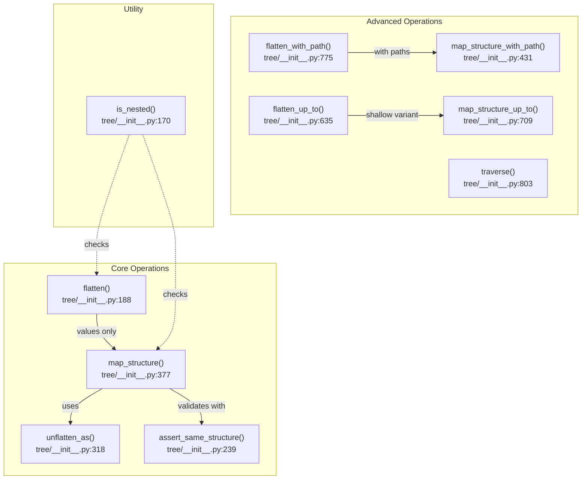
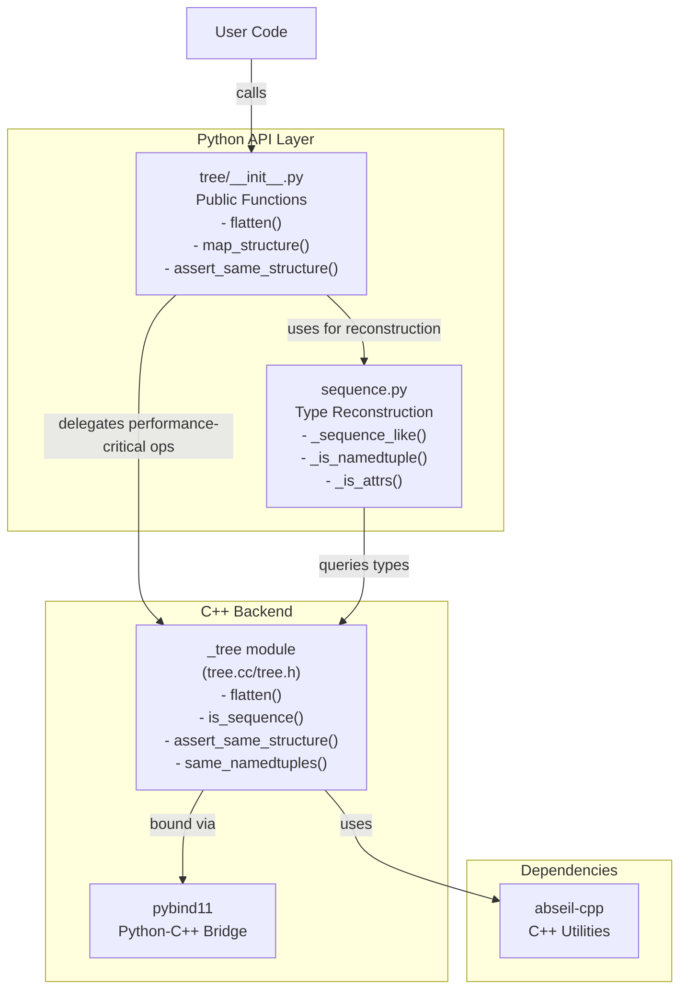
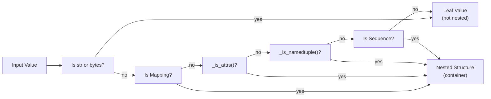

<!-- source: DeepWiki mcp.deepwiki.com · repo google-deepmind/tree · page 1 Home · fetched 2026-10-26 -->

# Home

<details>
<summary>Relevant source files</summary>

The following files were used as context for generating this wiki page:

- [README.md](README.md)
- [docs/index.rst](docs/index.rst)
- [tree/__init__.py](tree/__init__.py)

</details>


This page provides an introduction to dm-tree: what it is, the problem it solves, and an overview of its capabilities. For installation instructions, see [Installation and Setup](#3.1). For detailed API documentation, see [API Reference](#3.4). For architectural details, see [Architecture](#2).

**Sources:** [tree/__init__.py:1-62](), [README.md:1-48](), [docs/index.rst:1-45]()

## What is dm-tree?

`dm-tree` is a library for working with arbitrarily nested data structures in Python. It generalizes Python's built-in `map()` function (which only works with flat sequences) to operate on nested structures while preserving their shape. The library is backed by an optimized C++ implementation, making it suitable for performance-critical applications such as machine learning frameworks.

The library originated as part of TensorFlow (available as `tf.nest`) and has been extracted as a standalone package to benefit the broader Python ecosystem.

**Sources:** [tree/__init__.py:16](), [README.md:3-6](), [docs/index.rst:13-26]()

## Core Problem: Working with Nested Structures

Python programs frequently work with nested data structures like:

```python
# Configuration object
config = {
    'model': {'layers': [64, 128, 256], 'dropout': 0.5},
    'optimizer': {'learning_rate': 0.001, 'momentum': 0.9}
}

# Batch of samples
batch = [(features1, label1), (features2, label2), (features3, label3)]

# Neural network parameters
params = {'weights': [W1, W2, W3], 'biases': [b1, b2, b3]}
```

Common operations on these structures include:
- Applying a function to every leaf value
- Flattening to a list for batch processing
- Validating that two structures have the same shape
- Reconstructing a structure from a flat list

Without `dm-tree`, implementing these operations requires complex recursive code that handles different container types (lists, tuples, dicts, namedtuples, etc.). The library provides a clean, performant API for these operations.

**Sources:** [tree/__init__.py:377-428](), [README.md:3-15]()

## Key Functions and Their Roles



**Sources:** [tree/__init__.py:46-60](), [tree/__init__.py:170-941]()

## Function Categories

| Category | Functions | Purpose |
|----------|-----------|---------|
| **Basic Operations** | `flatten`, `unflatten_as`, `map_structure` | Transform entire nested structures |
| **Structure Validation** | `assert_same_structure`, `is_nested` | Verify structure compatibility and properties |
| **Path-Aware Operations** | `flatten_with_path`, `map_structure_with_path` | Access position information during traversal |
| **Shallow Operations** | `flatten_up_to`, `map_structure_up_to`, `flatten_with_path_up_to`, `map_structure_with_path_up_to` | Process structures only to a certain depth |
| **Custom Traversal** | `traverse`, `traverse_with_path` | Flexible depth-first traversal with pruning |

**Sources:** [tree/__init__.py:46-60]()

## Quick Start Examples

### Flattening and Unflattening

```python
import tree

# Flatten nested structure to list
structure = [[1, 2], {'a': 3, 'b': [4, 5]}]
flat = tree.flatten(structure)
# Result: [1, 2, 3, 4, 5]

# Unflatten using a structure template
new_values = [10, 20, 30, 40, 50]
result = tree.unflatten_as(structure, new_values)
# Result: [[10, 20], {'a': 30, 'b': [40, 50]}]
```

**Sources:** [tree/__init__.py:188-224](), [tree/__init__.py:318-374](), [README.md:8-15]()

### Mapping Functions Over Structures

```python
# Apply function to each leaf
structure = [[1], [[[2, 3]]], [4]]
squared = tree.map_structure(lambda v: v**2, structure)
# Result: [[1], [[[4, 9]]], [16]]

# Apply function to multiple structures element-wise
tree.map_structure(lambda x, y: x + y, [1, 2], [3, 4])
# Result: [4, 6]
```

**Sources:** [tree/__init__.py:377-428](), [README.md:13-14](), [docs/index.rst:18-21]()

### Structure Validation

```python
# Verify two structures have the same shape
tree.assert_same_structure([1, 2], [3, 4])  # OK
tree.assert_same_structure([1, 2], [3])     # Raises ValueError
tree.assert_same_structure([1, 2], (3, 4))  # Raises TypeError (by default)
```

**Sources:** [tree/__init__.py:239-284]()

## Supported Types

`dm-tree` recognizes and correctly handles the following Python types as nested structures:

| Type Category | Examples | Iteration Order |
|--------------|----------|----------------|
| **Sequences** | `list`, `tuple` | Index order (0, 1, 2, ...) |
| **Mappings** | `dict`, `OrderedDict`, `defaultdict`, `MappingProxyType` | **Sorted key order** (not insertion order) |
| **Named Tuples** | `collections.namedtuple` | Field name order (sorted) |
| **Attrs Classes** | `@attr.s` decorated classes | Attribute name order (sorted) |
| **Proxies** | `wrapt.ObjectProxy` | Delegates to wrapped object |

All other types (strings, numbers, custom objects, etc.) are treated as **leaf values**.

**Important:** Dictionaries are always iterated in sorted key order for determinism, even for `OrderedDict`. This ensures consistent behavior across operations.

**Sources:** [tree/__init__.py:64-66](), [tree/__init__.py:129-161](), [tree/__init__.py:144-160]()

## Architecture Overview



The library uses a two-tier architecture:
- **Python layer** ([tree/__init__.py:1-944]()) provides the rich public API and orchestrates operations
- **C++ backend** ([tree.cc]()) handles performance-critical primitives like flattening, type checking, and structure validation
- **Helper module** ([sequence.py]()) reconstructs Python types from flat sequences

For detailed architecture information, see [Architecture](#2).

**Sources:** [tree/__init__.py:1-44](), [tree/__init__.py:185-224](), [tree/__init__.py:276-284]()

## Type Detection Flow



The type detection logic ensures strings and bytes are always treated as leaves (not iterated), while all recognized container types are treated as nested structures.

**Sources:** [tree/__init__.py:64-66](), [tree/__init__.py:170-185](), [tree/__init__.py:487-501]()

## Use Cases

`dm-tree` is particularly useful in:

- **Machine Learning**: Handling nested parameter structures, batch data, and configuration objects
- **Configuration Management**: Processing hierarchical configuration dictionaries
- **Data Pipelines**: Transforming nested data structures in ETL workflows
- **Testing**: Validating structure consistency across inputs and outputs
- **Generic Programming**: Writing functions that work uniformly across different nested container types

**Sources:** [README.md:17-18]()

## Getting Started

1. **Install the package**: See [Installation and Setup](#3.1)
2. **Learn basic operations**: See [Basic Operations](#3.2)
3. **Explore advanced features**: See [Advanced Usage](#3.3)
4. **Review complete API**: See [API Reference](#3.4)

For contributors and developers who want to modify or extend dm-tree:
- **Development setup**: See [Development Setup](#4.1)
- **Build system details**: See [Build System Architecture](#4.2)
- **Testing guidelines**: See [Testing and Benchmarking](#4.3)

**Sources:** [docs/index.rst:28-33](), [README.md:20-38]()

## Version and License

Current version: `0.1.9`

The project is licensed under the Apache 2.0 License.

For project history and version changes, see [Changelog and History](#5.2).

**Sources:** [tree/__init__.py:62](), [README.md:45-47](), [docs/index.rst:41-44]()

---

