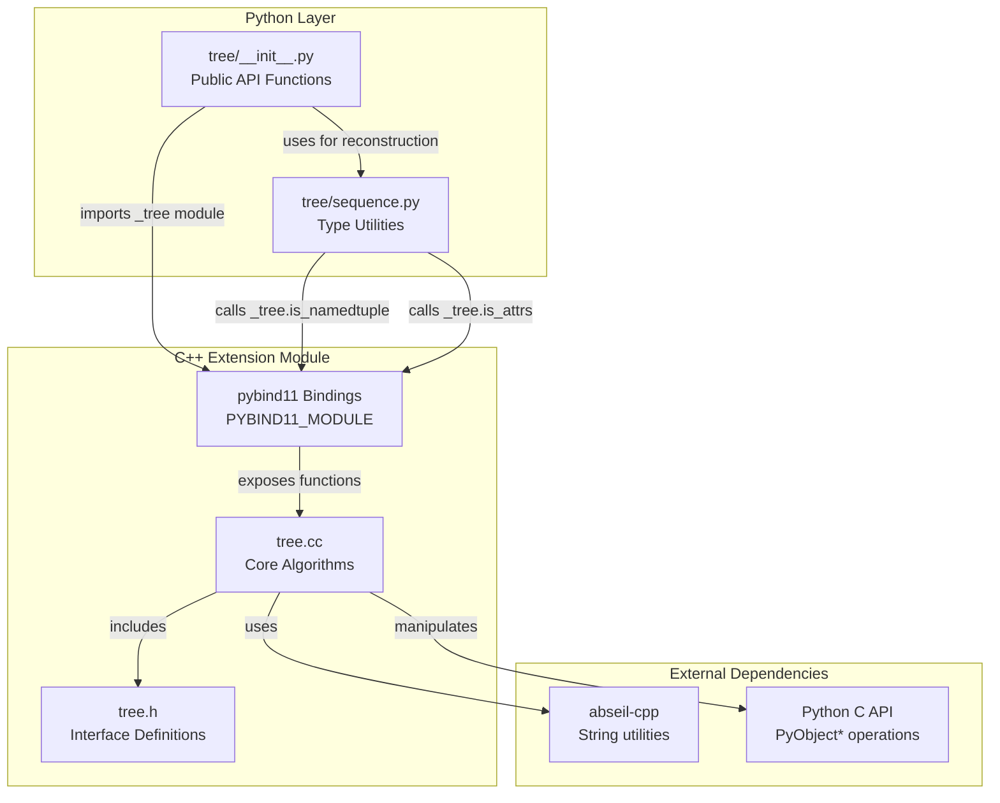
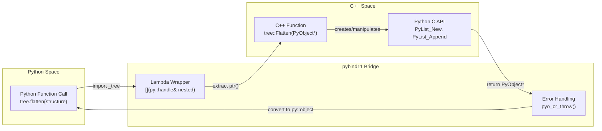
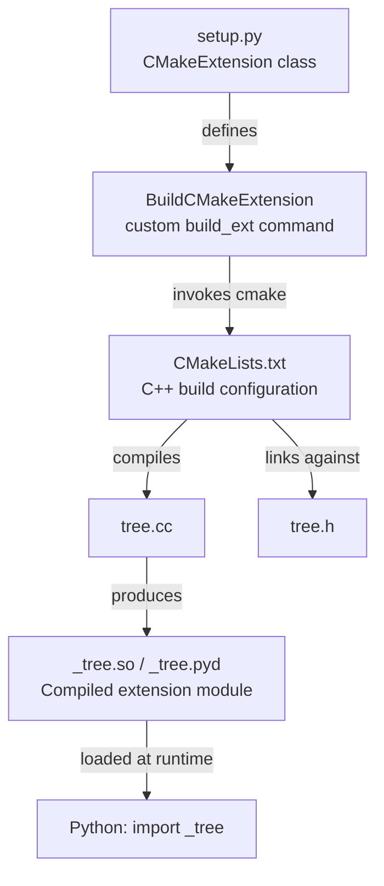
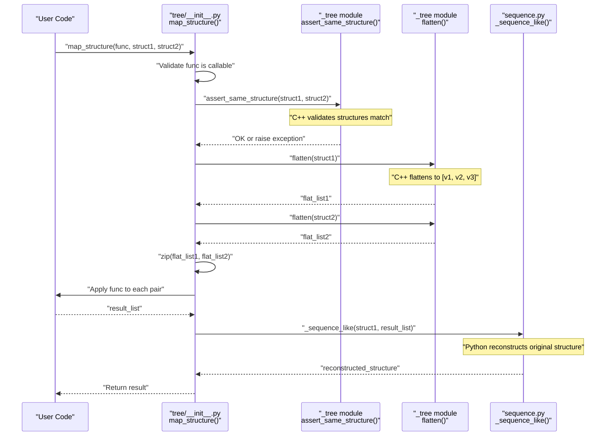
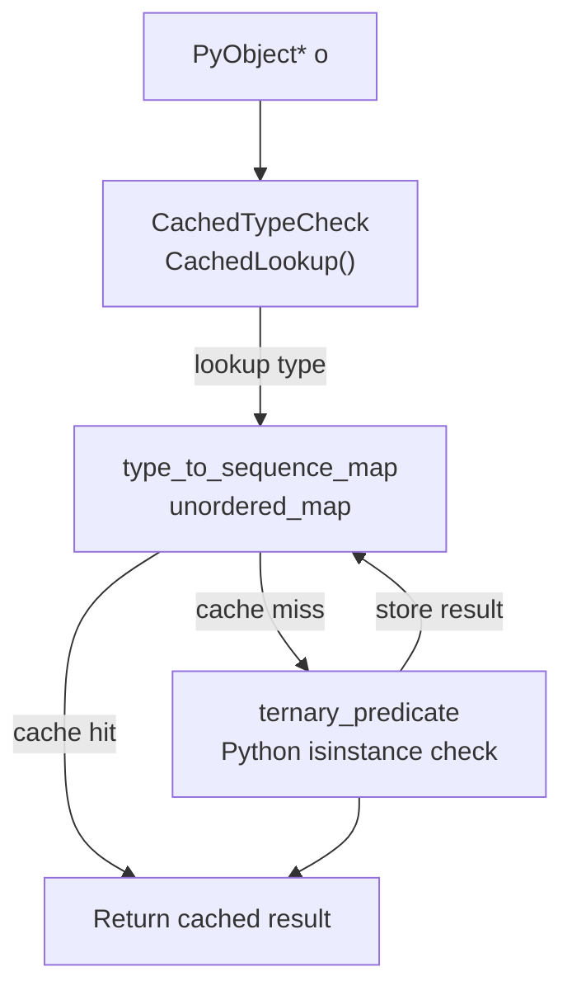

<!-- source: DeepWiki mcp.deepwiki.com · repo google-deepmind/tree · page 2 Architecture · fetched 2026-10-26 -->

# Architecture

Relevant source files

The following files were used as context for generating this wiki page:

- [setup.py](setup.py)
- [tree/__init__.py](tree/__init__.py)
- [tree/tree.cc](tree/tree.cc)

This document provides a high-level overview of dm-tree's internal architecture, focusing on the dual Python/C++ implementation strategy that enables both ease of use and high performance. For detailed information about specific components, see [Python API Layer](#2.1), [C++ Backend Implementation](#2.2), and [Type System and Utilities](#2.3). For build system details, see [Build System Architecture](#4.2).

## Architectural Overview

dm-tree employs a **two-tier architecture** that separates user-facing API functionality from performance-critical operations. The Python layer provides a rich, Pythonic interface while delegating computationally intensive tasks to a C++ backend. This design achieves three key objectives:

1. **Performance**: C++ implementation for flattening, structure validation, and type checking operations
2. **Usability**: Idiomatic Python API with comprehensive docstrings and error handling
3. **Flexibility**: Python-based orchestration for complex operations like `map_structure` and `traverse`

The architecture consists of three primary layers:

| Layer | Implementation | Primary Responsibility |
|-------|---------------|------------------------|
| **Python API** | [tree/\_\_init\_\_.py]() | Public API, orchestration, structure reconstruction |
| **C++ Backend** | [tree/tree.cc](), [tree/tree.h]() | Performance-critical operations, type checking |
| **Type Utilities** | [tree/sequence.py]() | Type-aware reconstruction of Python structures |

Sources: [tree/__init__.py:1-944](), [tree/tree.cc:1-783](), [setup.py:43-53]()

## System Component Diagram

**System Components and Their Roles**

Sources: [tree/__init__.py:37-43](), [tree/tree.cc:744-779](), [tree/sequence.py:1-30]()

## Layer Responsibilities

### Python API Layer

The Python API layer in [tree/\_\_init\_\_.py]() serves as the primary interface for users and handles:

- **API Orchestration**: Functions like `map_structure` coordinate between C++ operations and Python function application
- **Error Enhancement**: Wraps C++ exceptions with detailed structural information ([tree/__init__.py:276-284]())
- **Convenience Operations**: Provides variants like `flatten_with_path`, `map_structure_up_to` that build on C++ primitives
- **Structure Reconstruction**: Uses helper functions to rebuild nested structures after transformation

Key functions include:
- `flatten()` - Direct delegation to C++ ([tree/__init__.py:224]())
- `map_structure()` - Python orchestration using C++ flatten + Python function application ([tree/__init__.py:377-428]())
- `assert_same_structure()` - C++ validation with enhanced error reporting ([tree/__init__.py:239-284]())

### C++ Backend Layer

The C++ implementation in [tree/tree.cc]() and [tree/tree.h]() focuses on:

- **High-Performance Flattening**: `Flatten()` function recursively extracts values ([tree/tree.cc:611-619]())
- **Type Identification**: Fast type checking with caching via `CachedTypeCheck` class ([tree/tree.cc:95-148]())
- **Structure Validation**: `AssertSameStructure()` performs deep structural comparison ([tree/tree.cc:703-721]())
- **Iterator Abstractions**: Specialized iterators for different container types:
  - `DictValueIterator` for dictionaries with sorted keys ([tree/tree.cc:263-295]())
  - `MappingValueIterator` for generic mappings ([tree/tree.cc:298-329]())
  - `SequenceValueIterator` for sequences ([tree/tree.cc:332-358]())
  - `AttrsValueIterator` for attrs-decorated classes ([tree/tree.cc:360-390]())

Sources: [tree/tree.cc:608-619](), [tree/tree.cc:703-721](), [tree/tree.cc:95-148]()

### Type System Utilities

The [tree/sequence.py]() module bridges Python's type system with the tree operations:

- **Type Recognition**: Functions `_is_namedtuple()` and `_is_attrs()` identify special Python types
- **Structure Reconstruction**: `_sequence_like()` rebuilds structures with new values while preserving types
- **Key Sorting**: `_sorted()` provides deterministic ordering for dictionary keys

This module is crucial for operations like `unflatten_as()` and `map_structure()` that need to reconstruct the original structure types after flattening.

Sources: [tree/sequence.py:1-150](), [tree/__init__.py:23-26]()

## Language Boundary and Integration

### pybind11 Bridge

The Python-C++ boundary is managed through pybind11, configured in [tree/tree.cc:744-779](). The `PYBIND11_MODULE` macro exposes five core functions from C++ to Python:

**Exposed C++ Functions:**

| Python Name | C++ Implementation | Purpose |
|-------------|-------------------|---------|
| `_tree.flatten` | `tree::Flatten()` | Recursively flatten nested structures |
| `_tree.assert_same_structure` | `tree::AssertSameStructure()` | Validate structural equivalence |
| `_tree.is_sequence` | `tree::IsSequence()` | Check if object is a sequence |
| `_tree.is_namedtuple` | `tree::IsNamedtuple()` | Identify namedtuple objects |
| `_tree.is_attrs` | `tree::IsAttrs()` | Identify attrs-decorated classes |
| `_tree.same_namedtuples` | `tree::SameNamedtuples()` | Compare namedtuple types |

Sources: [tree/tree.cc:744-779](), [tree/__init__.py:37-42]()

### Compilation and Build Integration

The C++ extension is built through CMake integration in [setup.py]():

The `CMakeExtension` class in [setup.py:43-53]() and `BuildCMakeExtension` in [setup.py:55-117]() coordinate the build process, passing Python configuration to CMake and handling platform-specific requirements.

Sources: [setup.py:43-117](), [tree/tree.cc:744-779]()

## Operational Flow

### Example: `map_structure` Execution

The following diagram illustrates how a typical high-level operation flows through all architectural layers:

**Flow Breakdown:**

1. **Validation Phase** (Python → C++): `map_structure` calls `assert_same_structure` to ensure all input structures have compatible shapes
2. **Flattening Phase** (Python → C++): Each structure is flattened using the C++ `flatten` function for performance
3. **Application Phase** (Pure Python): The user's function is applied to zipped flat sequences
4. **Reconstruction Phase** (Python with C++ queries): `_sequence_like` rebuilds the output using type information from C++

Sources: [tree/__init__.py:377-428](), [tree/__init__.py:318-374](), [tree/sequence.py:50-150]()

## Type Checking and Caching Strategy

A key performance optimization in the C++ layer is the `CachedTypeCheck` class, which caches type identification results:

**Caching Mechanism:**

The `CachedTypeCheck` class ([tree/tree.cc:95-148]()) implements a type-based memoization strategy:

1. **First Check**: When encountering a new Python type, call the predicate (e.g., `isinstance(o, Sequence)`)
2. **Cache Storage**: Store the result in `type_to_sequence_map_` with the type object as key
3. **Subsequent Checks**: For objects of the same type, return cached result without Python callback
4. **Cache Limit**: Maximum 1024 types to prevent unbounded memory growth

This optimization is critical because type checks occur frequently during recursive flattening and validation operations.

Sources: [tree/tree.cc:95-148](), [tree/tree.cc:186-254]()

## Design Rationale

### Why Two Languages?

| Aspect | Python Implementation | C++ Implementation | Chosen Approach |
|--------|----------------------|-------------------|-----------------|
| **Recursive flattening** | Simple but slow (function call overhead) | Fast (tight loops, no interpreter) | **C++** |
| **Type identification** | Native `isinstance()` but repeated calls costly | Cached checks, fast lookup | **C++ with caching** |
| **Structure reconstruction** | Natural with Python's type system | Complex, requires Python API calls | **Python** |
| **User function application** | Natural, required for `map_structure` | Would require callback complexity | **Python** |
| **API composition** | Straightforward with decorators, kwargs | Verbose with pybind11 wrappers | **Python** |

### Performance vs. Flexibility Trade-off

The architecture makes deliberate choices about where to draw the Python/C++ boundary:

- **C++ handles**: Operations that iterate over large structures repeatedly (flatten, validate)
- **Python handles**: Operations that compose multiple steps or apply user-provided logic (map_structure, traverse)

This division allows the library to be both fast (competitive with hand-written C++ code for basic operations) and flexible (supporting arbitrary user functions and complex traversal patterns).

Sources: [tree/__init__.py:377-428](), [tree/tree.cc:393-419]()

## Module Dependencies

The following table summarizes the import relationships between core modules:

| Module | Imports From | Provides To |
|--------|--------------|-------------|
| `tree/__init__.py` | `tree._tree` (C++), `tree.sequence` | User code (public API) |
| `tree/sequence.py` | `tree._tree` (for type checks) | `tree/__init__.py` |
| `tree._tree` (C++ module) | Python C API, abseil-cpp | `tree/__init__.py`, `tree/sequence.py` |

The architecture maintains a clear dependency hierarchy with no circular dependencies between modules. The C++ module has no Python-level dependencies beyond the C API, making it independently testable and maintainable.

Sources: [tree/__init__.py:23-43](), [tree/sequence.py:1-30](), [tree/tree.cc:17-39]()

---

