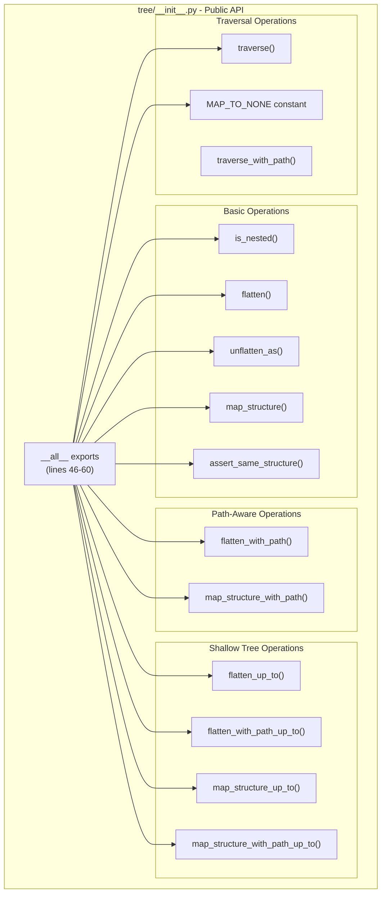
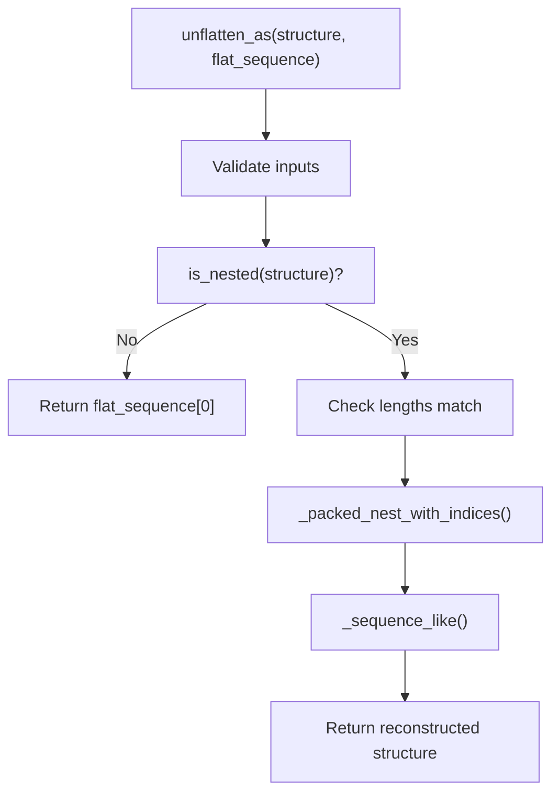
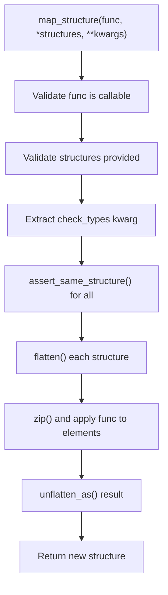
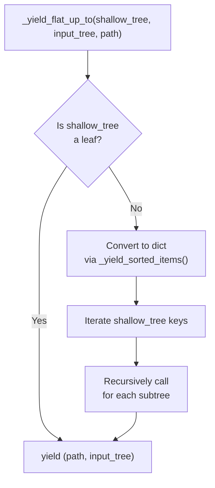
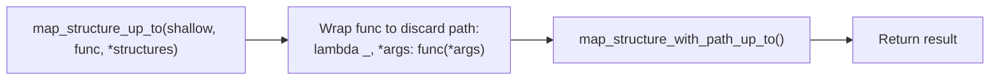
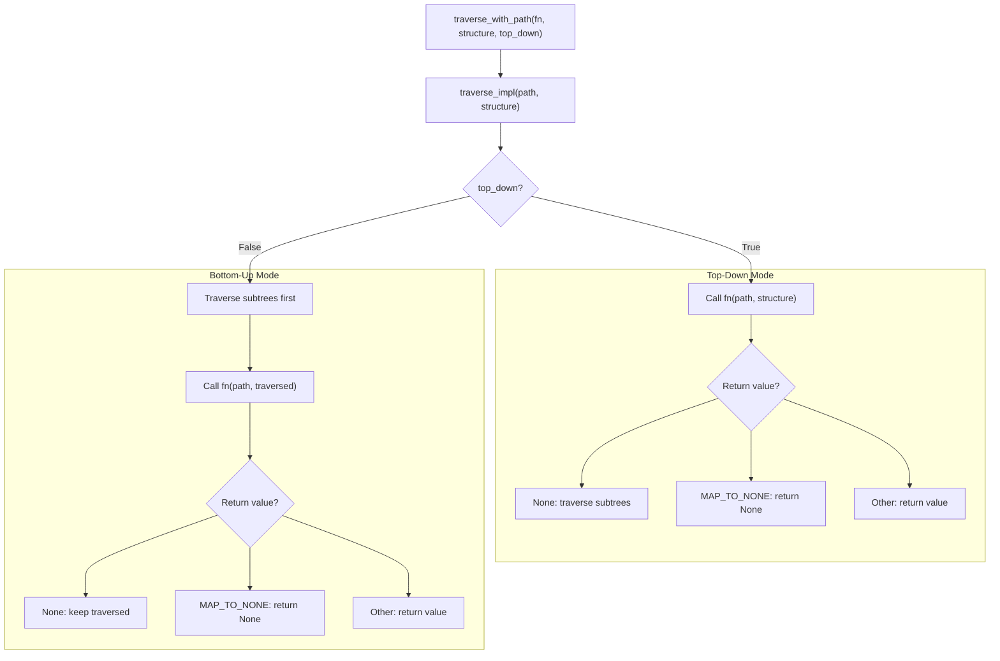
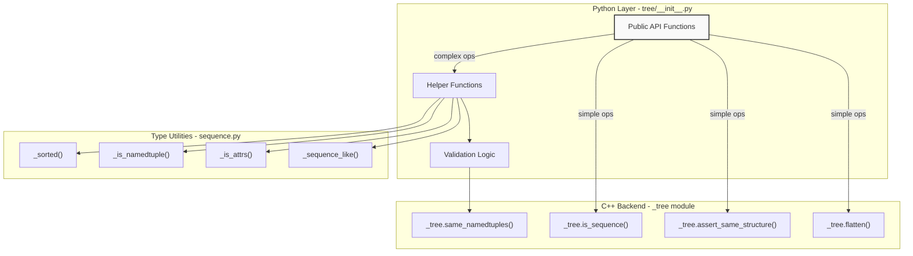

<!-- source: DeepWiki mcp.deepwiki.com · repo google-deepmind/tree · page 2.1 Python API Layer · fetched 2026-10-26 -->

# Python API Layer

<details>
<summary>Relevant source files</summary>

The following files were used as context for generating this wiki page:

- [LICENSE](LICENSE)
- [tree/__init__.py](tree/__init__.py)
- [tree/tree_test.py](tree/tree_test.py)

</details>


## Purpose and Scope

This document describes the Python API layer implemented in [tree/__init__.py](). This layer serves as the primary public interface to the dm-tree library, providing high-level functions for manipulating nested data structures. It orchestrates operations by delegating performance-critical tasks to the C++ backend while handling Python-specific type reconstruction and error reporting.

For information about the underlying C++ implementation, see [C++ Backend Implementation](#2.2). For details on how different Python types are handled, see [Type System and Utilities](#2.3).

---

## API Overview

The Python API layer exposes 10 public functions organized into three functional categories:

| Category | Functions | Purpose |
|----------|-----------|---------|
| **Basic Operations** | `flatten`, `unflatten_as`, `map_structure`, `assert_same_structure`, `is_nested` | Core tree manipulation operations |
| **Path-Aware Operations** | `flatten_with_path`, `map_structure_with_path` | Operations that track element positions |
| **Shallow Operations** | `flatten_up_to`, `map_structure_up_to`, `flatten_with_path_up_to`, `map_structure_with_path_up_to` | Partial tree traversal operations |
| **Traversal** | `traverse` | Custom tree walking with user-defined logic |

**Sources:** [tree/__init__.py:46-60]()

---

## Module Structure and Public Interface

The following diagram shows how the public API functions are organized and exported:



**Sources:** [tree/__init__.py:46-60](), [tree/__init__.py:16]()

---

## Basic Operations

### is_nested()

Determines whether a structure should be treated as nested (i.e., a sequence, mapping, namedtuple, or attrs object).

**Implementation:** [tree/__init__.py:170-185]()


This function directly delegates to the C++ backend's `_tree.is_sequence()` function. Strings and bytes are explicitly **not** treated as sequences, preventing unwanted character-level iteration.

**Sources:** [tree/__init__.py:170-185]()

---

### flatten()

Converts an arbitrarily nested structure into a flat list of leaf values. Dictionary keys are sorted to ensure deterministic ordering.

**Implementation:** [tree/__init__.py:188-224]()

**Key behaviors:**
- Non-nested inputs return single-element lists: `flatten(42) → [42]`
- Dictionary values are extracted in sorted key order
- `OrderedDict` instances ignore their ordering; keys are sorted
- Strings and byte strings are not flattened
- Delegates directly to `_tree.flatten()` for performance

**Sources:** [tree/__init__.py:188-224]()

---

### unflatten_as()

Reconstructs a nested structure from a flat sequence, using a template structure to determine the output shape.

**Implementation:** [tree/__init__.py:318-374]()



The reconstruction process uses the helper function `_packed_nest_with_indices()` [tree/__init__.py:287-315]() which recursively rebuilds the nested structure by matching the template structure's shape.

**Sources:** [tree/__init__.py:287-374]()

---

### assert_same_structure()

Validates that two structures have identical nesting patterns. This function is heavily used internally to validate inputs before operations.

**Implementation:** [tree/__init__.py:239-284]()

**Features:**
- Delegates to `_tree.assert_same_structure()` for validation
- On error, wraps the exception with visual structure representations
- Uses `map_structure(lambda _: _DOT, ...)` to create printable structure outlines
- The `check_types` parameter controls whether sequence types must match exactly

**Error Enhancement Pattern:**
```python
try:
    _tree.assert_same_structure(a, b, check_types)
except (ValueError, TypeError) as e:
    str1 = str(map_structure(lambda _: _DOT, a))
    str2 = str(map_structure(lambda _: _DOT, b))
    raise type(e)(f"{e}\nEntire first structure:\n{str1}\nEntire second structure:\n{str2}")
```

This pattern provides significantly better error messages by showing the complete structure outline.

**Sources:** [tree/__init__.py:239-284](), [tree/__init__.py:227-236]()

---

### map_structure()

Applies a function to corresponding elements across one or more nested structures, preserving the original structure shape.

**Implementation:** [tree/__init__.py:377-428]()



**Algorithm:** [tree/__init__.py:377-428]()
1. Validate callable and inputs
2. Check structure compatibility with `assert_same_structure()`
3. Flatten all input structures
4. Zip flattened lists and apply function element-wise
5. Unflatten results using the first structure as template

This implementation achieves O(n) complexity where n is the total number of leaf elements.

**Sources:** [tree/__init__.py:377-428]()

---

## Path-Aware Operations

Path-aware variants track the position of each element in the nested structure using a tuple of keys/indices.

### flatten_with_path()

Returns a list of `(path, value)` pairs where each path is a tuple identifying the element's location.

**Implementation:** [tree/__init__.py:775-796]()

```python
# Example from docstring:
tree.flatten_with_path([{"foo": 42}])
# Returns: [((0, 'foo'), 42)]
```

Internally delegates to `_yield_flat_up_to(structure, structure)` [tree/__init__.py:471-501](), treating both shallow and input tree as the same structure.

**Sources:** [tree/__init__.py:775-796](), [tree/__init__.py:471-501]()

---

### map_structure_with_path()

Like `map_structure()`, but passes the path as the first argument to the mapping function.

**Implementation:** [tree/__init__.py:431-468]()

```python
# Example:
tree.map_structure_with_path(
    lambda path, v: (path, v**2),
    [{"foo": 42}])
# Returns: [{'foo': ((0, 'foo'), 1764)}]
```

Internally delegates to `map_structure_with_path_up_to()` with the structure as its own shallow tree.

**Sources:** [tree/__init__.py:431-468]()

---

## Shallow Tree Operations

Shallow tree operations traverse only to the depth specified by a "shallow structure" template, leaving deeper nested elements intact.

### Core Helper: _yield_flat_up_to()

The foundation of all shallow operations is `_yield_flat_up_to()` [tree/__init__.py:471-501]():



This generator function:
1. Stops at shallow_tree leaves (including strings/bytes)
2. Yields `(path, value)` pairs
3. Recursively processes nested portions
4. Ensures deterministic ordering via sorted iteration

**Sources:** [tree/__init__.py:471-501]()

---

### _assert_shallow_structure()

Validates that the shallow structure's keys are a subset of the input structure's keys and that the nesting pattern is compatible.

**Implementation:** [tree/__init__.py:520-632]()

**Key validation rules:**
- If shallow tree is nested, input tree must also be nested
- Sequence lengths must match
- Type checking respects the `check_types` parameter
- For mappings, validates that all shallow keys exist in input
- Recursively validates all matching subtrees

**Sources:** [tree/__init__.py:520-632]()

---

### flatten_up_to()

Flattens the input structure only to the depth of the shallow structure.

**Implementation:** [tree/__init__.py:635-674]()

```python
# Example:
structure = [[[2, 2], [3, 3]], [[4, 9], [5, 5]]]
shallow = [[True, True], [False, True]]
tree.flatten_up_to(shallow, structure)
# Returns: [[2, 2], [3, 3], [4, 9], [5, 5]]
```

The shallow tree acts as a "mask" determining traversal depth.

**Sources:** [tree/__init__.py:635-674]()

---

### map_structure_up_to()

Maps a function across structures up to the shallow structure's depth.

**Implementation:** [tree/__init__.py:709-739]()



This function is implemented as a thin wrapper around `map_structure_with_path_up_to()` that discards the path argument.

**Sources:** [tree/__init__.py:709-739]()

---

### map_structure_with_path_up_to()

The most general shallow mapping operation, combining path tracking with shallow traversal.

**Implementation:** [tree/__init__.py:742-772]()

**Algorithm:**
1. Uses `_multiyield_flat_up_to()` [tree/__init__.py:504-517]() to yield aligned path-value tuples
2. Applies the function to each aligned set of values
3. Unflattens results using the shallow structure as template

The `_multiyield_flat_up_to()` helper zips multiple input trees together, ensuring all structures align at each path.

**Sources:** [tree/__init__.py:742-772](), [tree/__init__.py:504-517]()

---

## Traversal Operations

### traverse()

Provides custom tree walking with user-defined transformation logic. Supports both top-down and bottom-up traversal.

**Implementation:** [tree/__init__.py:803-844]()

**Traversal modes:**
- **Top-down:** Parents visited before children. Returning non-`None` prunes that subtree.
- **Bottom-up:** Children visited first. Return value replaces the subtree.

**Special value:** `MAP_TO_NONE` [tree/__init__.py:800]() - used when you want to replace a subtree with `None` (since `None` means "don't replace").

Internally delegates to `traverse_with_path()` with a wrapper that discards the path argument.

**Sources:** [tree/__init__.py:803-844](), [tree/__init__.py:800]()

---

### traverse_with_path()

The core traversal implementation that passes path information to the user function.

**Implementation:** [tree/__init__.py:847-941]()



The recursive implementation [tree/__init__.py:909-941]() uses a nested helper `traverse_impl()` that builds paths incrementally and handles the traversal logic.

**Sources:** [tree/__init__.py:847-941]()

---

## Internal Architecture and Design Patterns

### Delegation Strategy

The Python API layer follows a clear delegation pattern:



**Performance-critical operations** delegated to C++:
- `flatten()` → `_tree.flatten()`
- `assert_same_structure()` → `_tree.assert_same_structure()`
- `is_nested()` → `_tree.is_sequence()`

**Complex operations** implemented in Python:
- `unflatten_as()` - requires type reconstruction
- `map_structure()` - orchestrates multiple operations
- All shallow and path-aware operations - complex iteration logic

**Sources:** [tree/__init__.py:23-26](), [tree/__init__.py:37-42]()

---

### Helper Functions and Utilities

#### _yield_sorted_items()

Central iteration helper that provides deterministic ordering across all structure types.

**Implementation:** [tree/__init__.py:129-160]()

| Input Type | Iteration Strategy | Key Type |
|------------|-------------------|----------|
| `Mapping` | Sorted keys | Dictionary key |
| attrs object | `__attrs_attrs__` sorted by name | Attribute name |
| namedtuple | `_fields` in order | Field name |
| Sequence | Enumerate indices | Integer index |

This function is used throughout the codebase to ensure operations are deterministic regardless of dict insertion order or other runtime variations.

**Sources:** [tree/__init__.py:129-160]()

---

#### _sequence_like()

Reconstructs a structure of the same type as the input, using new values.

Imported from `sequence.py` [tree/__init__.py:25](), this function is critical for preserving type information during operations like `map_structure()` and `unflatten_as()`.

**Sources:** [tree/__init__.py:25]()

---

#### _get_attrs_items()

Extracts attribute name-value pairs from attrs objects.

**Implementation:** [tree/__init__.py:109-121]()

```python
def _get_attrs_items(obj):
    return [(attr.name, getattr(obj, attr.name))
            for attr in obj.__class__.__attrs_attrs__]
```

**Sources:** [tree/__init__.py:109-121]()

---

### Type Handling and Special Cases

#### Text and Bytes

Strings and byte strings are explicitly **not** treated as sequences to prevent character-level iteration:

```python
_TEXT_OR_BYTES = (str, bytes)  # Line 66
```

These types are checked in various functions to ensure they're treated as atomic values.

**Sources:** [tree/__init__.py:66]()

---

#### ObjectProxy Support

The API layer supports `wrapt.ObjectProxy` objects, with special handling for type checking:

```python
if isinstance(shallow_tree, ObjectProxy):
    shallow_type = type(shallow_tree.__wrapped__)
else:
    shallow_type = type(shallow_tree)
```

This allows transparent proxying of structures while maintaining correct type validation.

**Sources:** [tree/__init__.py:582-585](), [tree/__init__.py:29-34]()

---

### Error Messages and Diagnostics

The module defines several error message templates as module-level constants [tree/__init__.py:68-93]():

| Constant | Usage |
|----------|-------|
| `_SHALLOW_TREE_HAS_INVALID_KEYS` | Shallow tree keys not found in input |
| `_STRUCTURES_HAVE_MISMATCHING_TYPES` | Type mismatch between structures |
| `_STRUCTURES_HAVE_MISMATCHING_LENGTHS` | Length mismatch between structures |
| `_INPUT_TREE_SMALLER_THAN_SHALLOW_TREE` | Input has fewer elements |
| `_IF_SHALLOW_IS_SEQ_INPUT_MUST_BE_SEQ` | Type compatibility error |
| `_IF_SHALLOW_IS_SEQ_INPUT_MUST_BE_SEQ_WITH_PATH` | Type error with path info |

These templates support `.format()` substitution for detailed error reporting.

**Sources:** [tree/__init__.py:68-93]()

---

## Type Annotations

The module provides generic type annotations for nested structures:

```python
K = TypeVar("K")
V = TypeVar("V")

StructureKV = Union[
    Sequence["StructureKV[K, V]"],
    Mapping[K, "StructureKV[K, V]"],
    V,
]
Structure = StructureKV[str, V]
```

**Sources:** [tree/__init__.py:95-106]()

These recursive type definitions capture the concept of arbitrarily nested structures where:
- `StructureKV[K, V]` is a structure with key type K and leaf type V
- `Structure[V]` is shorthand for structures with string keys and leaf type V

---

## Module Initialization and Imports

The module carefully handles imports to support Sphinx documentation builds:

```python
try:
    from tree import _tree
except ImportError:
    if "sphinx" not in sys.modules:
        raise
    _tree = None
```

**Sources:** [tree/__init__.py:37-42]()

This pattern allows documentation to be built without requiring the compiled C++ extension, setting `_tree = None` when running under Sphinx.

Similarly for `wrapt.ObjectProxy`, the module provides a stub class when the library is unavailable [tree/__init__.py:29-34]().

---

## Summary

The Python API layer in `tree/__init__.py` implements a well-structured facade over the C++ backend, providing:

1. **Three categories of operations:** basic, path-aware, and shallow tree operations
2. **Performance optimization:** delegating simple operations to C++ while implementing complex logic in Python
3. **Rich error reporting:** enhancing C++ exceptions with structure visualizations
4. **Type preservation:** using helper utilities to reconstruct Python types correctly
5. **Deterministic behavior:** ensuring consistent ordering via sorted iteration
6. **Comprehensive validation:** checking structure compatibility before operations

The layer achieves a balance between performance (via C++ delegation) and flexibility (via Python implementation of complex operations), while maintaining a clean, well-documented public API.

---

