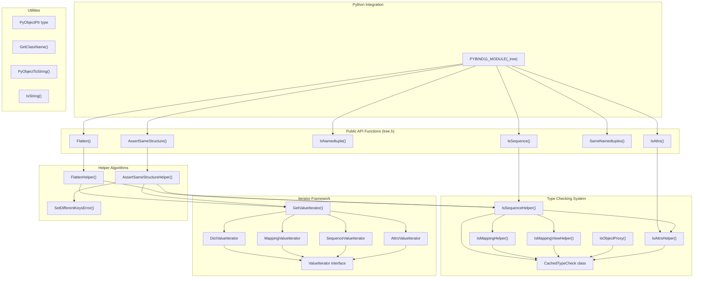
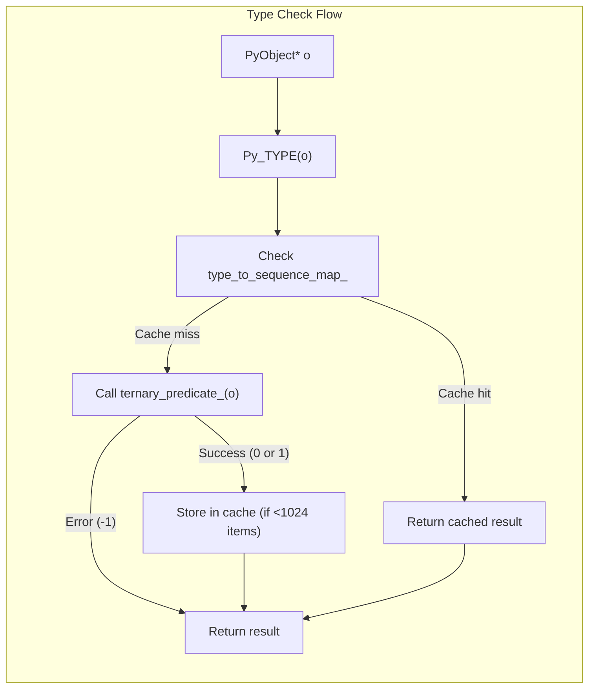
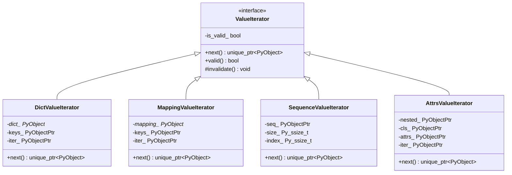
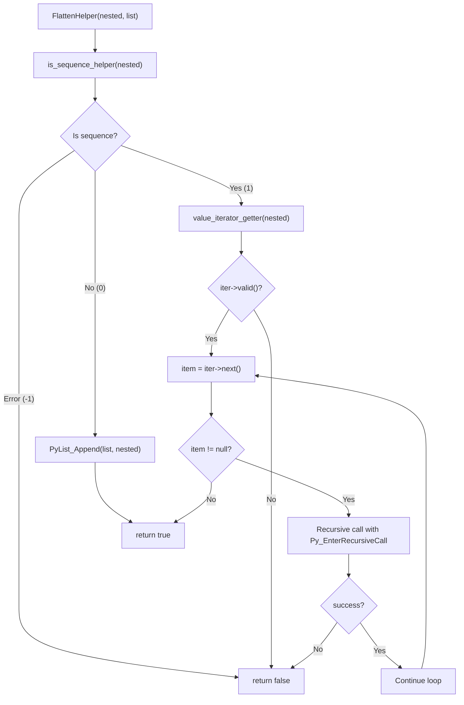
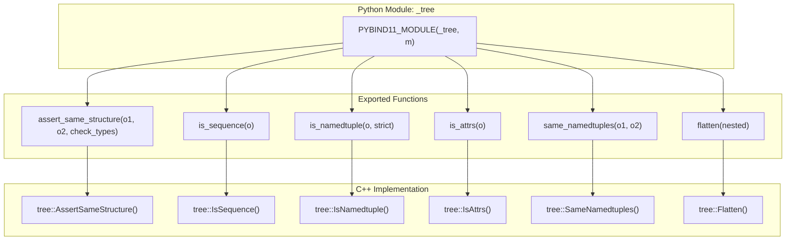

<!-- source: DeepWiki mcp.deepwiki.com · repo google-deepmind/tree · page 2.2 C++ Backend Implementation · fetched 2026-10-26 -->

# C++ Backend Implementation

<details>
<summary>Relevant source files</summary>

The following files were used as context for generating this wiki page:

- [tree/tree.cc](tree/tree.cc)
- [tree/tree.h](tree/tree.h)

</details>


## Purpose and Scope

This document provides a detailed technical explanation of the C++ backend implementation in `tree.cc` and `tree.h`. The C++ layer provides performance-critical operations for nested structure manipulation, including flattening, structure validation, and type identification.

For information about how the Python API layer uses these C++ functions, see [Python API Layer](#2.1). For details on how different Python types are handled and reconstructed, see [Type System and Utilities](#2.3).

**Sources:** [tree/tree.cc:1-783](), [tree/tree.h:1-140]()

---

## Architecture Overview

The C++ backend is organized into several key subsystems that work together to provide efficient nested structure operations:



The architecture consists of four main layers:
1. **Public API Functions** - exposed to Python via pybind11
2. **Type Checking System** - cached type identification with Python type introspection
3. **Iterator Framework** - uniform iteration over different container types
4. **Helper Algorithms** - recursive implementations of core operations

**Sources:** [tree/tree.cc:1-783](), [tree/tree.h:16-140]()

---

## Public API Functions

The C++ backend exposes six primary functions to Python through the `_tree` module:

| Function | Signature | Purpose | Return Type |
|----------|-----------|---------|-------------|
| `Flatten` | `PyObject* Flatten(PyObject*)` | Recursively flattens nested structures into a list | `PyObject*` (list) |
| `IsSequence` | `bool IsSequence(PyObject*)` | Checks if object is a sequence (excluding strings) | `bool` |
| `IsNamedtuple` | `PyObject* IsNamedtuple(PyObject*, bool)` | Checks if object is a namedtuple | `PyObject*` (bool) |
| `IsAttrs` | `bool IsAttrs(PyObject*)` | Checks if object is an attrs class instance | `bool` |
| `SameNamedtuples` | `PyObject* SameNamedtuples(PyObject*, PyObject*)` | Checks if two namedtuples have same structure | `PyObject*` (bool) |
| `AssertSameStructure` | `void AssertSameStructure(PyObject*, PyObject*, bool)` | Validates two structures match | `void` (raises on error) |

### Function Details

#### Flatten
[tree/tree.cc:611-619]() implements `Flatten`, which creates a new Python list and delegates to `FlattenHelper` to populate it recursively. On error, it decrements the list reference and returns `nullptr`.

#### IsSequence
[tree/tree.cc:608]() is a thin wrapper around `IsSequenceHelper` that converts the ternary result (-1, 0, 1) to a boolean, with error checking.

#### IsNamedtuple
[tree/tree.cc:621-678]() performs a multi-step validation:
1. Unwraps `wrapt.ObjectProxy` if present
2. Checks if object is a tuple subclass
3. In strict mode, verifies `__base__` is exactly `tuple`
4. Validates `_fields` attribute exists and contains only strings

#### AssertSameStructure
[tree/tree.cc:703-721]() delegates to `AssertSameStructureHelper` and raises either `TypeError` or `ValueError` based on the error type, with detailed error messages including string representations of both structures.

**Sources:** [tree/tree.cc:608-721](), [tree/tree.h:25-115]()

---

## Type Checking System

The type checking system uses a sophisticated caching mechanism to avoid repeated calls into Python's type system:



### CachedTypeCheck Class

[tree/tree.cc:95-148]() defines `CachedTypeCheck`, which caches type check results based on `PyTypeObject*` pointers:

**Key Components:**
- **Constructor**: Takes a `std::function<int(PyObject*)>` ternary predicate (returns -1 for error, 0 for false, 1 for true)
- **CachedLookup**: Checks cache first, then calls predicate and caches result
- **Cache Limit**: Limited to `kMaxItemsInCache` (1024) entries to prevent memory leaks
- **Memory Management**: Increments type refcount when caching to prevent type deletion

**Cache Instances:**

| Function | Predicate | Purpose |
|----------|-----------|---------|
| `IsMappingHelper` | `PyObject_IsInstance(..., Mapping)` | Check if object is a mapping |
| `IsMappingViewHelper` | `PyObject_IsInstance(..., MappingView)` | Check if object is a mapping view |
| `IsObjectProxy` | `PyObject_IsInstance(..., wrapt.ObjectProxy)` | Check if object is a wrapt proxy |
| `IsAttrsHelper` | `hasattr(obj.__class__, "__attrs_attrs__")` | Check if object is attrs instance |
| `IsSequenceHelper` | `PyObject_IsInstance(..., Sequence)` | Check if object is a sequence |

Each helper function creates a static `CachedTypeCheck` instance that persists for the lifetime of the module.

**Sources:** [tree/tree.cc:95-148](), [tree/tree.cc:185-254]()

### Type Collection Functions

[tree/tree.cc:150-180]() provides functions to retrieve Python types at runtime:

- `GetCollectionsSequenceType()` - returns `collections.abc.Sequence`
- `GetCollectionsMappingType()` - returns `collections.abc.Mapping`
- `GetCollectionsMappingViewType()` - returns `collections.abc.MappingView`
- `GetWraptObjectProxyType()` - returns `wrapt.ObjectProxy` (handles ImportError gracefully)

These use static `py::object` instances to cache the type objects.

**Sources:** [tree/tree.cc:150-180]()

---

## Iterator Framework

The iterator framework provides uniform iteration over different container types through a common `ValueIterator` interface:



### ValueIterator Interface

[tree/tree.h:122-134]() and [tree/tree.cc:256]() define the base interface:

- **`next()`**: Returns the next value as `PyObjectPtr` (unique_ptr with custom deleter)
- **`valid()`**: Returns whether the iterator is in a valid state
- **`invalidate()`**: Marks iterator as invalid (typically called on initialization error)

### Iterator Implementations

#### DictValueIterator

[tree/tree.cc:263-295]() iterates over Python dictionaries with sorted keys:

1. Extracts keys using `PyDict_Keys`
2. Sorts keys using `PyList_Sort` for deterministic ordering
3. Iterates through sorted keys
4. Retrieves values using `PyDict_GetItem` (borrowed reference, requires INCREF)

**Key behavior**: Ignores original `OrderedDict` ordering to prevent bugs from mixing ordered and plain dicts.

#### MappingValueIterator

[tree/tree.cc:298-329]() handles generic mapping types:

1. Extracts keys using `PyMapping_Keys`
2. Sorts keys for consistency
3. Iterates through sorted keys
4. Retrieves values using `PyObject_GetItem` (new reference)

**Difference from DictValueIterator**: Uses `PyObject_GetItem` instead of `PyDict_GetItem`, which returns a new reference.

#### SequenceValueIterator

[tree/tree.cc:332-358]() iterates over sequences by index:

1. Converts to fast sequence using `PySequence_Fast`
2. Gets size using `PySequence_Fast_GET_SIZE`
3. Iterates by index from 0 to size-1
4. Retrieves items using `PySequence_Fast_GET_ITEM` (borrowed reference)

#### AttrsValueIterator

[tree/tree.cc:360-390]() iterates over attrs class instances:

1. Gets `__class__` attribute
2. Gets `__attrs_attrs__` from class
3. Iterates over attrs
4. For each attr, gets its `name` and retrieves the corresponding attribute value

### GetValueIterator Factory

[tree/tree.cc:723-733]() selects the appropriate iterator based on type:

```
if PyDict_Check       -> DictValueIterator
elif IsMappingHelper  -> MappingValueIterator
elif IsAttrsHelper    -> AttrsValueIterator
else                  -> SequenceValueIterator
```

**Sources:** [tree/tree.h:122-136](), [tree/tree.cc:256-390](), [tree/tree.cc:723-733]()

---

## Core Algorithms

### Flatten Algorithm

[tree/tree.cc:393-419]() implements `FlattenHelper`, the recursive core of the flatten operation:



**Algorithm Details:**

1. **Base Case**: If `nested` is not a sequence, append it to `list` and return
2. **Recursive Case**: 
   - Get appropriate iterator for the container type
   - Iterate through all values
   - Recursively call `FlattenHelper` on each value
   - Use `Py_EnterRecursiveCall`/`Py_LeaveRecursiveCall` to protect against infinite recursion

**Error Handling**: Returns `false` on any error, with Python error state set appropriately.

**Sources:** [tree/tree.cc:393-419](), [tree/tree.cc:611-619]()

### AssertSameStructure Algorithm

[tree/tree.cc:457-604]() implements `AssertSameStructureHelper`, which validates that two structures have the same shape:

**Algorithm Flow:**

1. **Check if both are sequences**: If one is and one isn't, set error and return
2. **Base case**: If both are non-sequences, structures match
3. **Type checking** (if `check_types=True`):
   - Unwrap `wrapt.ObjectProxy` wrappers
   - Check if both are namedtuples and validate they match using `SameNamedtuples`
   - Check if types are identical (with special handling for lists and mappings)
   - For dicts/mappings: validate keys match using `SetDifferentKeysError`
4. **Recursive validation**:
   - Get iterators for both structures
   - Iterate through both simultaneously
   - Recursively validate each pair of elements
   - Check that both iterators finish at the same time

**Error Reporting:**

[tree/tree.cc:424-445]() `SetDifferentKeysError` creates detailed error messages for dict key mismatches:
- Fetches keys from both dicts using `PyMapping_Keys`
- Converts keys to strings for error message
- Sets `is_type_error` to `false` (it's a structure error, not type error)

**Output Parameters:**
- `error_msg`: Filled with detailed error description if structures don't match
- `is_type_error`: Set to `true` if error should be `TypeError`, `false` for `ValueError`

**Sources:** [tree/tree.cc:424-445](), [tree/tree.cc:457-604](), [tree/tree.cc:703-721]()

---

## pybind11 Integration

[tree/tree.cc:744-782]() defines the `_tree` Python extension module using pybind11:



### Module Initialization

[tree/tree.cc:744-748]() performs module initialization:
- Resolves `wrapt.ObjectProxy` at import time to avoid imports during function calls
- Note: [tree/tree.cc:178-179]() indicates caching was disabled due to a deadlock issue

### Function Bindings

Each binding uses lambda functions to handle type conversions:

**assert_same_structure** [tree/tree.cc:749-755]()
- Takes `py::handle&` references (no copying)
- Calls C++ function
- Converts to `py::error_already_set` exception on Python error

**is_sequence** [tree/tree.cc:756-762]()
- Returns boolean result
- Checks `PyErr_Occurred()` and throws exception if needed

**is_namedtuple** [tree/tree.cc:763-765]()
- Uses `pyo_or_throw` helper [tree/tree.cc:737-742]() to convert `PyObject*` to `py::object`
- Helper checks for errors and throws `py::error_already_set` if needed

**is_attrs** [tree/tree.cc:766-772]()
- Similar to `is_sequence`, returns boolean with error checking

**same_namedtuples** [tree/tree.cc:773-775]()
- Uses `pyo_or_throw` helper for safe conversion

**flatten** [tree/tree.cc:776-778]()
- Returns `py::object` via `pyo_or_throw` helper
- Uses `py::reinterpret_steal` to take ownership of returned reference

**Sources:** [tree/tree.cc:737-782]()

---

## Memory Management

The C++ implementation uses careful memory management to work with Python's reference counting:

### PyObjectPtr

[tree/tree.cc:49]() and [tree/tree.h:117-119]() define `PyObjectPtr` as:
```cpp
using PyObjectPtr = std::unique_ptr<PyObject, DecrementsPyRefcount>;
```

**DecrementsPyRefcount** [tree/tree.h:117-119]() is a custom deleter that calls `Py_DECREF`:
```cpp
struct DecrementsPyRefcount {
  void operator()(PyObject* p) const { Py_DECREF(p); }
};
```

This enables RAII-style automatic reference counting management. When a `PyObjectPtr` goes out of scope, it automatically decrements the reference count.

### Reference Counting Patterns

**Borrowed References**: Functions like `PyDict_GetItem` and `PySequence_Fast_GET_ITEM` return borrowed references. These must be converted to owned references using `Py_INCREF`:

[tree/tree.cc:277-282]()
```cpp
PyObject* elem = PyDict_GetItem(dict_, key.get());
if (elem) {
    Py_INCREF(elem);
    result.reset(elem);
}
```

**New References**: Functions like `PyObject_GetItem` and `PyObject_GetAttr` return new references that can be directly stored in `PyObjectPtr`:

[tree/tree.cc:314-316]()
```cpp
PyObject* elem = PyObject_GetItem(mapping_, key.get());
if (elem) {
    result.reset(elem);
}
```

**Static Objects**: [tree/tree.cc:151-154]() Type objects are cached in static `py::object` instances to avoid repeated imports and reference management.

### GIL Requirements

[tree/tree.cc:47-48]() notes that `PyObjectPtr` destructor does not acquire the GIL, so the GIL must be held when destructors are called. This is guaranteed by pybind11's bindings.

**Sources:** [tree/tree.cc:44-49](), [tree/tree.h:117-119](), [tree/tree.cc:151-180](), [tree/tree.cc:277-282](), [tree/tree.cc:314-316]()

---

## Performance Optimizations

### Type Caching Strategy

The `CachedTypeCheck` class [tree/tree.cc:95-148]() provides significant performance improvements:

**Cache Size Limit**: [tree/tree.cc:51]() defines `kMaxItemsInCache = 1024` to prevent unbounded memory growth while still caching common types.

**Cache Key**: Uses `PyTypeObject*` as the key, which is stable within a Python session (types don't change addresses).

**Ternary Result**: Returns -1 for errors (not cached), 0 for false, 1 for true. This allows distinguishing between "not a sequence" and "error checking if sequence".

**Refcount Management**: [tree/tree.cc:136-139]() Increments refcount on cached types to prevent type deletion while in cache:
```cpp
if (type_to_sequence_map_.size() < kMaxItemsInCache) {
    Py_INCREF(type);
    type_to_sequence_map_.insert({type, check_result});
}
```

### Iterator Optimizations

**Fast Sequence API**: [tree/tree.cc:335-336]() `SequenceValueIterator` uses `PySequence_Fast` and `PySequence_Fast_GET_SIZE` for O(1) indexing on lists and tuples.

**Borrowed References**: [tree/tree.cc:342-343]() Uses `PySequence_Fast_GET_ITEM` which returns borrowed references, avoiding unnecessary refcount operations.

**Sorted Keys**: [tree/tree.cc:266-271]() and [tree/tree.cc:301-306]() Both dict and mapping iterators sort keys once at initialization, then iterate through the sorted list.

### Recursion Safety

[tree/tree.cc:408-413]() and [tree/tree.cc:584-589]() use Python's recursion limit checking:
```cpp
if (Py_EnterRecursiveCall(" in flatten")) {
    return false;
}
// ... recursive call ...
Py_LeaveRecursiveCall();
```

This prevents stack overflow on deeply nested structures by respecting Python's `sys.getrecursionlimit()`.

**Sources:** [tree/tree.cc:51](), [tree/tree.cc:95-148](), [tree/tree.cc:263-358](), [tree/tree.cc:408-413](), [tree/tree.cc:584-589]()

---

## Error Handling

The C++ implementation uses multiple error handling strategies:

### Return Value Conventions

| Return Type | Success | Error | Example |
|-------------|---------|-------|---------|
| `PyObject*` | Non-null pointer | `nullptr` (with `PyErr_SetString`) | `Flatten`, `IsNamedtuple` |
| `bool` | `true` | `false` (with `PyErr_SetString`) | `FlattenHelper`, `AssertSameStructureHelper` |
| `int` (ternary) | 0 or 1 | -1 (with Python error set) | Type check helpers |
| `void` | N/A | Python error set | `AssertSameStructure` |

### Error State Checking

[tree/tree.cc:463]() and many other locations check `PyErr_Occurred()` to detect Python exceptions:
```cpp
if (PyErr_Occurred()) return false;
```

### Detailed Error Messages

[tree/tree.cc:713-720]() `AssertSameStructure` constructs comprehensive error messages:
- Includes both structure representations
- Specifies whether error is `TypeError` or `ValueError`
- Provides detailed explanation using `PyObjectToString`

**Example error format:**
```
The two structures don't have the same nested structure.

First structure: <str representation>

Second structure: <str representation>

More specifically: <detailed error>
```

### Utility Functions

[tree/tree.cc:55-57]() `IsString` checks for string types (bytes, bytearray, unicode) to exclude them from sequence handling.

[tree/tree.cc:63-79]() `GetClassName` extracts the class name from `tp_name`, removing module prefix.

[tree/tree.cc:81-93]() `PyObjectToString` safely converts Python objects to string representations for error messages, with fallback if `str()` fails.

**Sources:** [tree/tree.cc:55-93](), [tree/tree.cc:393-604](), [tree/tree.cc:703-721]()

---

