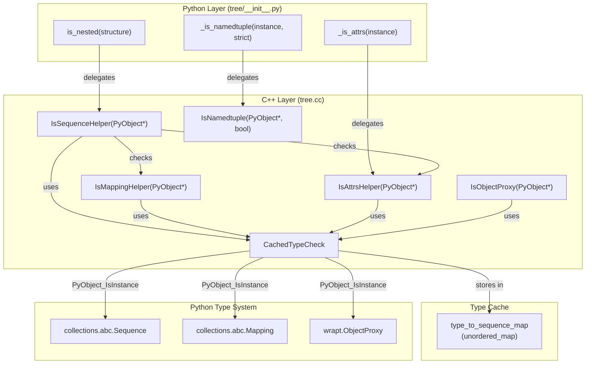
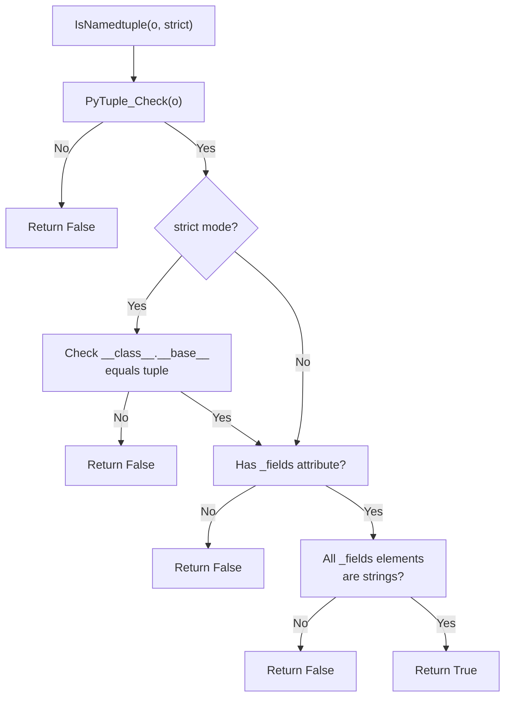
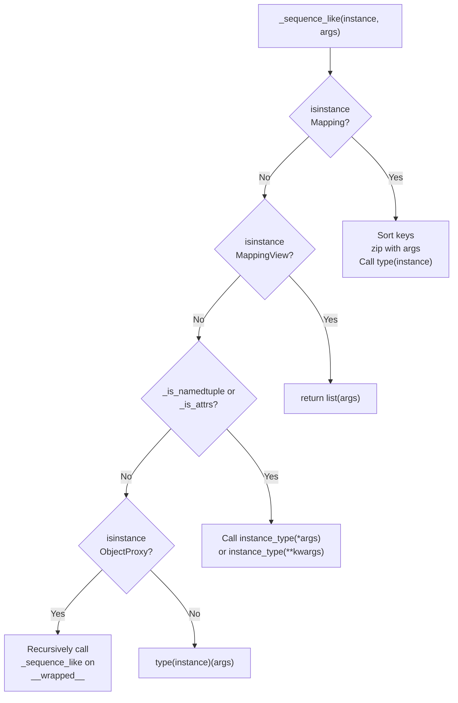
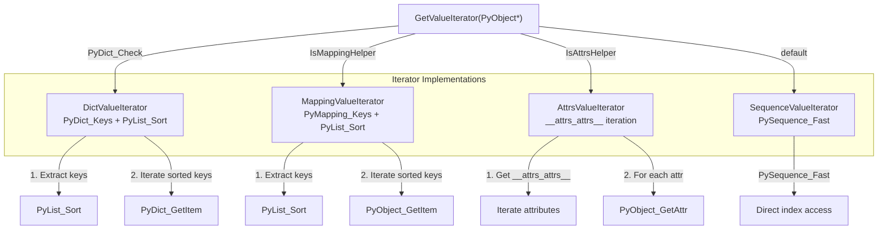
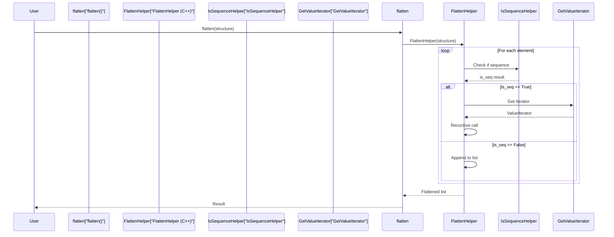
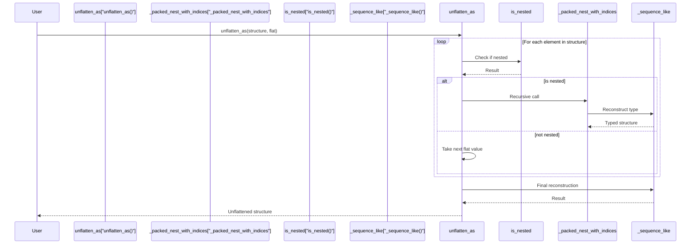

<!-- source: DeepWiki mcp.deepwiki.com · repo google-deepmind/tree · page 2.3 Type System and Utilities · fetched 2026-10-26 -->

# Type System and Utilities

<details>
<summary>Relevant source files</summary>

The following files were used as context for generating this wiki page:

- [tree/__init__.py](tree/__init__.py)
- [tree/sequence.py](tree/sequence.py)
- [tree/tree.cc](tree/tree.cc)

</details>


## Purpose and Scope

This document describes how dm-tree identifies, validates, and reconstructs Python data structures. The type system is fundamental to all tree operations, determining which objects are treated as nested structures versus leaf values, and ensuring that operations like `flatten` and `unflatten_as` correctly preserve type information.

For information about the high-level API that uses this type system, see [Python API Layer](#2.1). For details about the C++ performance optimizations, see [C++ Backend Implementation](#2.2).

## Overview of Supported Types

dm-tree supports a diverse set of Python types, categorized by their structural behavior:

| Category | Types | Behavior |
|----------|-------|----------|
| **Mappings** | `dict`, `OrderedDict`, `defaultdict`, `MappingProxyType` | Iterated by sorted keys |
| **Sequences** | `list`, `tuple` | Iterated by index |
| **Named Structures** | `namedtuple`, attrs classes | Iterated by field/attribute names |
| **Special Cases** | `wrapt.ObjectProxy` | Unwrapped before processing |
| **Mapping Views** | `dict_keys`, `dict_values`, `dict_items` | Converted to lists |
| **Non-sequences** | Strings (`str`, `bytes`), scalars, custom objects | Treated as leaf values |

**Sources:** [tree/__init__.py:66](), [tree/tree.cc:55-254](), [tree/sequence.py:58-112]()

## Type Identification Architecture



**Sources:** [tree/__init__.py:170-185](), [tree/tree.cc:95-254](), [tree/sequence.py:38-56]()

### C++ Type Checking with Caching

The C++ layer implements a sophisticated caching mechanism to avoid expensive Python type checks. The `CachedTypeCheck` class [tree/tree.cc:95-148]() caches type identification results based on the object's type pointer.

**Key Implementation Details:**

- **Cache Size Limit:** Maximum 1024 type entries to prevent unbounded memory growth [tree/tree.cc:51]()
- **Cache Key:** Uses `PyTypeObject*` pointer as map key [tree/tree.cc:114]()
- **Ternary Return Values:** 
  - `1` = type matches predicate
  - `0` = type does not match
  - `-1` = error occurred (not cached) [tree/tree.cc:111-127]()

**Type Check Functions:**

| Function | Purpose | Implementation |
|----------|---------|----------------|
| `IsSequenceHelper` | Checks if object is any supported sequence | [tree/tree.cc:233-254]() |
| `IsMappingHelper` | Checks for `dict` and `collections.abc.Mapping` | [tree/tree.cc:185-191]() |
| `IsAttrsHelper` | Detects attrs-decorated classes | [tree/tree.cc:216-228]() |
| `IsObjectProxy` | Identifies `wrapt.ObjectProxy` instances | [tree/tree.cc:206-212]() |

**Sources:** [tree/tree.cc:95-254]()

### Namedtuple Identification

Namedtuple detection requires special handling because namedtuples are dynamically created types with specific characteristics:



**Algorithm (C++ Implementation):** [tree/tree.cc:621-678]()

1. **Tuple Check:** Must be subclass of `tuple`
2. **Strict Mode Check:** If `strict=True`, `__class__.__base__` must be exactly `tuple` [tree/tree.cc:635-649]()
3. **Fields Validation:** Must have `_fields` attribute containing only strings [tree/tree.cc:653-676]()

**Sources:** [tree/tree.cc:621-678](), [tree/sequence.py:42-56]()

### Attrs Detection

Attrs classes are identified by checking for the `__attrs_attrs__` class attribute:

**Python Layer:** [tree/sequence.py:38-40]()
```python
def _is_attrs(instance):
  return _tree.is_attrs(instance)
```

**C++ Implementation:** [tree/tree.cc:216-228]()
- Retrieves `__class__` attribute from instance
- Checks for presence of `__attrs_attrs__` on the class
- Result is cached per type

**Sources:** [tree/sequence.py:38-40](), [tree/tree.cc:216-228]()

## Type Reconstruction System

The `_sequence_like` function [tree/sequence.py:58-112]() reconstructs nested structures by converting flat sequences back into their original types:



**Sources:** [tree/sequence.py:58-112]()

### Mapping Reconstruction

For dictionary-like types, reconstruction maintains deterministic ordering by sorting keys:

**Process:** [tree/sequence.py:69-84]()

1. **Sort Keys:** Use `_sorted(instance)` to get sorted key list [tree/sequence.py:30-36]()
2. **Zip with Values:** Combine sorted keys with provided `args`
3. **Type-Specific Construction:**
   - `defaultdict`: Pass `default_factory` as first argument [tree/sequence.py:78-79]()
   - `MappingProxyType`: Wrap dict in proxy [tree/sequence.py:80-82]()
   - Standard mappings: Direct construction [tree/sequence.py:84]()

**Special Case - OrderedDict:** Original insertion order is intentionally ignored to avoid bugs when mixing ordered and unordered dicts [tree/sequence.py:71-74]().

**Sources:** [tree/sequence.py:69-84]()

### Named Structure Reconstruction

Namedtuples and attrs classes require field-aware reconstruction:

| Type | Reconstruction Method | Code Reference |
|------|----------------------|----------------|
| **namedtuple** | `instance_type(*args)` | [tree/sequence.py:101]() |
| **attrs class** | `instance_type(**{attr.name: arg for ...})` | [tree/sequence.py:95-99]() |

**ObjectProxy Handling:** If the instance is wrapped in `wrapt.ObjectProxy`, unwrap to get the actual type before reconstruction [tree/sequence.py:89-92]().

**Sources:** [tree/sequence.py:88-104]()

## Value Iteration System

The C++ layer provides specialized iterators for extracting values from different structure types in deterministic order:



**Sources:** [tree/tree.cc:256-390](), [tree/tree.cc:723-733]()

### Iterator Classes

**DictValueIterator** [tree/tree.cc:263-295]()
- Uses `PyDict_Keys` to extract keys
- Sorts keys with `PyList_Sort` for deterministic iteration
- Retrieves values via `PyDict_GetItem` (borrowed reference)

**MappingValueIterator** [tree/tree.cc:298-329]()
- Fallback for custom mapping types
- Uses `PyMapping_Keys` instead of `PyDict_Keys`
- Retrieves values via `PyObject_GetItem` (new reference)

**AttrsValueIterator** [tree/tree.cc:360-390]()
- Accesses `__class__.__attrs_attrs__` to get attribute metadata
- Iterates through attrs in definition order
- Extracts values using `PyObject_GetAttr`

**SequenceValueIterator** [tree/tree.cc:332-358]()
- Converts to fast sequence with `PySequence_Fast`
- Direct index-based access via `PySequence_Fast_GET_ITEM`
- Most efficient iterator for list/tuple types

**Sources:** [tree/tree.cc:263-390]()

## Integration with Core Operations

The type system integrates with all core tree operations:

### Flatten Operation



**Sources:** [tree/__init__.py:188-224](), [tree/tree.cc:393-419](), [tree/tree.cc:611-619]()

### Unflatten Operation



**Sources:** [tree/__init__.py:287-374](), [tree/sequence.py:58-112]()

### Structure Validation

The `assert_same_structure` operation uses the type system to validate structural compatibility:

**Type Checking Logic:** [tree/tree.cc:457-604]()

1. **Sequence Detection:** Both structures must be sequences or both non-sequences
2. **Type Matching (if `check_types=True`):**
   - Unwrap `ObjectProxy` types [tree/tree.cc:479-489]()
   - Compare `PyTypeObject*` pointers
   - Special handling for namedtuples: compare by name and fields [tree/tree.cc:496-521]()
   - Allow mixing of list types and mapping types [tree/tree.cc:522-538]()
3. **Length Validation:** Compare element counts [tree/tree.cc:605-614]()
4. **Key Validation (mappings):** Ensure same key sets [tree/tree.cc:540-572]()
5. **Recursive Validation:** Check all nested structures [tree/tree.cc:580-603]()

**Sources:** [tree/tree.cc:457-721]()

## Special Type Behaviors

### ObjectProxy Unwrapping

`wrapt.ObjectProxy` is transparently unwrapped in multiple contexts:

| Context | Behavior | Code Reference |
|---------|----------|----------------|
| **Type checking** | Unwrap to check underlying type | [tree/tree.cc:479-489]() |
| **Namedtuple detection** | Check `__wrapped__` attribute | [tree/tree.cc:622-627]() |
| **Reconstruction** | Recursively unwrap then re-wrap | [tree/sequence.py:105-108]() |

**Import Handling:** The library gracefully handles missing `wrapt` installation by providing a stub class [tree/__init__.py:30-34](), [tree/sequence.py:22-28]().

**Sources:** [tree/__init__.py:30-34](), [tree/tree.cc:479-489](), [tree/sequence.py:105-108]()

### String Exclusion

Strings (`str`, `bytes`, `bytearray`) are explicitly excluded from being treated as sequences despite technically being Python sequences:

**Check Function:** [tree/tree.cc:55-57]()
```cpp
bool IsString(PyObject* o) {
  return PyBytes_Check(o) || PyByteArray_Check(o) || PyUnicode_Check(o);
}
```

**Rationale:** Prevents strings from being recursively flattened character-by-character, which would rarely be the desired behavior.

**Sources:** [tree/tree.cc:55-57](), [tree/tree.cc:241]()

### Set Warning

Sets are not considered sequences but may be in the future. A one-time warning is issued: [tree/tree.cc:246-252]()

**Sources:** [tree/tree.cc:246-252]()

## Deterministic Iteration Order

All operations maintain deterministic ordering by sorting dictionary keys and preserving sequence indices:

**Sorting Implementation:** [tree/sequence.py:30-36]()
```python
def _sorted(dictionary):
  """Returns a sorted list of the dict keys, with error if keys not sortable."""
  try:
    return sorted(dictionary)
  except TypeError:
    raise TypeError("tree only supports dicts with sortable keys.")
```

**Iteration Helpers:** [tree/__init__.py:129-161]()
- `_yield_sorted_items`: Yields `(key, value)` pairs in sorted order
- Handles mappings, sequences, namedtuples, and attrs uniformly
- Intentionally ignores `OrderedDict` insertion order [tree/__init__.py:145-149]()

**Sources:** [tree/sequence.py:30-36](), [tree/__init__.py:129-161]()

---

