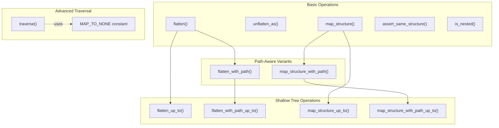
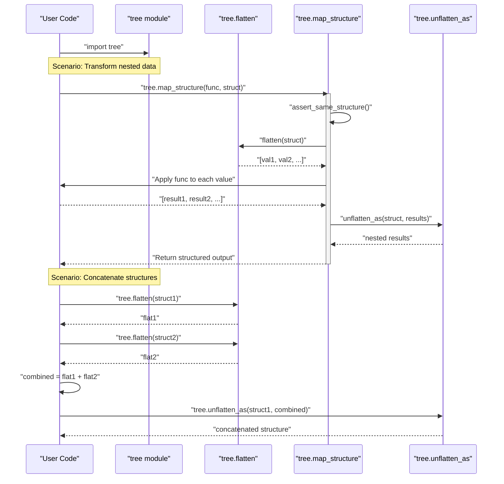
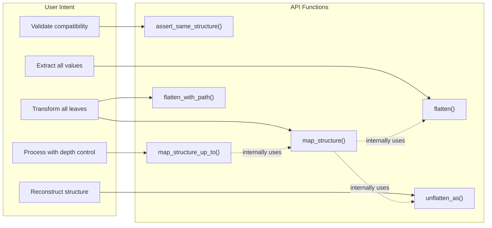

<!-- source: DeepWiki mcp.deepwiki.com · repo google-deepmind/tree · page 3 User Guide · fetched 2026-10-26 -->

# User Guide

<details>
<summary>Relevant source files</summary>

The following files were used as context for generating this wiki page:

- [README.md](README.md)
- [docs/recipes.rst](docs/recipes.rst)
- [tree/__init__.py](tree/__init__.py)

</details>


## Purpose and Scope

This guide provides practical instructions for using `dm-tree` to work with nested data structures in Python. It covers installation, core concepts, and common usage patterns. For architectural details about how `dm-tree` is implemented internally, see [Architecture](#2). For information on contributing to the project or building from source for development purposes, see [Developer Guide](#4).

## What is dm-tree?

`dm-tree` is a library for working with arbitrarily nested Python data structures such as lists, tuples, dictionaries, and named tuples. It generalizes Python's built-in `map()` function, which only works with flat sequences, to operate on nested structures while preserving their shape.

The library is implemented with an optimized C++ backend [tree.cc](), making it suitable for performance-critical applications such as machine learning model implementations where nested structures are processed repeatedly.

**Sources:** [README.md:1-18](), [tree/__init__.py:16]()

## Core Capabilities

`dm-tree` provides three main categories of operations:

| Operation Category | Functions | Purpose |
|-------------------|-----------|---------|
| **Structure Manipulation** | `flatten`, `unflatten_as` | Convert between nested and flat representations |
| **Structure Mapping** | `map_structure`, `map_structure_with_path` | Apply functions to all leaves while preserving structure |
| **Structure Validation** | `assert_same_structure`, `is_nested` | Verify structural properties |
| **Shallow Operations** | `flatten_up_to`, `map_structure_up_to` | Work with partial structure depth |
| **Traversal** | `traverse`, `flatten_with_path` | Visit nodes with custom logic |

**Sources:** [tree/__init__.py:46-60]()

## API Function Organization



**Diagram: Public API function hierarchy showing basic operations and their variants**

**Sources:** [tree/__init__.py:46-60](), [tree/__init__.py:188-224](), [tree/__init__.py:377-428]()

## Quick Start Examples

### Basic Flattening and Unflattening

The most fundamental operations convert nested structures to flat lists and vice versa:

```python
import tree

# Flatten a nested structure
structure = [[1, 2, 3], [4, [5], [[6]]]]
flat = tree.flatten(structure)
# Result: [1, 2, 3, 4, 5, 6]

# Unflatten using a template structure
template = [[None, None], [None, [None, None, None]]]
result = tree.unflatten_as(template, [1, 2, 3, 4, 5, 6])
# Result: [[1, 2], [3, [4, 5, 6]]]
```

**Sources:** [README.md:8-15](), [tree/__init__.py:188-224](), [tree/__init__.py:318-374]()

### Applying Functions to Nested Structures

`map_structure` applies a function to every leaf value while preserving the overall structure:

```python
structure = [[1], [[[2, 3]]], [4]]
result = tree.map_structure(lambda v: v**2, structure)
# Result: [[1], [[[4, 9]]], [16]]

# Works with multiple structures
tree.map_structure(lambda x, y: x + y, [[1, 2]], [[3, 4]])
# Result: [[4, 6]]
```

**Sources:** [README.md:13-14](), [tree/__init__.py:377-428]()

### Working with Dictionaries

Dictionaries are processed with keys in sorted order to ensure deterministic behavior:

```python
# Dictionary values are flattened in sorted key order
tree.flatten({100: 'world!', 6: 'Hello'})
# Result: ['Hello', 'world!']

# Unflatten maintains key correspondence
tree.unflatten_as({1: None, 2: None}, ['Hello', 'world!'])
# Result: {1: 'Hello', 2: 'world!'}
```

**Sources:** [tree/__init__.py:201-213](), [tree/__init__.py:330-342]()

## Supported Data Types

`dm-tree` recognizes the following types as "nested structures":

| Type Category | Examples | Notes |
|--------------|----------|-------|
| **Sequences** | `list`, `tuple` | Indexed by integer position |
| **Mappings** | `dict`, `OrderedDict`, `defaultdict`, `MappingProxyType` | Keys must be sortable |
| **Named Tuples** | `collections.namedtuple` | Accessed by field names |
| **Attrs Classes** | `@attrs.define` decorated classes | Accessed by attribute names |
| **Proxy Objects** | `wrapt.ObjectProxy` | Unwrapped before processing |

All other types are treated as atomic "leaf" values.

**Sources:** [tree/__init__.py:29-34](), [tree/__init__.py:144-160](), [tree/sequence.py]()

## Common Usage Patterns

### Pattern 1: Validating Structure Compatibility

Before processing multiple structures together, verify they have the same shape:

```python
structure1 = {'a': [1, 2], 'b': 3}
structure2 = {'a': [4, 5], 'b': 6}

# This succeeds
tree.assert_same_structure(structure1, structure2)

# This would raise TypeError due to shape mismatch
structure3 = {'a': [7], 'b': 8}
tree.assert_same_structure(structure1, structure3)  # Raises!
```

**Sources:** [tree/__init__.py:239-284]()

### Pattern 2: Broadcasting Values Across a Structure

Use `map_structure` to replicate a value across all positions in a template:

```python
reference_tree = {'a': 1, 'b': (2, 3)}
value = np.inf
tree.map_structure(lambda _: value, reference_tree)
# Result: {'a': inf, 'b': (inf, inf)}
```

**Sources:** [docs/recipes.rst:32-37]()

### Pattern 3: Path-Aware Processing

Track the location of each value using path-aware variants:

```python
tree.flatten_with_path([{"foo": 42}])
# Result: [((0, 'foo'), 42)]

tree.map_structure_with_path(
    lambda path, v: (path, v**2),
    [{"foo": 42}])
# Result: [{'foo': ((0, 'foo'), 1764)}]
```

**Sources:** [tree/__init__.py:775-796](), [tree/__init__.py:431-468]()

### Pattern 4: Shallow Operations with Template Structures

Process only part of a nested structure using `_up_to` variants:

```python
structure = [[1, 1], [2, 2]]

# Flatten only one level deep
tree.flatten_up_to([None, None], structure)
# Result: [[1, 1], [2, 2]]

# Map at a specific depth
tree.map_structure_up_to([None, None], len, structure)
# Result: [2, 2]
```

**Sources:** [tree/__init__.py:635-674](), [tree/__init__.py:709-739]()

## Typical Usage Flow



**Diagram: Typical data flow patterns when using dm-tree functions**

**Sources:** [tree/__init__.py:377-428](), [tree/__init__.py:188-224](), [tree/__init__.py:318-374]()

## Function Invocation Patterns



**Diagram: Mapping user intents to appropriate API functions**

**Sources:** [tree/__init__.py:377-428](), [tree/__init__.py:709-739]()

## Error Handling

Common error scenarios and their causes:

| Error Type | Typical Cause | Example |
|-----------|---------------|---------|
| `TypeError` | Structure type mismatch | Mixing `list` and `tuple` with `check_types=True` |
| `ValueError` | Structure size mismatch | Different number of elements in compared structures |
| `TypeError` | Non-sortable dictionary keys | Using unhashable objects as dict keys |
| `ValueError` | Key missing in shallow structure | `_up_to` operations with incompatible templates |

**Sources:** [tree/__init__.py:239-284](), [tree/__init__.py:520-632]()

## Next Steps

- **[Installation and Setup](#3.1)**: Detailed installation instructions including building from source
- **[Basic Operations](#3.2)**: In-depth tutorials for fundamental operations with comprehensive examples
- **[Advanced Usage](#3.3)**: Advanced features including custom traversal and complex transformations
- **[API Reference](#3.4)**: Complete function signatures and parameter documentation

**Sources:** [tree/__init__.py:1-944](), [README.md:1-48]()

---

