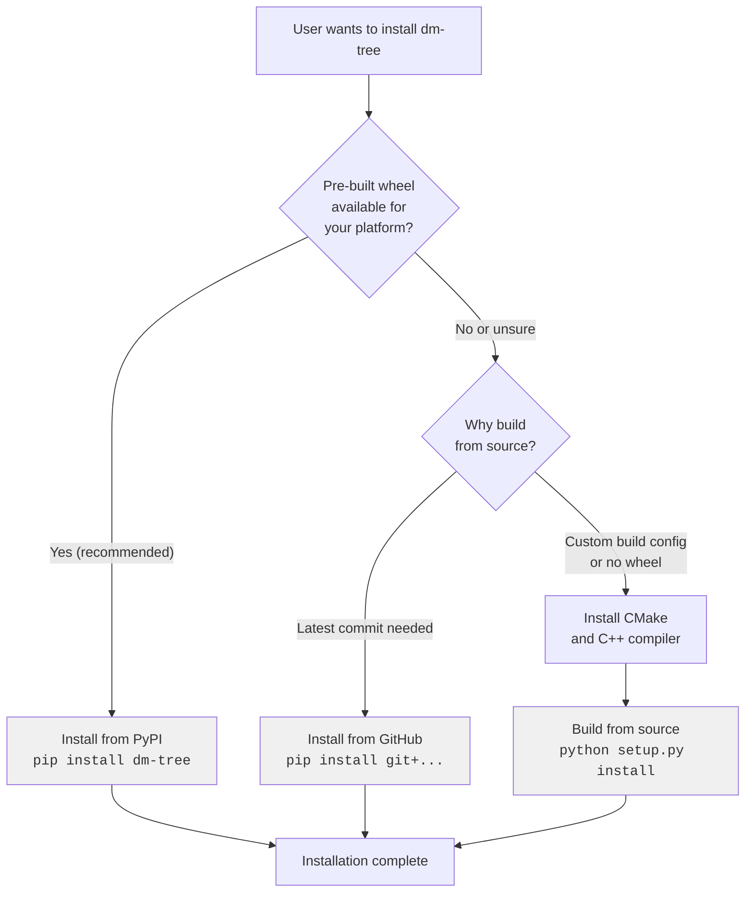
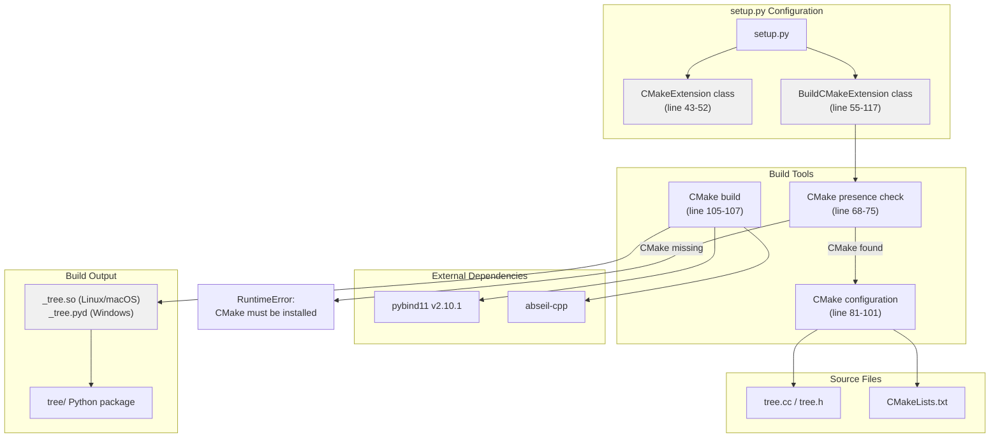
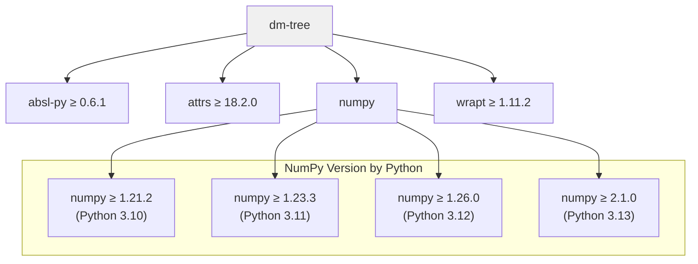

<!-- source: DeepWiki mcp.deepwiki.com · repo google-deepmind/tree · page 3.1 Installation and Setup · fetched 2026-10-26 -->

# Installation and Setup

<details>
<summary>Relevant source files</summary>

The following files were used as context for generating this wiki page:

- [README.md](README.md)
- [docs/changes.rst](docs/changes.rst)
- [setup.py](setup.py)

</details>


## Purpose and Scope

This page provides installation instructions for dm-tree users who want to install and use the library in their Python projects. It covers three installation methods: installing from PyPI (recommended for most users), installing directly from GitHub, and building from source. This document focuses on end-user installation. For contributors who want to set up a development environment to modify dm-tree itself, see [Development Setup](#4.1).

## System Requirements

dm-tree has the following system requirements:

| Requirement | Specification |
|------------|---------------|
| **Python Version** | ≥ 3.10 |
| **Operating Systems** | Linux, macOS, Windows |
| **Architecture** | x86_64, ARM64 (macOS) |

**Note**: Python 3.9 and earlier are no longer supported as of version 0.1.9 (released January 2025).

### Build-from-Source Additional Requirements

If you plan to build from source, you'll also need:

- **CMake** ≥ 3.14
- **C++ Compiler** with C++17 support (GCC, Clang, or MSVC)
- **Python development headers** (python3-dev on Linux)

Sources: [setup.py:130](), [docs/changes.rst:5-10]()

## Installation Methods



Sources: [README.md:20-38](), [setup.py:119-160]()

### Method 1: Installing from PyPI (Recommended)

The simplest installation method uses pre-compiled wheels from PyPI:

```bash
pip install dm-tree
```

This is the recommended method for most users because:
- No compilation required (pre-built wheels provided for common platforms)
- Fastest installation time
- All dependencies installed automatically
- Tested and stable releases

**Pre-built wheels** are available for:
- Linux (manylinux2014 x86_64)
- macOS (x86_64 and arm64)
- Windows (x86_64)

Sources: [README.md:22-26](), [setup.py:119-160]()

### Method 2: Installing from GitHub

To install the latest development version directly from the GitHub repository:

```bash
pip install git+git://github.com/deepmind/tree.git
```

Or using HTTPS:

```bash
pip install git+https://github.com/deepmind/tree.git
```

This method:
- Installs the latest committed code (may be newer than PyPI release)
- Still uses pre-built wheels if available for your platform
- Falls back to building from source if no wheel is available

**When to use this method**:
- You need a bug fix or feature that hasn't been released to PyPI yet
- You want to test changes before a formal release

Sources: [README.md:28-32]()

### Method 3: Building from Source

Building from source gives you full control over the compilation process but requires additional build tools.

#### Prerequisites

Before building, ensure you have the required tools installed:

**On Ubuntu/Debian:**
```bash
sudo apt-get update
sudo apt-get install cmake g++ python3-dev
```

**On macOS:**
```bash
brew install cmake
# Xcode Command Line Tools provide the C++ compiler
xcode-select --install
```

**On Windows:**
- Install CMake from https://cmake.org/download/
- Install Visual Studio with C++ build tools

#### Build Process

1. Clone the repository:
```bash
git clone https://github.com/deepmind/tree.git
cd tree
```

2. Build and install:
```bash
python setup.py install
```

Or for development (editable install):
```bash
pip install -e .
```

Sources: [README.md:34-38](), [setup.py:55-117]()

#### Build System Architecture

The following diagram shows how the build process works when building from source:



The build process works as follows:

1. **CMakeExtension** ([setup.py:43-52]()) defines a setuptools extension that uses CMake instead of direct compilation
2. **BuildCMakeExtension** ([setup.py:55-117]()) is a custom build command that:
   - Checks for CMake availability ([setup.py:66-75]())
   - Configures CMake with Python-specific paths ([setup.py:81-91]())
   - Handles platform-specific settings (macOS architectures, Windows paths)
   - Invokes CMake to build the C++ extension ([setup.py:100-107]())
3. CMake fetches dependencies (pybind11, abseil-cpp) and compiles the C++ code
4. The compiled extension (`_tree.so` or `_tree.pyd`) is placed in the `tree/` package directory

Sources: [setup.py:43-117]()

#### Build Configuration Parameters

The build process accepts several CMake arguments:

| Parameter | Purpose | Source |
|-----------|---------|--------|
| `Python3_ROOT_DIR` | Python installation root | [setup.py:82]() |
| `Python3_EXECUTABLE` | Python interpreter path | [setup.py:83]() |
| `CMAKE_LIBRARY_OUTPUT_DIRECTORY` | Where to place compiled extension | [setup.py:84]() |
| `CMAKE_BUILD_TYPE` | Debug or Release build | [setup.py:85]() |
| `Python3_LIBRARY` | Python standard library path (Unix) | [setup.py:89]() |
| `Python3_INCLUDE_DIR` | Python C API headers (Unix) | [setup.py:90]() |
| `CMAKE_OSX_ARCHITECTURES` | macOS architectures (x86_64/arm64) | [setup.py:98]() |

The build system also supports parallel compilation via the `--parallel` flag:
```bash
python setup.py build_ext --parallel=4
pip install .
```

Sources: [setup.py:81-107]()

## Dependencies

When you install dm-tree, the following Python packages are automatically installed:



### Dependency Details

| Package | Minimum Version | Purpose |
|---------|----------------|---------|
| **absl-py** | 0.6.1 | Abseil Python common libraries |
| **attrs** | 18.2.0 | Support for attrs-decorated classes in tree structures |
| **numpy** | Version-dependent | Numerical computing support |
| **wrapt** | 1.11.2 | Support for wrapped objects (ObjectProxy) |

**NumPy version requirements** vary by Python version to ensure compatibility:
- Python 3.10: numpy ≥ 1.21.2
- Python 3.11: numpy ≥ 1.23.3
- Python 3.12: numpy ≥ 1.26.0
- Python 3.13: numpy ≥ 2.1.0

Sources: [setup.py:131-140]()

### Build-time Dependencies (C++ Layer)

When building from source, CMake automatically fetches these C++ dependencies:

- **pybind11** v2.10.1 - Python/C++ binding layer
- **abseil-cpp** 20220623.2 - C++ common libraries

These are not Python packages and are only needed during compilation, not at runtime.

Sources: [setup.py:1-160](), [docs/changes.rst:17]()

## Verifying Installation

After installation, verify that dm-tree is working correctly:

```python
import tree

# Test basic functionality
structure = [[1, 2], {"a": 3, "b": 4}]
flat = tree.flatten(structure)
print(flat)  # Should print: [1, 2, 3, 4]

# Check version
print(tree.__version__)  # Should print version number (e.g., "0.1.9")
```

You can also verify that the C++ extension is properly loaded:

```python
import tree._tree

# This should not raise an ImportError
print("C++ extension loaded successfully")
```

If you encounter an `ImportError`, it typically means:
- The C++ extension wasn't compiled properly (if building from source)
- Your system is missing required runtime libraries
- There's a Python version or architecture mismatch

Sources: [README.md:8-15](), [setup.py:30-40]()

## Troubleshooting

### Common Installation Issues

#### "CMake must be installed" Error

If you see this error during installation:
```
RuntimeError: CMake must be installed to build the following extensions: _tree
```

**Solution**: Install CMake before running setup.py:
```bash
# Ubuntu/Debian
sudo apt-get install cmake

# macOS
brew install cmake

# Windows: Download from https://cmake.org/download/
```

This error is raised by the `_check_build_environment()` method in [setup.py:66-75]().

#### Python Version Incompatibility

If you encounter:
```
ERROR: Package 'dm-tree' requires a different Python: 3.9.x not in '>=3.10'
```

**Solution**: Upgrade to Python 3.10 or later. Python 3.9 and earlier are no longer supported as of dm-tree 0.1.9.

Sources: [setup.py:130](), [docs/changes.rst:5-10]()

#### ImportError for _tree Module

If you can import `tree` but operations fail:
```python
ImportError: cannot import name '_tree' from 'tree'
```

**Solution**: The C++ extension wasn't built or installed properly. Try:
1. Uninstall and reinstall: `pip uninstall dm-tree && pip install dm-tree`
2. If building from source, check that CMake completed successfully
3. Verify you have a C++ compiler installed

#### macOS Architecture Issues

On Apple Silicon Macs, if you encounter architecture mismatches:

**Solution**: Set the `ARCHFLAGS` environment variable:
```bash
# For Apple Silicon (M1/M2/M3)
export ARCHFLAGS="-arch arm64"
python setup.py install

# For Intel Macs
export ARCHFLAGS="-arch x86_64"
python setup.py install

# For universal binary
export ARCHFLAGS="-arch x86_64 -arch arm64"
python setup.py install
```

The build system detects and handles this in [setup.py:92-98]().

Sources: [setup.py:92-98]()

## Platform-Specific Notes

### Linux

- Pre-built wheels are manylinux2014-compatible
- Ensure you have `python3-dev` installed if building from source
- GCC 7+ or Clang 5+ recommended for C++17 support

### macOS

- Pre-built wheels available for both Intel and Apple Silicon
- Xcode Command Line Tools required for building from source
- Universal binaries supported via `ARCHFLAGS`

### Windows

- Pre-built wheels use MSVC runtime
- Visual Studio 2017 or later required for building from source
- CMake uses multi-generator output paths that are automatically handled by [setup.py:109-116]()

Sources: [setup.py:87-116]()

## Next Steps

After successful installation, you're ready to use dm-tree in your projects. To learn about basic operations like `flatten`, `map_structure`, and `assert_same_structure`, see [Basic Operations](#3.2). For advanced features, see [Advanced Usage](#3.3).

For a complete reference of all available functions, see [API Reference](#3.4).

Sources: [README.md:1-48](), [setup.py:119-160](), [docs/changes.rst:1-79]()

---

