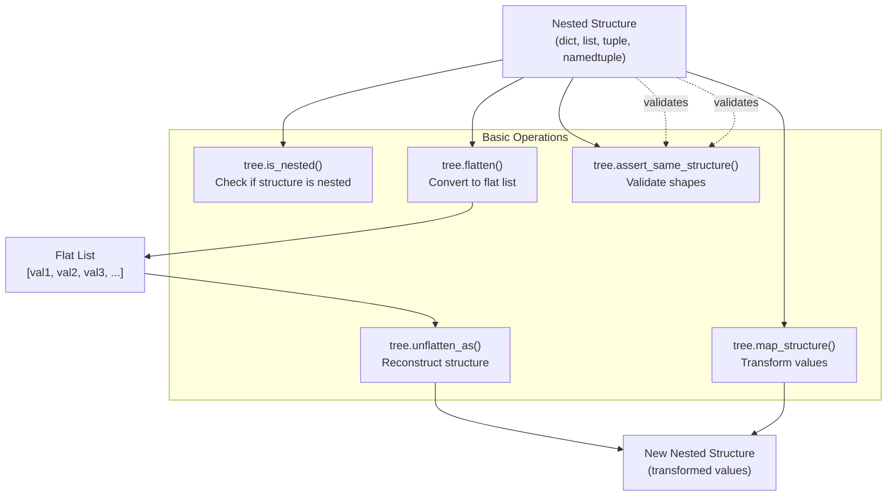
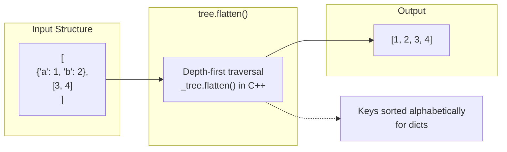
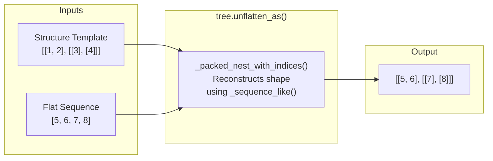
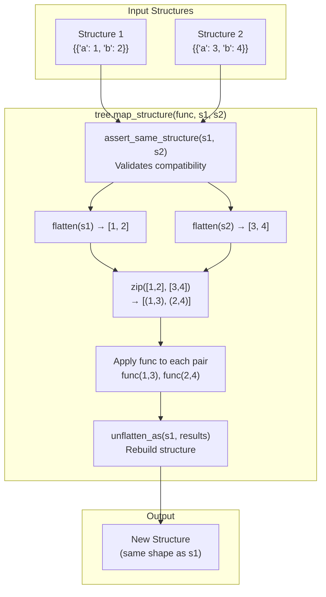
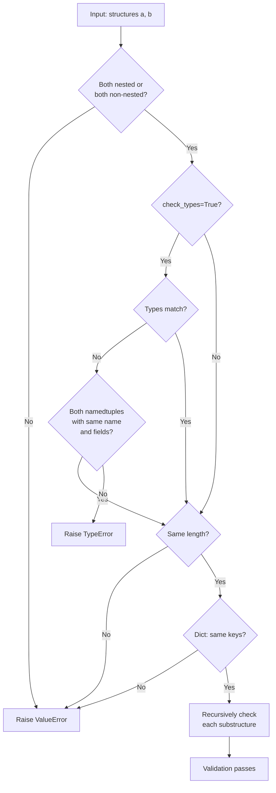
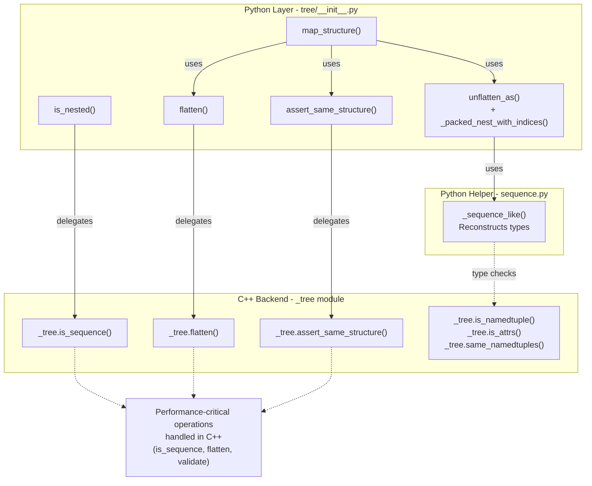

<!-- source: DeepWiki mcp.deepwiki.com · repo google-deepmind/tree · page 3.2 Basic Operations · fetched 2026-10-26 -->

# Basic Operations

<details>
<summary>Relevant source files</summary>

The following files were used as context for generating this wiki page:

- [LICENSE](LICENSE)
- [docs/recipes.rst](docs/recipes.rst)
- [tree/__init__.py](tree/__init__.py)
- [tree/tree_test.py](tree/tree_test.py)

</details>


This page covers the fundamental operations of dm-tree that enable working with nested data structures. These operations form the core toolkit for transforming and validating hierarchical data like nested dictionaries, tuples, and lists.

**Scope**: This page focuses on the four essential functions: `flatten`, `unflatten_as`, `map_structure`, and `assert_same_structure`. For advanced features like path-aware operations and shallow tree traversal, see [Advanced Usage](#3.3). For complete API details including all parameters and return types, see [API Reference](#3.4).

## Overview of Basic Operations

The dm-tree library provides four fundamental operations that work together to manipulate nested structures:



**Operations Summary**

| Function | Purpose | Input | Output |
|----------|---------|-------|--------|
| `is_nested()` | Check if value is a nested structure | Any value | Boolean |
| `flatten()` | Convert nested structure to flat list | Nested structure | List of leaf values |
| `unflatten_as()` | Reconstruct structure from flat values | Structure template + flat list | Nested structure |
| `map_structure()` | Apply function to all leaf values | Function + structure(s) | New structure with transformed values |
| `assert_same_structure()` | Validate structure compatibility | Two structures | None (raises on mismatch) |

Sources: [tree/__init__.py:170-428]()

## Checking if a Value is Nested

The `is_nested()` function determines whether a value is a nested structure (sequence, mapping, or namedtuple) or a scalar value.

### Function Signature

```python
tree.is_nested(structure) -> bool
```

### What Counts as Nested

**Nested types**: `list`, `tuple`, `dict`, `OrderedDict`, `defaultdict`, `namedtuple`, `attrs` classes, `MappingProxyType`

**Not nested**: `str`, `bytes`, `bytearray`, numbers, NumPy arrays, custom objects without special structure

### Examples

```python
import tree

# Scalar values are not nested
tree.is_nested(42)           # False
tree.is_nested("hello")      # False
tree.is_nested(b"bytes")     # False
tree.is_nested(np.array([1, 2, 3]))  # False

# Collections are nested
tree.is_nested([1, 2, 3])              # True
tree.is_nested({"a": 1, "b": 2})       # True
tree.is_nested((1, 2))                 # True
tree.is_nested([])                     # True (even empty)

# Named tuples are nested
Point = collections.namedtuple("Point", ["x", "y"])
tree.is_nested(Point(1, 2))           # True
```

### Implementation Detail

The function delegates to the C++ backend `_tree.is_sequence()` for performance. Strings and byte strings are explicitly excluded from being considered sequences.

Sources: [tree/__init__.py:170-185](), [tree/tree_test.py:233-246]()

## Flattening Structures

The `flatten()` function converts an arbitrarily nested structure into a single flat list containing all leaf values.

### Function Signature

```python
tree.flatten(structure) -> list
```

### How Flattening Works



### Key Behaviors

**Dictionary key ordering**: Keys are always sorted alphabetically for deterministic output. This applies to both `dict` and `OrderedDict` types.

**Scalar handling**: Non-nested values return a single-element list.

**Empty structures**: Empty containers return empty lists.

### Examples

```python
import tree

# Basic flattening
tree.flatten([[1, 2, 3], [4, [5], [[6]]]])
# Returns: [1, 2, 3, 4, 5, 6]

# Scalar values
tree.flatten(42)
# Returns: [42]

# Dictionary flattening (keys sorted)
tree.flatten({100: 'world!', 6: 'Hello'})
# Returns: ['Hello', 'world!']

# Mixed structures
structure = [
    "z",
    {"c": [1, 2], "b": 5},
    17
]
tree.flatten(structure)
# Returns: ["z", 5, 1, 2, 17]
#          Note: "b" comes before "c" alphabetically
```

### OrderedDict Behavior

Importantly, `OrderedDict` ordering is **ignored** during flattening. Keys are always sorted:

```python
from collections import OrderedDict

ordered = OrderedDict([("d", 3), ("b", 1), ("a", 0), ("c", 2)])
tree.flatten(ordered)
# Returns: [0, 1, 2, 3]  # Sorted by key (a, b, c, d)
```

This design ensures `flatten()` and `unflatten_as()` are compatible between `dict` and `OrderedDict`.

Sources: [tree/__init__.py:188-224](), [tree/tree_test.py:97-213]()

## Reconstructing Structures

The `unflatten_as()` function rebuilds a nested structure from a flat list, using a structure template to determine the shape.

### Function Signature

```python
tree.unflatten_as(structure, flat_sequence) -> nested_structure
```

### How Unflattening Works



### Key Behaviors

**Shape from template**: The structure template defines the output shape; its values are ignored.

**Type preservation**: Output uses the same types as the template (list vs tuple, namedtuple types, etc.).

**Dictionary key ordering**: Keys are processed in sorted order, matching `flatten()` behavior.

**Length validation**: The flat sequence must have exactly the same number of elements as the flattened template.

### Examples

```python
import tree

# Basic reconstruction
tree.unflatten_as([[1, 2], [[3], [4]]], [5, 6, 7, 8])
# Returns: [[5, 6], [[7], [8]]]

# Scalar template
tree.unflatten_as(None, [1])
# Returns: 1

# Dictionary reconstruction
tree.unflatten_as({1: None, 2: None}, ['Hello', 'world!'])
# Returns: {1: 'Hello', 2: 'world!'}

# Named tuples
Point = collections.namedtuple("Point", ["x", "y"])
structure = Point(x=4, y=2)
flat = [10, 20]
tree.unflatten_as(structure, flat)
# Returns: Point(x=10, y=20)
```

### OrderedDict Compatibility

Like `flatten()`, `unflatten_as()` uses sorted key order. This enables cross-compatibility:

```python
from collections import OrderedDict

# Flatten an OrderedDict
ordered = OrderedDict([("d", 0), ("b", 0), ("a", 0), ("c", 0)])
seq = [0, 1, 2, 3]

# Can unflatten using a plain dict
plain_dict = {"d": 0, "b": 0, "a": 0, "c": 0}
tree.unflatten_as(plain_dict, seq)
# Returns: {'d': 3, 'b': 1, 'a': 0, 'c': 2}

# Result has same values as if we used the OrderedDict
tree.unflatten_as(ordered, seq)
# Returns: OrderedDict([('d', 3), ('b', 1), ('a', 0), ('c', 2)])
```

### Error Conditions

```python
# Wrong number of elements
tree.unflatten_as([5, 6], ["a", "b", "c"])
# Raises: ValueError: Structure had 2 elements, but flat_sequence had 3 elements

# Non-sequence flat_sequence
tree.unflatten_as([4, 5], "bad_sequence")
# Raises: TypeError: flat_sequence must be a sequence

# Scalar template with multiple elements
tree.unflatten_as("scalar", [4, 5])
# Raises: ValueError: Structure is a scalar but len(flat_sequence) == 2 > 1
```

Sources: [tree/__init__.py:318-374](), [tree/tree_test.py:97-130](), [tree/tree_test.py:139-148]()

## Mapping Functions Across Structures

The `map_structure()` function applies a callable to all leaf values in one or more nested structures, preserving the structure shape.

### Function Signature

```python
tree.map_structure(func, *structures, check_types=True) -> nested_structure
```

### Parameters

| Parameter | Type | Default | Description |
|-----------|------|---------|-------------|
| `func` | Callable | Required | Function accepting N arguments (one per structure) |
| `*structures` | Structures | Required | One or more nested structures with matching shapes |
| `check_types` | bool | `True` | Whether to enforce exact type matching between structures |

### How Mapping Works



### Single Structure Examples

```python
import tree

# Apply function to all elements
structure = [[1], [2], [3]]
tree.map_structure(lambda v: v**2, structure)
# Returns: [[1], [4], [9]]

# Named tuples
Foo = collections.namedtuple('Foo', ['a', 'b'])
structure = Foo(a=1, b=2)
tree.map_structure(lambda v: v * 2, structure)
# Returns: Foo(a=2, b=4)

# Dictionaries
tree.map_structure(lambda v: v + 10, {"x": 1, "y": 2})
# Returns: {"x": 11, "y": 12}

# Scalar handling
tree.map_structure(lambda x: x - 1, 4)
# Returns: 3
```

### Multiple Structure Examples

```python
import tree

# Element-wise addition
s1 = [[1], [2], [3]]
s2 = [[4], [5], [6]]
tree.map_structure(lambda x, y: x + y, s1, s2)
# Returns: [[5], [7], [9]]

# String manipulation with multiple structures
ab_tuple = collections.namedtuple("ab_tuple", "a, b")
inp_a = ab_tuple(a="foo", b=("bar", "baz"))
inp_b = ab_tuple(a=2, b=(1, 3))
tree.map_structure(lambda string, repeats: string * repeats, inp_a, inp_b)
# Returns: ab_tuple(a='foofoo', b=('bar', 'bazbazbaz'))
```

### Type Checking Behavior

By default, `check_types=True` enforces that corresponding nodes have matching types:

```python
# This raises TypeError
tree.map_structure(lambda x, y: x + y, [1, 2], (1, 2))
# Raises: TypeError: don't have the same sequence type

# Allow type differences with check_types=False
tree.map_structure(lambda x, y: x + y, [1, 2], (1, 2), check_types=False)
# Returns: [2, 4]  # Output type matches first structure (list)
```

**Named tuple exception**: Named tuples with identical names and fields are always considered the same type, even with `check_types=True`.

```python
Foo = collections.namedtuple('Foo', ['a', 'b'])
AlsoFoo = collections.namedtuple('Foo', ['a', 'b'])  # Same name and fields

tree.map_structure(lambda x, y: x + y, Foo(0, 1), AlsoFoo(2, 3))
# Returns: Foo(2, 4)  # Works even though technically different classes
```

### Output Type

The output structure uses the types from the **first structure**:

```python
# First structure is a list
result = tree.map_structure(lambda x, y: x + y, [1, 2], [3, 4])
type(result)  # list

# First structure is a tuple
result = tree.map_structure(lambda x, y: x + y, (1, 2), (3, 4))
type(result)  # tuple
```

### Empty Structures

Empty structures are handled correctly:

```python
tree.map_structure(lambda x: x + 1, ())    # Returns: ()
tree.map_structure(lambda x: x + 1, [])    # Returns: []
tree.map_structure(lambda x: x + 1, {})    # Returns: {}
```

Sources: [tree/__init__.py:377-428](), [tree/tree_test.py:390-472]()

## Validating Structure Compatibility

The `assert_same_structure()` function validates that two structures have the same nested shape, raising an exception if they differ.

### Function Signature

```python
tree.assert_same_structure(a, b, check_types=True) -> None
```

### Parameters

| Parameter | Type | Default | Description |
|-----------|------|---------|-------------|
| `a` | Any | Required | First structure |
| `b` | Any | Required | Second structure |
| `check_types` | bool | `True` | Whether to enforce type matching at each level |

### Validation Rules



### Examples

```python
import tree

# Compatible structures
tree.assert_same_structure([(0, 1)], [(2, 3)])
# Passes

tree.assert_same_structure(
    {"a": 1, "b": 2},
    {"a": 10, "b": 20}
)
# Passes

# Different nesting
tree.assert_same_structure([(0, 1)], [0, 1])
# Raises: ValueError: The two structures don't have the same nested structure

# Different lengths
tree.assert_same_structure([1, 2], [1, 2, 3])
# Raises: ValueError: The two structures don't have the same number of elements

# Different types (with check_types=True)
tree.assert_same_structure([1, 2], (1, 2))
# Raises: TypeError: don't have the same sequence type

# Allow type differences
tree.assert_same_structure([1, 2], (1, 2), check_types=False)
# Passes

# Different dictionary keys
tree.assert_same_structure({"a": 1}, {"b": 1})
# Raises: ValueError: don't have the same set of keys
```

### Named Tuple Handling

Named tuples with identical names and fields are always considered compatible:

```python
Foo = collections.namedtuple('Foo', ['a', 'b'])
AlsoFoo = collections.namedtuple('Foo', ['a', 'b'])

tree.assert_same_structure(Foo(0, 1), AlsoFoo(2, 3))
# Passes

# Different names
Bar = collections.namedtuple('Bar', ['a', 'b'])
tree.assert_same_structure(Foo(0, 1), Bar(2, 3))
# Raises: TypeError: don't have the same sequence type

# Different field names
Baz = collections.namedtuple('Foo', ['x', 'y'])
tree.assert_same_structure(Foo(0, 1), Baz(2, 3))
# Raises: TypeError: don't have the same sequence type
```

### Error Messages

Error messages include visual representations of both structures:

```python
tree.assert_same_structure(
    [[[1, 2], 3], 4, [5, 6]],
    ["spam", "eggs"]
)
# Raises: TypeError: The two structures don't have the same nested structure.
# 
# Entire first structure:
# ((((., .), .), ., (., .)))
# 
# Entire second structure:
# (., .)
```

The `.` symbols represent leaf values, making the structure shapes easy to compare visually.

Sources: [tree/__init__.py:239-284](), [tree/tree_test.py:265-388]()

## Integration with C++ Backend

Understanding how these operations delegate to the C++ backend helps explain their performance characteristics:



**Performance characteristics**:
- `flatten()` and `is_nested()` are C++ operations: very fast
- `assert_same_structure()` uses C++ validation: fast
- `unflatten_as()` is pure Python but uses C++ type checks: moderate speed
- `map_structure()` combines all operations: speed depends on the mapped function

Sources: [tree/__init__.py:37-42](), [tree/__init__.py:170-428]()

## Common Patterns

### Pattern 1: Transform and Validate

Combine operations to safely transform structures:

```python
import tree

def safe_transform(structure, func):
    """Transform structure, validating it hasn't changed shape."""
    original = structure
    result = tree.map_structure(func, structure)
    tree.assert_same_structure(original, result)
    return result

# Use it
data = {"x": [1, 2], "y": [3, 4]}
result = safe_transform(data, lambda x: x * 2)
```

### Pattern 2: Flatten, Process, Rebuild

For batch operations on all values:

```python
import tree
import numpy as np

# Flatten, convert to array, process, rebuild
structure = {"a": [1, 2], "b": [3, 4, 5]}
flat = tree.flatten(structure)
array = np.array(flat)
processed = array * 2  # Batch operation
result = tree.unflatten_as(structure, processed.tolist())
# Returns: {"a": [2, 4], "b": [6, 8, 10]}
```

### Pattern 3: Broadcasting Values

Broadcast a single value across a reference structure:

```python
import tree
import numpy as np

reference_tree = {"a": 1, "b": (2, 3)}
value = np.inf
tree.map_structure(lambda _: value, reference_tree)
# Returns: {'a': inf, 'b': (inf, inf)}
```

### Pattern 4: Combining Multiple Sources

Merge data from multiple structures:

```python
import tree
import numpy as np

# Concatenate arrays from multiple sources
tree.map_structure(
    lambda *args: np.concatenate(args, axis=0),
    {'a': np.ones((2, 1))},
    {'a': np.zeros((2, 1))}
)
# Returns: {'a': array([[1.], [1.], [0.], [0.]])}
```

Sources: [docs/recipes.rst:6-38]()

## Type Support Summary

All basic operations support these types consistently:

| Type | Nested? | Notes |
|------|---------|-------|
| `list` | Yes | Standard sequence |
| `tuple` | Yes | Standard sequence |
| `dict` | Yes | Keys sorted alphabetically |
| `OrderedDict` | Yes | Original order ignored, keys sorted |
| `defaultdict` | Yes | Treated like dict |
| `namedtuple` | Yes | Type and field names preserved |
| `attrs` classes | Yes | Attributes sorted by name |
| `MappingProxyType` | Yes | Read-only mapping |
| `str` | No | Treated as scalar |
| `bytes` | No | Treated as scalar |
| `bytearray` | No | Treated as scalar |
| NumPy array | No | Treated as scalar |
| Numbers | No | Scalar values |
| Custom objects | No | Unless they're attrs or namedtuples |

Sources: [tree/__init__.py:16-106](), [tree/tree_test.py:53-246]()

---

