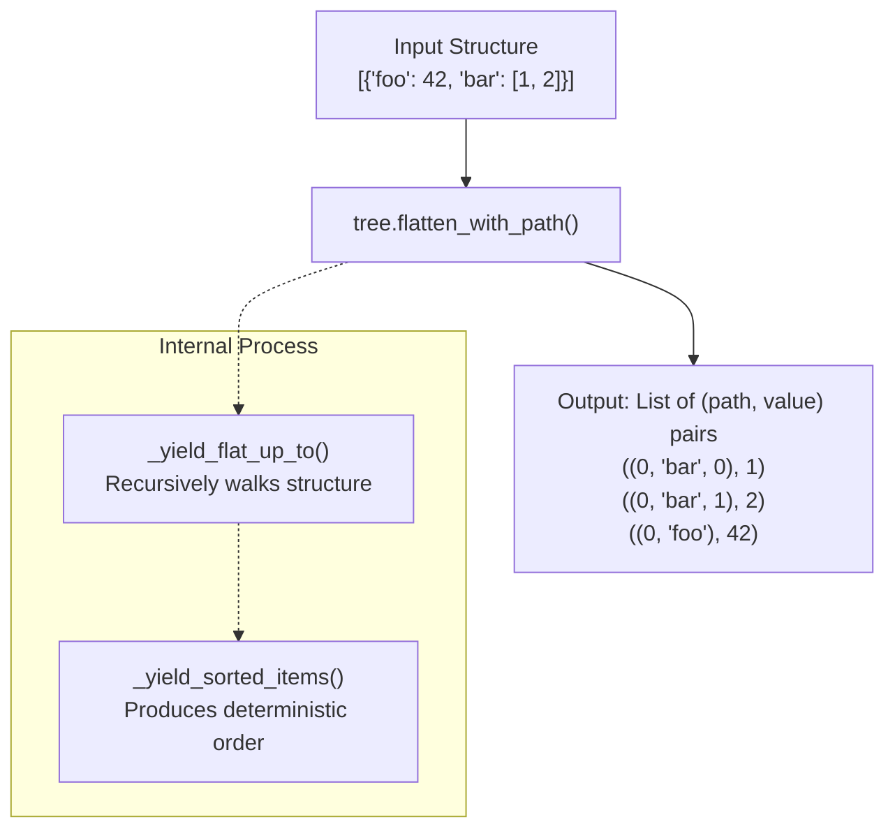
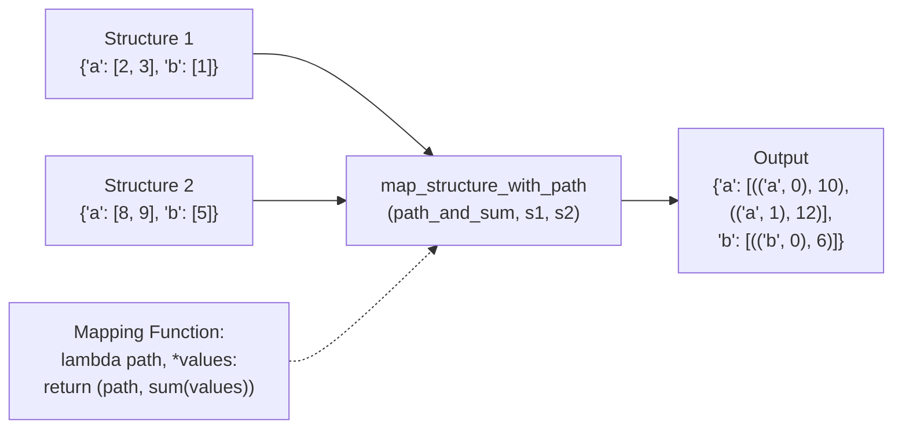
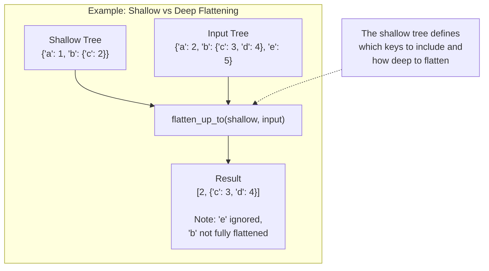
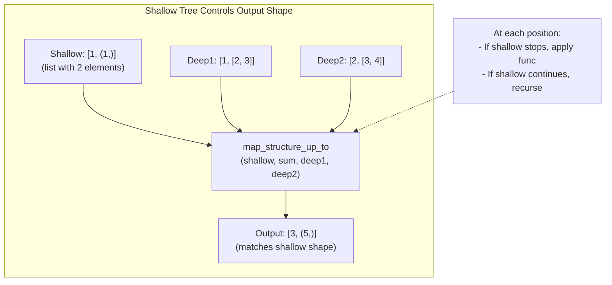
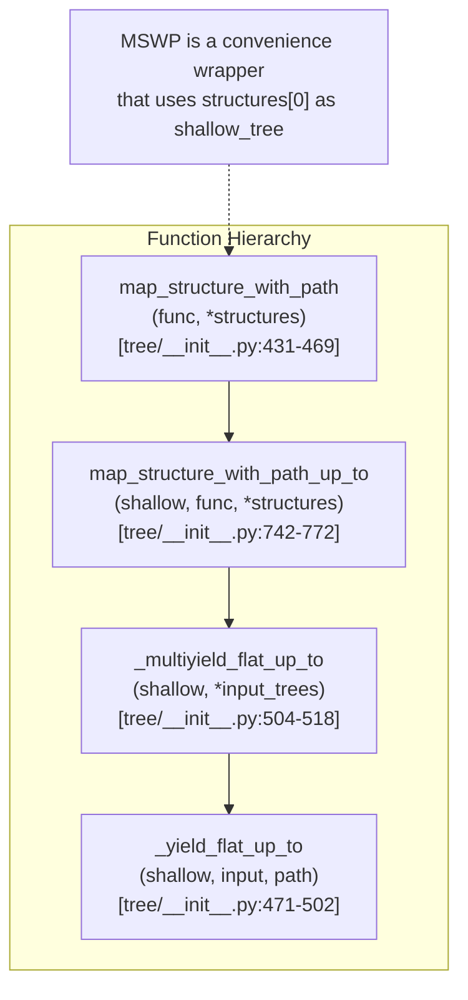
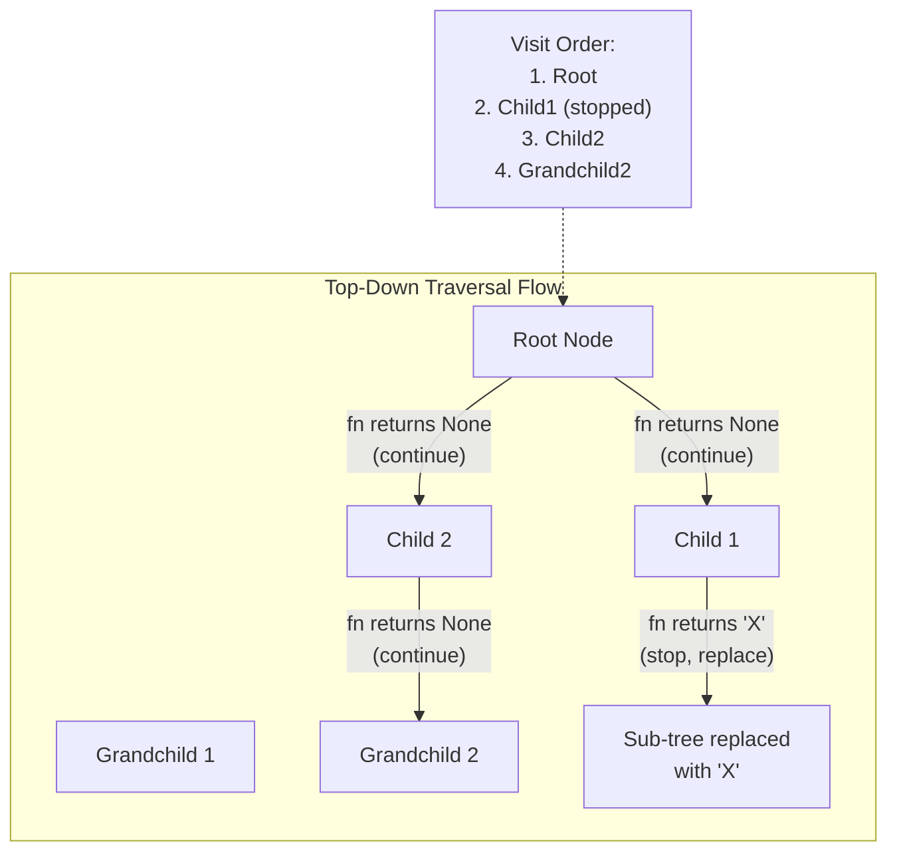
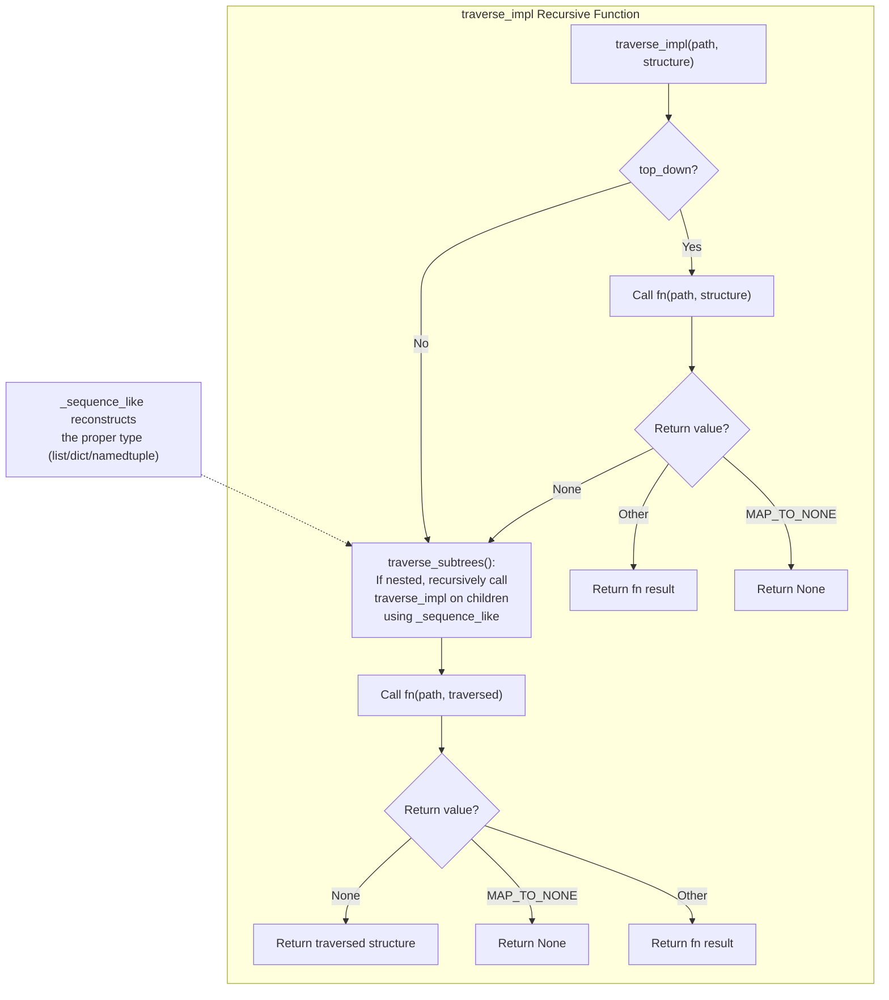

<!-- source: DeepWiki mcp.deepwiki.com · repo google-deepmind/tree · page 3.3 Advanced Usage · fetched 2026-10-26 -->

# Advanced Usage

<details>
<summary>Relevant source files</summary>

The following files were used as context for generating this wiki page:

- [LICENSE](LICENSE)
- [docs/recipes.rst](docs/recipes.rst)
- [tree/__init__.py](tree/__init__.py)
- [tree/tree_test.py](tree/tree_test.py)

</details>


This page covers advanced features of dm-tree for users who need more control over structure traversal and manipulation. These features extend the basic operations covered in [Basic Operations](#3.2) with path tracking, partial tree processing, and custom traversal patterns.

**Scope:** This page documents path-aware operations (`flatten_with_path`, `map_structure_with_path`), shallow tree operations (`flatten_up_to`, `map_structure_up_to`), combined operations, and the `traverse` API. For basic flatten/unflatten operations, see [Basic Operations](#3.2). For complete API signatures, see [API Reference](#3.4).

---

## Path-Aware Operations

Path-aware operations track the location of each element within the nested structure, providing a tuple of indices/keys that uniquely identifies each element's position. This enables operations that need to know where data is located in the original structure.

### flatten_with_path

The `flatten_with_path()` function produces a list of `(path, value)` pairs instead of just values. Paths are tuples containing the sequence of keys and indices needed to access each element.

```python
# Example from tree/__init__.py:775-796
structure = [{"foo": 42}]
result = tree.flatten_with_path(structure)
# Returns: [((0, 'foo'), 42)]
```

**Path Representation:**
- For lists/tuples: integer indices
- For dicts: string keys (or whatever key type is used)
- For namedtuples: field name strings
- For attrs classes: attribute name strings



**Sources:** [tree/__init__.py:775-796](), [tree/__init__.py:471-502](), [tree/__init__.py:129-161]()

### map_structure_with_path

The `map_structure_with_path()` function passes both the path and values to the mapping function, enabling position-aware transformations.

```python
# Example from tree/__init__.py:439-442
tree.map_structure_with_path(
    lambda path, v: (path, v**2),
    [{"foo": 42}])
# Returns: [{'foo': ((0, 'foo'), 1764)}]
```

**Function Signature:** The mapping function receives `(path, *values)` where path is a tuple and values come from all input structures at that position.



**Sources:** [tree/__init__.py:431-469](), [tree/tree_test.py:982-988]()

### Use Cases for Path-Aware Operations

| Use Case | Example |
|----------|---------|
| **Debugging** | Log the path of problematic values in deeply nested structures |
| **Selective Processing** | Apply different logic based on path (e.g., normalize only certain sub-trees) |
| **Error Reporting** | Report precise location of validation failures |
| **Metadata Tracking** | Associate metadata with specific positions in the structure |
| **Custom Reconstruction** | Build modified structures with path-dependent transformations |

**Sources:** [tree/tree_test.py:982-1002](), [docs/recipes.rst:1-38]()

---

## Shallow Tree Operations

Shallow tree operations process structures only up to the depth defined by a "shallow tree" template. Elements in the input that are nested deeper than the shallow tree are kept as-is, enabling partial structure processing.

### flatten_up_to

The `flatten_up_to(shallow_tree, input_tree)` function flattens `input_tree` only to the depth of `shallow_tree`. Sub-structures deeper than the shallow tree remain intact.

```python
# Example from tree/__init__.py:640-644
structure = [[1, 1], [2, 2]]
tree.flatten_up_to([None, None], structure)
# Returns: [[1, 1], [2, 2]]  # Stops at depth 1

tree.flatten_up_to([None, [None, None]], structure)
# Returns: [[1, 1], 2, 2]  # Flattens second element further
```

**Shallow Tree Semantics:**



**Sources:** [tree/__init__.py:635-675](), [tree/tree_test.py:509-665]()

### map_structure_up_to

The `map_structure_up_to(shallow_tree, func, *structures)` function maps `func` across structures only up to the depth defined by `shallow_tree`.

```python
# Example from tree/__init__.py:716-720
structure = [[1, 1], [2, 2]]
tree.map_structure_up_to([None, None], len, structure)
# Returns: [2, 2]  # Applies len() to [1, 1] and [2, 2]

tree.map_structure_up_to([None, [None, None]], str, structure)
# Returns: ['[1, 1]', ['2', '2']]  # str() on [1, 1], then recurse
```

**Key Behavior:** The output structure matches the shallow tree's shape, not the input tree's full depth.



**Sources:** [tree/__init__.py:709-740](), [tree/tree_test.py:920-1103](), [docs/recipes.rst:23-29]()

### Structure Validation

The `_assert_shallow_structure()` function validates that the shallow tree is a valid prefix of the input tree. This ensures safe partial processing.

**Validation Rules:**
1. Every key in shallow tree must exist in input tree
2. Sequence lengths must match at each level
3. Type compatibility (if `check_types=True`)

**Sources:** [tree/__init__.py:520-633](), [tree/tree_test.py:473-508]()

---

## Combined Path and Shallow Operations

### flatten_with_path_up_to

Combines path tracking with shallow flattening:

```python
# Example from tree/__init__.py:677-706
shallow = {"a": 0, "b": 0, "d": [0, 0]}
input_tree = {"a": 1, "b": {"c": 2}, "d": [3, (4, 5)]}

tree.flatten_with_path_up_to(shallow, input_tree)
# Returns: [(("a",), 1), (("b",), {"c": 2}), (("d", 0), 3), (("d", 1), (4, 5))]
```

**Sources:** [tree/__init__.py:677-707](), [tree/tree_test.py:671-919]()

### map_structure_with_path_up_to

The most powerful variant, combining path-awareness with shallow processing:

```python
# Example from tree/__init__.py:742-772
def func(path, *values):
    return f"{'/'.join(path)}: {sum(values)}"

shallow = {"a": 1, "b": {"c": 2}}
deep1 = {"a": 2, "b": {"c": 3, "d": 4}, "e": 5}
deep2 = {"a": 3, "b": {"c": 2, "d": 5}, "e": 6}

tree.map_structure_with_path_up_to(shallow, func, deep1, deep2)
# Returns: {"a": "a: 5", "b": {"c": "b/c: 5"}}
```

**Implementation Detail:** This function is the base implementation for `map_structure_with_path()`, which calls it with `shallow_structure=structures[0]`.



**Sources:** [tree/__init__.py:742-772](), [tree/__init__.py:431-469](), [tree/__init__.py:467-468]()

---

## Traversal

The `traverse()` and `traverse_with_path()` functions provide depth-first traversal with customizable processing at each node.

### Basic Traversal

```python
# Example from tree/__init__.py:810-820
visited = []
tree.traverse(visited.append, [(1, 2), [3], {"a": 4}], top_down=True)
# visited: [[(1, 2), [3], {'a': 4}], (1, 2), 1, 2, [3], 3, {'a': 4}, 4]

visited = []
tree.traverse(visited.append, [(1, 2), [3], {"a": 4}], top_down=False)
# visited: [1, 2, (1, 2), 3, [3], 4, {'a': 4}, [(1, 2), [3], {'a': 4}]]
```

### Traversal Modes

| Mode | Order | Use Case |
|------|-------|----------|
| **top_down=True** | Parents before children | Early termination, pruning sub-trees |
| **top_down=False** | Children before parents | Bottom-up aggregation, leaf-to-root processing |

### Early Termination with MAP_TO_NONE

In top-down mode, returning non-None from the function stops traversal into that sub-tree and replaces it with the return value.

```python
# Example from tree/tree_test.py:1020-1032
def visit(x):
    return "X" if isinstance(x, tuple) and len(x) > 2 else None

structure = [(1, [2]), [3, (4, 5, 6)]]
output = tree.traverse(visit, structure)
# Returns: [(1, [2]), [3, "X"]]
# The tuple (4, 5, 6) was replaced with "X" and not traversed further
```

**Special Value:** Use `tree.MAP_TO_NONE` when you want to replace a sub-tree with `None` (since returning `None` means "continue traversing").



**Sources:** [tree/__init__.py:803-845](), [tree/__init__.py:847-942](), [tree/tree_test.py:1011-1033]()

### traverse_with_path

Provides the same functionality with path tracking:

```python
# Example from tree/__init__.py:854-869
visited = []
tree.traverse_with_path(
    lambda path, subtree: visited.append((path, subtree)),
    [(1, 2), [3], {"a": 4}],
    top_down=True)
# visited includes:
# ((), [(1, 2), [3], {'a': 4}])
# ((0,), (1, 2))
# ((0, 0), 1)
# ((0, 1), 2)
# ((1,), [3])
# ((1, 0), 3)
# ((2,), {'a': 4})
# ((2, 'a'), 4)
```

### Traverse Implementation



**Sources:** [tree/__init__.py:909-942](), [tree/__init__.py:916-922]()

---

## Common Patterns and Use Cases

### Pattern 1: Type Conversion with Traverse

Convert nested lists to tuples recursively:

```python
# Example from tree/tree_test.py:1011-1018
structure = [(1, 2), [3], {"a": [4]}]
result = tree.traverse(
    lambda x: tuple(x) if isinstance(x, list) else x,
    structure,
    top_down=False)
# Returns: ((1, 2), (3,), {"a": (4,)})
```

**Why bottom-up?** Children must be converted before parents to ensure complete conversion.

**Sources:** [tree/tree_test.py:1011-1018]()

### Pattern 2: Excluding Meta Keys

Process only relevant keys while ignoring metadata:

```python
# Example from docs/recipes.rst:23-29
d1 = {'key_to_exclude': None, 'a': 1}
d2 = {'key_to_exclude': None, 'a': 2}
d3 = {'a': 3}

tree.map_structure_up_to({'a': True}, lambda x, y, z: x+y+z, d1, d2, d3)
# Returns: {'a': 6}
# 'key_to_exclude' is ignored
```

**Sources:** [docs/recipes.rst:23-29]()

### Pattern 3: Path-Based Validation

Use paths to provide detailed error messages:

```python
def validate_structure_with_path(structure):
    def validator(path, value):
        if isinstance(value, (int, float)) and value < 0:
            raise ValueError(f"Negative value at {'/'.join(map(str, path))}: {value}")
        return None  # Continue traversal
    
    tree.traverse_with_path(validator, structure)
```

**Sources:** [tree/tree_test.py:1108-1138]()

### Pattern 4: Broadcasting Values

Broadcast a single value across a reference structure:

```python
# Example from docs/recipes.rst:32-37
reference_tree = {'a': 1, 'b': (2, 3)}
value = np.inf
tree.map_structure(lambda _: value, reference_tree)
# Returns: {'a': inf, 'b': (inf, inf)}
```

**Sources:** [docs/recipes.rst:32-37]()

### Pattern 5: Cross-Structure Operations with Shallow Tree

Sum corresponding elements from multiple structures, processing only common keys:

```python
# Example from tree/tree_test.py:1034-1045
shallow = {"a": 1, "b": {"c": 2}}
deep1 = {"a": 2, "b": {"c": 3, "d": 2}, "e": 4}
deep2 = {"a": 3, "b": {"c": 2, "d": 3}, "e": 1}

summed = tree.map_structure_up_to(
    shallow, lambda *args: sum(args), deep1, deep2)
# Returns: {"a": 5, "b": {"c": 5}}
```

**Sources:** [tree/tree_test.py:1034-1045]()

---

## Error Handling

### Type Mismatches

Path-aware error messages help identify problems:

```python
# From tree/__init__.py:91-93
# Error includes path information:
# "If shallow structure is a sequence, input must also be a sequence. 
#  Input at path: ['a', 'b'] has type: <class 'set'>"
```

**Sources:** [tree/__init__.py:87-94](), [tree/tree_test.py:906-918]()

### Missing Keys in Shallow Operations

```python
# From tree/__init__.py:68-70
# "The shallow_tree's keys are not a subset of the input_tree's keys. 
#  The shallow_tree has the following keys that are not in the input_tree: ['d']"
```

**Sources:** [tree/__init__.py:68-70](), [tree/tree_test.py:494-500]()

### Structure Validation Matrix

| Check | flatten_up_to | map_structure_up_to | Always Validated |
|-------|---------------|---------------------|------------------|
| **Keys exist** | ✓ | ✓ | Shallow keys ⊆ Input keys |
| **Length match** | ✓ | ✓ | At each depth level |
| **Type match** | Optional | Optional | Controlled by `check_types` param |
| **Namedtuple compatibility** | ✓ | ✓ | Same name and fields |

**Sources:** [tree/__init__.py:520-633]()

---

