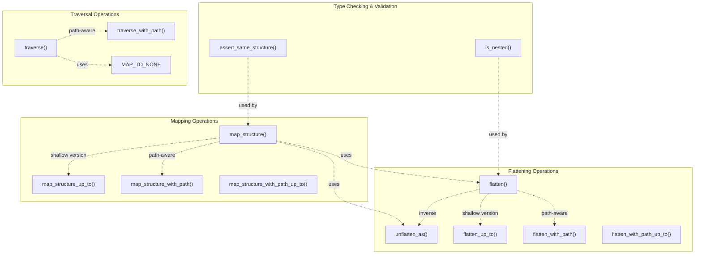
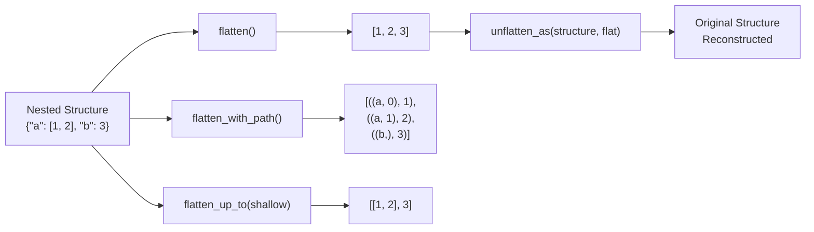
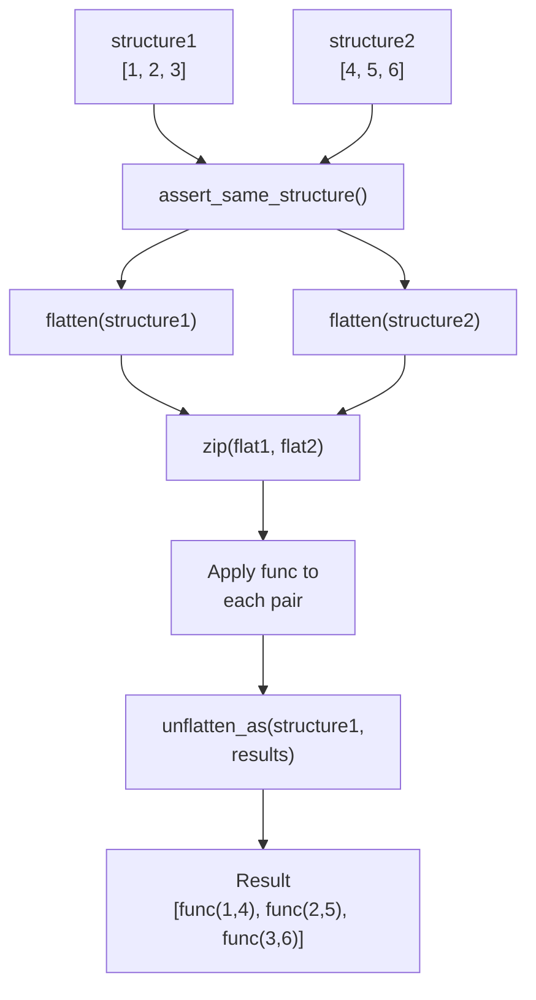
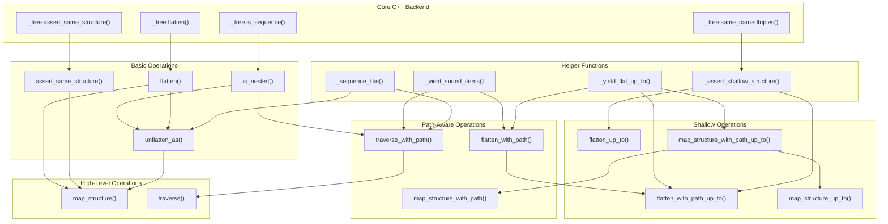

<!-- source: DeepWiki mcp.deepwiki.com · repo google-deepmind/tree · page 3.4 API Reference · fetched 2026-10-26 -->

# API Reference

<details>
<summary>Relevant source files</summary>

The following files were used as context for generating this wiki page:

- [docs/api.rst](docs/api.rst)
- [tree/__init__.py](tree/__init__.py)

</details>


This page provides complete reference documentation for all public functions in the `tree` module. Each function includes its signature, parameters, return values, exceptions, and usage examples.

For practical examples and common patterns, see [Basic Operations](#3.2) and [Advanced Usage](#3.3). For understanding the internal implementation, see [Python API Layer](#2.1) and [Type System and Utilities](#2.3).

**Sources:** [tree/__init__.py:46-60](), [docs/api.rst:1-63]()

---

## Core Concepts

### Structure Definition

A **structure** in dm-tree is recursively defined as any Python object that can contain other structures. The type hierarchy is:

```python
Structure = Union[
    Any,                          # Leaf node (non-nested value)
    Sequence['Structure'],        # list, tuple, etc.
    Mapping[Any, 'Structure'],    # dict, OrderedDict, etc.
    'AnyNamedTuple',             # collections.namedtuple instances
    'AttrsClass',                # attrs-decorated classes
]
```

**Supported Types:**
- **Sequences:** `list`, `tuple`
- **Mappings:** `dict`, `OrderedDict`, `defaultdict`, `MappingProxyType`
- **Named tuples:** Any `collections.namedtuple` instance
- **Attrs classes:** Classes decorated with `@attr.s` or `@attrs.define`
- **Special types:** `wrapt.ObjectProxy` instances
- **Non-nested (leaves):** Any other Python object

**Important:** dm-tree only supports acyclic structures. Behavior with cyclic references is undefined.

**Sources:** [tree/__init__.py:101-106](), [docs/api.rst:5-34]()

### Type Aliases

| Type Alias | Definition | Usage |
|------------|-----------|--------|
| `StructureKV[K, V]` | Nested structure with key type `K` and value type `V` | Generic structure typing |
| `Structure[V]` | Shorthand for `StructureKV[str, V]` | Common case with string keys |

**Sources:** [tree/__init__.py:95-106]()

---

## Function Categories

The following diagram shows how the public API functions are organized by their primary purpose:



**Sources:** [tree/__init__.py:46-60]()

---

## Type Checking and Validation

### is_nested

```python
def is_nested(structure) -> bool
```

Checks if a given structure is nested (i.e., contains other structures).

**Parameters:**
- `structure`: Any Python object to check

**Returns:**
- `bool`: `True` if the structure is nested (sequence, mapping, namedtuple, or attrs), `False` otherwise

**Examples:**

```python
>>> tree.is_nested(42)
False
>>> tree.is_nested([42])
True
>>> tree.is_nested({"foo": 42})
True
>>> tree.is_nested((1, 2, 3))
True
>>> tree.is_nested("string")  # Strings are not considered nested
False
```

**Implementation Note:** This function delegates to the C++ backend `_tree.is_sequence()` for performance.

**Sources:** [tree/__init__.py:170-186]()

---

### assert_same_structure

```python
def assert_same_structure(a, b, check_types=True) -> None
```

Asserts that two structures are nested in the same way.

**Parameters:**
- `a`: An arbitrarily nested structure
- `b`: An arbitrarily nested structure
- `check_types` (bool, optional): If `True` (default), types of sequences are checked. If `False`, different sequence types (e.g., list vs tuple) with the same size are considered equivalent

**Returns:**
- `None`: Returns nothing if structures match

**Raises:**
- `ValueError`: If the two structures have different numbers of elements or are not nested in the same way
- `TypeError`: If the two structures differ in the type of sequence and `check_types=True`

**Examples:**

```python
>>> tree.assert_same_structure([(0, 1)], [(2, 3)])
# Passes - same structure

>>> tree.assert_same_structure([1, 2], [3, 4, 5])
Traceback (most recent call last):
  ...
ValueError: The two structures don't have the same number of elements.

>>> tree.assert_same_structure([1, 2], (3, 4))
Traceback (most recent call last):
  ...
TypeError: The two structures don't have the same sequence type.

>>> tree.assert_same_structure([1, 2], (3, 4), check_types=False)
# Passes when check_types=False
```

**Named Tuple Behavior:**

Named tuples with identical name and fields are always considered to have the same structure:

```python
>>> Foo = collections.namedtuple('Foo', ['a', 'b'])
>>> AlsoFoo = collections.namedtuple('Foo', ['a', 'b'])
>>> tree.assert_same_structure(Foo(0, 1), AlsoFoo(2, 3))
# Passes - same name and fields

>>> Bar = collections.namedtuple('Bar', ['a', 'b'])
>>> tree.assert_same_structure(Foo(0, 1), Bar(2, 3))
Traceback (most recent call last):
  ...
TypeError: The two structures don't have the same nested structure.
```

**Implementation Note:** This function uses the C++ backend `_tree.assert_same_structure()` and enhances error messages with visual structure representations.

**Sources:** [tree/__init__.py:239-285]()

---

## Flattening Operations

The following diagram shows the relationships between flattening functions and their data flow:



**Sources:** [tree/__init__.py:188-707]()

### flatten

```python
def flatten(structure) -> list
```

Flattens a possibly nested structure into a list.

**Parameters:**
- `structure`: An arbitrarily nested structure

**Returns:**
- `list`: The flattened version of the input structure

**Raises:**
- `TypeError`: If structure contains a mapping with non-sortable keys

**Examples:**

```python
>>> tree.flatten([[1, 2, 3], [4, [5], [[6]]]])
[1, 2, 3, 4, 5, 6]

>>> tree.flatten(None)
[None]

>>> tree.flatten({100: 'world!', 6: 'Hello'})
['Hello', 'world!']  # Sorted by key
```

**Ordering Behavior:**

| Structure Type | Ordering |
|---------------|----------|
| `list`, `tuple` | Index order (0, 1, 2, ...) |
| `dict`, `OrderedDict` | Sorted by key (ignores OrderedDict order) |
| `namedtuple` | Field order (sorted by field name) |
| `attrs` classes | Attribute order (sorted by attribute name) |

**Important:** For dictionaries, values are always sorted by key for deterministic behavior. This applies to `OrderedDict` as well - the original order is ignored.

**Performance:** This function delegates to the optimized C++ implementation `_tree.flatten()`.

**Sources:** [tree/__init__.py:188-224]()

---

### unflatten_as

```python
def unflatten_as(structure, flat_sequence) -> Structure
```

Unflattens a sequence into a given structure.

**Parameters:**
- `structure`: Arbitrarily nested structure to use as a template
- `flat_sequence`: Sequence to unflatten

**Returns:**
- `Structure`: `flat_sequence` unflattened into the shape of `structure`

**Raises:**
- `TypeError`: If `flat_sequence` is not a sequence or if `structure` contains a mapping with non-sortable keys
- `ValueError`: If `flat_sequence` and `structure` have different element counts

**Examples:**

```python
>>> tree.unflatten_as([[1, 2], [[3], [4]]], [5, 6, 7, 8])
[[5, 6], [[7], [8]]]

>>> tree.unflatten_as(None, [1])
1

>>> tree.unflatten_as({1: None, 2: None}, ['Hello', 'world!'])
{1: 'Hello', 2: 'world!'}
```

**Behavior with Scalars:**

If `structure` is a scalar (non-nested), `flat_sequence` must be a single-element list:

```python
>>> tree.unflatten_as(42, [100])
100

>>> tree.unflatten_as(42, [1, 2])
Traceback (most recent call last):
  ...
ValueError: Structure is a scalar but len(flat_sequence) == 2 > 1
```

**Type Preservation:**

The output structure uses the types from `structure`, not from `flat_sequence`:

```python
>>> tree.unflatten_as((1, 2), [3, 4])
(3, 4)  # Tuple, not list
```

**Sources:** [tree/__init__.py:318-374]()

---

### flatten_up_to

```python
def flatten_up_to(shallow_structure, input_structure, check_types=True) -> list
```

Flattens `input_structure` up to `shallow_structure`, retaining nested components below `shallow_structure` leaves.

**Parameters:**
- `shallow_structure`: A structure with the same (but possibly more shallow) layout as `input_structure`
- `input_structure`: An arbitrarily nested structure
- `check_types` (bool, optional): If `True` (default), check that each node in `shallow_structure` has the same type as the corresponding node in `input_structure`

**Returns:**
- `list`: The partially flattened version of `input_structure` with respect to `shallow_structure`

**Raises:**
- `TypeError`: If the layout of `shallow_structure` does not match that of `input_structure`
- `TypeError`: If `check_types=True` and structures differ in types

**Examples:**

```python
>>> structure = [[1, 1], [2, 2]]
>>> tree.flatten_up_to([None, None], structure)
[[1, 1], [2, 2]]

>>> tree.flatten_up_to([None, [None, None]], structure)
[[1, 1], 2, 2]

>>> tree.flatten_up_to(42, [1, 2, 3])
[[1, 2, 3]]  # Non-nested shallow_structure treats input as single element
```

**Use Case:** This is useful when you want to partially flatten a structure, stopping at a certain depth defined by `shallow_structure`.

**Sources:** [tree/__init__.py:635-674]()

---

### flatten_with_path

```python
def flatten_with_path(structure) -> list[tuple[tuple, Any]]
```

Flattens a structure into a list of `(path, item)` pairs.

**Parameters:**
- `structure`: An arbitrarily nested structure

**Returns:**
- `list`: A list of `(path, item)` pairs where `path` is a tuple of indices/keys uniquely identifying the item's position

**Raises:**
- `TypeError`: If structure contains a mapping with non-sortable keys

**Examples:**

```python
>>> tree.flatten_with_path([{"foo": 42}])
[((0, 'foo'), 42)]

>>> tree.flatten_with_path({"a": [1, 2], "b": 3})
[(('a', 0), 1), (('a', 1), 2), (('b',), 3)]
```

**Path Interpretation:**

| Container Type | Path Element Type | Example |
|---------------|-------------------|---------|
| `list`, `tuple` | `int` (index) | `(0,)`, `(1,)` |
| `dict` | Key type | `('key',)` |
| `namedtuple` | `str` (field name) | `('field',)` |
| `attrs` class | `str` (attribute name) | `('attr',)` |

**Sources:** [tree/__init__.py:775-796]()

---

### flatten_with_path_up_to

```python
def flatten_with_path_up_to(shallow_structure, input_structure, check_types=True) -> list[tuple[tuple, Any]]
```

Combines `flatten_up_to` and `flatten_with_path` - flattens `input_structure` up to `shallow_structure` with path information.

**Parameters:**
- `shallow_structure`: A structure with the same (but possibly more shallow) layout as `input_structure`
- `input_structure`: An arbitrarily nested structure
- `check_types` (bool, optional): If `True` (default), check type compatibility

**Returns:**
- `list`: A list of `(path, item)` pairs corresponding to the partially flattened version

**Raises:**
- `TypeError`: If structures don't match or contain mappings with non-sortable keys
- `TypeError`: If `check_types=True` and structures differ in types

**Examples:**

```python
>>> shallow = [None, [None, None]]
>>> input_tree = [[1, 1], [2, 2]]
>>> tree.flatten_with_path_up_to(shallow, input_tree)
[((0,), [1, 1]), ((1, 0), 2), ((1, 1), 2)]
```

**Sources:** [tree/__init__.py:677-706]()

---

## Mapping Operations

The following diagram illustrates the execution flow of mapping operations:



**Sources:** [tree/__init__.py:377-772]()

### map_structure

```python
def map_structure(func, *structures, **kwargs) -> Structure
```

Maps `func` through given structures element-wise.

**Parameters:**
- `func`: A callable that accepts as many arguments as there are structures
- `*structures`: Arbitrarily nested structures of the same layout
- `**kwargs`: Only valid keyword argument is `check_types` (bool, default `True`)

**Returns:**
- `Structure`: A new structure with the same layout as the input structures. Uses the types from `structures[0]`

**Raises:**
- `TypeError`: If `func` is not callable
- `ValueError`: If no structures were given or if structures have different element counts
- `TypeError`: If `check_types=True` and structures differ in types
- `ValueError`: If invalid keyword arguments are provided

**Examples:**

```python
>>> structure = [[1], [2], [3]]
>>> tree.map_structure(lambda v: v**2, structure)
[[1], [4], [9]]

>>> tree.map_structure(lambda x, y: x * y, structure, structure)
[[1], [4], [9]]

>>> Foo = collections.namedtuple('Foo', ['a', 'b'])
>>> structure = Foo(a=1, b=2)
>>> tree.map_structure(lambda v: v * 2, structure)
Foo(a=2, b=4)
```

**Multiple Structures:**

When mapping over multiple structures, they must have the same layout:

```python
>>> tree.map_structure(lambda x, y: x + y, [1, 2], [3, 4])
[4, 6]

>>> tree.map_structure(lambda x, y: x + y, [1, 2], [3, 4, 5])
Traceback (most recent call last):
  ...
ValueError: Could not pack sequence...
```

**Type Checking:**

```python
>>> tree.map_structure(lambda x: x, [1], (1,), check_types=True)
Traceback (most recent call last):
  ...
TypeError: The two structures don't have the same sequence type.

>>> tree.map_structure(lambda x: x, [1], (1,), check_types=False)
[1]  # Allowed with check_types=False
```

**Sources:** [tree/__init__.py:377-428]()

---

### map_structure_up_to

```python
def map_structure_up_to(shallow_structure, func, *structures, **kwargs) -> Structure
```

Maps `func` through structures up to `shallow_structure`, retaining deeper nesting as-is.

**Parameters:**
- `shallow_structure`: A structure with layout common to all `structures`
- `func`: A callable that accepts as many arguments as there are structures
- `*structures`: Arbitrarily nested structures of the same layout
- `**kwargs`: No valid keyword arguments

**Returns:**
- `Structure`: A new structure with the same layout as `shallow_structure`

**Raises:**
- `ValueError`: If `func` is not callable, if structures have different layout, or if `shallow_structure` layout doesn't match

**Examples:**

```python
>>> structure = [[1, 1], [2, 2]]
>>> tree.map_structure_up_to([None, None], len, structure)
[2, 2]

>>> tree.map_structure_up_to([None, [None, None]], str, structure)
['[1, 1]', ['2', '2']]
```

**Use Case:** This is useful when you want to apply a function at a specific depth and preserve deeper nesting:

```python
>>> deep = [[[1, 2], [3, 4]], [[5, 6], [7, 8]]]
>>> tree.map_structure_up_to([None, None], lambda x: sum(sum(y) for y in x), deep)
[10, 26]
```

**Sources:** [tree/__init__.py:709-739]()

---

### map_structure_with_path

```python
def map_structure_with_path(func, *structures, **kwargs) -> Structure
```

Maps `func` through structures with path information passed to the function.

**Parameters:**
- `func`: A callable that accepts a path (tuple) and as many arguments as there are structures
- `*structures`: Arbitrarily nested structures of the same layout
- `**kwargs`: Only valid keyword argument is `check_types` (bool, default `True`)

**Returns:**
- `Structure`: A new structure with the same layout as the input structures

**Raises:**
- `TypeError`: If `func` is not callable or if structures don't have the same layout
- `TypeError`: If `check_types=True` and structures differ in types
- `ValueError`: If no structures were given or if invalid keyword arguments are provided

**Examples:**

```python
>>> tree.map_structure_with_path(
...     lambda path, v: (path, v**2),
...     [{"foo": 42}])
[{'foo': ((0, 'foo'), 1764)}]

>>> tree.map_structure_with_path(
...     lambda path, x, y: f"{path}: {x}+{y}",
...     {"a": 1}, {"a": 2})
{'a': "(('a',)): 1+2"}
```

**Path Structure:**

The `path` argument is a tuple containing the sequence of keys/indices from the root to the current element:

```python
>>> def print_path(path, value):
...     print(f"Path: {path}, Value: {value}")
...     return value
>>> tree.map_structure_with_path(print_path, {"x": [1, 2]})
Path: (('x', 0),), Value: 1
Path: (('x', 1),), Value: 2
{'x': [1, 2]}
```

**Sources:** [tree/__init__.py:431-468]()

---

### map_structure_with_path_up_to

```python
def map_structure_with_path_up_to(shallow_structure, func, *structures, **kwargs) -> Structure
```

Combines `map_structure_up_to` and `map_structure_with_path`.

**Parameters:**
- `shallow_structure`: A structure with layout common to all `structures`
- `func`: A callable that accepts a path and as many arguments as there are structures
- `*structures`: Arbitrarily nested structures of the same layout
- `**kwargs`: Note that `check_types` is deprecated and has no effect

**Returns:**
- `Structure`: Result of applying `func` with the same structure layout as `shallow_tree`

**Raises:**
- `ValueError`: If `func` is not callable, if structures have different layout, or if `shallow_structure` layout doesn't match

**Examples:**

```python
>>> shallow = [None, None]
>>> inputs = [[1, 1], [2, 2]]
>>> tree.map_structure_with_path_up_to(
...     shallow,
...     lambda path, x: (path, sum(x)),
...     inputs)
[((0,), 2), ((1,), 4)]
```

**Sources:** [tree/__init__.py:742-772]()

---

## Traversal Operations

### traverse

```python
def traverse(fn, structure, top_down=True) -> Structure
```

Traverses the given nested structure depth-first, applying the given function.

**Parameters:**
- `fn`: The function to be applied to each sub-nest of the structure
- `structure`: The structure to traverse
- `top_down` (bool, optional): If `True` (default), parents are visited before children; if `False`, children are visited before parents

**Returns:**
- `Structure`: The structured output from the traversal

**Function Behavior:**

**When `top_down=True`:**
- If `fn(subtree)` returns `None`, traversal continues into the sub-tree
- If `fn(subtree)` returns non-`None`, traversal stops and the sub-tree is replaced by the return value
- Use `MAP_TO_NONE` to replace a sub-tree with `None`

**When `top_down=False`:**
- If `fn(subtree)` returns `None`, the traversed sub-tree is returned unaltered
- If `fn(subtree)` returns non-`None`, the sub-tree is replaced by the return value
- Use `MAP_TO_NONE` to replace a sub-tree with `None`

**Examples:**

**Top-down traversal:**

```python
>>> visited = []
>>> tree.traverse(visited.append, [(1, 2), [3], {"a": 4}], top_down=True)
[(1, 2), [3], {'a': 4}]
>>> visited
[[(1, 2), [3], {'a': 4}], (1, 2), 1, 2, [3], 3, {'a': 4}, 4]
```

**Bottom-up traversal:**

```python
>>> visited = []
>>> tree.traverse(visited.append, [(1, 2), [3], {"a": 4}], top_down=False)
[(1, 2), [3], {'a': 4}]
>>> visited
[1, 2, (1, 2), 3, [3], 4, {'a': 4}, [(1, 2), [3], {'a': 4}]]
```

**Replacing sub-trees:**

```python
>>> # Replace all lists with their length
>>> tree.traverse(
...     lambda x: len(x) if isinstance(x, list) else None,
...     [1, [2, 3], [4, [5, 6]]],
...     top_down=True)
3
```

**Sources:** [tree/__init__.py:803-844]()

---

### traverse_with_path

```python
def traverse_with_path(fn, structure, top_down=True) -> Structure
```

Traverses the structure with path information. Similar to `traverse` but `fn` receives both the path and the subtree.

**Parameters:**
- `fn`: Function that accepts `(path, subtree)` where path is a tuple of indices/keys
- `structure`: The structure to traverse
- `top_down` (bool, optional): If `True` (default), parents are visited before children

**Returns:**
- `Structure`: The structured output from the traversal

**Examples:**

```python
>>> visited = []
>>> tree.traverse_with_path(
...     lambda path, subtree: visited.append((path, subtree)),
...     [(1, 2), [3], {"a": 4}],
...     top_down=True)
[(1, 2), [3], {'a': 4}]
>>> visited == [
...     ((), [(1, 2), [3], {'a': 4}]),
...     ((0,), (1, 2)),
...     ((0, 0), 1),
...     ((0, 1), 2),
...     ((1,), [3]),
...     ((1, 0), 3),
...     ((2,), {'a': 4}),
...     ((2, 'a'), 4)]
True
```

**Note:** `traverse_with_path` is not in `__all__` but is a public function used internally by `traverse`.

**Sources:** [tree/__init__.py:847-941]()

---

### MAP_TO_NONE

```python
MAP_TO_NONE: object
```

Special sentinel value for use with `traverse` and `traverse_with_path`.

**Purpose:** Used to distinguish between returning `None` (continue traversal) and replacing a sub-tree with `None`.

**Example:**

```python
>>> # Replace all nested lists with None
>>> tree.traverse(
...     lambda x: tree.MAP_TO_NONE if isinstance(x, list) else None,
...     [1, [2, 3], [4, [5, 6]]],
...     top_down=True)
None
```

Without `MAP_TO_NONE`, you cannot replace a sub-tree with `None` because returning `None` from `fn` means "continue traversal".

**Sources:** [tree/__init__.py:799-800]()

---

## Function Relationships

The following diagram shows how the API functions relate to each other and which functions build upon others:



**Sources:** [tree/__init__.py:1-944]()

---

## Quick Reference Table

| Function | Primary Use | Returns Path | Shallow Mode | Key Parameters |
|----------|-------------|--------------|--------------|----------------|
| `is_nested` | Type checking | No | N/A | - |
| `assert_same_structure` | Validation | No | No | `check_types` |
| `flatten` | Flatten to list | No | No | - |
| `unflatten_as` | Reconstruct structure | No | No | - |
| `flatten_up_to` | Partial flatten | No | Yes | `check_types` |
| `flatten_with_path` | Flatten with paths | Yes | No | - |
| `flatten_with_path_up_to` | Partial flatten with paths | Yes | Yes | `check_types` |
| `map_structure` | Apply function | No | No | `check_types` |
| `map_structure_up_to` | Apply function partially | No | Yes | - |
| `map_structure_with_path` | Apply function with paths | Yes | No | `check_types` |
| `map_structure_with_path_up_to` | Apply function partially with paths | Yes | Yes | - |
| `traverse` | Custom traversal | No | N/A | `top_down` |

**Sources:** [tree/__init__.py:46-60]()

---

