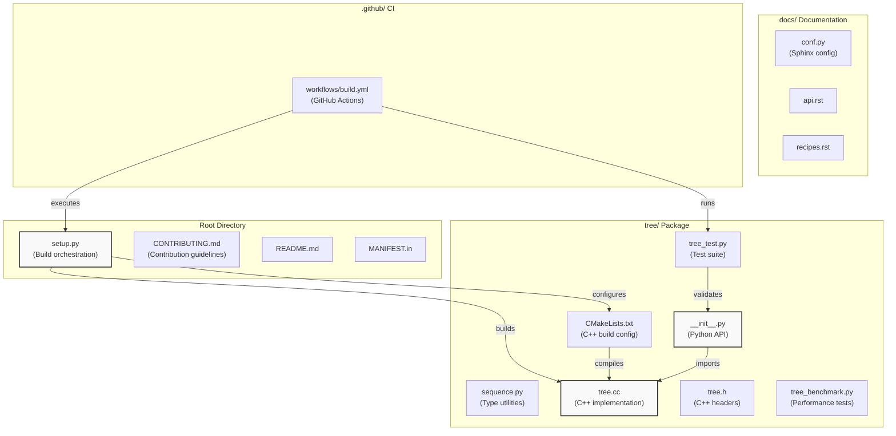
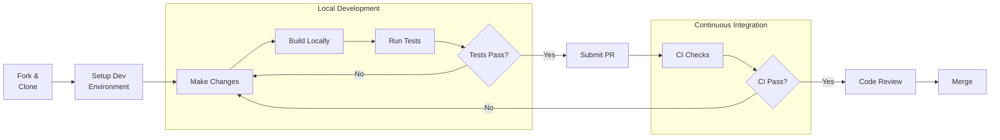
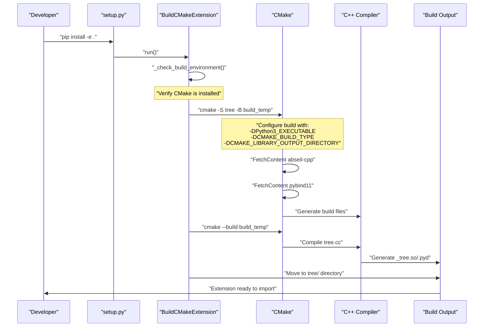
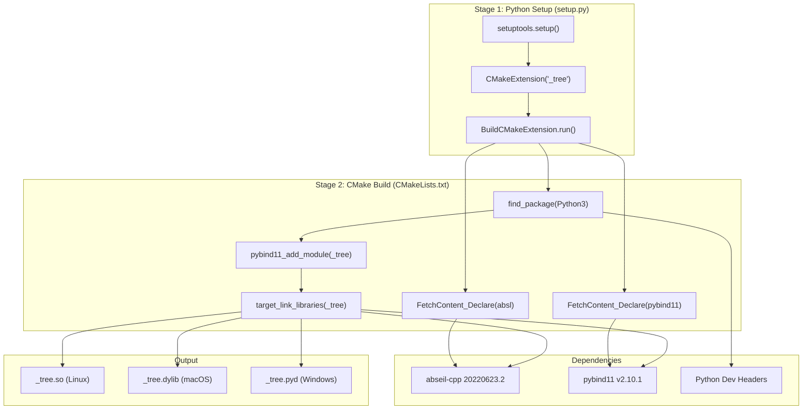
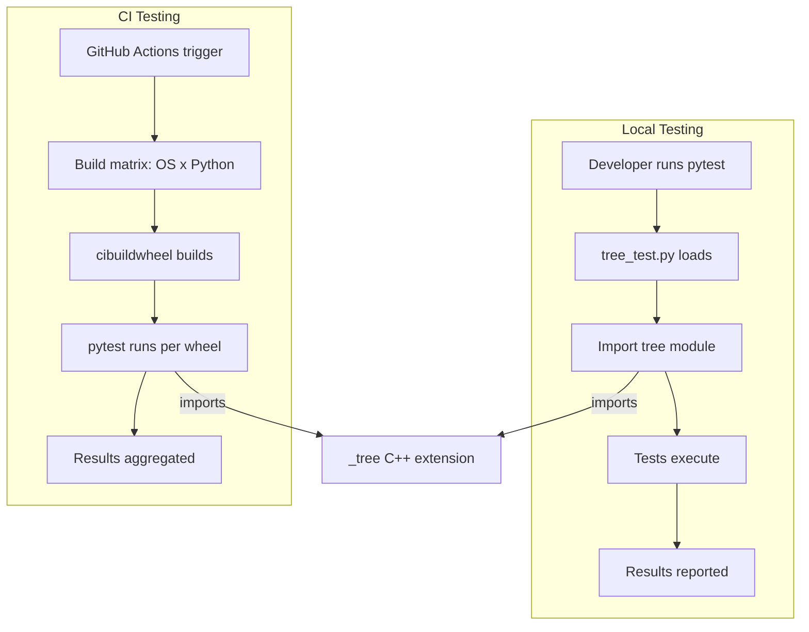
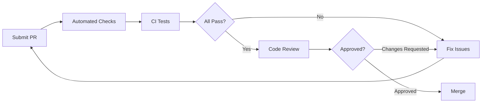

<!-- source: DeepWiki mcp.deepwiki.com · repo google-deepmind/tree · page 4 Developer Guide · fetched 2026-10-26 -->

# Developer Guide

<details>
<summary>Relevant source files</summary>

The following files were used as context for generating this wiki page:

- [CONTRIBUTING.md](CONTRIBUTING.md)
- [setup.py](setup.py)
- [tree/CMakeLists.txt](tree/CMakeLists.txt)

</details>


## Purpose and Scope

This guide is for contributors and developers who want to build, test, or modify the dm-tree library. It covers the development workflow, repository structure, build system, and testing infrastructure needed to make changes to the codebase.

For information about using dm-tree as a library, see the [User Guide](#3). For architecture details about the Python API and C++ implementation, see [Architecture](#2). For contribution policies and requirements, see [Contributing Guidelines](#5.1).

## Overview

The dm-tree project is a hybrid Python/C++ library that requires coordination between multiple build systems, testing frameworks, and distribution mechanisms. As a developer, you will interact with:

- **Python source code** in `tree/__init__.py` and `tree/sequence.py`
- **C++ source code** in `tree/tree.cc` and `tree/tree.h`
- **Build configuration** in `setup.py` and `tree/CMakeLists.txt`
- **Test suite** in `tree/tree_test.py`
- **CI/CD pipeline** defined in `.github/workflows/build.yml`

The development workflow involves building the C++ extension module, testing changes across multiple Python versions and platforms, and ensuring documentation stays synchronized.

**Sources:** Overview analysis of provided files and diagrams

## Repository Structure

### Directory Layout



**Sources:** [setup.py:1-161](), [tree/CMakeLists.txt:1-128](), [CONTRIBUTING.md:1-29]()

### Key Files and Their Roles

| File | Purpose | Developer Impact |
|------|---------|------------------|
| `setup.py` | Build orchestration, defines `CMakeExtension` and `BuildCMakeExtension` | Modify to change build behavior, dependencies, or package metadata |
| `tree/CMakeLists.txt` | CMake configuration for C++ compilation | Modify to change C++ build flags, add dependencies, or configure compilation |
| `tree/__init__.py` | Python API implementation and public interface | Add/modify Python-level functions here |
| `tree/tree.cc` | C++ implementation of performance-critical operations | Modify for C++ algorithm changes or new C++ functions |
| `tree/tree.h` | C++ header with function declarations | Add new C++ function signatures here |
| `tree/sequence.py` | Type reconstruction utilities for Python sequences | Modify to add support for new Python types |
| `tree/tree_test.py` | Main test suite | Add tests for new features or bug fixes |
| `CONTRIBUTING.md` | Contribution guidelines and CLA requirements | Review before submitting PRs |

**Sources:** [setup.py:1-161](), [tree/CMakeLists.txt:1-128](), [CONTRIBUTING.md:1-29]()

## Developer Workflow

### Development Cycle



**Sources:** [CONTRIBUTING.md:1-29](), workflow analysis from diagrams

### Build System Entry Points

The build process starts with `setup.py`, which defines two custom classes:

1. **`CMakeExtension`** [setup.py:43-52]() - Represents a Python extension built with CMake instead of distutils
2. **`BuildCMakeExtension`** [setup.py:55-117]() - Custom build command that invokes CMake to compile C++ code

When you run `pip install -e .` or `python setup.py build`, the following happens:



**Key configuration points:**

- **Python interpreter path** [setup.py:82-83]() - Ensures extension is built for the correct Python version
- **Build type** [setup.py:80]() - `Debug` or `Release` mode
- **Output directory** [setup.py:84]() - Where the compiled `.so`/`.pyd` file is placed
- **Platform-specific flags** [setup.py:87-98]() - macOS universal binary support via `CMAKE_OSX_ARCHITECTURES`

**Sources:** [setup.py:43-117](), [tree/CMakeLists.txt:1-128]()

## Build System Architecture

### Two-Stage Build Process

The dm-tree build uses a two-stage process that bridges Python packaging and C++ compilation:



**Critical implementation details:**

1. **`CMakeExtension` class** [setup.py:43-52]() - Overrides standard Extension to pass empty sources list, preventing distutils from trying to compile C++ directly

2. **`BuildCMakeExtension` class** [setup.py:55-117]() - Implements the actual build logic:
   - Checks for CMake availability [setup.py:66-75]()
   - Configures CMake with Python paths [setup.py:81-86]()
   - Handles platform-specific settings [setup.py:87-98]()
   - Runs parallel builds [setup.py:102-107]()
   - Moves output files to correct location [setup.py:111-116]()

3. **CMake configuration** [tree/CMakeLists.txt:1-128]():
   - Requires CMake 3.24+ [tree/CMakeLists.txt:4]()
   - Uses C++14 standard [tree/CMakeLists.txt:22]()
   - Enables position-independent code for Python extensions [tree/CMakeLists.txt:25]()
   - Fetches dependencies automatically [tree/CMakeLists.txt:90-110]()

For detailed information about the build system, see [Build System Architecture](#4.2).

**Sources:** [setup.py:43-117](), [tree/CMakeLists.txt:1-128]()

## Testing Infrastructure

### Test Organization

The test suite is organized in `tree/tree_test.py` and covers:

| Test Category | Coverage |
|---------------|----------|
| **Core Operations** | `flatten`, `unflatten_as`, `map_structure`, `traverse` |
| **Type Support** | `dict`, `list`, `tuple`, `namedtuple`, `attrs`, custom classes |
| **Edge Cases** | `wrapt.ObjectProxy`, `MappingProxyType`, empty structures |
| **Structure Validation** | `assert_same_structure`, type mismatch detection |
| **Path Operations** | `flatten_with_path`, `map_structure_with_path` |
| **Shallow Operations** | `flatten_up_to`, `map_structure_up_to`, `assert_shallow_structure` |

### Running Tests

```bash
# Run all tests
python -m pytest tree/tree_test.py

# Run specific test
python -m pytest tree/tree_test.py::TestTreeTest::test_flatten

# Run with verbose output
python -m pytest tree/tree_test.py -v

# Run benchmarks
python tree/tree_benchmark.py
```

### Test Execution Flow



For detailed testing procedures and benchmark information, see [Testing and Benchmarking](#4.3).

**Sources:** Analysis from provided diagrams, referenced test file

## Key Development Areas

### Adding a New Python Function

To add a new function to the Python API:

1. **Define the function** in `tree/__init__.py`
2. **Add to `__all__`** to make it public
3. **Add docstring** following NumPy/Google style
4. **Add tests** in `tree/tree_test.py`
5. **Update documentation** in `docs/api.rst` if needed

### Adding a New C++ Function

To add a new C++ function:

1. **Declare in header** `tree/tree.h`
2. **Implement in source** `tree/tree.cc`
3. **Expose via pybind11** at the bottom of `tree.cc`
4. **Import in Python** via `_tree` module in `tree/__init__.py`
5. **Add C++ and Python tests**

### Modifying Type Support

To add support for a new Python type:

1. **Update type detection** in `tree/tree.cc` (C++ level)
2. **Update reconstruction logic** in `tree/sequence.py` (Python level)
3. **Add comprehensive tests** for flatten/unflatten cycle
4. **Update documentation** with examples

### Build Configuration Changes

When modifying build configuration:

| Change Type | File to Modify | Impact |
|-------------|----------------|--------|
| Python dependencies | `setup.py` `install_requires` | Package installation requirements |
| C++ dependencies | `tree/CMakeLists.txt` `FetchContent_Declare` | Compilation dependencies |
| Compiler flags | `tree/CMakeLists.txt` `CMAKE_CXX_FLAGS` | Build optimization/debugging |
| Platform-specific settings | `setup.py` `build_extension()` | Platform compatibility |
| CMake version requirements | `tree/CMakeLists.txt` line 4 | Minimum CMake version |

**Sources:** [setup.py:119-160](), [tree/CMakeLists.txt:1-128]()

## Contribution Requirements

### Before Contributing

1. **Sign the CLA** - All contributions require a Contributor License Agreement. Visit https://cla.developers.google.com/ [CONTRIBUTING.md:7-16]()

2. **Review guidelines** - Follow Google's Open Source Community Guidelines [CONTRIBUTING.md:27-28]()

3. **Submit via PR** - All changes require code review through GitHub pull requests [CONTRIBUTING.md:19-23]()

### Code Review Process



**Sources:** [CONTRIBUTING.md:1-29]()

## Next Steps for Developers

Based on your development needs, proceed to:

- **[Development Setup](#4.1)** - Set up your local development environment and build dm-tree from source
- **[Build System Architecture](#4.2)** - Deep dive into how `setup.py` and CMake work together
- **[Testing and Benchmarking](#4.3)** - Learn about the test suite structure and how to run benchmarks
- **[CI/CD Pipeline](#4.4)** - Understand the GitHub Actions workflow that builds and publishes releases
- **[Documentation System](#4.5)** - Learn how to update and build the Sphinx documentation

For architectural understanding of the codebase itself, see:
- **[Architecture](#2)** - High-level overview of the Python/C++ architecture
- **[Python API Layer](#2.1)** - Deep dive into the Python implementation
- **[C++ Backend Implementation](#2.2)** - Detailed C++ implementation guide

**Sources:** Table of contents analysis

---

